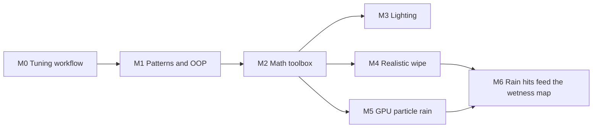

# Swish realism learning plan: lighting, wipe, GPU rain, patterns

You write the code. Each module follows the same loop. Steps 1 and 2 are reading and thinking, step 3 is hands-on, and steps 4 and 5 check and record the result:

1. Read the files and references listed for the module.
2. Before changing anything, write down what you expect to see.
3. Experiment, starting with the cheapest option: config files, then debug-UI sliders, then code.
4. Check by looking: take a window-only screenshot, at rain 0.35 and 1.0 for anything rain-related.
5. Note what you learned in `tasks/lessons.md`.

---

## M0. The tuning workflow (no code)

The debug build is your lab. Work out what you can change without touching C++ before writing any.

- Run `make debug`. The backtick key toggles between the edit panel and driving. Other keys: `R` changes rain (0 / 0.35 / 1.0), `V` changes the wiper mode, `G` changes the weather, and `C` changes the camera.
- Run the rigged car with `SWISH_CAR=blend/porsche_rigged.glb make debug`. A rigged car prints `named rig, wheelbase ...` in the load log.
- Config files you can edit:
  - [config/car.toml](config/car.toml): the `[wipers]` rates, dwell and sweep, plus the gauges.
  - [config/lie_corridor.toml](config/lie_corridor.toml): the start position (`min_start_m`, `start_min_radius_m`). Re-bake with `python3 tools/lie_corridor.py bake`.
  - [config/road.toml](config/road.toml): road dimensions and tints.
- Live tunables: [src/debug/Tunables.def](src/debug/Tunables.def). Read its header comment first; it is the recipe.
- Presets: save and load a look from the panel. Presets live in `~/.config/swish/presets/`; see [docs/debug-ui.md](docs/debug-ui.md), "TOML presets".
- Recipes to read: [docs/RECIPES.md](docs/RECIPES.md) sections add-a-tunable, add-a-shader, add-a-render-pass and add-a-test.
- How to check by looking: [.claude/skills/process/visual-verification/SKILL.md](.claude/skills/process/visual-verification/SKILL.md) and [.claude/skills/rain/rain-extremes/SKILL.md](.claude/skills/rain/rain-extremes/SKILL.md).

Exercises:
- Change the wiper rates in `car.toml`, run, and time a wipe with a stopwatch.
- Save two presets, a dry look and a wet look, then hand-edit one TOML value and reload it.
- Add one tunable by following add-a-tunable (for example a dummy `wiperFilm` float). Confirm the slider appears and that the release build doesn't change.

---

## M1. Design patterns and OOP, as this codebase uses them

Read in this order:
1. [docs/CODING_RULES.md](docs/CODING_RULES.md)
2. [docs/DESIGN_PATTERNS.md](docs/DESIGN_PATTERNS.md) (the TL;DR first)
3. [docs/FEATURE_RULES.md](docs/FEATURE_RULES.md)
4. The tutorial series in [docs/tutorials/typed-cpp/](docs/tutorials/typed-cpp/00-index.md), especially 04 and 08 (finite state machines), 07 (X-macro), 11 (RAII ownership) and 12 (pure step functions).

Patterns to find in the code:
- **Registry (X-macro list):** [src/renderer/Passes/PassList.def](src/renderer/Passes/PassList.def) and `Tunables.def`.
- **Update Method:** `IRenderPass::beginFrame`, `update` and `record` in [src/renderer/Passes/IRenderPass.h](src/renderer/Passes/IRenderPass.h).
- **Blackboard:** `FrameState`, where the rain pass publishes wetness for the passes after it.
- **Finite state machine and pure step function:** `WiperMode` and `wiper_step` in [src/scene/Entity/Wiper.h](src/scene/Entity/Wiper.h).
- **Double Buffer:** the ping-pong wetness map in [src/renderer/WindshieldRainPass/WindshieldRainPass.cpp](src/renderer/WindshieldRainPass/WindshieldRainPass.cpp).
- **RAII:** `GpuBuffer` and `GpuImage`.
- **Factory functions:** `make_rain_pass()`.
- **Facade:** `Renderer`.
- **The owner rule:** a `class` owns resources and keeps invariants (`RainSystem`); a `struct` is plain grouped data (`RainUBO`, `WiperParams`).

External references:
- Game Programming Patterns (free online): [Update Method](https://gameprogrammingpatterns.com/update-method.html), [Double Buffer](https://gameprogrammingpatterns.com/double-buffer.html), [Object Pool](https://gameprogrammingpatterns.com/object-pool.html), [Data Locality](https://gameprogrammingpatterns.com/data-locality.html), [State](https://gameprogrammingpatterns.com/state.html).
- [C++ Core Guidelines](https://isocpp.github.io/CppCoreGuidelines/CppCoreGuidelines): C.2 (class vs struct), R.1 (RAII), F.8 (prefer pure functions).
- [Refactoring Guru, design patterns](https://refactoring.guru/design-patterns) for diagrams of each pattern.

Exercises:
- Draw who calls whom for one frame of rain, from the `R` key to `rain.frag`.
- For each file you touch in M3 to M5, name the pattern it uses before editing.
- Write one pure, header-only helper with Catch2 tests, following [tests/test_wiper.cpp](tests/test_wiper.cpp). A good first one is the wiper's sweep direction from two angles.

---

## M2. Math toolbox (the realism math in the repo)

The project already has a study map: [docs/learning-path.md](docs/learning-path.md). It covers the cross-cutting math plus the Rain and Light sections.

What each piece is used for, and where it lives:
- **Exponential relaxation** $x \mathrel{+}= (x_t - x)(1 - e^{-\Delta t/\tau})$: wetness in `RainSystem::step` and auto-exposure.
- **Semi-Lagrangian advection:** `windshield_wetness.frag`, where `src = uv - flow * advect`.
- **Signed distance to a segment:** `segDist` and `wiperClear` in [shaders/windshield_wetness.frag](shaders/windshield_wetness.frag).
- **Finite-difference normals from a height field:** [shaders/windshield_rain.frag](shaders/windshield_rain.frag).
- **Fresnel and Snell:** reflectance at normal incidence is $F_0 = ((n-1)/(n+1))^2$, which is about 0.02 for water.
- **Drop sizes and fall speeds (Marshall–Palmer, Gunn–Kinzer):** [src/renderer/RainSystem/RainPhysics.h](src/renderer/RainSystem/RainPhysics.h), pinned by [tests/test_rain.cpp](tests/test_rain.cpp).
- **Beer–Lambert / Koschmieder fog:** the fog block in [shaders/lighting.frag](shaders/lighting.frag).
- **ODE integrators** (semi-implicit Euler): what the GPU particles in M5 need.
- **Monte Carlo and importance sampling:** the IBL prefilter in [shaders/ibl_prefilter.frag](shaders/ibl_prefilter.frag).

References:
- [Gaffer on Games, Integration Basics](https://gafferongames.com/post/integration_basics/)
- [Inigo Quilez, distance functions](https://iquilezles.org/articles/distfunctions2d/)
- [PBR Book (free)](https://pbr-book.org/)
- 3Blue1Brown, for intuition.

Exercises, done by hand:
- Derive the discrete relaxation formula.
- Compute $F_0$ for water and for glass.
- Compute how long the windshield takes to re-wet after a wipe at rain 0.35 and at 1.0. The rate is `0.7 * intensity` per second, minus 0.04 per second of evaporation.

---

## M3. Photoreal lighting

The big effects are already built; the gains now come from getting the values right. Overview: [docs/realism-features.md](docs/realism-features.md).

Two docs are out of date. That file's "Not built" list and [.claude/skills/realism/clearcoat-flake/SKILL.md](.claude/skills/realism/clearcoat-flake/SKILL.md) both say clearcoat doesn't exist. The code has it: `gbuffer.frag` writes `outClearcoatFlake`, and `lighting.frag` runs the clearcoat lobe.

Steps, cheapest first:
1. **Reference frames.** Gather 3 to 5 photos of a wet highway at overcast and at night. Compare luminance ratios (sky, road, paint, cabin) against screenshots.
2. **Sky and sun.** Use the sky and sun sliders in the debug panel. The code is `compute_sky_color` and the `SP_SKY_*` and `SP_SUN_DISC_*` values in `lighting.frag`. Exercise: in a scratch shader, compare the current gradient with the CIE overcast curve $L = L_z(1+2\cos\theta)/3$.
3. **Fog.** In release, `SP_FOG_MAX` is `0.0`, so distance fog is off. Find a good value in the debug Fog panel and judge it at both rain levels.
4. **Wet surfaces.** The `wetPorosity`, `wetRoughness` and `puddleCoverage` tunables, plus `wetSheen` in `lighting.frag`. Check the reflectance against the 0.02 for water.
5. **Reflections.** The IBL diffuse and specular tunables, and the SSR group in `Tunables.def`.
6. **Exposure and tone.** AgX in [shaders/composite.frag](shaders/composite.frag). Auto-exposure is debug-only, so release uses a fixed exposure.
7. **Night glare.** The rainy halo near line 525 of `lighting.frag` and the bloom pass. The car lights panel needs the rigged car.

References:
- Karis, [Real Shading in Unreal Engine 4](https://cdn2.unrealengine.com/Resources/files/2013SiggraphPresentationsNotes-26915738.pdf) (course notes).
- Lagarde and de Rousiers, [Moving Frostbite to PBR 3.0](https://media.contentapi.ea.com/content/dam/eacom/frostbite/files/course-notes-moving-frostbite-to-pbr-v32.pdf). Read section 4.3 on light units and section 5 on the physically based camera.
- Lagarde, [Water drop 3b: physically based wet surfaces](https://seblagarde.wordpress.com/2013/04/14/water-drop-3b-physically-based-wet-surfaces/).
- Hillaire, [Production ready sky and atmosphere](https://sebh.github.io/publications/egsr2020.pdf).
- [SIGGRAPH 2013 shading course index](https://blog.selfshadow.com/publications/s2013-shading-course/).

---

## M4. Realistic wipe, rigged Porsche only

The chain is: `V` key, then [src/core/App/App.cpp](src/core/App/App.cpp) `App::update_wiper`, then `Wiper.h`, then [src/scene/Entity/WiperBlade.h](src/scene/Entity/WiperBlade.h), then `WindshieldRainPass::update_wiper`, then `windshield_wetness.frag`, then `windshield_rain.frag`.

Steps:
1. **Pure helper and tests.** Write a function for the sweep direction (the angle rises for phase in [0, 0.5) and falls after) and for the pile release at park. Add tests in `tests/test_wiper.cpp`.
2. **More channels in the wetness map.** Change `m_wetFormat` from `VK_FORMAT_R16_SFLOAT` to `VK_FORMAT_R16G16B16A16_SFLOAT`. Use R for the film, G for the pile, and B for the wipe generation. The B-to-A copy carries every channel automatically.
3. **Residual film.** Replace line 87 of `windshield_wetness.frag`, `w *= 1 - wiperClear(...)`, with a floor of about 0.1 to 0.3, plus streak noise along the arc.
4. **Water pile.** Accumulate water in a band ahead of the blade, scaled by intensity. At park, release it into the run-off so it flows down with the existing advection.
5. **Re-seeded drops.** Stamp the generation into channel B where the blade swept. In `windshield_rain.frag`, hash that generation into `N()` and `N13()`. Half floats are exact only up to 2048, so wrap the generation (for example mod 64).
6. **Rubber line.** Pass the projected blade segments through `WindshieldRainUBO` as a new vec4 row, then add smear and refraction near the blade.
7. **Keep the default car unchanged.** Branch on rigged blades, `bladeCount` with `m_sdfBlade == false`.
8. **Constraints.** `WetnessPush` must stay a multiple of 16 bytes (it has a `static_assert`, currently 112). The shader changes alter two hashes in [tests/golden/release_spv.sha256](tests/golden/release_spv.sha256), so update them deliberately, with a changelog entry.

References:
- [olivierprat/rain-on-windshield](https://github.com/olivierprat/rain-on-windshield): wiper plus flow maps.
- [Heartfelt shader](https://www.shadertoy.com/view/ltffzl): the drop model already used here.
- Tatarchuk, [Rain rendering, SIGGRAPH 2006](https://advances.realtimerendering.com/s2006/Tatarchuk-Rain.pdf).
- Lagarde, [Water drop 2a](https://seblagarde.wordpress.com/2012/12/27/water-drop-2a-dynamic-rain-and-its-effects/), which also covers drops on the camera lens.
- [docs/car-rig.md](docs/car-rig.md) section 3, and Part 3 of [docs/rain/README.md](docs/rain/README.md).

---

## M5. GPU particle rain (compute shader, stateful drops)

Today [src/renderer/RainSystem/RainSystem.cpp](src/renderer/RainSystem/RainSystem.cpp) draws 8192 stateless streaks, animated in [shaders/rain.vert](shaders/rain.vert). The template for stateful particles is `SpraySystem`: [src/renderer/SpraySystem/SpraySystem.cpp](src/renderer/SpraySystem/SpraySystem.cpp) and [shaders/spray_sim.comp](shaders/spray_sim.comp). It has an SSBO, a compute pass, and a compute-to-vertex barrier.

Steps:
1. **Study the spray system.** Trace its compute pass, the `record_compute` barrier, and how the draw half finds the compute half.
2. **Design the particle struct.** For example `{vec4 posLife; vec4 velSize; vec4 seedDia;}`, 48 bytes, with std430 in GLSL and a matching `static_assert` in C++.
3. **Build it dark.** Following FEATURE_RULES, make a new `RainSim` pass registered as `PASS_DEBUG` with a toggle, next to the current rain. Compare the two side by side.
4. **The compute step.** Relax each drop's velocity toward wind plus the Gunn–Kinzer terminal speed, integrate the position, and respawn when life runs out or the drop hits the road plane (`road_y`). Move the Marshall–Palmer and Gunn–Kinzer functions into `shaders/common/` so `rain.vert` and the compute shader share one copy.
5. **Store positions camera-relative.** `SpraySystem` has no origin-rebase handling (I found none; its 1.5 s lifetime hides the jump). Rain drops live longer, so store them relative to the camera.
6. **Draw.** Change `rain.vert` to read the SSBO, keep the two parallax layers or replace them, and scale the live count with intensity.
7. **Collisions later.** Test against the windshield plane in car space, and write impacts into a buffer that the wetness pass reads. That is M6.

References:
- [Vulkan Tutorial, compute shader particles](https://vulkan-tutorial.com/en/Compute_Shader).
- [Khronos synchronization examples](https://docs.vulkan.org/guide/latest/synchronization_examples.html), the compute-to-graphics section.
- Garg and Nayar, [Photorealistic rendering of rain streaks](https://www.cs.columbia.edu/CAVE/publications/pdfs/Garg_TOG06.pdf), and the [CAVE rain streak database](https://cave.cs.columbia.edu/repository/Rain).
- NVIDIA, [Rain SDK whitepaper](https://developer.download.nvidia.com/whitepapers/2007/SDK10/RainSDKWhitePaper.pdf), a GPU particle rain design.
- Lagarde, [Water drop 2b](https://seblagarde.wordpress.com/2013/01/03/water-drop-2b-dynamic-rain-and-its-effects/), for splashes and puddles.

---

## M6. Rain hits feed the wetness map (capstone)

Particle impacts on the windshield are added into the wetness map, so drops appear where rain actually lands. This replaces the uniform `0.7 * intensity` gain. Do this only after M4 and M5 both work.

---

## Done criteria for every module

- `make test` and `make test-debug` pass.
- Window-only screenshots at rain 0.35 and 1.0. Revert any temporary forced values afterwards.
- The release build is unchanged, or the change is intended, with the golden hashes updated deliberately.
- A changelog entry in `docs/changelog/2026-10.md`, then run `python3 scripts/changelog_index.py`.
- Update the docs you used, including fixing the stale clearcoat statements.