# 🎨 Obsidian Visual Toolkit — LaTeX, Mermaid & Markdown

A copy-paste reference for **explaining your thinking** in math, programming, and software work.

Everything here renders **natively** in Obsidian (no plugins) unless noted.

> [!info] How to read this file Each trick appears **twice**: first the fenced code block you copy, then the **live rendered version** right below it so you can see the result. In your own notes, keep only the rendered `$$...$$` or ` ```mermaid ` block.
> 
> **Render shortcut:** toggle Reading View with **Cmd/Ctrl + E**.

---

# PART 1 · COLOR IN LATEX

Obsidian runs **MathJax v3**, which uses the LaTeX-style form `\textcolor{name}{content}`. If color ever shows as plain white, you used the old `{\color red ...}` syntax by mistake.

## Basic colored math

```latex
$$
\textcolor{red}{a^2} + \textcolor{blue}{b^2} = \textcolor{green}{c^2}
$$
```

$$ \textcolor{red}{a^2} + \textcolor{blue}{b^2} = \textcolor{green}{c^2} $$

## Highlight a term inside a derivation

```latex
$$
\frac{d}{dx}\left[ \textcolor{red}{x^2} \right] = \textcolor{red}{2x}
$$
```

$$ \frac{d}{dx}\left[ \textcolor{red}{x^2} \right] = \textcolor{red}{2x} $$

## Colored box (draws the eye)

```latex
$$
\colorbox{yellow}{$E = mc^2$}
$$
```

$$ \colorbox{yellow}{$E = mc^2$} $$

## Framed colored box

```latex
$$
\fcolorbox{red}{white}{$\displaystyle \int_a^b f(x)\,dx = F(b) - F(a)$}
$$
```

$$ \fcolorbox{red}{white}{$\displaystyle \int_a^b f(x),dx = F(b) - F(a)$} $$

## Custom RGB color

```latex
$$
\definecolor{myteal}{RGB}{0,150,150}
\textcolor{myteal}{\text{Custom teal text!}}
$$
```

$$ \definecolor{myteal}{RGB}{0,150,150} \textcolor{myteal}{\text{Custom teal text!}} $$

**Named colors that work:** `red, blue, green, orange, purple, magenta, cyan, teal, olive, brown, pink, gray, black, white`

---

# PART 2 · LATEX VISUAL TRICKS

## Color-coded proof steps

```latex
$$
\begin{array}{ll}
\textcolor{blue}{\text{Given:}} & 2q^2 = p^2 \\
\textcolor{green}{\text{So:}} & p^2 \text{ is even} \\
\textcolor{green}{\text{Thus:}} & p \text{ is even} \\
\textcolor{red}{\text{Contradiction:}} & \gcd(p,q) \geq 2
\end{array}
$$
```

$$ \begin{array}{ll} \textcolor{blue}{\text{Given:}} & 2q^2 = p^2 \ \textcolor{green}{\text{So:}} & p^2 \text{ is even} \ \textcolor{green}{\text{Thus:}} & p \text{ is even} \ \textcolor{red}{\text{Contradiction:}} & \gcd(p,q) \geq 2 \end{array} $$

## Highlighted definition box

```latex
$$
\boxed{\begin{array}{l}
\textbf{Definition: Limit} \\
\displaystyle \lim_{x \to a} f(x) = L \iff \\
\forall \epsilon > 0,\ \exists \delta > 0:\ 0 < |x-a| < \delta \implies |f(x)-L| < \epsilon
\end{array}}
$$
```

$$ \boxed{\begin{array}{l} \textbf{Definition: Limit} \ \displaystyle \lim_{x \to a} f(x) = L \iff \ \forall \epsilon > 0,\ \exists \delta > 0:\ 0 < |x-a| < \delta \implies |f(x)-L| < \epsilon \end{array}} $$

## Underbrace / overbrace (annotate parts)

```latex
$$
\underbrace{a + b + c}_{\text{sum}} = \overbrace{3\bar{x}}^{\text{mean} \times n}
$$
```

$$ \underbrace{a + b + c}_{\text{sum}} = \overbrace{3\bar{x}}^{\text{mean} \times n} $$

## Cancel terms (show simplification)

```latex
$$
\require{cancel}
\frac{\cancel{6}x}{\cancel{6}} = x
$$
```

$$ \require{cancel} \frac{\cancel{6}x}{\cancel{6}} = x $$

## Aligned equations with side notes

```latex
$$
\begin{align}
(x+y)^2 &= (x+y)(x+y) && \text{expand} \\
&= x^2 + 2xy + y^2 && \text{FOIL}
\end{align}
$$
```

$$ \begin{align} (x+y)^2 &= (x+y)(x+y) && \text{expand} \ &= x^2 + 2xy + y^2 && \text{FOIL} \end{align} $$

## Piecewise function

```latex
$$
f(x) = \begin{cases}
x^2 & \text{if } x \geq 0 \\
-x & \text{if } x < 0
\end{cases}
$$
```

$$ f(x) = \begin{cases} x^2 & \text{if } x \geq 0 \ -x & \text{if } x < 0 \end{cases} $$

## Matrix equation

```latex
$$
\begin{pmatrix} a & b \\ c & d \end{pmatrix}
\begin{pmatrix} x \\ y \end{pmatrix}
=
\begin{pmatrix} ax + by \\ cx + dy \end{pmatrix}
$$
```

# $$ \begin{pmatrix} a & b \ c & d \end{pmatrix} \begin{pmatrix} x \ y \end{pmatrix}

\begin{pmatrix} ax + by \ cx + dy \end{pmatrix} $$

## Truth table

```latex
$$
\begin{array}{|c|c|c|c|}
\hline
p & q & p \land q & p \lor q \\
\hline
T & T & T & T \\
T & F & F & T \\
F & T & F & T \\
F & F & F & F \\
\hline
\end{array}
$$
```

$$ \begin{array}{|c|c|c|c|} \hline p & q & p \land q & p \lor q \ \hline T & T & T & T \ T & F & F & T \ F & T & F & T \ F & F & F & F \ \hline \end{array} $$

## Complexity ladder

```latex
$$
O(1) < O(\log n) < O(n) < O(n \log n) < O(n^2) < O(2^n) < O(n!)
$$
```

$$ O(1) < O(\log n) < O(n) < O(n \log n) < O(n^2) < O(2^n) < O(n!) $$

---

# PART 3 · MERMAID DIAGRAMS

Wrap each in a fence whose first line is `mermaid`. The four-backtick wrapper below is only so you can see the code — in your notes, use a normal three-backtick ` ```mermaid ` block.

## Flowchart (decision logic)

````
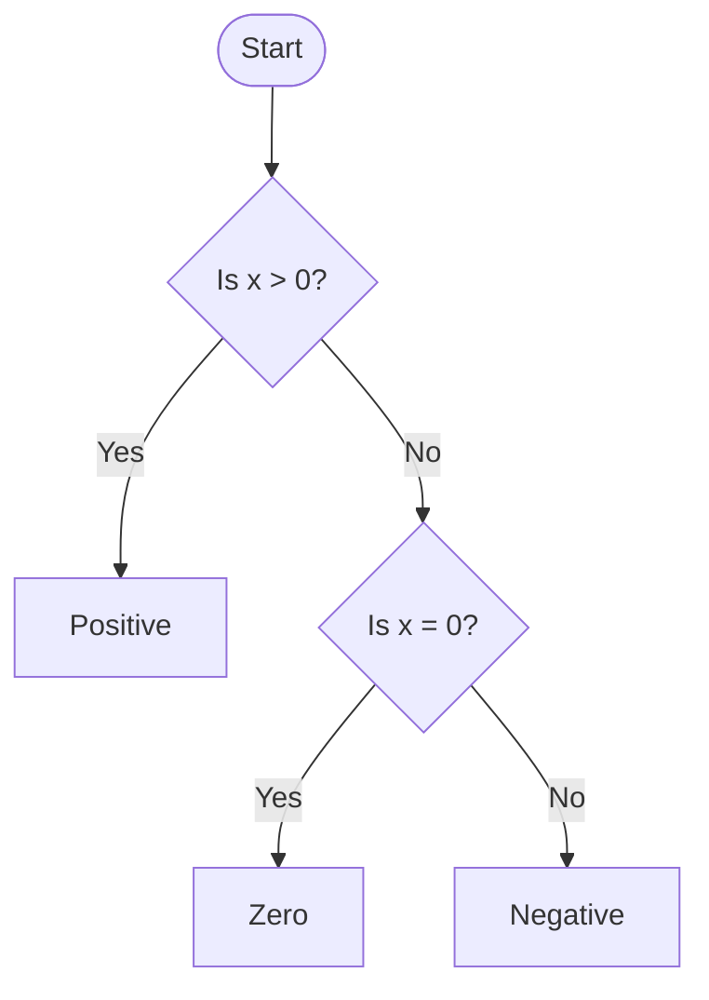
````


## Flowchart with color styling + node shapes

````
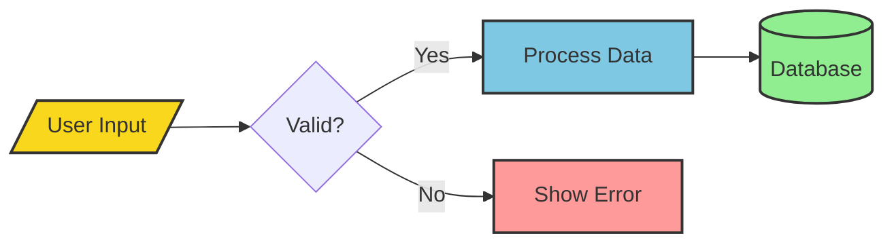
````


> [!tip] Node shape cheat sheet `[ ]` rectangle · `( )` rounded · `([ ])` stadium · `[( )]` database/cylinder · `{ }` diamond (decision) · `[/ /]` parallelogram (I/O) · `(( ))` circle

## Sequence diagram (API / service calls over time)

````
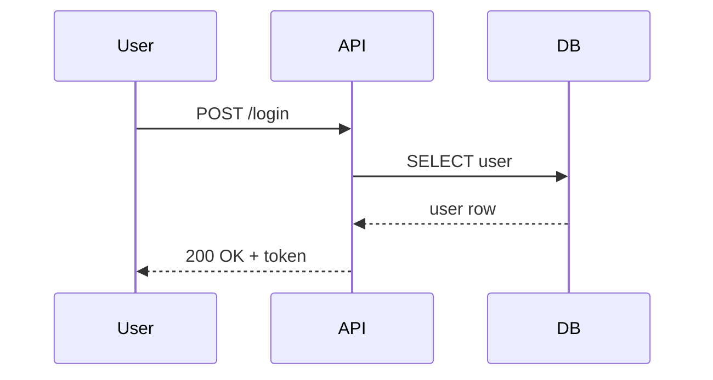
````


## State diagram (lifecycle / DFA)

````
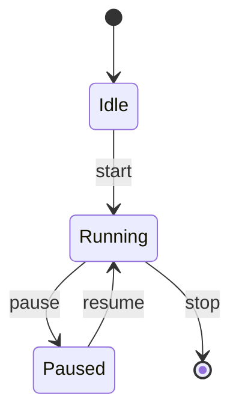
````


## Class diagram (OOP structure)

````
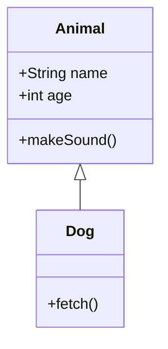
````


## Entity-Relationship diagram (database schema)

````
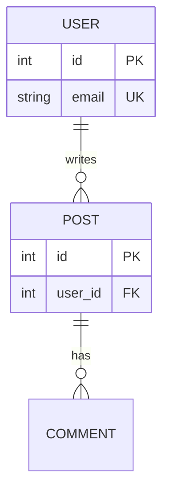
````


## Mind map (brainstorming / concept map)

````
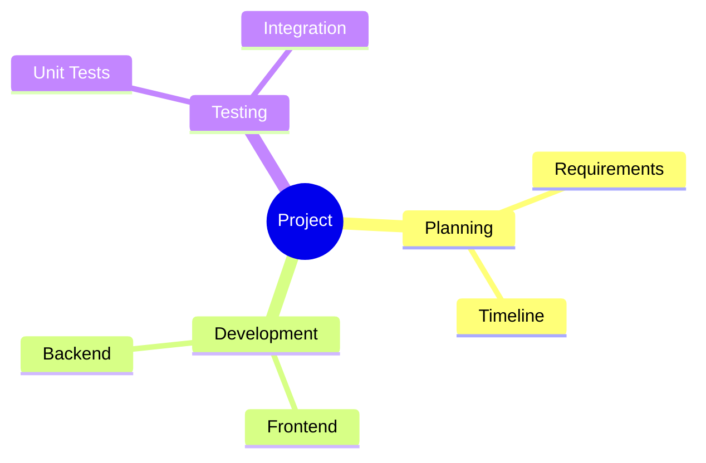
````


## Gantt chart (project timeline)

````
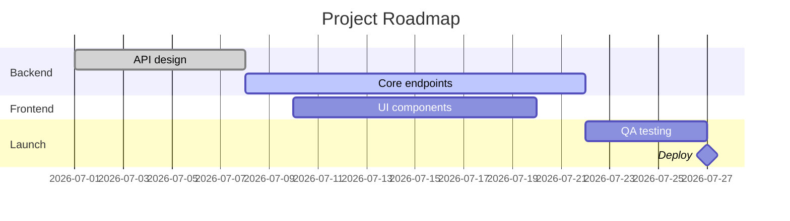
````


## Pie chart (proportions)

````
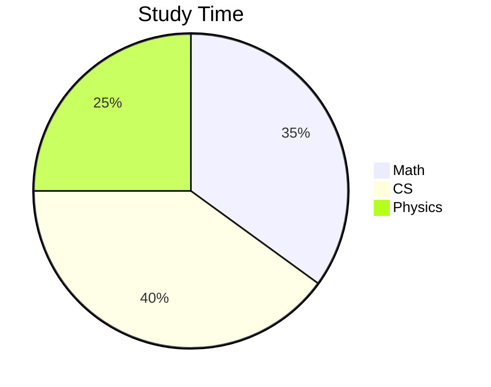
````


## Git graph (branch history)

````
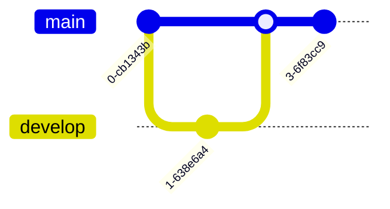
````

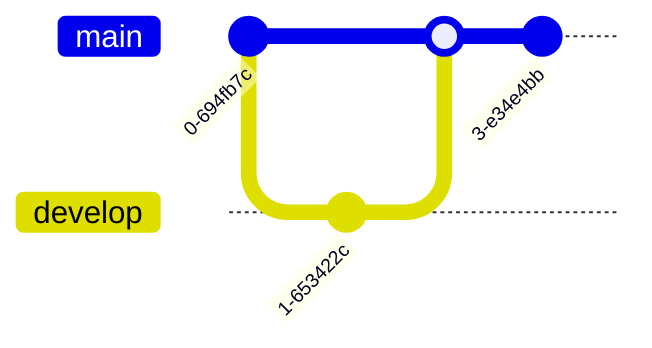

## Quadrant chart (2×2 prioritization)

````
```mermaid
quadrantChart
    title Effort vs Impact
    x-axis Low Effort --> High Effort
    y-axis Low Impact --> High Impact
    quadrant-1 Do First
    quadrant-2 Plan
    quadrant-3 Delegate
    quadrant-4 Eliminate
    Task A: [0.3, 0.8]
    Task B: [0.7, 0.6]
```
````

```mermaid
quadrantChart
    title Effort vs Impact
    x-axis Low Effort --> High Effort
    y-axis Low Impact --> High Impact
    quadrant-1 Do First
    quadrant-2 Plan
    quadrant-3 Delegate
    quadrant-4 Eliminate
    Task A: [0.3, 0.8]
    Task B: [0.7, 0.6]
```

---

# PART 4 · STORYTELLING DIAGRAMS (great for narrating ideas)

These are the ones that turn notes into a **story** — evolution over time, a user's experience, or a system at different zoom levels.

## Timeline (chronology / evolution of a concept)

````
```mermaid
timeline
    title Evolution of Web Development
    1990s : HTML/CSS
    2000s : JavaScript
          : jQuery
    2010s : Single Page Apps
          : React / Vue / Angular
    2020s : Modern Meta-frameworks
```
````

```mermaid
timeline
    title Evolution of Web Development
    1990s : HTML/CSS
    2000s : JavaScript
          : jQuery
    2010s : Single Page Apps
          : React / Vue / Angular
    2020s : Modern Meta-frameworks
```

## User journey (experience, rated by satisfaction 1–5)

````
```mermaid
journey
    title My Debugging Session
    section Investigate
      Read error log: 3: Me
      Reproduce bug: 2: Me
    section Fix
      Write patch: 4: Me
      Run tests: 5: Me, CI
    section Ship
      Open PR: 5: Me
```
````

```mermaid
journey
    title My Debugging Session
    section Investigate
      Read error log: 3: Me
      Reproduce bug: 2: Me
    section Fix
      Write patch: 4: Me
      Run tests: 5: Me, CI
    section Ship
      Open PR: 5: Me
```

## C4 context diagram (software architecture at a glance)

````
```mermaid
C4Context
    title System Context — Banking App
    Person(customer, "Customer", "Uses the app")
    System(banking, "Banking System", "Handles accounts & payments")
    System_Ext(email, "Email System", "Sends notifications")
    Rel(customer, banking, "Uses")
    Rel(banking, email, "Sends emails via")
```
````

```mermaid
C4Context
    title System Context — Banking App
    Person(customer, "Customer", "Uses the app")
    System(banking, "Banking System", "Handles accounts & payments")
    System_Ext(email, "Email System", "Sends notifications")
    Rel(customer, banking, "Uses")
    Rel(banking, email, "Sends emails via")
```

## Block diagram (system layout with grouping)

````
```mermaid
block-beta
    columns 3
    Frontend["Frontend (React)"]:3
    API["API Gateway"] Auth["Auth Service"] Cache["Redis Cache"]
    DB[("Database")]:3
    Frontend --> API
    API --> Auth
    API --> Cache
    Auth --> DB
```
````

```mermaid
block-beta
    columns 3
    Frontend["Frontend (React)"]:3
    API["API Gateway"] Auth["Auth Service"] Cache["Redis Cache"]
    DB[("Database")]:3
    Frontend --> API
    API --> Auth
    API --> Cache
    Auth --> DB
```

> [!note] If a newer diagram type won't render `timeline`, `journey`, `C4Context`, and `block-beta` need a reasonably recent Obsidian. If one stays as plain text, update Obsidian to the latest version.

---

# PART 5 · OBSIDIAN MARKDOWN TRICKS

Native features that make notes readable and navigable — no math required.

## Callouts (colored, titled boxes)

```
> [!tip] Remember this
> The derivative of $e^x$ is $e^x$ itself.

> [!warning] Common mistake
> $\sqrt{a^2 + b^2} \neq a + b$

> [!example]- Click to expand (folded by default)
> Hidden until you click, thanks to the `-`.
```

> [!tip] Remember this The derivative of $e^x$ is $e^x$ itself.

> [!warning] Common mistake $\sqrt{a^2 + b^2} \neq a + b$

> [!example]- Click to expand (folded by default) Hidden until you click, thanks to the `-`.

**All types:** `note, abstract, info, tip, success, question, warning, failure, danger, bug, example, quote` **Folding:** add `-` for collapsed, `+` for expanded by default.

## Tables with column alignment

```
| Algorithm      | Time       | Space  |
| :------------- | :--------: | -----: |
| Linear Search  | O(n)       | O(1)   |
| Binary Search  | O(log n)   | O(1)   |
| Merge Sort     | O(n log n) | O(n)   |
```

|Algorithm|Time|Space|
|:--|:-:|--:|
|Linear Search|O(n)|O(1)|
|Binary Search|O(log n)|O(1)|
|Merge Sort|O(n log n)|O(n)|

> `:---` left · `:---:` center · `---:` right. Tip: install the **Advanced Tables** community plugin for Tab-key navigation, auto-formatting, sorting, and even spreadsheet-style formulas.

## Highlight, bold, italic, strikethrough

```
==highlighted== **bold** *italic* ***both*** ~~struck through~~
```

==highlighted== **bold** _italic_ _**both**_ ~~struck through~~

## Task lists (checkboxes)

```
- [x] Write proof
- [ ] Add diagram
- [ ] Review notes
```

- [x] Write proof
- [ ] Add diagram
- [ ] Review notes

## Footnotes (great for citations / asides)

```
Euler's identity is beautiful.[^euler]

[^euler]: $e^{i\pi} + 1 = 0$ links five fundamental constants.
```

Euler's identity is beautiful.[^euler]

[^euler]: $e^{i\pi} + 1 = 0$ links five fundamental constants.

## Comments (invisible in reading view)

```
Visible text %%this note only shows in source mode%% more visible text.
```

Visible text %%this note only shows in source mode%% more visible text.

## Wikilinks, embeds & block references (connect your notes)

```
[[Sorting Algorithms]]            ← link to another note
[[Sorting Algorithms#Merge Sort]] ← link to a heading
![[Sorting Algorithms#Merge Sort]] ← EMBED that section inline
![[diagram.png|300]]              ← embed image at 300px wide
```

These are Obsidian-specific. The `!` turns a link into a live **embed** — pull a proof, diagram, or definition from one note into another and it updates automatically.

## Frontmatter (metadata at the very top of a note)

```
---
title: Proof — √2 is irrational
tags:
  - math
  - proofs
status: complete
---
```

Must be the first thing in the file. Shows up in the Properties panel and powers search, tags, and Dataview queries.

## Fenced code with syntax highlighting

````
```python
def gcd(a, b):
    while b:
        a, b = b, a % b
    return a
```
````

```python
def gcd(a, b):
    while b:
        a, b = b, a % b
    return a
```

---

# PART 6 · PUTTING IT TOGETHER — a worked "explain my thinking" note

This is how you'd narrate a single idea end-to-end using several tricks at once.

> [!abstract] Goal Explain **why binary search is O(log n)**.

**1. The intuition** — each step halves the search space:

```mermaid
flowchart LR
    A["n items"] --> B["n/2"] --> C["n/4"] --> D["..."] --> E["1"]
```

**2. The math** — how many halvings to reach 1 element? $$ \frac{n}{2^k} = 1 \implies 2^k = n \implies k = \textcolor{red}{\log_2 n} $$

**3. The comparison:**

|Search|Comparisons (worst case)|
|:--|:-:|
|Linear|$n$|
|Binary|$\log_2 n$|

> [!success] Takeaway Halving each step means the work grows with the **logarithm** of the input, not the input itself.

---

# QUICK TROUBLESHOOTING

- **Math not rendering?** `$...$` inline, `$$...$$` on their own lines (blank line before/after `$$`).
- **Color shows white?** Use `\textcolor{red}{x}`, not `{\color red x}`.
- **Mermaid stays as text?** The fence's first line must be exactly `mermaid`; the second line needs a valid keyword (`flowchart`, `sequenceDiagram`, `timeline`, ...). Quote labels with punctuation: `A["Review: blocked?"]`.
- **Callout/table looks wrong?** Add a blank line _before_ it, and check every `|` and `#` that needs escaping.
- **Newer diagram unsupported?** Update Obsidian — it ships a bundled Mermaid version that grows with each release.


# 🚗⚙️ Obsidian Toolkit II — Physics (Cars), Code Proofs & Code Diagrams

New content to drop into Obsidian. Native tricks work with **no plugins**; anything needing a plugin is flagged.

> [!info] Two rendering engines you'll use here
> 
> - **MathJax** (built in) — for `$...$` equations.
> - **Raw SVG** (built in) — Obsidian renders inline `<svg>` in **Reading View**, so labeled diagrams work with no plugin. If an SVG ever shows as source, save it as `car.svg` and embed with `![[car.svg]]`.
> - **TikZJax** (plugin) — for publication-grade physics figures (free-body diagrams, circuits, plots). Install _TikZJax_ from Community Plugins, then use ` ```tikz ` blocks.

---

# PART 1 · CAR PHYSICS — EQUATION REFERENCE BOXES

Color-coded so each force/energy concept is instantly recognizable.

## Newton's second law (the master equation)

```latex
$$
\boxed{\;\textcolor{teal}{\sum \vec{F}} = m\,\vec{a}\;}
$$
```

$$ \boxed{;\textcolor{teal}{\sum \vec{F}} = m,\vec{a};} $$

## Aerodynamic drag (why speed kills range)

```latex
$$
\textcolor{blue}{F_d} = \tfrac{1}{2}\,\rho\,v^2\,C_d\,A
$$
```

$$ \textcolor{blue}{F_d} = \tfrac{1}{2},\rho,v^2,C_d,A $$

> Drag grows with the **square** of velocity — double the speed, quadruple the drag.

## Tire friction (grip)

```latex
$$
\textcolor{green}{f} \le \mu\,N \qquad N = mg
$$
```

$$ \textcolor{green}{f} \le \mu,N \qquad N = mg $$

## Braking — kinetic energy and stopping distance

```latex
$$
\textcolor{red}{KE} = \tfrac{1}{2} m v^2
\qquad
d_{\text{brake}} = \frac{v^2}{2\,\mu\,g}
$$
```

$$ \textcolor{red}{KE} = \tfrac{1}{2} m v^2 \qquad d_{\text{brake}} = \frac{v^2}{2,\mu,g} $$

> Stopping distance also scales with $v^2$ — that's why speed limits matter.

## Engine power

```latex
$$
\textcolor{orange}{P} = F \cdot v = \tau \,\omega
$$
```

$$ \textcolor{orange}{P} = F \cdot v = \tau ,\omega $$

## Suspension (Hooke's law) and momentum

```latex
$$
\textcolor{purple}{F_{\text{spring}}} = -k\,x
\qquad
\vec{p} = m\vec{v}
\qquad
\vec{F} = \frac{d\vec{p}}{dt}
$$
```

$$ \textcolor{purple}{F_{\text{spring}}} = -k,x \qquad \vec{p} = m\vec{v} \qquad \vec{F} = \frac{d\vec{p}}{dt} $$

## Car on an incline (hill)

```latex
$$
F_{\parallel} = mg\sin\theta
\qquad
N = mg\cos\theta
$$
```

$$ F_{\parallel} = mg\sin\theta \qquad N = mg\cos\theta $$

---

# PART 2 · THE LABELED CAR DIAGRAM (native SVG — no plugin)

This is a side-view car where **each part is annotated with the equation it obeys**. Paste the whole `svg-less` block below directly into a note — Obsidian renders raw SVG in Reading View. (Colors are chosen to read on both light and dark themes.)

```
<svg xmlns="http://www.w3.org/2000/svg" viewBox="0 0 780 500" font-family="sans-serif">
  <defs>
    <marker id="ah" markerWidth="9" markerHeight="9" refX="7" refY="3" orient="auto">
      <path d="M0,0 L7,3 L0,6 Z" fill="#888"/>
    </marker>
  </defs>

  <!-- title -->
  <text x="390" y="34" text-anchor="middle" font-size="20" font-weight="bold" fill="#2e86c1">Forces on a Car — and the equations behind them</text>

  <!-- ground -->
  <line x1="40" y1="380" x2="740" y2="380" stroke="#888" stroke-width="2"/>

  <!-- airflow arrows over the roof -->
  <line x1="150" y1="215" x2="235" y2="215" stroke="#2e86c1" stroke-width="2" marker-end="url(#ah)"/>
  <line x1="150" y1="240" x2="215" y2="240" stroke="#2e86c1" stroke-width="2" marker-end="url(#ah)"/>

  <!-- car body -->
  <rect x="210" y="300" width="360" height="60" rx="18" fill="#4a90d9" stroke="#2c3e50" stroke-width="2"/>
  <polygon points="285,300 335,252 470,252 520,300" fill="#6aa9e9" stroke="#2c3e50" stroke-width="2"/>
  <polygon points="298,298 338,262 398,262 398,298" fill="#cfe6ff" stroke="#2c3e50" stroke-width="1"/>
  <polygon points="408,298 408,262 462,262 505,298" fill="#cfe6ff" stroke="#2c3e50" stroke-width="1"/>

  <!-- Newton's law inside body -->
  <text x="390" y="337" text-anchor="middle" font-size="17" font-weight="bold" fill="#ffffff">ΣF = m a</text>

  <!-- wheels -->
  <circle cx="290" cy="342" r="38" fill="#2b2b2b" stroke="#aaa" stroke-width="3"/>
  <circle cx="290" cy="342" r="14" fill="#777"/>
  <circle cx="490" cy="342" r="38" fill="#2b2b2b" stroke="#aaa" stroke-width="3"/>
  <circle cx="490" cy="342" r="14" fill="#777"/>

  <!-- Drag callout -->
  <text x="390" y="150" text-anchor="middle" font-size="15" font-weight="bold" fill="#2e86c1">Aerodynamics → Drag</text>
  <text x="390" y="172" text-anchor="middle" font-size="14" fill="#2e86c1">Fd = ½ ρ v² Cd A</text>
  <line x1="390" y1="182" x2="405" y2="250" stroke="#2e86c1" stroke-width="1.5"/>
  <circle cx="405" cy="250" r="3" fill="#2e86c1"/>

  <!-- Engine callout -->
  <text x="598" y="150" font-size="15" font-weight="bold" fill="#b9770e">Engine → Power</text>
  <text x="598" y="172" font-size="14" fill="#b9770e">P = F · v = τ ω</text>
  <line x1="640" y1="182" x2="560" y2="315" stroke="#b9770e" stroke-width="1.5"/>
  <circle cx="560" cy="315" r="3" fill="#b9770e"/>

  <!-- Suspension callout -->
  <text x="182" y="150" text-anchor="end" font-size="15" font-weight="bold" fill="#6c3483">Suspension</text>
  <text x="182" y="172" text-anchor="end" font-size="14" fill="#6c3483">F = − k x</text>
  <line x1="150" y1="182" x2="285" y2="306" stroke="#6c3483" stroke-width="1.5"/>
  <circle cx="285" cy="306" r="3" fill="#6c3483"/>

  <!-- Tires / friction callout -->
  <text x="70" y="430" font-size="15" font-weight="bold" fill="#1e8449">Tires → Friction</text>
  <text x="70" y="452" font-size="14" fill="#1e8449">f ≤ μ N</text>
  <line x1="150" y1="440" x2="272" y2="374" stroke="#1e8449" stroke-width="1.5"/>
  <circle cx="272" cy="374" r="3" fill="#1e8449"/>

  <!-- Brakes / KE callout -->
  <text x="590" y="430" font-size="15" font-weight="bold" fill="#c0392b">Brakes → Kinetic Energy</text>
  <text x="590" y="452" font-size="14" fill="#c0392b">KE = ½ m v²   ·   d = v²/(2μg)</text>
  <line x1="640" y1="418" x2="508" y2="374" stroke="#c0392b" stroke-width="1.5"/>
  <circle cx="508" cy="374" r="3" fill="#c0392b"/>
</svg>
```

**Rendered (this block will actually display the car in Obsidian):** <svg xmlns="http://www.w3.org/2000/svg" viewBox="0 0 780 500" font-family="sans-serif"> <defs> <marker id="ah" markerWidth="9" markerHeight="9" refX="7" refY="3" orient="auto"> <path d="M0,0 L7,3 L0,6 Z" fill="#888"/> </marker> </defs> <text x="390" y="34" text-anchor="middle" font-size="20" font-weight="bold" fill="#2e86c1">Forces on a Car — and the equations behind them</text> <line x1="40" y1="380" x2="740" y2="380" stroke="#888" stroke-width="2"/> <line x1="150" y1="215" x2="235" y2="215" stroke="#2e86c1" stroke-width="2" marker-end="url(#ah)"/> <line x1="150" y1="240" x2="215" y2="240" stroke="#2e86c1" stroke-width="2" marker-end="url(#ah)"/> <rect x="210" y="300" width="360" height="60" rx="18" fill="#4a90d9" stroke="#2c3e50" stroke-width="2"/> <polygon points="285,300 335,252 470,252 520,300" fill="#6aa9e9" stroke="#2c3e50" stroke-width="2"/> <polygon points="298,298 338,262 398,262 398,298" fill="#cfe6ff" stroke="#2c3e50" stroke-width="1"/> <polygon points="408,298 408,262 462,262 505,298" fill="#cfe6ff" stroke="#2c3e50" stroke-width="1"/> <text x="390" y="337" text-anchor="middle" font-size="17" font-weight="bold" fill="#ffffff">ΣF = m a</text> <circle cx="290" cy="342" r="38" fill="#2b2b2b" stroke="#aaa" stroke-width="3"/> <circle cx="290" cy="342" r="14" fill="#777"/> <circle cx="490" cy="342" r="38" fill="#2b2b2b" stroke="#aaa" stroke-width="3"/> <circle cx="490" cy="342" r="14" fill="#777"/> <text x="390" y="150" text-anchor="middle" font-size="15" font-weight="bold" fill="#2e86c1">Aerodynamics → Drag</text> <text x="390" y="172" text-anchor="middle" font-size="14" fill="#2e86c1">Fd = ½ ρ v² Cd A</text> <line x1="390" y1="182" x2="405" y2="250" stroke="#2e86c1" stroke-width="1.5"/> <circle cx="405" cy="250" r="3" fill="#2e86c1"/> <text x="598" y="150" font-size="15" font-weight="bold" fill="#b9770e">Engine → Power</text> <text x="598" y="172" font-size="14" fill="#b9770e">P = F · v = τ ω</text> <line x1="640" y1="182" x2="560" y2="315" stroke="#b9770e" stroke-width="1.5"/> <circle cx="560" cy="315" r="3" fill="#b9770e"/> <text x="182" y="150" text-anchor="end" font-size="15" font-weight="bold" fill="#6c3483">Suspension</text> <text x="182" y="172" text-anchor="end" font-size="14" fill="#6c3483">F = − k x</text> <line x1="150" y1="182" x2="285" y2="306" stroke="#6c3483" stroke-width="1.5"/> <circle cx="285" cy="306" r="3" fill="#6c3483"/> <text x="70" y="430" font-size="15" font-weight="bold" fill="#1e8449">Tires → Friction</text> <text x="70" y="452" font-size="14" fill="#1e8449">f ≤ μ N</text> <line x1="150" y1="440" x2="272" y2="374" stroke="#1e8449" stroke-width="1.5"/> <circle cx="272" cy="374" r="3" fill="#1e8449"/> <text x="590" y="430" font-size="15" font-weight="bold" fill="#c0392b">Brakes → Kinetic Energy</text> <text x="590" y="452" font-size="14" fill="#c0392b">KE = ½ m v² · d = v²/(2μg)</text> <line x1="640" y1="418" x2="508" y2="374" stroke="#c0392b" stroke-width="1.5"/> <circle cx="508" cy="374" r="3" fill="#c0392b"/> </svg>

## Companion legend (works even if SVG doesn't render)

|Car part|Concept|Equation|
|:--|:--|:--|
|Whole chassis|Newton's 2nd law|$\sum \vec F = m\vec a$|
|Body / roof|Aerodynamic drag|$F_d = \tfrac12 \rho v^2 C_d A$|
|Engine / drivetrain|Power|$P = F v = \tau\omega$|
|Tires|Friction (grip)|$f \le \mu N$|
|Brakes|Kinetic energy / stopping|$KE=\tfrac12 mv^2,\ d=\tfrac{v^2}{2\mu g}$|
|Suspension|Hooke's law|$F=-kx$|

> [!tip] Make your own labeled diagram The pattern is always: **shapes** (`<rect>`, `<circle>`, `<polygon>`) for the object, **`<line>` + `<circle>`** for leader lines/dots, and **`<text>`** for labels. Change the coordinates, keep the structure. It works for engines, circuits, cells, anything.

---

# PART 3 · FREE-BODY DIAGRAM OF A CAR

## Native SVG version (no plugin)

Paste this to show the four forces acting on a moving car:

<svg xmlns="http://www.w3.org/2000/svg" viewBox="0 0 560 380" font-family="sans-serif"> <defs> <marker id="r" markerWidth="10" markerHeight="10" refX="8" refY="3" orient="auto"><path d="M0,0 L8,3 L0,6 Z" fill="#c0392b"/></marker> <marker id="g" markerWidth="10" markerHeight="10" refX="8" refY="3" orient="auto"><path d="M0,0 L8,3 L0,6 Z" fill="#1e8449"/></marker> <marker id="b" markerWidth="10" markerHeight="10" refX="8" refY="3" orient="auto"><path d="M0,0 L8,3 L0,6 Z" fill="#2e86c1"/></marker> <marker id="o" markerWidth="10" markerHeight="10" refX="8" refY="3" orient="auto"><path d="M0,0 L8,3 L0,6 Z" fill="#b9770e"/></marker> </defs> <text x="280" y="28" text-anchor="middle" font-size="18" font-weight="bold" fill="#2c3e50">Free-Body Diagram — Car in Motion</text> <line x1="60" y1="300" x2="500" y2="300" stroke="#888" stroke-width="2"/> <rect x="230" y="235" width="100" height="55" rx="10" fill="#4a90d9" stroke="#2c3e50" stroke-width="2"/> <circle cx="255" cy="290" r="12" fill="#2b2b2b" stroke="#aaa" stroke-width="2"/> <circle cx="305" cy="290" r="12" fill="#2b2b2b" stroke="#aaa" stroke-width="2"/> <line x1="280" y1="262" x2="280" y2="360" stroke="#c0392b" stroke-width="3" marker-end="url(#r)"/> <text x="292" y="350" font-size="15" fill="#c0392b">W = m g</text> <line x1="280" y1="235" x2="280" y2="120" stroke="#1e8449" stroke-width="3" marker-end="url(#g)"/> <text x="292" y="130" font-size="15" fill="#1e8449">N (normal)</text> <line x1="330" y1="250" x2="470" y2="250" stroke="#2e86c1" stroke-width="3" marker-end="url(#b)"/> <text x="392" y="240" font-size="15" fill="#2e86c1">F_drive</text> <line x1="230" y1="250" x2="90" y2="250" stroke="#b9770e" stroke-width="3" marker-end="url(#o)"/> <text x="95" y="240" font-size="15" fill="#b9770e">F_drag + F_roll</text> </svg>

The net horizontal force gives acceleration: $$ m a = \textcolor{blue}{F_{\text{drive}}} - \textcolor{orange}{(F_{\text{drag}} + F_{\text{roll}})} $$ At top speed, $a = 0$, so drive force exactly balances drag.

## TikZ version (needs the _TikZJax_ plugin — publication quality)

Install **TikZJax** (Community Plugins), then use a ` ```tikz ` block. Remember `\begin{document}` ... `\end{document}`.

````
```tikz
\usepackage{tikz}
\begin{document}
\begin{tikzpicture}[>=latex, scale=1]
  % ground + car
  \draw[thick] (-3,0) -- (3,0);
  \draw[fill=blue!30,rounded corners] (-1,0.3) rectangle (1,1);
  \fill (-0.6,0.3) circle (0.18); \fill (0.6,0.3) circle (0.18);
  % force vectors from centre (0,0.65)
  \draw[->,red,   very thick] (0,0.65) -- (0,-1)   node[right]{$W=mg$};
  \draw[->,green!60!black,very thick] (0,0.65) -- (0,2) node[right]{$N$};
  \draw[->,blue,  very thick] (1,0.65) -- (2.5,0.65) node[above]{$F_{drive}$};
  \draw[->,orange,very thick] (-1,0.65) -- (-2.5,0.65) node[above]{$F_{drag}$};
\end{tikzpicture}
\end{document}
```
````

## Bonus TikZ — velocity vs time plot (acceleration then cruise)


```tikz
\usepackage{pgfplots}
\pgfplotsset{compat=1.16}
\begin{document}
\begin{tikzpicture}
\begin{axis}[xlabel=$t$ (s), ylabel=$v$ (m/s), width=9cm, height=6cm,
    domain=0:10, samples=100, grid=both]
  \addplot[blue,thick]{28*(1-exp(-x/3))};
\end{axis}
\end{tikzpicture}
\end{document}
```


This curve — velocity approaching a terminal cruise speed as drag rises — is exactly the drag equation in action.

> [!warning] TikZ package limits TikZJax bundles `tikz`, `pgfplots`, `circuitikz`, `tikz-cd`, `chemfig` and more, but **not** the `physics` package. Stick to core TikZ commands.

---

# PART 4 · CODE PROOFS (correctness, formally)

## Hoare triple (precondition · code · postcondition)

```latex
$$
\{\,\textcolor{blue}{P}\,\}\quad \texttt{C} \quad\{\,\textcolor{green}{Q}\,\}
$$
```

$$ {,\textcolor{blue}{P},}\quad \texttt{C} \quad{,\textcolor{green}{Q},} $$

> Read: _if $P$ holds before running `C`, then $Q$ holds after._

## Worked Hoare-logic box (integer division)

```latex
$$
\boxed{\begin{array}{l}
\{\,x \ge 0 \land y > 0\,\} \\
\quad q \leftarrow 0;\ r \leftarrow x \\
\quad \textbf{while } r \ge y \textbf{ do } \{r \leftarrow r - y;\ q \leftarrow q + 1\} \\
\{\,x = q\cdot y + r \ \land\ 0 \le r < y\,\}
\end{array}}
$$
```

$$ \boxed{\begin{array}{l} {,x \ge 0 \land y > 0,} \ \quad q \leftarrow 0;\ r \leftarrow x \ \quad \textbf{while } r \ge y \textbf{ do } {r \leftarrow r - y;\ q \leftarrow q + 1} \ {,x = q\cdot y + r \ \land\ 0 \le r < y,} \end{array}} $$

## Loop-invariant proof, laid out as a table

A loop invariant proof always has the same three obligations:

|Obligation|What you show|For our example ($\text{sum} = \sum_{i<k} A[i]$)|
|:--|:--|:--|
|**Initialization**|Invariant true before the loop|$k=0 \Rightarrow \text{sum}=0=\sum_{i<0}A[i]$ ✓|
|**Maintenance**|If true before an iteration, true after|assume $\text{sum}=\sum_{i<k}$; after `sum += A[k]`, $\text{sum}=\sum_{i<k+1}$ ✓|
|**Termination**|At loop exit, invariant ⇒ goal|$k=n \Rightarrow \text{sum}=\sum_{i<n}A[i]$ ✓|

## Proof-by-induction skeleton (for recursive code)

```latex
$$
\begin{array}{ll}
\textcolor{blue}{\textbf{Base:}} & T(1) \text{ correct} \\
\textcolor{green}{\textbf{Hypothesis:}} & T(k) \text{ correct } \forall k < n \\
\textcolor{purple}{\textbf{Step:}} & T(n) \text{ calls } T(k<n) \Rightarrow \text{correct} \\
\hline
\textcolor{red}{\therefore} & T(n) \text{ correct } \forall n \ge 1 \quad \blacksquare
\end{array}
$$
```

$$ \begin{array}{ll} \textcolor{blue}{\textbf{Base:}} & T(1) \text{ correct} \ \textcolor{green}{\textbf{Hypothesis:}} & T(k) \text{ correct } \forall k < n \ \textcolor{purple}{\textbf{Step:}} & T(n) \text{ calls } T(k<n) \Rightarrow \text{correct} \ \hline \textcolor{red}{\therefore} & T(n) \text{ correct } \forall n \ge 1 \quad \blacksquare \end{array} $$

## The three loop obligations as a flow (Mermaid)

````
```mermaid
flowchart TD
    I[Invariant] --> A[Initialization: true before loop]
    A --> B[Maintenance: preserved each iteration]
    B --> C{Loop condition}
    C -->|still true| B
    C -->|false| D[Termination: invariant + exit ⇒ goal]
    D --> E([Correct ✓])
    style E fill:#90ee90,stroke:#333
```
````

```mermaid
flowchart TD
    I[Invariant] --> A[Initialization: true before loop]
    A --> B[Maintenance: preserved each iteration]
    B --> C{Loop condition}
    C -->|still true| B
    C -->|false| D[Termination: invariant + exit ⇒ goal]
    D --> E([Correct ✓])
    style E fill:#90ee90,stroke:#333
```

---

# PART 5 · CODE DIAGRAMS

## Recursion tree (e.g. Fibonacci — shows overlapping subproblems)

````
```mermaid
flowchart TD
    F4["fib(4)"] --> F3["fib(3)"]
    F4 --> F2a["fib(2)"]
    F3 --> F2b["fib(2)"]
    F3 --> F1a["fib(1)"]
    F2a --> F1b["fib(1)"]
    F2a --> F0a["fib(0)"]
    F2b --> F1c["fib(1)"]
    F2b --> F0b["fib(0)"]
```
````

```mermaid
flowchart TD
    F4["fib(4)"] --> F3["fib(3)"]
    F4 --> F2a["fib(2)"]
    F3 --> F2b["fib(2)"]
    F3 --> F1a["fib(1)"]
    F2a --> F1b["fib(1)"]
    F2a --> F0a["fib(0)"]
    F2b --> F1c["fib(1)"]
    F2b --> F0b["fib(0)"]
```

## Control-flow graph (branches and loops)

````
```mermaid
flowchart TD
    S([enter]) --> A[i = 0]
    A --> C{i < n?}
    C -->|yes| B["process A[i]"]
    B --> U[i = i + 1]
    U --> C
    C -->|no| R([return])
```
````

```mermaid
flowchart TD
    S([enter]) --> A[i = 0]
    A --> C{i < n?}
    C -->|yes| B["process A[i]"]
    B --> U[i = i + 1]
    U --> C
    C -->|no| R([return])
```

## Call stack (LaTeX — top of stack on top)

```latex
$$
\begin{array}{|c|}
\hline
\text{main()} \rightarrow \text{solve()} \rightarrow \text{helper()} \leftarrow \textbf{top} \\
\hline
\text{helper(n=1)} \\
\hline
\text{solve(n=2)} \\
\hline
\text{main()} \\
\hline
\end{array}
$$
```

$$ \begin{array}{|c|} \hline \text{helper(n=1)} \leftarrow \textbf{top} \ \hline \text{solve(n=2)} \ \hline \text{main()} \ \hline \end{array} $$

## Data-structure sketch — binary search tree (native SVG)

<svg xmlns="http://www.w3.org/2000/svg" viewBox="0 0 460 260" font-family="sans-serif"> <line x1="230" y1="50" x2="140" y2="120" stroke="#888" stroke-width="2"/> <line x1="230" y1="50" x2="320" y2="120" stroke="#888" stroke-width="2"/> <line x1="140" y1="120" x2="90" y2="190" stroke="#888" stroke-width="2"/> <line x1="140" y1="120" x2="190" y2="190" stroke="#888" stroke-width="2"/> <line x1="320" y1="120" x2="370" y2="190" stroke="#888" stroke-width="2"/> <circle cx="230" cy="50" r="26" fill="#4a90d9" stroke="#2c3e50" stroke-width="2"/> <text x="230" y="56" text-anchor="middle" font-size="16" fill="#fff">8</text> <circle cx="140" cy="120" r="26" fill="#4a90d9" stroke="#2c3e50" stroke-width="2"/> <text x="140" y="126" text-anchor="middle" font-size="16" fill="#fff">3</text> <circle cx="320" cy="120" r="26" fill="#4a90d9" stroke="#2c3e50" stroke-width="2"/> <text x="320" y="126" text-anchor="middle" font-size="16" fill="#fff">10</text> <circle cx="90" cy="190" r="26" fill="#6aa9e9" stroke="#2c3e50" stroke-width="2"/> <text x="90" y="196" text-anchor="middle" font-size="16" fill="#fff">1</text> <circle cx="190" cy="190" r="26" fill="#6aa9e9" stroke="#2c3e50" stroke-width="2"/> <text x="190" y="196" text-anchor="middle" font-size="16" fill="#fff">6</text> <circle cx="370" cy="190" r="26" fill="#6aa9e9" stroke="#2c3e50" stroke-width="2"/> <text x="370" y="196" text-anchor="middle" font-size="16" fill="#fff">14</text> </svg>

## Big-O growth (Mermaid pie is wrong here — use a quick reference)

```latex
$$
O(1) \;<\; O(\log n) \;<\; O(n) \;<\; O(n\log n) \;<\; O(n^2) \;<\; O(2^n) \;<\; O(n!)
$$
```

$$ O(1) ;<; O(\log n) ;<; O(n) ;<; O(n\log n) ;<; O(n^2) ;<; O(2^n) ;<; O(n!) $$

---

# QUICK REFERENCE

- **Raw SVG** renders in Reading View natively. If it shows as source, save as `name.svg` and use `![[name.svg]]`.
- **Avoid `&`, `<`, `>` inside SVG `<text>`** — use words or unicode (`→ ½ ρ μ ² ·`).
- **SVG colors:** use mid-saturated hexes (`#2e86c1`, `#c0392b`, `#1e8449`) so labels read on light _and_ dark themes.
- **TikZ** = install _TikZJax_; wrap in ` ```tikz `, include `\begin{document}`/`\end{document}`; no `physics` package.
- **Proofs:** boxed `\begin{array}` for Hoare logic; a 3-row table for loop invariants (init · maintenance · termination).
- **Code diagrams:** Mermaid `flowchart` for recursion trees, control flow, and call graphs; SVG for trees/lists you want pixel-controlled.


# ✒️ TikZ Tricks for Obsidian (TikZJax)

Ready-to-render snippets. Since you have **TikZJax**, each ` ```tikz ` block below draws directly in Reading View. Open **Source mode** to copy any snippet.

> [!info] The wrapper every snippet needs TikZJax uses `\documentclass{standalone}`, so each block must contain `\begin{document}` … `\end{document}`. `tikz` itself is preloaded — you only `\usepackage{}` extras like `pgfplots`, `circuitikz`, `tikz-cd`, and `\usetikzlibrary{}` for libraries.
> 
> ````
> ```tikz
> \begin{document}
> \begin{tikzpicture}
>   \draw (0,0) circle (1);
> \end{tikzpicture}
> \end{document}
> ````

> [!warning] Dark theme? TikZ draws in **black on transparent** On a dark theme the lines can vanish. Fix globally with a CSS snippet (Settings → Appearance → CSS snippets):
> 
> ```css
> .theme-dark .block-language-tikz svg { filter: invert(1) hue-rotate(180deg); }
> ```
> 
> Or color strokes explicitly per diagram (e.g. `\draw[white] ...`). The selector may need tweaking depending on your Obsidian version.

---

# PART 1 · PHYSICS DIAGRAMS

## Car on an inclined plane (forces + angle)

Ties straight back to $F_\parallel = mg\sin\theta,\ N = mg\cos\theta$.

```tikz
\usetikzlibrary{angles,quotes}
\begin{document}
\begin{tikzpicture}[scale=1.4,>=latex]
  \coordinate (O) at (0,0);
  \coordinate (A) at (6,0);
  \coordinate (B) at (6,3);
  \draw[thick] (O) -- (A) -- (B) -- cycle;
  \begin{scope}[shift={(3.6,1.8)},rotate=26.57]
    \draw[fill=blue!30] (-0.5,0) rectangle (0.5,0.6);
    \coordinate (C) at (0,0.3);
  \end{scope}
  \draw[->,red,thick]            (C) -- ++(0,-1.5)     node[below]{$mg$};
  \draw[->,green!60!black,thick] (C) -- ++(-0.9,0.45)  node[above left]{$N$};
  \draw[->,orange,thick]         (C) -- ++(0.63,-0.31) node[right]{$mg\sin\theta$};
  \pic[draw,"$\theta$",angle radius=0.9cm]{angle=A--O--B};
\end{tikzpicture}
\end{document}
```

## Projectile motion trajectory (parametric parabola)

```tikz
\usepackage{pgfplots}
\pgfplotsset{compat=1.16}
\begin{document}
\begin{tikzpicture}
\begin{axis}[axis lines=middle,xlabel=$x$,ylabel=$y$,domain=0:23,samples=100,
  ymin=0,xmin=0,width=10cm,height=6cm,clip=false]
  \addplot[blue,thick]{x*tan(45) - (9.8*x^2)/(2*(15*cos(45))^2)};
  \node[blue] at (axis cs:6,7) {$v_0=15,\ \theta=45^\circ$};
\end{axis}
\end{tikzpicture}
\end{document}
```

## Vector addition (tip-to-tail resultant)

```tikz
\begin{document}
\begin{tikzpicture}[>=latex,thick,scale=1.2]
  \draw[->,blue]           (0,0) -- (3,0) node[midway,below]{$\vec{a}$};
  \draw[->,red]            (3,0) -- (3,2) node[midway,right]{$\vec{b}$};
  \draw[->,green!60!black] (0,0) -- (3,2) node[midway,above left]{$\vec{a}+\vec{b}$};
\end{tikzpicture}
\end{document}
```

## Hanging mass with two tensions (classic FBD)

```tikz
\begin{document}
\begin{tikzpicture}[>=latex,thick,scale=1.2]
  \draw (-2,2) -- (2,2);
  \foreach \x in {-1.8,-1.4,...,1.8} \draw (\x,2) -- (\x+0.2,2.25);
  \coordinate (M) at (0,0);
  \draw (-2,2) -- (M) -- (2,2);
  \draw[fill=blue!30] (M) circle (0.22);
  \draw[->,red]            (M) -- (0,-1.6) node[below]{$mg$};
  \draw[->,green!60!black] (M) -- (-1,1)   node[above left]{$T_1$};
  \draw[->,green!60!black] (M) -- (1,1)    node[above right]{$T_2$};
\end{tikzpicture}
\end{document}
```

## Circular motion (centripetal force vs velocity)

```tikz
\usetikzlibrary{calc}
\begin{document}
\begin{tikzpicture}[>=latex,thick,scale=1.4]
  \draw[gray,dashed] (0,0) circle (2);
  \coordinate (P) at (35:2);
  \fill[blue!40] (P) circle (0.12);
  \draw[->,red]            (P) -- (0,0) node[midway,above right]{$F_c$};
  \draw[->,green!60!black] (P) -- ($(P)+(125:1.3)$) node[above]{$v$};
  \fill (0,0) circle (1pt);
\end{tikzpicture}
\end{document}
```

---

# PART 2 · FUNCTION PLOTS (pgfplots)

## Compare functions (perfect for Big-O)

```tikz
\usepackage{pgfplots}
\pgfplotsset{compat=1.16}
\begin{document}
\begin{tikzpicture}
\begin{axis}[axis lines=middle,domain=0:4,samples=100,legend pos=north west,
  width=10cm,height=6.5cm,ymax=16,ymin=0]
  \addplot[green!60!black,thick]{x};       \addlegendentry{$O(n)$}
  \addplot[orange,thick]{x*ln(x+1)};       \addlegendentry{$O(n\log n)$}
  \addplot[red,thick]{x^2};                \addlegendentry{$O(n^2)$}
  \addplot[blue,thick]{2^x};               \addlegendentry{$O(2^n)$}
\end{axis}
\end{tikzpicture}
\end{document}
```

## Shaded area under a curve (a definite integral)

```tikz
\usepackage{pgfplots}
\pgfplotsset{compat=1.16}
\begin{document}
\begin{tikzpicture}
\begin{axis}[axis lines=middle,xlabel=$x$,ylabel=$y$,domain=0:3,samples=100,
  width=10cm,height=6cm,xmin=0,ymin=0]
  \addplot[draw=blue,fill=blue!20,domain=0.5:2.5]{0.5*x^2+1} \closedcycle;
  \addplot[blue,thick]{0.5*x^2+1};
  \node at (axis cs:1.5,1.2) {$\displaystyle\int_{0.5}^{2.5} f(x)\,dx$};
\end{axis}
\end{tikzpicture}
\end{document}
```

## Bar chart with labels

```tikz
\usepackage{pgfplots}
\pgfplotsset{compat=1.16}
\begin{document}
\begin{tikzpicture}
\begin{axis}[ybar,width=10cm,height=6cm,symbolic x coords={A,B,C,D},
  xtick=data,ymin=0,nodes near coords,bar width=18pt,
  every node near coord/.append style={font=\small}]
  \addplot[fill=blue!40] coordinates {(A,3)(B,5)(C,2)(D,6)};
\end{axis}
\end{tikzpicture}
\end{document}
```

## Scatter plot from data points

```tikz
\usepackage{pgfplots}
\pgfplotsset{compat=1.16}
\begin{document}
\begin{tikzpicture}
\begin{axis}[xlabel=$x$,ylabel=$y$,width=9cm,height=6cm,grid=both]
  \addplot[only marks,mark=*,blue] coordinates {
    (1,2)(2,2.8)(3,3.6)(4,4.1)(5,5.3)(6,5.9)};
  \addplot[red,thick,domain=1:6]{0.75*x+1.2};
\end{axis}
\end{tikzpicture}
\end{document}
```

---

# PART 3 · CIRCUITS (circuitikz)

## RC circuit

```tikz
\usepackage{circuitikz}
\begin{document}
\begin{circuitikz}[scale=1]
  \draw (0,0) to[V,l=$V$] (0,3)
        to[R,l=$R$] (3,3)
        to[C,l=$C$] (3,0) -- (0,0);
\end{circuitikz}
\end{document}
```

## Voltage divider

```tikz
\usepackage{circuitikz}
\begin{document}
\begin{circuitikz}
  \draw (0,0) to[V,l=$V_{in}$] (0,4) -- (2,4)
        to[R=$R_1$] (2,2)
        to[R=$R_2$] (2,0) -- (0,0);
  \draw (2,2) to[short,-o] (3.6,2) node[right]{$V_{out}$};
\end{circuitikz}
\end{document}
```

---

# PART 4 · CS & MATH DIAGRAMS

## Finite automaton / DFA (automata library)

```tikz
\usetikzlibrary{automata,positioning}
\begin{document}
\begin{tikzpicture}[>=latex,shorten >=1pt,node distance=2.8cm,on grid,auto,
  every state/.style={draw=blue!60,thick,fill=blue!10}]
  \node[state,initial]   (q0) {$q_0$};
  \node[state]           (q1) [right=of q0] {$q_1$};
  \node[state,accepting] (q2) [right=of q1] {$q_2$};
  \path[->] (q0) edge            node {a}   (q1)
            (q1) edge            node {b}   (q2)
            (q1) edge[loop above] node {a}   ()
            (q2) edge[bend left]  node {a,b} (q0);
\end{tikzpicture}
\end{document}
```

## Binary tree (native TikZ tree)

```tikz
\begin{document}
\begin{tikzpicture}[level distance=1.2cm,
  level 1/.style={sibling distance=3cm},
  level 2/.style={sibling distance=1.5cm},
  every node/.style={circle,draw=blue!60,fill=blue!10,minimum size=0.85cm}]
  \node {8}
    child {node {3}
      child {node {1}}
      child {node {6}}}
    child {node {10}
      child[missing]
      child {node {14}}};
\end{tikzpicture}
\end{document}
```

## Weighted graph

```tikz
\usetikzlibrary{positioning}
\begin{document}
\begin{tikzpicture}[thick,
  vtx/.style={circle,draw,fill=blue!10,minimum size=0.85cm},
  wt/.style={midway,draw=none,fill=none,font=\small}]
  \node[vtx] (A) {A};
  \node[vtx] (B) [right=2.4cm of A] {B};
  \node[vtx] (C) [below=2.4cm of A] {C};
  \node[vtx] (D) [right=2.4cm of C] {D};
  \draw (A)--(B) node[wt,above]{5};
  \draw (A)--(C) node[wt,left]{3};
  \draw (B)--(D) node[wt,right]{2};
  \draw (C)--(D) node[wt,below]{4};
  \draw (A)--(D) node[wt,sloped,above]{7};
\end{tikzpicture}
\end{document}
```

## Commutative diagram (tikz-cd)

```tikz
\usepackage{tikz-cd}
\begin{document}
\begin{tikzcd}
A \arrow[r,"f"] \arrow[d,"g"'] & B \arrow[d,"h"] \\
C \arrow[r,"k"']              & D
\end{tikzcd}
\end{document}
```

---

# PART 5 · STYLING TRICKS (reusable techniques)

## Named styles + background layer

Define a style once, reuse it — and paint a highlight behind everything.

```tikz
\usetikzlibrary{backgrounds,positioning}
\begin{document}
\begin{tikzpicture}[
  box/.style={rectangle,rounded corners,draw=blue!60,fill=blue!10,
              minimum width=2cm,minimum height=0.9cm,thick},
  arr/.style={->,>=latex,thick,gray}]
  \node[box] (a) {Input};
  \node[box,right=1.6cm of a] (b) {Process};
  \node[box,right=1.6cm of b] (c) {Output};
  \draw[arr] (a)--(b);
  \draw[arr] (b)--(c);
  \begin{scope}[on background layer]
    \fill[yellow!25,rounded corners] (-1.3,-0.8) rectangle (8.1,0.8);
  \end{scope}
\end{tikzpicture}
\end{document}
```

## `\foreach` loops — a radial fan from nothing

```tikz
\begin{document}
\begin{tikzpicture}
  \foreach \a in {0,20,...,340}
    \draw[->,>=latex,blue!70] (0,0) -- (\a:2);
\end{tikzpicture}
\end{document}
```

## `\foreach` with computed values — a dot grid

```tikz
\begin{document}
\begin{tikzpicture}
  \foreach \x in {0,1,...,10}
    \foreach \y in {0,1,...,6}
      \fill[blue!40] (\x*0.5,\y*0.5) circle (1.5pt);
\end{tikzpicture}
\end{document}
```

## Annotate a length with a brace

```tikz
\usetikzlibrary{decorations.pathreplacing}
\begin{document}
\begin{tikzpicture}
  \draw[thick,fill=blue!10] (0,0) rectangle (4,1);
  \draw[decorate,decoration={brace,amplitude=6pt},thick]
       (0,1.2) -- (4,1.2) node[midway,above=6pt]{width $w$};
  \draw[decorate,decoration={brace,amplitude=6pt,mirror},thick]
       (4.2,0) -- (4.2,1) node[midway,right=6pt]{height $h$};
\end{tikzpicture}
\end{document}
```

## Fancy arrowheads (arrows.meta) + curved edges

```tikz
\usetikzlibrary{arrows.meta,bending}
\begin{document}
\begin{tikzpicture}[thick]
  \node[circle,draw,fill=blue!10] (a) at (0,0) {A};
  \node[circle,draw,fill=blue!10] (b) at (3,0) {B};
  \draw[-{Stealth[length=3mm]},blue]   (a) to[bend left=40]  (b);
  \draw[-{Latex[length=3mm]},red]      (b) to[bend left=40]  (a);
\end{tikzpicture}
\end{document}
```

---

# QUICK REFERENCE

- **Every block needs** `\begin{document}` … `\end{document}`. `tikz` is preloaded; add `\usepackage{pgfplots|circuitikz|tikz-cd}` and `\usetikzlibrary{...}` as needed.
- **Common libraries:** `arrows.meta` (arrowheads), `positioning` (`right=of`), `calc` (`$(A)+(B)$`), `angles,quotes` (angle marks), `automata` (state machines), `backgrounds` (layers), `decorations.pathreplacing` (braces), `patterns`, `intersections`.
- **Plot fails to render?** Your bundled pgfplots may be older — lower the version: `\pgfplotsset{compat=1.9}`.
- **Arrows:** `>=latex` and `>=stealth` need no library; `Stealth[]`, `Latex[]` need `arrows.meta`.
- **Trig in pgfplots is in degrees** (`sin(90)=1`); wrap in `deg()`/`rad()` only if you need to convert.
- **Dark theme:** add the CSS invert snippet (top of file) or draw with light colors.
- **Reuse everything:** put repeated looks in a `name/.style={...}` and apply with `[name]`.


# 🖥️ Obsidian Diagrams — Systems & Hardware

Specialized, ready-to-paste diagrams for **cars, CPUs, GPUs, the Linux kernel, and memory**. Native SVG renders with no plugin (Reading View). Mermaid renders natively too. Colors are chosen to read on light _and_ dark themes.

---

# PART 1 · CARS

## Powertrain — how torque reaches the wheels

```mermaid
flowchart LR
    E[Engine] --> C[Clutch] --> T[Transmission]
    T --> DS[Driveshaft] --> D[Differential] --> W((Wheels))
    style E fill:#b9770e,color:#fff
    style W fill:#1e8449,color:#fff
```

## Four-stroke engine cycle (repeats)

```mermaid
flowchart LR
    I[Intake] --> Cm[Compression] --> P[Power] --> Ex[Exhaust] --> I
    style P fill:#c0392b,color:#fff
```

## ICE vs EV drivetrain

```mermaid
flowchart TB
    subgraph ICE[Internal Combustion]
        f[Fuel Tank] --> en[Engine] --> tr[Transmission] --> w1((Wheels))
    end
    subgraph EV[Electric Vehicle]
        b[Battery] --> inv[Inverter] --> mo[Motor] --> w2((Wheels))
    end
```

---

# PART 2 · CPU

## Fetch–Decode–Execute cycle

```mermaid
flowchart LR
    F[Fetch instruction] --> D[Decode] --> E[Execute] --> M[Memory access] --> W[Write back]
    W --> F
```

## 5-stage pipeline — instructions overlap in time

Each instruction moves through IF → ID → EX → MEM → WB; the pipeline runs one stage of five different instructions at once.

<svg xmlns="http://www.w3.org/2000/svg" viewBox="0 0 734 340" font-family="sans-serif"> <text x="367" y="34" text-anchor="middle" font-size="18" font-weight="bold" fill="#2e86c1">5-Stage Pipeline Timeline</text> <text x="153" y="80" text-anchor="middle" font-size="13" fill="#888">cycle 1</text> <text x="219" y="80" text-anchor="middle" font-size="13" fill="#888">cycle 2</text> <text x="285" y="80" text-anchor="middle" font-size="13" fill="#888">cycle 3</text> <text x="351" y="80" text-anchor="middle" font-size="13" fill="#888">cycle 4</text> <text x="417" y="80" text-anchor="middle" font-size="13" fill="#888">cycle 5</text> <text x="483" y="80" text-anchor="middle" font-size="13" fill="#888">cycle 6</text> <text x="549" y="80" text-anchor="middle" font-size="13" fill="#888">cycle 7</text> <text x="615" y="80" text-anchor="middle" font-size="13" fill="#888">cycle 8</text> <text x="681" y="80" text-anchor="middle" font-size="13" fill="#888">cycle 9</text> <text x="40" y="122" font-size="14" font-weight="bold" fill="#2c3e50">I1</text> <rect x="123" y="99" width="60" height="34" rx="5" fill="#2e86c1" stroke="#222" stroke-width="1"/> <text x="153" y="120" text-anchor="middle" font-size="13" font-weight="bold" fill="#fff">IF</text> <rect x="189" y="99" width="60" height="34" rx="5" fill="#1e8449" stroke="#222" stroke-width="1"/> <text x="219" y="120" text-anchor="middle" font-size="13" font-weight="bold" fill="#fff">ID</text> <rect x="255" y="99" width="60" height="34" rx="5" fill="#b9770e" stroke="#222" stroke-width="1"/> <text x="285" y="120" text-anchor="middle" font-size="13" font-weight="bold" fill="#fff">EX</text> <rect x="321" y="99" width="60" height="34" rx="5" fill="#6c3483" stroke="#222" stroke-width="1"/> <text x="351" y="120" text-anchor="middle" font-size="13" font-weight="bold" fill="#fff">MEM</text> <rect x="387" y="99" width="60" height="34" rx="5" fill="#c0392b" stroke="#222" stroke-width="1"/> <text x="417" y="120" text-anchor="middle" font-size="13" font-weight="bold" fill="#fff">WB</text> <text x="40" y="162" font-size="14" font-weight="bold" fill="#2c3e50">I2</text> <rect x="189" y="139" width="60" height="34" rx="5" fill="#2e86c1" stroke="#222" stroke-width="1"/> <text x="219" y="160" text-anchor="middle" font-size="13" font-weight="bold" fill="#fff">IF</text> <rect x="255" y="139" width="60" height="34" rx="5" fill="#1e8449" stroke="#222" stroke-width="1"/> <text x="285" y="160" text-anchor="middle" font-size="13" font-weight="bold" fill="#fff">ID</text> <rect x="321" y="139" width="60" height="34" rx="5" fill="#b9770e" stroke="#222" stroke-width="1"/> <text x="351" y="160" text-anchor="middle" font-size="13" font-weight="bold" fill="#fff">EX</text> <rect x="387" y="139" width="60" height="34" rx="5" fill="#6c3483" stroke="#222" stroke-width="1"/> <text x="417" y="160" text-anchor="middle" font-size="13" font-weight="bold" fill="#fff">MEM</text> <rect x="453" y="139" width="60" height="34" rx="5" fill="#c0392b" stroke="#222" stroke-width="1"/> <text x="483" y="160" text-anchor="middle" font-size="13" font-weight="bold" fill="#fff">WB</text> <text x="40" y="202" font-size="14" font-weight="bold" fill="#2c3e50">I3</text> <rect x="255" y="179" width="60" height="34" rx="5" fill="#2e86c1" stroke="#222" stroke-width="1"/> <text x="285" y="200" text-anchor="middle" font-size="13" font-weight="bold" fill="#fff">IF</text> <rect x="321" y="179" width="60" height="34" rx="5" fill="#1e8449" stroke="#222" stroke-width="1"/> <text x="351" y="200" text-anchor="middle" font-size="13" font-weight="bold" fill="#fff">ID</text> <rect x="387" y="179" width="60" height="34" rx="5" fill="#b9770e" stroke="#222" stroke-width="1"/> <text x="417" y="200" text-anchor="middle" font-size="13" font-weight="bold" fill="#fff">EX</text> <rect x="453" y="179" width="60" height="34" rx="5" fill="#6c3483" stroke="#222" stroke-width="1"/> <text x="483" y="200" text-anchor="middle" font-size="13" font-weight="bold" fill="#fff">MEM</text> <rect x="519" y="179" width="60" height="34" rx="5" fill="#c0392b" stroke="#222" stroke-width="1"/> <text x="549" y="200" text-anchor="middle" font-size="13" font-weight="bold" fill="#fff">WB</text> <text x="40" y="242" font-size="14" font-weight="bold" fill="#2c3e50">I4</text> <rect x="321" y="219" width="60" height="34" rx="5" fill="#2e86c1" stroke="#222" stroke-width="1"/> <text x="351" y="240" text-anchor="middle" font-size="13" font-weight="bold" fill="#fff">IF</text> <rect x="387" y="219" width="60" height="34" rx="5" fill="#1e8449" stroke="#222" stroke-width="1"/> <text x="417" y="240" text-anchor="middle" font-size="13" font-weight="bold" fill="#fff">ID</text> <rect x="453" y="219" width="60" height="34" rx="5" fill="#b9770e" stroke="#222" stroke-width="1"/> <text x="483" y="240" text-anchor="middle" font-size="13" font-weight="bold" fill="#fff">EX</text> <rect x="519" y="219" width="60" height="34" rx="5" fill="#6c3483" stroke="#222" stroke-width="1"/> <text x="549" y="240" text-anchor="middle" font-size="13" font-weight="bold" fill="#fff">MEM</text> <rect x="585" y="219" width="60" height="34" rx="5" fill="#c0392b" stroke="#222" stroke-width="1"/> <text x="615" y="240" text-anchor="middle" font-size="13" font-weight="bold" fill="#fff">WB</text> <text x="40" y="282" font-size="14" font-weight="bold" fill="#2c3e50">I5</text> <rect x="387" y="259" width="60" height="34" rx="5" fill="#2e86c1" stroke="#222" stroke-width="1"/> <text x="417" y="280" text-anchor="middle" font-size="13" font-weight="bold" fill="#fff">IF</text> <rect x="453" y="259" width="60" height="34" rx="5" fill="#1e8449" stroke="#222" stroke-width="1"/> <text x="483" y="280" text-anchor="middle" font-size="13" font-weight="bold" fill="#fff">ID</text> <rect x="519" y="259" width="60" height="34" rx="5" fill="#b9770e" stroke="#222" stroke-width="1"/> <text x="549" y="280" text-anchor="middle" font-size="13" font-weight="bold" fill="#fff">EX</text> <rect x="585" y="259" width="60" height="34" rx="5" fill="#6c3483" stroke="#222" stroke-width="1"/> <text x="615" y="280" text-anchor="middle" font-size="13" font-weight="bold" fill="#fff">MEM</text> <rect x="651" y="259" width="60" height="34" rx="5" fill="#c0392b" stroke="#222" stroke-width="1"/> <text x="681" y="280" text-anchor="middle" font-size="13" font-weight="bold" fill="#fff">WB</text> <rect x="120" y="320" width="16" height="16" rx="3" fill="#2e86c1"/> <text x="142" y="333" font-size="13" fill="#888">IF</text> <rect x="230" y="320" width="16" height="16" rx="3" fill="#1e8449"/> <text x="252" y="333" font-size="13" fill="#888">ID</text> <rect x="340" y="320" width="16" height="16" rx="3" fill="#b9770e"/> <text x="362" y="333" font-size="13" fill="#888">EX</text> <rect x="450" y="320" width="16" height="16" rx="3" fill="#6c3483"/> <text x="472" y="333" font-size="13" fill="#888">MEM</text> <rect x="560" y="320" width="16" height="16" rx="3" fill="#c0392b"/> <text x="582" y="333" font-size="13" fill="#888">WB</text> </svg>

## CPU core — internal blocks

<svg xmlns="http://www.w3.org/2000/svg" viewBox="0 0 640 400" font-family="sans-serif"> <defs><marker id="a" markerWidth="9" markerHeight="9" refX="7" refY="3" orient="auto"><path d="M0,0 L7,3 L0,6 Z" fill="#888"/></marker></defs> <text x="320" y="30" text-anchor="middle" font-size="18" font-weight="bold" fill="#2e86c1">CPU Core</text> <rect x="40" y="50" width="560" height="300" rx="14" fill="none" stroke="#888" stroke-width="2"/> <rect x="70" y="80" width="200" height="70" rx="10" fill="#2d6a9f" stroke="#222" stroke-width="2"/> <text x="170" y="113" text-anchor="middle" font-size="15" font-weight="bold" fill="#fff">Control Unit</text> <text x="170" y="131" text-anchor="middle" font-size="11" fill="#eee">fetch / decode</text> <rect x="370" y="80" width="200" height="70" rx="10" fill="#b9770e" stroke="#222" stroke-width="2"/> <text x="470" y="113" text-anchor="middle" font-size="15" font-weight="bold" fill="#fff">ALU</text> <text x="470" y="131" text-anchor="middle" font-size="11" fill="#eee">arithmetic / logic</text> <rect x="70" y="180" width="200" height="70" rx="10" fill="#1e8449" stroke="#222" stroke-width="2"/> <text x="170" y="213" text-anchor="middle" font-size="15" font-weight="bold" fill="#fff">Registers</text> <text x="170" y="231" text-anchor="middle" font-size="11" fill="#eee">fast local storage</text> <rect x="370" y="180" width="200" height="70" rx="10" fill="#6c3483" stroke="#222" stroke-width="2"/> <text x="470" y="213" text-anchor="middle" font-size="15" font-weight="bold" fill="#fff">L1 Cache</text> <text x="470" y="231" text-anchor="middle" font-size="11" fill="#eee">data + instructions</text> <rect x="150" y="280" width="340" height="50" rx="10" fill="#c0392b" stroke="#222" stroke-width="2"/> <text x="320" y="303" text-anchor="middle" font-size="15" font-weight="bold" fill="#fff">L2 Cache</text> <line x1="270" y1="115" x2="370" y2="115" stroke="#888" stroke-width="2" marker-end="url(#a)"/> <line x1="170" y1="150" x2="170" y2="180" stroke="#888" stroke-width="2" marker-end="url(#a)"/> <line x1="470" y1="150" x2="470" y2="180" stroke="#888" stroke-width="2" marker-end="url(#a)"/> <line x1="320" y1="250" x2="320" y2="280" stroke="#888" stroke-width="2" marker-end="url(#a)"/> </svg>

## Cache hierarchy — smaller is faster

|Level|Typical size|Approx. latency|
|:--|:--|:--|
|Registers|~1 KB|< 1 ns|
|L1 cache|32–64 KB|~1 ns|
|L2 cache|256 KB–1 MB|~4 ns|
|L3 cache|8–32 MB|~12 ns|
|Main memory (RAM)|8–64 GB|~80 ns|
|SSD|0.5–4 TB|~100 µs|

---

# PART 3 · GPU

## GPU architecture — many small cores, grouped into SMs

<svg xmlns="http://www.w3.org/2000/svg" viewBox="0 0 720 470" font-family="sans-serif"> <defs><marker id="ga" markerWidth="9" markerHeight="9" refX="7" refY="3" orient="auto"><path d="M0,0 L7,3 L0,6 Z" fill="#888"/></marker></defs> <text x="360" y="30" text-anchor="middle" font-size="18" font-weight="bold" fill="#2e86c1">GPU Architecture</text> <rect x="40" y="50" width="640" height="300" rx="14" fill="none" stroke="#888" stroke-width="2"/> <text x="52" y="70" font-size="12" fill="#888">GPU die</text> <rect x="60" y="82" width="140" height="92" rx="8" fill="#2d6a9f" stroke="#111" stroke-width="1.5"/> <text x="130" y="100" text-anchor="middle" font-size="13" font-weight="bold" fill="#fff">SM 0</text> <rect x="76" y="116" width="20" height="12" rx="2" fill="#7ec8e3"/> <rect x="106" y="116" width="20" height="12" rx="2" fill="#7ec8e3"/> <rect x="136" y="116" width="20" height="12" rx="2" fill="#7ec8e3"/> <rect x="166" y="116" width="20" height="12" rx="2" fill="#7ec8e3"/> <rect x="76" y="134" width="20" height="12" rx="2" fill="#7ec8e3"/> <rect x="106" y="134" width="20" height="12" rx="2" fill="#7ec8e3"/> <rect x="136" y="134" width="20" height="12" rx="2" fill="#7ec8e3"/> <rect x="166" y="134" width="20" height="12" rx="2" fill="#7ec8e3"/> <text x="130" y="168" text-anchor="middle" font-size="10" fill="#cfe6ff">cores + warp sched + shared mem</text> <rect x="210" y="82" width="140" height="92" rx="8" fill="#2d6a9f" stroke="#111" stroke-width="1.5"/> <text x="280" y="100" text-anchor="middle" font-size="13" font-weight="bold" fill="#fff">SM 1</text> <rect x="226" y="116" width="20" height="12" rx="2" fill="#7ec8e3"/> <rect x="256" y="116" width="20" height="12" rx="2" fill="#7ec8e3"/> <rect x="286" y="116" width="20" height="12" rx="2" fill="#7ec8e3"/> <rect x="316" y="116" width="20" height="12" rx="2" fill="#7ec8e3"/> <rect x="226" y="134" width="20" height="12" rx="2" fill="#7ec8e3"/> <rect x="256" y="134" width="20" height="12" rx="2" fill="#7ec8e3"/> <rect x="286" y="134" width="20" height="12" rx="2" fill="#7ec8e3"/> <rect x="316" y="134" width="20" height="12" rx="2" fill="#7ec8e3"/> <text x="280" y="168" text-anchor="middle" font-size="10" fill="#cfe6ff">cores + warp sched + shared mem</text> <rect x="360" y="82" width="140" height="92" rx="8" fill="#2d6a9f" stroke="#111" stroke-width="1.5"/> <text x="430" y="100" text-anchor="middle" font-size="13" font-weight="bold" fill="#fff">SM 2</text> <rect x="376" y="116" width="20" height="12" rx="2" fill="#7ec8e3"/> <rect x="406" y="116" width="20" height="12" rx="2" fill="#7ec8e3"/> <rect x="436" y="116" width="20" height="12" rx="2" fill="#7ec8e3"/> <rect x="466" y="116" width="20" height="12" rx="2" fill="#7ec8e3"/> <rect x="376" y="134" width="20" height="12" rx="2" fill="#7ec8e3"/> <rect x="406" y="134" width="20" height="12" rx="2" fill="#7ec8e3"/> <rect x="436" y="134" width="20" height="12" rx="2" fill="#7ec8e3"/> <rect x="466" y="134" width="20" height="12" rx="2" fill="#7ec8e3"/> <text x="430" y="168" text-anchor="middle" font-size="10" fill="#cfe6ff">cores + warp sched + shared mem</text> <rect x="510" y="82" width="140" height="92" rx="8" fill="#2d6a9f" stroke="#111" stroke-width="1.5"/> <text x="580" y="100" text-anchor="middle" font-size="13" font-weight="bold" fill="#fff">SM 3</text> <rect x="526" y="116" width="20" height="12" rx="2" fill="#7ec8e3"/> <rect x="556" y="116" width="20" height="12" rx="2" fill="#7ec8e3"/> <rect x="586" y="116" width="20" height="12" rx="2" fill="#7ec8e3"/> <rect x="616" y="116" width="20" height="12" rx="2" fill="#7ec8e3"/> <rect x="526" y="134" width="20" height="12" rx="2" fill="#7ec8e3"/> <rect x="556" y="134" width="20" height="12" rx="2" fill="#7ec8e3"/> <rect x="586" y="134" width="20" height="12" rx="2" fill="#7ec8e3"/> <rect x="616" y="134" width="20" height="12" rx="2" fill="#7ec8e3"/> <text x="580" y="168" text-anchor="middle" font-size="10" fill="#cfe6ff">cores + warp sched + shared mem</text> <rect x="60" y="190" width="140" height="92" rx="8" fill="#2d6a9f" stroke="#111" stroke-width="1.5"/> <text x="130" y="208" text-anchor="middle" font-size="13" font-weight="bold" fill="#fff">SM 4</text> <rect x="76" y="224" width="20" height="12" rx="2" fill="#7ec8e3"/> <rect x="106" y="224" width="20" height="12" rx="2" fill="#7ec8e3"/> <rect x="136" y="224" width="20" height="12" rx="2" fill="#7ec8e3"/> <rect x="166" y="224" width="20" height="12" rx="2" fill="#7ec8e3"/> <rect x="76" y="242" width="20" height="12" rx="2" fill="#7ec8e3"/> <rect x="106" y="242" width="20" height="12" rx="2" fill="#7ec8e3"/> <rect x="136" y="242" width="20" height="12" rx="2" fill="#7ec8e3"/> <rect x="166" y="242" width="20" height="12" rx="2" fill="#7ec8e3"/> <text x="130" y="276" text-anchor="middle" font-size="10" fill="#cfe6ff">cores + warp sched + shared mem</text> <rect x="210" y="190" width="140" height="92" rx="8" fill="#2d6a9f" stroke="#111" stroke-width="1.5"/> <text x="280" y="208" text-anchor="middle" font-size="13" font-weight="bold" fill="#fff">SM 5</text> <rect x="226" y="224" width="20" height="12" rx="2" fill="#7ec8e3"/> <rect x="256" y="224" width="20" height="12" rx="2" fill="#7ec8e3"/> <rect x="286" y="224" width="20" height="12" rx="2" fill="#7ec8e3"/> <rect x="316" y="224" width="20" height="12" rx="2" fill="#7ec8e3"/> <rect x="226" y="242" width="20" height="12" rx="2" fill="#7ec8e3"/> <rect x="256" y="242" width="20" height="12" rx="2" fill="#7ec8e3"/> <rect x="286" y="242" width="20" height="12" rx="2" fill="#7ec8e3"/> <rect x="316" y="242" width="20" height="12" rx="2" fill="#7ec8e3"/> <text x="280" y="276" text-anchor="middle" font-size="10" fill="#cfe6ff">cores + warp sched + shared mem</text> <rect x="360" y="190" width="140" height="92" rx="8" fill="#2d6a9f" stroke="#111" stroke-width="1.5"/> <text x="430" y="208" text-anchor="middle" font-size="13" font-weight="bold" fill="#fff">SM 6</text> <rect x="376" y="224" width="20" height="12" rx="2" fill="#7ec8e3"/> <rect x="406" y="224" width="20" height="12" rx="2" fill="#7ec8e3"/> <rect x="436" y="224" width="20" height="12" rx="2" fill="#7ec8e3"/> <rect x="466" y="224" width="20" height="12" rx="2" fill="#7ec8e3"/> <rect x="376" y="242" width="20" height="12" rx="2" fill="#7ec8e3"/> <rect x="406" y="242" width="20" height="12" rx="2" fill="#7ec8e3"/> <rect x="436" y="242" width="20" height="12" rx="2" fill="#7ec8e3"/> <rect x="466" y="242" width="20" height="12" rx="2" fill="#7ec8e3"/> <text x="430" y="276" text-anchor="middle" font-size="10" fill="#cfe6ff">cores + warp sched + shared mem</text> <rect x="510" y="190" width="140" height="92" rx="8" fill="#2d6a9f" stroke="#111" stroke-width="1.5"/> <text x="580" y="208" text-anchor="middle" font-size="13" font-weight="bold" fill="#fff">SM 7</text> <rect x="526" y="224" width="20" height="12" rx="2" fill="#7ec8e3"/> <rect x="556" y="224" width="20" height="12" rx="2" fill="#7ec8e3"/> <rect x="586" y="224" width="20" height="12" rx="2" fill="#7ec8e3"/> <rect x="616" y="224" width="20" height="12" rx="2" fill="#7ec8e3"/> <rect x="526" y="242" width="20" height="12" rx="2" fill="#7ec8e3"/> <rect x="556" y="242" width="20" height="12" rx="2" fill="#7ec8e3"/> <rect x="586" y="242" width="20" height="12" rx="2" fill="#7ec8e3"/> <rect x="616" y="242" width="20" height="12" rx="2" fill="#7ec8e3"/> <text x="580" y="276" text-anchor="middle" font-size="10" fill="#cfe6ff">cores + warp sched + shared mem</text> <rect x="60" y="298" width="590" height="34" rx="6" fill="#6c3483" stroke="#111" stroke-width="1.5"/> <text x="355" y="320" text-anchor="middle" font-size="14" font-weight="bold" fill="#fff">L2 Cache (shared)</text> <rect x="40" y="380" width="640" height="46" rx="8" fill="#1e8449" stroke="#111" stroke-width="1.5"/> <text x="360" y="408" text-anchor="middle" font-size="14" font-weight="bold" fill="#fff">VRAM — global memory (GDDR / HBM)</text> <line x1="360" y1="350" x2="360" y2="380" stroke="#888" stroke-width="2" marker-end="url(#ga)"/> </svg>

## CUDA execution model — grid of blocks of threads

```mermaid
flowchart TD
    G[Grid] --> B0[Block 0]
    G --> B1[Block 1]
    G --> B2[Block 2]
    B1 --> T0[Thread 0]
    B1 --> T1[Thread 1]
    B1 --> T2[Thread 2]
    B1 --> T3[Thread ...]
    style G fill:#2d6a9f,color:#fff
    style B1 fill:#6c3483,color:#fff
```

## CPU vs GPU — different design goals

||CPU|GPU|
|:--|:--|:--|
|Cores|few (4–64), complex|thousands, simple|
|Optimized for|latency, branching|throughput, parallelism|
|Best at|sequential logic|data-parallel math (SIMT)|
|Control logic|large|small|

## GPU memory hierarchy

|Memory|Scope|Speed|
|:--|:--|:--|
|Registers|per thread|fastest|
|Shared memory|per block|very fast|
|L1 / L2 cache|SM / device|fast|
|Global (VRAM)|whole device|slow, large|

---

# PART 4 · LINUX KERNEL

## Kernel architecture — user space to hardware

<svg xmlns="http://www.w3.org/2000/svg" viewBox="0 0 720 430" font-family="sans-serif"> <text x="360" y="30" text-anchor="middle" font-size="18" font-weight="bold" fill="#2e86c1">Linux Kernel Architecture</text> <rect x="40" y="50" width="640" height="54" rx="8" fill="#2d6a9f" stroke="#111" stroke-width="1.5"/><text x="360" y="82" text-anchor="middle" font-size="15" font-weight="bold" fill="#fff">User Space — applications, shells, libraries</text> <rect x="40" y="120" width="640" height="42" rx="8" fill="#b9770e" stroke="#111" stroke-width="1.5"/><text x="360" y="146" text-anchor="middle" font-size="15" font-weight="bold" fill="#fff">System Call Interface (syscalls)</text> <rect x="40" y="178" width="640" height="118" rx="8" fill="none" stroke="#888" stroke-width="2"/> <text x="52" y="196" font-size="12" fill="#888">Kernel subsystems</text> <rect x="52" y="205" width="116" height="70" rx="6" fill="#6c3483" stroke="#111" stroke-width="1.5"/> <text x="110" y="235" text-anchor="middle" font-size="12" font-weight="bold" fill="#fff">Process</text> <text x="110" y="252" text-anchor="middle" font-size="12" font-weight="bold" fill="#fff">Scheduler</text> <rect x="176" y="205" width="116" height="70" rx="6" fill="#6c3483" stroke="#111" stroke-width="1.5"/> <text x="234" y="235" text-anchor="middle" font-size="12" font-weight="bold" fill="#fff">Memory</text> <text x="234" y="252" text-anchor="middle" font-size="12" font-weight="bold" fill="#fff">Manager</text> <rect x="300" y="205" width="116" height="70" rx="6" fill="#6c3483" stroke="#111" stroke-width="1.5"/> <text x="358" y="235" text-anchor="middle" font-size="12" font-weight="bold" fill="#fff">VFS</text> <rect x="424" y="205" width="116" height="70" rx="6" fill="#6c3483" stroke="#111" stroke-width="1.5"/> <text x="482" y="235" text-anchor="middle" font-size="12" font-weight="bold" fill="#fff">Network</text> <text x="482" y="252" text-anchor="middle" font-size="12" font-weight="bold" fill="#fff">Stack</text> <rect x="548" y="205" width="116" height="70" rx="6" fill="#6c3483" stroke="#111" stroke-width="1.5"/> <text x="606" y="235" text-anchor="middle" font-size="12" font-weight="bold" fill="#fff">Device</text> <text x="606" y="252" text-anchor="middle" font-size="12" font-weight="bold" fill="#fff">Drivers</text> <rect x="40" y="312" width="640" height="50" rx="8" fill="#1e8449" stroke="#111" stroke-width="1.5"/><text x="360" y="342" text-anchor="middle" font-size="15" font-weight="bold" fill="#fff">Hardware — CPU, RAM, disks, network cards</text> </svg>

## Process state machine

```mermaid
stateDiagram-v2
    [*] --> New
    New --> Ready : admitted
    Ready --> Running : scheduler dispatch
    Running --> Ready : time slice expired
    Running --> Waiting : I/O or event wait
    Waiting --> Ready : I/O complete
    Running --> Terminated : exit
    Terminated --> [*]
```

## System call flow (e.g. reading a file)

```mermaid
sequenceDiagram
    participant App
    participant libc
    participant Kernel
    participant Disk
    App->>libc: read(fd, buf, n)
    libc->>Kernel: syscall (trap)
    Kernel->>Disk: fetch blocks
    Disk-->>Kernel: data
    Kernel-->>libc: bytes read
    libc-->>App: return value
```

---

# PART 5 · MEMORY ALGORITHMS

## Virtual memory — pages map to physical frames

<svg xmlns="http://www.w3.org/2000/svg" viewBox="0 0 740 360" font-family="sans-serif"> <defs><marker id="pa" markerWidth="9" markerHeight="9" refX="7" refY="3" orient="auto"><path d="M0,0 L7,3 L0,6 Z" fill="#888"/></marker></defs> <text x="370" y="28" text-anchor="middle" font-size="18" font-weight="bold" fill="#2e86c1">Virtual Memory — Paging</text> <rect x="40" y="70" width="110" height="44" rx="6" fill="#2d6a9f" stroke="#111"/> <text x="95" y="97" text-anchor="middle" font-size="14" fill="#fff">VP0</text> <rect x="40" y="130" width="110" height="44" rx="6" fill="#2d6a9f" stroke="#111"/> <text x="95" y="157" text-anchor="middle" font-size="14" fill="#fff">VP1</text> <rect x="40" y="190" width="110" height="44" rx="6" fill="#2d6a9f" stroke="#111"/> <text x="95" y="217" text-anchor="middle" font-size="14" fill="#fff">VP2</text> <rect x="40" y="250" width="110" height="44" rx="6" fill="#2d6a9f" stroke="#111"/> <text x="95" y="277" text-anchor="middle" font-size="14" fill="#fff">VP3</text> <text x="95" y="320" text-anchor="middle" font-size="12" fill="#888">virtual pages</text> <rect x="250" y="60" width="180" height="250" rx="8" fill="none" stroke="#b9770e" stroke-width="2"/> <text x="340" y="82" text-anchor="middle" font-size="14" font-weight="bold" fill="#b9770e">Page Table</text> <rect x="266" y="100" width="148" height="34" rx="4" fill="#6c3483" stroke="#111"/> <text x="340" y="122" text-anchor="middle" font-size="13" fill="#fff">VP0 -> PF2</text> <line x1="150" y1="92" x2="266" y2="117" stroke="#888" stroke-width="1.5" marker-end="url(#pa)"/> <rect x="266" y="148" width="148" height="34" rx="4" fill="#6c3483" stroke="#111"/> <text x="340" y="170" text-anchor="middle" font-size="13" fill="#fff">VP1 -> PF0</text> <line x1="150" y1="152" x2="266" y2="165" stroke="#888" stroke-width="1.5" marker-end="url(#pa)"/> <rect x="266" y="196" width="148" height="34" rx="4" fill="#6c3483" stroke="#111"/> <text x="340" y="218" text-anchor="middle" font-size="13" fill="#fff">VP2 -> PF5</text> <line x1="150" y1="212" x2="266" y2="213" stroke="#888" stroke-width="1.5" marker-end="url(#pa)"/> <rect x="266" y="244" width="148" height="34" rx="4" fill="#6c3483" stroke="#111"/> <text x="340" y="266" text-anchor="middle" font-size="13" fill="#fff">VP3 -> PF3</text> <line x1="150" y1="272" x2="266" y2="261" stroke="#888" stroke-width="1.5" marker-end="url(#pa)"/> <rect x="560" y="60" width="120" height="38" rx="6" fill="#1e8449" stroke="#111"/> <text x="620" y="84" text-anchor="middle" font-size="13" fill="#fff">PF0</text> <rect x="560" y="104" width="120" height="38" rx="6" fill="#3a3a3a" stroke="#111"/> <text x="620" y="128" text-anchor="middle" font-size="13" fill="#fff">PF1</text> <rect x="560" y="148" width="120" height="38" rx="6" fill="#1e8449" stroke="#111"/> <text x="620" y="172" text-anchor="middle" font-size="13" fill="#fff">PF2</text> <rect x="560" y="192" width="120" height="38" rx="6" fill="#1e8449" stroke="#111"/> <text x="620" y="216" text-anchor="middle" font-size="13" fill="#fff">PF3</text> <rect x="560" y="236" width="120" height="38" rx="6" fill="#3a3a3a" stroke="#111"/> <text x="620" y="260" text-anchor="middle" font-size="13" fill="#fff">PF4</text> <rect x="560" y="280" width="120" height="38" rx="6" fill="#1e8449" stroke="#111"/> <text x="620" y="304" text-anchor="middle" font-size="13" fill="#fff">PF5</text> <text x="620" y="320" text-anchor="middle" font-size="12" fill="#888">physical frames</text> <line x1="414" y1="117" x2="560" y2="167" stroke="#1e8449" stroke-width="1.5" marker-end="url(#pa)"/> <line x1="414" y1="165" x2="560" y2="79" stroke="#1e8449" stroke-width="1.5" marker-end="url(#pa)"/> <line x1="414" y1="213" x2="560" y2="299" stroke="#1e8449" stroke-width="1.5" marker-end="url(#pa)"/> <line x1="414" y1="261" x2="560" y2="211" stroke="#1e8449" stroke-width="1.5" marker-end="url(#pa)"/> </svg>

## Heap allocation & fragmentation

<svg xmlns="http://www.w3.org/2000/svg" viewBox="0 0 720 140" font-family="sans-serif"> <text x="360" y="28" text-anchor="middle" font-size="16" font-weight="bold" fill="#2e86c1">Heap — allocated vs free blocks</text> <rect x="40" y="55" width="120" height="46" fill="#2d6a9f" stroke="#111" stroke-width="1.5"/> <text x="100" y="82" text-anchor="middle" font-size="12" fill="#fff">alloc A</text> <rect x="160" y="55" width="70" height="46" fill="#3a3a3a" stroke="#111" stroke-width="1.5"/> <text x="195" y="82" text-anchor="middle" font-size="12" fill="#fff">free</text> <rect x="230" y="55" width="90" height="46" fill="#2d6a9f" stroke="#111" stroke-width="1.5"/> <text x="275" y="82" text-anchor="middle" font-size="12" fill="#fff">alloc B</text> <rect x="320" y="55" width="150" height="46" fill="#2d6a9f" stroke="#111" stroke-width="1.5"/> <text x="395" y="82" text-anchor="middle" font-size="12" fill="#fff">alloc C</text> <rect x="470" y="55" width="60" height="46" fill="#3a3a3a" stroke="#111" stroke-width="1.5"/> <text x="500" y="82" text-anchor="middle" font-size="12" fill="#fff">free</text> <rect x="530" y="55" width="110" height="46" fill="#2d6a9f" stroke="#111" stroke-width="1.5"/> <text x="585" y="82" text-anchor="middle" font-size="12" fill="#fff">alloc D</text> <text x="40" y="122" font-size="12" fill="#888">External fragmentation: free gaps are scattered, so a large request may fail even when total free space is enough.</text> </svg>

## LRU cache eviction

```mermaid
flowchart LR
    subgraph Cache[Most-recent → Least-recent]
        M[Page 7 - MRU] --> P4[Page 3] --> P2[Page 9] --> L[Page 1 - LRU]
    end
    L -. evicted on miss .-> X((discard))
    style M fill:#1e8449,color:#fff
    style L fill:#c0392b,color:#fff
```

On a cache miss the **LRU** entry is evicted; on every access the touched entry moves to the **MRU** end.

## Mark-and-sweep garbage collection

```mermaid
flowchart LR
    R[Roots] --> Mk[Mark: trace all reachable objects]
    Mk --> Sw[Sweep: scan heap]
    Sw --> Keep[Keep marked]
    Sw --> Free[Free unmarked]
    style Free fill:#c0392b,color:#fff
    style Keep fill:#1e8449,color:#fff
```

---

# QUICK NOTES

- **Raw SVG** renders in Reading View; if it shows as source, save as `name.svg` and embed with `![[name.svg]]`.
- Rebuild any diagram by editing coordinates — the hardware pictures are just `<rect>` + `<text>` + leader lines.
- Colors use mid-saturated hexes so labels read on light _and_ dark themes.


# 🧮 Obsidian Diagrams — Algorithms

Specialized diagrams for **recommendation systems, graphics, graph, and greedy algorithms**. Mermaid + LaTeX render natively (no plugin); TikZ blocks need the **TikZJax** plugin (you have it). SVG renders in Reading View.

---

# PART 1 · RECOMMENDATION SYSTEMS

## The recommendation pipeline (retrieval → ranking)

```mermaid
flowchart LR
    U[User + context] --> CG[Candidate generation<br/>retrieve ~1000 items]
    Items[(Item catalog)] --> CG
    CG --> RK[Ranking model<br/>score each candidate]
    RK --> FL[Filtering<br/>business rules, dedupe]
    FL --> REC[Top-N recommendations]
    style CG fill:#2d6a9f,color:#fff
    style RK fill:#b9770e,color:#fff
    style REC fill:#1e8449,color:#fff
```

## Collaborative vs content-based filtering

```mermaid
flowchart TB
    subgraph CF[Collaborative filtering]
        c1["Users who liked what you liked"] --> c2["also liked item X"] --> c3[Recommend X]
    end
    subgraph CB[Content-based filtering]
        b1["You liked items with features F"] --> b2["item Y shares features F"] --> b3[Recommend Y]
    end
```

## Matrix factorization — the core math

A sparse user–item rating matrix $R$ is approximated by two thin matrices of latent factors:

```latex
$$
\underbrace{R}_{m \times n} \;\approx\; \underbrace{P}_{m \times k}\,\underbrace{Q^{\top}}_{k \times n}
\qquad
\hat{r}_{ui} = \mathbf{p}_u \cdot \mathbf{q}_i
$$
```

$$ \underbrace{R}_{m \times n} ;\approx; \underbrace{P}_{m \times k},\underbrace{Q^{\top}}_{k \times n} \qquad \hat{r}_{ui} = \mathbf{p}_u \cdot \mathbf{q}_i $$ Trained by minimizing error on known ratings with regularization:

```latex
$$
\min_{P,Q} \sum_{(u,i)\in \mathcal{K}} \left(r_{ui} - \mathbf{p}_u\cdot\mathbf{q}_i\right)^2 + \lambda\left(\lVert\mathbf{p}_u\rVert^2 + \lVert\mathbf{q}_i\rVert^2\right)
$$
```

$$ \min_{P,Q} \sum_{(u,i)\in \mathcal{K}} \left(r_{ui} - \mathbf{p}_u\cdot\mathbf{q}_i\right)^2 + \lambda\left(\lVert\mathbf{p}_u\rVert^2 + \lVert\mathbf{q}_i\rVert^2\right) $$

## Two-tower retrieval model

```mermaid
flowchart TB
    UF[User features] --> UT[User tower<br/>neural net] --> UE[User embedding]
    IF[Item features] --> IT[Item tower<br/>neural net] --> IE[Item embedding]
    UE --> DOT((dot product))
    IE --> DOT
    DOT --> S[Similarity score]
    style DOT fill:#6c3483,color:#fff
```

---

# PART 2 · GRAPHICS ALGORITHMS

## The rendering pipeline

```mermaid
flowchart LR
    V[Vertices] --> VS[Vertex shader<br/>transform to clip space]
    VS --> CL[Clipping + culling]
    CL --> RS[Rasterization<br/>triangles → fragments]
    RS --> FS[Fragment shader<br/>color, texture, light]
    FS --> DT{Depth test}
    DT -->|pass| FB[Framebuffer]
    DT -->|fail| DIS((discard))
    style RS fill:#b9770e,color:#fff
    style FB fill:#1e8449,color:#fff
```

## 2D transformation matrices (homogeneous coordinates)

```latex
$$
T=\begin{pmatrix}1&0&t_x\\0&1&t_y\\0&0&1\end{pmatrix}
\quad
S=\begin{pmatrix}s_x&0&0\\0&s_y&0\\0&0&1\end{pmatrix}
\quad
R=\begin{pmatrix}\cos\theta&-\sin\theta&0\\\sin\theta&\cos\theta&0\\0&0&1\end{pmatrix}
$$
```

$$ T=\begin{pmatrix}1&0&t_x\0&1&t_y\0&0&1\end{pmatrix} \quad S=\begin{pmatrix}s_x&0&0\0&s_y&0\0&0&1\end{pmatrix} \quad R=\begin{pmatrix}\cos\theta&-\sin\theta&0\\sin\theta&\cos\theta&0\0&0&1\end{pmatrix} $$ Chaining them (apply right-to-left) composes a single transform: $M = T,R,S$.

## Bresenham's line algorithm (which pixels light up)

The integer-only algorithm picks the pixel closest to the ideal line — no floating point.

```tikz
\begin{document}
\begin{tikzpicture}[scale=0.62]
  \draw[step=1,gray!40,very thin] (0,0) grid (9,6);
  \fill[blue!45] (0,0) rectangle (1,1);
  \fill[blue!45] (1,1) rectangle (2,2);
  \fill[blue!45] (2,1) rectangle (3,2);
  \fill[blue!45] (3,2) rectangle (4,3);
  \fill[blue!45] (4,2) rectangle (5,3);
  \fill[blue!45] (5,3) rectangle (6,4);
  \fill[blue!45] (6,4) rectangle (7,5);
  \fill[blue!45] (7,4) rectangle (8,5);
  \fill[blue!45] (8,5) rectangle (9,6);
  \draw[red,very thick] (0.5,0.5) -- (8.5,5.5);
  \node[red] at (6.5,1.2) {ideal line};
\end{tikzpicture}
\end{document}
```

---

# PART 3 · GRAPH ALGORITHMS

## Two ways to store a graph

For this graph on vertices 1–4 with edges 1–2, 1–3, 2–4, 3–4: <svg xmlns="http://www.w3.org/2000/svg" viewBox="0 0 300 220" font-family="sans-serif"> <line x1="60" y1="50" x2="240" y2="50" stroke="#888" stroke-width="2"/> <line x1="60" y1="50" x2="60" y2="170" stroke="#888" stroke-width="2"/> <line x1="240" y1="50" x2="240" y2="170" stroke="#888" stroke-width="2"/> <line x1="60" y1="170" x2="240" y2="170" stroke="#888" stroke-width="2"/> <circle cx="60" cy="50" r="22" fill="#2d6a9f" stroke="#111" stroke-width="2"/> <text x="60" y="55" text-anchor="middle" font-size="16" fill="#fff">1</text> <circle cx="240" cy="50" r="22" fill="#2d6a9f" stroke="#111" stroke-width="2"/> <text x="240" y="55" text-anchor="middle" font-size="16" fill="#fff">2</text> <circle cx="60" cy="170" r="22" fill="#2d6a9f" stroke="#111" stroke-width="2"/> <text x="60" y="175" text-anchor="middle" font-size="16" fill="#fff">3</text> <circle cx="240" cy="170" r="22" fill="#2d6a9f" stroke="#111" stroke-width="2"/> <text x="240" y="175" text-anchor="middle" font-size="16" fill="#fff">4</text> </svg>

```latex
$$
\text{Adjacency matrix} \quad
\begin{array}{c|cccc}
 & 1 & 2 & 3 & 4 \\ \hline
1 & 0 & 1 & 1 & 0 \\
2 & 1 & 0 & 0 & 1 \\
3 & 1 & 0 & 0 & 1 \\
4 & 0 & 1 & 1 & 0 \\
\end{array}
\qquad
\begin{array}{ll}
\text{Adjacency list} & \\
1: & [2,3] \\
2: & [1,4] \\
3: & [1,4] \\
4: & [2,3] \\
\end{array}
$$
```

$$ \text{Adjacency matrix} \quad \begin{array}{c|cccc} & 1 & 2 & 3 & 4 \ \hline 1 & 0 & 1 & 1 & 0 \ 2 & 1 & 0 & 0 & 1 \ 3 & 1 & 0 & 0 & 1 \ 4 & 0 & 1 & 1 & 0 \ \end{array} \qquad \begin{array}{ll} \text{Adjacency list} & \ 1: & [2,3] \ 2: & [1,4] \ 3: & [1,4] \ 4: & [2,3] \ \end{array} $$

## BFS vs DFS visit order

```mermaid
flowchart TB
    A((A)) --> B((B))
    A --> C((C))
    B --> D((D))
    B --> E((E))
    C --> F((F))
    E --> G((G))
```

Starting at A: **BFS** visits level by level → `A, B, C, D, E, F, G`. **DFS** goes deep first → `A, B, D, E, G, C, F`.

## Dijkstra's shortest paths (weighted graph)

Numbers on nodes are final shortest distances from **A**.

```tikz
\usetikzlibrary{positioning}
\begin{document}
\begin{tikzpicture}[thick,
  v/.style={circle,draw,fill=blue!12,minimum size=1.05cm,font=\small},
  w/.style={midway,fill=none,draw=none,font=\small,text=orange!70!black}]
  \node[v] (A) {A\,|\,0};
  \node[v] (C) [right=2.6cm of A] {C\,|\,2};
  \node[v] (B) [above right=1.4cm and 2.6cm of C] {B\,|\,3};
  \node[v] (D) [below right=1.4cm and 2.6cm of C] {D\,|\,8};
  \node[v] (E) [right=6.0cm of C] {E\,|\,11};
  \draw (A)--(C) node[w,below]{2};
  \draw (A)--(B) node[w,above]{4};
  \draw (C)--(B) node[w,left]{1};
  \draw (B)--(D) node[w,right]{5};
  \draw (C)--(D) node[w,left]{8};
  \draw (D)--(E) node[w,below]{3};
  \draw (B)--(E) node[w,above]{10};
\end{tikzpicture}
\end{document}
```

## Topological sort (a DAG of prerequisites)

```mermaid
flowchart LR
    C1[Intro CS] --> C2[Data Structures]
    C1 --> C3[Discrete Math]
    C2 --> C4[Algorithms]
    C3 --> C4
    C4 --> C5[Compilers]
    C2 --> C6[Databases]
```

A valid order respects every arrow, e.g. `Intro, Discrete, Data Structures, Algorithms, Databases, Compilers`.

---

# PART 4 · GREEDY ALGORITHMS

## The greedy-choice property

```latex
$$
\boxed{\begin{array}{l}
\textbf{Greedy works when:} \\
\textcolor{green}{\textbf{1. Greedy-choice property}} \text{ — a global optimum can be reached} \\
\quad\text{by making a locally optimal choice at each step.} \\
\textcolor{blue}{\textbf{2. Optimal substructure}} \text{ — an optimal solution contains} \\
\quad\text{optimal solutions to subproblems.}
\end{array}}
$$
```

$$ \boxed{\begin{array}{l} \textbf{Greedy works when:} \ \textcolor{green}{\textbf{1. Greedy-choice property}} \text{ — a global optimum can be reached} \ \quad\text{by making a locally optimal choice at each step.} \ \textcolor{blue}{\textbf{2. Optimal substructure}} \text{ — an optimal solution contains} \ \quad\text{optimal solutions to subproblems.} \end{array}} $$

## Activity selection — pick the earliest finishing compatible activity

Sort by finish time; greedily keep each activity that starts after the last kept one finishes. Green = chosen, gray = rejected.

```tikz
\begin{document}
\begin{tikzpicture}[xscale=0.42,yscale=0.6]
  \fill[green!55!black] (1,8) rectangle (4,8.7);
  \node[left] at (0,8.3) {\small a1};
  \node[white] at (2.5,8.3) {\scriptsize [1,4]};
  \fill[gray!55] (3,7) rectangle (5,7.7);
  \node[left] at (0,7.3) {\small a2};
  \node[white] at (4.0,7.3) {\scriptsize [3,5]};
  \fill[gray!55] (0,6) rectangle (6,6.7);
  \node[left] at (0,6.3) {\small a3};
  \node[white] at (3.0,6.3) {\scriptsize [0,6]};
  \fill[green!55!black] (5,5) rectangle (7,5.7);
  \node[left] at (0,5.3) {\small a4};
  \node[white] at (6.0,5.3) {\scriptsize [5,7]};
  \fill[gray!55] (3,4) rectangle (9,4.7);
  \node[left] at (0,4.3) {\small a5};
  \node[white] at (6.0,4.3) {\scriptsize [3,9]};
  \fill[gray!55] (6,3) rectangle (10,3.7);
  \node[left] at (0,3.4) {\small a6};
  \node[white] at (8.0,3.4) {\scriptsize [6,10]};
  \fill[green!55!black] (8,2) rectangle (11,2.7);
  \node[left] at (0,2.4) {\small a7};
  \node[white] at (9.5,2.4) {\scriptsize [8,11]};
  \fill[green!55!black] (12,1) rectangle (16,1.7);
  \node[left] at (0,1.4) {\small a8};
  \node[white] at (14.0,1.4) {\scriptsize [12,16]};
  \draw[->] (0,0.2) -- (17,0.2) node[right]{time};
  \draw (0,0.1)--(0,0.3) node[below=2pt]{\scriptsize 0};
  \draw (2,0.1)--(2,0.3) node[below=2pt]{\scriptsize 2};
  \draw (4,0.1)--(4,0.3) node[below=2pt]{\scriptsize 4};
  \draw (6,0.1)--(6,0.3) node[below=2pt]{\scriptsize 6};
  \draw (8,0.1)--(8,0.3) node[below=2pt]{\scriptsize 8};
  \draw (10,0.1)--(10,0.3) node[below=2pt]{\scriptsize 10};
  \draw (12,0.1)--(12,0.3) node[below=2pt]{\scriptsize 12};
  \draw (14,0.1)--(14,0.3) node[below=2pt]{\scriptsize 14};
  \draw (16,0.1)--(16,0.3) node[below=2pt]{\scriptsize 16};
\end{tikzpicture}
\end{document}
```

## Huffman coding — build the prefix-code tree

Repeatedly merge the two lowest-frequency nodes. Left edge = 0, right edge = 1.

```tikz
\begin{document}
\begin{tikzpicture}[level distance=1.3cm,
  level 1/.style={sibling distance=4cm},
  level 2/.style={sibling distance=2cm},
  every node/.style={circle,draw=blue!60,fill=blue!10,minimum size=0.9cm,font=\small},
  edgelabel/.style={midway,draw=none,fill=none,font=\scriptsize}]
  \node {10}
    child {node {A:4} edge from parent node[edgelabel,left]{0}}
    child {node {6}
      child {node {B:3} edge from parent node[edgelabel,left]{0}}
      child {node {3}
        child {node {C:2} edge from parent node[edgelabel,left]{0}}
        child {node {D:1} edge from parent node[edgelabel,right]{1}}
        edge from parent node[edgelabel,right]{1}}
      edge from parent node[edgelabel,right]{1}};
\end{tikzpicture}
\end{document}
```

Resulting codes: `A=0, B=10, C=110, D=111` — no code is a prefix of another.

## Fractional knapsack — sort by value/weight ratio

Take items greedily by highest $v/w$, filling the last one fractionally.

|Item|Value|Weight|$v/w$|Take (cap = 15)|
|:--|--:|--:|--:|:--|
|A|60|10|6.0|all (10)|
|B|100|20|5.0|fraction 5/20|
|C|120|30|4.0|none|

Greedy value $= 60 + \tfrac{5}{20}\cdot 100 = 85$, which is optimal for the _fractional_ version.

---

# QUICK NOTES

- **TikZ** blocks need TikZJax; on dark themes add `.theme-dark .block-language-tikz svg { filter: invert(1) hue-rotate(180deg); }` as a CSS snippet.
- **Mermaid** labels with punctuation or `<br/>` are quoted/escaped already — keep the fence's first line a valid keyword.
- **LaTeX** `\underbrace`, `\boxed`, and `\begin{array}` are your workhorses for annotated math.# 🧮 Obsidian Diagrams — Algorithms

Specialized diagrams for **recommendation systems, graphics, graph, and greedy algorithms**. Mermaid + LaTeX render natively (no plugin); TikZ blocks need the **TikZJax** plugin (you have it). SVG renders in Reading View.

---

# PART 1 · RECOMMENDATION SYSTEMS

## The recommendation pipeline (retrieval → ranking)

```mermaid
flowchart LR
    U[User + context] --> CG[Candidate generation<br/>retrieve ~1000 items]
    Items[(Item catalog)] --> CG
    CG --> RK[Ranking model<br/>score each candidate]
    RK --> FL[Filtering<br/>business rules, dedupe]
    FL --> REC[Top-N recommendations]
    style CG fill:#2d6a9f,color:#fff
    style RK fill:#b9770e,color:#fff
    style REC fill:#1e8449,color:#fff
```

## Collaborative vs content-based filtering

```mermaid
flowchart TB
    subgraph CF[Collaborative filtering]
        c1["Users who liked what you liked"] --> c2["also liked item X"] --> c3[Recommend X]
    end
    subgraph CB[Content-based filtering]
        b1["You liked items with features F"] --> b2["item Y shares features F"] --> b3[Recommend Y]
    end
```

## Matrix factorization — the core math

A sparse user–item rating matrix $R$ is approximated by two thin matrices of latent factors:

```latex
$$
\underbrace{R}_{m \times n} \;\approx\; \underbrace{P}_{m \times k}\,\underbrace{Q^{\top}}_{k \times n}
\qquad
\hat{r}_{ui} = \mathbf{p}_u \cdot \mathbf{q}_i
$$
```

$$ \underbrace{R}_{m \times n} ;\approx; \underbrace{P}_{m \times k},\underbrace{Q^{\top}}_{k \times n} \qquad \hat{r}_{ui} = \mathbf{p}_u \cdot \mathbf{q}_i $$ Trained by minimizing error on known ratings with regularization:

```latex
$$
\min_{P,Q} \sum_{(u,i)\in \mathcal{K}} \left(r_{ui} - \mathbf{p}_u\cdot\mathbf{q}_i\right)^2 + \lambda\left(\lVert\mathbf{p}_u\rVert^2 + \lVert\mathbf{q}_i\rVert^2\right)
$$
```

$$ \min_{P,Q} \sum_{(u,i)\in \mathcal{K}} \left(r_{ui} - \mathbf{p}_u\cdot\mathbf{q}_i\right)^2 + \lambda\left(\lVert\mathbf{p}_u\rVert^2 + \lVert\mathbf{q}_i\rVert^2\right) $$

## Two-tower retrieval model

```mermaid
flowchart TB
    UF[User features] --> UT[User tower<br/>neural net] --> UE[User embedding]
    IF[Item features] --> IT[Item tower<br/>neural net] --> IE[Item embedding]
    UE --> DOT((dot product))
    IE --> DOT
    DOT --> S[Similarity score]
    style DOT fill:#6c3483,color:#fff
```

---

# PART 2 · GRAPHICS ALGORITHMS

## The rendering pipeline

```mermaid
flowchart LR
    V[Vertices] --> VS[Vertex shader<br/>transform to clip space]
    VS --> CL[Clipping + culling]
    CL --> RS[Rasterization<br/>triangles → fragments]
    RS --> FS[Fragment shader<br/>color, texture, light]
    FS --> DT{Depth test}
    DT -->|pass| FB[Framebuffer]
    DT -->|fail| DIS((discard))
    style RS fill:#b9770e,color:#fff
    style FB fill:#1e8449,color:#fff
```

## 2D transformation matrices (homogeneous coordinates)

```latex
$$
T=\begin{pmatrix}1&0&t_x\\0&1&t_y\\0&0&1\end{pmatrix}
\quad
S=\begin{pmatrix}s_x&0&0\\0&s_y&0\\0&0&1\end{pmatrix}
\quad
R=\begin{pmatrix}\cos\theta&-\sin\theta&0\\\sin\theta&\cos\theta&0\\0&0&1\end{pmatrix}
$$
```

$$ T=\begin{pmatrix}1&0&t_x\0&1&t_y\0&0&1\end{pmatrix} \quad S=\begin{pmatrix}s_x&0&0\0&s_y&0\0&0&1\end{pmatrix} \quad R=\begin{pmatrix}\cos\theta&-\sin\theta&0\\sin\theta&\cos\theta&0\0&0&1\end{pmatrix} $$ Chaining them (apply right-to-left) composes a single transform: $M = T,R,S$.

## Bresenham's line algorithm (which pixels light up)

The integer-only algorithm picks the pixel closest to the ideal line — no floating point.

```tikz
\begin{document}
\begin{tikzpicture}[scale=0.62]
  \draw[step=1,gray!40,very thin] (0,0) grid (9,6);
  \fill[blue!45] (0,0) rectangle (1,1);
  \fill[blue!45] (1,1) rectangle (2,2);
  \fill[blue!45] (2,1) rectangle (3,2);
  \fill[blue!45] (3,2) rectangle (4,3);
  \fill[blue!45] (4,2) rectangle (5,3);
  \fill[blue!45] (5,3) rectangle (6,4);
  \fill[blue!45] (6,4) rectangle (7,5);
  \fill[blue!45] (7,4) rectangle (8,5);
  \fill[blue!45] (8,5) rectangle (9,6);
  \draw[red,very thick] (0.5,0.5) -- (8.5,5.5);
  \node[red] at (6.5,1.2) {ideal line};
\end{tikzpicture}
\end{document}
```

---

# PART 3 · GRAPH ALGORITHMS

## Two ways to store a graph

For this graph on vertices 1–4 with edges 1–2, 1–3, 2–4, 3–4: <svg xmlns="http://www.w3.org/2000/svg" viewBox="0 0 300 220" font-family="sans-serif"> <line x1="60" y1="50" x2="240" y2="50" stroke="#888" stroke-width="2"/> <line x1="60" y1="50" x2="60" y2="170" stroke="#888" stroke-width="2"/> <line x1="240" y1="50" x2="240" y2="170" stroke="#888" stroke-width="2"/> <line x1="60" y1="170" x2="240" y2="170" stroke="#888" stroke-width="2"/> <circle cx="60" cy="50" r="22" fill="#2d6a9f" stroke="#111" stroke-width="2"/> <text x="60" y="55" text-anchor="middle" font-size="16" fill="#fff">1</text> <circle cx="240" cy="50" r="22" fill="#2d6a9f" stroke="#111" stroke-width="2"/> <text x="240" y="55" text-anchor="middle" font-size="16" fill="#fff">2</text> <circle cx="60" cy="170" r="22" fill="#2d6a9f" stroke="#111" stroke-width="2"/> <text x="60" y="175" text-anchor="middle" font-size="16" fill="#fff">3</text> <circle cx="240" cy="170" r="22" fill="#2d6a9f" stroke="#111" stroke-width="2"/> <text x="240" y="175" text-anchor="middle" font-size="16" fill="#fff">4</text> </svg>

```latex
$$
\text{Adjacency matrix} \quad
\begin{array}{c|cccc}
 & 1 & 2 & 3 & 4 \\ \hline
1 & 0 & 1 & 1 & 0 \\
2 & 1 & 0 & 0 & 1 \\
3 & 1 & 0 & 0 & 1 \\
4 & 0 & 1 & 1 & 0 \\
\end{array}
\qquad
\begin{array}{ll}
\text{Adjacency list} & \\
1: & [2,3] \\
2: & [1,4] \\
3: & [1,4] \\
4: & [2,3] \\
\end{array}
$$
```

$$ \text{Adjacency matrix} \quad \begin{array}{c|cccc} & 1 & 2 & 3 & 4 \ \hline 1 & 0 & 1 & 1 & 0 \ 2 & 1 & 0 & 0 & 1 \ 3 & 1 & 0 & 0 & 1 \ 4 & 0 & 1 & 1 & 0 \ \end{array} \qquad \begin{array}{ll} \text{Adjacency list} & \ 1: & [2,3] \ 2: & [1,4] \ 3: & [1,4] \ 4: & [2,3] \ \end{array} $$

## BFS vs DFS visit order

```mermaid
flowchart TB
    A((A)) --> B((B))
    A --> C((C))
    B --> D((D))
    B --> E((E))
    C --> F((F))
    E --> G((G))
```

Starting at A: **BFS** visits level by level → `A, B, C, D, E, F, G`. **DFS** goes deep first → `A, B, D, E, G, C, F`.

## Dijkstra's shortest paths (weighted graph)

Numbers on nodes are final shortest distances from **A**.

```tikz
\usetikzlibrary{positioning}
\begin{document}
\begin{tikzpicture}[thick,
  v/.style={circle,draw,fill=blue!12,minimum size=1.05cm,font=\small},
  w/.style={midway,fill=none,draw=none,font=\small,text=orange!70!black}]
  \node[v] (A) {A\,|\,0};
  \node[v] (C) [right=2.6cm of A] {C\,|\,2};
  \node[v] (B) [above right=1.4cm and 2.6cm of C] {B\,|\,3};
  \node[v] (D) [below right=1.4cm and 2.6cm of C] {D\,|\,8};
  \node[v] (E) [right=6.0cm of C] {E\,|\,11};
  \draw (A)--(C) node[w,below]{2};
  \draw (A)--(B) node[w,above]{4};
  \draw (C)--(B) node[w,left]{1};
  \draw (B)--(D) node[w,right]{5};
  \draw (C)--(D) node[w,left]{8};
  \draw (D)--(E) node[w,below]{3};
  \draw (B)--(E) node[w,above]{10};
\end{tikzpicture}
\end{document}
```

## Topological sort (a DAG of prerequisites)

```mermaid
flowchart LR
    C1[Intro CS] --> C2[Data Structures]
    C1 --> C3[Discrete Math]
    C2 --> C4[Algorithms]
    C3 --> C4
    C4 --> C5[Compilers]
    C2 --> C6[Databases]
```

A valid order respects every arrow, e.g. `Intro, Discrete, Data Structures, Algorithms, Databases, Compilers`.

---

# PART 4 · GREEDY ALGORITHMS

## The greedy-choice property

```latex
$$
\boxed{\begin{array}{l}
\textbf{Greedy works when:} \\
\textcolor{green}{\textbf{1. Greedy-choice property}} \text{ — a global optimum can be reached} \\
\quad\text{by making a locally optimal choice at each step.} \\
\textcolor{blue}{\textbf{2. Optimal substructure}} \text{ — an optimal solution contains} \\
\quad\text{optimal solutions to subproblems.}
\end{array}}
$$
```

$$ \boxed{\begin{array}{l} \textbf{Greedy works when:} \ \textcolor{green}{\textbf{1. Greedy-choice property}} \text{ — a global optimum can be reached} \ \quad\text{by making a locally optimal choice at each step.} \ \textcolor{blue}{\textbf{2. Optimal substructure}} \text{ — an optimal solution contains} \ \quad\text{optimal solutions to subproblems.} \end{array}} $$

## Activity selection — pick the earliest finishing compatible activity

Sort by finish time; greedily keep each activity that starts after the last kept one finishes. Green = chosen, gray = rejected.

```tikz
\begin{document}
\begin{tikzpicture}[xscale=0.42,yscale=0.6]
  \fill[green!55!black] (1,8) rectangle (4,8.7);
  \node[left] at (0,8.3) {\small a1};
  \node[white] at (2.5,8.3) {\scriptsize [1,4]};
  \fill[gray!55] (3,7) rectangle (5,7.7);
  \node[left] at (0,7.3) {\small a2};
  \node[white] at (4.0,7.3) {\scriptsize [3,5]};
  \fill[gray!55] (0,6) rectangle (6,6.7);
  \node[left] at (0,6.3) {\small a3};
  \node[white] at (3.0,6.3) {\scriptsize [0,6]};
  \fill[green!55!black] (5,5) rectangle (7,5.7);
  \node[left] at (0,5.3) {\small a4};
  \node[white] at (6.0,5.3) {\scriptsize [5,7]};
  \fill[gray!55] (3,4) rectangle (9,4.7);
  \node[left] at (0,4.3) {\small a5};
  \node[white] at (6.0,4.3) {\scriptsize [3,9]};
  \fill[gray!55] (6,3) rectangle (10,3.7);
  \node[left] at (0,3.4) {\small a6};
  \node[white] at (8.0,3.4) {\scriptsize [6,10]};
  \fill[green!55!black] (8,2) rectangle (11,2.7);
  \node[left] at (0,2.4) {\small a7};
  \node[white] at (9.5,2.4) {\scriptsize [8,11]};
  \fill[green!55!black] (12,1) rectangle (16,1.7);
  \node[left] at (0,1.4) {\small a8};
  \node[white] at (14.0,1.4) {\scriptsize [12,16]};
  \draw[->] (0,0.2) -- (17,0.2) node[right]{time};
  \draw (0,0.1)--(0,0.3) node[below=2pt]{\scriptsize 0};
  \draw (2,0.1)--(2,0.3) node[below=2pt]{\scriptsize 2};
  \draw (4,0.1)--(4,0.3) node[below=2pt]{\scriptsize 4};
  \draw (6,0.1)--(6,0.3) node[below=2pt]{\scriptsize 6};
  \draw (8,0.1)--(8,0.3) node[below=2pt]{\scriptsize 8};
  \draw (10,0.1)--(10,0.3) node[below=2pt]{\scriptsize 10};
  \draw (12,0.1)--(12,0.3) node[below=2pt]{\scriptsize 12};
  \draw (14,0.1)--(14,0.3) node[below=2pt]{\scriptsize 14};
  \draw (16,0.1)--(16,0.3) node[below=2pt]{\scriptsize 16};
\end{tikzpicture}
\end{document}
```

## Huffman coding — build the prefix-code tree

Repeatedly merge the two lowest-frequency nodes. Left edge = 0, right edge = 1.

```tikz
\begin{document}
\begin{tikzpicture}[level distance=1.3cm,
  level 1/.style={sibling distance=4cm},
  level 2/.style={sibling distance=2cm},
  every node/.style={circle,draw=blue!60,fill=blue!10,minimum size=0.9cm,font=\small},
  edgelabel/.style={midway,draw=none,fill=none,font=\scriptsize}]
  \node {10}
    child {node {A:4} edge from parent node[edgelabel,left]{0}}
    child {node {6}
      child {node {B:3} edge from parent node[edgelabel,left]{0}}
      child {node {3}
        child {node {C:2} edge from parent node[edgelabel,left]{0}}
        child {node {D:1} edge from parent node[edgelabel,right]{1}}
        edge from parent node[edgelabel,right]{1}}
      edge from parent node[edgelabel,right]{1}};
\end{tikzpicture}
\end{document}
```

Resulting codes: `A=0, B=10, C=110, D=111` — no code is a prefix of another.

## Fractional knapsack — sort by value/weight ratio

Take items greedily by highest $v/w$, filling the last one fractionally.

|Item|Value|Weight|$v/w$|Take (cap = 15)|
|:--|--:|--:|--:|:--|
|A|60|10|6.0|all (10)|
|B|100|20|5.0|fraction 5/20|
|C|120|30|4.0|none|

Greedy value $= 60 + \tfrac{5}{20}\cdot 100 = 85$, which is optimal for the _fractional_ version.

---

# QUICK NOTES

- **TikZ** blocks need TikZJax; on dark themes add `.theme-dark .block-language-tikz svg { filter: invert(1) hue-rotate(180deg); }` as a CSS snippet.
- **Mermaid** labels with punctuation or `<br/>` are quoted/escaped already — keep the fence's first line a valid keyword.
- **LaTeX** `\underbrace`, `\boxed`, and `\begin{array}` are your workhorses for annotated math.