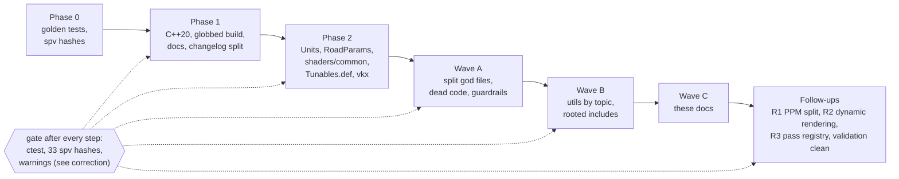

# Deep clean, 2026-09-29

**Label:** Largely AI-generated (Claude + subagents); verified by automated builds, tests and screenshots; please review.

**Legend:** ✅ done · ⚠️ watch out · ⏸ waiting on you

---

## TL;DR

- ✅ **Output unchanged** — release shaders bit-identical (33/33); first frame pixel-identical to the pre-refactor binary.
- ✅ **Big files split** — four "god files" (700 to 2150 lines) cut by topic; `PostProcessManager` (1063) followed in the follow-ups.
- ✅ **One source per fact** — units, road numbers, shader structs, tunables and Vulkan barriers each live in one place.
- ✅ **Clutter gone** — dead code removed, root notes moved to `docs/notes/`, `make check` guards the rest.
- ✅ **Follow-ups done the same day** — pass registry, Vulkan 1.3 dynamic rendering, validation clean, SSR puddle fix, patterns; see [Later updates](#later-updates).
- ⚠️ **Warning claims corrected** — earlier "0 warnings" results on macOS were **without** `-Wall -Wextra -Wpedantic`; see [the correction](#warnings-correction).
- ⚠️ **Not committed** — the working tree is the only copy; read [How to commit](#how-to-commit) first.
- ⏸ **6 items** still wait on you — see [Waiting on you](#waiting-on-you).

## Contents

- [What got better](#what-got-better)
- [How we checked it](#how-we-checked-it) (incl. the [warnings correction](#warnings-correction))
- [Removed](#removed)
- [Moved](#moved)
- [New single sources of truth](#new-single-sources-of-truth)
- [New safety checks](#new-safety-checks)
- [Behaviour changes](#behaviour-changes)
- [Found but not fixed](#found-but-not-fixed)
- [Waiting on you](#waiting-on-you)
- [How to commit](#how-to-commit)
- [Later updates](#later-updates)

**Status:** finished in the working tree (including the same-day follow-ups), **not committed**. Not yet reviewed by you.

**Related docs**

- **Editing rules** — [KEEPING_IT_CLEAN.md](KEEPING_IT_CLEAN.md)
- **Where things live** — [REPO_MAP.md](REPO_MAP.md) and [DIRECTORY.md](DIRECTORY.md)
- **Layout diagram** — [diagrams/directory-layout.excalidraw](diagrams/directory-layout.excalidraw)
- **How to add X** — [RECIPES.md](RECIPES.md)
- **Changelog entry** — [changelog/2026-09.md](changelog/2026-09.md)

---

## What got better

**Before**

- **Tunables** — one tunable touched 8 to 9 places in 6 files.
- **Shader structs** — `CameraUBO` was pasted into 9 shaders.
- **Constants** — `1000`, `0.3048` and pi were re-declared in half a dozen headers.
- **File size** — three files were 700 to 2150 lines.
- **Root** — notes and stray files sat in the repo root.
- **Navigation** — there was no map.

**What we did**

- **Safety net first** — golden tests, `.spv` hashes, both build configs gated every step.
- **God files** — split the four biggest by topic.
- **`src/utils/`** — given a topic layout with one include rule.
- **Single sources** — units, road parameters, shader structs and tunables each in one place.
- **`vkx`** — added a checked Vulkan barrier layer.
- **Dead code** — removed.
- **Root clutter** — moved to `docs/notes/`.
- **`make check`** — added guardrails.

**Result**

- ✅ **Release output** — unchanged.
- ✅ **Shaders** — 33/33 bit-identical.
- ✅ **First frame** — pixel-identical to the pre-refactor binary.
- **Deliberate changes** — listed exactly in [Behaviour changes](#behaviour-changes).

---

## How we checked it

- **Who** — all results come from the main session, independent of the agents that edited.
- ⚠️ **Correction (2026-09-29, later)** — every "0 warnings" below was measured **without** `-Wall -Wextra -Wpedantic` on macOS. See [Warnings correction](#warnings-correction).

| When | Check | Result |
|------|-------|--------|
| C++20 flip | release + debug-UI build, ctest | 137/137 both; 33/33 `.spv` identical to C++17 baseline |
| After Phase 0/1 | fresh scratch builds | release 141/141, debug-UI 149/149, 33/33 hashes, 0 first-party warnings (*without the full warning flags on AppleClang, see correction*) |
| After wave A | fresh builds, `-DSWISH_WERROR=ON`, full `swish` link | release 149/149, debug-UI 168/168, 33/33 hashes, 0 warnings with `-Werror` (*without the full warning flags on AppleClang, see correction*), `make check` OK (2 report-only warnings: sizes, format) |
| After wave A | runtime smoke: baseline binary vs new release vs new Debug (validation on, sync validation env set) | see the sub-bullets below |
| After wave B | fresh builds, `-DSWISH_WERROR=ON` | release 181/181, debug-UI 203/203, 0 first-party warnings (*same caveat*), 33/33 `.spv`, `check_repo` hard checks OK, 0 `#include "../` left |
| After the follow-ups | fresh builds with the full warning flags + `-Werror`; 4 validation configs; runtime identity check | release **218/218**, debug-UI **241/241**, 33/33 `.spv`, 0 first-party warnings **with** `-Wall -Wextra -Wpedantic`, 0 validation messages in all 4 configs, release first frame pixel-identical (details in [Later updates](#later-updates)) |

**Runtime smoke test results**

- ✅ **First frame** — pixel-identical (mean diff 0.00).
- ✅ **Key log output** — keys C x4, R x2, V, G give identical logs.
- **Later frames** — differ only by timing (mean diff 1.4 to 4.5 of 255).
- ✅ **Validation** — 0 messages.
- ✅ **Crashes** — none.

### Warnings correction

- ⚠️ **What was wrong** — the `-Wall -Wextra -Wpedantic` block in `CMakeLists.txt` and `tests/CMakeLists.txt` matched only GNU and Clang, **not AppleClang**. On macOS those flags never applied.
- **Effect** — every earlier "0 warnings" / "0 first-party warnings" claim on macOS (Phase 0/1, waves A and B) held only for the compiler's default warnings plus `-Werror`.
- **Fix** — AppleClang added to the block; VMA and the vendored `include/` marked `SYSTEM`; 4 real first-party warnings fixed (two `GeometryProducer` unused stats variables in release, `TextureManager` unused `m_physicalDevice`, a test keyword-macro); the separate GCC sweep is in [Later updates](#later-updates).
- **Now true** — release 218/218 and debug-UI 241/241 with 0 first-party warnings under the full flags plus `-Werror`; 33/33 `.spv`.

### Toolchain notes

- ⚠️ **glslc pick** — CMake uses `~/VulkanSDK/1.4.321.0/macOS/bin/glslc` only when `VULKAN_SDK` is set.
- ⚠️ **Unset `VULKAN_SDK`** — happens in a GUI-launched IDE or on Arch.
  - Homebrew's newer glslc (v2026.4) then wins.
  - The hashes in [`tests/golden/release_spv.sha256`](../tests/golden/release_spv.sha256) will not match.
- **Fix** — run `which -a glslc`, or pass `-DGLSLC=$HOME/VulkanSDK/1.4.321.0/macOS/bin/glslc`.
- ⚠️ **Validation layer** — runs only in a plain `Debug` build.
  - `make run` (Release) and `make debug` (RelWithDebInfo) both define `NDEBUG`.
  - `NDEBUG` turns the layer off (`kEnableValidationLayers`, [VulkanContext.cpp](../src/renderer/VulkanContext/VulkanContext.cpp) lines 13 to 17).
  - To validate, configure `-DCMAKE_BUILD_TYPE=Debug`.

Why glslc selection works this way

- **Search order** — `find_program(... HINTS $ENV{VULKAN_SDK}/bin)` searches HINTS before `PATH`.
- **Consequence** — with `VULKAN_SDK` set, the SDK glslc wins; unset, the first glslc on `PATH` wins.

---

## Removed

Removed files were backed up to the session scratchpad (`deepclean-backup/MANIFEST.txt`).

- ⚠️ **Temporary backup** — that folder is temporary; copy out anything you want to keep.

| Area | What was removed |
|------|------------------|
| Scene | `generate_trees` (dead); 5 unreferenced `RoadGeometry` accessors; unused includes |
| Renderer (helpers) | `Pipeline::createShaderModule`; 2 `ScopedShaderModule` copies; the `DepthOnlyPipeline` copy |
| Renderer (getters) | unused getters and members (list below) |
| Renderer (barriers) | all hand-rolled `insertImageBarrier` calls (22 of 24 in wave A, the rest and the helper itself in the follow-ups) |
| Renderer (dead dir) | `src/renderer/DepthBuffer/` (zero references); empty `src/shaders/` |
| Core + debug | `App::set_clear_day`, `clear_day()`, `cockpit()`; six per-key `KeyEdge` members; hand-written code for 5 tunables |
| Utils | `utils/Constants.h`; the `FileIO` class; unused `StdTypes` aliases; `to_vec4`; stray `<limits>` |
| Duplicate constants | `1000` / `0.3048` / pi copies in 10 places (list below) |
| Stale comments | 5 wrong numbers or names (list below) |
| Repo root | 3 stray files; empty `scripts/glslc_test`; `.cursorrules`; empty `.cursor/`; Windows backend |
| Agents | 20 overlapping local agents merged to 12 |

Full removal lists

**Scene**

- **`RoadGeometry` accessors** — `get_chunk_len`, `get_chunks_ahead`, `get_chunks_behind`, `get_rebase_threshold`, `get_camera_far`.

**Renderer**

- **Shader-module copies** — replaced by `vkx::make_shader_module`.
- **Unused getters and members**
  - `Renderer::get_scene_manager`, `get_model_manager`, `m_clearDay`.
  - `RainSystem::get_streak_len`, `get_time`.
  - `CameraUniforms::has_lights`, `MaterialDescriptors::is_built`, `Swapchain::getImages`.
- **Write-only members** — `register_scene_manager` / `register_model_manager`, plus members and calls.

**Utils**

- **`utils/Constants.h`** — held `PI`, `SWISH_PI`, `WORLD_SCALE`.

**Duplicate constants**

- **Files** — `RoadGeometry.h`, `RoadScene.h`, `CarEntity.h`, `tools/toml_baker.cpp`, `CarPhysics.h`, `WheelKinematics.h`, `App.cpp`, `DebugUI.cpp`, `WindshieldRainPass.cpp`, tests.
- **Comments** — every "must match" comment.

**Stale comments fixed**

- **SSR block** — said "144 B"; is 224 B.
- **Sampler pool** — said "30 samplers"; is 32.
- **Shadow** — `sampler2DShadow` mention removed.
- **Scene-params set** — said "set 3"; is 4.
- **G-buffer** — said "4 textures"; is 5.

**Repo root**

- **Stray files** — `debug`, `renderer`, `scene` (accidental shell redirects).
- **Empty tracked file** — `scripts/glslc_test`.
- **Editor leftovers** — `.cursorrules`, empty `.cursor/`.
- **Windows backend** — in CMake and `Device.cpp`.

**Agents**

- **Scope** — local `.claude/`, dispatch depth <= 1.

---

## Moved

Line counts measured on the tree 2026-09-29 (`grep -c ''`).

- **Small drift** — some differ by a few lines from agent reports because clang-format ran on touched files.

### Big files split

| Before | After |
|--------|-------|
| `RoadScene.cpp` 2139 | `RoadScene.cpp` 359, `MeshBuilder.cpp` 404 (+ `.h` 88), `_Surfaces` 273, `_Furniture` 661, `_Ramps` 440 |
| `Renderer.cpp` 1718 | wave A: `Renderer.cpp` 366, `_Frame` 219, `_Record` 512, `_PostPasses` 363, `_State` 262, `RendererDetail.h` 44. After the pass registry (R3): `Renderer.cpp` 268, `_Frame` 145, `_Record` 41, `_State` 131; `_PostPasses` and `RendererDetail.h` deleted; the frame is [`src/renderer/Passes/PassList.def`](../src/renderer/Passes/PassList.def) |
| `CarPhysics.h` 955 | umbrella 25 + `CarParams.h` 81, `Powertrain.h` 193, `Tire.h` 81, `Drivetrain.h` 129, `Longitudinal.h` 137, `Bicycle.h` 263, `WetGrip.h` 150 |
| `App.cpp` 715 (one ~500-line `run()`) | `App.cpp` 249, `AppInit.cpp` 206, `AppInput.cpp` 117 (key table `m_key_bindings`) |
| `PostProcessManager.cpp` 1063 (follow-up R1, pure move) | `PostProcessManager.cpp` 232, `_Passes` 171, `_Images` 301, `_Descriptors` 207, `_Pipelines` 63 |
| (new) | `src/core/CameraController/CameraController.{h,cpp}` 85 + 283 |
| Road element order in code | two ordered tables `intro_elements()` (18) and `chunk_elements()` (14), plus an order test |

- **Physics location** — the `CarPhysics.h` pieces live in `src/scene/Entity/`.
- ⚠️ **Still over the soft limits** — `src/debug/DebugUI.cpp` 875, `tests/test_car_physics.cpp` 1810 and `shaders/lighting.frag` 567 (report-only in `make check`).

PostProcessManager split plan (executed as R1, see Later updates)

- **`PostProcessManager.cpp`** — ~200 lines: init, cleanup, recreate, helpers.
- **`_Passes.cpp`** — ~200: `createRenderPasses`.
- **`_Images.cpp`** — ~260.
- **`_Descriptors.cpp`** — ~340.
- **`_Pipelines.cpp`** — ~60.

### `src/utils/` by topic

Namespace is `swish::util::<topic>`.

| Before | After |
|--------|-------|
| `utils/Types.h` | `utils/types/Types.h` (umbrella) + `GlmTypes.h`, `StdTypes.h`, `GlfwTypes.h` |
| `utils/Constants.h` (`PI`, `WORLD_SCALE`) | `utils/units/Units.h` (`kPi`, `kWuPerMetre`, ...) |
| `utils/Smoothing.h` | `utils/math/Smoothing.h` |
| (new) | `math/Noise.h`, `Hash.h` (`hash01`, was `tree_hash`), `Sequences.h` (`halton`) |
| frustum + polyline helpers in road / renderer code | `utils/geometry/Frustum.h`, `Polyline.h` |
| `utils/FileIO/FileIO.{h,cpp}` (class) | `utils/io/File.{h,cpp}` (`read_binary`) |
| `utils/StbImage.cpp` | `utils/io/StbImage.cpp` |
| `utils/VulkanCheck.h` | `utils/vulkan/Check.h` (`VK_CHECK`) |
| `utils/VulkanInit.h` (`swish::vk`) | `utils/vulkan/Init.h` (`swish::vkx`) |
| (new) | `color/Color.h`, `container/VectorOps.h`, `meta/EnumCycle.h`, `debug/TomlGlm.h` (debug-UI only) |
| `MAX_FRAMES_IN_FLIGHT` in utils | `src/renderer/RendererConfig.h` |
| `tests/test_{units,smoothing,file_io}.cpp` | `tests/utils/test_{units_Units,math_Smoothing,io_File}.cpp` |

- **Test target** — `swish_utils_tests` (Catch2 + GLM, no GLFW).
- **Details** — add-a-util procedure in [`src/utils/README.md`](../src/utils/README.md).

### Include rule

- **Rooted at `src/`** — e.g. `"utils/units/Units.h"`, `"renderer/Renderer/Renderer.h"`.
- **Same directory** — include by bare name.
- **`../`** — banned; 0 left.
- **Include path** — `${CMAKE_SOURCE_DIR}/src` is on it for `swish`, `toml_baker` and the tests.

### Root clutter and notes

| Before | After |
|--------|-------|
| `issue.md`, `prompt.md`, `metal_debugging.md`, `obsidian_latex_mermaid.md` | `docs/notes/` (index: [notes/README.md](../archive/docs/notes/README.md)) |
| `plan/` | `docs/notes/plan/` |
| `call_hierchies/` (typo) | `docs/notes/call_hierarchies/` |
| `architecture.excalidraw` (root) | `docs/diagrams/architecture.excalidraw` |
| `src/renderer/renderer_architecture.excalidraw` | `docs/diagrams/renderer_architecture.excalidraw` |
| `response.md` | `scratch/` (gitignored) |
| debug presets in `build/config/presets/` | `~/.config/swish/presets/` (see [Behaviour changes](#behaviour-changes)) |

- **Re-pointed links** — older entries in `docs/changelog/2026-06.md`, `2026-07.md` and `tasks/archive/2026-06.md`.

---

## New single sources of truth

| Fact | Lives in | Replaced |
|------|----------|----------|
| `1 m = 1000 WU`, feet, pi | [`src/utils/units/Units.h`](../src/utils/units/Units.h) | 4 to 6 private copies + `WORLD_SCALE` |
| Road, crown, service, exit numbers; `snap_dash_to_chunk` | [`src/scene/RoadScene/RoadParams.h`](../src/scene/RoadScene/RoadParams.h) | "must match" comments |
| GLSL structs, bindings, helpers | [`shaders/common/`](../shaders/common/) | `CameraUBO` pasted into 9 shaders |
| Live tunables | [`src/debug/Tunables.def`](../src/debug/Tunables.def) + `Tunables.h` | ~6 to 8 edit sites per scalar |
| Vulkan barriers, labels, handles, shader modules, push blocks | [`src/utils/vulkan/`](../src/utils/vulkan/README.md) (`swish::vkx`) | silent barrier fall-through; 4 shader-module copies |

- **Unit math** — as `Units.h` defines it:

$$x_{\mathrm{WU}} = 1000\,x_{\mathrm{m}},\qquad 1\,\mathrm{ft} = 0.3048\,\mathrm{m} = 304.8\,\mathrm{WU},\qquad 13\,\mathrm{ft} = 3962.4\,\mathrm{WU}$$

Details per source

**`RoadParams.h`**

- **Constants** — constexpr `kLie`, `kCrownSlope`, `kService`, `kExit`.
- **Baker** — `toml_baker` now includes the shared `RoadConfig.h`.
- **Size guard** — `static_assert(sizeof(RoadConfig) == 292)`.
- **Output** — `road.bin` is byte-identical.

**`shaders/common/`**

- **Files** — `bindings`, `camera`, `lights`, `math`, `hash`, `hash11`, `oct`, `color`, `puddle`.

**Tunables**

- **Converted groups** — `ssr` 5, `reflection` 3, `wet` 2 = 10 tunables at the time; the follow-ups added the two puddle entries to `wet` (now 4, total 12).

**`vkx` barriers**

- **Old helper** — `insertImageBarrier` silently fell back to `TOP/BOTTOM_OF_PIPE` with access 0.
- **New `Barrier.h`** — fails loudly on an unsupported `(old layout, new layout)` pair.

---

## New safety checks

| Command | What it does |
|---------|--------------|
| `make check` | Runs [`scripts/check_repo.sh`](../scripts/check_repo.sh) (details below) |
| `scripts/check_file_sizes.sh` | Limits: 800 lines C++, 400 lines GLSL |
| `make format-check` | Dry-run clang-format; modifies nothing |
| `make new-class NAME=Foo DIR=scene` | Scaffolds `src/scene/Foo/Foo.{h,cpp}` |
| `make install-hooks` | Installs the pre-commit hook. ⚠️ **Not installed yet** |
| `make test-debug`, `make clean-debug`, `make clean-all`, `make help` | Separate `build-debug/` tree; plain `make` prints help |
| `-DSWISH_WERROR=ON` | First-party warnings become errors |
| Golden tests | `tests/golden/`; details below |
| CI | Linux matrix job in `.github/workflows/ci.yml`. ⚠️ **Never run, unproven** |

Check details

**`make check`**

- **Hard checks**
  - Changelog index is current.
  - No stray root files (allowlist in [`scripts/check_root.sh`](../scripts/check_root.sh)).
  - No ignored-but-tracked files.
  - CMake still globs sources.
- **Report-only** — file sizes and clang-format.
- **Flags** — `CHECK_ARGS=--strict` makes report-only checks fail; also `--quick`, `--verbose`.

**File sizes**

- **Env overrides** — `SWISH_MAX_CPP_LINES`, `SWISH_MAX_GLSL_LINES`.

**`make format-check`**

- **Runs** — `scripts/format.sh --check`.
- **Excludes** — `include/stb_*`, build dirs, `_deps`.

**`make install-hooks`**

- **Copies** — [`scripts/hooks/pre-commit`](../scripts/hooks/pre-commit) into `.git/hooks`.
- **Hook runs** — `check --quick`.

**Golden tests** ([README](../tests/golden/README.md))

- **Car** — real `CarEntity::update` (4 scenarios).
- **Meshes** — road, chunk and interchange mesh hashes.
- **Shaders** — `.spv` sha256.
- **Debug IO** — `DebugParams` round-trip.
- **Layout** — `static_assert`s on `SsaoParams` 144 B, `SsrParams` 224 B, `GodRaysParams` 32 B.

**CI**

- **Matrix** — release + debug-UI, clang, `-Werror`.

---

## Behaviour changes

- ✅ **Release rendering and physics** — no change (proved in [How we checked it](#how-we-checked-it)).

What did change:

| Change | Detail |
|--------|--------|
| Preset location | New saves go to `~/.config/swish/presets/` (debug-UI builds only) |
| `vkx::make_shader_module` | Now **throws** on a bad `.spv` |
| Validation wording | Makefile comment corrected; no code path changed |
| Key handling | One key table `m_key_bindings`; smoke-tested identical |
| Formatting | Some diffs contain whitespace-only churn |
| Vulkan path (follow-up) | Dynamic rendering + sync2 are enabled when the device supports them; `Device` logs one new `[Device]` line; `SWISH_CLASSIC_VULKAN=1` forces the classic path |
| SSR puddles (follow-up) | SSR now uses the lit pass's puddle coverage (0.501) in release: a deliberate, subtle change when wet |
| Bloom sets (follow-up) | Per-frame bloom-extract descriptor sets; fixes a cross-frame race (odd frames sampled frame 0's HDR) |

Detail per change

**Preset location**

- **Lookup order** — `$SWISH_PRESETS_DIR`, else `$XDG_CONFIG_HOME/swish/presets/`, else `~/.config/swish/presets/`.
- **Old folder** — `build/config/presets/` is still **read** as a fallback.
- **Saves** — go to the new place.
- ⚠️ **Docs lag** — [`docs/debug-ui.md`](debug-ui.md) may still say `CONFIG_DIR/presets/`.

**`vkx::make_shader_module`**

- **Throws** — `std::invalid_argument` on an empty or non-multiple-of-4 `.spv`, before creating the module.
- **Leak fixed** — the first module no longer leaks if the second fails.

**Validation wording**

- **Before** — the [Makefile](../Makefile) comment above `debug-build` said "Validation still runs".
- **Now** — says validation is OFF in both `make run` and `make debug` (both define `NDEBUG`).
- **Bonus** — gives the plain-`Debug` recipe.

**Key handling**

- **Smoke-tested keys** — Esc cursor, C camera, R rain, V wiper, G weather, backtick edit mode (debug).

**Formatting**

- **Cause** — agents ran clang-format on files they touched.
- **Plan** — a single format commit comes later.

---

## Found but not fixed

Found while building the safety net. Each needs a decision or is out of scope.

### Golden mesh hashes

- **Finding** — bit-exact to the shipped Release codegen.
- **Fails at** — `-O0` Debug, `-ffp-contract=off` (both verified) and GCC 16.
  - Affected tests: `generate.vertex_hash` and `drawcall_hash`.
- **Cause** — FMA contraction differs by optimisation level and compiler.
- ✅ **Not a regression** — recorded before any refactor; still pass in Release and RelWithDebInfo.
- **Pass everywhere** — counts, bounds, chunk and interchange hashes.
- **Needed for Arch/GCC CI** — assert exact hashes only in optimised Clang builds; tolerance/count checks elsewhere.
- **Where** — `tests/test_golden_mesh.cpp`.

### Other findings

| Finding | Where |
|---------|-------|
| `DebugParams::save()` omits haze, god-rays, cull, wheel-tuning fields | `src/debug/DebugParamsIO.cpp` |
| `DebugParams::load()` ignores typos and wrong types; applies out-of-range values unclamped | `src/debug/DebugParamsIO.cpp` |
| Yaw wrap `fmod(y + 180, 360) - 180` keeps the sign; negative yaw passes -180 deg (harmless: sin/cos periodic) | `CarEntity::update` |
| `generate_chunk` emits 0 lights | `RoadScene` |
| Unused debug fields (list below) | `src/debug/DebugParams.h` |
| **C2 (fixed later the same day):** SSR `puddleCoverage` was forced to 0 in release while `lighting.frag` drew puddles at 0.501 | now one registry entry, see [Later updates](#later-updates) |
| Stale docs naming removed things (list below) | docs, shader comment |
| Repo weight (list below) | root |
| `Treadmill` is vestigial (active road path is `CorridorDriver`; `App` calls `m_corridor.update`); kept | `src/scene/` |
| Utils design items not done (list below) | `src/utils/` |

Lists behind the table

**Unused debug fields**

- **Never read** — `carOverride`, `carMetalness`, `carPaint`, `carRoughnessMul`, `sunAzimuth`, `sunElevation`, `shadowHalfExtent`, `shadowDepthRange`.
- **Odd default** — `shadowLightSize` is 2.0 in debug but a 0.0 release literal.

**Stale docs**

- **`generate_trees`** — `docs/glen-cove-lie.md` (lines 27, 68, 134); `docs/environment-asset-pipeline.md:22`; `docs/diagrams/roadside-detail.excalidraw`.
- **Moved-note link** — `shaders/windshield_rain.frag:20` links to a moved note.

**Repo weight**

- **`textures/`** — 36 tracked files (33 MB), loaded by directory scan.
- **`examples/`** — 3.1 GB of gitignored third-party repos.
- **`.obsidian/`** — 9 tracked files, incl. a 4.9 MB plugin bundle.
- **`References/`** — 3 PDFs.

**Utils design not done**

- **`Paths.h`** — `SHADER_DIR` concatenation in 12 files.
- **Helpers** — `Angle.h`, `Interp.h`, `Bounds.h`.
- **Puddle noise** — a C++ mirror.
- **Umbrella** — a `Utils.h`.
- **CMake** — a `swish_utils` INTERFACE target.

---

## Waiting on you

⏸ Each open item is a decision only you can make. None is started. Eight of the original 13 items were done as follow-ups (see [Later updates](#later-updates)).

| Item | The one decision |
|------|------------------|
| Strong unit types at `CarEntity` / `Treadmill` | Worth the churn? |
| `VehicleSpec`, `WheelKinematics` split, Lua/YAML loaders | Revive, or defer until Wheel Phase C? |
| Repo-wide clang-format commit | One isolated commit, before or after the cleanup commit? |
| Arch reconciliation | Follow the plan (details below). Say when |
| CI fixes | Do the checklist in `tasks/todo.md` (CI was not updated for the new test layout; deferred by you) |
| All commits and pushes | Say when. Also decide on the leftover branch `claude/thirsty-darwin` |

Done since this report was first written: C2 puddle mismatch, untracking `References/` and `.obsidian/`, the stale `thirsty-darwin` worktree, the 2 luminance-blit barriers, dynamic rendering + sync2, the pass registry, the `PostProcessManager` split.

Details behind the remaining decisions

**Arch reconciliation**

- **Plan** — [`review_2026-09-29/docs/arch-plan-git-reconciliation.md`](../archive/local/review_2026-09-29/docs/arch-plan-git-reconciliation.md) (see also the other `arch-plan-*.md` files there).
- ⚠️ **Arch commit `6d9d920`** (swapchain format) **would change Mac output** unless gated to Linux.

---

## How to commit

- ⚠️ **Nothing committed** — nothing was stashed or pushed. The only staged change is the 12 deletions from untracking `.obsidian/` and `References/` (index-only; the files are still on disk and gitignored).
- ⚠️ **Only copy** — the working tree holds the only copy of this work.

**Steps**

1. **Read the plan** — [`review_2026-09-29/docs/arch-plan-git-reconciliation.md`](../archive/local/review_2026-09-29/docs/arch-plan-git-reconciliation.md) first.
   - Its Phase 0 makes a bundle, a patch and a tarball backup before anything else.
2. **Check untracked-but-required files** — the build and app need them; they show as `??`.
   - [`assets/corridor/lie_corridor.bin`](../assets/corridor/lie_corridor.bin)
   - [`config/lie_corridor.toml`](../config/lie_corridor.toml)
   - Every new file under `src/utils/`, `shaders/common/`, `tests/utils/`, `tests/golden/`, `docs/notes/`.
   - The split `.cpp` / `.h` files.
3. **Stage with `git add -A`** — not `git add -u`, so moves are recorded as renames.
   - Notes and diagrams were moved with plain `mv`; git sees deletions plus untracked files.
   - Review `git status` first.
4. **Run checks before staging** — `make check` and `make test && make test-debug`.
   - `make check` fails if a tracked file is also ignored.
5. **Split into three commits** — (a) formatting only, (b) the cleanup, (c) Arch merge.
   - This keeps `git blame` and bisect usable.
6. **Discard one file** — do not `git add` `include/stb_image.h`'s one-line reflow.
   - `scripts/format.sh` no longer touches `include/stb_*`.

---

## Later updates

Follow-ups done after the deep clean, same day (2026-09-29). All verified by the main session; still **not committed**.

### TL;DR

- ✅ **Housekeeping** — stale worktree deleted; `.obsidian/` and `References/` untracked (index-only).
- ✅ **Rendering refactors** — `PostProcessManager` split, Vulkan 1.3 dynamic rendering + sync2, pass registry.
- ✅ **Validation** — 0 messages in all 4 configurations, down from 20 in the original code.
- ✅ **Patterns** — tag dispatch, `push_quad`, the class/struct audit applied.
- ⚠️ **Warnings corrected** — AppleClang now really gets the full warning flags; see [the correction](#warnings-correction).
- ✅ **Identity** — release first frame pixel-identical after every refactor; logs identical except the new `[Device]` line.
- ⏸ **Still waiting on you** — see the last group below.

### Housekeeping

- **Worktree** — deleted the stale `.claude/worktrees/thirsty-darwin` (backup tarball in the session scratchpad). The branch `claude/thirsty-darwin` is left for you.
- **Untracked** — `.obsidian/` and `References/`: index-only, **12 deletions are staged**, files stay on disk, both gitignored.
- **C2 puddles** — SSR now uses the lit pass's puddle coverage 0.501 in release, from one registry entry.
  - **Single constant** — `swish::road::kPuddleCoverage` in [`RoadParams.h`](../src/scene/RoadScene/RoadParams.h), used by physics ([`WetGrip.h`](../src/scene/Entity/WetGrip.h)).
  - **Pinned by tests** — registry default equals the constant; the `lighting.frag` literal equals the registry.
  - **Look** — subtle: at wetness 0.3 about 300 px/frame change, at most 6/255, because SSR only reflects on-screen geometry.

### Rendering refactors

- **R1: `PostProcessManager` split** — 1063 lines into 5 files, pure move.
- **R2: Vulkan 1.3 path** — dynamic rendering and `synchronization2` are enabled when the device supports them.
  - **Log** — `Device` prints one `[Device]` line saying which path is active.
  - **Test switch** — `SWISH_CLASSIC_VULKAN=1` forces the classic path.
  - **Users** — TAA records with dynamic rendering.
  - **Barriers** — all legacy barrier helpers removed (`ResourceManager::insertImageBarrier` is gone); [`Barrier.h`](../src/utils/vulkan/Barrier.h) has 14 rows plus `image_barrier2` / `_auto` / `_with`; [`Rendering.h`](../src/utils/vulkan/Rendering.h) is new.
- **R3: pass registry** in [`src/renderer/Passes/`](../src/renderer/Passes/).
  - **Types** — `IRenderPass`, `FrameCtx` / `FrameUpdate` / `FrameState` / `PassResources` / `PassInitCtx`, `enum class Img` + `ImageRegistry`, `PassRegistry`, `FullscreenPass<Push>`, `ForwardPass`, `PassInputs`.
  - **The list** — [`PassList.def`](../src/renderer/Passes/PassList.def) (ordered) + `PassList.cpp` factories; one `.cpp` per pass.
  - **Split out of `Renderer`** — `GeometryProducer` (CSM + G-buffer + cascades) and `WeatherController` (preset, IBL rebake, debug apply).
  - **Bindings** — [`renderer/Bindings.h`](../src/renderer/Bindings.h) includes `shaders/common/bindings.glsl`.
  - **Builders** in `src/utils/vulkan/` — `RenderScope.h`, `RenderPass.h` (`make_color_pass`), `Descriptors.h`, `Samplers.h`, `ImageView.h`.
  - **Deleted** — `Renderer_PostPasses.cpp`, `RendererDetail.h`.
  - **Payoff** — add a pass = 2 files (`FooPass.cpp` + one `PassList.def` line) instead of 5; a test pins the pass order.

### Validation fixes

- **Result** — 0 messages in 4 configs: debug-UI TAA off; TAA + auto-exposure on dynamic rendering; same on the classic path; release-look. Original code: 20.
- **Only in `CMAKE_BUILD_TYPE=Debug`** — `make run` and `make debug` define `NDEBUG`, so validation is off there.

| Fix | Pre-existing or new |
|-----|---------------------|
| 14 luminance-chain barrier/blit hazards | pre-existing |
| ImGui render-pass external dependency lacked `COLOR_ATTACHMENT_READ` | pre-existing |
| Per-frame bloom-extract descriptor sets (odd frames sampled frame 0's HDR: a cross-frame race) | pre-existing |
| `VelocityPass` colour subpass dependency; vertex input trimmed to location 0 | new (introduced and fixed in the same work) |

### Patterns

- **Tag dispatch** — [`utils/meta/Tags.h`](../src/utils/meta/Tags.h) (`swish::tag`); `tunables::visit` in [`Tunables.h`](../src/debug/Tunables.h) replaces 4 per-type ladders.
- **`MeshBuilder`** — `push_quad` / `add_quad` replace 8 hand-written quad blocks; mesh dump byte-identical.
- **class/struct audit applied**
  - `ResourceManager` is now `namespace swish::resource` free functions.
  - `Pipeline` is now `namespace swish::pipeline` (`create_graphics`, `create_compute`, `create_layout`). The pipeline cache is owned by `Device` and passed as `RendererServices::pipelineCache`: no hidden global.
  - `CorridorScene` became the free function `build_corridor_segments`.
  - `Scene` is `using Scene = std::function<void(Renderer&)>`.
  - `MeshData`'s mutable `getVertices()` is gone (`forEachVertex`).
- **Push blocks** — `PostProcessParams` padded 52 to 64 B; every push range goes through `vkx::push_range<T>` (16-byte `static_assert`).

### Warnings and portability

- ⚠️ **Correction** — see [Warnings correction](#warnings-correction): the full flags never applied on AppleClang until now.
- **AppleClang** — added to the warning block; VMA and vendored `include/` marked `SYSTEM`; 4 real warnings fixed.
- **GCC for Arch** — a `g++-16` sweep is clean (`DebugUI` sign-compare, an unused test function, `VmaUsage.cpp` pragmas fixed).
  - GCC runs all tests except the known Clang-bound golden-mesh intro hash.
- **Now** — release 218/218, debug-UI 241/241, 0 first-party warnings with full flags + `-Werror`, 33/33 `.spv`.

### Still waiting on you

- ⏸ **CI fixes** — deferred by you; checklist in [`tasks/todo.md`](../tasks/todo.md) ("CI fixes").
- ⏸ **Branch** — `claude/thirsty-darwin` is left for you to delete or keep.
- ⏸ **Remaining decisions** — the six items in [Waiting on you](#waiting-on-you).

How the follow-ups were checked

- **Builds** — release 218/218 and debug-UI 241/241 ctest, 33/33 `.spv`, full warning flags with `-Werror`.
- **Validation** — 4 configs, 0 messages each.
- **Runtime** — release first frame pixel-identical to the pre-refactor binary inside the window (only the rounded window corners differ); logs identical except the new `[Device]` line.
- **C2** — visual proof at forced wetness 0.3 in cockpit, chase and hood views; dry and fully wet frames identical.
- **Changelog** — [changelog/2026-09.md](changelog/2026-09.md), entry "Follow-ups: pass registry, dynamic rendering, validation clean, puddle fix, patterns".

