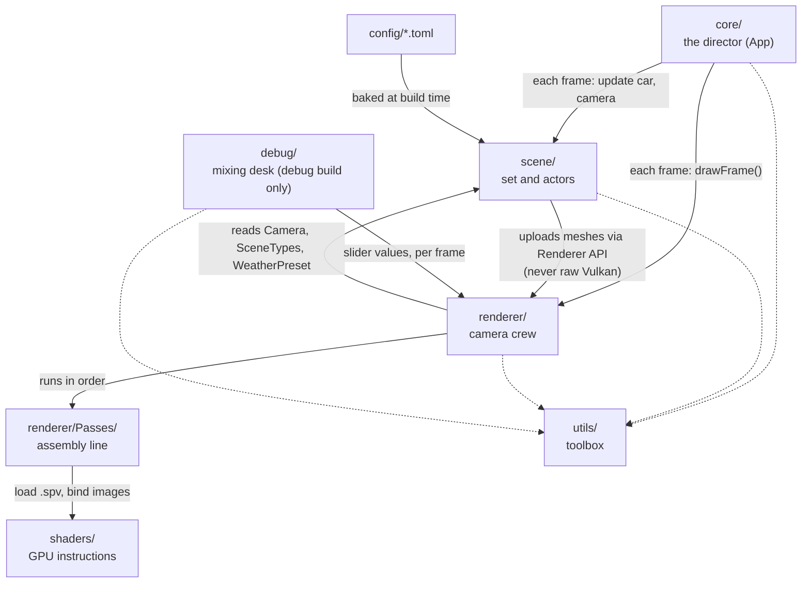

# Coding rules: read before you write code

**Label:** Largely AI-generated (Claude), checked against the working tree on 2026-09-29 (include graph grepped,
paths listed). Please review. If this page and the code disagree, the code wins: fix this page.

This is the one-page front door. Where a rule needs more detail it links to the full doc. Quick access:
`make rules` prints this file in the terminal. Planning a whole new feature? Read
[FEATURE_RULES.md](FEATURE_RULES.md) (`make feature-rules`) first.

**On this page:** [The 12 rules](#the-12-rules) · [Where does it go?](#where-does-it-go) ·
[How it all connects (plain English)](#how-it-all-connects-plain-english) · [Who may include whom](#who-may-include-whom) ·
[Before you start](#before-you-start) · [Before you say "done"](#before-you-say-done) · [Read next](#read-next)

---

## The 12 rules

| # | Rule | In plain words | Enforced by |
|---|------|----------------|-------------|
| 1 | **One source of truth.** Every number, struct or list lives in one place. | If you are about to copy a value, find where it already lives and use that. | Review, `make check` |
| 2 | **Units come from `utils/units/Units.h`.** 1 m = 1000 world units (WU). Never type `1000`, `0.3048` or pi. | The whole game measures in thousandths of a metre; the header does the converting. | Review |
| 3 | **Includes start at `src/`** (`#include "utils/math/Smoothing.h"`). Same folder: bare name. **Never `../`.** | Every include reads like an address from the same front door. | Review |
| 4 | **One class per `Name/Name.{h,cpp}`**, `#pragma once`, everything in `namespace swish`. Scaffold with `make new-class NAME=Foo DIR=scene`. | Each thing gets its own folder named after it. CMake finds new files by itself. | `make check` (globs) |
| 5 | **`class` owns, `struct` groups.** `class` = big component with resources and private state (`Renderer`, `CarEntity`). `struct` = plain bag of public fields (`SsrParams`, `RoadParams`). | If it has rules about its own insides, make it a class. If it is just a form with fields, make it a struct. | Review, [DESIGN_PATTERNS.md](DESIGN_PATTERNS.md) |
| 6 | **Scene code never calls Vulkan.** It hands data to renderer managers (`Renderer`, `TextureManager`). | The "world" describes what exists; only the renderer talks to the graphics card. | Review |
| 7 | **Debug-only code sits inside `#ifdef SWISH_DEBUG_UI`.** The release build must stay byte-identical unless you mean to change it. | The slider panel is unplugged in the shipping build and must leave no trace. | `.spv` hashes, goldens |
| 8 | **Tunables: one line in `src/debug/Tunables.def`** (converted groups). Scene constants go in `config/*.toml` or `RoadParams.h`, not in code. | Settings live in settings files, not scattered through the code. | Review |
| 9 | **A render pass is 2 files:** `src/renderer/Passes/FooPass.cpp` + one line in `Passes/PassList.def`. Use the `vkx` builders in `src/utils/vulkan/`, not raw `vkCreate*` structs (**migration in progress**: the builders exist and new code must use them, but some older sites still call raw `vkCreate{GraphicsPipelines,ComputePipelines,RenderPass,Sampler,ImageView,DescriptorSetLayout,PipelineLayout}`: `Pipeline.cpp`, `DepthOnlyPipeline.cpp`, `PostProcessManager_Passes.cpp`, `IBLManager.cpp`, `RainSystem.cpp`, `SpraySystem.cpp`, `WindshieldRainPass.cpp`, `CameraUniforms.cpp`, `TextureManager.cpp`, `MaterialDescriptors.cpp`, `Swapchain.cpp`). | Adding a station to the assembly line never means rewiring the whole factory. | `test_renderer_PassRegistry.cpp` pins the order |
| 10 | **MoltenVK limits:** push-constant blocks are 16-byte multiples; no comparison samplers (plain `sampler2D` + manual PCF); barriers go through `vkx::image_barrier`. No ray tracing on macOS. | The Mac graphics layer has quirks; these rules sidestep them. | `static_assert` in `PushConstants.h`, `Barrier.h` fails loudly |
| 11 | **Never regenerate a golden to make a refactor pass.** `SWISH_UPDATE_GOLDENS=1` is only for a behaviour change you meant, with a changelog entry. | The goldens are reference photos. If they stop matching, something changed; find out what. | `make test` |
| 12 | **Small files, zero warnings.** Split by topic before 800 lines (C++) / 400 (GLSL). Keep first-party warnings at 0 (`-DSWISH_WERROR=ON`). Run `make format`. | Short files are easy to read; a warning today is a bug tomorrow. | `make check`, `make format-check` |

**Plus:** commit and push only when you decide to. Log every non-trivial change in `docs/changelog/YYYY-MM.md`, then
run `python3 scripts/changelog_index.py`.

---

## Where does it go?

Start from what you are adding. Detailed steps for each row are in [RECIPES.md](RECIPES.md).

| I want to add... | It goes in | Recipe |
|------------------|-----------|--------|
| A new class | `make new-class NAME=Foo DIR=<layer>` creates `src/<layer>/Foo/Foo.{h,cpp}` | add-a-source-file |
| Game-world logic (road, car, camera, props) | `src/scene/<Thing>/` | add-a-road-prop |
| Car physics (tire, engine, grip) | Topic header in `src/scene/Entity/` (`Tire.h`, `Powertrain.h`, `WetGrip.h`, ...) | [car_system.md](car_system.md) |
| A road dimension | `src/scene/RoadScene/RoadParams.h` (C++) or `config/road.toml` + `RoadConfig.h` (baked) | add-a-config-key |
| A key binding | The `m_key_bindings` table in `src/core/App/AppInput.cpp` | [src/core/README.md](../src/core/README.md) |
| A render pass | `src/renderer/Passes/FooPass.cpp` + one `PASS(...)` line in `Passes/PassList.def` | add-a-render-pass |
| A shader | `shaders/<name>.{vert,frag,comp}` (found automatically) | add-a-shader |
| Shared GLSL (structs, helpers, bindings) | `shaders/common/<name>.glsl` | [shaders/README.md](../shaders/README.md) |
| A Vulkan helper (barrier, sampler, image view, descriptors) | `src/utils/vulkan/` (`swish::vkx`) | [src/utils/vulkan/README.md](../src/utils/vulkan/README.md) |
| A generic helper (math, colour, containers) | `src/utils/<topic>/Name.h` + `tests/utils/test_<topic>_Name.cpp` | add-a-util |
| A unit conversion or constant | `src/utils/units/Units.h` | - |
| A live-tuning slider | One line in `src/debug/Tunables.def` (or the hand-written sites for unconverted groups) | add-a-tunable |
| A test | `tests/test_<topic>.cpp` (list it in `tests/CMakeLists.txt`) or `tests/utils/` | add-a-test |
| An offline tool (bakers, generators) | `tools/` | [tools/README.md](../tools/README.md) |
| A repo script | `scripts/` | [KEEPING_IT_CLEAN.md](KEEPING_IT_CLEAN.md) |
| Docs and diagrams | `docs/` (reference), `docs/diagrams/` (Excalidraw); **never the repo root** | [docs/README.md](README.md) |
| Drafts, prompts, loose notes | `scratch/` (gitignored, local) | - |
| A doc that is finished or stale | `archive/docs/<same path>` + a row in `archive/README.md`; repoint its links | [archive/README.md](../archive/README.md) |
| Plans and to-dos | `tasks/todo.md`; lessons in `tasks/lessons.md` | - |
| Art assets (models, HDRIs, textures) | Made on the Arch machine, pulled over ssh into `assets/` (cars in `assets/cars/`), `textures/`. Do not generate binaries in-tree | [car-asset-pipeline.md](car-asset-pipeline.md) |
| A debug preset | Save from the UI into `~/.config/swish/presets/` (not the repo) | add-a-debug-preset |

**Do not touch unless asked:** `include/` (vendored third-party headers), `build*/` (generated), `archive/` (history: read, do not build on it),
`scratch/` (local only).

---

## How it all connects (plain English)

Think of Swish as a **film shoot that happens 60+ times a second**.

| Folder | Its job in the film shoot | What it really is |
|--------|---------------------------|-------------------|
| `src/core/` | **The director.** Shouts "action" every frame: read the keys, move the car, place the camera, then tell the crew to shoot. | `App` (main loop), `Window` (the GLFW window), `CameraController` (cockpit/chase camera placement) |
| `src/scene/` | **The set and the actors.** The road, the car and its physics, the camera. Knows *what exists and where*, but not how to draw it. | `SceneManager`, `RoadScene`, `Corridor` (the real Long Island Expressway), `CarEntity`, `Camera`, `ModelManager` |
| `src/renderer/` | **The camera crew and the film lab.** Turns the scene into pixels on the graphics card (Vulkan). | `Renderer` (the boss), managers (`TextureManager`, `PostProcessManager`, ...), one class per pass |
| `src/renderer/Passes/PassList.def` | **The assembly line.** Each line is one station (shadows, lighting, reflections, rain, bloom, ...), run in that order every frame. | The ordered list of render passes |
| `shaders/` | **The instructions each station follows**, run on the graphics card. `shaders/common/` = recipe cards shared by several stations. | GLSL files compiled to SPIR-V `.spv` files |
| `src/debug/` | **The mixing desk.** Sliders to tweak the look live. The UI exists only in the debug build (`make debug`); release keeps the parameter defaults and compiles the UI out. | Dear ImGui UI, `Tunables.def`, TOML presets |
| `src/utils/` | **The toolbox.** Measuring tape (units), maths, colour, Vulkan shortcuts. Everyone uses it; it depends on nobody. | Header helpers in `swish::util::<topic>` and `swish::vkx` |
| `config/` | **The set designer's spec sheets.** Road widths, lane counts, the corridor route. | `road.toml` (baked into `road.bin` at build time), `lie_corridor.toml` |
| `tools/` | **The workshop off-set.** Prepares data before the shoot. | `toml_baker`, `lie_corridor.py`, `car_analyzer` |
| `tests/` | **The safety inspectors.** `tests/golden/` holds reference "photos" the output must still match. | Catch2 tests, no GPU needed |
| `assets/` (incl. `assets/cars/`), `textures/` | **Props and costumes.** | GLB car models, PBR textures, HDRI skies |

### Who talks to whom

Dotted lines: everyone may use the toolbox; the toolbox never uses anyone back.

### One frame, in plain words

1. **The director checks the keys** (`App` + `AppInput.cpp`): steer, brake, toggle rain, switch camera.
2. **The actors move** (`scene/`): the car physics steps forward; the road streams in around the car.
3. **The camera is placed** (`CameraController`): cockpit, chase, or free-fly.
4. **The crew shoots** (`Renderer::drawFrame`): each station in `PassList.def` runs in order:
   shadows and surfaces first, then lighting, reflections, god-rays, rain and spray, glass, then bloom, and
   finally composite, which paints the finished picture to the screen.
5. **(Debug build only)** the mixing desk sends its slider values to the crew before shooting.

A worked example, "I want the road to look wetter": the look is decided by a **station** (the lighting pass,
`Passes/LightingPass.cpp`) running its **instructions** (`shaders/lighting.frag`). How wet it is comes from the **weather**
(`WeatherController`), and the knob you turn while testing is on the **mixing desk** (`wet` group in `Tunables.def`).

---

## Who may include whom

Checked by grepping `#include` across `src/` on 2026-09-29.

| Code in... | May include | Must not |
|------------|-------------|----------|
| `utils/` | std, GLM, Vulkan headers, other `utils/` | Anything in `core/`, `scene/`, `renderer/`, `debug/` |
| `scene/` | `utils/`, other `scene/`, the renderer's **public API** (`Renderer.h`, `TextureManager.h`, `Vertex.h`) to upload data | Call `vk*` functions or hold Vulkan handles |
| `renderer/` | `utils/`, `renderer/`, scene **data types** (`Camera.h`, `SceneTypes.h`, `WeatherPreset.h`, `CarEntity.h`), `core/Window` (for the surface), `debug/DebugParams.h` (the parameter structs, present in both builds); `DebugUI.h` / `SceneParamsUniform.h` only inside `#ifdef SWISH_DEBUG_UI` | Scene logic, or global singletons (subsystems are owned by `Renderer`) |
| `debug/` | `utils/`, what it tunes | Leak into release: `src/debug/*.cpp` is compiled only with `SWISH_DEBUG_UI=ON`, so release code may use `DebugParams.h` defaults but not the UI |
| `core/` | Everything: it is the top that wires things together | Business logic that belongs in `scene/` or `renderer/` |

**Never hold on to `RendererServices`:** get it from `Renderer::services()` when you need it and copy out only the handles
you use. The swapchain size inside it goes stale after every window resize.

---

## Before you start

- [ ] Read [`docs/user-goals/CURRENT.md`](user-goals/CURRENT.md) and [`tasks/todo.md`](../tasks/todo.md): is this what is wanted now?
- [ ] Check `git log --oneline -20`: has it already been done?
- [ ] Found the right folder in [Where does it go?](#where-does-it-go) and its recipe in [RECIPES.md](RECIPES.md)?
- [ ] Does a helper for this already exist in `src/utils/`? Use it rather than writing a copy.
- [ ] More than a couple of files, or a change to how things are wired? Write a short plan in `tasks/todo.md` first.
- [ ] Is it debug-only? Plan the `#ifdef SWISH_DEBUG_UI` gate from the start.
- [ ] Is it visual? Decide how you will look at it: temporarily force an extreme, window-only screenshot, then revert the force.

## Before you say "done"

- [ ] `make format`
- [ ] `make test` and `make test-debug` both green
- [ ] Shader change: the `.spv` hashes still match, or you changed them deliberately and said so:
      `(cd build/shaders && shasum -a 256 -c ../../tests/golden/release_spv.sha256)`
- [ ] Visual change: ran it and **looked** (rain at 0 and at 1.0); temporary forces reverted
- [ ] Barrier or pass change: one run in a `Debug` build (validation layers on), 0 messages
- [ ] `make check` prints OK
- [ ] Changelog entry in `docs/changelog/YYYY-MM.md` + `python3 scripts/changelog_index.py`
- [ ] Moved or added paths? Update [REPO_MAP.md](REPO_MAP.md) / the folder's README

Full checklist with reasons: [KEEPING_IT_CLEAN.md](KEEPING_IT_CLEAN.md#before-you-commit).

**Editor tip:** if clangd shows "file not found" for a `src/...` include, the compile database is stale. Run `make build`
(it regenerates `build/compile_commands.json`), then **clangd: Restart language server**.

---

## Read next

| When you need... | Read |
|------------------|------|
| To plan a new feature end to end | [FEATURE_RULES.md](FEATURE_RULES.md) |
| Exactly where every file is | [REPO_MAP.md](REPO_MAP.md), [DIRECTORY.md](DIRECTORY.md) |
| Step-by-step "add X" | [RECIPES.md](RECIPES.md) |
| Every rule with the reasons behind it | [KEEPING_IT_CLEAN.md](KEEPING_IT_CLEAN.md), [../CONTRIBUTING.md](../CONTRIBUTING.md) |
| The whole system in depth | [architecture.md](architecture.md), [render-pipeline.md](render-pipeline.md) |
| What a word means | [GLOSSARY.md](GLOSSARY.md) |
| Hard-won mistakes not to repeat | [../tasks/lessons.md](../tasks/lessons.md) |
