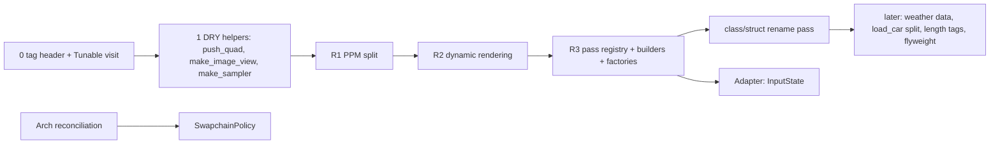

# Design patterns for Swish

*Largely AI-generated (Claude + subagents); verified by automated builds, tests and screenshots; please review.*
Written 2026-09-29 from the working tree (`debug-ui`, dirty); updated the same day after the refactors landed. **Done** marks what is implemented (sections 1, 2, 3, 5, 6, 6.1, 8); everything not marked is still a proposal. Companions:
[KEEPING_IT_CLEAN.md](KEEPING_IT_CLEAN.md) (rules), [DIRECTORY.md](DIRECTORY.md) (layout),
[../src/utils/README.md](../src/utils/README.md), [../src/utils/vulkan/README.md](../src/utils/vulkan/README.md),
and the local-only plans `archive/local/review_2026-09-29/docs/render-pass-architecture.md` (IRenderPass / FrameCtx / PassRegistry /
FullscreenPass) and `vulkan-dispatch-and-utils.md` (vkx layer). As built: [../src/renderer/README.md](../src/renderer/README.md)
"Pass registry". Line numbers in the proposal text are from the tree before the refactors; re-grep before editing.

## TL;DR

- **Owner rule:** `class` = large component (owns resources or behaviour, keeps invariants). `struct` = sub-component
  (plain grouped data, public fields, owned by or passed to a class). The tree was ~97% compliant before the audit.
- **Audit (done):** 150 definitions (101 `struct`, 49 `class`; `ScopedLabel` is defined twice under `#ifdef`, so 149 types). The 3
  firm mismatches are fixed: `ScopedRenderPass` became `vkx::RenderScope`, `Pipeline` and `ResourceManager` became
  namespaces of free functions; `CorridorScene`, `Scene` and the mutable `MeshData::getVertices()` were tightened too.
- **Builders (done):** aggregates + factory functions (defaults + designated initializers) now cover render passes
  (`make_color_pass`), descriptor layouts / pools (`Descriptors.h`), samplers and image views. No fluent chains.
- **Factories (done):** **factory functions** (`make_*`), not class hierarchies. The registry is `PassRegistry` built from an
  ordered X-macro list (`Passes/PassList.def`), not static registrars. `SwapchainPolicy` (not done) is a data table, not an
  abstract factory.
- **Tag dispatch (done for Tunable kinds):** cheap, closed-set overloads in one header, `src/utils/meta/Tags.h`; `tunables::visit`
  replaced 4 ladders. Image aspect and length-space tags are still proposals.
- **DRY (done):** per-pass render-pass / sampler / descriptor / image-view boilerplate, per-type TOML/ImGui branches, the
  quad emission in `MeshBuilder` (`push_quad` / `add_quad`) and the push-block `static_assert`s (`push_range<T>`) are gone.
- **Structural:** Facade (`Renderer`; `PostProcessManager` still wide) and Registry (`Tunables.def`, `Element` tables,
  `PassRegistry`) exist. Decorator (`ScopedLabel`) exists but is not wired into `record`. Adapter for input (B4/S8) is worth
  doing later. Flyweight/Proxy/Bridge: mostly *don't*.
- **Don't:** no parallel singletons, no abstract `IRenderer`, no object pool for spray (GPU ring already), no Prototype.
- **Order (as executed 2026-09-29):** tag dispatch and DRY helpers, R1 (PostProcessManager split), R2 (dynamic rendering),
  R3 (pass registry + builders + factories + class/struct renames). `SwapchainPolicy` still goes with the Arch reconciliation.

Step labels used below (from the coordinator, not the local review docs): **R1** = PostProcessManager split (done),
**R2** = dynamic rendering + sync2 (done, TAA first), **R3** = pass registry (done). The local docs use `P0..P8` and `R1..R10` for other things.

---

## 1. class vs struct audit

Method: grep of every `class|struct` definition under `src/` (no third-party code lives there; `include/` is vendored),
plus a script that measured each body (private section, Vulkan handle members, methods, constructors), then a read of
every ambiguous one. Counts are definitions, so nested and `.cpp`-local types count.

| Where | Count |
|-------|------:|
| Top-level in headers | 121 |
| Nested in a class (`Config`, `Push`, `Sample`, ...) | 21 |
| Local to a `.cpp` (`Basis`, `Look`, `TileSlice`, ...) | 8 |
| **Total definitions** | **150** (101 struct, 49 class) |

| Class | struct | class |
|-------|-------:|------:|
| (a) correct per the rule | 98 | 42 |
| (b) struct that is really a component | 1 firm, 2 borderline | - |
| (c) class that is really data / a namespace | - | 4 firm, 2 tighten-in-place |

### Stay as they are (do not "fix")

- **GPU/std140/std430 mirrors stay `struct`** (~25): `CameraUBO`, `LightsUBO`, `PointLightData`, `PushConstantData`
  ([SceneTypes.h:61,127,132,287](../src/scene/SceneTypes.h)), `RainUBO`, `SpraySimUBO`, `WindshieldRainUBO`,
  `SceneParamsUBO`, every `Push` (Velocity, Taa, Dof, IBL x3, Wetness, Depth, Lighting), `SprayParticle`, `Vertex`, and the
  push-block param structs `SsrParams`, `SsaoParams`, `PostProcessParams`, `GodRaysParams`. Layout is the contract; adding
  a ctor or private field breaks aggregate init and std140 asserts.
- **On-disk layouts stay `struct`:** `CorridorHeader/Station/Landmark`, `RoadConfig` (shared with the Python baker).
- **RAII handle templates stay `class`:** `GpuBuffer`, `GpuImage` ([GpuResource.h:18,68](../src/renderer/GpuResource/GpuResource.h)),
  `DeviceHandle` ([DeviceHandle.h:62](../src/utils/vulkan/DeviceHandle.h)).
- **Small tag/row/config types stay `struct`:** `Barrier.h` `BarrierMasks`, `SubresourceSpan`, `Row`; `DeviceRef`;
  `DebugLabelFns`; `KeyEdge`, `KeyBinding` ([App.h:34,41](../src/core/App/App.h)); `RoadScene::Element`;
  `QueueFamilyIndices`; the `*Params` and `Config` structs.
- **X-macro generated:** `DebugParams` ([DebugParams.h:38](../src/debug/DebugParams.h)) gets fields from
  [Tunables.def](../src/debug/Tunables.def); `Tunable` ([Tunables.h:20](../src/debug/Tunables.h)) is a constexpr table row.
  Both are plain data: `struct`.
- **`RendererServices`** ([RendererServices.h:9](../src/renderer/Renderer/RendererServices.h)) holds Vulkan handles but
  owns none of them (non-owning bag): `struct` is right, and it is the service locator, not a singleton.
- **`Texture`** ([TextureManager.h:18](../src/renderer/TextureManager/TextureManager.h)) holds a `GpuImage` and a raw
  `VkImageView`: `struct` is right *only because* `TextureManager` owns destruction order. Keep it that way.

<details><summary>(b) and (c) items with file:line</summary>

| Kind | Item | Reason | Action |
|------|------|--------|--------|
| (b) | `ScopedRenderPass` | RAII begin/end with deleted copy = an invariant | **done**: replaced by `vkx::RenderScope` ([RenderScope.h](../src/utils/vulkan/RenderScope.h)); `RendererDetail.h` deleted |
| (b?) | [CorridorAsset.h:143](../src/scene/Corridor/CorridorAsset.h) local `Closer` | function-local RAII for `FILE*` | **kept**: `unique_ptr<FILE, decltype(&fclose)>` trips GCC `-Wignored-attributes` under `-Werror`, and a local deleter functor would be the same thing renamed |
| (b?) | [TextureManager.h:18](../src/renderer/TextureManager/TextureManager.h) `Texture` | holds handles, but owned by a class | keep, see above |
| (c) | [ResourceManager.h](../src/renderer/ResourceManager/ResourceManager.h) `ResourceManager` | all-`static`, no state | **done**: `namespace swish::resource` free functions (folder and file names kept) |
| (c) | [Pipeline.h](../src/renderer/Pipeline/Pipeline.h) `Pipeline` | all-`static`; hidden process-wide cache global | **done**: `namespace swish::pipeline` (`create_graphics` / `create_compute` / `create_layout`); the `VkPipelineCache` is owned by `Device`, carried in `RendererServices::pipelineCache` and passed in explicitly; `Pipeline::set_cache` and the static are gone |
| (c) | [CorridorScene.h](../src/scene/Corridor/CorridorScene.h) `CorridorScene` | one `static build()` | **done**: free function `build_corridor_segments` |
| (c) | [SceneManager.h](../src/scene/SceneManager/SceneManager.h) `Scene` | wraps one `std::function` + `run()` | **done**: `using Scene = std::function<void(Renderer&)>`; `SceneManager` holds `std::vector<Scene>` |
| tighten | [MeshBuilder.h](../src/scene/RoadScene/MeshBuilder.h) `MeshBuilder` | public `m_mesh` / `m_draws` | already private in the current tree; no action |
| tighten | [SceneTypes.h](../src/scene/SceneTypes.h) `MeshData` | mutable `getVertices()` could add/remove vertices | **done**: mutable getter removed; load-time fixups use `forEachVertex(fn)`, which cannot change the vertex count |

Re-audit after R3 (2026-09-29): the pass registry types are correctly split (`IRenderPass`, `FullscreenPass<Push>`,
`PassRegistry`, `ImageRegistry`, every pass = `class`; `FrameCtx`, `FrameUpdate`, `FrameState`, `PassResources`,
`PassInitCtx`, `FullscreenDraw`, `SamplerInput` = `struct`). No new mismatch found.

Checked and fine as `class`: `Entity`/`ModelEntity`, `Camera`, `Treadmill`, all managers, all passes, `RoadScene`,
`CarEntity`, `DebugUI`. `Renderer` (197-line body, 61 methods) is the largest and correctly a `class`.
</details>

---

## 2. Tag dispatch (implemented 2026-09-29)

*Status: **done** for the Tunable value kind (`flag_t` / `real_t`, `tunables::visit`); image aspect and length space are still proposals.*

- **What:** empty tag types pick an overload at compile time. `struct flag_t {}; inline constexpr flag_t flag{};`
  then `f(tag::flag, ...)` vs `f(tag::real, ...)`. Same idea as `std::input_iterator_tag`.
- **Prefer it when** the variants are a small, closed set (2 to 4), the call site knows the variant statically, and each
  variant needs *different code*, not a different value. It replaces `if (kind == X)` ladders repeated in several files.
- **Prefer `if constexpr` / a concept when** one function body differs by a line or two, or the constraint is a property
  of a type (`HasDevice` in [DeviceHandle.h](../src/utils/vulkan/DeviceHandle.h) is already right).
- **Prefer a runtime flag / enum when** the variant is only known at runtime (a row read from
  [Tunables.def](../src/debug/Tunables.def) at startup). Tag dispatch then needs ONE `visit()` shim (below).
- **Keep it simple:** no tag hierarchies, no traits classes, no SFINAE. If it needs more than an overload set, use a
  plain function or a table.
- **Naming:** namespace `swish::tag` (a vocabulary, like `Vec3`, not `swish::util::...`); type `real_t`; constant
  `inline constexpr real_t real{};`; call `f(tag::real, ...)`. Avoid `float_t` (a `<cmath>` typedef): use `real_t`,
  `flag_t`, later `vec3_t`.
- **Where (as built):** [src/utils/meta/Tags.h](../src/utils/meta/Tags.h), std only, next to
  [EnumCycle.h](../src/utils/meta/EnumCycle.h). It defines `flag_t` / `flag`, `real_t` / `real` and the helper
  `is_tag_v<T>`, nothing else. Test: [tests/utils/test_meta_Tags.cpp](../tests/utils/test_meta_Tags.cpp) (in `swish_utils_tests`,
  no GLFW). A tag used by only one module stays in that module's header. `vec3_t`, `color_t` / `depth_t` and the length
  spaces are added with their first real user (rule 7), not before.

| Candidate | Files | Benefit | Verdict |
|-----------|-------|---------|---------|
| **Tunable value kind** (`flag_t`/`real_t`, later `vec3_t`) | [Tunables.h](../src/debug/Tunables.h) `visit`, [DebugParamsIO.cpp](../src/debug/DebugParamsIO.cpp) save/load, [DebugUI.cpp](../src/debug/DebugUI.cpp) widget/dump | 4 `if (t.kind == Bool)` ladders became overload sets; a new kind adds overloads, not branches. Hand-written groups can later join the registry | **done** (debug-only, no release change) |
| **Image aspect** (`color`/`depth`) | [Barrier.h](../src/utils/vulkan/Barrier.h); `ASPECT_COLOR_BIT` dominates, depth is rare | drops the raw aspect argument; lets `image_barrier<DEPTH_L, DEPTHRO>` `static_assert` a depth layout is never paired with `color` | **not done**: R3 kept eager barriers, so there is no tracker to hang it on; revisit if a 2nd depth user appears |
| **Length space** (`metres`/`wu`/`feet`) | [Units.h:31-34](../src/utils/units/Units.h), [CarEntity.h:35,91,228](../src/scene/Entity/CarEntity.h), [Treadmill.h:44](../src/scene/Treadmill/Treadmill.h) | owner-chosen (decision U4) *only* strong-type site: the "x1000 twice" boundary | **later**; must keep the single multiply (Units.h "Precision" note) |
| **Debug vs release params** | was the `const DebugParams d{}` idiom in 3 places | one `params()` accessor instead of 3 `#ifdef` pairs | **done with R3**: `Renderer::tune()` feeds `FrameCtx::tune` once; an accessor, not a tag |
| **MeshBuilder primitives** | [MeshBuilder.cpp](../src/scene/RoadScene/MeshBuilder.cpp) | the quads differ in corners, not in emission | **not a tag; done** as plain `push_quad` / `add_quad` with a 3-value `QuadWinding` enum (section 5); output byte-identical (8 hand-written blocks replaced) |

As built (debug-only, all inside `#ifdef SWISH_DEBUG_UI` TUs; release never sees it):

```cpp
// utils/meta/Tags.h
namespace swish::tag { struct flag_t {}; struct real_t {}; inline constexpr flag_t flag{}; inline constexpr real_t real{}; }
// Tunables.h: the ONE runtime branch. No `default:`, so a new Kind enumerator is a -Wswitch error here.
template <class P, class F> void visit(const Tunable& t, P& p, F&& f) {   // P = DebugParams or const DebugParams
    switch (t.kind) { case Kind::Bool: f(tag::flag, p.*t.b); return; case Kind::Float: f(tag::real, p.*t.f); return; }
}
// DebugParamsIO.cpp (save / load)                         // DebugUI.cpp (widget / dump)
put(g, t, tag::flag_t, bool)   put(g, t, tag::real_t, float)   widget(t, tag::flag_t, bool&)   widget(t, tag::real_t, float&)
get(node, tag::flag_t, bool&)  get(node, tag::real_t, float&)  dump(t, tag::flag_t, bool)      dump(t, tag::real_t, float)
// the four loops are one line each:  tunables::visit(t, p, [&](auto kind, auto& v) { widget(t, kind, v); });
```

**Add a new value kind (say `vec3`):**

1. `Tags.h`: add `vec3_t` and `inline constexpr vec3_t vec3{}` (and extend `is_tag_v`).
2. `Tunables.h`: add `Kind::Vec3`, a member pointer field on `Tunable` (append it with a default so existing rows and the
   tests' positional initialisers still compile), a `TUNE_V` macro, and ONE `case` in `visit`. `-Wswitch` flags the spot.
3. Add one overload per consumer for the new tag: `put` + `get` in `DebugParamsIO.cpp` (use `vec3_to_toml` / `read_vec3`),
   `widget` + `dump` in `DebugUI.cpp`. Forgetting one is a compile error (no matching overload).
4. [`Passes/SsrPass.cpp`](../src/renderer/Passes/SsrPass.cpp) includes `Tunables.def` with its own `TUNE_B` / `TUNE_F`: give it a `TUNE_V` no-op too.
5. Add rows to `Tunables.def`, then extend `tests/test_debug_params_io.cpp` (round trip is generic; add key-name pins).

Sites before / after: the per-kind branches in save, load, widget and dump (4 `if (t.kind == Bool) ... else ...` ladders)
became 8 two-line overloads plus 1 `visit`. Keys, labels, ranges, formats, dump text and load semantics are unchanged
(`tests/test_debug_params_io.cpp` passes unchanged; one test case was added for `visit`).

Risk: low; `visit` lives in `Tunables.h`, which is only consumed by debug-UI code and tests. Release output is untouched.

---

## 3. Creational patterns

### 3.1 Builder

- **Existing:** [PipelineConfig](../src/renderer/Pipeline/Pipeline.h) plus `pipeline::create_graphics`,
  `create_layout`, `create_compute` (free functions since 2026-09-29; **done**). It is a **config aggregate with defaults + a
  factory**, which is the right C++20 shape; keep it. Per-pass `Config` structs exist in [DeferredLightingPipeline.h:11](../src/renderer/DeferredLightingPipeline/DeferredLightingPipeline.h),
  [DepthOnlyPipeline.h:39](../src/renderer/DepthOnlyPipeline/DepthOnlyPipeline.h), [ScenePipeline.h:9](../src/renderer/ScenePipeline/ScenePipeline.h).
- **Existing:** `MeshBuilder` ([MeshBuilder.h:13](../src/scene/RoadScene/MeshBuilder.h), 404-line `.cpp`) is a real builder for
  vertex/index emission. Fine; tighten access (section 1) and share the quad core (section 5).
- **Opportunities**

| Where | Today | Proposed | Priority |
|-------|-------|----------|----------|
| Single-colour render pass (**done**: `RenderPass.h`, 15 sites) | 13 `vkCreateRenderPass` in ~8 files ([GlassPass.cpp:89](../src/renderer/GlassPass/GlassPass.cpp), [TaaPass.cpp:190](../src/renderer/TaaPass/TaaPass.cpp), [RainSystem.cpp:198](../src/renderer/RainSystem/RainSystem.cpp), [VelocityPass.cpp:119](../src/renderer/VelocityPass/VelocityPass.cpp), [SpraySystem.cpp:284](../src/renderer/SpraySystem/SpraySystem.cpp), [IBLManager.cpp:137](../src/renderer/IBLManager/IBLManager.cpp), 3 in `PostProcessManager_Passes.cpp`) | `vkx::AttachmentDesc` aggregate + `vkx::make_color_pass(dev, {...})`; **skip if R2 (dynamic rendering) removes `VkRenderPass`**: then this becomes a `RenderingInfo` builder | with R2/R3 |
| Descriptor set layout (**done**: `Descriptors.h`) | 15 `vkCreateDescriptorSetLayout`, 17 allocate, 17 update | `vkx::DescriptorLayout::samplers(dev, n, stage)` factory + `PoolSizer` (plan doc 3.4) | with R3 |
| Sampler (**done**: `Samplers.h`) | 9 `vkCreateSampler` in 6 files (no compare option: MoltenVK) | `vkx::SamplerDesc` aggregate + `make_sampler` | with R3 |
| Image / buffer create-info over VMA | already covered by `gpu::deviceLocalBuffer / hostVisibleBuffer / deviceLocalImage` ([GpuResource.h:117,130,143](../src/renderer/GpuResource/GpuResource.h)) | **don't add a builder**; add parameters to those factories when a 2nd user needs them | don't |
| Road elements / scene | `RoadScene::Element` table + `layout_gen` adapter ([RoadScene.h:237-246](../src/scene/RoadScene/RoadScene.h)) | already a registry; no builder | don't |

Sketch (aggregate + factory; C++20 designated initialisers, no fluent chain; as built in [`utils/vulkan/RenderPass.h`](../src/utils/vulkan/RenderPass.h), which takes a `VkDevice` and returns a raw `VkRenderPass`):

```cpp
// utils/vulkan/RenderPass.h
struct ColorPassDesc {
    VkFormat format; VkAttachmentLoadOp load = VK_ATTACHMENT_LOAD_OP_DONT_CARE;
    VkImageLayout initial = VK_IMAGE_LAYOUT_UNDEFINED, final = VK_IMAGE_LAYOUT_COLOR_ATTACHMENT_OPTIMAL;
};
UniqueRenderPass<> make_color_pass(const DeviceRef& dev, const ColorPassDesc& d);
// call site (DofPass.cpp today: ~25 lines)
m_renderPass = vkx::make_color_pass(dev, {.format = m_format});
```

Benefit: ~20 lines per site, one place for subpass dependencies. Risk: the 12 create sites differ in subpass
dependencies, so the desc must expose them (do not assume [PostProcessManager_Passes.cpp](../src/renderer/PostProcessManager/PostProcessManager_Passes.cpp)'s).
Verify: `.spv` unchanged (no shader edit), validation run with sync validation, pixel-identical first frame.

### 3.2 Factory / factory function

- **Rule:** a **factory function** (`make_*`, returns a value or `unique_ptr`) beats a factory *class*. No `IFooFactory`.
- **Existing (keep):** `vkx::make*Info` ([Init.h:23-50](../src/utils/vulkan/Init.h), 5 helpers), `vkx::make_shader_module`
  ([ShaderModule.h:37](../src/utils/vulkan/ShaderModule.h)), `gpu::*` buffer/image factories, `ModelManager::load_car`
  ([ModelManager.h:28](../src/scene/ModelManager/ModelManager.h), `.cpp:212`, returns `unique_ptr<CarEntity>`).
- **Opportunities**

| Where | Proposal | Priority |
|-------|----------|----------|
| **Pass creation** (~12 `unique_ptr` managers, each with hand-written create/cleanup/recreate) | **done** (R3): factory functions `make_*_pass()` listed in order in [`PassList.def`](../src/renderer/Passes/PassList.def); no `REGISTER_PASS` static registrars (the list order *is* the frame order) | done |
| **Weather presets** | still an enum + switch: [WeatherPreset.h](../src/scene/WeatherPreset.h) and `look_for` in [WeatherController.cpp](../src/renderer/WeatherController/WeatherController.cpp) (moved out of `Renderer_State.cpp` by R3). Owner chose data files: `WeatherLook load_weather_look(std::string_view name)` reading `config/weather/*.toml`; enum becomes an index into the loaded list | later (after R3; touches `App`, `Renderer`, `AppInput`) |
| **Car creation** | `load_car(path)` is one ~370-line function ([ModelManager.cpp:212-584](../src/scene/ModelManager/ModelManager.cpp)); split into `load_gltf` -> `CarAsset` (pure data) -> `make_car(CarAsset, CarParams)`. Enables a test without a `Renderer` | later; `tests/test_golden_car.cpp` is the safety net |
| **Texture / material** | `TextureManager::register_*` already acts as a named factory; leave | don't |
| **Manager creation in `Renderer`** | keep two-phase `init/cleanup`; a `make_renderer_services()` gains nothing over `Renderer::services()` | don't |

Sketch (registry with factory functions). **Superseded as built:** `make_pass_registry` in [`PassList.cpp`](../src/renderer/Passes/PassList.cpp) expands `PassList.def`; there is no singleton and no static registrar:

```cpp
// renderer/passes/PassRegistry.h
using PassFactory = std::unique_ptr<IRenderPass> (*)();
class PassRegistry {
public:
    static PassRegistry& instance();                  // the ONE registry; not a parallel service locator
    bool add(PassInfo info, PassFactory make);        // returns bool so REGISTER_PASS can be a static init
    std::vector<std::unique_ptr<IRenderPass>> build() const;  // sorted by (phase, order); asserts unique
};
#define REGISTER_PASS(T) static const bool k_##T = PassRegistry::instance().add(T::kInfo, [] { return std::unique_ptr<IRenderPass>(new T); })
```

Risk: static registrars can be dropped by the linker if passes move into a static library (executable lists sources
directly today; use an object library if that changes). The registry object is a registration point, not a runtime
service: `Renderer` owns the built pass list.

### 3.3 Abstract factory

- **Only real candidate:** per-backend swapchain policy (APPLE_METAL vs LINUX_VULKAN). Today `chooseSwapSurfaceFormat` /
  `chooseSwapPresentMode` are hard-coded Mac behaviour ([Swapchain.cpp:106,122](../src/renderer/Swapchain/Swapchain.cpp));
  CMake already defines `SWISH_BACKEND_APPLE` / `SWISH_BACKEND_LINUX` ([CMakeLists.txt:243-244](../CMakeLists.txt)).
- **It is not a family of products**, just two data tables. So: **no abstract factory**. Use the
  `SwapchainPolicy` constexpr table from `archive/local/review_2026-09-29/docs/arch-plan-linux-code-and-phases.md` (section 1),
  chosen with `#if defined(SWISH_BACKEND_APPLE)`, with a pure picker that unit tests can feed fake `VkSurfaceFormatKHR`
  vectors. Apple must stay byte-identical (`R16G16B16A16_SFLOAT` first, MAILBOX-if-offered).
- Revisit an abstract factory only if a third backend adds *several* interchangeable objects (surface + input + paths).

### 3.4 Prototype / Object pool / Singleton (honest answers)

- **Singleton: don't.** CLAUDE.md forbids parallel global singletons; `RendererServices` is the one service locator and is
  passed by reference. The one offender, the **process-wide pipeline cache** (`Pipeline::set_cache`), is **fixed**: `Device` owns the
  cache and it travels as `RendererServices::pipelineCache`. `PassRegistry` is a plain member of `Renderer`, not a singleton (see 3.2).
- **Prototype: don't.** Nothing clones configured objects. Copying an aggregate (`PipelineConfig c = base; c.cullMode = ...;`)
  already gives "clone and tweak" for free.
- **Object pool: mostly don't.** Spray is a fixed GPU ring: `kSprayMaxParticles = 4096` respawned in compute
  ([SpraySystem.h:18](../src/renderer/SpraySystem/SpraySystem.h)); no CPU pool needed. Per-frame descriptor sets are
  `MAX_FRAMES_IN_FLIGHT` (2) arrays allocated once ([RendererConfig.h:13](../src/renderer/RendererConfig.h)); `PoolSizer` (3.1)
  is the useful helper, not a pool. A **pool helps later** for traffic cars (spawn/despawn at treadmill speed): a
  fixed-capacity slot array of `CarEntity`-lite structs with a free-list, added with the traffic work, not before.

---

## 4. Structural patterns

| Pattern | Where | Status | Verdict |
|---------|-------|--------|---------|
| **Facade** | `Renderer` ([Renderer.h](../src/renderer/Renderer/Renderer.h)); `PostProcessManager` ([.h](../src/renderer/PostProcessManager/PostProcessManager.h)) | exists; PPM still wide | **done:** R1 split PPM into 5 files, R3 shrank `Renderer` to lifecycle + the pass loop. **Not done:** PPM as a thin image owner (each fullscreen pass owning its GPU objects) |
| **Composite / Registry** | `PassRegistry` (3.2, **done**); `Tunables.def` X-macro; `RoadScene::Element` tables ([RoadScene.h](../src/scene/RoadScene/RoadScene.h)); `App::m_key_bindings` ([App.h](../src/core/App/App.h)) | all 4 exist | do not build a scene-graph Composite |
| **Adapter** | `vkx` over raw Vulkan; `layout_gen` ([RoadScene.h:243](../src/scene/RoadScene/RoadScene.h)); **input**: `glfwGetKey` polled in Camera (7), CarEntity (4), CameraController, Treadmill | vkx exists; input missing | B4/S8: `InputState` snapshot built once in `core/` from GLFW, passed to scene; scene drops GLFW |
| **Bridge** | backend pieces (swapchain policy, platform paths) | not needed | **don't**: one `#if` table (3.3) beats an abstraction with one implementation each |
| **Decorator** | `ScopedLabel` ([DebugLabel.h](../src/utils/vulkan/DebugLabel.h), release no-op stub) | exists, **unused** | **not done:** `PassRunner` (label around every `record()`) waits for the label function pointers to be loaded in `VulkanContext` |
| **Flyweight** | shared `MeshData` + per-draw `DrawCall` already; corridor tiles instanced via `CorridorInstance` ([SceneTypes.h:179](../src/scene/SceneTypes.h)) | exists implicitly | later: roadside props (lamps, signs) as one mesh + instance list; do it under the road-prop work |
| **Proxy** | lazy IBL rebake `maybeRebakeIBL` ([Renderer.h:257](../src/renderer/Renderer/Renderer.h)), `IBLManager::set_hdri` | ad-hoc dirty flags | don't wrap; a `Dirty<T>` helper only if a 2nd lazy resource appears |
| **RAII handle** | `DeviceHandle` + 9 aliases ([DeviceHandle.h](../src/utils/vulkan/DeviceHandle.h)), used only by shader modules | partial | **not done:** the R3 builders return raw handles (behaviour-identical refactor); wrapping them is the next RAII step |

<details><summary>Sketches (Adapter, Decorator, RAII)</summary>

```cpp
// core/InputState.h (Adapter over GLFW; scene code takes this, never GLFWwindow*)
struct InputState { bool key[GLFW_KEY_LAST + 1]{}; double mouse_x{}, mouse_y{}; };
InputState poll_input(GLFWwindow* w);                 // core/ only; tests build InputState by hand
void Camera::handle_input(const InputState& in, float dt);
```

```cpp
// renderer/passes/PassRunner.cpp (Decorator: label wraps record(); no-op when SWISH_DEBUG_UI is off)
void run(IRenderPass& p, FrameCtx& c) {
    vkx::ScopedLabel label(c.cmd, c.labels, p.info().name);   // empty struct in release
    p.record(c);
}
```

```cpp
// Extending RAII: render passes and samplers (already declared as aliases, unused so far)
UniqueSampler<> m_sampler = vkx::make_sampler(services, {.filter = VK_FILTER_LINEAR});
```
Risks: Adapter changes key semantics only if edge detection moves (keep `KeyEdge` in `core/`); Decorator must not
add labels to the release path; RAII changes destruction order on `recreate()` paths (plan doc step 8, risk medium).
</details>

---

## 5. DRY hotspots (measured before the refactors; status in the last column)

| Duplicate | Evidence | Removed by |
|-----------|----------|------------|
| Render-pass creation | 13 `vkCreateRenderPass`, 23 `VkAttachmentDescription` decls, 6 private `createRenderPass` members | **done:** `make_color_pass` (3.1), 15 sites; TAA also has a dynamic-rendering path (R2) |
| Sampler creation | 9 `vkCreateSampler` in 6 files | **done:** `make_sampler` |
| Descriptor layout + pool sizing | 15 layouts, 17 allocs, 17 writes; hand-counted pool in PPM | **done:** `Descriptors.h` (`make_sampler_layout`, `PoolSizes` + `make_pool`, `allocate_set(s)`) |
| Image view creation | 9 `vkCreateImageView`; PPM had a private `createImageView` | **done:** `vkx::make_image_view2d` (`ImageView.h`); `UniqueImageView` wrapping not done |
| Shader module + pipeline setup | `make_shader_module` exists; `vkCreateShaderModule` is in 1 place. Fullscreen recording recipe was repeated | **done:** `FullscreenPass<Push>` (recording; the GPU objects are still owned by `PostProcessManager`) |
| Repeated barrier sequences | back-to-back identical COLOR->READ barriers; 39 `image_barrier` calls, 19 of them the identical COLOR->READ template | **partly done:** every site is on `vkx::image_barrier` (legacy helpers deleted, checked table). A `BarrierTracker` was **not** built: R3 kept barriers eager |
| Per-type TOML / ImGui / dump branches | 4 `t.kind` ladders (section 2) + ~65 hand-written lines in `DebugParamsIO.cpp` | **done for the registry groups:** tag dispatch + `tunables::visit`; converting the other groups to `Tunables.def` is still open |
| Quad UV + vertex emission | 8 hand-written quad blocks in [MeshBuilder.cpp](../src/scene/RoadScene/MeshBuilder.cpp) | **done:** `MeshBuilder::push_quad` / `add_quad` with a 3-value `QuadWinding` enum; mesh dump byte-identical at -O3 and -O0, goldens `test_golden_mesh` guard it |
| Debug-vs-release params idiom | 3x `const DebugParams d{}` under `#ifdef` | **done:** `FrameCtx::tune` via `Renderer::tune()` (R3) |
| Per-pass create/cleanup/recreate wiring | 12 managers hand-wired in `Renderer.cpp`; 35 `MAX_FRAMES_IN_FLIGHT` loops | **done:** `PassRegistry` + `IRenderPass` lifecycle |
| Push-block size asserts | 10 `static_assert(sizeof...)` vs 22 GLSL push blocks; `push_range<T>()` ([PushConstants.h](../src/utils/vulkan/PushConstants.h)) had 0 callers | **done:** every push range goes through `push_range<T>` (16-byte `static_assert`); `PostProcessParams` padded 52 to 64 B |
| Repeated constants | `grep -E "0\.3048|3\.14159|1000\.0f"` on `src/` outside `Units.h`: 9 hits at measurement time; 2 looked like real conversions (`App.cpp` WU to m, `RoadScene_Furniture.cpp` feet), the rest are km sliders or asserts | `Units.h` is the single source (Phase 2); re-run the grep and check each hit |
| Shader structs | plan doc 4.1 (CameraUBO x9, hash x3, ...) | **done:** shared includes `shaders/common/*.glsl` |

---

## 6. Recommendation table

Verify column shorthand: **B2** = both configs build (`make build`, `make debug`) + `make test` and `make test-debug`;
**H** = 33 `.spv` hashes ([tests/golden/release_spv.sha256](../tests/golden/release_spv.sha256)); **PX** = pixel-identical first frame
vs baseline (window-only screenshot, rain 0 and 1.0); **V** = Debug build with validation (+ sync validation), 0 messages.

| Pattern | Where | Priority | Effort | Risk | Verify | Status |
|---------|-------|----------|--------|------|--------|--------|
| Tag dispatch: Tunable kind | `src/debug/*` | now | S | low | B2, `test_debug_params_io`, debug UI look | **done** |
| DRY: `push_quad` in MeshBuilder | `MeshBuilder.cpp` | now | S | low | B2, `test_golden_mesh`, `test_road_scene` | **done** |
| DRY: `make_image_view`, `make_sampler` | `utils/vulkan/` + 6 files | now / with R1 | M | low | B2, H, PX, V | **done** (`ImageView.h`, `Samplers.h`) |
| Class/struct: `ScopedRenderPass` -> class / `RenderScope` | `RendererDetail.h` | with R3 | S | low | B2 | **done** (`RenderScope.h`; `RendererDetail.h` deleted) |
| Factory fn: `PassRegistry` + `REGISTER_PASS` | `renderer/passes/` | with R3 | L | medium | B2, H, PX, V | **done** as `Passes/PassList.def` + factory functions; no static registrars, see 6.1 |
| Builder/factory: `make_color_pass` (or dynamic-rendering info) | 8 files | with R2/R3 | M | medium | B2, H, PX, V | **done** (`RenderPass.h`, 15 sites; TAA also `Rendering.h`) |
| Builder/factory: `DescriptorLayout` + `PoolSizer` | PPM + 9 files | with R3 | M | medium | B2, H, PX, V | **done** (`Descriptors.h`: `make_sampler_layout`, `PoolSizes` + `make_pool`, `allocate_set(s)`, 8 files) |
| Tag dispatch: image aspect | `Barrier.h` + call sites | with R3 | S | low | B2, V | not done (no tracker) |
| Facade: PPM thin after split | `PostProcessManager/` | R1 | L | medium | B2, H, PX, V | split **done** (5 files); thin facade **not done** |
| Decorator: `PassRunner` labels | `renderer/passes/` | with R3 | S | low | B2, H, release PX (label is a no-op) | not done |
| `SwapchainPolicy` table | `Swapchain/` | with Arch reconciliation | M | medium | Mac format log identical, PX, H, unit test | not done |
| Adapter: `InputState` (B4/S8) | `core/`, `scene/` | after R3 | M | medium | B2, drive-test, `test_camera` no GLFW link | not done |
| Factory fn: `Pipeline` -> free functions + cache ctx | `Pipeline/`, `Device.cpp` | with R3 | M | low | B2, H, V | **done** (`swish::pipeline`; cache in `RendererServices::pipelineCache`) |
| Factory fn: `ResourceManager` -> free functions | `ResourceManager/` | with R3 | S | low | B2 | **done** (`swish::resource`) |
| Factory fn: `CorridorScene` -> free fn | `Corridor/` | later | S | low | B2, `test_corridor` | **done** (`build_corridor_segments`) |
| Factory fn: `load_car` split | `ModelManager` | later | M | low | B2, `test_golden_car` | not done |
| Data-driven weather presets | `WeatherPreset.h`, `WeatherController.cpp` | later | M | medium | B2, PX at each preset, both rain extremes | not done |
| Tag dispatch: length space | `CarEntity`, `Treadmill`, `Units.h` | later | M | medium | B2, goldens (`test_golden_car`, `test_car_physics`), bit-identical | not done |
| Flyweight: roadside prop instances | `RoadScene_Furniture.cpp` | later | L | medium | B2, `test_golden_mesh` (will change: deliberate) | not done |
| Object pool: traffic cars | traffic work | later | M | low | with traffic | not done |
| RAII spread (`DeviceHandle`) | all managers | incremental | L | medium | B2, V (teardown + resize) | not done |
| Abstract factory, Bridge, Prototype, Singleton, Proxy | - | **don't** | - | - | - | - |

---

### 6.1 What R3 and the follow-ups implemented (2026-09-29)

Status of the rows marked "with R3" above, after the pass-registry refactor (verified: 33/33 `.spv` hashes, first release
frame pixel-identical, `ctest` green in both configurations, validation 0 in four configurations; see the changelog).

| Row | Status | Where |
|-----|--------|-------|
| `PassRegistry` (factory functions, explicit order) | **done**, with one deviation: order comes from an X-macro list (`PassList.def`), not `REGISTER_PASS` static registrars. A static registrar cannot express "the order is the frame order" without a sort key, and the list has one real reader (the registry) | `src/renderer/Passes/` |
| `IRenderPass` (needs 5+ implementers, rule 4) | **done**: 20 registry entries in debug builds (14 in release), 19 classes | `Passes/IRenderPass.h` |
| `FullscreenPass<Push>` | **done** for bloom x3, god-rays, SSAO, AO blur, SSR, composite (recorded calls identical); GPU objects still owned by `PostProcessManager` | `Passes/FullscreenPass.h` |
| `RenderScope` (class/struct rename) | **done** | `utils/vulkan/RenderScope.h` |
| `make_color_pass` | **done**, 15 sites (rule 7: >= 2 users) | `utils/vulkan/RenderPass.h`, `Passes/ForwardPass.h` |
| `DescriptorLayout` + `PoolSizer` | **done** as free functions + a `PoolSizes` aggregate (rules 2 and 4: no builder class) | `utils/vulkan/Descriptors.h` |
| `make_sampler`, `make_image_view` | **done** | `utils/vulkan/Samplers.h`, `ImageView.h` |
| `FrameCtx::tune` (the `const DebugParams d{}` idiom) | **done**: `Renderer::tune()`; the three inline `#ifdef` pairs are gone | `Renderer.cpp` |
| Weather / IBL rebake / debug-apply out of `Renderer` | **done** | `WeatherController/` |
| CSM as a geometry producer | **done** | `GeometryProducer/` |
| Composite declared inputs with `bindings.glsl` indices | **done** (also the G-buffer set) | `Passes/PassInputs.h`, `renderer/Bindings.h` |
| `PassRunner` decorator (`ScopedLabel` around `record`) | **not done**: the label function pointers are not loaded in `VulkanContext` yet | - |
| Tag dispatch: image aspect in the barrier layer | **not done** (no `BarrierTracker`: R2 answer was eager barriers) | - |
| Facade: `PostProcessManager` thin | split into 5 files (R1, **done**); **not done** as a thin facade: it still owns every fullscreen pass's GPU objects | `src/renderer/README.md` "What is not migrated yet" |
| `Pipeline` / `ResourceManager` to free functions + cache context | **done** (audit follow-up): `swish::pipeline`, `swish::resource`; the cache is owned by `Device` and passed via `RendererServices::pipelineCache` | `Pipeline/`, `ResourceManager/`, `Device` |
| `CorridorScene`, `Scene`, mutable `MeshData::getVertices()` | **done** (audit follow-up) | `Corridor/`, `SceneManager/`, `SceneTypes.h` |
| Tag dispatch (Tunable kinds), `push_quad` / `add_quad` | **done** (before R1) | `utils/meta/Tags.h`, `MeshBuilder.cpp` |

## 7. Rules for the codebase (copy into KEEPING_IT_CLEAN)

1. **Struct vs class:** `struct` = plain data with public fields and no invariants; `class` = owns resources or keeps an
   invariant. A stateless bag of `static` functions is neither: use a namespace and free functions.
2. **Aggregates first:** for a config with 3 or more knobs, write a `struct` with defaults and use C++20 designated
   initialisers (`{.format = f, .load = ...}`). Add a builder class only when construction has *ordering or validation*
   that an aggregate cannot express (MeshBuilder does; a sampler does not).
3. **No fluent chains** (`a.with_x().with_y()`): they hide defaults and fight designated initialisers.
4. **Factory function over class hierarchy:** `make_foo(args)` returning a value or `unique_ptr`. A hierarchy
   (`IRenderPass`) needs a *lifecycle* shared by 5+ implementers; otherwise use a function pointer or a table.
5. **Where factories live:** next to the product (`Foo.h` declares `make_foo`); generic Vulkan ones in `utils/vulkan/`
   (`vkx::make_*`, no renderer includes); registries in the owning module (`renderer/Passes/PassRegistry.h`).
   No `FooFactory` class and no `FooFactory.h` unless a registry needs one.
6. **Tag dispatch:** closed set of 2 to 4, tags in `swish::tag`, `_t` suffix on the type, no traits machinery. Prefer
   `if constexpr` for one-line differences and a runtime enum for values read at runtime.
7. **No speculative abstraction:** add a pattern only with **2 or more real users today**, or when it removes measured
   duplication (cite the count in the changelog). "We might need a second backend" is not a user.
8. **No new singletons.** State is owned by a `class` and passed by reference (`RendererServices`). A registry may hold
   factories only, never live objects.
9. **Behaviour-preserving:** every pattern refactor keeps `.spv` hashes, goldens and the first frame identical; keep float
   expression order when moving math.
10. **Debug gating:** debug-only variants (labels, tunable visitors) compile to nothing without `SWISH_DEBUG_UI`.

---

## 8. Suggested implementation order



1. **Now, isolated: done.** `Tags.h` + Tunable `visit()`; `push_quad` in `MeshBuilder.cpp`.
2. **During R1: done.** `make_image_view` / `make_sampler` in `utils/vulkan/`; PPM's private helpers became callers. The split is done; PPM as a facade over per-pass owners is not.
3. **During R2: done, with one decision recorded.** Dynamic rendering is enabled when supported and only TAA uses it so far; the other passes keep `VkRenderPass`, so `make_color_pass` was worth building (15 sites). `Rendering.h` has the `RenderingInfo` aggregate for the dynamic path.
4. **With R3: done (2026-09-29, see 6.1).** `IRenderPass`, `PassRegistry` (factory functions), `FullscreenPass<Push>`, `Descriptors.h`, `FrameCtx::tune` (killed the 3 `#ifdef` idioms), `Pipeline`/`ResourceManager` as free functions with the cache in `RendererServices`. **Not done:** image-aspect tags / barrier tracker (barriers stayed eager) and the `PassRunner` decorator.
5. **After R3: done** (in the working tree, not committed): the class/struct rename list from section 1 (`ScopedRenderPass`, `CorridorScene`,
   `Scene`, `Pipeline`, `ResourceManager`, `MeshData`). No behaviour change; both configs built and hashes diffed.
6. **With the Arch reconciliation:** `SwapchainPolicy` (Apple list identical to today's behaviour).
7. **After R3:** `InputState` adapter (B4/S8), then `core/` owns all GLFW.
8. **Later, each its own plan:** data-driven weather presets, `load_car` split, length-space tags at the
   `CarEntity`/`Treadmill` boundary, prop flyweight/instancing, traffic pool.

---

## 9. Not verified / caveats

- The proposals were written before any build; the parts marked **done** were built and tested afterwards (release 218/218, debug-UI
  241/241, 33/33 `.spv`, 0 validation messages in 4 configs, first frame pixel-identical). Counts in the proposal text come from
  grep and a body-measuring script; the (a)/(b)/(c) split is judgement, not a compiler check. `Texture`, `Closer`, `MeshData` are borderline calls.
- "~25 GPU mirror structs" is approximate: the four `*Params` push structs were classified from the plan docs
  (SsrParams 224 B push) without re-reading each shader block.
- `SwapchainPolicy` and `BarrierTracker` are plans in local-only docs (`archive/local/review_2026-09-29/`, gitignored) and are not built;
  `IRenderPass` and `FrameCtx` exist (`src/renderer/Passes/IRenderPass.h`).
- R1/R2/R3 labels come from the task hand-off, not from a repo document.
- R2 (dynamic rendering) is viable on MoltenVK: the local machine (SDK 1.4.321, Apple M3 Max) reports both Vulkan 1.3 features
  and TAA runs on it; NVIDIA on Arch is expected to but is not verified.
