# Feature rules: read before you plan a new feature

**Label:** Largely AI-generated (Claude), checked against the working tree on 2026-09-29 (`PassList.def`, `RECIPES.md`,
`.claude/README.md`, `docs/adr/`). Please review. If this page and the code disagree, the code wins: fix this page.

The companion to [CODING_RULES.md](CODING_RULES.md) (how to write code). This page covers **how to take a feature from
idea to shipped** without breaking the release build. Quick access: `make feature-rules`.

**On this page:** [The 10 feature rules](#the-10-feature-rules) · [The path from idea to shipped](#the-path-from-idea-to-shipped) ·
[1. Should I build it?](#1-should-i-build-it) · [2. Write the spec](#2-write-the-spec) · [3. What shape is my feature?](#3-what-shape-is-my-feature) ·
[4. Plan it](#4-plan-it) · [5. Build it dark](#5-build-it-dark) · [6. Prove it](#6-prove-it) · [7. Turn it on](#7-turn-it-on-for-release) ·
[8. Write it down](#8-write-it-down) · [Stop signs](#stop-signs) · [Worked example](#worked-example-a-lens-flare)

---

## The 10 feature rules

| # | Rule | In plain words |
|---|------|----------------|
| 1 | **Check it isn't already done.** Read `docs/user-goals/CURRENT.md`, `tasks/todo.md`, `git log --oneline -20`. | Status notes go stale; the history does not. |
| 2 | **Spec before code.** One short page: what the player sees, when it is "done", what it costs. | If you cannot say what "done" looks like, you are not ready to code. |
| 3 | **Check the platform first.** macOS/MoltenVK has no ray tracing, no comparison samplers, and 16-byte push blocks. | Do not design a feature the Mac graphics layer cannot run. |
| 4 | **Find the feature's shape** (table below). It tells you the files, the owner and the recipe. | Most features follow a path someone already built. |
| 5 | **Build it dark.** New work sits behind `#ifdef SWISH_DEBUG_UI` / `PASS_DEBUG` with an identity default, so release output stays byte-identical. | Build the new room behind a closed door; the house works normally until you open it. |
| 6 | **Build in thin slices**, each one green: data → logic + tests → GPU → sliders → look at it. | Small steps you can check beat one big leap you cannot. |
| 7 | **Every tunable has one home.** Sliders in `Tunables.def`, scene numbers in `config/*.toml` / `RoadParams.h`, units from `Units.h`. | One knob, one place. |
| 8 | **Prove it by looking**, at both extremes, in a window-only screenshot, plus tests and the `.spv` hashes. | "It compiled" is not "it works". |
| 9 | **Turning it on for release is its own step**, with a changelog entry saying the output changed on purpose. | Opening the door is a decision, not a side effect. |
| 10 | **Write it down**: changelog, the feature's doc, the maps, and an ADR if you made a choice that will be hard to undo. | The next person (or you in a month) needs to find it. |

---

## The path from idea to shipped

```mermaid
graph LR
  A["1. Should I build it?<br/>goals, todo, git log"] --> B["2. Spec<br/>sees / done / cost"]
  B --> C["3. Shape<br/>files + owner"]
  C --> D["4. Plan<br/>tasks/todo.md (+ ADR)"]
  D --> E["5. Build dark<br/>thin slices"]
  E --> F["6. Prove it<br/>tests, hashes, screenshots"]
  F -->|"looks wrong"| E
  F --> G["7. Turn on for release<br/>(separate, deliberate)"]
  G --> H["8. Write it down<br/>changelog + docs"]
  H --> I["You decide to commit"]
```



Steps 7 and 8 can wait: a feature may ship debug-only for a while. TAA is the current example: it is built and
tested but debug-only, and promoting it over SSAA is still an open decision in `docs/user-goals/CURRENT.md`.

---

## 1. Should I build it?

- [ ] Is it in, or does it serve, [`docs/user-goals/CURRENT.md`](user-goals/CURRENT.md)?
- [ ] Not already shipped? Check `git log --oneline -20`, [`CHANGELOG.md`](../CHANGELOG.md) and `tasks/archive/`, not just prose docs.
- [ ] Possible on macOS/MoltenVK? No `VK_KHR_ray_tracing_pipeline`/`acceleration_structure`: reflections are IBL + SSR only.
- [ ] Is there research already? Look in `docs/` and in [`archive/`](../archive/README.md) (the research surveys `research-night-scene-realism.md`, `research-rain-rendering.md` and `wheels/research/` now live under `archive/docs/`).

## 2. Write the spec

Put this at the top of the feature's section in `tasks/todo.md` (or `docs/<feature>.md` for a big one). Keep it short.

```markdown
### Feature: <name>
- **Player sees:** <one or two sentences, in plain words>
- **Done when:** <observable checks: screenshot at X, test Y passes, fps within Z of before>
- **Builds:** debug-only first | release from day one (say why)
- **Default:** identity value that reproduces today's output (e.g. intensity = 0)
- **Cost:** fps before/after at the same spot and resolution; any new GPU image / memory
- **Touches:** <shape from section 3 + the files>
- **Owner:** <specialist from section 3>
- **Out of scope:** <what this version will not do>
- **Math:** <equations + constants in LaTeX, if any; decided before code>
```

## 3. What shape is my feature?

Pick the row that matches. It gives you the usual files, the specialist that owns that area (the agents in
`.claude/agents/`; route by the **first file you will edit**), and the recipe to follow.

| Shape | In plain words | Usual files | Owner | Recipe |
|-------|----------------|-------------|-------|--------|
| **New screen effect** (lens flare, vignette, film grain) | A new station on the assembly line | `renderer/Passes/FooPass.cpp`, `shaders/foo.frag`, one `PASS_DEBUG` line in `PassList.def` | `screen-space-post-engineer` (effect), `gpu-pipeline-engineer` (plumbing) | [add-a-render-pass](RECIPES.md#add-a-render-pass), [add-a-shader](RECIPES.md#add-a-shader) |
| **Surface look** (paint, asphalt, wet BRDF, IBL) | Changing how light bounces off things | `shaders/lighting.frag`, `shaders/gbuffer.frag`, `MaterialDescriptors/`, `IBLManager/` | `lighting-materials-engineer` | [add-a-car-material](RECIPES.md#add-a-car-material) |
| **Weather** (rain, spray, puddles, wipers) | Things falling on or splashing off the world | `RainSystem/`, `SpraySystem/`, `WindshieldRainPass/`, `WeatherController/`, `scene/WeatherPreset.h` | `rain-weather-engineer` | Test rain at 0 **and** 1.0 |
| **World content** (signs, lamps, ramps, overpasses) | New props on the set | `scene/RoadScene/RoadScene_{Furniture,Ramps,Surfaces}.cpp`, `scene/Corridor/`, `RoadParams.h`, `config/road.toml` | `world-engineer` | [add-a-road-prop](RECIPES.md#add-a-road-prop), [add-a-config-key](RECIPES.md#add-a-config-key) |
| **Car behaviour** (tires, suspension, grip) | How the actor moves | `scene/Entity/` topic headers (`Tire.h`, `WetGrip.h`, ...), `CarEntity.cpp` | `vehicle-dynamics-engineer` | Math spec first; [car_system.md](car_system.md) |
| **Car model / asset** (new car, wheel grouping) | Changing the costume | `scene/ModelManager/`, `assets/cars/`, `tools/car_analyzer/` | `car-asset-engineer` | [car-asset-pipeline.md](car-asset-pipeline.md) |
| **Traffic** (NPC cars, lane changes) | Adding extras to the scene | New `scene/` class + draw submission through the renderer | `traffic-engineer` | Plan with `product-orchestrator` first (large) |
| **Controls / camera** (a key, a camera mode) | What the director listens for | `core/App/AppInput.cpp` (`m_key_bindings`), `core/CameraController/` | Main session | [src/core/README.md](../src/core/README.md) |
| **Live tuning only** (a slider for an existing value) | A new knob on the mixing desk | `debug/Tunables.def` (or the 3 hand-written sites) | `debug-ui-engineer` | [add-a-tunable](RECIPES.md#add-a-tunable) |
| **Generic helper** needed by the feature | A new tool in the toolbox | `utils/<topic>/Name.h` + `tests/utils/test_<topic>_Name.cpp` | Whoever needs it | [add-a-util](RECIPES.md#add-a-util) |
| **Spans 3+ rows** | A production, not a scene | All of the above | `product-orchestrator` sequences: planner → implementer → debug-UI → `build-verify-engineer` → `docs-scribe` | `feature-pipeline` skill |

**New GPU data?** Check the layout rules before you design: push blocks are 16-byte multiples (`PushConstants.h`
static-asserts it); UBOs follow std140 ([data-types.md](data-types.md)); the G-buffer has **no free channels**. Read
[ADR 0001](adr/0001-separate-clearcoat-and-velocity-gbuffer-targets.md) before adding G-buffer bits (the velocity target's
spare channels are the intended home for debug-only bits).

## 4. Plan it

Write the plan in [`tasks/todo.md`](../tasks/todo.md) as checkboxes, one per slice, before editing code.

```markdown
- [ ] Slice 1: params struct + defaults (identity) — `FooParams` in <file>
- [ ] Slice 2: CPU logic + Catch2 test (GPU-free) — `tests/test_foo.cpp`
- [ ] Slice 3: pass / shader, gated (`PASS_DEBUG`, `#ifdef SWISH_DEBUG_UI`)
- [ ] Slice 4: sliders in `Tunables.def`, preset round-trip
- [ ] Slice 5: verify: both configs, 33/33 .spv hashes, screenshots at extremes, fps
- [ ] Slice 6: changelog + docs
- [ ] Review: what shipped, what did not, lessons
```

- **Big or hard-to-undo decision** (a new G-buffer target, a new descriptor set, a new coordinate or unit convention):
  write a short ADR in `docs/adr/NNNN-<decision>.md`: what you chose, what you rejected, and the consequences.
- **More than one specialist?** Name the order in the plan and hand off one slice at a time.

## 5. Build it dark

"Dark" means the code exists and runs in `make debug`, but the release build is **byte-identical** to before.

| Do | Because |
|----|---------|
| Register a new pass as `PASS_DEBUG(Foo, make_foo_pass)` first | `PASS_DEBUG` passes are built only with `SWISH_DEBUG_UI`: release does not even compile them |
| Give every new parameter an **identity default** (intensity 0, multiplier 1, feature off) | At the default, the debug build must also look exactly like today |
| In shaders, read the tunable under `#ifdef SWISH_DEBUG_UI`, else a literal `SP_*` constant | Release shaders keep their `.spv` hashes |
| Put pure logic (math, physics, geometry) in a header you can test without a GPU | Tests catch it in seconds; the GPU cannot |
| Slice order: data → logic + tests → GPU → sliders → look | Each slice is green before the next; a failure points at one slice |
| Put new code in new topic files; split before 800 lines (C++) / 400 (GLSL) | Features are how god files come back |
| Reuse `utils/` and the `vkx` builders | The feature adds behaviour, not a second copy of a helper |
| Keep scene code free of Vulkan; go through the renderer's API | The layering in [CODING_RULES.md](CODING_RULES.md#who-may-include-whom) |

## 6. Prove it

- [ ] `make test` and `make test-debug` green (the new tests included)
- [ ] Release still byte-identical: `(cd build/shaders && shasum -a 256 -c ../../tests/golden/release_spv.sha256)` gives 33/33 OK; goldens untouched
- [ ] **Look at it:** `make debug`, drag each new slider to **both extremes**, window-only screenshot (`screencapture -R <window bounds>`), judge; then the default must match today's frame
- [ ] Weather or wet features: rain at **0 and 1.0**
- [ ] New pass or barrier: one run in a `Debug` build (validation layers on) with 0 messages; once with `SWISH_CLASSIC_VULKAN=1` for dynamic-rendering passes
- [ ] fps before/after at the same spot, written in the spec
- [ ] `-DSWISH_WERROR=ON`: 0 first-party warnings; `make check` OK
- [ ] Temporary forces (defaults pushed to extremes for screenshots) **reverted**

Looks wrong? Suspect a **structural** bug first (a term computed but never used, a constant normal, a missing barrier)
before retuning constants. See [`tasks/lessons.md`](../tasks/lessons.md).

## 7. Turn it on for release

A separate, deliberate change, never folded into the build work.

- [ ] Switch `PASS_DEBUG` to `PASS` and/or set the release default (`releaseValue` in `Tunables.def`, `SP_*` in the shader)
- [ ] Screenshots of release **before and after**, same spot
- [ ] If `.spv` hashes or goldens move: re-record them (`SWISH_UPDATE_GOLDENS=1`) **only now**, and say so in the changelog
- [ ] Release fps cost stated
- [ ] Update `docs/user-goals/CURRENT.md` if it was a listed goal

## 8. Write it down

| What | Where |
|------|-------|
| Changelog entry (one-liner + technical details, file table, math, diagram) | `docs/changelog/YYYY-MM.md`, then `python3 scripts/changelog_index.py` |
| How the feature works | Its doc in `docs/` (for example `realism-features.md`, `rain/`, `wheels/`) or a new `docs/<feature>.md` linked from [docs/README.md](README.md) |
| New pass, shader or file paths | [REPO_MAP.md](REPO_MAP.md) pass table, the folder's README |
| New struct or UBO layout | [data-types.md](data-types.md) |
| New sliders | [debug-ui.md](debug-ui.md) |
| New words | [GLOSSARY.md](GLOSSARY.md) |
| A new repeatable "how to add X" | [RECIPES.md](RECIPES.md) |
| Hard-to-undo decision | `docs/adr/NNNN-*.md` |
| What went wrong and how to avoid it | [`tasks/lessons.md`](../tasks/lessons.md); tick the plan and add a review in `tasks/todo.md` |

Then **you** decide when to commit and push.

---

## Stop signs

Stop and re-plan (update `tasks/todo.md`) when:

- a release `.spv` hash or golden changes while the feature is supposed to be dark;
- the default setting no longer reproduces today's frame;
- you want to regenerate a golden "to make it pass";
- the feature needs a `vk*` call from `scene/`, a `../` include, or a new global;
- a file heads past 800 (C++) / 400 (GLSL) lines;
- you are retuning a constant for the third time without a screenshot that explains why;
- the feature needs something MoltenVK does not have.

---

## Worked example: a lens flare

1. **Should I?** Serves the "UE cinematic look" goal; not in `git log`; no RT needed. Yes.
2. **Spec:** "Player sees soft flare ghosts when facing the low sun. Done when: visible at intensity 1, invisible at 0,
   release unchanged, fps drop under the budget written in the spec."
3. **Shape:** new screen effect, so `Passes/LensFlarePass.cpp` + `shaders/lens_flare.frag` + one line in `PassList.def`.
   Owner: `screen-space-post-engineer`.
4. **Plan:** slices in `tasks/todo.md`. Where in the frame? After `HdrFinalize` and before `Composite`, like bloom.
5. **Build dark:** `PASS_DEBUG(LensFlare, make_lens_flare_pass)`; a new `lensflare` group in `Tunables.def` with
   `intensity` default **0**; the flare maths in a small testable header if it has any CPU part.
6. **Prove it:** 33/33 hashes (release never compiled it); screenshots at intensity 0 (matches today) and max; fps noted.
7. **Turn on later:** switch to `PASS`, set the release intensity, before/after screenshots, re-record hashes, changelog says so.
8. **Write it down:** changelog, `realism-features.md` section, REPO_MAP pass table row, GLOSSARY "lens flare".
