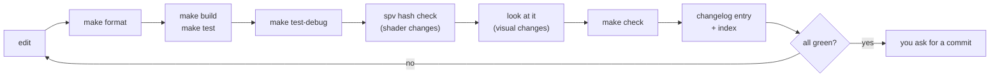

# Keeping Swish clean

**Label:** Largely AI-generated (Claude + subagents); verified by automated builds, tests and screenshots; please review.

**Legend:** ✅ done · ⚠️ watch out · ⏸ waiting on you

---

## TL;DR

- **One truth** — every fact lives in one place; edit the owner, delete copies.
- **Refactors change no output** — hashes, goldens and first frame stay identical.
- **Small files** — split by topic before 800 lines (C++) or 400 (GLSL).
- **Hard to get wrong** — prefer a table, `static_assert` or `make check` rule over a "keep in sync" comment.
- **You commit** — agents commit and push only when you ask.
- **Add a pass in 2 files** — `Passes/FooPass.cpp` plus one line in `Passes/PassList.def`; no `Renderer` edits.
- **Use the `vkx` builders** — `make_color_pass`, `Descriptors.h`, `Samplers.h`, `ImageView.h`, `RenderScope.h`, `push_range<T>`; no raw create-infos.
- **Tag dispatch for closed sets** — 2 to 4 variants, one `visit()` shim; not `if (kind == ...)` ladders.
- **Warnings count on macOS now** — AppleClang gets `-Wall -Wextra -Wpedantic`; keep 0.
- **Validation is `Debug` only** — `make run` / `make debug` define `NDEBUG`; use `SWISH_CLASSIC_VULKAN=1` to test the classic path.
- ⚠️ **Tree wins** — if this file and the code disagree, fix this file.

## Contents

- [The 5 rules](#the-5-rules)
- [Where things go](#where-things-go)
- [Rules by topic](#rules-by-topic): [Includes](#includes) · [Naming](#naming) · [Classes vs structs](#classes-vs-structs) · [Render passes](#render-passes) · [Tag dispatch](#tag-dispatch) · [File size](#file-size) · [Units](#units) · [Tunables](#tunables) · [Shaders](#shaders) · [Vulkan](#vulkan) · [Warnings](#warnings) · [Debug UI gating](#debug-ui-gating) · [Tests and goldens](#tests-and-goldens) · [Docs and changelog](#docs-and-changelog)
- [Daily loop](#daily-loop)
- [Before you commit](#before-you-commit)
- [Working with Claude](#working-with-claude)
- [Warning signs](#warning-signs)
- [Anti-patterns we removed](#anti-patterns-we-removed)

**Written** 2026-09-29, after the deep clean ([CLEANUP_2026-09-29.md](CLEANUP_2026-09-29.md)).

**Companions**

- **Where things are** — [REPO_MAP.md](REPO_MAP.md)
- **Step-by-step per task** — [RECIPES.md](RECIPES.md)
- **Layout** — [DIRECTORY.md](DIRECTORY.md)
- **Agent instructions** — [../CLAUDE.md](../CLAUDE.md) (the one file)
- **C++ conventions** — [../CONTRIBUTING.md](../CONTRIBUTING.md)
- **Design patterns** — [DESIGN_PATTERNS.md](DESIGN_PATTERNS.md) (factories, builders, registries, tag dispatch; mostly implemented, status per row)

---

## The 5 rules

1. **One source of truth per fact.**
   - A number, struct or list in two places is a bug waiting to happen.
   - Find the owner in [Where things go](#where-things-go), edit it there, delete the copy.
2. **Refactors change no output.**
   - Keep release `.spv` hashes identical, golden tests green, first frame pixel-identical.
   - If one moves, behaviour changed: stop and find out why.
3. **Small files, one topic.**
   - Split by topic before 800 lines (C++) or 400 lines (GLSL).
4. **Make the wrong thing hard.**
   - Use a table, a `static_assert`, a throwing helper or a `make check` rule.
   - Avoid comments that say "keep in sync".
5. **Release stays byte-identical.**
   - Unless you change it deliberately and verify it (see [Debug UI gating](#debug-ui-gating)).

Bonus rule

- **Commit and push only when you ask** — agents never do either unprompted.

---

## Where things go

| I want to add... | Put it in | Recipe |
|------------------|-----------|--------|
| A live-tunable slider | One line in [`src/debug/Tunables.def`](../src/debug/Tunables.def) (converted groups) | RECIPES: add-a-tunable |
| ...in an unconverted group | Hand-written sites: `DebugParams.h`, `DebugParamsIO.cpp`, `DebugUI.cpp` | RECIPES: add-a-tunable |
| A new class | `make new-class NAME=Foo DIR=scene` → `src/scene/Foo/Foo.{h,cpp}`; CMake globs it | RECIPES: add-a-source-file |
| A render pass | **2 files:** `src/renderer/Passes/FooPass.cpp` (class + `make_foo_pass()`) and one `PASS(Foo, make_foo_pass)` line in [`Passes/PassList.def`](../src/renderer/Passes/PassList.def) | [Render passes](#render-passes), RECIPES: add-a-render-pass |
| A shader | `shaders/<name>.{vert,frag,comp}` (globbed) | RECIPES: add-a-shader |
| A shared GLSL struct or helper | `shaders/common/<name>.glsl` (include guard); bindings in `bindings.glsl` | [../shaders/README.md](../shaders/README.md) |
| A unit conversion or pi | [`src/utils/units/Units.h`](../src/utils/units/Units.h) | [Units](#units) |
| A generic helper | `src/utils/<topic>/Name.h` + `tests/utils/test_<topic>_Name.cpp` | [../src/utils/README.md](../src/utils/README.md) |
| A Vulkan barrier, render pass, sampler, image view, descriptor layout, shader module, push block, label | `src/utils/vulkan/` (`swish::vkx`) | [../src/utils/vulkan/README.md](../src/utils/vulkan/README.md) |
| A road prop or ramp | `RoadScene_Furniture.cpp` / `_Ramps.cpp` / `_Surfaces.cpp`; order in `intro_elements()` / `chunk_elements()` | RECIPES: add-a-road-prop |
| A road dimension | [`RoadParams.h`](../src/scene/RoadScene/RoadParams.h) (C++); `config/road.toml` + `RoadConfig.h` (baked) | RECIPES: add-a-config-key |
| Car physics | Topic header in `src/scene/Entity/` | [car_system.md](car_system.md) |
| A key binding | `m_key_bindings` table in `src/core/App/AppInput.cpp` | [../src/core/README.md](../src/core/README.md) |
| A test | `tests/test_<topic>.cpp` (list in `tests/CMakeLists.txt`) or `tests/utils/` | RECIPES: add-a-test |
| A debug preset | Save from the UI into `~/.config/swish/presets/` (not in repo) | RECIPES: add-a-debug-preset |
| A note, draft, prompt | `scratch/` (gitignored). **Never the repo root** | - |
| A finished or stale doc | `archive/docs/<same path>` (tracked, `git mv`), row in `archive/README.md`, links repointed | [archive/README.md](../archive/README.md) |
| Local-only bulk (reference code, raw downloads, old builds) | `archive/local/` (gitignored) | [archive/README.md](../archive/README.md) |
| A diagram | `docs/diagrams/*.excalidraw` (Excalidraw JSON, version 2) | [README.md](README.md) |
| A changelog entry | `docs/changelog/YYYY-MM.md`, then `python3 scripts/changelog_index.py` | [Docs and changelog](#docs-and-changelog) |

<details>
<summary>Where the car-physics and render-pass files live</summary>

- **Physics topic headers** — `Tire.h`, `Powertrain.h`, `Longitudinal.h`, `Bicycle.h`, `WetGrip.h`, `Drivetrain.h`, `CarParams.h`.
- **Render pass wiring** — none in `Renderer`: the frame order is `PassList.def`, and `Renderer_Record.cpp` only brackets `PassRegistry::record_all`.

</details>

---

## Rules by topic

### Includes

- **Rooted at `src/`** — `#include "utils/units/Units.h"`, `#include "renderer/Renderer/Renderer.h"`.
- **Same directory** — bare name: `#include "Check.h"`.
- **Never `../`** — `rg '#include "\.\./' src tests tools` must print nothing.
- **Order** — Vulkan/GLFW, standard library, third-party (GLM), then project headers (see CONTRIBUTING).
- **Forward-declare** — when you only hold a pointer or reference.
- **Layering**
  - `utils/` includes only std and GLM (Vulkan headers under `vulkan/`, toml++ under `debug/`).
  - `utils/` never includes `core/`, `renderer/` or `scene/`.
  - Scene code never calls Vulkan directly.

### Naming

| Thing | Rule | Example |
|-------|------|---------|
| Class layout | `Name/Name.{h,cpp}`, one class per directory | `src/renderer/DofPass/DofPass.{h,cpp}` |
| Files | `PascalCase`, match the class | `RoadScene_Ramps.cpp` (topic suffix after `_` when splitting) |
| Functions (new, utils, free) | `snake_case` | `read_binary`, `sphere_outside_frustum` |
| Existing Vulkan-core getters | Keep `camelCase`; do not mix styles in one class | `getDevice()` |
| Members | `m_` + `snake_case` | `m_key_bindings` |
| Constants | `k` + `PascalCase` | `kWuPerMetre`, `kCrownSlope` |
| Namespaces | `swish`; `swish::util::<topic>`; `swish::vkx` | `swish::util::units` |
| Vocabulary types | Plain `swish::` so `Vec3`, `Mat4`, `u32` work | `utils/types/Types.h` |
| Header guard | `#pragma once` | |
| Namespace use | Local alias in `.cpp`; never `using namespace` in a header | `namespace uu = swish::util::units;` |

- **Formatting** — run `make format` after editing C++; `make format-check` only looks.

### Classes vs structs

Owner convention, 2026-09-29.

- **class** — a large component.
  - Owns resources or behaviour, keeps invariants, has private state.
  - Examples: `Renderer`, `PostProcessManager`, `RoadScene`, `CarEntity`, `CameraController`, `IRenderPass` and every pass, `PassRegistry`.
- **struct** — a sub-component of a class.
  - Plain data aggregate: a parameter or config block owned by, or passed to, a class.
  - Public fields, no invariants to protect.
  - Examples: `SsrParams`, `RoadParams`, `CarParams`, `FrameCtx`, `FrameState`.
- **Neither** — a stateless bag of `static` functions is a namespace with free functions (`swish::resource`, `swish::pipeline`).
- **Rule of thumb** — a constructor that enforces something, or private members, means class; just grouped fields means struct.
- **Patterns** — for factories, builders and registries see [DESIGN_PATTERNS.md](DESIGN_PATTERNS.md).

### Render passes

- **Two files** — `src/renderer/Passes/FooPass.cpp` and one line in [`PassList.def`](../src/renderer/Passes/PassList.def). Sources are globbed: no CMake edit, no `Renderer.h` edit.
- **Line order is recording order** — put the line where the pass records; `tests/utils/test_renderer_PassRegistry.cpp` pins the order, so update its expected list in the same change.
- **Debug-only pass** — `PASS_DEBUG(...)`; it is not compiled into the release list, so release output stays identical.
- **Fullscreen post pass** — derive `FullscreenPass<Push>`; implement `describe()` and, if needed, `before()` / `after()` for barriers.
- **Barriers are eager** — the pass that leaves an image in a layout records the barrier; state the layout in the pass header.
- **Private history** — cross-frame state (TAA images, previous view-projection, exposure) stays inside its pass; passes read named images (`Img`) and `FrameState`, never each other.
- **Recipe** — [RECIPES.md](RECIPES.md) add-a-render-pass; design in [`src/renderer/README.md`](../src/renderer/README.md) "Pass registry".

### Tag dispatch

- **When** — a closed set of 2 to 4 variants known at compile time, each needing different code, that would otherwise repeat an `if (kind == ...)` ladder in 3 or more places.
- **How** — empty tag types in `swish::tag` ([`utils/meta/Tags.h`](../src/utils/meta/Tags.h)), `_t` suffix on the type, overloads per consumer.
- **Runtime value** — one `visit()` shim does the single `switch` (see `tunables::visit` in [`Tunables.h`](../src/debug/Tunables.h), no `default:` so a new enumerator is a compile error).
- **Not tags** — a one-line difference (`if constexpr`), a value read at runtime (enum), or a property of a type (concept).
- **No** — tag hierarchies, traits classes or SFINAE.
- **Test** — [`tests/utils/test_meta_Tags.cpp`](../tests/utils/test_meta_Tags.cpp).

### File size

| Language | Limit | Enforced by |
|----------|-------|-------------|
| C++ (`.cpp` / `.h`) | **800 lines** | `scripts/check_file_sizes.sh` via `make check` |
| GLSL | **400 lines** | same |

- **Report-only** — `CHECK_ARGS=--strict` makes it fail.
- **Split by topic** — not "part 2".
- **How** — `Name_Topic.cpp` next to `Name.cpp`; sources are globbed, no CMake edit.
- **Move text-for-text** — keep float expression order.
- **Shared code** — goes in a small internal header.
- **Verify** — build both configs and check the `.spv` hashes (see [Shaders](#shaders)).
- ⚠️ **Today's offenders** (`make check` prints them) — `src/debug/DebugUI.cpp` (875), `tests/test_car_physics.cpp` (1810), `shaders/lighting.frag` (567). `PostProcessManager.cpp` was split into 5 files on 2026-09-29.

<details>
<summary>Examples of splits already done</summary>

| Big file | Split into |
|----------|-----------|
| `RoadScene.cpp` (was 2139) | `RoadScene.cpp`, `MeshBuilder.cpp`, `RoadScene_Surfaces.cpp`, `RoadScene_Furniture.cpp`, `RoadScene_Ramps.cpp` |
| `Renderer.cpp` (was 1718) | `Renderer.cpp`, `Renderer_Frame.cpp`, `Renderer_Record.cpp`, `Renderer_State.cpp`; the post passes moved into `src/renderer/Passes/` (one `.cpp` per pass) |
| `PostProcessManager.cpp` (was 1063) | `PostProcessManager.cpp`, `_Passes.cpp`, `_Images.cpp`, `_Descriptors.cpp`, `_Pipelines.cpp` |
| `CarPhysics.h` (was 955) | Umbrella header + `Powertrain.h`, `Tire.h`, `Bicycle.h`, `WetGrip.h`, ... |
| `App.cpp` (was 715) | `App.cpp`, `AppInit.cpp`, `AppInput.cpp` |

</details>

### Units

- **Scale** — `1 scene-metre = 1000 world units (WU)`; physics, geometry and lights are in WU.
- **Always `Units.h`** — [`Units.h`](../src/utils/units/Units.h), namespace `swish::util::units`.
- **Helpers** — `kWuPerMetre`, `kWuPerFt`, `m()`, `ft()`, `to_m()`, `to_ft()`, `kPi`, `kTwoPi`.
- **No literals** — never write `1000`, `0.3048` or `3.14159` for a conversion.
- **Gone** — `WORLD_SCALE` and `Constants.h` no longer exist.
- **Road dimensions** — `constexpr` in `RoadParams.h`; the baker includes `RoadConfig.h` instead of copying.

```cpp
namespace uu = swish::util::units;
const float lane = uu::ft(13.0f);        // 3962.4 WU, not 13.0f * 304.8f
const float dist = uu::m(50.0f);         // not 50.0f * 1000.0f
```

### Tunables

- **Debug UI only** — live tuning exists only in debug-UI builds.
- **Add one line** — to [`Tunables.def`](../src/debug/Tunables.def), inside the right group.
- **It generates** — the `DebugParams` field and default, TOML save and load, the ImGui slider, the dump line.
  - Also the push-constant copy for `PUSH(...)`.
- **Never** — rename an existing TOML key, or change the `TUNE_B` / `TUNE_F` arity.
- **Keep** — `lo <= def <= hi`; use `NOREL` unless the release default must differ.

```cpp
TUNE_F(ssrIntensity, "ssr", "intensity", 0.714f, 0.0f, 2.0f, "Intensity##ssr", "%.3f", 3, PUSH(intensity), NOREL)
```

<details>
<summary>When you still need manual code</summary>

- **Group not converted** — only `ssr` (5), `reflection` (3) and `wet` (4: porosity, roughness, puddles enabled, puddle coverage) are.
  - Everything else is hand-written in `DebugParams.h`, `DebugParamsIO.cpp`, `DebugUI.cpp` (RECIPES: add-a-tunable).
- **Value goes to the set-4 UBO** (`NOPUSH`)
  - Pack it in `SceneParamsUniform.cpp::update`.
  - Keep the `static_assert` on `SceneParamsUBO` and the GLSL block in step.
- **Value goes to a push block**
  - Add the member to both the C++ struct and the GLSL block.
  - Push blocks are multiples of 16 bytes on MoltenVK.
- **Derived logic** (e.g. `ssrEnabled` zeroing intensity)
  - Keep it next to the generated copy in the owning pass (`SsrPass::describe` in `src/renderer/Passes/SsrPass.cpp`).
- **Release literal in a shader must match the default**
  - `tests/test_debug_params_io.cpp` diffs the hand-written macros against the table.

</details>

### Shaders

- **Shared code** — in [`shaders/common/`](../shaders/common/), pulled in with `#include "name.glsl"`.
- **Never paste a struct** — into a shader.
- **Hashes stay identical** — for a pure refactor.
  - Run `(cd build/shaders && shasum -a 256 -c ../../tests/golden/release_spv.sha256)` after a release build.
  - A failure means the SPIR-V changed: undo, or make it deliberate and re-record.
- ⚠️ **Hashes assume glslc 1.4.321.0** — the SDK one.
  - Check `which -a glslc`.
  - With `VULKAN_SDK` unset, Homebrew's newer glslc wins and every hash differs.
  - Pass `-DGLSLC=$HOME/VulkanSDK/1.4.321.0/macOS/bin/glslc`.
- **No `sampler2DShadow`** — MoltenVK; use plain `sampler2D` + manual PCF.
- **Rebuilds** — editing an include rebuilds the shaders that use it (glslc `-MD` depfile; Xcode generator rebuilds all).
- ⚠️ **Kill the app before rebuilding** — `.spv` files load at startup.

<details>
<summary>What lives in <code>shaders/common/</code> and glslc quirks</summary>

- **`bindings.glsl`** — all `SET_*` / `BIND_*` numbers.
- **`camera.glsl`** — `CameraUBO`; opt-in `CAMERA_UBO_WEATHER` / `CAMERA_UBO_CSM`.
- **Others** — `lights.glsl`, `math.glsl`, `hash.glsl` / `hash11.glsl`, `oct.glsl`, `color.glsl`, `puddle.glsl`.
- **Unused functions** — glslc emits them, so put a function not used by every includer behind an opt-in `#define` or its own file.
- **Constants** — use `#define` for `LUMA_*` (a global `const vec3` changes the emitted SPIR-V).
- **Luma** — `LUMA_709` and `LUMA_601` stay separate on purpose.

</details>

### Vulkan

- **Use `vkx` helpers** — not hand-rolled structs. See the [`vkx` README](../src/utils/vulkan/README.md).
  - `VK_CHECK` for every fallible call.
  - `vkx::image_barrier` for layout transitions (`image_barrier_auto` where a sync2 path exists).
  - `vkx::make_shader_module` and `push_range<T>()` for **every** push range (the 16-byte rule is a `static_assert`).
  - **Builders** — `make_color_pass` (`RenderPass.h`, or `make_forward_hdr_pass` for forward passes), `make_sampler_layout` / `PoolSizes` / `allocate_set` (`Descriptors.h`), `make_sampler` (`Samplers.h`), `make_image_view2d` (`ImageView.h`), `RenderScope` (`RenderScope.h`). Do not write a new `vkCreateRenderPass`, `vkCreateSampler` or `vkCreateImageView` by hand.
  - **Aggregates, not chains** — a config with 3 or more knobs is a `struct` with defaults and designated initialisers; no fluent builders.
- **Barriers** — `Barrier.h` has a constexpr `(old layout, new layout)` table.
  - An unsupported pair **throws or fails `static_assert`**.
  - Add a row and prove it against the spec.
  - ⚠️ Never add a "default to TOP/BOTTOM_OF_PIPE" fallback.
  - The legacy helper (`ResourceManager::insertImageBarrier`) is gone; the luminance blit chain is on `vkx` too.
- **Handles** — start as `VK_NULL_HANDLE`; cleanup checks `!= VK_NULL_HANDLE` and resets.
  - Destroy in reverse creation order.
  - Own GPU memory through `GpuImage` / `GpuBuffer` ([vma-memory.md](vma-memory.md)).
- **MoltenVK** — push-constant blocks are **multiples of 16 bytes**; match formats across blits.
- **Descriptor sets 0 to 4** — listed in [REPO_MAP.md](REPO_MAP.md).
- ⚠️ **Validation** — runs only in a plain `Debug` build (`-DCMAKE_BUILD_TYPE=Debug`).
  - `make run` and `make debug` define `NDEBUG` and turn it off.
  - Run validation (with sync validation) for any barrier or pass change, including resize and teardown.
  - **Baseline** — 0 messages in 4 configs (debug-UI TAA off; TAA + auto-exposure on dynamic rendering; same on the classic path; release-look). Keep it 0.
- **Two paths** — `Device` enables Vulkan 1.3 dynamic rendering + `synchronization2` when supported and logs one `[Device]` line.
  - `SWISH_CLASSIC_VULKAN=1` forces the classic path, so both paths can be tested on one machine.
  - A pass with a dynamic-rendering path must leave images in the same layouts on both paths.
- **Pipeline cache** — owned by `Device`, passed as `RendererServices::pipelineCache`; never a global.

<details>
<summary>Header comment block and quick check</summary>

- **Every `vulkan/` header** names the Vulkan concept and links docs in its comment block.
- **Fields** — `Vulkan concept / Spec / Guide / Vulkan-Hpp / MoltenVK notes / Purpose / Ownership / See also`.
- **Check** — `grep -L "Vulkan concept" src/utils/vulkan/*.h` prints nothing.

</details>

### Warnings

- **Full flags on every compiler** — `-Wall -Wextra -Wpedantic` now apply on GNU, Clang **and AppleClang** (before 2026-09-29 the block skipped AppleClang, so macOS builds never had them).
- **Keep first-party at 0** — release and debug-UI, with `-DSWISH_WERROR=ON` (warnings become errors) before you finish a change.
- **Third-party is `SYSTEM`** — VMA and the vendored `include/` do not warn; do not edit them to silence anything.
- **Fix, do not suppress** — a `(void)x` or `[[maybe_unused]]` is fine for a genuinely release-only unused value; a blanket `-Wno-...` is not.
- **GCC** — `g++-16` builds clean and runs every test except the Clang-bound golden-mesh intro hash (needed for Arch).

### Debug UI gating

- **Gate everything** — all debug-UI and live-tuning code sits behind `#ifdef SWISH_DEBUG_UI`.
- **Compile scope** — `src/debug/` is compiled only with the flag; debug shaders use `-DSWISH_DEBUG_UI`.
- **Release rule** — the release build (`SWISH_DEBUG_UI=OFF`) must be **byte-identical** to before, or a change you meant and verified.
- **Identity defaults** — no override, fixed exposure, identity correction must reproduce old behaviour exactly.
- **After any change**
  - Build both configs.
  - Check the 33 `.spv` hashes.
  - For anything visible, compare a window-only screenshot (see [Daily loop](#daily-loop)).

### Tests and goldens

- **Three test targets** — they differ in what they link.
  - `swish_tests` — Catch2 + GLM + **GLFW** (`Camera.cpp` and `CarEntity.cpp` call `glfwGetKey`).
  - `swish_utils_tests` — Catch2 + GLM only, **no GLFW**; one test per util header.
  - `swish_debug_tests` — debug-UI builds only (`-DSWISH_DEBUG_UI=ON`); `DebugParams` IO, links toml++, no GLFW.
- **No Vulkan loader, no window** — no test target links the loader or needs a GPU (details in [`tests/README.md`](../tests/README.md)).
- **Util tests** — `tests/utils/test_<topic>_<Header>.cpp`, listed in `tests/utils/CMakeLists.txt`.
- **Test names** — no `,` `;` `[` `]` in `TEST_CASE` names; CTest discovery splits on them.
- **Bug fix** — gets a test that fails without it.
- ⚠️ **Never regenerate a golden to make a refactor pass** — a golden diff means behaviour changed.
- **`SWISH_UPDATE_GOLDENS=1 build/tests/swish_tests "[golden]"`** — only for a deliberate change; review the diff ([golden README](../tests/golden/README.md)).

<details>
<summary>Golden details</summary>

- **Mesh hashes** — bound to the shipped Release build (Apple clang, arm64, optimised).
  - They fail at `-O0`, with `-ffp-contract=off` and under GCC (FMA contraction).
  - Not a regression; a portable check is an open item.
- **Car trajectory** — tolerance 1e-3 abs + 1e-3 rel; gear exact.
- **Why no GLFW in utils tests** — it guards `src/utils/` against depending on GLFW.

</details>

### Docs and changelog

- **Changelog entry** — every non-trivial change (fixes, tuning, refactors too) goes at the top of `docs/changelog/YYYY-MM.md`.
  - Skip only for pure formatting or comment edits.
- **Entry shape**
  - Heading `### YYYY-MM-DD — <title>`.
  - A one-line past-tense summary.
  - `<details><summary>Technical summary</summary>` with motivation, fix as `[path](path)` links, a file-change table.
  - `$$...$$` or mermaid where they clarify.
- **Index** — run `python3 scripts/changelog_index.py`; `make check` fails if you forget.
- **Path changes** — update [REPO_MAP.md](REPO_MAP.md), [RECIPES.md](RECIPES.md) and the touched directory's README in the same change.
  - Both have `verified:` / `against:` front-matter; bump it when you re-check.
- **Stale status** — put "what is open" in `tasks/todo.md` and the user goal in `docs/user-goals/CURRENT.md`, not `CLAUDE.md`.
- **New doc** — add it to [README.md](README.md) (the index) and link it from where readers will look.

---

## Daily loop



1. `make format`
2. `make build && make test`
3. `make test-debug`
4. Shader change: `(cd build/shaders && shasum -a 256 -c ../../tests/golden/release_spv.sha256)`
5. Visual change: run it and look (see below)
6. `make check`
7. Changelog entry, then `python3 scripts/changelog_index.py`

| Command | Use |
|---------|-----|
| `make` / `make help` | List targets |
| `make build`, `make test` | Release tree (`build/`) + ctest |
| `make debug`, `make test-debug` | Debug-UI tree (`build-debug/`, RelWithDebInfo) + ctest |
| `make check` (`CHECK_ARGS=--strict`) | Hygiene: changelog index, stray root files, ignored-but-tracked, source globs; sizes and format report-only |
| `make format`, `make format-check` | clang-format in place, or dry run |
| `make new-class NAME=Foo DIR=scene` | Scaffold a class |
| `make install-hooks` | Install pre-commit hook (runs `check --quick`); opt-in; bypass once with `--no-verify` |
| `cmake ... -DSWISH_WERROR=ON` | Warnings become errors, with the full flag set on macOS too (use before finishing a refactor) |

**Visual check**

- **Screenshot** — run it, then window-only `screencapture -R <window bounds>`; never the full display.
- **Force** — set the default to an extreme, judge, then **revert the force**.
- **Rain** — test both 0 and 1.0.

---

## Before you commit

- [ ] `make format` run (or only-touched files formatted)
- [ ] `make test` and `make test-debug` green
- [ ] Shader change: 33/33 `.spv` hashes match (pure refactor), or hashes deliberately re-recorded and said so
- [ ] Barrier / pass change: ran once in a Debug build with validation, 0 messages (and once with `SWISH_CLASSIC_VULKAN=1` if it touches a dynamic-rendering pass)
- [ ] Release and debug-UI build with `-DSWISH_WERROR=ON`: 0 first-party warnings
- [ ] Visual change: window-only screenshot looked at, temporary forces reverted
- [ ] Debug-only code is inside `#ifdef SWISH_DEBUG_UI`; release output unchanged or change stated
- [ ] No goldens regenerated to hide a diff
- [ ] No new literal `1000`, `0.3048`, pi; no `../` include; no file over 800 / 400 lines
- [ ] New file is in the right place; READMEs, REPO_MAP, RECIPES updated if paths changed
- [ ] Changelog entry added and `python3 scripts/changelog_index.py` run
- [ ] `make check` prints OK (soft warnings understood)
- [ ] Nothing new in the repo root (`scratch/` or `archive/` instead)
- [ ] You asked for this commit

---

## Working with Claude

- **Instruction file** — [`CLAUDE.md`](../CLAUDE.md) is the only one (the `AGENTS.md` stub was removed 2026-09-29; Codex and other tools should be pointed at `CLAUDE.md`).
  - Change rules there, once.
- **Plan first** — for anything touching more than a couple of files or changing architecture.
  - Say what must not change: release output, hashes, goldens.
- **Parallel agents** — give each a **disjoint set of directories**; two agents on one file lose edits.
- **Dispatch depth** — at most 1; an orchestrator dispatches specialists, specialists do not dispatch.
- **Verify before "done"**
  - Build both configs and `ctest` both trees.
  - `.spv` hashes for shader work.
  - Window-only screenshot for visual work.
  - Debug build with validation for barrier or pass work.
  - ⚠️ "It compiles" is not done.
- **Drafts** — agent output is a draft; read the diff and label AI-generated documents.
- **Commits** — agents commit or push only when you ask.
- **Backups** — uncommitted work lives only in the working tree; ask for a backup (see the reconciliation plan) before risky operations.

---

## Warning signs

Run this list when the repo starts getting messy again.

1. **File sizes** — run `make check CHECK_ARGS=--strict`; the top offenders are your next split.
2. **Format drift** — `make check CHECK_ARGS=--verbose` lists it; do the repo-wide format as **its own commit**.
3. **Unit and pi literals** — `rg "0\.3048|3\.14159|1000\.0f" src`.
   - Expect no hits except `Units.h` and non-length uses (milliseconds, counts).
4. **Parent includes** — `rg '#include "\.\./' src tests tools` must print nothing.
5. **Root files** — anything at the root not in the `check_root.sh` allowlist.
6. **Stale maps** — `REPO_MAP.md` / `RECIPES.md` `verified:` dates old, or their paths missing.
7. **Next cleanup** — open a task in `tasks/todo.md` with a named target (one file to split, one duplicate to remove).
   - Get a plan approved.
   - Gate it with the same safety net: goldens, 33 hashes, both configs, no output change.
8. **Never "just add one more"** — to a file at its limit: split first, then add.

---

## Anti-patterns we removed

| Smell | What it cost | Fix now |
|-------|--------------|---------|
| **God files** (`RoadScene.cpp` 2139, `Renderer.cpp` 1718, `CarPhysics.h` 955, `App.cpp` 715) | Merge conflicts, slow builds, nothing findable | Split by topic under the size limit |
| **Copy-pasted constants** (`1000`, `0.3048`, pi in 6+ places, "must match" comments) | Silent drift | `Units.h`, `RoadParams.h`, shared `RoadConfig.h` |
| **Hand-listed sources** in two CMake files | New files silently not built | `file(GLOB_RECURSE ... CONFIGURE_DEPENDS)`; `make check` verifies |
| **Duplicated shader structs** (`CameraUBO` in 9 shaders) | One edit, nine places, mismatched std140 | `shaders/common/*.glsl` |
| **Silent barrier fall-through** (unknown pair became TOP/BOTTOM_OF_PIPE, access 0) | Missing sync that "worked" | `vkx::image_barrier` table that throws |
| **One tunable in 6 to 8 places** | Forgotten save/load/UI | `Tunables.def` one-liner |
| **Three copies of shader-module creation** (one leaked) | Leaks on error | `vkx::make_shader_module` (throws on bad `.spv`) |
| **Root clutter** (`issue.md`, `prompt.md`, `plan/`, `debug`, `renderer`, `scene` from shell redirects) | Noise, accidental commits | `scratch/`, `archive/`, `scripts/check_root.sh` allowlist |
| **`../../` includes** | Moves break everything | Rooted includes |
| **Dead code kept "just in case"** (`generate_trees`, unused getters, `DepthBuffer/`) | Misleads readers and agents | Delete it; git has it |
| **Hand-wired pass plumbing** (5 C++ files per pass; 12 managers created, cleaned and recreated by hand in `Renderer`) | Forgotten recreate / cleanup, merge conflicts | `Passes/PassList.def` + `IRenderPass` lifecycle |
| **Per-pass Vulkan boilerplate** (13 `vkCreateRenderPass`, 9 `vkCreateSampler`, 15 descriptor layouts) | Copy-paste drift, missing subpass dependencies | `vkx` builders |
| **Per-type `if (kind == ...)` ladders** (4 in the tunable save / load / UI / dump code) | A new kind needs edits in four places | Tag dispatch + one `visit()` |
| **Stateless classes and hidden globals** (all-`static` `Pipeline` / `ResourceManager`, a process-wide pipeline cache) | Misleading types, hidden state | Namespaces of free functions; cache passed in `RendererServices` |
| **Warning flags that silently did not apply** (AppleClang was skipped) | "0 warnings" claims that were untrue | AppleClang added; `-DSWISH_WERROR=ON` |
| **Status claims in CLAUDE.md** | Agents re-planned shipped work | Live sources only (`tasks/todo.md`, `git log`) |
| **Presets inside `build/`** | Wiped by `make clean` | `~/.config/swish/presets/` |
| **A doc per agent, no index** | Stale duplicates | One instruction file, `docs/README.md` index |
