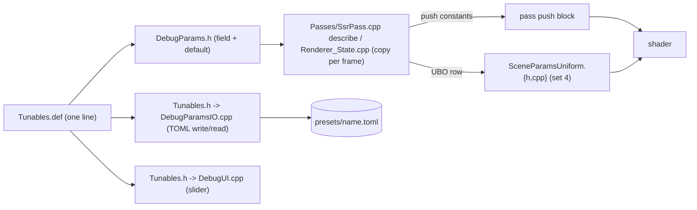

# Repo map

> **Label:** AI-generated, verified against the working tree on 2026-09-29 (after the deep clean). Line counts and
> file counts decay; re-run `ls`/`wc -l` before relying on them. The full annotated tree is
> [DIRECTORY.md](DIRECTORY.md); for "how do I add X" see [RECIPES.md](RECIPES.md); what the clean-up changed is
> [CLEANUP_2026-09-29.md](CLEANUP_2026-09-29.md); upkeep rules are [KEEPING_IT_CLEAN.md](KEEPING_IT_CLEAN.md).
> Rules and build commands: [../CLAUDE.md](../CLAUDE.md).

## 1. Directory table

| Path | Layer / role | Read first |
|------|--------------|------------|
| `src/core/{App,CameraController,Window}` | Main loop (`App::run` skeleton in `App.cpp`, startup in `AppInit.cpp`, key table in `AppInput.cpp`), camera modes, GLFW window | [../src/core/README.md](../src/core/README.md) |
| `src/renderer/*` (27 dirs + `Bindings.h`, `RendererConfig.h`) | Vulkan managers and render passes; `Renderer/` is the facade (lifecycle + the pass loop, split over `Renderer{,_Frame,_Record,_State}.cpp`); `Passes/` is the pass registry (`PassList.def` = the ordered frame, one `.cpp` per pass); `GeometryProducer/` (CSM + G-buffer) and `WeatherController/` were split out of `Renderer` | [architecture.md](architecture.md), [../src/renderer/README.md](../src/renderer/README.md) |
| `src/scene/{Camera,Corridor,Entity,ModelManager,RoadGeometry,RoadScene,SceneManager,Treadmill}` | Scene, procedural road (`RoadScene_*.cpp`, `MeshBuilder`, `RoadParams.h`), real-LIE corridor, car entity and physics (`CarPhysics.h` umbrella over `CarParams/Powertrain/Tire/Drivetrain/Longitudinal/Bicycle/WetGrip`) | [../src/scene/README.md](../src/scene/README.md), [endless-road.md](endless-road.md) |
| `src/debug/*` | Dear ImGui live-tuning UI, `DebugParams`, `Tunables.def` registry, TOML presets, set-4 UBO (compiled only with `SWISH_DEBUG_UI=ON`) | [debug-ui.md](debug-ui.md) |
| `src/utils/<topic>/` | Generic helpers by topic: `types/ units/ math/ geometry/ color/ container/ meta/ io/ vulkan/ debug/`; namespace `swish::util::<topic>`, Vulkan glue `swish::vkx` (barriers, `Rendering.h`, and the builders `RenderPass.h`, `Descriptors.h`, `Samplers.h`, `ImageView.h`, `RenderScope.h`); tag dispatch in `meta/Tags.h` | [../src/utils/README.md](../src/utils/README.md), [../src/utils/vulkan/README.md](../src/utils/vulkan/README.md) |
| `shaders/*`, `shaders/common/*.glsl` | 33 GLSL files (`.vert/.frag/.comp`) compiled to SPIR-V by `glslc`; shared includes in `common/` | [../shaders/README.md](../shaders/README.md) |
| `config/` | `road.toml` (baked to `road.bin` by `toml_baker`), `lie_corridor.toml` (input to `tools/lie_corridor.py`); `config/presets/` is local and gitignored | [../tools/README.md](../tools/README.md) |
| `tools/` | `toml_baker.cpp`, `lie_corridor.py`, `sign_generator.py`, `car_analyzer/` | [../tools/README.md](../tools/README.md) |
| `tests/`, `tests/utils/`, `tests/golden/` | Catch2 v3, GPU-free: 9 top-level `test_*.cpp` in `swish_tests`, 24 `tests/utils/test_*.cpp` in `swish_utils_tests` (no GLFW; includes the pass-order pin `test_renderer_PassRegistry.cpp`), `swish_debug_tests` (debug-UI build only: `test_debug_params_io.cpp`, `utils/test_debug_TomlGlm.cpp`), golden fixtures | [../tests/README.md](../tests/README.md), [../tests/golden/README.md](../tests/golden/README.md) |
| `scripts/` | `check_repo.sh` (`make check`), `check_root.sh`, `check_file_sizes.sh`, `format.sh`, `changelog_index.py`, `create_object.sh` (`make new-class`), `glslc_test.sh`, `test_source_registry.sh`, `run_linux.sh`, `hooks/pre-commit`; `prune_sources.sh` is a no-op kept for old docs | [KEEPING_IT_CLEAN.md](KEEPING_IT_CLEAN.md) |
| `docs/`, `tasks/`, `docs/user-goals/` | Documentation, live plan, current user goal; finished plan sections live in `tasks/archive/`; stale docs, old notes and local-only bulk in `archive/` | [README.md](README.md), [../archive/README.md](../archive/README.md) |
| `assets/` (incl. `assets/cars/`), `textures/` | GLB car models (local, `assets/cars/`), PBR/sign textures, logo/GIF, `assets/corridor/lie_corridor.bin` (HDRIs under `assets/Sky/` when present) | [car_system.md](car_system.md) |

**Includes** are rooted at `src/` (`#include "utils/units/Units.h"`); a same-directory include uses the bare name;
`../` is never used. **New assets** (models, HDRIs, textures) are produced on the Arch machine and pulled over ssh; do
not generate binary assets in-tree.

Largest files (lines, measured 2026-09-29 after the follow-ups): `tests/test_car_physics.cpp` 1810, `src/debug/DebugUI.cpp` 875,
`shaders/lighting.frag` 567, `src/scene/Entity/CarEntity.cpp` 516. The former god files are split: `Renderer.cpp` 1718 to 268 (+3
topic files; the post passes now live in `src/renderer/Passes/`), `RoadScene.cpp` 2139 to 359 (+`MeshBuilder` and 3 topic files),
`CarPhysics.h` 955 to a 25-line umbrella, `App.cpp` 715 to 249 (+`AppInit.cpp`, `AppInput.cpp`), `PostProcessManager.cpp` 1063 to
232 (+4 topic files). `make check` reports files over 800 (C++) / 400 (GLSL) lines.

## 2. Pass to shader to file table

The frame order is [`src/renderer/Passes/PassList.def`](../src/renderer/Passes/PassList.def) (line order = recording order; a test pins
it). Each pass's factory lives in the file named in the last column. Verified by grepping the `.cpp` files for the shader names.

| Pass | Shaders | Owning C++ |
|------|---------|------------|
| Depth-only / CSM | `depth_only.{vert,frag}` | `src/renderer/DepthOnlyPipeline/DepthOnlyPipeline.cpp` |
| G-buffer + shadow atlas (`Geometry` producer) | `basic.vert`, `gbuffer.frag` | `src/renderer/GeometryProducer/GeometryProducer.cpp` (pipelines in `ScenePipeline/`) |
| Velocity (debug-gated) | `velocity.{vert,frag}` | `src/renderer/VelocityPass/VelocityPass.cpp` |
| SSAO + blur | `ssao.frag`, `ao_blur.frag` | `src/renderer/Passes/SsaoPasses.cpp` (GPU objects in `PostProcessManager/`) |
| Deferred lighting | `fullscreen.vert`, `lighting.frag` | `src/renderer/Passes/LightingPass.cpp` (pipeline in `DeferredLightingPipeline/`) |
| SSR, god-rays, bloom, composite | `ssr.frag`, `godrays.frag`, `bloom_{extract,blur}.frag`, `composite.frag` | `Passes/SsrPass.cpp`, `GodRaysPass.cpp`, `BloomPasses.cpp`, `CompositePass.cpp` (GPU objects in `PostProcessManager/`) |
| HDR finalize (luminance pyramid or HDR to shader-read barrier) | (blit chain, no shader) | `src/renderer/Passes/HdrFinalizePass.cpp` |
| DoF | `dof.frag` | `src/renderer/DofPass/DofPass.cpp` |
| Glass | `glass.{vert,frag}` | `src/renderer/GlassPass/GlassPass.cpp` |
| Rain | `rain.{vert,frag}` | `src/renderer/RainSystem/RainSystem.cpp` |
| Windshield rain + wetness | `windshield_rain.{vert,frag}`, `windshield_wetness.frag` | `src/renderer/WindshieldRainPass/WindshieldRainPass.cpp` |
| Spray (compute) | `spray_sim.comp`, `spray.{vert,frag}` | `src/renderer/SpraySystem/SpraySystem.cpp` |
| TAA (debug-gated) | `taa.frag` | `src/renderer/TaaPass/TaaPass.cpp` |
| IBL bake | `ibl_{sky,equirect,irradiance,prefilter,brdf}.frag` | `src/renderer/IBLManager/IBLManager.cpp` |

`fullscreen.vert` is shared by every screen-space pass. `basic.frag` is not loaded by any `.cpp`
(unused forward fallback). Shader discovery is a glob in `CMakeLists.txt` (`SHADER_SOURCES`, `CONFIGURE_DEPENDS`); the
shared includes are `shaders/common/{bindings,camera,lights,math,hash,hash11,oct,color,puddle}.glsl`
(glslc `-I` + depfile, so an edited include rebuilds exactly the shaders that use it). Recording order lives in
`Passes/PassList.def`; `Renderer_Record.cpp` (`recordCommandBuffer`) only brackets `PassRegistry::record_all`. To add a pass see
[RECIPES.md](RECIPES.md) add-a-render-pass (2 files).

## 3. Descriptor set map (from `shaders/lighting.frag`)

| Set | Content | Bindings |
|-----|---------|----------|
| 0 | `CameraUBO`, `LightsUBO` | 0, 1 |
| 1 | G-buffer | 0 albedo, 1 normal, 2 material, 3 depth, 4 clearcoat/flake (`gbClearcoatFlake`) |
| 2 | Shadow map (CSM atlas, plain `sampler2D`, manual PCF) | 0 |
| 3 | IBL: irradiance cube, prefiltered cube, BRDF LUT | 0, 1, 2 |
| 4 | `SceneParamsUBO` (live tunables), `static_assert(sizeof == 11 * 16)` in `src/debug/SceneParamsUniform.h` | 0 |

Push-constant blocks must be 16-byte multiples (MoltenVK; `utils/vulkan/PushConstants.h` static-asserts it). Layouts:
[data-types.md](data-types.md).

## 4. Tunable data flow

`Tunables.def` is an X-macro registry: for the **converted groups** (`ssr` 5, `reflection` 3, `wet` 4: porosity,
roughness, puddles enabled, puddle coverage; 12 tunables) one line generates the field, TOML key, slider, dump line and push copy. Every other
group is still hand-written across `DebugParams.h`, `DebugParamsIO.cpp` and `DebugUI.cpp`.
`DebugParams`, `DebugParamsIO`, `DebugUI`, `Tunables` and `SceneParamsUniform` are `#ifdef SWISH_DEBUG_UI` territory;
the release shader keeps literal constants (`SP_*` macros in `lighting.frag`). Presets are TOML files in
`$SWISH_PRESETS_DIR`, else `$XDG_CONFIG_HOME/swish/presets/`, else `~/.config/swish/presets/` (the old
`build/config/presets/` is still read as a fallback).

## 5. Corridor vs treadmill

`CorridorDriver` (real OSM-derived LIE corridor, [phase-3-osm-lie-corridor.md](phase-3-osm-lie-corridor.md)) is the
**active** road path: `App` calls `m_corridor.update`. `Treadmill` (procedural endless road,
[endless-road.md](endless-road.md)) is vestigial: still constructed and tested, not the driven road. Both are owned by
`App` (`src/core/App/App.h`); read `App.cpp` to confirm before editing either.

## 6. Local-only trees

Everything local-only now lives in `archive/local/` (gitignored), indexed in [../archive/README.md](../archive/README.md).

`archive/local/review_2026-09-29/` (audit and plan documents from the clean-up) is gitignored and exists only on the machine that
produced it; nothing tracked may link into it. Likewise `scratch/`, `archive/local/examples/`, `build*/`, `.claude/`.

## After planned refactors

Update the pass table when a pass moves, when `PostProcessManager` hands its GPU objects to the pass classes (not done yet), and
section 4 as more tunable groups convert to `Tunables.def`. Bump `verified:` and `against:`.
