# Architecture

Swish is organized as a 5-layer stack. Each layer depends only on the layers below it. Shared helpers live in
`src/utils/<topic>/` (namespace `swish::util::<topic>`, Vulkan glue `swish::vkx`); project includes are rooted at
`src/` and never use `../` (see [`src/utils/README.md`](../src/utils/README.md)). Where every file lives:
[REPO_MAP.md](REPO_MAP.md) and [DIRECTORY.md](DIRECTORY.md).

```
┌─────────────────────────────────────────────────────────────────┐
│  Layer 1 — Platform          App · Window · GLFW                │
├─────────────────────────────────────────────────────────────────┤
│  Layer 2 — Vulkan Core       VulkanContext · Device · Swapchain │
│                              CommandManager · SyncObjects        │
├─────────────────────────────────────────────────────────────────┤
│  Layer 3 — Render Systems    PassRegistry (Passes/) · one class │
│                              per pass · GeometryProducer         │
│                              PostProcessManager · WeatherController│
│                              CameraUniforms · MaterialDescriptors│
│                              TextureManager · swish::resource    │
├─────────────────────────────────────────────────────────────────┤
│  Layer 4 — Scene             SceneManager · RoadScene · Camera  │
│                              Entity · CarEntity · ModelManager   │
├─────────────────────────────────────────────────────────────────┤
│  Layer 5 — Shaders           GLSL 450 → glslc → SPIR-V          │
└─────────────────────────────────────────────────────────────────┘
```

See [`docs/diagrams/system-overview.excalidraw`](diagrams/system-overview.excalidraw) for the component ownership diagram.

---

<details>
<summary><strong>Layer 1 — Platform</strong></summary>

### App (`src/core/App/`)

The top-level orchestrator, split over three files: `App.cpp` (ctor, `run()`, per-frame stages, `shutdown()`),
`AppInit.cpp` (`init()` and its steps) and `AppInput.cpp` (data-driven key table, GLFW callbacks); camera placement
lives in `src/core/CameraController/`. `App::run()` is a short skeleton around the main loop:

```
delta_time = min(now − last_frame, 1/15 s)
```

$$dt_\text{eff} = \min\!\left(t_\text{now} - t_\text{last},\; \tfrac{1}{15}\ \text{s}\right)$$

The cap prevents physics blow-up after focus loss or debugger pauses — without it, a 5-second stall would integrate 5 seconds of car acceleration in one step.

**Per-frame loop:**

```
poll_events()
process_key_bindings()      (key table: Esc cursor, C camera, R rain, V wiper, G weather, backtick edit mode in debug)
camera.poll_input(...)      (free-fly WASD / helicopter Q,E)
update_car(dt)              (drive, Y-snap, corridor update, wheel visuals, push draws)
update_camera(dt)           (CameraController: cockpit/chase/... placement)
renderer.drawFrame(dt)
```

**Input edge detection:** each binding row in `m_key_bindings` carries its own `KeyEdge`, which fires only on the rising edge of the key press. Without this, a toggle such as cursor-lock would flip every frame (~60×/s) while the key is held. Details: [`src/core/README.md`](../src/core/README.md).

**Ownership:** App owns `Window`, `Renderer`, `TextureManager`, `SceneManager`, `ModelManager`. Only `TextureManager` is registered with Renderer (`register_texture_manager`); the write-only `register_scene_manager` / `register_model_manager` hooks were deleted on 2026-09-29.

### Window (`src/core/Window/`)

A thin GLFW wrapper. Created with `GLFW_CLIENT_API = GLFW_NO_API` — no OpenGL context.

| Method | Behavior |
|--------|---------|
| `pollEvents()` | `glfwPollEvents()` — non-blocking, returns immediately |
| `waitEvents()` | `glfwWaitEvents()` — blocks CPU until any event arrives |
| `mark_resized()` | Called from GLFW resize callback; sets `m_resized = true` |
| `wasResized()` | Returns and **clears** `m_resized` — consume once per frame |

`waitEvents()` is used in the minimize spin-loop so the CPU blocks at ~0% instead of spinning at 100% checking a 0×0 framebuffer.

</details>

---

<details>
<summary><strong>Layer 2 — Vulkan Core</strong></summary>

These five subsystems form the Vulkan infrastructure. They must be initialized in order and cleaned up in reverse.

### VulkanContext (`src/renderer/VulkanContext/`)

Creates the `VkInstance`, debug messenger (validation layers in debug builds), and `VkSurfaceKHR` via `glfwCreateWindowSurface`.

On `SWISH_BACKEND_APPLE`, two additional instance extensions are required for MoltenVK:
```cpp
VK_KHR_PORTABILITY_ENUMERATION_EXTENSION_NAME   // list portability devices
VK_INSTANCE_CREATE_ENUMERATE_PORTABILITY_BIT_KHR // flag
```

Validation layer enablement uses `constexpr bool kEnableValidationLayers` so the compiler eliminates the debug path entirely in release builds. It keys on `NDEBUG`, and both `make run` (Release) and `make debug` (RelWithDebInfo) define it, so validation layers are on **only** in a plain `-DCMAKE_BUILD_TYPE=Debug` build.

### Device (`src/renderer/Pipeline/Device/`)

Selects the best `VkPhysicalDevice` using a score. It also queries `VkPhysicalDeviceVulkan13Features` and enables **dynamic rendering** and **synchronization2** when the device supports them (`supportsDynamicRendering()` / `supportsSynchronization2()`, copied into `RendererServices`), logs the active path in one `[Device]` line, and owns the `VkPipelineCache`. `SWISH_CLASSIC_VULKAN=1` forces the classic path for testing. Details: [`src/renderer/README.md`](../src/renderer/README.md) "Vulkan 1.3 path".

| Criterion | Score |
|-----------|-------|
| Discrete GPU | +1000 |
| Integrated GPU | +100 |
| Matching vendor (AMD/NVIDIA on Linux, Apple on macOS) | +500 |
| Required extensions missing | Disqualified |
| Queue families incomplete | Disqualified |

Vendor IDs: `0x1002` = AMD, `0x10DE` = NVIDIA, `0x106B` = Apple. The `SWISH_BACKEND_LINUX` guard enables AMD+NVIDIA preference; `SWISH_BACKEND_APPLE` enables Apple GPU preference.

After selecting a physical device, logical device creation uses `std::set<uint32_t>` to deduplicate queue family indices — graphics and present may share one family, in which case only one `VkDeviceQueueCreateInfo` is created (as required by the spec).

Call `getQueueFamilies()` to retrieve the cached `QueueFamilyIndices` — do not call `findQueueFamilies()` again after init.

### Swapchain (`src/renderer/Swapchain/`)

Negotiates:
- **Image count:** `min(minImageCount + 1, maxImageCount)`
- **Surface format:** prefers `VK_FORMAT_B8G8R8A8_SRGB` + `VK_COLOR_SPACE_SRGB_NONLINEAR_KHR`
- **Present mode:** prefers `VK_PRESENT_MODE_MAILBOX_KHR` (low-latency triple-buffer), falls back to `FIFO`

Must be fully recreated on resize — see [Swapchain Recreation](#swapchain-recreation).

### CommandManager (`src/renderer/CommandManager/`)

Allocates one `VkCommandPool` on the graphics queue family. Allocates `MAX_FRAMES_IN_FLIGHT` (2) primary command buffers — one per frame-in-flight slot. Each frame calls `vkResetCommandBuffer` then re-records.

### SyncObjects (`src/renderer/SyncObjects/`)

Owns two semaphore pools with **different sizes**:

| Name | Size | Signaled by | Waited by |
|------|------|-------------|-----------|
| `imageAvailable[frame]` | `MAX_FRAMES_IN_FLIGHT` | `vkAcquireNextImageKHR` | Queue submit |
| `renderFinished[imageIndex]` | swapchain image count | Queue submit | `vkQueuePresentKHR` |

**Why different sizes?** VUID-00067 prohibits re-signaling a semaphore that is still pending in a present operation. Indexing `renderFinished` by swapchain image index (not frame slot) ensures each semaphore maps to one in-flight image, so it cannot be re-signaled while still being waited on by the previous present of that image.

See [`docs/diagrams/vulkan-sync.excalidraw`](diagrams/vulkan-sync.excalidraw) and [`archive/docs/investigations/2026-04-21-vulkan-validation-errors.md`](../archive/docs/investigations/2026-04-21-vulkan-validation-errors.md).

</details>

---

<details>
<summary><strong>Layer 3 — Rendering Subsystems</strong></summary>

All subsystems are `std::unique_ptr` members of `Renderer` (the passes are owned by its `PassRegistry`). They receive raw Vulkan handles via the short-lived `RendererServices` bundle — never via long-lived stored references.

### Pass registry and frame flow

The frame is one ordered list, [`src/renderer/Passes/PassList.def`](../src/renderer/Passes/PassList.def); line order is command-buffer recording order. `make_pass_registry` (`PassList.cpp`) turns it into factory calls, and `Renderer` drives the `PassRegistry` lifecycle: `init_all`, then per frame `begin_frame` / `update` / `record_all`, `resize_all` after a swapchain or SSAA recreate, `cleanup_all` in reverse. Passes exchange images by name (`enum class Img`, `ImageRegistry`) and CPU values through `FrameState`; barriers are eager (the pass that leaves an image in a layout records the barrier). Adding a pass is 2 files: `Passes/FooPass.cpp` and one list line ([RECIPES.md](RECIPES.md) add-a-render-pass).

```mermaid
graph LR
  R["Renderer::drawFrame"] --> BF["PassRegistry::begin_frame<br/>(TAA jitter, exposure readback, rain step)"]
  BF --> CU["GeometryProducer::compute_cascades<br/>+ CameraUniforms update"]
  CU --> UP["PassRegistry::update<br/>(spray UBO, wiper)"]
  UP --> RA["PassRegistry::record_all"]
  RA --> G["Geometry<br/>shadow atlas + G-buffer"] --> L["Lighting"] --> S["[Ssao, AoBlur, Velocity]<br/>Ssr, GodRays, [Dof]"] --> F["SpraySim, Rain, SprayDraw,<br/>Glass, WindshieldRain, [Taa]"] --> H["HdrFinalize, Bloom x3,<br/>Composite, [DebugOverlay]"]
```



`GeometryProducer` (CSM cascades, shadow atlas, G-buffer and the scene-geometry upload API) is the first entry but is created by the `Renderer`; `WeatherController` owns the weather preset and the IBL rebake. Full per-pass reference: [`src/renderer/README.md`](../src/renderer/README.md) "Pass registry"; frame order with math: [render-pipeline.md](render-pipeline.md).

### PostProcessManager

The largest subsystem, split over five files by topic (`PostProcessManager.cpp`, `_Passes`, `_Images`, `_Descriptors`, `_Pipelines`). It owns the GPU objects the fullscreen passes draw with (their recording lives in `Passes/`) and all offscreen render targets:

| Image | Count | Size | Format |
|-------|-------|------|--------|
| G-buffer: albedo | per frame-in-flight | Full | `R8G8B8A8_SRGB` |
| G-buffer: normal | per frame-in-flight | Full | `R16G16B16A16_SFLOAT` |
| G-buffer: material | per frame-in-flight | Full | `R8G8B8A8_UNORM` |
| G-buffer: depth | per frame-in-flight | Full | `D32_SFLOAT` |
| HDR color | per frame-in-flight | Full | `R16G16B16A16_SFLOAT` |
| Bloom extract | shared | 1/4 | `R16G16B16A16_SFLOAT` |
| Bloom blur H | shared | 1/4 | `R16G16B16A16_SFLOAT` |
| Bloom blur V | shared | 1/4 | `R16G16B16A16_SFLOAT` |
| AO (disabled) | shared | 1/2 | `R8_UNORM` |

Also owns the render passes, framebuffers, descriptor sets, and post-process pipelines (bloom extract, blur H, blur V, composite, SSAO, SSR, god-rays), and publishes its images to the `ImageRegistry`.

On swapchain recreate, only extent-dependent images and framebuffers are rebuilt; pipelines persist.

### ScenePipeline

G-buffer generation pipeline. `basic.vert` + `gbuffer.frag`. Enables back-face culling (`VK_CULL_MODE_BACK_BIT`). Used for both static road geometry and the dynamic car entity; owned by `GeometryProducer`.

### DeferredLightingPipeline

`fullscreen.vert` + `lighting.frag`. Reads the G-buffer to compute PBR lighting; owned by `LightingPass` (`Passes/LightingPass.cpp`). Inverse view and projection matrices are pushed as constants each frame (see [`docs/render-pipeline.md`](render-pipeline.md) for the math).

### CameraUniforms

Per-frame UBOs for descriptor set 0:
- `CameraUBO`: view matrix, proj matrix, camera world position, sun direction + color
- `LightsUBO`: `PointLightData[MAX_POINT_LIGHTS]`

Uses `m_lightsDirty` flag — lights are only re-uploaded on `set_lights()`, not every frame.

### MaterialDescriptors

Descriptor sets (set 1) binding PBR texture triplets (albedo, normal, roughness) per `MaterialId`. All writes batched into a single `vkUpdateDescriptorSets` call via `kTexturesPerMaterial` constant.

### TextureManager / `swish::resource`

`TextureManager` loads images (JPG/PNG via stb_image) into device-local `VkImage`s, maintaining a name-keyed cache and a shared sampler. `swish::resource` (`src/renderer/ResourceManager/`) is a namespace of free functions, no longer a class: one-time-command helpers (`transitionImageLayout`, `copyBufferToImage`) and `findDepthFormat`. Buffers and images are allocated through VMA (`GpuBuffer` / `GpuImage`, [vma-memory.md](vma-memory.md)); inline layout transitions use `swish::vkx::image_barrier`.

</details>

---

<details>
<summary><strong>Layer 4 — Scene Management</strong></summary>

### SceneManager

Owns a vector of `Scene`s; `Scene` is an alias for a setup callable (`using Scene = std::function<void(Renderer&)>`) invoked at startup and again after swapchain recreation. `App::init_scenes` registers the road scene:

```cpp
scenes.push_back([this](Renderer& renderer) { build_road_scene(renderer); });
m_sceneManager = std::make_unique<SceneManager>(*m_renderer, std::move(scenes));
m_sceneManager->set_active_scene(0);
```

`build_road_scene` (in `AppInit.cpp`) builds the real-LIE corridor meshes via `build_corridor_segments` (`scene/Corridor/CorridorScene.{h,cpp}`), uploads them and sets the POV camera.

### RoadScene

Procedural highway generator. Configuration-driven (see `src/scene/README.md`). Outputs `MeshData` + `DrawCall[]` + `LightDesc[]`. A `RoadLayout` struct computed once at the top of `generate()` is threaded through all sub-generators.

### Camera

FPS-style POV camera. Angles stored as $(yaw, pitch)$ in degrees; view matrix computed from `glm::lookAt`. Supports collision bounds (`Bounds2D`) for cockpit mode. Coordinate system: +X right, +Y up, −Z forward.

### Entity / CarEntity

`Entity` is a base class (position, Euler rotation, scale). `CarEntity` adds bicycle-model physics — a longitudinal force balance (power/traction limited), clamped steering, a dynamic bicycle model above ~5 m/s, heading wrapped via `fmod`; the pure SI physics is in header-only topic files under `src/scene/Entity/` behind the `CarPhysics.h` umbrella. See [`src/scene/README.md`](../src/scene/README.md) for full equations.

### ModelManager

Loads GLB files via tinygltf. Node-walk bake collapses all node transforms into a normalized local space. See [`docs/car_system.md`](car_system.md) for the full normalization algorithm.

</details>

---

<details>
<summary><strong>Layer 5 — Shaders</strong></summary>

All shaders are GLSL 4.50. CMake compiles them to SPIR-V via `glslc`, placing binaries in `build/shaders/*.spv`. Runtime loads via `util::io::read_binary(SHADER_DIR + name)` (`utils/io/File.h`) and wraps the bytes with `vkx::make_shader_module` (`utils/vulkan/ShaderModule.h`). Shared GLSL lives in `shaders/common/*.glsl` (`#include`), including `bindings.glsl`, the single source of set/binding numbers.

**Descriptor set convention:**

| Set | Content | Bound for |
|-----|---------|-----------|
| 0 | `CameraUBO` + `LightsUBO` | Every draw call |
| 1 | PBR texture triplet (albedo, normal, roughness) | Per material |

This table is the **G-buffer (scene) pass**. The **lighting pass** layout is 0 camera+lights, 1 G-buffer (5 targets), 2 shadow atlas, 3 IBL, 4 scene-params UBO (debug); see [REPO_MAP.md](REPO_MAP.md) section 3.

Post-process passes bind their own descriptor sets (managed by `PostProcessManager`). The deferred-lighting pass reuses set 0 and binds the G-buffer images as its set 1. See [`docs/diagrams/descriptor-sets.excalidraw`](diagrams/descriptor-sets.excalidraw) for the binding layout, [`docs/data-types.md`](data-types.md) for the exact UBO byte layouts, and [`shaders/README.md`](../shaders/README.md) for per-shader math.

</details>

---

## Startup Sequence

```
Window::init(800, 600, "swish")
Renderer::init(window)
  VulkanContext::init(window)          ← instance, surface, debug messenger
  Device::init(instance, surface)      ← pick GPU, Vulkan 1.3 features, logical device, queues, pipeline cache
  Swapchain::init(device, surface)     ← images, image views, present mode
  CameraUniforms::init(...)            ← per-frame UBOs + descriptor sets
  MaterialDescriptors::init(device)    ← empty descriptor sets + layout
  CommandManager::init(device, N)      ← pool + N command buffers
  SyncObjects::init(device, N, imgs)   ← semaphores + fences
  PostProcessManager::init(...)        ← all offscreen images, passes, pipelines; register_images
  IBLManager::init(services)           ← set 3 layout + baked-sky IBL
  SceneParamsUniform::init             ← set 4 (debug builds only)
  make_pass_registry + PassRegistry::init_all   ← Geometry pipelines, Lighting pipeline, ... in PassList.def order
  WeatherController::set_preset        ← first HDRI bake
TextureManager::init(services)
  └─ load_directory(TEXTURE_DIR)
ModelManager::load_car(path)           ← GLB → normalized MeshData
build_road_scene(renderer)             ← real-LIE corridor geometry (build_corridor_segments) → upload
renderer.rebuild_material_descriptors()
renderer.set_camera(new Camera(...))
```

---

## RendererServices Bundle

`RendererServices` (`src/renderer/Renderer/RendererServices.h`) is a transient struct of raw Vulkan handles:

```cpp
struct RendererServices {
    VkDevice         device;
    VkPhysicalDevice physicalDevice;
    VkCommandPool    commandPool;
    VkQueue          graphicsQueue;
    VkExtent2D       swapchainExtent;   // invalid after every resize
    VmaAllocator     allocator;
    bool             dynamicRendering;  // Vulkan 1.3 features enabled on the device
    bool             synchronization2;
    VkPipelineCache  pipelineCache;     // Device-owned, passed to pipeline::create_*; not a global
};
```

**Rules:**
- Retrieve from `Renderer::services()` at the moment of use
- Copy out only the specific handles you need; never store the struct
- Never cache `swapchainExtent` — stale extents cause framebuffer dimension mismatches

---

## Swapchain Recreation

Triggered by: resize (`wasResized()` flag) or `VK_ERROR_OUT_OF_DATE_KHR` / `VK_SUBOPTIMAL_KHR` from acquire or present.

**What gets recreated:**
- `Swapchain` — new extent, possibly new image count
- `SyncObjects::m_renderFinished` — resized to match new image count
- `PostProcessManager` offscreen images + framebuffers — new extent (re-registered in the `ImageRegistry`)
- Every registry pass, via `PassRegistry::resize_all` (`onResize` rebuilds its framebuffers and descriptor writes)

**What persists (no recreation needed):**
- All pipeline objects (viewport/scissor are dynamic state)
- Descriptor set layouts and pools
- Render passes (format-independent)
- Vertex/index buffers

During the minimize spin (framebuffer 0×0), the CPU blocks with `glfwWaitEvents()` — not polling — preventing 100% CPU usage while the window is minimized.
