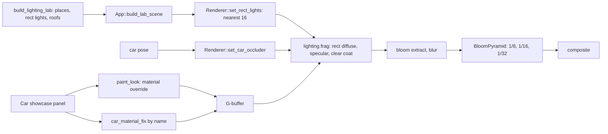

# Car showcase: places, looks and area lights

Four places built to look at a car, a panel that changes the car's paint, surface and lights, and the lighting pieces those needed: rectangle area lights, a grounding shadow, a wide bloom, a wet car surface. It all lives in the lighting lab ([`lighting-lab.md`](lighting-lab.md)) and is debug only. `make run` is unchanged. The decisions are in [`tasks/todo.md`](../tasks/todo.md) under "Car showcase".

*Written with Claude Code from the source as of 2026-11-15. Largely AI-generated; the owner has not yet looked at any of it in the app. Luminance, lumen and colour-temperature figures are typical values or lab choices, not measurements.*

## Launch

```sh
SWISH_LAB=1 make debug
```

Press the backtick key for the panel. Teleport from the **Lighting lab** section; change the car in the **Car showcase** section.

## The places

| Station | Centre (x, z) | What is there | Lights | What to judge |
|---------|---------------|---------------|--------|---------------|
| Studio | -200 m, 200 m | A closed dark room, 18 by 26 m, 6.5 m high. No sky reaches it | One overhead panel 6 by 10 m at 3,000 cd/m², a strip 8 by 1.8 m on each side wall at 2,000 cd/m². 5,600 K | Paint finishes, the shape of highlights, the turntable |
| Parking garage | -200 m, 300 m | A concrete deck 2.8 m high on pillars, open at the -Z end | 12 tube lights, 1.2 m by 0.15 m, 9,000 cd/m², 4,000 K | Long thin reflections sliding over the body, daylight fading in from the mouth |
| Gas canopy (night) | 260 m, 200 m | A slab on four columns, 5 m high, two pump islands | 8 LED panels 0.9 m square, 15,000 cd/m², 6,500 K | A bright pool in the dark, bloom, the grounding shadow |
| Night street (R = rain) | 260 m, 330 m | A 60 m street between two rows of buildings | 6 shop windows 4.4 by 2.2 m at 600 cd/m², 3,000 K; 3 sodium lamps of 12,000 lm | Mixed warm light, wet road and wet car (press R) |

Teleporting to the canopy or the street switches the time of day to Midnight. The studio is closed, so the time of day does not matter there.

## The panel ("Car showcase")

| Control | What it does |
|---------|--------------|
| Finish | As the asset, Solid gloss, Metallic, Pearl, Satin, Matte |
| Colour | As the asset, Black, White, Silver, Red, Deep blue, Yellow |
| Clean / Wet / Dusty | Wet puts a water film and beaded drops on the car's exterior. Dusty roughens the paint and dulls the clear coat |
| Material fixes | Corrects metalness and roughness of tyres, glass, chrome, wheels, brake discs and the cabin, found by material name |
| Car lights: Auto / Off / Parking / Low beam / Brake | Auto follows the time of day. The others force a state while parked |
| Turntable | Orbits the camera around the car (radius, height, speed). The car does not move. It takes over the camera while on |
| Grounding shadow under area lights | The car blocks area light from reaching the ground beneath it |
| Bloom pyramid | Wide, soft bloom on top of the tight one |

## How it works

### Rectangle area lights

A rectangle light has a centre, two half-edge vectors, a luminance $L$ in cd/m² and a colour from a colour temperature. Up to 16 are uploaded each frame, nearest to the camera first, in a tail of the lights UBO that exists only in debug builds.

Diffuse light uses the solid angle $\Omega$ the rectangle covers as seen from the shaded point, and the direction to its centre:

$$
E \approx L \,\Omega\, \max(0,\ n\cdot \omega_c)
$$

The specular highlight uses a representative point: the reflection ray is intersected with the light's plane, the hit is clamped to the rectangle, and that point is treated as a small light. The roughness is widened by the light's angular size so the highlight keeps the right energy. The clear coat gets its own lobe, which is why a glossy car shows the rectangle as a sharp shape. The method is an approximation; it is not the exact (LTC) solution.

Rectangle lights cast no shadows from the world. A wall between a panel and the car does not block it.

### Grounding shadow

The car is sent to the shader as one box: half size 2.25 by 0.60 by 0.95 m, centred 0.72 m above the ground, in the car's frame. For a ground pixel, five rays go to the centre and the four quarter points of each rectangle light; the share that hits the box darkens that light. This gives a soft dark patch under the car. The box is a generic sports-car size, not measured from the model.

### Paint looks

A look is a finish, a colour and a surface state turned into one material override by [`paint_look`](../src/scene/Entity/CarLooks.h), applied to the car's body-paint material slots.

| Finish | Metalness | Roughness × | Clear coat | Flakes |
|--------|-----------|-------------|------------|--------|
| Solid gloss | 0 | 1.0 | 0.6 | 0 |
| Metallic | 0.7 | 1.8 | 0.6 | 0.45 |
| Pearl | 0.25 | 1.4 | 0.6 | 0.2 |
| Satin | 0 | 3.0 | 0.15 | 0 |
| Matte | 0 | 5.5 | 0 | 0 |

Dusty multiplies roughness by 2.5 and clear coat and flakes by 0.3, and mixes 30% of a dust colour into the paint.

### Wet car

Wet sets a per-draw flag that travels in the G-buffer (albedo alpha, shared with the retroreflection flag). In `lighting.frag` a wet car pixel gets a smoother surface and a pattern of beaded drops fixed to the car's frame, so drops do not swim when the camera moves.

### Bloom pyramid

The bloom was one blur at quarter resolution: a tight glow. [`BloomPyramidPass`](../src/renderer/Passes/BloomPyramidPass.cpp) blurs that result again at 1/8, 1/16 and 1/32 and blends the three levels back over it with weights 0.5, 0.4, 0.3. With $B_0$ the existing bloom and $B_k$ the levels:

$$
B = \operatorname{mix}\bigl(\operatorname{mix}(\operatorname{mix}(B_0, B_1, 0.5),\ B_2,\ 0.4),\ B_3,\ 0.3\bigr)
= 0.21\,B_0 + 0.21\,B_1 + 0.28\,B_2 + 0.30\,B_3
$$

The weights sum to 1, so the bloom keeps its energy and "bloom intensity" means the same as before.



## Changing it

| I want to | Edit |
|-----------|------|
| Move or resize a place, change a light | `studio()`, `garage()`, `gas_canopy()`, `night_street()` in [`LightingLab.cpp`](../src/scene/LightingLab/LightingLab.cpp). A `panel(...)` call makes the glowing mesh and the light together |
| Add a place | A new builder there, a `LabStationId` and a `lab_stations()` row. Add a roof volume if the sky must not reach inside |
| Change a finish or a colour, add one | `paint_look` and the name tables in [`CarLooks.h`](../src/scene/Entity/CarLooks.h) |
| Fix another car material | `car_material_fix` in the same file (keys are parts of the material name) |
| Allow more than 16 rectangle lights | `MAX_RECT_LIGHTS` in [`SceneTypes.h`](../src/scene/SceneTypes.h) and the matching array in [`lights.glsl`](../shaders/common/lights.glsl) |
| Change the car's shadow box | The `set_car_occluder` call in `App::update_camera` |
| Change the bloom's width or weights | `kLevels` and `kWeights` in `BloomPyramidPass.cpp` |

## Known limits

- **Not run by its author.** Unit tests pass; nothing here has been looked at. The check list is in [`tasks/upcoming-tests.md`](../tasks/upcoming-tests.md).
- Rectangle lights have no shadows except the car box. Light leaks through walls and pillars.
- The garage has 12 tubes and the limit is 16, so near the garage the nearest 16 of all 29 lights are used. Lights can switch as the camera moves between places; the places are far enough apart that this should not show.
- Paint is found by material name (`paint`, `_ext1`). Another car model may need new keys.
- The car box is a guess at a sports car's size. A different car needs different numbers.
- The wet street needs the R key; teleporting does not start rain.
- Lens glow in Parking / Brake needs the lamp lenses to be opaque meshes; glass-pass lenses do not glow.
- The representative-point highlight is too bright at grazing angles on rough surfaces compared with an exact area-light solution.

## Tests

[`tests/test_car_looks.cpp`](../tests/test_car_looks.cpp) (finishes, colours, dusty, material fixes by name), [`tests/test_lighting_lab.cpp`](../tests/test_lighting_lab.cpp) (the four places exist, light counts, stations, time of day), [`tests/utils/test_light_SkyVisibility.cpp`](../tests/utils/test_light_SkyVisibility.cpp) (closed, one-end and all-sides roofs), [`tests/utils/test_renderer_PassRegistry.cpp`](../tests/utils/test_renderer_PassRegistry.cpp) (pass order with `BloomPyramid`).
