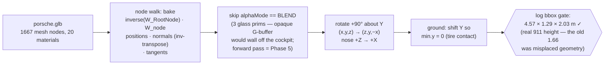
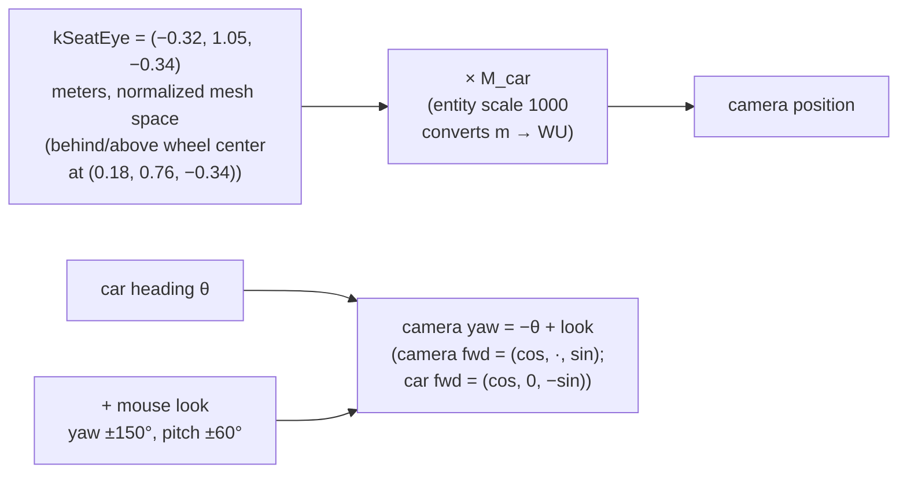
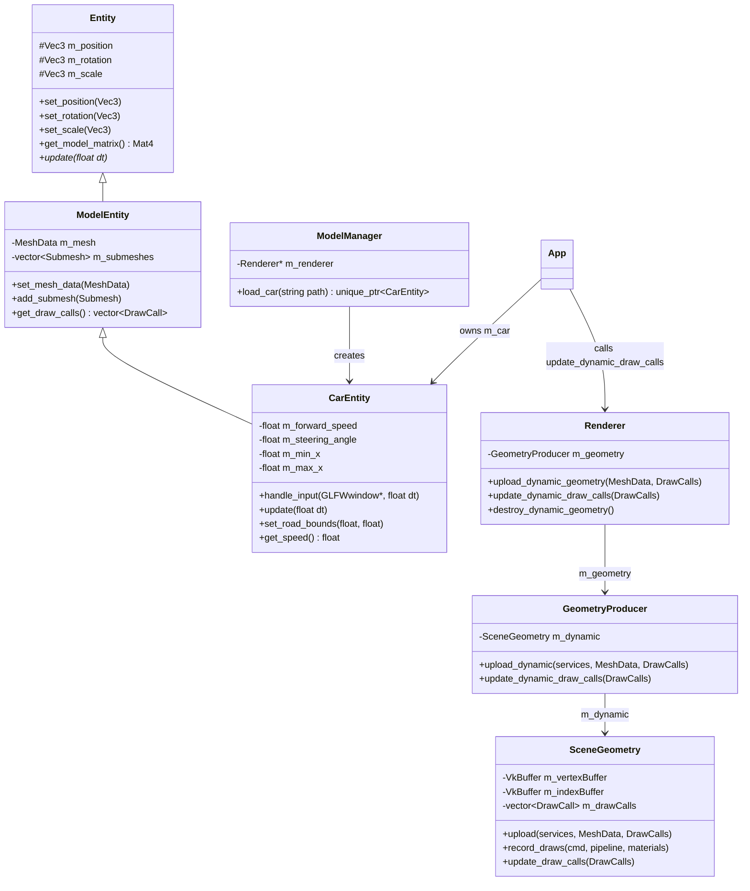
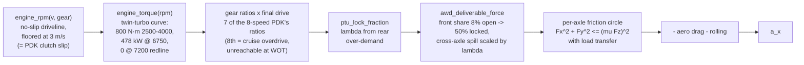
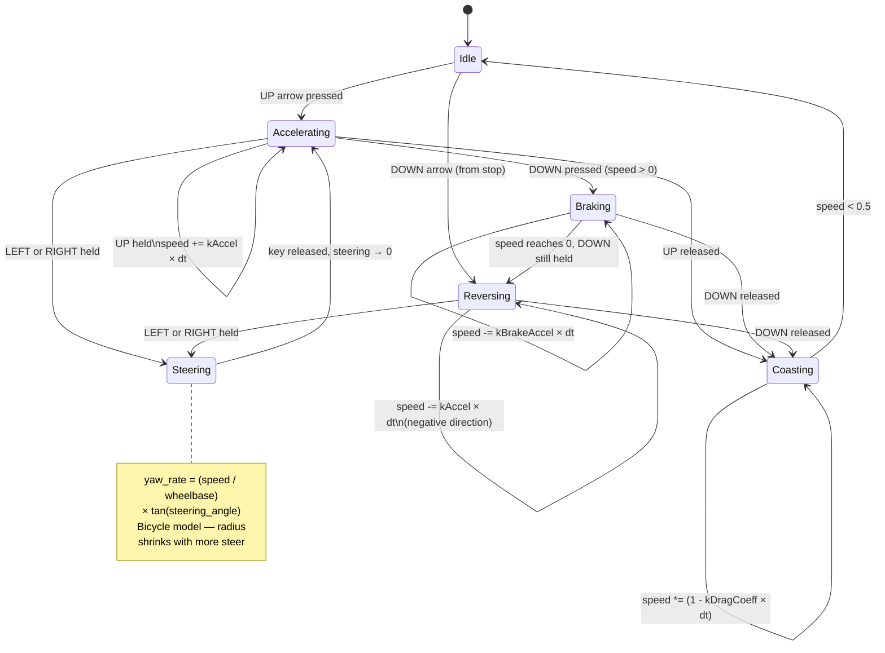

# Car System — Implementation Guide

## Coordinate Convention (read this first)

One definition of "forward" is shared by the mesh, the physics, and the
renderer, so the body always lines up with the direction of travel:

- The loader **normalizes the mesh** so the nose points **+X** at yaw 0.
- Heading: `forward = R_y(yaw)·(+X) = (cos(yaw), 0, −sin(yaw))`.
- Increasing yaw turns the body **left** (counterclockwise from above), so
  positive steering (= right) *decreases* yaw.
- **yaw = +90° faces −Z** — down the road, the same way the camera looks.

## Load-Time Mesh Normalization (node-walk loader)

`ModelManager::load_car()` walks the glTF node tree and bakes each mesh
node's transform **relative to the node named `RootNode`** into its
vertices. The chain *above* RootNode (Sketchfab axis conversion × FBX unit
scale, which nets ~10×) must not be baked; the chains *below* it place
pivoted parts — steering wheel, wipers, dials — correctly. 1,665 of the
1,667 mesh nodes carry a non-identity transform, which is why the interior
was missing before this existed. RootNode-relative space is the asset's raw
mesh space: meters, Y-up, nose +Z.



After this, `set_position(y = 0)` means "tires resting on the road surface"
(the road plane is at world Y = 0) and `set_rotation(0, 90, 0)` points the
nose down −Z.

## Cockpit Camera

The app starts in **cockpit mode**; `C` toggles cockpit ↔ free-fly.
No scene graph — the eye is *derived* from the car transform each frame:



In cockpit mode WASD camera flight is disabled (arrows drive the car);
in free-fly the camera detaches wherever it was and WASD/mouse work as
before. Mouse-look offsets reset on every toggle.

## Class Structure



---

## Per-Frame Data Flow

```mermaid
stateDiagram-v2
    [*] --> PollInput : glfwPollEvents

    PollInput --> ModeToggle : C key (edge-detected)
    PollInput --> CameraInput : WASD + mouse (free-fly only)
    PollInput --> CarInput : Arrow keys

    CameraInput --> CameraUpdate : camera.process_keyboard()
    CarInput --> CarPhysics : car.handle_input()

    CarPhysics --> CarPhysics : clamp speed + steering
    CarPhysics --> PositionUpdate : car.update()

    PositionUpdate --> DrawCallRegen : car.get_draw_calls()
    note right of DrawCallRegen
        Stamps current
        model matrix into
        each DrawCall
    end note

    DrawCallRegen --> DynamicGeometry : renderer.update_dynamic_draw_calls()

    PositionUpdate --> CockpitCam : cockpit mode
    note right of CockpitCam
        eye = M_car · kSeatEye
        yaw = −heading + look_yaw
        pitch = look_pitch
    end note

    CameraUpdate --> RenderFrame : renderer.drawFrame()
    CockpitCam --> RenderFrame
    DynamicGeometry --> RenderFrame

    RenderFrame --> GBufferPass : GeometryProducer::record_gbuffer()
    GBufferPass --> StaticGeometry : scene geometry record_draws()
    GBufferPass --> DynGeometry2 : m_dynamic.record_draws()

    StaticGeometry --> LightingPass
    DynGeometry2 --> LightingPass
    LightingPass --> Composite
    Composite --> [*] : vkQueuePresentKHR
```

---

## Car Physics — as built (2026-08-23, Phase 1)

> The state diagram and the "Improving the Drive Feel" section further down are
> **onboarding material from the original kinematic prototype** and describe
> constants (`kAccel`, `kDragCoeff`, `kBrakeAccel`) that no longer exist. They are
> kept because the *shape* of the input state machine is still right. This block
> is the authoritative summary of what actually runs.

**Target car: 992 911 Turbo S, AWD.** 0-60 mph 2.8 s (measured 2.758 s) · Vmax
~205 mph (measured 205.1 m/s→mph analytically, 203 mph and still climbing in
engine) · 641 hp / 590 lb-ft · 1670 kg. See
[`phase-1-physics-speed-accuracy.md`](../archive/docs/phase-1-physics-speed-accuracy.md).

Per-frame chain, all of it in the `CarPhysics.h` umbrella (pure SI, unit-tested without a GPU; since 2026-09-29 split into
`CarParams.h`, `Powertrain.h` (`engine_rpm`, `engine_torque`, gearbox), `Tire.h` (load transfer, friction circle),
`Drivetrain.h` (`ptu_lock_fraction`, `awd_deliverable_force`), `Longitudinal.h` (`longitudinal_accel`), `Bicycle.h`
(`dynamic_bicycle_deriv`, `steady_state_top_speed`) and `WetGrip.h` (`effective_mu`), all under `src/scene/Entity/`)
with `CarEntity` converting at the world-unit boundary:



Key properties, none of them clamped or scripted:
- **Launch** = the four-wheel ceiling `mu*m*g` (1.05 g), because at a standstill the
  rear axle is demanded far past its limit so the PTU clutch closes and the axles
  tie together. Turbo lag in the torque curve is what keeps it off `mu*g` in the
  first instants.
- **Top speed** emerges where thrust meets drag, in 7th, essentially at the power
  peak. `steady_state_top_speed()` scans every gear rather than assuming the
  tallest one wins.
- **Cornering costs acceleration**: `CarEntity` feeds the bicycle model's own
  per-axle `F_y` into the same circle, so power-down and braking both lose
  capacity while the tires are working laterally.
- **Wet/hydroplaning** rides on top via `effective_mu()`, which only changes `mu`
  — every limit above therefore collapses together.
- **Suspension** is a per-corner quarter-car (`WheelKinematics.h`) plus
  parametric camber/toe gain curves and an anti-roll bar folded in as a
  cross-corner target shift. Wheels spin, steer, travel, and change alignment;
  body Y is snapped to the road each frame in `App.cpp` (`update_car`).

## Rigid-body chassis (stub, 2026-10-10, debug-only)

An alternative to the planar bicycle model, selected by the debug-UI "Physics model: rigid body (stub)" checkbox
(`DebugParams::rigidBodyChassis`, `[car] rigid_body_chassis`, default off = bicycle). Compiled only under
`SWISH_DEBUG_UI`; the release build always runs the bicycle model.

| Piece | Where |
|-------|-------|
| 6-DOF integrator (semi-implicit Euler, angular momentum carried so the gyroscopic term is exact) | [src/utils/physics/RigidBody.h](../src/utils/physics/RigidBody.h) |
| Four spring-damper contacts at the loader's wheel hubs, tire force at the patch, friction circle shared with `Tire.h` | [src/scene/Entity/RigidChassis.h](../src/scene/Entity/RigidChassis.h) |
| Mode switch, seeding from the bicycle state, write-back to `m_position` / `m_rotation` | `CarEntity::set_physics_model`, `init_rigid_body`, `update_rigid_body` |

Static sag per wheel is $s = mg/4k$; `make_chassis_params` adds a preload $F_\text{static}/k$ so the design ride height
is the equilibrium. In rigid mode `App::update_car` skips the road Y snap (the body owns heave). Wheel visuals
(`update_wheel_visuals`) still run as a draw-matrix-only layer on top of the body pose.

**What the full version must do** (each is a `TODO(stub)` in the code): query road height at every contact patch
(`RoadGeometry::road_surface_y`, slope and crown) instead of one flat plane; add unsprung mass per wheel (wheel hop) and
bump stops; fold in anti-roll bars and aero downforce / pitch moment; give each wheel a spin DOF with slip ratio and a
real tire curve (Pacejka / Fiala) with camber thrust and aligning torque; shift the patch by $r\sin(\text{roll})$;
replace the box inertia with measured mass-point inertia; add a standstill stick model; and move to impulse-based
non-smooth contact ([docs/lessons-from-chrono/](lessons-from-chrono/)).

## Car Physics — State Diagram (input state machine; constants are historical)



---

## Changing Car Position

The car is loaded in `App::load_car()` ([`src/core/App/AppInit.cpp`](../src/core/App/AppInit.cpp); `SWISH_CAR=<glb>`
swaps in another model). Scale is set there, but **position and heading no longer come from a hard-coded pose**: the
active road is the real-LIE corridor, so `m_corridor.place_at_start(*m_car)` puts the car at the corridor's west end
(the Queens-Midtown Tunnel portal) with the alignment's heading and opens `CarEntity`'s world-X clamp (the lateral limit
is enforced in corridor space by `CorridorDriver`). The table below describes the world-space convention that the old
hard-coded pose used, which still holds for the chase/cockpit maths:

```cpp
car_entity->set_scale(Vec3(1000.f, 1000.f, 1000.f));        // AppInit.cpp: glTF metres to WU
m_corridor.place_at_start(*m_car);                          // position + heading from the alignment
// old fixed pose (retired): set_position(Vec3(6501, 0, -20000)); set_rotation(Vec3(0, 90, 0));  // +90° = nose down -Z
```

| Parameter | Axis | Effect |
|-----------|------|--------|
| `X` | Left/Right | Move car across lanes (EB road ~1728–19610 WU) |
| `Y` | Up/Down | 0 = tires on the road (mesh is grounded at load); camera eye = ~1448 WU |
| `Z` | Forward/Back | Camera starts at −5000; more negative = further ahead |
| `rotation.y` | Yaw | +90° faces −Z (down the road); −90° faces +Z (wrong way) |
| `scale` | All | 1000 = 1 meter in world units; raise if car appears too small |

**Quick question to think about:** If you want the car to start at the camera's exact position so you're looking at it from behind, what Z offset would you add to put it 30m ahead?

---

## Improving the Drive Feel — What to Think About

The current physics is a **simplified bicycle model**. Here is what it lacks and what you'd need to add for each improvement:

### 1. Ground Contact (most impactful)
Right now `Y` is fixed. A real vehicle should sit on the road surface. What data would you need to query at the car's four wheel positions to determine the Y the car should be at?

### 2. Wheel Rotation Animation
The GLB model is static — the wheels don't spin. The car has separate wheel meshes. What property of the car's physics state would you use as the input to drive a wheel rotation angle? Think about: distance traveled per frame.

### 3. Steering Return Feel
The steering currently springs back at a fixed rate (`kSteerReturn`). Real cars return faster at high speed (self-aligning torque). Look at `CarEntity::handle_input()` — can you make the return rate a function of `m_forward_speed`?

### 4. Speed-Dependent Steering Sensitivity
At highway speed, full lock steering is dangerous. Look at `kSteerRate` in `CarEntity.h`. How would you scale it down as speed increases? What curve would feel good — linear? exponential?

### 5. Camera Follow Mode
Right now WASD controls a free camera. A follow camera would sit behind the car at a fixed offset in the car's local space. Given the car's `get_position()` and `get_rotation().y`, how would you compute the camera's world position?

**Hint:** The offset vector `(0, 1500, 3000)` in local space (up and behind) needs to be rotated by the car's yaw before being added to the car's position. Which GLM function rotates a vector by an angle around the Y axis?
