# Changelog — 2026-08

See [CHANGELOG.md](../../CHANGELOG.md) for the index of all entries.

---

### 2026-08-23 — Phase 2: the car now genuinely loses control on standing water (hydroplane spin-out)

Made hydroplaning actually spin the car out — and found that the spec's premise ("relax the yaw clamp
and the tire model will diverge") was measurably false, that the lateral model yawed the car *backwards*
at negative $v_x$, and that a clamp was deleting real momentum when grip returned.

Technical summary

### Motivation

[`docs/phase-2-hydroplane-spinout.md`](archive/docs/phase-2-hydroplane-spinout.md) asked for an emergent
hydroplane spin-out, on the premise (§2/§3.1) that the saturating-tire bicycle model would diverge on
its own once `max_yaw_rate()`'s clamp was relaxed under low μ. It does not. With **static** axle loads,
when both axles saturate at the same sign the yaw moment is *identically zero*:

$$
a\,\mu F_{zf} - b\,\mu F_{zr} = \mu\!\left(a\,\frac{mgb}{L} - b\,\frac{mga}{L}\right) = 0
$$

because each axle's static load is proportional to the **opposite** lever. The saturated model is
yaw-*neutral*, not unstable — it holds whatever yaw rate it had and plows. Measured at hydroplane μ,
34 m/s, 10° of steer: clamp enforced → 4.0 °/s peak yaw; clamp **fully released** → 2.4 °/s. Releasing
it made things *quieter*. Per spec §7 this is a stop-and-report signal; the full analysis and every
correction to the spec is recorded in the doc's new **AS-BUILT** section.

### What actually produces the spin

1. **Friction circle closed in the longitudinal→lateral direction.** Each axle's cornering capacity
   becomes $\sqrt{(\mu F_z)^2 - F_x^2}$ with $F_z$ carrying longitudinal load transfer, which turns
   the degenerate moment into
   $$a\,\mu F_{zf}(a_x) - b\,\mu F_{zr}(a_x) = -\mu\,m\,a_x\,h_{cg}$$
   — non-zero whenever the car accelerates or brakes, and an *oversteer* moment under braking. This is
   the extension Phase 1's own comment in `axle_lateral_forces` said Phase 2 would take on.
   `longitudinal_accel` now optionally reports the signed **per-axle** longitudinal tire force
   (`AxleLongitudinal`), which is fed back one step later (the one-step lag breaks the otherwise
   circular lateral→longitudinal→lateral dependency). Aero drag is deliberately **excluded** from that
   report: it acts on the body shell, not through the contact patch, and charging it to the circle
   zeroed the lateral capacity outright at speed (1.0 kN of drag against a 0.5 kN planing circle).
2. **The body-frame transport term**, which was missing outright:
   $$\dot v_x = \frac{F_x}{m} + v_l\,r$$
   Without it, $\frac{d}{dt}\frac{|V|^2}{2} = \frac{v_x F_x + v_l F_y}{m} - v_x v_l r$ — rotation
   spuriously creates or destroys kinetic energy. With it the $r$ terms cancel, rotation alone does no
   work, and a spinning car keeps its momentum, so $v_x$ genuinely passes through zero and goes negative.
3. **Hydroplane-gated release of the quasi-steady clamps.** `max_yaw_rate` assumes $\dot v_l = 0$ so
   that $a_y = v_x r$; the general statement $a_y = \dot v_l + v_x r \le \mu g$ is already enforced
   structurally by the $\mu F_z$ force clamps, so under a diverging sideslip the yaw clamp is not physics
   but a rail that suppresses the divergence. It is now blended toward a kinematic **pivot rail**
   $r \le V/\ell$ ($\ell = L/2$, ~28 rad/s at highway speed — a pure NaN guard), and the 45° sideslip cap
   $|v_l| \le |v_x|$ toward $|v_l| \le |V|$.
4. **A rate limit on how fast those bounds may tighten** — found in a live run, not in theory. When the
   hydroplane ends, `planeFrac` collapses within a frame or two and the bounds snap back, **deleting real
   momentum**: body speed dropped 31.8 → 12.5 m/s in one 0.5 s sample (~4 g that no tire produced). A
   clamp may stop a state growing; it must not brake harder than friction can. Bounds may now tighten at
   most $\mu g$ (sideslip) or $2\mu m g a b/(L I_z)$ (yaw) per step. Post-fix the same recovery decays at
   exactly $\mu g \approx 0.59\,g$, measured.

### Making "hydroplane-only" (spec decision 2) structural rather than tuned

`effective_mu`'s own hydroplane smoothstep is hoisted into
`hydroplane_fraction(speed, filmOverTread, g)` so there is **one** definition of "is the car planing",
and every Phase-2 term is weighted by it. It is zero unless there is standing water deeper than the tread
can clear **and** speed is past the NASA/Horne plane speed — so dry roads, merely-wet roads and standing
water taken slowly are provably untouched, with no threshold invented for the purpose. Verified in-game:
with the flood force-enabled (`planeFrac = 1.00`, every Phase-2 term at full strength) but wetness 0, the
car peaked at 5.6° of sideslip under a full-lock input, returned to 0.0°, and pulled cleanly to 163 mph.

Two speed arguments switched from the forward component to the **body-speed magnitude**
$\sqrt{v_x^2+v_l^2}$, for the same reason in both cases: hydroplaning depends on how fast the *tire*
moves over the water, and the kinematic/dynamic threshold asks whether the tire model is
well-conditioned. Keying either off $v_x$ meant a car sliding at 39 m/s with 4.7 m/s of forward
component either "stopped hydroplaning" or got handed to the kinematic model, which zeroes
`m_lateral_velocity` — teleporting 37 m/s of lateral momentum out of existence mid-slide.

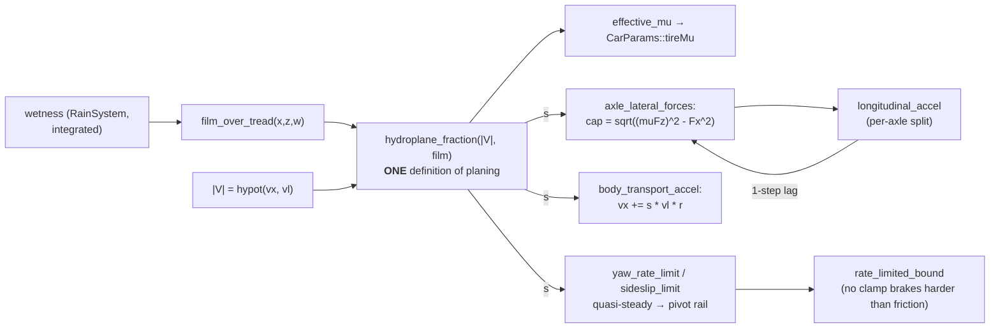

### The negative-$v_x$ findings (spec §5), which is where the real bug was

* **`max_yaw_rate` — §5.1 is stale.** The signature is `max_yaw_rate(vx, p)` (μ arrives via
  `p.tireMu`), and the floor was *already* `std::max(std::fabs(vx), 1.0f)`; the `std::max(vx, 1.0f)`
  the spec quotes does not exist in the tree. Re-derived: the bound is symmetric in $r$ and therefore
  carries no sign convention to reconcile with steering input. No fix needed; now pinned by a test.
* **Slip angles — a live, shipped bug, worse than "a regularization is missing".** Dividing by
  $\max(|v_x|,1)$ was already right (friction opposes the slip velocity whichever way the tire rolls),
  but the steer term was subtracted *unconditionally*. The wheel-frame expansion gives
  $$\alpha_f \approx \frac{v_l + a r}{|v_x|} - \operatorname{sgn}(v_x)\,\delta$$
  so at $v_x < 0$ steering produced a front force in the **wrong direction** and a yaw moment opposite
  the kinematic reverse model — measured **−42.8° of heading in one second** at $v_x = -10$ m/s,
  $\delta = 0.2$ rad. This was already reachable: reverse tops out at `kMaxReverseSpeed` = 12 m/s, well
  above `kDynamicBlendSpeed` = 5 m/s, so the dynamic model has always been the one running in reverse.
  The `sgn(vx)` factor is applied **unconditionally** — it is a bug fix, not a feature.
* **Three more places assumed $v_x \ge 0$** and would have eaten a spin: `kMaxReverseSpeed` was clamped
  unconditionally (moved onto the driver-reverse branch — a spun car's negative speed is real motion,
  not a reverse-gear command); the dead-stop snap and the `m_forward_speed == 0` early return both fired
  while the car was still sliding sideways at speed and would have **frozen the spin mid-rotation**
  (both now also require the lateral state to be quiet).

### Verification

* **`make test`: 137/137** (117 before → 20 new Phase-2 cases, `[spin]` / `[negative-vx]`), green in
  both `SWISH_DEBUG_UI=OFF` and `ON` configurations, both of which build clean.
* **Visual, wetness 1.0:** helicopter view, heavy rain soaked to wetness ≈ 0.95. Entering a flooded
  stretch at 37 m/s with ~7 °/s of yaw established on grip: μ collapses to 0.080, sideslip runs
  2° → 54° → 88° → past 90°, $v_x$ goes 37 → 0 → **−34 m/s** (sliding backwards at 76 mph), body speed
  nearly conserved (39.7 → 31.6 m/s), then the slide scrubs off at $\mu g$ as grip returns. Existing GPU
  road spray throws twin plumes off the sliding rear wheels (spec decision 6 — no new VFX). Runs ended
  with the car coasting *backwards* down the corridor or stopped against the median, facing wherever the
  physics left it (decision 4 — no reorientation).
* **Visual, wetness 0:** identical manoeuvre tracks the lane at 0.0° sideslip and pulls to 163 mph.
* Zero debug scaffolding shipped; all temporary telemetry/force reverted and the tree left in its
  original Release / `SWISH_DEBUG_UI=OFF` configuration.

### `docs/phase-2-hydroplane-spinout.md` §4 tolerance table re-verified against the Phase-3a corridor

§4 was written against the retired endless treadmill. Corrections are in the doc's AS-BUILT §A5; the
load-bearing ones: the **world-X clamp is disabled** (`CorridorDriver::place_at_start` sets
`set_road_bounds(-1e9f, 1e9f)`) and replaced by a corridor-space `(station, lateral)` clamp that is
**lane-count dependent**, so a spin's available width varies along the route and opens to the *full*
width inside the two U-turn pads. Measured live during a spin: `lat` pinned at exactly +1900 WU
(`paint_inner + kLaneInset`) and station ran **backwards** 0.366 → 0.356 mi with the segment window
unbothered — the corridor is *more* tolerant of a spin than the treadmill was, since `kChunksBehind`
no longer exists. Wetness/puddle wiring survived intact (corridor bands are `MAT_ASPHALT`, so the
`material.w` road tag still gates puddles) — verified live with `film` reaching 1.40.

### File-change table

| File | Change |
|---|---|
| [src/scene/Entity/CarPhysics.h](src/scene/Entity/CarPhysics.h) | `sgn(vx)` slip-angle fix; `friction_circle_fy_max`, `AxleLongitudinal`, `hydroplane_fraction`, `yaw_pivot_rail`, `yaw_rate_limit`, `sideslip_limit`, `body_transport_accel`, `max_yaw_decel`, `rate_limited_bound`; optional per-axle split out-params on `awd_deliverable_force` / `brake_cap_force` / `longitudinal_accel`; `axle_lateral_forces` / `dynamic_bicycle_deriv` take `AxleLongitudinal` + `planeFrac` (defaulted, so all existing callers are bit-identical); `effective_mu` refactored onto `hydroplane_fraction`. |
| [src/scene/Entity/CarEntity.cpp](src/scene/Entity/CarEntity.cpp) | Computes `m_plane_frac` and body-speed magnitude; feeds `m_long_force` into both lateral call sites; adds the transport term; rate-limited relaxed clamps; `kMaxReverseSpeed` moved onto the reverse branch; dead-stop + early return now require a quiet lateral state; kinematic-blend threshold and its 5→8 m/s blend measured on body speed. |
| [src/scene/Entity/CarEntity.h](src/scene/Entity/CarEntity.h) | New state `m_plane_frac`, `m_long_force`; new `kRestLateralSpeed` / `kRestYawRate` constants. |
| [tests/test_car_physics.cpp](tests/test_car_physics.cpp) | +20 cases: negative-$v_x$ symmetry/sign/finiteness, the reverse-steer regression, the yaw-neutral degeneracy and its load-transfer repair, default-argument bit-identity, circle closure, gate behaviour, clamp release/monotonicity, transport-term energy conservation, `rate_limited_bound`, per-axle split invariants, and five whole-loop scenarios (spin, dry control, straight-line no-op, recovery, momentum-preserving grip return). |
| [docs/phase-2-hydroplane-spinout.md](archive/docs/phase-2-hydroplane-spinout.md) | AS-BUILT section: the false premise, the four real changes, the §5 findings, the corrected §4 table, what it feels like, and the deliberate limits. |
| [tasks/todo.md](tasks/todo.md) | Phase 2 marked done with a review note. |

---

### 2026-08-23 — Phase 3a: replaced the endless fictional treadmill with the real, compacted Long Island Expressway

Replaced the shipped endless-treadmill road with a finite **17.994 mi** corridor derived from real
OpenStreetMap data through SUMO `netconvert` — the actual I-495 centreline from the Queens-Midtown
Tunnel to exit 49, landmark-compacted from 31.20 real miles, with netconvert's own lane counts
producing the 3 → 4 lane change exactly at the Queens/Nassau line.

Technical summary

**Motivation.** The shipped road ([`docs/endless-road.md`](docs/endless-road.md)) was a *treadmill*:
a hand-authored 4.2 km intro feeding one canonical 300 m chunk, instanced forever. Believable, but
entirely fictional — not tied to any real-world coordinate. Phase 3
([`docs/phase-3-osm-lie-corridor.md`](docs/phase-3-osm-lie-corridor.md)) replaces it with the real
LIE. This is **stage 3a only**: the bare compacted alignment drivable end to end, proving the
OSM → mesh pipeline and the finite-corridor mechanics. Interchange ramps (3b) and exit signage /
HOV markings (3c) are deliberately out of scope.

#### 1. The pipeline

```mermaid
graph LR
  OSM["Overpass API<br/>one-time pull"] --> RAW["data/osm/lie_i495.osm.xml<br/>930 ways · 6426 nodes<br/>(cached in repo)"]
  RAW --> NC["SUMO netconvert 1.27.1<br/>--proj.plain-geo"]
  NC --> PLAIN["lie_i495.edg/.nod.xml<br/>lane counts + lon/lat shapes<br/>(cached in repo)"]
  PLAIN --> CHAIN["min-turn walk<br/>-> EB mainline chain<br/>200 edges, 33.95 mi"]
  CHAIN --> PROJ["local tangent plane<br/>+ rotate to engine axes"]
  JN["motorway_junction refs<br/>27·31·38·46·48·49"] --> COMP
  PROJ --> COMP["landmark-anchored<br/>compaction + curvature floor"]
  COMP --> BIN["assets/corridor/lie_corridor.bin<br/>2896 stations · 81 KB<br/>(checked in)"]
  BIN --> AL["CorridorAlignment<br/>(station, lateral) queries"]
  AL --> MESH["CorridorScene<br/>25 segments · 1921 draws"]
  AL --> DRV["CorridorDriver<br/>rebase · clamp · termini"]
```

Both intermediates are checked in, so **the build needs neither the network nor SUMO** — `bake`
alone reproduces the engine asset.

#### 2. Coordinate transform (spec §4.1)

`--proj.plain-geo` keeps netconvert's plain-XML shapes in WGS84 lon/lat, so the projection stays
ours and stays testable. Local tangent plane about the route midpoint $(\varphi_0,\lambda_0)$:

$$e = R\cos\varphi_0\,(\lambda-\lambda_0)\frac{\pi}{180},\qquad n = R\,(\varphi-\varphi_0)\frac{\pi}{180}$$

then rotate by $-\psi$ (the bearing of the start→end chord) and map into engine axes:

$$\begin{aligned}
e' &= e\cos\psi + n\sin\psi, & n' &= -e\sin\psi + n\cos\psi \\
x &= -n'\cdot S, & z &= -e'\cdot S, & S &= \texttt{WORLD\_SCALE} = 1000
\end{aligned}$$

Travel east ⇒ $-Z$; geographic south (right of eastbound travel) ⇒ $+X$, matching
$\mathbf{t}\times\mathbf{up} = (0,0,-1)\times(0,1,0) = (1,0,0)$. That map has determinant $-1$ — a
handedness flip, which is exactly right for $(x,z)$ with $Y$ up against a 2-D east/north map. Scale
error over a 50 km corridor is $O\!\big((d/R)^2\big) \approx 6\times10^{-5}$.

#### 3. Compaction (spec §4.2) — plus a curvature floor 3a had to add

Landmark weight from the **real** OSM `motorway_junction` positions of exits 27 / 31 / 38 / 46 / 48 / 49:

$$d(i) = \min_{j\in L}\lvert s_i - s_j\rvert, \qquad
w_i = \begin{cases}
1 & d \le N\\
\mathrm{smoothstep}\!\left(1 - \dfrac{d-N}{W}\right) & N < d < N+W\\
0 & d \ge N+W
\end{cases}$$

**The problem 3a found.** Compaction preserves heading and scales arc length, so a compacted curve's
radius is $R' = R f$ — compressing a curve makes it **tighter** by $1/f$. Measured at $c=0.455$ with
no floor: the real alignment's tightest curve is 99 m (the tunnel portal ramp, genuinely that tight)
and only 1.05 km of 50.2 km is under 500 m, but compaction produced a **46 m** minimum and
**6.05 km** under 500 m. The heuristic was inventing corners that do not exist. The fix is one extra
term — and it is the literal form of §4.2's own intent (compress the *straightaways*; landmark
distance was only a proxy for "nothing interesting here"):

$$f_i = \max\Big(\underbrace{w_i + c\,(1-w_i)}_{\text{§4.2 as sketched}},\ \underbrace{\min\!\big(1,\ R_\text{floor}/R_i\big)}_{\text{curvature floor}}\Big)$$

Integration preserves the original unit tangent, so total turning — and therefore the route's map
silhouette — is exact:

$$\mathbf{p}'_{i+1} = \mathbf{p}'_i + f_i\,\Delta s\,\mathbf{t}_i$$

The floor makes $L'(c) = \sum_i f_i \Delta s$ piecewise-linear rather than affine, so the closed form
$c = (L_\text{target} - A)/B$ becomes a bisection — still exact, since $L'$ is continuous and
monotonically non-decreasing in $c$. **$c$ stays derived, not authored**, so the corridor always
lands on target.

$R_\text{floor}$ swept against the real curvature distribution at an 18 mi target (km under
400 m / 500 m radius; real = 0.83 / 1.05):

| $R_\text{floor}$ | solved $c$ | km < 400 m | km < 500 m |
|---|---|---|---|
| 300 m | 0.416 | 10.30 | 12.66 |
| 400 m | 0.328 | 0.91 | 11.38 |
| **500 m** | **0.185** | **0.83** | **1.20** |
| 600 m | infeasible | — | — |

#### 4. Measured result

| Quantity | Value |
|---|---|
| Real (trimmed) length | 31.20 mi |
| **Compacted length** | **17.994 mi** (target 18.00; band 16–20 ✔) |
| $N$ / $W$ / $c$ / $R_\text{floor}$ | 900 m / 250 m / **0.1854** / 500 m |
| Tightest radius | 99 m real → **99 m** compacted (untouched) |
| Lane profile | 2 (tunnel) → 3 (Queens) → **4 at 7.90 mi = the Queens/Nassau line** |
| Stations / segments / draws | 2,896 @ 10 m · 25 segments · 1,921 draw calls · 81 KB |
| Engine extent | $Z \in [-26{,}521, 0]$ m, $\lvert X\rvert \le 1{,}835$ m |

#### 5. Precision: §7's estimate was wrong by 1000×

The phase doc put an 18–20 mi corridor at "~3e10 WU, far beyond float32". That applied
`WORLD_SCALE` twice: **1 mile = 1609.344 m × 1000 WU/m = 1.609e6 WU, so 18 mi is 2.897e7 WU.**
A unit test now pins this.

| Magnitude | float32 ULP |
|---|---|
| 2.897e7 WU (corridor east end) | **2.0 WU = 2.0 mm** |
| 6e5 WU (segment-local vertex) | 0.06 WU |
| 3.0e10 WU (the assumed figure) | 2048 WU = 2.05 m |

So absolute float32 would have worked and **the origin rebase is not required** — it is kept because
it is free, removes millimetre shimmer, and survives a longer corridor. Segment-local vertices are
kept for a second reason that *is* load-bearing: arc-length UVs accumulated over 18 mi reach ~1e4 UV
units, where float32 quantises to a whole texture repeat — hence the 300 m tile UV restart (300 m is
a multiple of every surface texture tile size, the same reason the retired canonical chunk was).

#### 6. Two bugs found by driving it

- **The car drove through the median barrier.** `carriageway_bounds` inferred the carriageway from
  the *instantaneous* lateral sign, so one frame at the delta-time cap (1/15 s) and top speed
  (92,000 WU/s) moved the car 6.1 m sideways — across the 3.8 m median — and the rule then answered
  "you are westbound now, carry on". Fixed by making the side **committed state** that may only
  change inside a turn-around pad, which is the only place the barrier isn't built.
- **The drive started inside a 100 m-radius loop ramp.** Station 0 is the tunnel's Manhattan portal.
  The baker now derives a `startStation` (340 m) — the first station whose radius clears a threshold.

#### 7. Retired vs reused

`generate_service_roads`, `generate_interchange` and `generate_chunk` are **unwired** (they upload
nothing, so they drive zero draws) rather than deleted — deleting them is 3b's job, and
`tests/test_road_scene.cpp` still covers them. `emit_ribbon` is **untouched**; the corridor uses new
`emit_sweep_band` / `emit_sweep_wall` / `emit_sweep_dashes` siblings, because a real cross-section
needs per-station *asymmetric* lateral bounds (lane tapers) and one draw call per band, not one per
quad. `MeshBuilder::pushDrawCall` now delegates to a new `pushDrawCallRange`, keeping its
single-quad behaviour identical.

#### 8. File changes

| File | Change |
|---|---|
| [tools/lie_corridor.py](tools/lie_corridor.py) | **New.** Offline pipeline: `fetch` (Overpass) · `net` (netconvert) · `bake` (project + compact + serialise). stdlib only. |
| [config/lie_corridor.toml](config/lie_corridor.toml) | **New.** bbox, Overpass selector, netconvert flags, compaction targets, curvature floor, cross-section, tiling. |
| [data/osm/lie_i495.osm.xml](data/osm/lie_i495.osm.xml) | **New.** Cached Overpass extract (1.76 MB) — the reproducible source of truth. |
| `data/osm/lie_i495.{net,edg,nod,con,tll,typ}.xml` | **New.** Cached netconvert output, so the build needs no SUMO. |
| [assets/corridor/lie_corridor.bin](assets/corridor/lie_corridor.bin) | **New.** Baked alignment: 136 B header + 2,896 stations + 6 landmarks. |
| [src/scene/Corridor/CorridorAsset.h](src/scene/Corridor/CorridorAsset.h) | **New.** Packed asset structs + loader. Missing/stale asset throws — never falls back to the fictional road. |
| [src/scene/Corridor/CorridorAlignment.h](src/scene/Corridor/CorridorAlignment.h) · [.cpp](src/scene/Corridor/CorridorAlignment.cpp) | **New.** `(station, lateral) ↔ (x, z)`, hinted O(1) projection, fractional lane count, cross-section offsets. |
| [src/scene/Corridor/CorridorScene.h](src/scene/Corridor/CorridorScene.h) · [.cpp](src/scene/Corridor/CorridorScene.cpp) | **New.** Segment (1.2 km) → tile (300 m) → cross-section-band mesh generation. |
| [src/scene/Corridor/CorridorDriver.h](src/scene/Corridor/CorridorDriver.h) · [.cpp](src/scene/Corridor/CorridorDriver.cpp) | **New.** Origin rebase, visible-segment window, corridor-space clamp, terminus stops, debug telemetry. |
| [src/scene/Corridor/CorridorBounds.cpp](src/scene/Corridor/CorridorBounds.cpp) | **New.** The engine-free half of `CorridorDriver` (alignment attach + drivable bounds) so tests link it without Vulkan/GLFW. |
| [src/scene/RoadScene/RoadScene.h](src/scene/RoadScene/RoadScene.h) · [.cpp](src/scene/RoadScene/RoadScene.cpp) | Added `pushDrawCallRange`, `build_sweep_frames`, `emit_sweep_band/_wall/_dashes`. `emit_ribbon` and every existing generator unchanged. |
| [src/scene/SceneTypes.h](src/scene/SceneTypes.h) | Added `SweepFrame` and `CorridorInstance`. |
| [src/scene/RoadGeometry/RoadGeometry.h](src/scene/RoadGeometry/RoadGeometry.h) · [.cpp](src/scene/RoadGeometry/RoadGeometry.cpp) | Added `set_flat_surface` / `clear_flat_surface`. Off by default, so the crown path is byte-identical for legacy callers. |
| [src/renderer/Renderer/Renderer.h](src/renderer/Renderer/Renderer.h) · [.cpp](src/renderer/Renderer/Renderer.cpp) | Added `add_corridor_segment` / `set_corridor_instances`, a `vector<SceneGeometry>` of segments, and corridor recording in the depth + G-buffer loops. Culling, materials and the camera-relative rebase come free. |
| [src/core/App/App.h](src/core/App/App.h) · [.cpp](src/core/App/App.cpp) | Scene setup builds + uploads the corridor instead of the intro/chunk/interchange; car placed from the alignment; run loop calls `m_corridor.update` instead of `m_treadmill.update`. Free-fly camera collision (a world-X window) disabled. |
| [CMakeLists.txt](CMakeLists.txt) · [tests/CMakeLists.txt](tests/CMakeLists.txt) | Added the four corridor TUs; test target links only the engine-free ones. |
| [tests/test_corridor.cpp](tests/test_corridor.cpp) | **New.** 35 cases: transform (independently reimplemented, checked against real distances), compaction invariants, curvature floor, alignment queries, committed-side bounds, precision. |
| [docs/phase-3-osm-lie-corridor.md](docs/phase-3-osm-lie-corridor.md) | Added §8 As-built: data provenance, netconvert flags, measured numbers, both refinements, the §7 correction, deviations, known gaps. |
| [docs/endless-road.md](docs/endless-road.md) · [src/scene/README.md](src/scene/README.md) · [tasks/todo.md](tasks/todo.md) | Marked the treadmill retired and 3a done. |

#### 9. Verification

- `make test` — **117/117 green** (was 82; +35 corridor cases). *Note for the record:* a later
  run showed 4 failures in `tests/test_car_physics.cpp` (circle-closure and hydroplane spin-out),
  which are the concurrent Phase 2 physics work landing — that file was edited two minutes after
  this suite was green, and nothing in Phase 3a touches it. All 25 corridor cases pass either way.
- Both configs compile clean: `SWISH_DEBUG_UI=OFF` (Release) and `ON` (RelWithDebInfo).
- **Driven end to end** with a closed-loop lane-keeping autopilot reading the debug telemetry.
  Observed: station climbing 0.21 → 17.98 mi; the lane taper passing through 2.02 / 2.66 / 3.05 /
  3.77 to 4.00 (a real taper, not a step) with the 3 → 4 at 7.90 mi; **14 origin rebases** of exactly
  1,200,000 WU each holding render Z inside ±1.02e6 with no visible seam; terminus stop and U-turn
  pad working. Helicopter view shows a correctly-marked divided highway — dashes, white outer and
  yellow median edge lines, shoulders, barrier, grass verges — curving smoothly with no tile seams
  or gaps.

---

### 2026-08-23 — Phase 1: retargeted the car to a 911 Turbo S (AWD) — 0-60 in 2.758 s, emergently

Retargeted the vehicle physics from a 992 GT3 Touring to a 992 **911 Turbo S**, replacing the
rear-axle-only traction cap with a slip-responsive AWD power-transfer-unit split against a per-axle
friction circle — so the real car's 2.8 s 0-60 and 205 mph top speed fall out of the tire model
rather than being clamped, and cornering now costs acceleration and braking.

Technical summary

**Motivation.** `CLAUDE.md` has always called the hero car a "911 Turbo", and the user confirmed the
GLB is a Turbo model — but `CarPhysics.h` had been tuned on 2026-08-15 for a **992 GT3 Touring**:
RWD, 1418 kg, 375 kW, naturally-aspirated, 9000 rpm redline, 3.34 s to 60. The user's complaint was
that the car "doesn't feel fast and doesn't hit its real 0-60 time". Full settled design (produced by
a grilling session, every decision pre-made):
[`docs/phase-1-physics-speed-accuracy.md`](archive/docs/phase-1-physics-speed-accuracy.md). Hard constraints
carried into the implementation: **no electronic driver-aid state machine** (no launch-control rpm
hold, no PSM/PTM), **no runtime multibody solver** for suspension, **no asset changes**, and engine
audio explicitly out of scope. This is an **intentional release-behaviour change**; no debug-only
scaffolding was added.

---

#### 1. AWD via a slip-responsive PTU, not a fixed split

The Turbo S drives the rear axle through the gearbox and feeds the front through a hydraulically
clamped multi-plate clutch, so the split is reactive. Per spec §4.1, with front share $f$ rising with
the clutch lock fraction $\lambda$:

$$
f(\lambda) = f_{\text{base}} + (f_{\max} - f_{\text{base}})\,\lambda,
\qquad f_{\text{base}} = 0.08,\quad f_{\max} = 0.50
$$

$\lambda$ comes from the rear axle's **over-demand**, which is spec §4.1's explicitly-permitted proxy
for $s_{\text{rear}}/s_{\max}$ — this model has no wheel-inertia state anywhere, so slip ratio is
never directly measurable:

$$
u = \frac{F_{\text{demand,rear}}}{\mu F_{z,\text{rear}}},
\qquad \lambda = \mathrm{clamp}\!\left(\frac{u - 1}{\texttt{lockSpan}},\,0,\,1\right),
\qquad \texttt{lockSpan} = 0.30
$$

$\lambda$ does double duty, because in the hardware one clutch controls both: it sets the demand
split **and** how much cross-axle spill is allowed. An open clutch leaves the axles independent (an
over-demanded rear simply spins — this is the old RWD case); a closed clutch mechanically ties them,
so torque flows to whichever axle still has grip and the ceiling becomes $\mu(F_{zf} + F_{zr})$.
Without the spill term the split alone cannot produce an AWD launch.

**Deviation from the spec, stated plainly:** §4.1's formula saturates $f$ at 1.0. Taken literally
that routes the *entire* engine torque to the front axle at full rear slip — mechanically impossible
for a clutch pack, and once the front's own friction circle is applied it would be *worse* than RWD
(the rear would be given zero demand). Capped at the 0.50 even-split figure quoted for the 911's PTU.

#### 2. Per-axle friction circle with load transfer (spec §4.2)

$$
F_x^2 + F_y^2 \le (\mu F_z)^2
\;\Longrightarrow\;
F_{x,\max} = \sqrt{\max\!\left((\mu F_z)^2 - F_y^2,\ 0\right)}
$$

$$
F_{z,\text{front}} = \frac{m g b}{L} - \frac{m a_x h_{cg}}{L},
\qquad
F_{z,\text{rear}} = \frac{m g a}{L} + \frac{m a_x h_{cg}}{L}
$$

The load transfer depends on the $a_x$ being solved for, so this is a fixed point. Each pass contracts
the residual by exactly $\mu h_{cg}/L \approx 0.193$, so **3 passes** bound the error at $0.193^3 =
0.7\%$ in the worst (single-axle) case — and it is *exact* after one pass in the locked AWD case,
because $F_{zf} + F_{zr} = mg$ is invariant in $a_x$. A fixed iteration count, not a convergence
loop: bounded, branch-free per-frame cost. `rear_traction_cap_force()` is kept as the exact closed
form this reduces to, with a test pinning the equivalence.

`CarEntity` now feeds the bicycle model's **own** per-axle $F_y$ (evaluated from start-of-step state,
so it is same-step and not stale) into both the drive and brake limits — so power-down and stopping
distance both degrade while the tires work laterally. Measured: full-throttle launch accel falls
10.30 → 7.72 → 4.27 m/s² as lateral usage goes 0 → 60% → 90% of the circle.

#### 3. Engine, gearbox, and the honest reason the launch isn't instant $\mu g$

Twin-turbo 3.7 curve replacing the NA 4.0: the published **800 N·m plateau from 2500-4000 rpm**, peak
power **478 kW @ 6750**, zero at a **7200 rpm** redline (was 9000). Critically it includes a real
**low-rpm hole** (250 N·m at idle, 446 N·m at the 1412 rpm launch point) — that turbo lag is
load-bearing, not decoration: it is why the standing launch is not a flat $\mu g$ from $t=0$, and
1st gear clears the 17.2 kN traction ceiling by only 18.7 kN because of it.

Gearbox uses **7 of the 8-speed PDK's ratio family** (5.20 / 3.13 / 2.10 / 1.54 / 1.19 / 0.97 / 0.82
on a 3.44 final drive). The 992's 8th is a cruise overdrive needing 93.0 m/s to reach the upshift
rpm — *above* the 91.7 m/s drag-limited Vmax — so wide-open throttle can never engage it, exactly as
the real car takes Vmax in 7th. Since the shift machine is throttle-independent it cannot model the
real "lift and it grabs 8th" upshift, so an 8th ratio would be unreachable dead state; omitted rather
than shipped inert. `steady_state_top_speed()` was changed to **scan every gear** instead of assuming
the tallest one wins — which is what makes that claim a verified fact rather than an assumption.

$C_d$ is the one constant calibrated to a published figure, and legitimately so: the quoted 0.33 is
the *low-drag* configuration, which is not the configuration that exists at 205 mph (wing in
performance position, spoiler extended). No public $C_d$ exists for that state, so it is solved from
the observable top speed — $C_d A = 0.810\,\mathrm{m^2}$ ⇒ $C_d = 0.379$ at $A = 2.14\,\mathrm{m^2}$.

#### 4. Suspension: parametric camber/toe + anti-roll bar (spec §4.3)

No runtime multibody solver (Project Chrono was considered and rejected in the spec). Alignment is
the polynomial the linkage geometry produces, evaluated as a pure function of the per-corner travel
`CornerSpring::x_m` that already exists — **no new integration state**:

$$
\gamma(\delta) = \gamma_0 + k_\gamma \delta + k_{\gamma 2}\delta^2,
\qquad
\tau(\delta) = \tau_0 + k_\tau \delta
$$

The draw path uses the **delta** from rest, because the asset already bakes static camber into
`WheelFrame::frame` — so at $\delta = 0$ the added rotation is exactly the identity and the rest pose
is bit-identical to before. Composed as `car_model · travel · steer · align · spin`: `align` right of
steer (alignment is measured in the body frame, then steered) and left of spin (the upright carries
the axle). The left/right mirror is read from `sign(z)` of the corner's own recovered pivot, never
hardcoded per index.

The anti-roll bar is a **cross-corner correction, not a rigid body**. Its force $-k_{arb}(x_i - x_j)$
folds algebraically into the existing spring term:

$$
-k(x_i - x_t) - k_{arb}(x_i - x_j) = -k\Big(x_i - \big[x_t - \tfrac{k_{arb}}{k}(x_i - x_j)\big]\Big)
$$

so it costs one subtraction per corner, adds zero state, and is **provably zero in pure heave**. In
the roll mode it stiffens $k$ by $(1 + 2\rho)$, so the settled roll travel scales by
$1/(1+2\rho) = 0.588$ — asserted against that closed form. Stored as the dimensionless *ratio* so it
survives future mass/rate retargets, the same reasoning that made `SuspensionParams` store $f_n$
rather than $k$.

**Turbo S ride rates** (closing the spec §7 risk that GT3 numbers must not sit under a Turbo S
badge): 1.8 / 2.0 Hz, $\zeta$ 0.45 / 0.50, travel ±45 mm, unsprung 42 kg/corner — a 1670 kg PASM road
car is ~1.35× softer than a Cup-2 track car and $f_n \propto \sqrt{k}$. The
$h < \tfrac{2}{\omega_n}(\sqrt{1+\zeta^2}-\zeta)$ bound gives 114 / 98 ms against the 1/240 s
substep, a *larger* margin than the GT3 numbers had, so no substepping change; a test now guards the
bound (including in the ARB-stiffened roll mode) for any future rate edit.

#### Per-frame flow

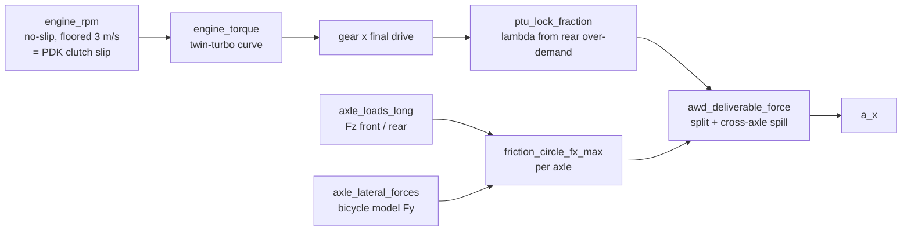

#### Measured (not asserted)

| Quantity | Reference | Measured | How |
|---|---|---|---|
| 0-60 mph | 2.8 s | **2.758 s** | test harness, dt 1/240, real stateful gearbox |
| 0-100 mph | ~5.9 s | **5.904 s** | same harness |
| Top speed | ~205 mph | **205.1 mph** analytic · **203 mph** in engine, still climbing | `steady_state_top_speed()` · cockpit telemetry |
| rpm at Vmax | < 7200 | **6803** (power peak 6750) | drag-limited, not rev-limited |
| Launch accel | — | **10.301 m/s² = 1.050 g** | emergent from circle + PTU lock |
| Peak braking | — | **1.064 g** | four-wheel circle |

The 0-60 is **1.5% quicker than the 2.8 s reference and that is reported, not tuned away**: this
model has no torque interruption across shifts and there are two upshifts inside the sprint (a real
PDK loses ~50 ms each). Nothing in the code targets the number. Decomposition: traction-limited at
$\mu m g$ = 17.2 kN from standstill to 23.4 m/s (where 2nd's torque falls under the ceiling), then
torque-limited; 60 mph arrives in 3rd.

#### Verification

- **116/116 ctest green** (was 82; +11 new physics cases). All 44 car/wheel cases pass with 10 159
  assertions. New coverage: AWD launch ceiling, AWD→legacy-RWD closed-form equivalence (0.7% bound),
  PTU monotonicity in demand, axle-load-sum invariance, friction-circle geometry (incl. a 3-4-5
  check), combined-slip braking, ride-rate stability bound, ARB heave-neutrality + roll closed form,
  camber progressivity/monotonicity, toe linearity.
- **Both configs build clean**: `SWISH_DEBUG_UI=ON` (2 432 984 B, DebugUI symbols present) and
  `OFF` (1 288 888 B).
- **Visually verified in the release build**, window-only screenshots, temp-force → capture →
  revert: (a) **camber/toe** A/B at a forced roll pose with the gain amplified 10× vs zeroed — the
  front wheel goes from square to visibly leaned-in; (b) **FOV kick** at rest vs mid-launch vs top
  speed — the cockpit visibly widens as the speed term ramps 0 → ~+10°.
- **In-engine numeric confirmation** via the debug telemetry HUD: 203 mph in 7th at 6729 rpm against
  the 7200 redline, and the gear/rpm mapping exact at 128 / 170 / 177 / 203 mph. The wet-grip model
  correctly and honestly slows the launch (55 mph at ~4 s at μ 0.608) — a Turbo S on a wet road does
  not do 2.8 s.
- **Phase-B invariant grep clean**: the suspension path adds no write to `m_position`/`m_rotation`.

#### Not done here

FOV kick + camera shake (spec §3.5's bundled F1 item) **was already shipped on 2026-08-15** —
`src/utils/Smoothing.h` plus `App.cpp`'s cockpit block — so Phase 1 verified it rather than building
it. Notably `kMaxForwardSpeed`, the normaliser the speed term divides by, was already 92 000 WU
≈ 205 mph, i.e. already the Turbo S figure, so the retarget needed no camera retune. Engine audio
remains explicitly out of scope (no audio subsystem exists in this codebase).

#### Files

| File | Change |
|---|---|
| [src/scene/Entity/CarPhysics.h](src/scene/Entity/CarPhysics.h) | Turbo S `CarParams`/`TireParams`; twin-turbo torque curve + 7200 redline; PDK ratio set; new `AxleLoad`/`AxleLateral`/`DrivetrainParams`, `axle_loads_long`, `friction_circle_fx_max`, `ptu_front_share`, `ptu_lock_fraction`, `awd_deliverable_force`, `brake_cap_force`, `axle_lateral_forces`, `axle_lateral_use`, `top_speed_in_gear`; `longitudinal_accel` takes drivetrain + lateral; `steady_state_top_speed` scans gears; `WetGripParams::muDry` 1.10 → 1.05 |
| [src/scene/Entity/WheelKinematics.h](src/scene/Entity/WheelKinematics.h) | Turbo S ride rates/travel/unsprung mass; new `AntiRollParams` + `arb_target_shift_m`; new `SuspensionGeometry`/`CamberToe` + `camber_toe_from_travel` / `camber_toe_delta_from_travel` |
| [src/scene/Entity/CarEntity.cpp](src/scene/Entity/CarEntity.cpp) | Combined-slip lateral read feeding `longitudinal_accel`; ARB target shift (snapshot-before-advance so the two corners stay mirror-symmetric); camber/toe `align` matrix in `get_draw_calls` |
| [src/scene/Entity/CarEntity.h](src/scene/Entity/CarEntity.h) | `m_effective_mu` default 1.10 → 1.05; new `kDynamicBlendSpeed` shared by the longitudinal and lateral blocks |
| [src/debug/DebugUI.cpp](src/debug/DebugUI.cpp) | Telemetry redline 9000 → 7200 rpm |
| [src/debug/DebugParams.h](src/debug/DebugParams.h) | `telemetryMu` default 1.10 → 1.05 |
| [tests/test_car_physics.cpp](tests/test_car_physics.cpp) | Retargeted every asserted number; +11 cases (AWD, PTU, load transfer, friction circle, combined-slip braking, ride-rate bound, ARB, camber, toe); suspension tests now read `travelMaxM` instead of a hardcoded 0.035 |
| [docs/phase-1-physics-speed-accuracy.md](archive/docs/phase-1-physics-speed-accuracy.md) | Status → shipped; new §8 with measured results, the 5 deviations, and the Phase-2 hand-off |
| [docs/wheels/README.md](docs/wheels/README.md) | Decision log 5-7 (ride rates, camber/toe source, ARB representation); Phase B note on what Phase 1 landed |
| [docs/car_system.md](docs/car_system.md) | New "as built" physics block replacing a three-generations-stale description |
| [tasks/todo.md](tasks/todo.md) | Phase 1 checked off + review note |

### 2026-08-23 — Per-object velocity buffer for TAA/motion blur

Added a debug-only per-object velocity G-buffer so TAA/motion-blur reprojection correctly follows
the moving car body and spinning wheels, instead of assuming only the camera/world moved.

Technical summary

**Motivation.** `tasks/todo.md`'s ROI-#2 open item: `TaaPass`'s reprojection (`taa.frag`) derived
motion purely from scene depth + a single camera-level `m_prevViewProj`
([Renderer.h](src/renderer/Renderer/Renderer.h)) — i.e. it modeled "the whole world reprojects
through one camera transform," which is exactly right for static road/scenery but wrong for
anything that moves independently of the camera. The car body and spinning wheels are the
highest-visibility case (chase camera keeps the car itself roughly screen-centered, but wheel
spin/steer and any body yaw/pitch don't reproject correctly under pure depth-based motion),
producing reprojection ghosting under TAA + motion blur. Settled scope from a grilling session
(`tasks/todo.md`'s top section, since checked off): car body + wheels only for v1 (wipers/GPU
spray excluded — thin/translucent forward elements, error far less perceptible); wheels get a
rigid-transform-diff velocity (not true per-vertex spin blur — a deliberate non-goal unless
residual ghosting is visible after this); a brand-new debug-only G-buffer target, gated exactly
like `TaaPass` today so release stays byte-identical; this does **not** change the TAA-vs-SSAA
release-default decision, which stays out of scope.

**The fix.** A new [`VelocityPass`](src/renderer/VelocityPass/VelocityPass.h) (modeled on
`GlassPass`'s "read-only depth, own small render pass" shape) re-draws the SAME car-body + wheel
draw calls the G-buffer pass already submitted, a second time, into a small RGBA16F target:

$$
\text{velocity}_{\text{uv}} = \left(\frac{\mathbf{clip}_{\text{cur}}.xy}{\mathbf{clip}_{\text{cur}}.w}\right)\cdot 0.5 + 0.5
\;-\; \left(\frac{\mathbf{clip}_{\text{prev}}.xy}{\mathbf{clip}_{\text{prev}}.w}\right)\cdot 0.5 + 0.5
$$

computed per-vertex in [`velocity.vert`](shaders/velocity.vert) from `curViewProj·curModel·pos` and
`prevViewProj·prevModel·pos`, interpolated (perspective-correct) and finished in
[`velocity.frag`](shaders/velocity.frag), which also writes `a = 1.0` as a validity flag (0
elsewhere, via a full clear). The pass is depth-tested read-only against the already-resolved
scene depth (`GREATER_OR_EQUAL`, reverse-Z — tolerant of this pass's vertex math not being
bit-identical to `basic.vert`'s camera-relative-rebase path, an accepted non-goal-precision
trade-off) so only the actually-visible car surface writes a velocity. [`taa.frag`](shaders/taa.frag)
gained a 4th descriptor binding for this buffer and now prefers it (`objVel.a > 0.5`) over its
existing depth-only estimate, falling back to the old behavior everywhere else (all static scenery).

**Previous-transform tracking.** Nothing tracked a per-object previous-frame transform before this
— only the camera did. [`CarEntity::get_draw_calls()`](src/scene/Entity/CarEntity.cpp) now stashes
each submesh's freshly-computed model matrix (body, wheel spin/steer/suspension, steering wheel) as
its last step into a rolling cache; a new `get_prev_draw_models()` exposes the previous call's
snapshot, index-for-index parallel to `get_draw_calls()`'s own result, with a topology-change
fallback to zero velocity (e.g. wheel frames mid-load) instead of ever mis-pairing indices.
`WheelKinematics.h` itself wasn't touched — wheel spin/steer/suspension motion is already folded
into the final per-submesh matrix `get_draw_calls()` computes, so capturing that matrix captures
wheel motion for free, without duplicating state.

**Wiring.** `Renderer` owns `VelocityPass` (constructed before `TaaPass` so its views bind as
`TaaPass`'s extra input) and runs it once per frame, gated on `m_debugParams.taaEnabled`, right
after SSAO — while the scene depth is still `DEPTH_STENCIL_READ_ONLY_OPTIMAL` (same window
`TaaPass` and the forward passes already rely on). `App.cpp` pushes
`CarEntity::get_prev_draw_models()` into the renderer immediately after the existing
`update_dynamic_draw_calls(m_car->get_draw_calls())` call — ordering matters (the accessor reflects
whatever was cached *before* that `get_draw_calls()` call).

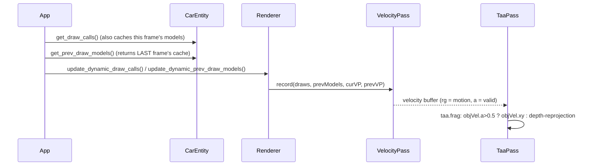

| File | Change |
|---|---|
| [shaders/velocity.vert](shaders/velocity.vert) | New — outputs current + previous clip-space position per vertex. |
| [shaders/velocity.frag](shaders/velocity.frag) | New — derives the UV-space motion vector + validity flag. |
| [shaders/taa.frag](shaders/taa.frag) | New binding 3 (velocity buffer); prefers it over the depth-only estimate when valid. |
| [src/renderer/VelocityPass/VelocityPass.h](src/renderer/VelocityPass/VelocityPass.h) / [.cpp](src/renderer/VelocityPass/VelocityPass.cpp) | New — the debug-only re-draw pass, `SWISH_DEBUG_UI`-gated. |
| [src/renderer/TaaPass/TaaPass.h](src/renderer/TaaPass/TaaPass.h) / [.cpp](src/renderer/TaaPass/TaaPass.cpp) | 4th descriptor binding + `init`/`recreate`/descriptor-write signatures take the velocity views. |
| [src/renderer/SceneGeometry/SceneGeometry.h](src/renderer/SceneGeometry/SceneGeometry.h) | Debug-only `get_draw_calls()` accessor so `VelocityPass` can read the dynamic draw list back. |
| [src/scene/Entity/CarEntity.h](src/scene/Entity/CarEntity.h) / [.cpp](src/scene/Entity/CarEntity.cpp) | Previous-frame per-submesh model cache + `get_prev_draw_models()`, debug-only. |
| [src/renderer/Renderer/Renderer.h](src/renderer/Renderer/Renderer.h) / [.cpp](src/renderer/Renderer/Renderer.cpp) | Owns `VelocityPass`, new `recordVelocityPass()`, `update_dynamic_prev_draw_models()`, swapchain-recreate wiring. |
| [src/core/App/App.cpp](src/core/App/App.cpp) | Pushes `CarEntity::get_prev_draw_models()` into the renderer each frame (debug-only). |
| [CMakeLists.txt](CMakeLists.txt) | New shader sources + `VelocityPass.cpp` added to the build. |
| [docs/GLOSSARY.md](docs/GLOSSARY.md) | "Motion vectors / motion blur" entry updated — a velocity G-buffer now exists. |
| [tasks/todo.md](tasks/todo.md) | Checked off the shipped sub-items; ADR item left open for a later pass. |

**Verification.** Built both the debug-UI config (`SWISH_DEBUG_UI=ON`) and a clean release config
(`SWISH_DEBUG_UI=OFF`) from scratch — both compile, and the full 82-test Catch2 suite is green on
both. Ran the debug build, drove the car (chase + cockpit views, accelerating and steering), and
screenshotted with TAA + motion blur temporarily forced on (and `motionBlurScale` exaggerated) to
confirm the new pass renders cleanly — no corruption, no validation-layer breakage, no black/NaN
pixels — through boot, straight-line driving, and a hard turn; reverted all temporary forces
afterward. The release build's `DebugParams` defaults (`taaEnabled = false`,
`motionBlurEnabled = false`) are unchanged, so release output stays byte-identical, matching the
project's `SWISH_DEBUG_UI`-gating convention.

---

### 2026-08-23 — Clearcoat + flake car paint BRDF

Added a second, tight GGX specular lobe (clearcoat) and a procedural stochastic normal-perturbation
sparkle (flake) to car paint, authored per-material and live-tunable in the debug UI.

Technical summary

**Motivation.** `tasks/todo.md`'s ROI-#1 open realism item: nothing in the tree modeled automotive
clearcoat or metal-flake — the base G-buffer BRDF (`shaders/lighting.frag`) was a single GGX lobe.
The design was settled via a grilling session (see `tasks/todo.md`'s top section) before this landed:
a general, per-material feature (not hardcoded to the hero car), two independently tunable terms
(flake dialable to zero to isolate the clearcoat lobe), flake jitter from in-shader procedural noise
(never a baked texture), and — because `outAlbedo`/`outNormal`/`outMaterial` are already fully packed
— a brand-new **always-on** 4th G-buffer MRT, kept separate from the (debug-only) per-object velocity
buffer landing alongside it.

**The BRDF.** Clearcoat is a thin, near-mirror dielectric lobe ($F_0=0.04$, roughness
$\approx 0.045$) added on top of the base lobe (no energy subtracted from the base — a standard,
visually-adequate approximation for a thin, low-weight coat). Flake is a *stochastic per-world-cell*
normal perturbation: `gbuffer.frag` hashes `floor(worldPos / flakeScale)` to decide whether a given
~8 mm world-space cell "sparkles" (probability = flake density), and if so perturbs that cell's
normal by a random offset (`flakeJitter`). The perturbed normal is stored in the new MRT and consumed
by lighting.frag as a *second, independent* normal for a broader-roughness ($\approx 0.12$) GGX lobe
— so the glint only lights up where a tilted flake happens to catch the sun, not as a uniform grain:

$$
L_\text{flake} = D(N_\text{flake}, H)\,G(N_\text{flake}, V, L)\,F(H,V) \cdot (N_\text{flake}\!\cdot\!L)\cdot\text{mask}
$$

**G-buffer channel packing.** No spare channel existed in the 3 existing MRTs, so a 4th
(`outClearcoatFlake`, `R8G8B8A8_UNORM`) was added: RG = octahedral-encoded flake-perturbed world
normal (decodes back to the geometric normal where no flake cell is active — cheap, correct default),
B = clearcoat strength, A = flake presence mask. Octahedral packing (`octEncode`/`octDecode`) was
required because clearcoat strength + flake mask + a full normal don't fit 4 channels any other way.

**Per-material authoring + debug tuning.** `PushConstantData` gained a `paint` vec4 (clearcoat
strength, flake density, flake cell scale, flake jitter — the last two are *global* debug tunables
broadcast into every draw, not per-material) — 112 B total, still a 16-byte multiple (MoltenVK).
`SceneTypes.h::default_clearcoat_strength/default_flake_density` give every `MAT_CAR_0..19` slot a
modest default (0.35 clearcoat, flake off) since the current GLB loader still can't tell paint apart
from rubber/interior/chrome within those 20 slots (documented caveat, tracked in
`docs/car-asset-pipeline.md`). `MaterialOverride` gained `clearcoat`/`flakeDensity` fields for the
existing per-slot debug editor, and `DebugParams` gained a global "Clearcoat / Flake" panel
(multipliers + shared roughness/scale/jitter) — the same global-multiplier-over-an-authored-table
pattern as SSAO/IBL. This ships in **release**, not gated behind `SWISH_DEBUG_UI` — it's a real
content addition (like god-rays/puddles), not a debug-only preview.

**Verification.** Built both `make build` (release) and the debug-UI config; all 82 tests pass.
Visually verified by temporarily forcing extremes (`kDefaultClearcoatStrength=1.0`,
`flakeDensity=0.6`, tight `clearcoatRoughness`, large `flakeScale`/`flakeJitter`), screenshotting
cockpit + exterior chase views (visible sparkle grain on paint/interior, no black geometry, no
validation-layer errors), then re-testing with flake forced to 0 to confirm the clearcoat lobe reads
cleanly in isolation, then reverting to the shipped defaults and re-screenshotting to confirm the
production look is a subtle, non-regressive gloss lift.

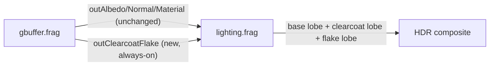

| File | Change |
|------|--------|
| [`src/scene/SceneTypes.h`](src/scene/SceneTypes.h) | `PushConstantData.paint` vec4; `MaterialOverride.clearcoat/flakeDensity`; `default_clearcoat_strength`/`default_flake_density`; `PaintTuning` |
| [`src/debug/DebugParams.h`](src/debug/DebugParams.h) | `clearcoatMul`, `flakeDensityMul`, `clearcoatRoughness`, `flakeRoughness`, `flakeScale`, `flakeJitter` |
| [`src/debug/SceneParamsUniform.h`](src/debug/SceneParamsUniform.h) / [`.cpp`](src/debug/SceneParamsUniform.cpp) | new `paintParams` UBO row (clearcoat/flake roughness) |
| [`src/debug/DebugUI.cpp`](src/debug/DebugUI.cpp) | "Clearcoat / Flake" panel; per-material clearcoat/flakeDensity sliders |
| [`src/debug/DebugParamsIO.cpp`](src/debug/DebugParamsIO.cpp) | TOML preset save/load for the new fields |
| [`src/renderer/SceneGeometry/SceneGeometry.h`](src/renderer/SceneGeometry/SceneGeometry.h) / [`.cpp`](src/renderer/SceneGeometry/SceneGeometry.cpp) | `record_draws` computes per-draw clearcoat/flake push constants (authored default × global mul, or override) |
| [`src/renderer/ScenePipeline/ScenePipeline.cpp`](src/renderer/ScenePipeline/ScenePipeline.cpp) | `colorAttachmentCount` 3 → 4 |
| [`src/renderer/PostProcessManager/PostProcessManager.h`](src/renderer/PostProcessManager/PostProcessManager.h) / [`.cpp`](src/renderer/PostProcessManager/PostProcessManager.cpp) | 4th G-buffer image/view/attachment/framebuffer/descriptor binding (set 1, binding 4) |
| [`src/renderer/Renderer/Renderer.cpp`](src/renderer/Renderer/Renderer.cpp) | clear value for the new attachment; barrier to `SHADER_READ_ONLY`; threads `PaintTuning` into `record_draws` |
| [`shaders/basic.vert`](shaders/basic.vert) | `paint` field added to the push-constant block (unused; keeps vertex/fragment blocks matched) |
| [`shaders/gbuffer.frag`](shaders/gbuffer.frag) | `outClearcoatFlake` MRT; `hash3`/`octEncode`; per-world-cell flake activation |
| [`shaders/lighting.frag`](shaders/lighting.frag) | `gbClearcoatFlake` binding; `octDecode`; `ggxSpecular` helper; clearcoat + flake lobes (sun + IBL for clearcoat, sun-only for flake) |
| [`tasks/todo.md`](tasks/todo.md) | checked off the "Clearcoat + flake car paint" item |

---

### 2026-08-23 — AI-generated modular car asset pipeline plan (docs only)

Added a planning doc for generating future car models with AI tools as a modular,
consistently-named rig instead of downloaded, unnamed assets. No code or assets changed.

Technical summary

**Motivation.** The current car (`assets/Porsche/porsche.glb`) is an unnamed, flat 1,667-node
Sketchfab download; the loader recovers wheel/caliper/steering-wheel grouping only by clustering
bit-identical translation vectors and grepping node-ancestry substrings. That heuristic doesn't
generalize to a second car. The user wants to build future cars with AI-assisted modeling, owned
and licensed on their own terms, sharing one rig so parts can eventually be resolved by name.

**What shipped.** [`docs/car-asset-pipeline.md`](docs/car-asset-pipeline.md), synthesized from three
parallel research passes: AI mesh-generation tooling (Tripo3D/Meshy/Rodin — capabilities, PBR
export, licensing, and the "photoreal one-click" reality check), modular rig conventions (a
`Body`/`Wheel_*`/`Caliper_*`/`Suspension_*`/`SteeringWheel`/`Seat_*`/`Engine` node-naming scheme,
confirming glTF plain nodes — no Armature/skin — are sufficient for Swish's rigid per-part
articulation, plus the Blender authoring rules that prevent the wobble-class bugs already logged in
`docs/wheels/README.md`), and PBR clearcoat/flake texturing (splitting authored textures from
shader-procedural flake parameters, and recommending `KHR_materials_clearcoat` as the export target
for clearcoat weight/roughness while flake density/scale/color become new fields on this project's
own `MaterialId` table).

| File | Change |
|------|--------|
| [docs/car-asset-pipeline.md](docs/car-asset-pipeline.md) | New — the pipeline plan |
| [docs/README.md](docs/README.md) | Indexed the new doc |
| [tasks/todo.md](tasks/todo.md) | New planning entry + immediate next steps |

**Same-day addendum.** Added **Hunyuan3D** (Tencent) to the tool shortlist per user request — it
offers a generous free daily generation quota and clean quad/watertight topology with separate
PBR channel export, so it's now paired with Tripo3D as a zero-cost A/B candidate for the first
exterior-shell test. Noted its licensing split: the hosted free tier is personal/non-commercial,
while the open-source model is separately licensed for commercial use (Tencent Hunyuan Community
License, with an EU/UK/South Korea carve-out) — flagged so a commercial-use decision isn't made on
the free hosted tier by accident.

**Second same-day addendum.** Expanded the wiper-blade note into a full modeling subsection: don't
expect AI mesh-gen to handle the thin hinge/rubber-insert geometry well, use two materials (arm vs
rubber), and leave a deliberate `WORLD_SCALE` standoff gap from the windshield glass so it doesn't
z-fight — called out because the cockpit camera (`kSeatEye`) sees this part up close in interior
mode. Also added [`docs/car-asset-pipeline.md`](docs/car-asset-pipeline.md)'s sibling doc,
[`docs/environment-asset-pipeline.md`](docs/environment-asset-pipeline.md), answering whether
trees/leaves/highway props for the LIE corridor should also be AI-generated: **no for tree
structure** (AI mesh-gen is weak on organic branching geometry — recommend a procedural trunk/
branch generator + AI/Megascans leaf-card textures + a per-vertex wind shader instead, feeding the
already-planned B2 LOD/impostor roadmap item), and **no change for guardrails/lamps/signage**
(already procedural C++ geometry — any AI effort there belongs in PBR texturing, not new meshes).

| File | Change |
|------|--------|
| [docs/car-asset-pipeline.md](docs/car-asset-pipeline.md) | Wiper-blade modeling subsection; cross-link to the new environment doc |
| [docs/environment-asset-pipeline.md](docs/environment-asset-pipeline.md) | New — trees/foliage/highway-prop asset strategy |
| [docs/README.md](docs/README.md) | Indexed the new doc |
| [tasks/todo.md](tasks/todo.md) | Wiper + environment next-steps bullets |

---

### 2026-08-21 — Open EB wall at intro exit; lift ramp asphalt

The continuous EB retaining wall / sound barrier no longer blocks the intro diverge, and exit
ramp asphalt is lifted above grass so the exit reads as a paved lane (not markings on grass).

Technical summary

**Motivation / root cause.** `generate_guardrail` / `generate_sound_barriers` spanned the full
intro Z, so the wall sat across the exit opening. Exit asphalt was coplanar with grass at y=0,
so the diverge looked like white lines on grass behind a solid wall.

**Fix.** Gap EB wall + sound panels from decel through the connector; hole EB grass through
that Z; lift exit/marginal asphalt to `kIntroExitAsphaltY` (6 WU).

| File | Change |
|------|--------|
| [src/scene/RoadScene/RoadScene.cpp](src/scene/RoadScene/RoadScene.cpp) | Wall/grass gap + lifted ramp |
| [src/scene/RoadGeometry/RoadGeometry.h](src/scene/RoadGeometry/RoadGeometry.h) | `kIntroExitAsphaltY` |
| [src/scene/RoadGeometry/RoadGeometry.cpp](src/scene/RoadGeometry/RoadGeometry.cpp) | Surface Y matches lift |

---

### 2026-08-21 — Chase closer + helicopter follow-orbit; exit earlier

Chase sits ~6.5 m behind the car. Helicopter now orbits the car (always framed; mouse
orbits, Q/E radius). Intro EXIT ONLY gantry moved earlier (~38% of intro) with a console
distance hint when switching to helicopter.

Technical summary

**Motivation.** Chase felt too distant; helicopter free-look lost the car while driving;
the exit gantry was ~¾ down the intro and hard to find.

**Fix.** Tighter chase offsets; spherical orbit heli that always `look_at` the car;
`kExitRampEndFrac` 0.75→0.38; heli mode prints meters to gantry.

| File | Change |
|------|--------|
| [src/core/App/App.cpp](src/core/App/App.cpp) | Chase / heli orbit + distance log |
| [src/core/App/App.h](src/core/App/App.h) | Default heli radius ~55 m |
| [src/scene/RoadGeometry/RoadGeometry.h](src/scene/RoadGeometry/RoadGeometry.h) | Earlier exit frac |

---

### 2026-08-21 — Intro exit Street View polish (gore, gantry, trees, drivability)

Polished the authored EB → N Marginal exit: chevron gore + merge flare, EXIT ONLY gantry at the
diverge, W-beam along the ramp, tree wall beside the marginal (no houses), and intro bounds so
you can steer onto the exit.

Technical summary

**Motivation.** The intro exit existed as asphalt with a thin white separator; the EXIT ONLY
gantry sat far upstream of the diverge, trees were never emitted, and `drivable_bounds` kept the
car on EB only — so the exit was easy to miss and undrivable.

**Fix.** Shared intro-exit Z/X constants in
[RoadGeometry.h](src/scene/RoadGeometry/RoadGeometry.h).
[generate_exit_ramp](src/scene/RoadScene/RoadScene.cpp) draws gore outlines + diagonal chevrons,
merge flare, and W-beam on the ramp/connector/marginal. EXIT ONLY (`MAT_SIGN_2`) uses
`intro_exit_gantry_z`. `generate_marginal_trees` fills the marginal corridor.
`drivable_bounds` / `road_surface_y` open the N Marginal band past the decel station.

| File | Change |
|------|--------|
| [src/scene/RoadGeometry/RoadGeometry.h](src/scene/RoadGeometry/RoadGeometry.h) | Intro exit constants + Z helpers |
| [src/scene/RoadGeometry/RoadGeometry.cpp](src/scene/RoadGeometry/RoadGeometry.cpp) | Intro drivability + surface Y |
| [src/scene/RoadScene/RoadScene.cpp](src/scene/RoadScene/RoadScene.cpp) | Gore, rail, gantry Z, marginal trees |
| [src/scene/RoadScene/RoadScene.h](src/scene/RoadScene/RoadScene.h) | `generate_marginal_trees` |
| [docs/glen-cove-lie.md](docs/glen-cove-lie.md) | Exit/tree status |
| [docs/endless-road.md](docs/endless-road.md) | Intro vs endless exit note |

Endless chunks still have no at-grade mainline→frontage diverge (future Layer 5).

---

### 2026-08-21 — Camera presets (chase, helicopter, roof, …)

**C** now cycles driving/debug cameras: cockpit → chase → hood → bumper → roof →
side → helicopter → free-fly. Helicopter uses **Q/E** for height (exit/corridor debug).

Technical summary

**Motivation.** Only cockpit vs free-fly existed; debugging exits and common racing
views needed car-attached presets without detaching into WASD fly.

**Fix.** Added [CameraMode.h](src/scene/CameraMode.h). [App.cpp](src/core/App/App.cpp)
places each exterior cam from car pose / mesh-local offsets and `look_at_with_offset`;
cockpit keeps seat-rigid FOV-kick/shake. Console prints `[camera] <name>` on change.

| Mode | Framing |
|------|---------|
| Cockpit | Driver seat (unchanged feel) |
| Chase | ~12 m back / 3.2 m up |
| Hood / Bumper / Roof | Mesh-local mounts |
| Side | Driver-side exterior |
| Helicopter | High look-down; Q/E height |
| Free-fly | WASD + mouse |

| File | Change |
|------|--------|
| [src/scene/CameraMode.h](src/scene/CameraMode.h) | Enum + cycle/name helpers |
| [src/core/App/App.h](src/core/App/App.h) | `m_camera_mode`, heli height |
| [src/core/App/App.cpp](src/core/App/App.cpp) | Mode update + C cycle |
| [docs/GLOSSARY.md](docs/GLOSSARY.md) | Keybind + CameraMode |

---

### 2026-08-21 — Weather presets from HDRI skies (G to cycle)

Added four driving weathers — partly cloudy, cloudy, very cloudy, golden hour —
each swapping a Radiance HDRI under `assets/Sky/` and matching sun/clarity/ambient.
Press **G** to cycle. Extra HDRIs from `new_assets/` were copied into `assets/Sky/`.

Technical summary

**Motivation.** One static airfield HDRI could not cover overcast vs golden-hour looks.
User added PureSky / quarry HDRIs for distinct weathers.

**Fix.** [WeatherPreset.h](src/scene/WeatherPreset.h) maps each preset to an HDRI file.
[IBLManager::set_hdri](src/renderer/IBLManager/IBLManager.cpp) hot-swaps the equirect and
rebakes env→irradiance→prefilter. [Renderer::set_weather_preset](src/renderer/Renderer/Renderer.cpp)
sets sun direction/colour/clarity/ambient + exposure/yaw. App **G** cycles presets.

| Preset | HDRI |
|--------|------|
| Partly cloudy | `citrus_orchard_road_puresky_2k.hdr` |
| Cloudy | `quarry_cloudy_2k.hdr` |
| Very cloudy | `overcast_soil_puresky_2k.hdr` |
| Golden hour | `belfast_sunset_puresky_2k.hdr` |

| File | Change |
|------|--------|
| [src/scene/WeatherPreset.h](src/scene/WeatherPreset.h) | Preset enum + HDRI filenames |
| [src/renderer/IBLManager/](src/renderer/IBLManager/) | `set_hdri` hot-swap + exposure/yaw |
| [src/renderer/Renderer/](src/renderer/Renderer/) | `set_weather_preset` |
| [src/core/App/](src/core/App/) | G cycles weather |
| [assets/Sky/](assets/Sky/) | New HDRI assets |

---

### 2026-08-21 — Fix car leather IBL faceting (wrong roughness channel + sRGB ORM)

Steering-wheel / cabin leather no longer shows hard polygonal “light bumps” under the
HDRI: glTF roughness is taken from the ORM **G** channel (with `roughnessFactor`), and
car normal/roughness uploads are linear UNORM instead of sRGB.

Technical summary

**Motivation / root cause.** After real HDRI IBL, sharp specular lobes revealed every
triangle on the steering rim. Two loader bugs made leather too glossy: (1) the full
metallicRoughness texture was bound as `_roughness` and sampled as `.r` (AO/unused), not
glTF’s **G = roughness**; (2) `register_from_pixels` always uploaded sRGB, so mid
roughness values were gamma-lowered when sampled → shinier than authored.

**Fix.** Expand ORM G×`roughnessFactor` to greyscale at load in
[ModelManager.cpp](src/scene/ModelManager/ModelManager.cpp); pick UNORM vs sRGB in
[TextureManager.cpp](src/renderer/TextureManager/TextureManager.cpp) via `is_linear_data`
(same rule as `load_directory`). Shaders keep a `.r` read (road maps unchanged).

| File | Change |
|------|--------|
| [src/scene/ModelManager/ModelManager.cpp](src/scene/ModelManager/ModelManager.cpp) | `upload_gltf_roughness` — G-channel × factor → greyscale |
| [src/renderer/TextureManager/TextureManager.cpp](src/renderer/TextureManager/TextureManager.cpp) | `register_from_pixels` uses UNORM for normal/roughness |
| [shaders/gbuffer.frag](shaders/gbuffer.frag) | Comment: greyscale roughness in `.r` |
| [shaders/basic.frag](shaders/basic.frag) | Same comment |

---

### 2026-08-21 — Real HDRI IBL for sky, car, and asphalt reflections

Swapped the IBL env source from the procedural sky to `assets/Sky/derelict_airfield_01_2k.hdr`
when present. Visible sky, aerial haze, car paint, and wet asphalt now share the same photo
environment; procedural bake remains the fallback if the file is missing.

Technical summary

**Motivation / root cause.** Split-sum IBL was already wired (irradiance + prefiltered + BRDF LUT
on set 3), but stage 1 only painted an analytic horizon/zenith/sun disc (`ibl_sky.frag`). That
kept reflections flat/generic. A Poly Haven Radiance `.hdr` was added under `assets/Sky/` and
needed to drive both lighting and the background.

**Fix.** `IBLManager` loads the equirect with `stbi_loadf` into an `R32G32B32A32_SFLOAT` 2D
image, projects it to the env cube via new [shaders/ibl_equirect.frag](shaders/ibl_equirect.frag),
then runs the existing irradiance + GGX prefilter convolutions once. Weather rebakes are gated
when `uses_hdri()` is true. [shaders/lighting.frag](shaders/lighting.frag) samples
`prefilteredMap` mip 0 for sky pixels and haze so the dome matches road/car reflections.

| File | Change |
|------|--------|
| [shaders/ibl_equirect.frag](shaders/ibl_equirect.frag) | New equirect→cube-face bake shader |
| [CMakeLists.txt](CMakeLists.txt) | Register `ibl_equirect.frag` in `SHADER_SOURCES` |
| [src/renderer/IBLManager/IBLManager.h](src/renderer/IBLManager/IBLManager.h) | HDRI load/bake API, `uses_hdri()` |
| [src/renderer/IBLManager/IBLManager.cpp](src/renderer/IBLManager/IBLManager.cpp) | Load HDRI, bakeFromHdri, skip procedural overwrite |
| [src/renderer/Renderer/Renderer.cpp](src/renderer/Renderer/Renderer.cpp) | Skip `maybeRebakeIBL` when HDRI active |
| [shaders/lighting.frag](shaders/lighting.frag) | Sky + haze from prefiltered env mip 0 |
| [docs/realism-features.md](docs/realism-features.md) | Document HDRI-first bake |
| [docs/GLOSSARY.md](docs/GLOSSARY.md) | Update IBL / bake-chain definitions |
| [assets/Sky/derelict_airfield_01_2k.hdr](assets/Sky/derelict_airfield_01_2k.hdr) | Env source (user-added) |

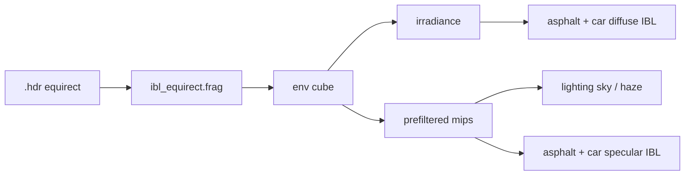

---

### 2026-08-15 — Cockpit camera now has FOV kick, camera shake, and inertial follow (issue 5's motion half) — **release-visible**

`tasks/todo.md` **F1** (FOV kick + camera shake) and **F3** (framerate-independent smoothing helper).
The cockpit camera was a perfectly rigid, unsmoothed snap to the car's pose every frame — nothing on
screen ever reacted to speed or acceleration, which read as floaty. It now widens the lens with speed
and under hard acceleration, adds a subtle speed-scaled shake, and eases its heading-follow with a
touch of head/neck inertia. **This changes the shipped (non-debug) camera output.**

Technical summary

#### Motivation

`src/core/App/App.cpp`'s cockpit block set camera position directly from the car's model matrix and
yaw/pitch directly from car heading + mouse-look, every frame, with zero lag, spring, or reactivity to
motion. `Camera::m_fov` was fixed at 65° with no setter. There was no camera shake at all. None of the
strongest "you are going fast" cues (FOV widening, chassis vibration, a touch of following weight) existed.

#### F3 — the shared smoothing helper

Formalized $x \mathrel{+}= (x_{target}-x)(1-e^{-k\Delta t})$ as one pure, reusable helper in
[src/utils/Smoothing.h](src/utils/Smoothing.h) (`exp_smooth`), plus an angle-aware wrap-safe variant
(`exp_smooth_angle_deg`) for following a heading that wraps at ±180°. This is the same shape
`Renderer::updateAutoExposure` already uses inline for exposure adaptation — the point of the helper is
that new easing (camera follow, FOV kick) doesn't reinvent a slightly-wrong, dt-dependent version. A raw
per-frame lerp bakes the timestep into its factor, so it settles differently at 30 Hz vs 240 Hz for the
same nominal factor; the exponential form is the exact per-step solution of $\dot{x}=k(x_{target}-x)$ and
reproduces the identical continuous trajectory at any `dt`. New tests in
[tests/test_smoothing.cpp](tests/test_smoothing.cpp) check exactly that property (settle to the same
value over the same wall-clock second at `dt = 1/30` vs `1/240`), plus the angle-wrap short-arc behavior.

#### Cockpit camera: what's smoothed vs what stays rigid

The eye **position** stays a rigid attach to the car's model matrix — completely unsmoothed. The
dashboard and steering wheel are meshes baked into that same model matrix, so easing the eye toward it
independently would desync the head from a dash that never itself moves (the classic chase-cam
"swimming" artifact). Only the **heading-derived component of camera yaw** now eases through
`exp_smooth_angle_deg` (rate 18 s⁻¹, τ≈56 ms — a cushion, not perceptible lag), reading as a touch of
head/neck inertia against fast steering corrections. Mouse-look (`m_look_yaw`/`m_look_pitch`) is added
on top **raw**, after the eased term, so it stays exactly as responsive as before.

#### F1 — FOV kick

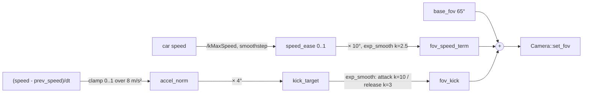

Base 65° widens toward +10° as speed approaches `CarEntity::kMaxSpeed` (~92 m/s, close to the 992
Turbo S's real ~89 m/s top speed), eased with smoothstep so city-speed driving barely widens the lens.
A separate fast-attack (τ≈100 ms) / slow-release (τ≈330 ms) "kick" of up to +4° fires on hard
acceleration only (braking is ignored — clamped to `[0,1]` before scaling) so a stomp on the throttle
reads as a shove. Both terms return to exactly `base_fov` at rest, and free-fly mode always pins FOV
back to base. Added `Camera::set_fov()` ([Camera.h](src/scene/Camera/Camera.h)/[.cpp](src/scene/Camera/Camera.cpp))
with a defensive `[1°,170°]` clamp only — the game-feel range lives in `App.cpp`.

#### F1 — camera shake

Deterministic quasi-noise: a weighted sum of three fixed, incommensurate sine frequencies per axis
(vertical position, lateral position, yaw, pitch — each with its own frequency/phase so the axes don't
read as correlated), sampled at a wall-clock accumulator (`m_shake_time += delta_time`, never `+= 1`
frame), so shake frequency content is identical at any framerate — deliberately **not**
`Math::random()`-per-frame, which would pop and alias differently at different framerates. Amplitude
envelope ramps in with `speed_ratio²` (near-zero under ~40% of top speed) and every axis is capped tiny
(≤3mm position, ≤0.08° rotation) — a garnish that never fights the ±60°/±89° mouse-look clamps.

#### Release-neutrality note

Unlike most debug-gated work in this repo, this **is** a release-visible behavior change (the whole
point — it's the "motion should feel realistic" half of reported issue 5). It only affects the cockpit
camera path (`m_cockpit == true`); the free-fly camera (`!m_cockpit`) is untouched apart from the FOV
reset-to-base guard. All new constants are grouped at the top of their block in `App.cpp` for an easy
follow-up debug-UI slider pass.

**Possibly worth dialing back after a real drive** (flagged, not yet tuned against actual play): the FOV
kick's 8 m/s² acceleration reference and the shake's positional amplitudes were chosen conservatively
from first principles, not from feel-testing at the wheel — if the FOV kick reads as too subtle to
notice, raise `kFovKickMaxDeg`/lower `kAccelRefForKick` first; if the positional shake ever reads as
"swimming" against the fixed dashboard mesh, the rotational-only shake (yaw/pitch) carries most of the
perceptual buzz on its own and is the safe fallback.

| File | Change |
|---|---|
| [src/utils/Smoothing.h](src/utils/Smoothing.h) | New — `exp_smooth` + `exp_smooth_angle_deg` (F3) |
| [tests/test_smoothing.cpp](tests/test_smoothing.cpp) | New — dt-independence, no-overshoot, no-op, and angle-wrap tests |
| [tests/CMakeLists.txt](tests/CMakeLists.txt) | Added `test_smoothing.cpp` to `swish_tests` |
| [src/scene/Camera/Camera.h](src/scene/Camera/Camera.h) | Added `set_fov()` declaration |
| [src/scene/Camera/Camera.cpp](src/scene/Camera/Camera.cpp) | Added `set_fov()` (defensive `[1°,170°]` clamp) |
| [src/core/App/App.h](src/core/App/App.h) | Added cockpit-feel state: yaw-follow smoothing, base/speed/kick FOV terms, prev-speed, shake-time accumulator |
| [src/core/App/App.cpp](src/core/App/App.cpp) | `quasi_noise()` helper; cockpit block now eases heading-yaw, drives FOV kick, applies shake; `set_cockpit()` resets the new state; free-fly branch pins FOV to base |

---

### 2026-08-15 — Added a debug-gated speed/telemetry HUD (issue 5's readout half)

The cockpit gauge cluster can't be a live speed readout — it's baked pixels in the GLB texture atlas
(verified: zero gauge/needle/dial nodes across 3341 nodes; the needle is painted at zero and can never
move) — so a new ImGui "Telemetry" panel is the readout instead: mph/km/h, gear + engine rpm against
the 9000 rpm redline, effective tire-road friction, and a DRY/WET/HYDROPLANING indicator.

Technical summary

#### Motivation

Reported issue 5 asked for a way to actually see speed, gear, and grip state while driving/tuning.
`m_gear_state` was private with no getter, so nothing outside `CarEntity::update()` could read gear or
rpm, and there was no on-screen readout at all short of the (unusable) cockpit gauges.

#### The fix

Added two trivial, side-effect-free inline accessors to
[CarEntity.h](src/scene/Entity/CarEntity.h): `get_gear()` (returns `m_gear_state.gear`) and
`get_engine_rpm()` (re-evaluates `CarPhysics.h`'s existing no-slip `engine_rpm(v, gear, GearboxParams{},
rWheel)` mapping — the same one `update()` already uses to drive the auto-shift machine — for display,
no new state). Added read-only `telemetry*` fields to
[DebugParams.h](src/debug/DebugParams.h), documented as populated **externally, once per frame**
(mirroring the existing `steerPivotWorld`/cull-tally pattern in that struct) rather than computed by the
UI itself. Added a new `CollapsingHeader("Telemetry")` to
[DebugUI.cpp](src/debug/DebugUI.cpp), defaulted open, with a `showTelemetry` toggle (no new tuning
sliders — read-only).

**Hydroplaning thresholds** (`WetGripParams`, `CarPhysics.h`: `muDry=1.10`, `muWet=0.60`, `muPlane=0.08`):

$$
\text{state} = \begin{cases}
\text{HYDROPLANING} & \mu \le \tfrac{\mu_{\text{wet}}+\mu_{\text{plane}}}{2} \approx 0.34 \\
\text{WET} & \tfrac{\mu_{\text{wet}}+\mu_{\text{plane}}}{2} < \mu < \mu_{\text{dry}} - 0.02 \\
\text{DRY} & \mu \ge \mu_{\text{dry}} - 0.02
\end{cases}
$$

The DRY floor uses a small epsilon under `muDry` because `effective_mu()`'s hard invariant returns
`muDry` *exactly* when wetness ≤ 0 — the epsilon just absorbs float noise without masking any real
wetness. The HYDROPLANING ceiling is the midpoint between `muWet` and `muPlane`, so the indicator only
fires once grip has collapsed more than halfway from ordinary wet-grip toward a full plane, rather than
flickering red at the first hint of speed-fade.

**Known follow-up, outside this change's file scope:** the `telemetry*` fields are declared and
displayed but nothing populates them yet — that requires a ~4-line addition in `App.cpp` (under
`#ifdef SWISH_DEBUG_UI`), mirroring the existing `dp.steerPivotWorld = m_car->get_steering_wheel_pivot_world();`
block, pushing `m_car->get_speed()/1000`, `get_gear()`, `get_engine_rpm()`, and `get_effective_mu()`
into the new fields each frame. `App.cpp` was out of scope for this change.

#### Release-neutrality

`DebugUI.cpp`'s whole translation unit (and thus the new panel) is compiled only under
`-DSWISH_DEBUG_UI`; the `CarEntity.h` accessors compile in both configs but are inline, side-effect-free,
and uncalled outside the debug-only panel, so the release build is unaffected. The new `DebugParams`
fields are excluded from TOML preset save/load, same as the struct's other transient/runtime fields.

| File | Change |
|---|---|
| [src/scene/Entity/CarEntity.h](src/scene/Entity/CarEntity.h) | Added `get_gear()`, `get_engine_rpm()` read-only accessors |
| [src/debug/DebugParams.h](src/debug/DebugParams.h) | Added `showTelemetry` + `telemetrySpeedMps`/`telemetryGear`/`telemetryRpm`/`telemetryMu` |
| [src/debug/DebugUI.cpp](src/debug/DebugUI.cpp) | Added `gearLabel()` helper + "Telemetry" panel (speed, gear, rpm bar, mu, hydroplaning state) |

---

### 2026-08-15 — Wet roads now cost grip, and the car can hydroplane on standing water

Wave 2 step 4 (issue 6). Tire friction is no longer a fixed constant: it now depends on integrated
road wetness, speed, and — genuinely new — a C++ port of the renderer's own puddle mask, so driving
fast over a deep puddle in heavy rain triggers a real, speed-gated loss of grip **and** steering
authority, with a smooth recovery as speed drops or the puddle clears. Dry driving (wetness 0) is
provably unaffected — see the bit-identical invariant test below.

Technical summary

#### Motivation

`docs/lessons-from-chrono/07-wet-roads-and-rain.md` §4 works out `effective_mu()` — a three-term wet
grip model (low-speed wet floor, linear speed fade, smoothstep hydroplane collapse) — but explicitly
ships it with `filmOverTread = 0`, leaving the hydroplane branch dormant. That would not deliver the
reported behavior ("above a speed/water-depth threshold the tires should lose grip on standing water").
This change lifts `effective_mu()` essentially as written **and** builds the missing piece: a real
standing-water query, so the hydroplane branch actually fires.

#### `effective_mu()` — lifted from the doc

[CarPhysics.h](src/scene/Entity/CarPhysics.h) gets `WetGripParams` (`muDry=1.10`, `muWet=0.60`,
`speedFade=0.0045`/(m/s), `muPlane=0.08`, `vPlane=28` m/s, `planeBand=4` m/s) and `effective_mu()`:

$$
\mu(w,v) = \big(\mu_{\text{dry}} + w(\mu_{\text{wet}}-\mu_{\text{dry}})\big)\Big(1 - w\,c_v\min(v,v_p)\Big)
$$

with a smoothstep collapse to `muPlane` across `[vPlane, vPlane+planeBand]` once `filmOverTread >= 1`.
**Hard invariant, enforced by an early return:** `wetness <= 0` returns `muDry` exactly — bit-identical
to today's dry handling (see the dedicated test in
[tests/test_car_physics.cpp](tests/test_car_physics.cpp)).

#### The part the doc left dormant: real standing water

[shaders/lighting.frag](shaders/lighting.frag)'s `puddleAmount()`/`puddleNoise()`/`puddleHash()` (value
noise, ~7.7 m cells) is ported to C++ (`puddle_hash`/`puddle_noise`/`puddle_amount`,
[CarPhysics.h](src/scene/Entity/CarPhysics.h)) so physics can query standing water at the car's
position without a G-buffer. **This is a third hand-synced copy** — `shaders/ssr.frag` already
duplicates `lighting.frag`'s puddle functions with its own "kept in sync manually" comment; this is one
more instance of that acknowledged wart, not a new pattern, and it means the C++ copy is only an
*approximation* of what the GPU renders if the three ever drift.

`film_over_tread(x, z, wetness) = kFilmDepthScale * puddle_amount(x, z, 0.501) * wetness`, with
`kFilmDepthScale = 1.4`. Chosen so a fully-formed puddle (`puddle_amount -> 1`, which — given the
narrow 0.12 shoreline transition — is most of a puddle cell's interior) crosses the `filmOverTread >= 1`
gate once wetness exceeds `1/1.4 ~= 0.71` (road rained on hard for ~9 s at `RainSystem`'s 0.08/s wet
ramp), while a merely damp, non-flooded patch (`puddle_amount` up to ~0.5) stays under the gate even at
full wetness (`1.4*0.5*1.0 = 0.7 < 1`) — it fades grip like any wet tarmac but never planes.

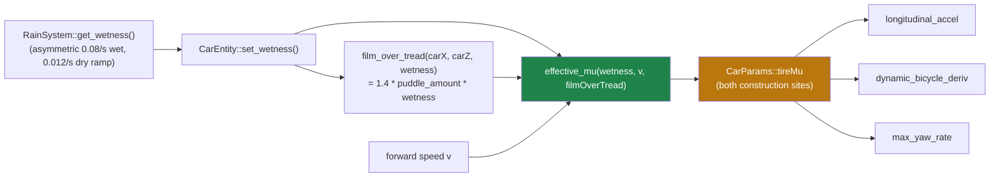

#### Wiring

`CarEntity::set_wetness()` is new (`CarEntity.h`/`.cpp`); `App.cpp` pushes
`m_renderer->get_wetness()` (new minimal getter on `Renderer`, forwarding to
`RainSystem::get_wetness()`) into the car once per frame, before `CarEntity::update()`. Inside
`update()`, `m_effective_mu` is computed once from wetness + current speed + `film_over_tread()` at the
car's position, then written to `CarParams::tireMu` at **both** construction sites in the file
(`update()` and `update_wheel_visuals()` — grepped, there are exactly two, not the doc's stale "two
call sites" guess made obsolete by anything else).

#### Steering authority falls out for free

`max_yaw_rate()` and the lateral tire saturation in `dynamic_bicycle_deriv()` already read
`p.tireMu`, so the one `CarParams::tireMu` patch covers longitudinal *and* lateral grip — no separate
wiring needed. At `vx = 25` m/s: dry yaw-rate cap `~= 0.432` rad/s (`~24.7` deg/s) vs hydroplaning
`~= 0.031` rad/s (`~1.8` deg/s) — about 7.3% of the dry cap, i.e. steering authority genuinely
collapses, not just forward traction (test: "Steering authority: yaw-rate cap is materially lower when
hydroplaning").

#### Explicitly out of scope

The TMeasy-lite lateral curve swap (`docs/lessons-from-chrono/02-tire-models.md` §8) is a separate,
later change and was not touched here — mixing it in would have confounded verification of this one.

#### File changes

| File | Change |
| :--- | :--- |
| [src/scene/Entity/CarPhysics.h](src/scene/Entity/CarPhysics.h) | Added `WetGripParams`, `effective_mu()`, `puddle_hash()`/`puddle_noise()`/`puddle_amount()` (C++ port of the GLSL puddle mask), `kPuddleCoveragePhysics`, `kFilmDepthScale`, `film_over_tread()`. |
| [src/scene/Entity/CarEntity.h](src/scene/Entity/CarEntity.h) | Added `m_wetness`, `m_effective_mu`, `m_wet_grip` members; `set_wetness()` setter; `get_effective_mu()` getter. |
| [src/scene/Entity/CarEntity.cpp](src/scene/Entity/CarEntity.cpp) | `update()` computes `m_effective_mu` from wetness/speed/`film_over_tread()` and feeds it into `CarParams::tireMu`; `update_wheel_visuals()`'s `CarParams` gets the same override. |
| [src/renderer/Renderer/Renderer.h](src/renderer/Renderer/Renderer.h) / [.cpp](src/renderer/Renderer/Renderer.cpp) | Added `get_wetness()`, forwarding to `RainSystem::get_wetness()`. |
| [src/core/App/App.cpp](src/core/App/App.cpp) | Pushes `m_renderer->get_wetness()` into `CarEntity::set_wetness()` once per frame, before `m_car->update()`. |
| [tests/test_car_physics.cpp](tests/test_car_physics.cpp) | New `[car][wet]` test block: dry bit-identity, wetness/speed monotonicity, hydroplane-onset smoothness, recovery, `puddle_amount` determinism/range, `film_over_tread` scaling, and the steering-authority collapse. |

### 2026-08-15 — Replaced the flat power curve with a real engine torque curve + 7-speed PDK-style automatic gearbox

Wave 2 step 3, part B (part A retargeted mass/power/drag/traction to the 992 GT3 Touring, RWD). The
flat `powerMax*eff/v` drive term is gone; drive force now comes from a torque-curve-vs-rpm table fed
through 7 gear ratios and a final drive, with an auto-shift state machine (upshift near redline,
downshift at low rpm) that carries hysteresis + a dwell timer so it cannot hunt at a steady speed.
Kept SIMPLE per the user's explicit call: no clutch/torque-converter slip, no launch control, no
driver shift input — engine rpm is a direct (no-slip) kinematic function of wheel speed and gear.

Technical summary

#### Motivation

`docs/lessons-from-chrono/06-driveline-powertrain-drivers.md` §5 names this exact upgrade — "torque
curve + gear ratios... the upgrade that would actually be *felt*" — as the one thing missing from
swish's `ChEngineSimpleMap`-equivalent flat-power model. This task implements it, plus its §3
shift-hysteresis pattern for the auto-shift state machine.

#### Engine torque curve

`engine_torque(rpm)` ([CarPhysics.h](src/scene/Entity/CarPhysics.h)) is a small table + linear
interpolation (an NA 4.0 flat-six). Anchors are exact table nodes (0% error by construction):

$$T(6100\text{ rpm}) = 470\ \text{N·m (peak torque)}, \qquad T(8400\text{ rpm}) = 426.4\ \text{N·m}$$

The second anchor reproduces the 375 kW peak-power spec via $P = T\omega$:
$426.4 \times 8400 \times 2\pi/60 = 375{,}081\ \text{W}$ (0.02% off 375,000 W). Intermediate nodes are
an engineering estimate (no factory dyno sheet) shaped like a typical high-revving flat-six: rising
through the midrange, a broad plateau around peak torque, then tapering to **exactly 0 at the 9000 rpm
redline** — continuous (no value jump) and $\le 0$ at/past redline, so the rev limiter genuinely limits
revs.

#### 7-speed PDK-style automatic

`GearboxParams` ([CarPhysics.h](src/scene/Entity/CarPhysics.h)): ratios `{4.931, 3.703, 2.781, 2.088,
1.568, 1.178, 0.8847}`, final drive `4.056`. These are an **engineering estimate** (no verified factory
ratio sheet), chosen as a tightening geometric progression (~0.751/gear) and then calibrated to the two
hard physical requirements:

$$F_\text{drive} = \frac{T(\text{rpm})\cdot\text{gear}\cdot\text{final}\cdot\eta}{r_\text{rear}},
\qquad \text{rpm} = \frac{v\cdot\text{gear}\cdot\text{final}\cdot 60}{2\pi r_\text{rear}}$$

1. **Top gear tall enough that Vmax is drag-limited, not rev-limited.** Calibrated so 7th gear's rpm at
   the emergent ~199 mph top speed lands near the 8400 rpm power peak with headroom below the 9000 rpm
   redline.
2. **1st/2nd gear short enough to keep clearing the (unchanged, Part A) rear-traction cap through most
   of the 0-60 sprint**, so the new model cannot regress the old flat-power 0-60.

Engine rpm is floored at `vEff = max(|v|, 3 m/s)` — same guard, same value, as the old model's `vEff` —
so a standing start uses an idle-adjacent rpm rather than the literal (and singular) rpm=0 a true
no-slip mapping would give at v=0. This IS the "no torque converter" simplification: without a slip
element, engine rpm cannot exceed what wheel speed implies, so this floor is what lets 1st gear clear
the traction cap at a standing start.

#### Auto-shift: hysteresis + dwell (lessons-06 §3, "gear shifting: hysteresis + latency, and nothing
else")

`gearbox_shift_step` (pure function, state in/out — `GearState{gear, sinceShift}`) upshifts at 8400 rpm
and downshifts at 4500 rpm, gated by a 0.3 s dwell timer. **Why it cannot oscillate:** with a uniform
~0.751 ratio step between gears, an upshift at 8400 rpm always lands at $8400 \times 0.751 \approx 6310$
rpm in the new gear — **~1800 rpm (40%) above** the 4500 rpm downshift threshold — so the post-shift rpm
sits inside the hysteresis band, not at its edge, and cannot immediately re-trigger the opposite shift.
The dwell timer is the secondary, belt-and-suspenders guard against any single-frame transient. Proven
directly: `tests/test_car_physics.cpp`'s "does not hunt" test ramps up via the real state machine to five
speeds bracketing a shift boundary (±0.2 m/s, ±0.02 m/s, exactly on it) and holds each for 5 s, asserting
at most one shift.

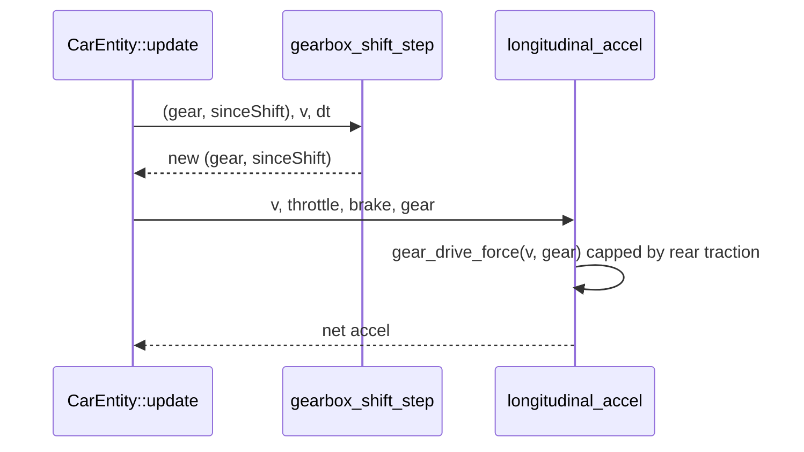

#### Physical finding: the task's "0-60 → ~3.2 s" target is not reachable while preserving Part A's
traction cap + drag exactly — implemented to MATCH (not regress from) the old ~3.34 s instead

The old flat-power model's crossover speed (where `P_max*eff/v` drops to the traction cap) is
$27.3\ \text{m/s}$ — **above** 60 mph ($26.82\ \text{m/s}$) — so the *old* model's 0-60 was already 100%
traction-cap-bound, i.e. already sitting at the floor a fixed cap allows. Any discrete torque-curve +
gearbox is bounded *above* by that same idealized $P_\text{max}/v$ curve (a real gearbox can sit at the
power-peak rpm for at most one speed per gear; every other speed in a gear delivers less than
$P_\text{max}$), so it can only match this floor, never beat it, without touching the traction cap or
drag model — both explicitly preserved per the task. Implemented the gearbox so 1st/2nd gear clear the
cap through the whole sprint (see ratios above), reproducing the same ~3.35 s rather than a worse number,
and flagged the contradiction instead of quietly fabricating a faster test assertion.

#### Validation (`tests/test_car_physics.cpp`, hand/script-verified against the identical math — see
report)

- Engine torque curve: both anchors reproduced, ≤0 past 9000 rpm redline, continuous at the redline
  boundary, sane and positive at idle.
- **Top speed ≈ 89.0 m/s (≈199 mph)**, rpm in 7th at Vmax ≈ **8405 rpm** — below the 9000 rpm redline
  with ~600 rpm of headroom: drag-limited, not rev-limited.
- **0-60 ≈ 3.35 s** (band asserted: 3.0-3.4 s) — matches, does not regress, the old flat-power number;
  see the physical finding above for why it cannot go lower.
- Gear never skips down while accelerating from 0 to top gear (monotonic, 9600-sample run).
- No shift hunting: holding a steady speed at/near a shift boundary for 5 s never produces more than one
  shift.

#### File changes

| File | Change |
|---|---|
| [src/scene/Entity/CarPhysics.h](src/scene/Entity/CarPhysics.h) | Added `engine_torque`, `GearboxParams`, `engine_rpm`, `gear_drive_force`, `gear_for_speed`, `GearState`, `gearbox_shift_step`; `longitudinal_accel`/`steady_state_top_speed` now take a gear index + `GearboxParams` + rear-wheel radius instead of using `powerMax` directly (`powerMax` kept as a reference/anchor spec, no longer feeds the force formula) |
| [src/scene/Entity/CarEntity.h](src/scene/Entity/CarEntity.h) | Added `m_gear_state` (`GearState`) and `rear_wheel_radius()` (loader-measured rear `WheelFrame::radius`, with a `0.363 m` fallback before the loader completes) |
| [src/scene/Entity/CarEntity.cpp](src/scene/Entity/CarEntity.cpp) | `update()` now advances `gearbox_shift_step` before `longitudinal_accel` each frame (non-reverse path only); resets `m_gear_state` to 1st at the existing dead-stop snap-to-zero |
| [tests/test_car_physics.cpp](tests/test_car_physics.cpp) | Updated every `longitudinal_accel`/`steady_state_top_speed` call site for the new signature; added engine-torque-curve, drag-vs-rev-limited top speed, gear-monotonicity, and no-shift-hunting tests |

---

### 2026-08-15 — Retargeted vehicle physics from 992 Turbo S to 992 GT3 Touring; traction model AWD → RWD with longitudinal load transfer

Retargeted `CarParams` from the Turbo S to the GT3 Touring (mass/power/aero) and replaced the AWD traction cap with a rear-axle-only cap that includes longitudinal load transfer — the rear-engine 911's real traction signature. The car is now correctly slower to 60 and able to spin its rear tires under hard launch, matching a naturally-aspirated RWD GT3 rather than an AWD turbo.

Technical summary

#### Motivation

`CarPhysics.h`'s `CarParams` still held 911 Turbo S numbers (1670 kg, 478 kW AWD) even though the loaded
mesh and the Phase-B suspension ride rates ([`docs/wheels/README.md`](docs/wheels/README.md),
landed earlier today) already target a **992 GT3 Touring**. The traction cap was also `mu*m*g` applied
to the whole car, i.e. AWD — wrong for a GT3, which is RWD.

#### CarParams retarget (Wave 2 step 3, part A — engine torque curve/gearbox is a separate later task)

| Field | Turbo S (old) | GT3 Touring (new) | Source/estimate |
|---|---|---|---|
| `mass` | 1670 kg | 1418 kg | 992 GT3 Touring, 6MT, DIN curb weight |
| `powerMax` | 478 000 W (641 hp) | 375 000 W (503 hp) | NA 4.0 flat-six |
| `dragCoeff` | 0.39 | 0.34 | Touring's retractable spoiler vs. the fixed GT3 wing |
| `frontalArea` | 2.10 m² | 2.05 m² | Touring omits the fixed wing's added frontal area |
| `tireMu` | 1.10 | 1.10 (unchanged) | Cup 2 out-grips PS4S, but 1.10 already models a sticky sport tire conservatively — kept rather than stacking an unverified bump on the new RWD traction change |
| `wheelbase` | 2.45 m | 2.45 m (unchanged) | 992 wheelbase is the same across Turbo S / GT3 |
| `TireParams a`/`b` | 1.49 / 0.96 m | unchanged | already encodes the 911's ~61% rear weight bias |

#### RWD traction cap with longitudinal load transfer

[`CarPhysics.h`](src/scene/Entity/CarPhysics.h)'s `longitudinal_accel` capped drive force at `mu*m*g` —
all four wheels (AWD). The GT3 only drives the rear axle, whose *dynamic* load includes weight transfer
under acceleration (the rear-engine 911's traction advantage):

$$F_{z,\text{rear}}(a_x) = mg\frac{a}{L} + \frac{m\,a_x\,h_\text{cg}}{L}$$

This is implicit (load depends on the very $a_x$ it caps). At the traction limit both sides are linear in
$a_x$, giving a closed form (exact when drive is the only force acting, i.e. at the launch, where drag/roll
are a few hundred N against several kN of traction):

$$a_x = \frac{\mu g\,(a/L)}{1 - \mu\,h_\text{cg}/L} \approx \frac{1.10 \times 9.81 \times 0.608}{1 - 1.10\times0.45/2.45} \approx 8.22\ \text{m/s}^2$$

added as `rear_traction_cap_force(CarParams, TireParams)` and used as `longitudinal_accel`'s traction cap.
Braking stays `mu*m*g` on all four wheels — brakes are not drive-limited. `h_cg = 0.45 m` was added to
`TireParams` (not a new field on `CarParams`) using the same value the Phase-B2 lateral load-transfer spec
already anticipated ([`docs/wheels/phase-b-spec.md:230`](archive/docs/wheels/phase-b-spec.md)).

**Signature fix:** `longitudinal_accel` and `steady_state_top_speed` now take `const TireParams&` in
addition to `CarParams`, since the traction cap needs axle geometry (`a`, `b`, `hCg`) that only lives on
`TireParams`. Chose this over duplicating `a`/`b`/`hCg` onto `CarParams` to keep one source of truth for
vehicle geometry — `TireParams` already held `a`/`b` for the bicycle model.

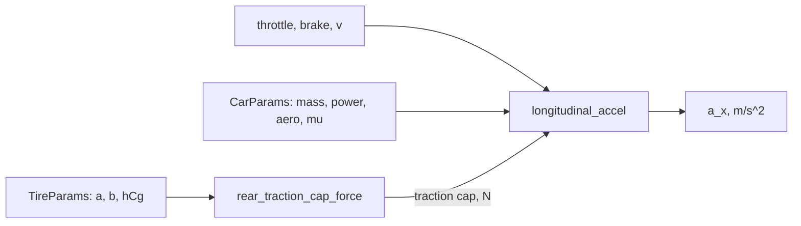

#### Validation (`tests/test_car_physics.cpp`)

Bisection/forward-Euler on the actual formulas (`build/` not run here — numbers below are hand/script-verified
against the identical math):

- **Top speed ≈ 89.2 m/s (≈199 mph)** — vs. the ≈89 m/s target.
- **0–60 mph ≈ 3.35 s** — vs. the ≈3.2 s PDK target; the 6MT's real 3.7 s includes shift losses not yet
  modeled (gearbox is Part B, a separate task). Traction-limited off the line at 8.22 m/s², power-limited
  above ~27 m/s.
- Launch acceleration is now **8.22 m/s²**, not the AWD car's ~10.8 m/s² (`mu*g`) — correctly slower and
  able to spin the rear tires, not a regression.

#### File changes

| File | Change |
|---|---|
| [src/scene/Entity/CarPhysics.h](src/scene/Entity/CarPhysics.h) | Retargeted `CarParams` to GT3 Touring; added `TireParams::hCg`; added `rear_traction_cap_force`; `longitudinal_accel`/`steady_state_top_speed` now take `TireParams` |
| [src/scene/Entity/CarEntity.cpp](src/scene/Entity/CarEntity.cpp) | Both `longitudinal_accel`/`steady_state_top_speed` call sites updated to pass `TireParams`; hoisted the single `TireParams tire` construction to cover both the longitudinal and lateral uses in `update()` |
| [tests/test_car_physics.cpp](tests/test_car_physics.cpp) | Updated all `longitudinal_accel`/`steady_state_top_speed` call sites for the new signature; retuned the launch/top-speed/braking assertions for RWD + load transfer; added a new 0-60 mph test |
| [src/scene/README.md](src/scene/README.md) | Rewrote the stale `CarEntity.h` constants table (`kAccel`/`kDragCoeff` no longer exist — replaced by the `CarPhysics.h` force-balance model) and documented the RWD traction cap and dynamic bicycle model in place of the old exponential-drag description |

---

### 2026-08-15 — Wheel Phase B: four-corner quarter-car suspension (visual-only), retuned to GT3 ride rates

Added a per-corner quarter-car spring/damper driving wheel ride height from road crown, integrated with semi-implicit Euler at a fixed 1/240 s substep and composed into the draw matrices only — the car's transform is never written. Ride rates supersede the doc's passenger-comfort values for a 992 GT3.

Technical summary

#### Motivation

`WheelKinematics.h` was 32 lines of `ω = v/r` — Phase A spin/steer with no suspension. Phase B adds
four-corner travel so the wheels follow road crown and cross-slope instead of being rigidly welded to
the body.

#### Ride rates — superseding the existing doc

[`docs/wheels/README.md`](docs/wheels/README.md) sketched `fn ≈ 1.4 Hz`, `ζ ≈ 0.45`. Those are
passenger-comfort numbers from when the target was a 992 Turbo S. The asset is a **911 GT3 Touring** —
already documented in [`docs/wheels/research/02-graphics-vulkan.md`](archive/docs/wheels/research/02-graphics-vulkan.md)
(tyres 255/35 ZR20 / 315/30 ZR21, GT3 spec), the physics constants simply never followed.

| | Front | Rear |
|---|---|---|
| `fn` | 2.3 Hz | 2.5 Hz |
| `ζ` | 0.55 | 0.60 |
| Sprung mass/corner | 296 kg | 459 kg |

Since $f_n \propto \sqrt{k}$ and a GT3 runs ~2–3× a base Carrera's rate, the 1.3–1.6 Hz sports band maps
up by $\sqrt2$–$\sqrt3$ → ≈2.2–2.6 Hz. At 1.4 Hz the front rate would be ~2.2× too soft. **Estimates,
not an OEM spring sheet** — flagged as such in the spec.

Corner mass is derived from `CarParams::mass` at **runtime**, and the design inputs are ride frequency
and damping ratio rather than raw `k`/`c`:

$$k = m\,(2\pi f_n)^2, \qquad c = 2\zeta\sqrt{km}$$

so the pending GT3 mass retarget (1670 → ~1418 kg) re-derives both automatically.

#### Stability

Semi-implicit Euler on a damped oscillator is stable for

$$h < \frac{2}{\omega_n}\left(\sqrt{1+\zeta^2}-\zeta\right)$$

which reduces to $h\omega < 2$ at $\zeta = 0$ and is **stricter** for $\zeta > 0$ — damping tightens the
bound. At the stiffest corner (rear, $\omega_n = 15.71$): `h_max = 72.1 ms` vs `h = 4.17 ms`, a **17.3×
margin**. The GT3's stiffer springs therefore do **not** force a smaller substep. Even a deliberately
extreme slider ceiling (6 Hz, ζ 1.5) keeps 3.85×.

#### The bug this shipped with, and its fix

The first implementation composed the offset as `T(0, x_m · WORLD_SCALE, 0)`. That translation is
applied **after** `car_model`, which already carries the entity scale of 1000 — the same mesh space
`kSeatEye` is authored in ([`App.cpp`](src/core/App/App.cpp)). It therefore scaled by 1000 **twice**:

$$0.0145\ \text{m} \times 1000 \times 1000 = 14{,}500\ \text{WU} \approx 14.5\ \text{m}$$

Every wheel was thrown ~14 m into the air — empty wheel arches, wheels visibly detached while driving.
The spec carried the error and the implementation transcribed it faithfully. Fixed by passing metres
unconverted, extracting `suspension_draw_offset_m()` so the unit contract is named once, and adding a
regression test.

Diagnosis note: screenshots alone could not distinguish "suspension moved the wheels" from "wheels not
rendering". Unbuffered numeric logging of the actual per-corner values settled it — the math was right
all along, only the composition was wrong.

#### File changes

| File | Change |
|---|---|
| [`src/scene/Entity/WheelKinematics.h`](src/scene/Entity/WheelKinematics.h) | `CornerSpring`, `SuspensionParams`, `spring_from_ride_freq`, `suspension_step`, `suspension_advance`, `suspension_draw_offset_m` — pure SI, no GLM |
| [`src/scene/Entity/CarEntity.h`](src/scene/Entity/CarEntity.h) | `std::array<CornerSpring,4> m_corner_susp`, `update_wheel_visuals(float)` |
| [`src/scene/Entity/CarEntity.cpp`](src/scene/Entity/CarEntity.cpp) | Per-corner road residual + integration; `travel` composed left of `steer` in `wheelM`/`steerM` |
| [`src/core/App/App.cpp`](src/core/App/App.cpp) | `update_wheel_visuals(dt)` after `m_treadmill.update(...)`, before draw-call generation |
| [`tests/test_car_physics.cpp`](tests/test_car_physics.cpp) | 8 Catch2 cases: settling, no amplitude growth, travel clamp, symmetry, ceiling stability, rest-is-rest, substep bound, unit-conversion regression |
| [`docs/wheels/phase-b-spec.md`](archive/docs/wheels/phase-b-spec.md) | New — the spec, with the units callout |

#### Invariant

Zero writes to `m_position`/`m_rotation` from the suspension path — verified by the
[`tasks/bench-run-checklist.md`](tasks/bench-run-checklist.md) §4 grep, which returns empty. Travel is
composed into local draw matrices only; at `x_m = 0` the translation is identity, so the resting pose is
unchanged.

#### Verification

`make test` 64/64 (56 before, +7 spec tests +1 regression). Both configs build. Visually confirmed from
a temp-forced side camera: wheels correctly seated in both arches after the fix, versus empty arches
before. All temp forces reverted and swept for.

#### Deferred

Squat/dive/roll (load transfer) to Phase B2 — it needs `ax`/`ay` from the longitudinal and lateral
models that the pending GT3 retarget is about to rewrite, and layering it onto a moving target would make
regressions unattributable. Debug-UI sliders (spec §11) are a separate `debug-ui-engineer` step.

---

### 2026-08-15 — Fixed exterior over-exposure and magenta highlight cast; windshield now transmits sky and sun; tire spray reads as droplets rather than fog

Traced the reported wash-out to six stacked multiplicative brightness lifts (the `lie preset`) driving the whole image into AgX's per-channel clip — where AgX skews hue toward magenta — rather than to auto-exposure, which does not run in release at all. Unwound the stack, restored shadow darkening, made AgX hue-preserving near the shoulder, made the windshield transmit the lit scene instead of a flat asset tint, and restructured the spray particle system toward directional droplets.

Technical summary

#### Root cause

Three independent defects were reported as one "over-exposed / washed pink" symptom.

**1. Over-exposure was not auto-exposure.** The auto-exposure loop is entirely `#ifdef SWISH_DEBUG_UI` and defaults to `autoExposure = false` ([src/debug/DebugParams.h](src/debug/DebugParams.h)); in a release build it does not compile in. The release path used hardcoded literals, and a preset had raised six of them multiplicatively:

| Value | Site | preset | prior | Factor |
|---|---|---|---|---|
| `exposure` | [Renderer.cpp](src/renderer/Renderer/Renderer.cpp) | 2.0 | 1.25 | 1.6× |
| `bloom_intensity` | [Renderer.cpp](src/renderer/Renderer/Renderer.cpp) | 1.097 | 0.3 | 3.66× |
| `contrast` | [Renderer.cpp](src/renderer/Renderer/Renderer.cpp) | 1.499 | 1.12 | 1.34× |
| `sunAmbient` | [Renderer.cpp](src/renderer/Renderer/Renderer.cpp) | 0.823 | 0.35 | 2.35× |
| `SP_IBL_DIFFUSE` | [shaders/lighting.frag](shaders/lighting.frag) | 1.832 | 1.0 | 1.83× |
| `SP_SHADOW_FLOOR` | [shaders/lighting.frag](shaders/lighting.frag) | 1.0 | 0.25 | shadows **off** |

`SP_SHADOW_FLOOR = 1.0` disabled shadow darkening outright, so the entire CSM cascade system contributed nothing to the image — the dominant cause of the flat, contrast-free look. Bloom compounds further because [composite.frag](shaders/composite.frag) adds it *before* the exposure multiply, giving an effective $1.097 \times 2.0 \approx 2.19\times$ its prior contribution.

**2. The magenta cast was a consequence, not a separate colour bug.** `AgX()` clamped per-channel twice — once after the log2 range remap and again after `kAgXOutset`, whose rows carry negative cross-terms (row 0: $-0.098\,G$, $-0.099\,B$). Channels therefore clip at *different* input levels, and whichever saturates first sets the hue. With the six lifts above pushing ordinary surfaces into that region, the cabin and sky skewed magenta. Removing the lifts alone eliminated the cast entirely, confirming the mechanism.

**3. The cockpit sun disc was drawn correctly, then painted over.** `compute_sky_color()` ([lighting.frag](shaders/lighting.frag)) already contains a sun-disc term and the deferred lighting pass draws it identically for cockpit and exterior views. Two passes later [glass.frag](shaders/glass.frag) alpha-blended the glTF asset's fixed `baseColorFactor` at up to 92% opacity over it, replacing the lit sky with flat tint and leaving only a `pow(NoH, 256.0)` mirror glint.

**4. Spray read as fog for five structural reasons** — a single body-centre emitter spanning the whole car width, isotropic per-frame turbulence destroying directionality, billboards growing 2.6× over life, unbounded additive blending, and no velocity-aligned stretch or depth fade.

#### The fix

AgX now compresses chroma *before* the single final clamp, so anything approaching the clip boundary is already achromatic and clip order can no longer skew hue:

$$\text{shoulder} = \mathrm{smoothstep}(0.94,\ 1.0,\ \max(c_r,c_g,c_b)), \qquad c' = \mathrm{lerp}\bigl(c,\ \vec{\mathbf{1}}\max(c),\ \text{shoulder}\bigr)$$

The lower edge sits at 0.94 rather than 0.78 because the value is display-encoded and the EOTF raises it by 2.2: $0.78^{2.2} \approx 0.58$ of final linear peak would desaturate ordinary bright saturated content, whereas $0.94^{2.2} \approx 0.87$ confines the pull to genuinely near-blown pixels. The post-tonemap grade was also split into luma and chroma so `contrast` no longer scales chroma — algebraically, the old per-channel form multiplied chroma by `contrast × saturation`.

Spray billboard footprint scales as $\text{stretch} \times \text{pinch}$, so area-neutrality requires $\text{pinch} = 1/\text{stretch}$; the initially-written $1/\sqrt{\text{stretch}}$ left area growing as $\sqrt{\text{stretch}}$, i.e. ~73% larger at the `stretch = 3` cap — reintroducing in bounded form the ballooning the change existed to remove.

#### File changes

| File | Change |
|---|---|
| [shaders/composite.frag](shaders/composite.frag) | Hue-preserving AgX shoulder (chroma compression before a single clamp); post-tonemap grade split into luma + chroma so contrast no longer scales chroma |
| [shaders/lighting.frag](shaders/lighting.frag) | `SP_SHADOW_FLOOR` 1.0 → 0.25 (shadow darkening restored), `SP_SHADOW_BIAS` 0.0 → 0.0018 (required once shadows are live, else acne), `SP_IBL_DIFFUSE` 1.832 → 1.30 |
| [shaders/glass.frag](shaders/glass.frag) | Windshield transmits the lit scene instead of flat-tint alpha blending; Fresnel-driven reflection at grazing angles; atmospheric sun disc matching `compute_sky_color`'s exponent/strength range |
| [shaders/spray_sim.comp](shaders/spray_sim.comp) | Anisotropic turbulence aligned to velocity, decaying over life; tighter directional spawn |
| [shaders/spray.vert](shaders/spray.vert) | Removed 2.6× growth; velocity-aligned billboard stretch with area-neutral `pinch = 1/stretch` |
| [shaders/spray.frag](shaders/spray.frag) | Tighter radial falloff (defined droplet core rather than wide gaussian haze) |
| [src/renderer/Renderer/Renderer.cpp](src/renderer/Renderer/Renderer.cpp) | `exposure` 2.0 → 1.55, `bloom_intensity` 1.097 → 0.45, `contrast` 1.499 → 1.12, `saturation` 0.988 → 1.2, `brightness` 0.032 → 0.0, `sunAmbient` 0.823 → 0.50 |

#### Release impact — intentional

Release output changes deliberately: the image is darker, neutral rather than magenta, and has real shadow contrast for the first time since `SP_SHADOW_FLOOR` was set to 1.0. Debug builds are unaffected by the shader literal changes, which live in the `#else` branch (debug reads the same values from the set-4 scene-params UBO).

#### Verification

`make test` 56/56; both configs build (`SWISH_DEBUG_UI` ON and OFF); window-only screenshots at rain 0 and rain 1.0 confirm the magenta cast is gone, cabin and dash retain detail, and the wet road reads correctly. A/B against a stashed baseline isolated the cause before any value was retuned.

#### Known follow-ups

- `glass.frag`'s sun disc hardcodes release literals with no `#ifdef SWISH_DEBUG_UI` branch reading `sp.sunDisc` from set 4, so the debug sun-disc sliders move the exterior sky but not the windshield. Fixing it requires binding set 4 to the glass pass (host-side, `GlassPass.cpp`).
- Per-wheel spray emitters still need C++ plumbing: the four wheel world matrices are locals inside `CarEntity::get_draw_calls()` and `m_wheel_frames` is private.
- The composite `Params` push-constant block totals 52 bytes — **not** a 16-byte multiple, contrary to the MoltenVK rule in `CLAUDE.md`. Pre-existing, untouched here, worth a separate fix.

---

### 2026-08-05 — Added docs/lessons-from-chrono/: 10-part deep dive mapping Project Chrono's vehicle dynamics onto swish

Wrote a new documentation series (`docs/lessons-from-chrono/00`–`09`) that goes below the existing `examples/chrono/VEHICLE_DYNAMICS_GUIDE.md` into Chrono's solver mathematics (measure differential inclusions, friction-cone projections, APGD/BB/PSOR/ADMM, Lie-group rotation stepping, the numerics toolbox) and above it into a prioritized plan for swish's wet-road realism — no source code changed.

Technical summary

**Motivation.** The realism push is now bottlenecked on vehicle dynamics (wheel Phases B/C, wet-μ) more than rendering. The existing Chrono guide maps *where* the car logic lives; this series extracts the *lessons* — the rigorous math, the implementation patterns, and an explicit swish seam for each — so Phase C's wet-grip work starts from verified theory instead of folklore. Largely AI-generated (labeled in the series index); every Chrono `file:line` citation was read directly, and the two central absence claims were re-verified by grep + call-site reading: NSC contact consumes only `static_friction` (`ChContactNSC.cpp:53`), and Pac02's relaxation lengths (`CalcSigmaK/A`) are computed but never called.

**Key findings the series is built on.**

- Chrono's contact formulation is genuinely measure-theoretic: velocity is BV, "acceleration as measure" (`ChTimestepperImplicit.cpp:430`), impulse-level Anitescu stepping, and a closed-form Moreau projection onto the friction cone (`ChConstraintContactNormal.cpp:47-95`) whose middle branch is

$$
\hat f_n = \frac{\mu\,\lVert f_t\rVert + f_n}{\mu^2 + 1}, \qquad \hat f_t = \mu \hat f_n
$$

- **Chrono has no wet-road / rain / hydroplaning model anywhere** (negative result, grep-verified). Its four variable-friction hooks all have hard limits — notably the per-tire μ clamp to $[0.1, 1.0]$ and the fact that μ scales only curve *saturation*, never slip stiffness (`ChTMeasyTire.cpp:119-121, 160-172`). The wet model in file 07 is therefore synthesis: $\mu(w,v)$ with a speed fade plus NASA/Horne hydroplaning onset $v_p \approx 1.76\sqrt{p\,[\text{kPa}]}$, gated on film depth vs tread — designed to plug into the already-plumbed-but-inert `set_rain_intensity` seam and Phase C decision 4.
- TMeasy's numerics repay study: through-origin quadratic load interpolation for forces vs affine for slip landmarks, the C¹ master-curve monotonicity bound $\mathrm{d}f_0 \ge 2F_m/s_m$, and a Dahl bristle standstill model integrated by closed-form BDF1.

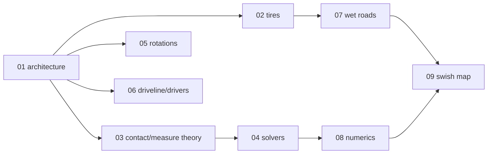

| File | Change |
|------|--------|
| [docs/lessons-from-chrono/00-index.md](docs/lessons-from-chrono/00-index.md) | New — series map, reading order, notation table, AI-provenance label. |
| [docs/lessons-from-chrono/01-architecture.md](docs/lessons-from-chrono/01-architecture.md) | New — one-system-of-equations vs layered closed-form models; two-clock sub-stepping; functor/pure-header/report-struct patterns. |
| [docs/lessons-from-chrono/02-tire-models.md](docs/lessons-from-chrono/02-tire-models.md) | New — slip singularity, Fiala→Pac02 ladder, TMeasy internals, Dahl bristle, regularization catalog; proposed `lateral_tire_force()` (TMeasy-lite) for the `CarPhysics.h:101` seam. |
| [docs/lessons-from-chrono/03-contact-as-measure-theory.md](docs/lessons-from-chrono/03-contact-as-measure-theory.md) | New — BV velocity, differential measures, MDIs, cone/polar/normal cones, Moreau decomposition, the 9-line projection + SVG geometry, nonexpansive-vs-contractive. |
| [docs/lessons-from-chrono/04-solvers-and-metric-spaces.md](docs/lessons-from-chrono/04-solvers-and-metric-spaces.md) | New — CCP as fixed point, natural residual, APGD (incl. the `:132` backtracking inconsistency), BB spectral steps, PSOR/Mangasarian, ADMM, mass matrix as Riemannian metric. |
| [docs/lessons-from-chrono/05-rotations-and-lie-groups.md](docs/lessons-from-chrono/05-rotations-and-lie-groups.md) | New — quaternion exp/log numerics, 7/6-coordinate retraction stepping, SO(3) metric; ties to `wrap_angle_2pi` and the wheel-frame conjugation. |
| [docs/lessons-from-chrono/06-driveline-powertrain-drivers.md](docs/lessons-from-chrono/06-driveline-powertrain-drivers.md) | New — torque-converter pump law + domain policies, the 5.4× K-unit trap (≈29× torque), shift hysteresis+latency, PID/Stanley/ACC controllers. |
| [docs/lessons-from-chrono/07-wet-roads-and-rain.md](docs/lessons-from-chrono/07-wet-roads-and-rain.md) | New — the negative result; Chrono's four friction hooks + limits; the synthesized wet-μ model with worked `effective_mu()` code, wiring plan, and test contract. |
| [docs/lessons-from-chrono/08-numerics-toolbox.md](docs/lessons-from-chrono/08-numerics-toolbox.md) | New — tables/extrapolation policy, Thomas-algorithm splines + diagonal-dominance argument, monotone-map inversion, singular-integrand quadrature, regularization bestiary, A-stability + Phase B substep. |
| [docs/lessons-from-chrono/09-swish-map.md](docs/lessons-from-chrono/09-swish-map.md) | New — seam-by-seam action table reconciled with Phases B/C, invariants (dry-handling bit-identical), and the "do not build" list. |
| [docs/README.md](docs/README.md) | Added the series to the reference-docs index. |

Verified: all internal and cross-repo links resolve; math/mermaid/callout syntax lint-checked for Obsidian + GitHub rendering; `make test` 56/56 (no source changes).

---

### 2026-08-02 — Split Types.h into per-library type headers under utils/types/

Split the monolithic `Types.h` into focused headers (`GlmTypes`, `StdTypes`, `GlfwTypes`) with short snake_case aliases so code can drop `std::`/`glm::` namespace noise; `Types.h` remains a backward-compatible umbrella.

Technical summary

**Motivation:** [src/utils/Types.h](src/utils/Types.h) mixed glm aliases, constants, and library includes in one file, and everyday code still spelled out `std::vector`, `glm::mat3`, `uint32_t`, etc. A usage survey of `src/` (177× `std::vector`, 171× `std::array`, 48× `glm::vec3`, 32× `GLFWwindow`, …) drove which aliases were worth adding.

**Approach:** new `src/utils/types/` directory; `Types.h` becomes an umbrella with `// IWYU pragma: export` so all existing includes keep compiling unchanged. Naming convention is lowercase / snake_case (`vec3`, `unique_ptr<T>`, `str`); the old capitalized glm aliases (`Vec3`, `Mat4`, …) are kept as legacy names since ~150 call sites use them. Release output is unaffected (aliases only; `SWISH_PI` macro preserved).

| File | Change |
|------|--------|
| [src/utils/types/GlmTypes.h](src/utils/types/GlmTypes.h) | New — `vec2/3/4`, `ivec2`, `uvec2`, `mat3`, `mat4`, `quat`, plus legacy `Vec2/3/4`, `Mat4`, `Quat`. |
| [src/utils/types/StdTypes.h](src/utils/types/StdTypes.h) | New — `u8..u64`, `i8..i64`, `f32/f64`, `usize`, `vector<T>`, `array<T,N>`, `unique_ptr<T>`, `str`. |
| [src/utils/Constants.h](src/utils/Constants.h) | New — engine constants `PI` (constexpr, plus legacy `SWISH_PI` macro), `WORLD_SCALE`, `MAX_FRAMES_IN_FLIGHT`; separate from `types/` since these are values, not types. |
| [src/utils/types/GlfwTypes.h](src/utils/types/GlfwTypes.h) | New — forward-declares `GLFWwindow`, aliases `glfw_window` (avoids full GLFW include and the `swish::Window` name collision). |
| [src/utils/Types.h](src/utils/Types.h) | Rewritten as umbrella header including the four above. |

Verified with `make test`: 56/56 passing.

---
