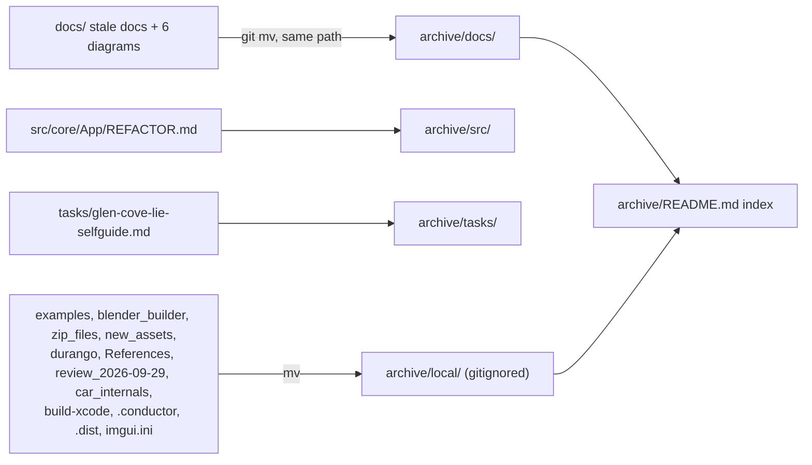
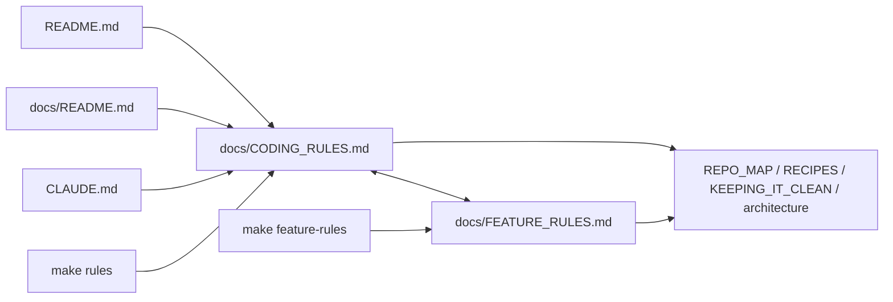
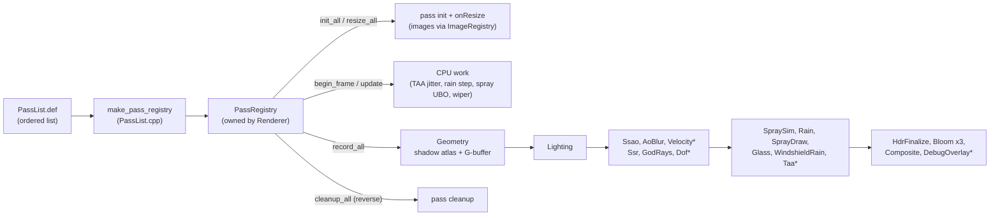
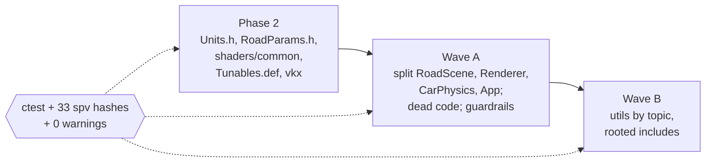
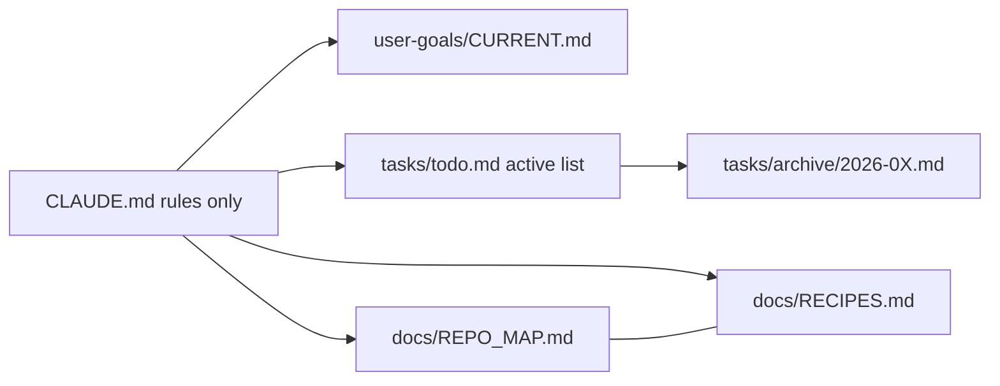

# Changelog — 2026-09

See [CHANGELOG.md](../../CHANGELOG.md) for the index of all entries.

---

### 2026-09-29 — Archive reorganisation: stale docs and local-only bulk moved to archive/

Moved 29 stale docs and diagrams into a tracked `archive/` (same paths, `git mv`), moved 12 local-only folders (3.1 GB reference code, raw downloads, old builds) into gitignored `archive/local/`, repointed every link, and adapted the tree to the owner's own moves (`user-goals/` into `docs/`, `cars/` into `assets/`, `AGENTS.md` removed).

Technical summary

### Motivation

The owner asked for everything stale or not about the code to live in one easy-to-find archive. A read-only audit
classified every markdown file (current / history-in-place / archive / unsure); the owner decided the unsure ones and
the local folders. Nothing was deleted.

- **No orphaned first-party code:** every `src/**/*.cpp` is globbed into the build; every header, shader, test and tool
  is built or referenced. The loose C/C++ was the ~4,900 third-party files in `examples/` (Chrono, DownPour, rind).

### What moved

- **Tracked (29 files):** phase-1 and phase-2 docs, `wheels/phase-b-spec.md`, `wheels/research/01-03`, 4 pre-implementation
  rain docs, the April validation investigation, all of `docs/notes/`, both research surveys, `REFACTOR.md` (its
  "what remains" list moved into `tasks/todo.md` first), the Glen Cove self-guide, and 6 diagrams that draw deleted
  classes. Full list with reasons: [archive/README.md](archive/README.md).
- **Links:** a script resolved every markdown link from each file's old location and rewrote it for the new one
  (changelog links stay root-relative), and rewrote repo-rooted path mentions in code comments (about 25, e.g.
  `archive/docs/phase-2-hydroplane-spinout.md §5`). Plain-text history in changelogs and `tasks/archive/` was left as
  written. The 15 broken `../` links that `tasks/archive/` already had (it moved one folder deeper earlier today) were
  fixed as well.
- **Owner's moves adapted:** links, [CLAUDE.md](CLAUDE.md), the `session-context` / `subagent-handoff` hooks and the
  product-orchestrator agent now read `docs/user-goals/CURRENT.md`. `/assets/cars/` was added to `.gitignore` because the
  old `cars/*` rule no longer covered the ~76 MB of `.glb` models. The Makefile `car-analyze` examples now use
  `assets/cars/`.
- **Rules:** new drafts go to `scratch/`; finished docs go to `archive/<same path>` with a row in `archive/README.md`
  ([scripts/check_root.sh](scripts/check_root.sh), [docs/KEEPING_IT_CLEAN.md](docs/KEEPING_IT_CLEAN.md),
  [docs/CODING_RULES.md](docs/CODING_RULES.md)).
- **Stale facts fixed:** the `wheels/README.md` header (Phase B shipped 2026-08-15), the `glen-cove-lie.md` status for
  phases 3-5 (sky, PCSS and DoF landed through the realism suite), the `tools/car_analyzer/` path in phase-3, and two
  todo items that were already done.

### Verification

Broken relative links: 25 before, 13 after. The 13 are `path` placeholders in format examples plus changelog history
naming long-gone files. Release 218/218 tests, debug-UI 241/241, 33/33 release `.spv` hashes identical (the edit to the
`windshield_rain.frag` comment compiles to the same SPIR-V), `make check` OK, clang-format drift unchanged at 20 files.

### File-change table

| File | Change |
|------|--------|
| [archive/README.md](archive/README.md) | New index: every archived file, why, and where the current information lives |
| `archive/docs/**`, `archive/src/core/App/REFACTOR.md`, `archive/tasks/glen-cove-lie-selfguide.md` | 29 files moved here (content unchanged apart from links) |
| `archive/local/` (gitignored) | 12 local-only folders and files moved here |
| [.gitignore](.gitignore) | `/archive/local/`, `/assets/cars/` |
| [scripts/check_root.sh](scripts/check_root.sh) | Allows `archive`; drops `user-goals` from the root allowlist; notes rule now points to `scratch/` / `archive/` |
| [Makefile](Makefile) | `car-analyze` examples use `assets/cars/` |
| [CLAUDE.md](CLAUDE.md) | Goal link to `docs/user-goals/CURRENT.md` |
| [docs/README.md](docs/README.md) | Archived rows removed; new Archive section; stale-diagram note |
| [docs/DIRECTORY.md](docs/DIRECTORY.md), [docs/REPO_MAP.md](docs/REPO_MAP.md), [docs/KEEPING_IT_CLEAN.md](docs/KEEPING_IT_CLEAN.md), [docs/CODING_RULES.md](docs/CODING_RULES.md), [docs/FEATURE_RULES.md](docs/FEATURE_RULES.md), [docs/DESIGN_PATTERNS.md](docs/DESIGN_PATTERNS.md), [docs/CLEANUP_2026-09-29.md](docs/CLEANUP_2026-09-29.md) | Tree, placement rules and links updated for `archive/`, `docs/user-goals/`, `assets/cars/` |
| [docs/architecture.md](docs/architecture.md), [docs/car_system.md](docs/car_system.md), [docs/car-asset-pipeline.md](docs/car-asset-pipeline.md), [docs/debug-ui.md](docs/debug-ui.md), [docs/rain/README.md](docs/rain/README.md), [docs/lessons-from-chrono/](docs/lessons-from-chrono/00-index.md) (8 files), [docs/user-goals/CURRENT.md](docs/user-goals/CURRENT.md), [README.md](README.md), [tools/README.md](tools/README.md), [src/core/README.md](src/core/README.md), [src/utils/README.md](src/utils/README.md), [src/utils/vulkan/README.md](src/utils/vulkan/README.md) | Links repointed |
| [docs/wheels/README.md](docs/wheels/README.md), [docs/glen-cove-lie.md](docs/glen-cove-lie.md), [docs/phase-3-osm-lie-corridor.md](docs/phase-3-osm-lie-corridor.md) | Links + stale status facts corrected |
| `src/core/App/App.{h,cpp}`, `src/scene/Entity/{Bicycle,CarEntity,CarParams,Longitudinal,Tire,WheelKinematics}.h`, `CarEntity.cpp`, `src/utils/vulkan/DeviceHandle.h`, [tests/test_car_physics.cpp](tests/test_car_physics.cpp), [shaders/windshield_rain.frag](shaders/windshield_rain.frag), `tools/car_analyzer/car_analyzer/loader.py` | Comment / docstring paths only |
| [tasks/todo.md](tasks/todo.md), [tasks/bench-*.md](tasks/bench-run-checklist.md), `tasks/archive/2026-0{6,7,8}.md` | Plan + review, Core/App items from REFACTOR.md, links fixed |
| `.claude/hooks/{session-context,subagent-handoff}.sh`, `.claude/agents/product-orchestrator.md`, `.claude/README.md`, one skill (local, gitignored) | Read `docs/user-goals/` |

---

### 2026-09-29 — Coding and feature rulesets, clangd fix

Added `docs/CODING_RULES.md` (12 rules, a "where does it go" table, a plain-English map of how the folders connect, pre/post checklists) and `docs/FEATURE_RULES.md` (idea-to-shipped path: spec template, feature shapes with owners, build dark, prove, turn on for release) with `make rules` / `make feature-rules`, and stopped `.clangd` forcing C++17 over the C++20 compile database.

Technical summary

### Motivation

- **Ruleset:** the rules were spread over `CLAUDE.md`, `KEEPING_IT_CLEAN.md`, `CONTRIBUTING.md`, `REPO_MAP.md` and `RECIPES.md`, with no single "read this before you type" page and no non-specialist explanation of how `core/`, `scene/`, `renderer/`, `shaders/`, `debug/` and `utils/` relate.
- **clangd:** the IDE showed `'renderer/Renderer/Renderer.h' file not found` in `SceneManager.cpp`. Root cause: `build/compile_commands.json` predated the uncommitted clean-up (no `-Isrc`, `-std=gnu++17`, 32 current `.cpp` files missing). Reconfiguring `build/` regenerated it, but [.clangd](.clangd) also appended `-std=gnu++17`; an appended flag wins, so clangd would still have parsed as C++17.

### Fix

- [docs/CODING_RULES.md](docs/CODING_RULES.md): new front-door doc. The "who may include whom" table was built from a grep of `#include` across `src/` (e.g. `scene/` uses the renderer's public API, `renderer/` reads scene data types, `DebugParams.h` is ungated while `DebugUI.h` / `SceneParamsUniform.h` are gated). Links out to the detailed docs instead of copying them.
- [docs/FEATURE_RULES.md](docs/FEATURE_RULES.md): new-feature path. Grounded in `PASS_DEBUG` (release never compiles the pass), identity defaults and `releaseValue` in `Tunables.def`, the agent routing table in `.claude/README.md`, ADR 0001 (no free G-buffer channels), and the TAA precedent (built debug-only, promotion still an open decision). Promotion to release is a separate step, the only point where hashes or goldens may be re-recorded.
- [Makefile](Makefile): `make rules` / `make feature-rules` print the docs.
- [.clangd](.clangd): removed the `Add: -std=gnu++17` block; the standard now comes from the compile database.
- Verified: `clangd --check --clang-tidy` over all 103 `.cpp` and 104 headers in `src/` + `tests/` reports no diagnostics (only clangd's internal tweak self-test failures); release build has 0 warnings. All relative links in the new doc resolve.

### File-change table

| File | Change |
|------|--------|
| [docs/CODING_RULES.md](docs/CODING_RULES.md) | New: rules, placement table, plain-English connection map, include rules, checklists |
| [docs/FEATURE_RULES.md](docs/FEATURE_RULES.md) | New: 10 feature rules, spec template, feature-shape/owner table, build-dark, prove, promote, document, stop signs, worked example |
| [Makefile](Makefile) | `rules` and `feature-rules` targets (+ `.PHONY`) |
| [docs/README.md](docs/README.md) | "Start Here" rows for both rulesets |
| [README.md](README.md) | Docs highlights rows for both rulesets |
| [CLAUDE.md](CLAUDE.md) | Pointers to both rulesets in the intro |
| [.clangd](.clangd) | Dropped forced `-std=gnu++17`; header comment says C++20 |

---

### 2026-09-29 — Follow-ups: pass registry, dynamic rendering, validation clean, puddle fix, patterns

Split `PostProcessManager`, turned the frame into an ordered pass registry (add a pass = 2 files), enabled Vulkan 1.3 dynamic rendering + synchronization2 where supported, took validation from 20 messages to 0 in four configurations, made SSR use the lit pass's puddle coverage from one registry entry, applied the tag-dispatch and class/struct patterns, and corrected the earlier "0 warnings" claim (the full warning flags had never applied on AppleClang).

Technical summary

*Largely AI-generated (Claude + subagents); verified by automated builds, tests and screenshots; please review. Full report: [docs/CLEANUP_2026-09-29.md](docs/CLEANUP_2026-09-29.md) ("Later updates"); patterns: [docs/DESIGN_PATTERNS.md](docs/DESIGN_PATTERNS.md); rules: [docs/KEEPING_IT_CLEAN.md](docs/KEEPING_IT_CLEAN.md).*

**Motivation.**

- **Adding a pass touched 5 C++ files** and `Renderer` hand-wired 12 managers (create, cleanup, recreate). The registry makes it 2 files and one ordered list.
- **Validation was not clean.** The original code produced 20 validation messages (luminance-chain hazards, an ImGui subpass dependency, a cross-frame descriptor race). Dynamic rendering + sync2 needed a clean baseline first.
- **C2 (puddle mismatch).** `lighting.frag` drew puddles at 0.501 coverage while SSR's push constant forced 0 in release, so SSR never reflected in them, and three hand-synced copies of the number existed.
- **Warnings.** The `-Wall -Wextra -Wpedantic` block matched only GNU and Clang, not AppleClang, so every earlier macOS "0 warnings with `-Werror`" result was without those flags.
- **Housekeeping and patterns.** Stale worktree and tracked editor/reference files; per-type `if (kind == ...)` ladders; stateless classes (`Pipeline`, `ResourceManager`) and a hidden pipeline-cache global.

**What changed.**

- **Housekeeping.** Deleted the stale `.claude/worktrees/thirsty-darwin` (backup tarball in the session scratchpad; branch `claude/thirsty-darwin` left for the owner). Untracked `.obsidian/` and `References/` index-only (12 deletions staged, files on disk, gitignored).
- **C2 puddle fix.** SSR now uses puddle coverage 0.501 in release, from one registry entry in [src/debug/Tunables.def](src/debug/Tunables.def) (`puddleCoverage`, `puddlesEnabled`; the registry is now 12 tunables). One C++ constant, `swish::road::kPuddleCoverage` in [src/scene/RoadScene/RoadParams.h](src/scene/RoadScene/RoadParams.h), is used by physics ([src/scene/Entity/WetGrip.h](src/scene/Entity/WetGrip.h)); tests pin registry default == constant and `lighting.frag` literal == registry. The visual effect is subtle (at wetness 0.3: about 300 px/frame differ, at most 6/255) because SSR only reflects on-screen geometry; puddle reflectivity rises from about 0.11 to about 0.33 and off-screen sky still falls back to IBL.
- **R1: `PostProcessManager` split** into 5 files (1063 lines), pure move, first frame pixel-identical.
- **R2: Vulkan 1.3 path.** [Device.cpp](src/renderer/Pipeline/Device/Device.cpp) enables dynamic rendering and `synchronization2` when supported and logs one `[Device]` line; `SWISH_CLASSIC_VULKAN=1` forces the classic path. [TaaPass.cpp](src/renderer/TaaPass/TaaPass.cpp) records with dynamic rendering. All legacy barrier helpers were removed (`ResourceManager::insertImageBarrier` is gone); [Barrier.h](src/utils/vulkan/Barrier.h) has 14 rows plus `image_barrier2` / `_auto` / `_with`; [Rendering.h](src/utils/vulkan/Rendering.h) is new.
- **R3: pass registry** in [src/renderer/Passes/](src/renderer/Passes/): `IRenderPass`, `FrameCtx` / `FrameUpdate` / `FrameState` / `PassResources` / `PassInitCtx`, `enum class Img` + `ImageRegistry`, `PassRegistry`, the ordered list [PassList.def](src/renderer/Passes/PassList.def) with factories in [PassList.cpp](src/renderer/Passes/PassList.cpp), `FullscreenPass<Push>`, `ForwardPass`, `PassInputs`, one `.cpp` per pass. `GeometryProducer` (CSM + G-buffer + cascades) and `WeatherController` (preset, IBL rebake, debug apply) were split out of `Renderer`. [renderer/Bindings.h](src/renderer/Bindings.h) includes `shaders/common/bindings.glsl`. `Renderer_PostPasses.cpp` and `RendererDetail.h` were deleted. Builders in `src/utils/vulkan/`: [RenderScope.h](src/utils/vulkan/RenderScope.h), [RenderPass.h](src/utils/vulkan/RenderPass.h) (`make_color_pass`), [Descriptors.h](src/utils/vulkan/Descriptors.h), [Samplers.h](src/utils/vulkan/Samplers.h), [ImageView.h](src/utils/vulkan/ImageView.h). A test pins the pass order.
- **Validation fixes** (0 messages in 4 configs; only `CMAKE_BUILD_TYPE=Debug` runs the layers). Pre-existing: 14 luminance-chain barrier/blit hazards; the ImGui render-pass external dependency lacked `COLOR_ATTACHMENT_READ`; the bloom-extract descriptor sets are now per frame (odd frames used to sample frame 0's HDR, a cross-frame race). New in this work and fixed: `VelocityPass` colour subpass dependency, vertex input trimmed to location 0.
- **Patterns.** Tag dispatch: [src/utils/meta/Tags.h](src/utils/meta/Tags.h) (`swish::tag`) and `tunables::visit` in [src/debug/Tunables.h](src/debug/Tunables.h) replace 4 per-type ladders. `MeshBuilder::push_quad` / `add_quad` replace 8 hand-written quad blocks (mesh dump byte-identical at -O3 and -O0). class/struct audit applied: `ResourceManager` is `namespace swish::resource`; `Pipeline` is `namespace swish::pipeline` (`create_graphics` / `create_compute` / `create_layout`) with the pipeline cache owned by `Device` and passed as `RendererServices::pipelineCache` (no hidden global); `CorridorScene` is the free function `build_corridor_segments`; `Scene` is `using Scene = std::function<void(Renderer&)>`; `MeshData`'s mutable `getVertices()` is gone (`forEachVertex`). `PostProcessParams` is padded 52 to 64 B and every push range goes through `vkx::push_range<T>` (16-byte `static_assert`):

$$\left\lceil \frac{52}{16} \right\rceil \cdot 16 = 64\ \text{B}$$

- **Warnings and portability.** AppleClang added to the warning block in [CMakeLists.txt](CMakeLists.txt) and [tests/CMakeLists.txt](tests/CMakeLists.txt); VMA and the vendored `include/` marked `SYSTEM`; 4 real first-party warnings fixed (two `GeometryProducer` unused stats variables in release, `TextureManager` unused `m_physicalDevice`, a test keyword-macro). A `g++-16` sweep is clean (`DebugUI` sign-compare, an unused test function, `VmaUsage.cpp` pragmas); GCC runs every test except the known Clang-bound golden-mesh intro hash.
- **Docs.** [CLEANUP_2026-09-29.md](docs/CLEANUP_2026-09-29.md), [KEEPING_IT_CLEAN.md](docs/KEEPING_IT_CLEAN.md), [DESIGN_PATTERNS.md](docs/DESIGN_PATTERNS.md), [REPO_MAP.md](docs/REPO_MAP.md), [RECIPES.md](docs/RECIPES.md), `CLAUDE.md` and the architecture / renderer docs were updated to the new tree; stale references to deleted files and removed symbols were fixed.

**New frame flow.**

`*` = debug-UI builds only (`PASS_DEBUG`); release output is unchanged.

**File-change table (by directory).**

| Directory | Change |
|-----------|--------|
| [src/renderer/Passes/](src/renderer/Passes/) | **New.** `IRenderPass.h`, `PassRegistry.{h,cpp}`, `ImageRegistry.{h,cpp}`, `PassList.{def,cpp}`, `FullscreenPass.h`, `ForwardPass.h`, `PassInputs.h`, and one `.cpp` per pass (`LightingPass`, `SsaoPasses`, `SsrPass`, `GodRaysPass`, `BloomPasses`, `HdrFinalizePass`, `CompositePass`, `DebugOverlayPass`) |
| [src/renderer/Renderer/](src/renderer/Renderer/) | `Renderer.cpp`, `_Frame`, `_Record` (41 lines), `_State` shrunk to lifecycle + the pass loop; `Renderer_PostPasses.cpp` and `RendererDetail.h` **deleted** |
| [src/renderer/GeometryProducer/](src/renderer/GeometryProducer/), [WeatherController/](src/renderer/WeatherController/) | **New.** Split out of `Renderer` |
| [src/renderer/PostProcessManager/](src/renderer/PostProcessManager/) | `PostProcessManager.cpp` (1063) split into `.cpp`, `_Passes`, `_Images`, `_Descriptors`, `_Pipelines`; `PostProcessParams` padded to 64 B; per-frame bloom-extract sets |
| [src/renderer/Pipeline/](src/renderer/Pipeline/) | `Pipeline` class to `swish::pipeline` free functions; `Device` enables dynamic rendering + sync2, owns the cache, logs `[Device]` |
| [src/renderer/ResourceManager/](src/renderer/ResourceManager/) | Class to `swish::resource` namespace; `insertImageBarrier` deleted |
| `src/renderer/{TaaPass,VelocityPass,DofPass,GlassPass,RainSystem,SpraySystem,WindshieldRainPass,IBLManager}/` | Implement `IRenderPass` with factories; use the `vkx` builders; TAA on dynamic rendering; Velocity dependency fix |
| [src/renderer/Bindings.h](src/renderer/Bindings.h), [RendererConfig.h](src/renderer/RendererConfig.h) | `Bindings.h` includes `shaders/common/bindings.glsl` |
| [src/utils/vulkan/](src/utils/vulkan/README.md) | `Rendering.h`, `RenderScope.h`, `RenderPass.h`, `Descriptors.h`, `Samplers.h`, `ImageView.h` new; `Barrier.h` extended (sync2) |
| [src/utils/meta/](src/utils/meta/Tags.h) | `Tags.h` new (tag dispatch) |
| [src/debug/](src/debug/Tunables.def) | `Tunables.def` (+ puddle entries; comments point at `Passes/SsrPass.cpp`), `Tunables.h` `visit`, `DebugParamsIO.cpp` / `DebugUI.cpp` overload sets, `DebugParams.h`; ImGui render-pass dependency fix; `DebugUI` sign-compare |
| [src/scene/](src/scene/RoadScene/RoadParams.h) | `RoadParams.h` `kPuddleCoverage`; `Entity/WetGrip.h` aliases it; `MeshBuilder` `push_quad` / `add_quad`; `Corridor/CorridorScene` free function; `SceneManager` `Scene` alias; `SceneTypes.h` `MeshData` |
| [tests/](tests/README.md), [tests/utils/](tests/utils/) | New: `test_meta_Tags.cpp`, `test_vulkan_Rendering.cpp`, `test_vulkan_RenderPass.cpp`, `test_vulkan_Descriptors.cpp`, `test_vulkan_Samplers.cpp`, `test_vulkan_ImageView.cpp`, `test_renderer_Bindings.cpp`, `test_renderer_PassRegistry.cpp` (pins the pass order); `test_debug_params_io.cpp` pins the puddle chain |
| [CMakeLists.txt](CMakeLists.txt), [tests/CMakeLists.txt](tests/CMakeLists.txt), [tests/utils/CMakeLists.txt](tests/utils/CMakeLists.txt) | AppleClang in the warning block; `SYSTEM` for VMA and `include/`; new test lists |
| `docs/`, `src/**/README.md`, `tests/README.md`, `CLAUDE.md` | Updated to the new tree (see **Docs** above); this entry |
| `.obsidian/`, `References/`, `.claude/worktrees/` | Untracked (index-only, 12 staged deletions) / stale worktree deleted |

**Verification (main session).**

| Check | Result |
|-------|--------|
| Release build + ctest (full warning flags, `-DSWISH_WERROR=ON`) | 218/218, 0 first-party warnings |
| Debug-UI build + ctest (same flags) | 241/241, 0 first-party warnings |
| Release `.spv` hashes | 33/33 match [tests/golden/release_spv.sha256](tests/golden/release_spv.sha256) |
| Validation layers (`CMAKE_BUILD_TYPE=Debug`) | 0 messages in 4 configs: debug-UI TAA off; TAA + auto-exposure on dynamic rendering; same on the classic path; release-look (was 20 in the original code) |
| Runtime identity | release first frame pixel-identical to the pre-refactor binary inside the window (only the rounded window corners differ); logs identical except the new `[Device]` line |
| C2 visual proof | at forced wetness 0.3, old vs new differ in about 300 px/frame by at most 6/255 (cockpit, chase, hood); dry and fully wet frames identical |
| `g++-16` sweep | clean; all tests run except the Clang-bound golden-mesh intro hash |
| `make check` | hard checks pass; report-only: sizes (`DebugUI.cpp`, `test_car_physics.cpp`, `lighting.frag`) and clang-format |

**Not done / still open.** CI fixes (deferred by the owner; checklist in [tasks/todo.md](tasks/todo.md)); `PostProcessManager` still owns the fullscreen passes' GPU objects; no `PassRunner` label decorator; image-aspect tag dispatch; nothing is committed.

---

### 2026-09-29 — Deep clean: split god files, topic-organised utils, rooted includes, vkx barriers, repo guardrails

Split the four god files by topic, moved `src/utils/` to a topic layout with rooted includes, added single sources of truth (`Units.h`, `RoadParams.h`, `shaders/common`, `Tunables.def`) and a checked Vulkan barrier layer (`vkx`), removed dead code, moved root clutter to `docs/notes/`, and added `make check` guardrails, with no change to release output.

Technical summary

*Largely AI-generated (Claude + subagents); verified by automated builds, tests and a runtime smoke test, not yet reviewed by the owner. Full report: [docs/CLEANUP_2026-09-29.md](docs/CLEANUP_2026-09-29.md); how to keep it clean: [docs/KEEPING_IT_CLEAN.md](docs/KEEPING_IT_CLEAN.md).*

**Motivation.** After the Phase 0/1 safety net (entry below), the review's remaining cost drivers were: `RoadScene.cpp` 2139, `Renderer.cpp` 1718, `CarPhysics.h` 955 and `App.cpp` 715 lines; `1000` / `0.3048` / pi re-declared in 6+ places with "must match" comments; `CameraUBO` pasted into 9 shaders; one tunable spread over 6 to 8 edit sites; a hand-rolled barrier helper that silently fell through to `TOP/BOTTOM_OF_PIPE`; flat `src/utils/` with `../` includes; and notes and accidental files (`debug`, `renderer`, `scene`) in the repo root.

**Approach.** Phases in fixed order, each step gated by the safety net: ctest, the 33 release `.spv` hashes, `-Werror`, both build configs.

**What changed.**

- **Single sources of truth (Phase 2).** [Units.h](src/utils/units/Units.h) owns `1 m = 1000 WU`, feet and pi ($x_{\mathrm{WU}} = 1000\,x_{\mathrm{m}}$, $1\,\mathrm{ft} = 304.8\,\mathrm{WU}$), replacing the copies in `RoadGeometry.h`, `RoadScene.h`, `CarEntity.h`, `toml_baker.cpp`, `CarPhysics.h`, `WheelKinematics.h`, `App.cpp`, `DebugUI.cpp`, `WindshieldRainPass.cpp` and tests. [RoadParams.h](src/scene/RoadScene/RoadParams.h) holds constexpr road parameters; `toml_baker` includes the shared [RoadConfig.h](src/scene/RoadScene/RoadConfig.h) (`static_assert(sizeof(RoadConfig) == 292)`, `road.bin` byte-identical). [shaders/common/](shaders/common/) holds `bindings`, `camera`, `lights`, `math`, `hash`, `hash11`, `oct`, `color`, `puddle` (glslc `-I` + `-MD` depfile). [Tunables.def](src/debug/Tunables.def) + `Tunables.h` register 10 tunables (`ssr` 5, `reflection` 3, `wet` 2): one line per scalar.
- **`vkx` Vulkan layer.** [src/utils/vulkan/](src/utils/vulkan/README.md): `Barrier.h` (constexpr layout table, throws on unsupported pairs), `DebugLabel.h`, `DeviceHandle.h`, `ShaderModule.h`, `PushConstants.h`. 22 of 24 `insertImageBarrier` calls, the IBL `toShaderRead` and partial Dof/Taa/Windshield helpers now use `vkx::image_barrier` (masks proven identical per pair). Two luminance-blit barriers stay on the legacy helper (held: the legacy masks were the silent fall-through).
- **God files split (wave A).** `RoadScene.cpp` 2139 into `RoadScene.cpp` 359, `MeshBuilder.cpp` 404, `RoadScene_Surfaces.cpp` 273, `RoadScene_Furniture.cpp` 661, `RoadScene_Ramps.cpp` 440; `Renderer.cpp` 1718 into `Renderer.cpp` 366, `_Frame` 219, `_Record` 512, `_PostPasses` 363, `_State` 262, `RendererDetail.h` 44; `CarPhysics.h` 955 into a 25-line umbrella + `CarParams`, `Powertrain`, `Tire`, `Drivetrain`, `Longitudinal`, `Bicycle`, `WetGrip`; `App.cpp` 715 into `App.cpp` 249, `AppInit.cpp` 206, `AppInput.cpp` 117 (key table) + new `CameraController`. Road elements became two ordered tables with an order test.
- **`src/utils/` by topic (wave B).** `types/`, `units/`, `math/`, `geometry/`, `color/`, `container/`, `meta/`, `io/`, `vulkan/`, `debug/`, namespace `swish::util::<topic>`, every header with a doc block; `FileIO` class became `io/File.h` (`read_binary`); `utils/Constants.h` removed. **Include rule:** rooted at `src/`, bare name in the same directory, no `../` (0 left). New [tests/utils/](tests/utils/CMakeLists.txt) target `swish_utils_tests` (Catch2 + GLM, no GLFW).
- **Dead code removed.** `generate_trees`; 5 `RoadGeometry` accessors; duplicate shader-module code (`Pipeline::createShaderModule`, 2 `ScopedShaderModule`, `DepthOnlyPipeline` copy); unused `Renderer`/`RainSystem`/`CameraUniforms`/`MaterialDescriptors`/`Swapchain`/`App` accessors; write-only `register_scene_manager`/`register_model_manager`; `src/renderer/DepthBuffer/`, empty `src/shaders/`; stale comments (SSR 144 B to 224 B, sampler pool, set 3 to 4).
- **Repo hygiene.** Notes moved to [docs/notes/](archive/docs/notes/README.md) (`issue.md`, `prompt.md`, `metal_debugging.md`, `obsidian_latex_mermaid.md`, `plan/`, `call_hierchies/` renamed `call_hierarchies/`); `architecture.excalidraw` and `renderer_architecture.excalidraw` moved to [docs/diagrams/](docs/diagrams/); stray root files and the empty tracked `scripts/glslc_test` removed; `response.md` to gitignored `scratch/`.
- **Guardrails.** `make check` ([check_repo.sh](scripts/check_repo.sh): changelog index, stray root files via [check_root.sh](scripts/check_root.sh), ignored-but-tracked, source globs = hard; sizes 800 C++ / 400 GLSL and clang-format = report-only), `make format-check`, `make new-class`, `make install-hooks` ([pre-commit](scripts/hooks/pre-commit), not installed), [run_linux.sh](scripts/run_linux.sh).

**Verification (main session).**

> **Correction (same day, see the follow-ups entry above):** the "0 warnings" results in this table were measured without `-Wall -Wextra -Wpedantic`, which did not apply on AppleClang until later that day.

| Stage | Result |
|-------|--------|
| After wave A (`-DSWISH_WERROR=ON`) | release 149/149, debug-UI 168/168 tests, 33/33 `.spv` identical, 0 first-party warnings |
| Runtime smoke (baseline binary vs new release vs new Debug with validation) | first frame pixel-identical (mean diff 0.00); C/R/V/G keys give identical logs; 0 validation messages |
| After wave B | release 181/181, debug-UI 203/203, 0 first-party warnings, 33/33 `.spv`, 0 `#include "../` |

**Behaviour changes (all outside release rendering).** Debug presets now save to `$SWISH_PRESETS_DIR` or `$XDG_CONFIG_HOME/swish/presets/` or `~/.config/swish/presets/`; the old `build/config/presets/` is still read as a fallback. `vkx::make_shader_module` throws on an empty or misaligned `.spv`, and the first module no longer leaks if the second fails. Comments about validation were corrected: only `CMAKE_BUILD_TYPE=Debug` enables the layer (`NDEBUG` disables it in `make run` and `make debug`).

**Findings recorded, not fixed.** Golden mesh hashes are bit-exact to the shipped Release Clang codegen and fail at `-O0`, with `-ffp-contract=off` and under GCC 16 (FMA contraction); `DebugParams::save()` omits haze, god-ray, cull and wheel-tuning fields; yaw wrap runs past -180 deg; unused debug fields (`carOverride`, `carMetalness`, `carPaint`, `carRoughnessMul`, `sunAzimuth`, `sunElevation`, `shadowHalfExtent`, `shadowDepthRange`); C2 SSR puddle mismatch. Held for the owner: the two barrier pairs, V5 dynamic rendering + sync2, pass registry, `PostProcessManager` split, repo-wide clang-format commit, Arch reconciliation, all commits.

**File-change table.**

| Area | Files |
|------|-------|
| `src/utils/` | new: `types/{Types,GlmTypes,StdTypes,GlfwTypes}.h`, [units/Units.h](src/utils/units/Units.h), `math/{Smoothing,Noise,Hash,Sequences}.h`, `geometry/{Frustum,Polyline}.h`, `color/Color.h`, `container/VectorOps.h`, `meta/EnumCycle.h`, `io/{File.h,File.cpp,StbImage.cpp}`, `vulkan/{Check,Init,Barrier,DebugLabel,DeviceHandle,ShaderModule,PushConstants}.h`, `debug/TomlGlm.h`, [README.md](src/utils/README.md), [vulkan/README.md](src/utils/vulkan/README.md); removed: `Constants.h`, `FileIO/`, flat `Types.h`, `Smoothing.h`, `VulkanCheck.h`, `VulkanInit.h`, `StbImage.cpp` |
| `src/scene/RoadScene/` | `RoadScene.cpp` split into `MeshBuilder.{h,cpp}`, `RoadScene_{Surfaces,Furniture,Ramps}.cpp`; new [RoadParams.h](src/scene/RoadScene/RoadParams.h); `RoadScene.h`, `RoadConfig.h`, `RoadGeometry.h` use `Units.h`; dead `generate_trees` and 5 accessors removed |
| `src/scene/Entity/` | `CarPhysics.h` split into `CarParams.h`, `Powertrain.h`, `Tire.h`, `Drivetrain.h`, `Longitudinal.h`, `Bicycle.h`, `WetGrip.h`; `CarEntity.h` and `WheelKinematics.h` use `Units.h` |
| `src/renderer/Renderer/` | `Renderer.cpp` split into `Renderer_{Frame,Record,PostPasses,State}.cpp` + `RendererDetail.h`; barriers to `vkx`; write-only registrations and unused getters removed |
| `src/renderer/` (other) | `RendererConfig.h` new; `Pipeline`, `DepthOnlyPipeline` (shader-module dedupe); `DofPass`, `TaaPass`, `WindshieldRainPass`, `IBLManager`, `PostProcessManager` (barriers, `static_assert`s, includes); `RainSystem`, `CameraUniforms`, `MaterialDescriptors`, `Swapchain` (unused accessors); `VulkanContext` (comment); `DepthBuffer/` removed |
| `src/core/` | `App.cpp` split into `AppInit.cpp`, `AppInput.cpp`; new `CameraController/CameraController.{h,cpp}`; [README.md](src/core/README.md), `App/REFACTOR.md` |
| `src/debug/` | [Tunables.def](src/debug/Tunables.def), `Tunables.h`; `DebugParams.h`, `DebugParamsIO.{h,cpp}` (presets dir), `DebugUI.cpp`, `SceneParamsUniform.{h,cpp}` |
| `shaders/` | new [common/](shaders/common/) (9 files); 19 shaders include them (`lighting`, `gbuffer`, `ssr`, `ssao`, `composite`, `taa`, `bloom_extract`, `glass.*`, `rain.vert`, `spray*`, `windshield_rain.*`, `basic.*`, `ibl_{brdf,irradiance,prefilter}`); [README.md](shaders/README.md); `.spv` output identical |
| `tools/` | `toml_baker.cpp` (shared `RoadConfig.h`, `Units.h`, C++20) |
| `tests/` | new `utils/` (target `swish_utils_tests`, 17 test files), moved `test_{units,smoothing,file_io}`; `test_road_params.cpp`, golden tests, `tests/CMakeLists.txt`; call sites updated to rooted includes |
| Build and scripts | `CMakeLists.txt` (rooted include path, globs, `SWISH_WERROR`), `Makefile` (`check`, `format-check`, `new-class`, `install-hooks`, `test-debug`), new `scripts/{check_repo,check_root,check_file_sizes,run_linux}.sh`, `scripts/hooks/pre-commit`, updated `scripts/{format,glslc_test,create_object}.sh` |
| Repo root and docs | moved to [docs/notes/](archive/docs/notes/README.md): `issue.md`, `prompt.md`, `metal_debugging.md`, `obsidian_latex_mermaid.md`, `plan/`, `call_hierarchies/`; moved to [docs/diagrams/](docs/diagrams/): `architecture.excalidraw`, `renderer_architecture.excalidraw`; removed: `debug`, `renderer`, `scene`, `.cursorrules`, `scripts/glslc_test`; new [docs/CLEANUP_2026-09-29.md](docs/CLEANUP_2026-09-29.md), [docs/KEEPING_IT_CLEAN.md](docs/KEEPING_IT_CLEAN.md), `docs/DIRECTORY.md`; [CONTRIBUTING.md](CONTRIBUTING.md) slimmed; `CLAUDE.md`, `README.md`, `docs/README.md`, `docs/REPO_MAP.md`, `docs/RECIPES.md`, `docs/GLOSSARY.md` refreshed by the docs agents; older changelog and `tasks/archive/2026-06.md` links re-pointed to the moved notes |

---

### 2026-09-29 — Cleanup Phase 0 and 1: safety-net tests, glob-based build, split changelog, agent roster

Added golden/round-trip tests, moved the build to globbed sources with separate release and debug-UI trees, split the changelog by month, rewrote `.gitignore` and merged the agent roster, with no change to release output.

Technical summary

**Motivation.** The review in `review_2026-09-29/` found the repo costly to change (a tunable touched 8–9 places, sources were hand-listed in two CMake files, one 4 500-line changelog, 20 overlapping agents). The approved plan runs a safety net first, then hygiene, so later refactors can be checked mechanically.

**Verification (fresh scratch builds, 2026-09-29).**

| Check | Result |
|-------|--------|
| Release tests (`SWISH_DEBUG_UI=OFF`) | 141 / 141 (was 137) |
| Debug-UI tests | 149 / 149 |
| Release `.spv` hashes vs C++17 baseline | 33 / 33 identical |
| First-party warnings | 0 (only pre-existing tinygltf `_json` literal-operator warnings) |

**What changed.**

- **Safety net:** [tests/test_golden_car.cpp](tests/test_golden_car.cpp) drives the real `CarEntity::update`; [tests/test_golden_mesh.cpp](tests/test_golden_mesh.cpp) hashes `generate()`, `generate_chunk()`, `generate_interchange_scene()`; [tests/test_debug_params_io.cpp](tests/test_debug_params_io.cpp) round-trips `DebugParams` (separate `swish_debug_tests` target). Goldens live in [tests/golden/](tests/golden/README.md), including [release_spv.sha256](tests/golden/release_spv.sha256). `static_assert`s pin `SsaoParams` 144 B, `SsrParams` 224 B, `GodRaysParams` 32 B in [PostProcessManager.h](src/renderer/PostProcessManager/PostProcessManager.h).
- **Build:** [CMakeLists.txt](CMakeLists.txt) globs `src/**/*.cpp` and `shaders/*` with `CONFIGURE_DEPENDS`, drops the Windows backend, adds an opt-in `SWISH_WERROR`; [Makefile](Makefile) gains `help`, `run` builds first, `debug` uses `build-debug/`; [CMakePresets.json](CMakePresets.json) and a Linux job in [.github/workflows/ci.yml](.github/workflows/ci.yml) (not runnable locally — unproven on Linux).
- **Docs/process:** [CHANGELOG.md](CHANGELOG.md) is now an index generated by [scripts/changelog_index.py](scripts/changelog_index.py) over [docs/changelog/](docs/changelog/); all 103 entries verified preserved exactly once. `.gitignore` rewritten (large assets, `build-debug/`, `review_*/`, `*.claude` kept); `.cursorrules` removed; `.claude/agents` merged 20 → 12 with a backup.

**Findings recorded, not changed (need an owner decision).**

- SSR `puddleCoverage` is forced to 0 in release ([Renderer.cpp](src/renderer/Renderer/Renderer.cpp)) while `lighting.frag` draws puddles at 0.501 in release, so SSR never reflects in them.
- `DebugParams::save()` never writes the haze, god-ray, cull and wheel-tuning fields; `load()` ignores typos and accepts out-of-range values.
- `CarEntity::update` wraps yaw with `fmod(y+180,360)-180`, which keeps the sign so negative yaw runs past −180° (harmless: sin/cos are periodic).
- MoltenVK on Apple M3 Max reports `maxPushConstantsSize = 4096`.

**File-change table.**

| Area | Files |
|------|-------|
| Tests | `tests/test_golden_car.cpp`, `tests/test_golden_mesh.cpp`, `tests/test_debug_params_io.cpp`, `tests/golden_util.h`, `tests/CMakeLists.txt`, `tests/golden/*` |
| Build | `CMakeLists.txt`, `Makefile`, `CMakePresets.json`, `.github/workflows/ci.yml`, `scripts/*` |
| Source (dead-code only) | `src/renderer/Pipeline/Device/Device.cpp` (removed the never-defined `SWISH_BACKEND_WINDOWS` branch), `src/renderer/PostProcessManager/PostProcessManager.h` (`static_assert`s) |
| Docs | `CLAUDE.md`, `AGENTS.md`, `docs/REPO_MAP.md`, `docs/RECIPES.md`, `CHANGELOG.md`, `docs/changelog/*`, `tasks/todo.md`, `tasks/archive/*` |
| Config | `.gitignore` (`.claude/`, `.agents/` are local and ignored) |

---

### 2026-09-29 — Repo docs cleanup: slim CLAUDE.md, repo map, recipes, split changelog

Slimmed `CLAUDE.md` to rules with no status claims, added a repo map and task recipes, archived the finished `tasks/todo.md` sections, and refreshed stale READMEs. The monthly CHANGELOG split was **not** done in this pass (see Not done).

Technical summary

### Motivation

`CLAUDE.md` carried decay-prone status (it still listed clearcoat, the per-object velocity buffer and Wheel Phase B as open after all three shipped, listed set 1 with four bindings when `gbClearcoatFlake` is binding 4, and said C++17). There was no map of where things live and no "how do I add X" recipe (a tunable touches 5-6 files). `tasks/todo.md` had grown to 1,031 lines of mostly shipped work, and three READMEs described code that no longer exists.

### What changed

- [CLAUDE.md](CLAUDE.md): rewritten to 80 lines. Status now points at [user-goals/CURRENT.md](docs/user-goals/CURRENT.md), [tasks/todo.md](tasks/todo.md) and `git log`. Every MUST rule kept (changelog format, commit/push only when asked, `SWISH_DEBUG_UI` gating, verify by looking, MoltenVK gotchas, `WORLD_SCALE`); the `.cursorrules` code-style and layering rules were folded in. Descriptor map now lists set 1 binding 4.
- [AGENTS.md](AGENTS.md): 4-line stub pointing at `CLAUDE.md` (a plain file, not a symlink).
- [docs/REPO_MAP.md](docs/REPO_MAP.md) and [docs/RECIPES.md](docs/RECIPES.md): new, with `verified:` / `against:` front-matter. Nine recipes, each with an ordered file list, a Verify line and an "after planned refactors" note. Linked from [docs/README.md](docs/README.md) and `CLAUDE.md`.
- [tasks/todo.md](tasks/todo.md): 1,031 to 97 lines. Sections moved verbatim (line counts verified) to [tasks/archive/2026-06.md](tasks/archive/2026-06.md), [2026-07.md](tasks/archive/2026-07.md), [2026-08.md](tasks/archive/2026-08.md); open items carried into the active list; a "Cleanup program" checklist mirrors the plan phases (Phase 0 step 1, the C++20 flip, ticked).
- Stale-fact fixes: [src/renderer/README.md](src/renderer/README.md) (removed non-existent `RenderPass/`, added `TaaPass`, `DofPass`, `VelocityPass`, `IBLManager`, `SpraySystem`, `DepthOnlyPipeline`, `GpuResource`), [shaders/README.md](shaders/README.md) (glob discovery, all 33 shaders listed, composite is AgX not ACES, set-1 binding 4), [src/core/App/REFACTOR.md](archive/src/core/App/REFACTOR.md) (status block: `RoadGeometry`, `Treadmill`, `KeyEdge` and setters are done; `run()` is still ~515 lines), [user-goals/CURRENT.md](docs/user-goals/CURRENT.md) (clearcoat, velocity buffer, HDRI and Wheel Phase B marked shipped).

### Not done

- Monthly `docs/changelog/YYYY-MM.md` files and the one-line index: this pass had no shell, and moving ~395 KB verbatim through file writes was judged too risky to leave unverified. `CHANGELOG.md` keeps its single-file, newest-first layout; the split remains open (Phase 1).
- `.cursorrules` was backed up to the session scratchpad but not deleted (no delete capability); `.cursor/` had no files.

### File-change table

| File | Change |
|------|--------|
| [CLAUDE.md](CLAUDE.md) | Slimmed, status claims removed, descriptor map fixed, C++20 |
| [AGENTS.md](AGENTS.md) | Stub pointing at CLAUDE.md |
| [docs/REPO_MAP.md](docs/REPO_MAP.md) | New |
| [docs/RECIPES.md](docs/RECIPES.md) | New |
| [docs/README.md](docs/README.md) | Index rows for the two new docs and ADR; set-3 to set-4 wording |
| [src/renderer/README.md](src/renderer/README.md) | Directory table corrected, base-chain caveat |
| [shaders/README.md](shaders/README.md) | Discovery, file table, set-1 binding 4, composite AgX note |
| [src/core/App/REFACTOR.md](archive/src/core/App/REFACTOR.md) | Status block with measured numbers |
| [user-goals/CURRENT.md](docs/user-goals/CURRENT.md) | Shipped items marked, reading map |
| [tasks/todo.md](tasks/todo.md) | Active list, cleanup checklist |
| [tasks/archive/2026-06.md](tasks/archive/2026-06.md), [2026-07.md](tasks/archive/2026-07.md), [2026-08.md](tasks/archive/2026-08.md) | New, verbatim archives |
| [CHANGELOG.md](CHANGELOG.md) | This entry and the C++20 entry |

---

### 2026-09-29 — Flipped project to C++20

Switched the language standard from C++17 to C++20 for `swish`, `toml_baker` and clang-format with no change to release output.

Technical summary

### Motivation

Phase 0 step 1 of the cleanup program: the refactors that follow (unit types, tunable registry, pass architecture) want C++20 features, and the code was already being compiled as a mix. Doing the flip first, alone, proves it is safe before anything else changes.

### Fix

- [CMakeLists.txt](CMakeLists.txt): `CMAKE_CXX_STANDARD` 17 to 20 (line 4) and `toml_baker` `cxx_std_17` to `cxx_std_20` (line 198 at the time of the change; now `target_compile_features(toml_baker PRIVATE cxx_std_20)` near line 171 after later edits).
- [.clang-format](.clang-format): `Standard: c++20` (line 9).

### Verification (reported by the change author)

Both configs build; 137/137 tests pass; the 33 release `.spv` hashes are identical to the C++17 baseline; the same tinygltf warnings appear before and after.

### File-change table

| File | Change |
|------|--------|
| [CMakeLists.txt](CMakeLists.txt) | C++ standard 17 to 20 for `swish` and `toml_baker` |
| [.clang-format](.clang-format) | `Standard: c++20` |

---
