# Changelog — 2026-10

See [CHANGELOG.md](../../CHANGELOG.md) for the index of all entries.

---

### 2026-10-17 — Rigged 993 Carrera RS is now the default car

The app now loads `assets/blend/porsche_rigged.glb` when `SWISH_CAR` is unset, so wheels spin and steer, the wipers and needles are 3D, and the 993 RS physics profile applies by default. `SWISH_CAR=Porsche/porsche.glb` still loads the old shipped Porsche.

Technical summary

**Motivation.** The rigged car passed its unit tests and the S0 to S3 stages, but the default still pointed at the heuristic `porsche.glb`. The owner's plan (`tasks/todo.md`, Rigged Porsche S2) makes the rigged car the default once it is verified, as a separate labelled change.

**Fix.** [`App::load_car`](../../src/core/App/AppInit.cpp) now defaults to `blend/porsche_rigged.glb`. Nothing else changes: the named-rig branch in `ModelManager::load_car` already selects the 993 profile and the rig wiring, and `SWISH_CAR` still overrides the path. The heuristic loader (`Combined3DWheel*`, `Steering_Wheel`) is not deleted in this change; it still serves `porsche.glb`, the Hellcat and any `SWISH_CAR` override.

**Verification (isolated copy of `debug-ui` HEAD plus this change).** Release build clean; `make test` 352/352; `make test-debug` 377/377; launch log shows `named rig, wheelbase 2.25904 m, track 1.40437 m, tyre radius 0.319694 m`, no `WHEEL RECOVERY FAILED`, `windshield: 1`. Window-only screenshot of the default cockpit view renders the 993 interior, dial cluster and 3D wiper arms. Not yet checked: the rest of [`tasks/rigged-porsche-app-checks.md`](../../tasks/rigged-porsche-app-checks.md) (Ackermann, rain-extreme wipes, needle calibration) and the debug build.

**Release-behaviour change (intended).** With the default car changed, the release image changes: the default car uses the rigged 3D wipers and the 993 physics profile, and the screen-space fallback wiper is no longer drawn. Hellcat and `SWISH_CAR` overrides are unaffected.

| File | Change |
|------|--------|
| [src/core/App/AppInit.cpp](../../src/core/App/AppInit.cpp) | Default car path `Porsche/porsche.glb` → `blend/porsche_rigged.glb`; comment updated |
| [docs/car-rig.md](../car-rig.md) | Intro says the rigged car is the default, not "not yet the default" |
| [docs/changelog/2026-10.md](2026-10.md) | This entry |

---

### 2026-10-16 — Realism learning plan: course doc, stub headers, hidden learning tests; clearcoat docs corrected

Added a self-paced course on photoreal lighting, a realistic windshield wipe and GPU particle rain, with two stub headers and eleven hidden Catch2 tests for the owner to fill in, and corrected two docs that still called the shipped clearcoat paint unbuilt. No behaviour change: release and debug output are unchanged and `make test` skips the new tests.

Technical summary

**Motivation.** The owner wants to learn the realism work by writing it, not to receive it finished. The course
needed concrete hooks in the tree: functions to fill in, and tests that say when they are right.

**What was added.**

- [docs/realism-learning-plan.md](docs/realism-learning-plan.md): modules M0 (tuning workflow), M1 (patterns and OOP
  in this codebase), M2 (the realism math, with worked answers), M3 (lighting), M4 (realistic wipe on the rigged
  Porsche), M5 (GPU particle rain built dark), M6 (rain impacts feeding the wetness map). Each module lists files,
  knobs, external references, exercises and answer notes. Shader and pass sketches stay in the doc, not in `shaders/`,
  so the build and the `.spv` golden are untouched.
- [src/scene/Entity/WiperWipe.h](src/scene/Entity/WiperWipe.h): stubs for sweep direction, park arrival, residual film,
  collected water and the wipe-generation counter (wrapped at 64 so it survives a half-float channel exactly).
- [src/renderer/RainSystem/RainParticle.h](src/renderer/RainSystem/RainParticle.h): the 48-byte `RainParticle` layout
  (camera-relative positions) plus stubs for target velocity, exponential velocity relaxation, box wrapping, respawn,
  and a segment-plane crossing for M6.
- [tests/test_wiper_wipe.cpp](tests/test_wiper_wipe.cpp) (6 cases), [tests/test_rain_particle.cpp](tests/test_rain_particle.cpp)
  (5 cases), tagged `[.learning]`. Catch2 hides `[.]`-tagged tests from the default run and from
  `catch_discover_tests`, so ctest stays green. Run them with `build/tests/swish_tests "[learning]"`.

**How the tests were checked.** A temporary reference implementation of both headers passed all 11 cases
(323 assertions); the stubs were then restored, and all 11 fail as intended.

**Things the course points out (found while writing it, not changed).**

- `compute_sky_color` and `skyIrradiance` in `shaders/lighting.frag` are no longer called from `main`.
- The Sky panel only affects the procedural fallback: `WeatherController::maybe_rebake_ibl` returns while an HDRI is loaded.
- The Sun / Light azimuth and elevation sliders are not wired (`WeatherController::apply_debug`).
- The wet model raises dielectric $F_0$ from 0.04 to 0.06, while water is
  $F_0 = \left(\frac{1.33 - 1}{1.33 + 1}\right)^2 \approx 0.020$.
- `SpraySystem::record_compute` records only the compute-to-vertex barrier after its dispatch, not the
  vertex-to-compute one before it (a possible hazard across frames in flight).

**Docs corrected.** [docs/realism-features.md](docs/realism-features.md) listed clearcoat and flake paint under
"Not built"; it shipped on 2026-08-23, so the bullet became a short as-built section. The project skill
`.claude/skills/realism/clearcoat-flake/SKILL.md` (local, not tracked) said the same and was updated.

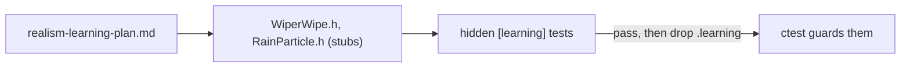

| File | Change |
|---|---|
| [docs/realism-learning-plan.md](docs/realism-learning-plan.md) | New course document |
| [src/scene/Entity/WiperWipe.h](src/scene/Entity/WiperWipe.h) | New stub header (M1, M4) |
| [src/renderer/RainSystem/RainParticle.h](src/renderer/RainSystem/RainParticle.h) | New particle layout + stub header (M5, M6) |
| [tests/test_wiper_wipe.cpp](tests/test_wiper_wipe.cpp) | New hidden tests (6) |
| [tests/test_rain_particle.cpp](tests/test_rain_particle.cpp) | New hidden tests (5) |
| [tests/CMakeLists.txt](tests/CMakeLists.txt) | Registered the two test files |
| [docs/realism-features.md](docs/realism-features.md) | Clearcoat moved from "Not built" to an as-built section |
| [docs/README.md](docs/README.md) | Index row for the course |
| `.claude/skills/realism/clearcoat-flake/SKILL.md` | Status updated to built (untracked local file) |

---

### 2026-10-12 — Rigged 993 Carrera RS: named-rig loader, per-car physics, wheels, wipers, needles

Made the rigged 1995 911 Carrera RS (`SWISH_CAR=assets/blend/porsche_rigged.glb`) a working car: a named-node loader finds its wheels, calipers, steering wheel, dial needles and wipers; it drives on its own 993 RS physics profile; the wheels spin per corner and the fronts steer with Ackermann; V cycles the wipers through Off / Intermittent / Low / High, and the 3D blades and the windshield-rain clear share one angle; the tach and speedo needles follow rpm and speed. Not yet checked in a running window. The default car is unchanged apart from the new wiper look and the V cycle.

Technical summary

### Motivation

The owner's brief (`goals.md`) asked for the rigged car to work like a real one: a steering wheel that turns naturally, wheels that move properly, wipers that switch on and off easily, working dials, and a model that is "precise". The 2026-10-11 merge brought in `assets/blend/porsche_rigged.{blend,glb}`, but the loader fell back to `WHEEL RECOVERY FAILED` (rigid wheels) and nothing in the cabin moved. Three grill rounds settled the scope ([tasks/todo.md](tasks/todo.md) "Rigged Porsche: first-class car"):

- **"Precise"** means three things: it looks like `porsche.glb`, its dimensions match the real car, and its pivots sit at the real hinges.
- The car gets **its own 993 RS physics profile**. Geometry comes from the GLB; the powertrain is 993 RS spec, with the redline matched to the painted dial.
- **Wheels:** per-wheel kinematic spin, plus a `wheel_omega[4]` hook for Phase C. Ackermann is draw-only and tunable (0–100%, default 100%).
- **Wipers:** V cycles four modes. The motion is a real park-and-sweep with eased ends, and one angle drives both the blades and the rain shader. This is an intended release change.
- **Needles:** the tach is a linear fit and the speedo a lookup table (stored in TOML), both measured off the painted faces. A critically damped follower (~80 ms) drives them, plus a startup sweep.
- The work stays behind `SWISH_CAR` until the owner verifies it. After that, the rigged car becomes the default and the old heuristic loader is deleted, as separate steps.

Reference for everything below: [docs/car-rig.md](docs/car-rig.md).

### Per stage

**S0a: Blender, wiper spindles re-aimed.** In the committed `.blend`, the `Wiper_*` spindles (Blender local Z, which becomes glTF +Y after export) were not normal to the glass, so the blades cut into the windshield as they swept. The fix worked on a fresh headless copy of the `.blend`, leaving the owner's open Blender session untouched. Each pivot's Euler angles were re-solved so its local Z matches a fitted glass normal. The child mesh got the inverse correction, so the parked pose is unchanged (rest displacement checked to be ~0). The `Collection` collection was then re-exported to the GLB. Blade-to-glass gap, measured by ray against the glass BVH every 15° from 0 to 120°:

| | Worst gap over 0–120° (+ = above the glass) |
|---|---|
| Before | **−74 mm** (blade inside the glass) |
| After | **−1.2 mm to +5.7 mm** |

The arm's mid-span still stands 16–29 mm off the glass; that comes from the mesh, not the spindle.

**S0c: named-rig loader.** [CarRig.h](src/scene/Entity/CarRig.h) (new, header-only, GPU-free) maps exact pivot names to roles. A car counts as a named rig when all four `Wheel_*` pivots exist. Every node inherits the role of its nearest named ancestor, so the child meshes under a pivot (`Wheel_FL_Rim` and so on) need no special names. [ModelManager.cpp](src/scene/ModelManager/ModelManager.cpp) tries this convention first; the explicit-rig, Hellcat and heuristic paths are the fallbacks. Each corner's wheel frame is rebuilt orthonormal from the hub pivot's local X (the axle), then checked: the hub must be inside its named corner's box, the axle within ~26° of lateral, the radius between 0.25 and 0.45 m, and at least one spinning piece present. The `SteeringWheel` frame is flipped 180° about its local Y when its +Z points forward, so a right steer turns the rim clockwise. Needle and wiper pieces get `Submesh::rig_part` and `rig_pivot_frame` ([SceneTypes.h](src/scene/SceneTypes.h)). Only the `GLASS_FRONT` pane is tagged `is_windshield`. [CarRigGeometry.h](src/scene/Entity/CarRigGeometry.h) holds the measured wheelbase, tracks and tyre radii.

**S0d: CarProfile and `gearCount`.** [CarProfile.h](src/scene/Entity/CarProfile.h) (new) bundles one car's physics: `CarParams`, `TireParams`, `GearboxParams`, `TorqueCurve`, `DrivetrainParams`, fallback wheel radius, steer lock and steering ratio. `CarEntity::apply_profile` switches profile; every physics read in [CarEntity.cpp](src/scene/Entity/CarEntity.cpp) now goes through `m_profile`. A default-constructed profile **is** `turbo_s_992()`, so the default car is bit-identical (the goldens, including `tests/golden/car_trajectory.csv`, are untouched). The torque curve became data ([Powertrain.h](src/scene/Entity/Powertrain.h) `TorqueCurve`, `kTurboS992TorqueCurve`), threaded through [Longitudinal.h](src/scene/Entity/Longitudinal.h) and [Bicycle.h](src/scene/Entity/Bicycle.h). `GearboxParams::gearCount` (7 for the 992, 6 for the 993) limits the validators, `gear_for_speed` and `gearbox_shift_step`. The Ch01 tutorial has a postscript on this ([01-static-assert.md](docs/tutorials/typed-cpp/01-static-assert.md) §10). `car_profiles::rs_993()`:

| Field | 993 RS | Source |
|---|---|---|
| Mass | 1279 kg | spec |
| Power / torque | 300 PS (221 kW) at 6500 rpm; 355 N·m at 5400 rpm | spec |
| Fuel cut (redline) | 6800 rpm (start of the painted red zone) | matched to the dial |
| Gearbox | G50/31 6-speed: 3.154 / 2.000 / 1.522 / 1.242 / 1.024 / 0.820, final drive 3.444 | from memory (flagged) |
| Shift band | up 6600, down 3200 rpm | est |
| Drive | RWD (`frontShareBase = frontShareMax = 0`) | spec |
| Drag | $C_d = 0.3305$, $A = 1.90\ \text{m}^2$, calibrated to 277 km/h | calibrated |
| Weight split, $I_z$, $C_\alpha$, $h_{cg}$ | 40/60, 2336 kg·m², 73.5 / 133.2 kN/rad, 0.46 m | est |
| Steering | 16.5:1, 29.5° lock (2.70 turns lock to lock) | from memory (flagged) |
| Wheelbase / rear tyre radius | measured from the GLB (2.259 m / 0.320 m); spec fallback 2.272 / 0.320 | measured |

The tests check the profile against its targets: top speed 277 km/h ±3% (drag-limited in 6th, at 6484 rpm), 0–100 km/h in 4.82 s through the real `CarEntity` (test window 4.8–5.6 s, reached in 2nd), and `car_profile_valid` as a `static_assert`. All of these are the profile's own numbers, not road-test data.

**S1a: per-wheel spin and Ackermann.** [WheelKinematics.h](src/scene/Entity/WheelKinematics.h) gains `wheel_rolling_speed`, `ackermann_wheel_angle` and `wheel_spin_advance`. `CarEntity::advance_wheel_spin` writes each corner's $\omega_i$ into `m_wheel_omega` (the Phase C slip/lockup hook) and integrates the visible angle from it. `get_wheel_steer_rad(c)` gives each front wheel its own angle, which the calipers share; calipers never spin. The steering wheel turns by $\delta\cdot\rho$, where $\rho$ is the profile's ratio. The physics still uses the single bicycle angle $\delta$. Every symbol below is in car space: nose $+X$, right $+Z$, yaw rate $\dot\psi$ right-positive, hub position $(x_i, z_i)$ relative to the entity origin.

$$
v_i=(v_x-\dot\psi\,z_i)\cos\delta_i+(v_l+\dot\psi\,x_i)\sin\delta_i,\qquad
\omega_i=\frac{v_i}{R_i},\qquad
\theta_i\leftarrow\operatorname{wrap}_{2\pi}\!\big(\theta_i+k_{spin}\,\omega_i\,\Delta t\big)
$$

The bicycle angle $\delta$ is a virtual centre wheel; $L$ is the wheelbase and $t$ the front track, both measured. Each front hub sits at $z_w=\pm t/2$:

$$
\cot\delta_w=\cot\delta-\frac{z_w}{L}
\iff
\delta_w=\arctan\frac{L\tan\delta}{L-z_w\tan\delta}
\quad\Longrightarrow\quad
\cot\delta_o-\cot\delta_i=\frac{t}{L}
$$

$$
\delta_{w,\text{drawn}}=\delta+k\,(\delta_w-\delta),\qquad k=\texttt{[wheels] ackermann}\in[0,1]\ (\text{default }1)
$$

**S1b: wipers.** [Wiper.h](src/scene/Entity/Wiper.h) (new) is the mode machine and the motion. V cycles Off → Intermittent → Low → High → Off. A mode switch never jumps the blade. Off finishes the current wipe and parks. Intermittent does one Low-speed wipe, then dwells 4 s at park. One wipe is phase $u\in[0,1)$, going park → top → park:

$$
\theta(u)=\Theta\;\mathrm{mix}\!\Big(1-|2u-1|,\ \tfrac{1-\cos 2\pi u}{2},\ e\Big),\qquad
\dot u=\frac{\text{wpm}}{60}
$$

The defaults are $\Theta = 105°$ and $e = 1$ (cosine profile: zero angular speed at both reversals). Low is 45 wipes/min and High 65. [WiperBlade.h](src/scene/Entity/WiperBlade.h) (new) measures each arm's tip from the mesh, in its pivot frame. The tip is the vertex farthest from the spindle, giving a 0.53 m reach; the rubber covers the outer 70%, `kWiperBladeInnerFrac = 0.3`. Each frame, `App::update_wiper` steps the model, sets `CarEntity::set_wiper_angle` and sends a `WiperFrame` to `Renderer::set_wiper`. `CarEntity::get_draw_calls` sweeps the arms. [WindshieldRainPass.cpp](src/renderer/WindshieldRainPass/WindshieldRainPass.cpp) projects each blade's wiped segment $P(\alpha, f) = F\,R_y(\alpha)\,(f\,\mathbf{tip})$, for $f \in [0.3, 1]$, to screen UV, using last frame's and this frame's angle. [windshield_wetness.frag](shaders/windshield_wetness.frag) then clears the quad swept between the two segments, plus a feathered band around the current one:

$$
c(\mathbf q)=\max\!\Big(\mathbb 1[\mathbf q\in\square(a_0,b_0,b_1,a_1)],\ 1-\mathrm{smoothstep}\big(b_x,b_y,\ d(\mathbf q,\overline{a_1b_1})\big)\Big),\qquad W\leftarrow W\,(1-c)
$$

The rigged band is $(0.008, 0.02)$ in aspect-corrected UV. A car without `Wiper_*` pivots (the default `porsche.glb`) uses one analytic screen-space blade. It pivots at $(0.5, 0.92)$ with reach 0.95 and band $(0.04, 0.13)$, and its angle maps the same wiper angle to $-1.15 + 2.30\,\mathrm{clamp}(\alpha/\Theta)$ rad: parked at the left, sweeping right. Because the clear is now the swept area between two frames, it no longer depends on frame rate.

**S1c: needles.** [GaugeNeedles.h](src/scene/Entity/GaugeNeedles.h) (new). Dial angles are degrees clockwise from 12 o'clock, as the driver sees them. The tach is a linear fit to the painted 1k / 4k / 7k numerals, measured at −109.0° / −0.4° / +105.5°:

$$
\theta_{tach}=-145°+36°\cdot\frac{\mathrm{clamp}(\text{rpm},\,0,\,7600)}{1000}
$$

The speedo is a piecewise-linear table of the printed marks (0 km/h is extrapolated, since the face has no 0), clamped at both ends:

$$
\theta_{spd}(v)=\theta_{j-1}+\frac{v-v_{j-1}}{v_j-v_{j-1}}\,(\theta_j-\theta_{j-1}),\qquad v_{j-1}<v\le v_j
$$

| km/h | 0 | 10 | 20 | 60 | 100 | 140 | 180 | 220 | 260 | 300 |
|---|---|---|---|---|---|---|---|---|---|---|
| θ (deg) | −141 | −133 | −125.2 | −90.9 | −55.9 | −18.9 | 19.1 | 58.5 | 98.5 | 138.1 |

Each needle follows its target $x^*$ as a critically damped spring with $\omega_n=1/\tau$, $\tau=80$ ms. `needle_follow` steps the exact solution for a target held over $\Delta t$, so the result does not depend on frame rate and the needle never overshoots from rest:

$$
e=x-x^*,\quad k=\dot x+\omega_n e,\qquad
x'=x^*+(e+k\,\Delta t)\,e^{-\omega_n\Delta t},\qquad
\dot x'=(\dot x-\omega_n k\,\Delta t)\,e^{-\omega_n\Delta t}
$$

On load, both needles sweep to full scale and back over 1.2 s (each half a smoothstep), then hand over to the follower.

**Pivot conjugation (wipers, needles, steering wheel).** A part with normalized pivot frame $F$ turns about a local axis $\hat a$ (wipers $+Y$, needles $-Z$, steering wheel $+Z$):

$$
M=F\,R_{\hat a}(\alpha)\,F^{-1},\qquad \text{draw model}=M_{car}\,M
$$

For a needle, $\alpha=-\,\mathrm{rad}(\theta-\theta_{rest})$, with $\theta_{rest}$ = −144° (tach) or −151° (speedo). For the steering wheel, $\alpha=-\delta\rho$.

**Integration (merge commits `cb46c9f`, `94fe72c`, `57e772b`).** One file, [config/car.toml](config/car.toml), holds the `[wheels]`, `[gauges]` and `[wipers]` tables. [CarConfig](src/scene/CarConfig/CarConfig.cpp) (new) reads it at startup in **both** builds. A missing file or key falls back to the C++ defaults, and a test checks that the file matches them. The separate `gauges.toml`, `wiper.toml` and the wiper bake from the stage branches were folded into this one file. As a result, the release binary now links toml++ (it already ran at build time for `toml_baker`). `App::load_car` applies `rs_993(&measured)` only when the loader reports a named rig with recovered wheels; every other car keeps the 992. The debug Telemetry redline now reads `CarEntity::get_redline_rpm()` (the profile's fuel cut) instead of a fixed 7200. Debug builds seed the `wiper`, `wheels` and `gauges` sliders in [Tunables.def](src/debug/Tunables.def) from the TOML.

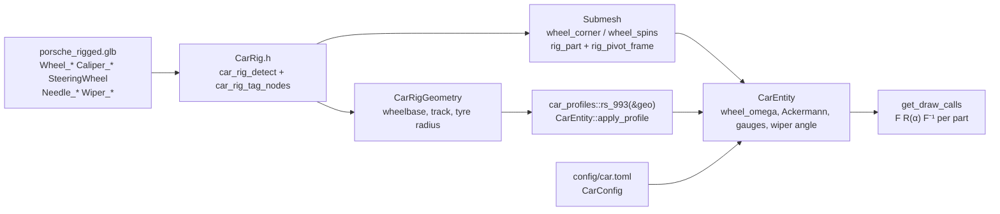

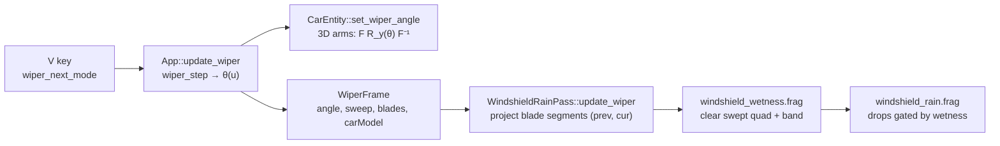

### Release-behaviour changes (intended)

- **Rain-wipe look, on both cars.** The wetness clear is now the swept area between two frames' blade segments, not a fixed-width band around a `sin`-driven angle. The default car's screen-space blade parks at the left and sweeps right with the eased profile. In `tests/golden/release_spv.sha256`, only the `windshield_wetness.frag.spv` hash changed; the other 32 are unchanged.
- **V cycles four modes** (Off → Intermittent → Low → High) instead of toggling, and prints `[wiper] <mode>`.
- **toml++ is linked into the release binary** (`CarConfig` reads `config/car.toml` at startup; CMake copies it to `build*/config/`).
- The default car is otherwise unchanged: it keeps the 992 profile (goldens untouched), it has no needles, and its wheels draw as before. Its fronts now get the Ackermann angle when its wheel frames are recovered (draw-only, at `ackermann = 1.0`).

### Status: not yet verified in the app

Unit tests pass (352 release / 377 debug, per [tasks/todo.md](tasks/todo.md) S2), but nothing here has been checked by eye. The owner's checklist, with where to fix each item, is [tasks/rigged-porsche-app-checks.md](tasks/rigged-porsche-app-checks.md). Still open in S2: make the rigged car the default, then delete the heuristic loader (`Combined3DWheel*`, `Steering_Wheel`).

### Licence

The model is "1995 Porsche 911 Carrera RS (993)" by **ddiaz-design** (Sketchfab), licensed CC BY-NC-SA 4.0: attribution required, non-commercial use only, and the rigged derivative must carry the same licence. See [assets/CREDITS.md](assets/CREDITS.md).

### Files

Built by reading the code at `57e772b`. Check it against `git diff 6510814..HEAD --stat` before committing. `tasks/` files are left out.

| File | Change |
|------|--------|
| `assets/blend/porsche_rigged.blend`, `assets/blend/porsche_rigged.glb` | S0a: `Wiper_*` spindles re-aimed to the glass normal (child meshes compensated); GLB re-exported |
| [assets/CREDITS.md](assets/CREDITS.md) | new: model credit and CC BY-NC-SA 4.0 terms |
| [config/car.toml](config/car.toml) | new: `[wheels]`, `[gauges]`, `[wipers]` |
| [CMakeLists.txt](CMakeLists.txt) | copy `config/car.toml`; link toml++ into `swish` in both builds |
| [src/scene/Entity/CarRig.h](src/scene/Entity/CarRig.h) | new: name → role, ancestry tagging, pivot normalization, wheel / steering frames, `rig_part_sweep`, `measure_car_rig_geometry` |
| [src/scene/Entity/CarRigGeometry.h](src/scene/Entity/CarRigGeometry.h) | new: measured wheelbase / tracks / tyre radii |
| [src/scene/Entity/CarProfile.h](src/scene/Entity/CarProfile.h) | new: `CarProfile`, `car_profile_valid`, `turbo_s_992()`, `rs_993()` |
| [src/scene/Entity/Wiper.h](src/scene/Entity/Wiper.h) | new: modes, `wiper_step`, `wiper_profile`, `wiper_angle` |
| [src/scene/Entity/WiperBlade.h](src/scene/Entity/WiperBlade.h) | new: arm tip from the mesh, `wiper_blade_point`, `WiperFrame` |
| [src/scene/Entity/GaugeNeedles.h](src/scene/Entity/GaugeNeedles.h) | new: tach fit, speedo LUT, `needle_follow`, startup sweep, `needle_pose` |
| [src/scene/Entity/WheelKinematics.h](src/scene/Entity/WheelKinematics.h) | `wheel_spin_advance`, `wheel_rolling_speed`, `ackermann_wheel_angle` |
| [src/scene/Entity/CarEntity.h](src/scene/Entity/CarEntity.h), [CarEntity.cpp](src/scene/Entity/CarEntity.cpp) | `apply_profile` / `m_profile`; `m_wheel_omega`; per-corner steer; caliper and steering-wheel matrices; wiper and needle draw; `update_gauges`; rig geometry |
| [src/scene/Entity/Powertrain.h](src/scene/Entity/Powertrain.h) | `TorqueCurve` as data, `kTurboS992TorqueCurve`; `gearCount` and its validators |
| [src/scene/Entity/Longitudinal.h](src/scene/Entity/Longitudinal.h), [Bicycle.h](src/scene/Entity/Bicycle.h), [Drivetrain.h](src/scene/Entity/Drivetrain.h) | torque curve parameter (992 default); gear loops to `gearCount`; RWD note |
| [src/scene/SceneTypes.h](src/scene/SceneTypes.h) | `RigPart`; `Submesh::rig_part`, `rig_pivot_frame` |
| [src/scene/ModelManager/ModelManager.cpp](src/scene/ModelManager/ModelManager.cpp) | named-rig branch first; `GLASS_FRONT` windshield; wiper-blade measurement; log lines |
| [src/scene/CarConfig/CarConfig.h](src/scene/CarConfig/CarConfig.h), [CarConfig.cpp](src/scene/CarConfig/CarConfig.cpp) | new: `config/car.toml` reader (toml++), clamps and validation |
| [src/core/App/App.h](src/core/App/App.h), [App.cpp](src/core/App/App.cpp), [AppInit.cpp](src/core/App/AppInit.cpp), [AppInput.cpp](src/core/App/AppInput.cpp) | `WiperState` / `update_wiper`; V → `on_cycle_wiper`; profile selection; `CarConfig` load and debug seeding; gauges / Ackermann wiring |
| [src/renderer/Renderer/Renderer.h](src/renderer/Renderer/Renderer.h), [Renderer.cpp](src/renderer/Renderer/Renderer.cpp), [Renderer_State.cpp](src/renderer/Renderer/Renderer_State.cpp), [src/renderer/Passes/IRenderPass.h](src/renderer/Passes/IRenderPass.h) | `set_wiper(const WiperFrame&)`; `FrameUpdate::wiper` |
| [src/renderer/WindshieldRainPass/WindshieldRainPass.h](src/renderer/WindshieldRainPass/WindshieldRainPass.h), [.cpp](src/renderer/WindshieldRainPass/WindshieldRainPass.cpp) | blade projection, swept segments, 112-byte push block |
| [shaders/windshield_wetness.frag](shaders/windshield_wetness.frag) | swept-quad + band clear from projected segments |
| [src/debug/Tunables.def](src/debug/Tunables.def), [DebugParams.h](src/debug/DebugParams.h), [DebugUI.cpp](src/debug/DebugUI.cpp) | `wiper`, `wheels`, `gauges` groups; "Gauge Needles" header; telemetry redline from the profile |
| [tests/test_car_rig.cpp](tests/test_car_rig.cpp), [test_car_profiles.cpp](tests/test_car_profiles.cpp), [test_wiper.cpp](tests/test_wiper.cpp), [test_gauge_needles.cpp](tests/test_gauge_needles.cpp) | new |
| [tests/test_wheel_articulation.cpp](tests/test_wheel_articulation.cpp), [test_debug_params_io.cpp](tests/test_debug_params_io.cpp), [tests/CMakeLists.txt](tests/CMakeLists.txt) | Ackermann / spin / config cases; tunable counts; new tests + `CarConfig.cpp` + toml++ |
| [tests/golden/release_spv.sha256](tests/golden/release_spv.sha256) | `windshield_wetness.frag.spv` hash (intended) |
| [docs/tutorials/typed-cpp/01-static-assert.md](docs/tutorials/typed-cpp/01-static-assert.md) | §10 postscript: `gearCount` |
| [docs/car-rig.md](docs/car-rig.md) | new: the named-rig reference |
| [docs/README.md](docs/README.md), [docs/car_system.md](docs/car_system.md), [docs/car-asset-pipeline.md](docs/car-asset-pipeline.md), [docs/rain/README.md](docs/rain/README.md), [docs/GLOSSARY.md](docs/GLOSSARY.md), [src/core/README.md](src/core/README.md), [README.md](README.md) | links to `car-rig.md`; V cycles the wiper modes; wiper clear description |

**Label:** Largely AI-generated (Claude). Please review.

---

### 2026-10-11 — Merged everything into `debug-ui`: upstream fixes, Ch01 work, rigged Porsche asset

Merged the three upstream `origin/debug-ui` commits (swapchain prefers 8-bit sRGB and always presents FIFO/vsync, GPU
choice by score, `scripts/run_mac.sh`, 2026-07-25 review docs), the committed Ch01 / Hellcat work-in-progress, and the
rigged Porsche asset; release output changes on purpose only through the upstream swapchain fix.

Technical summary

### What and why

The owner asked to merge all outstanding changes. `origin/debug-ui` had diverged at `002346d` with three dabibhabi
commits from June–July that the local line never had; `refactor/01-static-assert` held uncommitted Ch01 and Hellcat
work, committed as `d5d3b78` on request.

### Conflict resolution

- Upstream vs local: the six conflicting source files (`App.h`, `RainSystem.h`, `WindshieldRainPass.cpp`,
  `RoadGeometry.cpp`, `RoadScene.cpp`, `SceneManager.cpp`) were formatting-only on the upstream side against code that
  has since been refactored locally (key-binding table, `vkx` builders, `polyline_length`, split RoadScene files), so
  the local versions were kept. The real upstream change, [Swapchain.cpp](src/renderer/Swapchain/Swapchain.cpp) /
  [Device.cpp](src/renderer/Pipeline/Device/Device.cpp), merged cleanly. `.obsidian/workspace.json` stays deleted.
- Ch01: `tests/CMakeLists.txt` keeps the P0.3 `swish_scene_core` layout plus `test_powertrain_invariants.cpp`.
- Ch01 bug found by the merged gate: `upshift_lands_above_downshift` in
  [Powertrain.h](src/scene/Entity/Powertrain.h) negated `upshiftRpm` before the multiply (`!a * b > c`), so it could never
  fail; parenthesised (`!(a * b > c)`), matching the chapter's reference solution.

### Verification

Merged result: `make test` 309/309, `make test-debug` 333/333, release `.spv` 33/33, 0 first-party warnings,
`make check` OK. Not yet looked at in a running window (see "What's next" item 1).
- This month file was rebuilt from each entry's own commit (an earlier union resolution had interleaved the
  2026-10-10 entries), newest first; `CHANGELOG.md` index regenerated.

### Behaviour change (intended, from upstream)

Present mode is always `VK_PRESENT_MODE_FIFO_KHR` (vsync: fps is capped at the display refresh) and the surface format
prefers `B8G8R8A8_SRGB`, then `B8G8R8A8_UNORM`, with `R16G16B16A16_SFLOAT` + extended-sRGB only as a last resort
(it could black-screen Linux NVIDIA/Wayland). Shaders and goldens are unchanged. To check on the Mac: image match and
fps re-baseline ([tasks/todo.md](tasks/todo.md) "What's next" item 2).

### Files

| File | Change |
|------|--------|
| [src/renderer/Swapchain/Swapchain.cpp](src/renderer/Swapchain/Swapchain.cpp), [.h](src/renderer/Swapchain/Swapchain.h) | upstream: sRGB-first format, FIFO, log line |
| [src/renderer/Pipeline/Device/Device.cpp](src/renderer/Pipeline/Device/Device.cpp) | upstream: best-score GPU + log |
| [scripts/run_mac.sh](scripts/run_mac.sh), `docs/reviews/2026-07-25-*.md`, [docs/architecture.md](docs/architecture.md) | upstream |
| Ch01 / Hellcat files (`Powertrain.h`, `RendererConfig.h`, `ModelManager.cpp`, `SceneTypes.h`, `MaterialDescriptors.cpp`, tests) | owner WIP `d5d3b78` |
| [tests/CMakeLists.txt](tests/CMakeLists.txt), [tests/utils/CMakeLists.txt](tests/utils/CMakeLists.txt) | merge resolution |
| `assets/blend/porsche_rigged.blend`, `assets/blend/porsche_rigged.glb` | new asset |
| [tasks/todo.md](tasks/todo.md) | "What's next" section, Ch01 status, feature-table notes |

**Label:** Largely AI-generated (Claude). Please review.

---

### 2026-10-11 — Replaced `#define private public` in the golden car test with a friend test accessor

Replaced the `#define private public` include hack in `tests/test_golden_car.cpp` with a narrow `CarEntityTestAccess` friend, so the golden trajectory test no longer redefines a keyword and CarEntity can safely change layout/typing (Ch03); behaviour and goldens unchanged.

Technical summary

**Motivation.** The golden test needed to set `m_throttle`/`m_brake` and read `m_lateral_velocity`/`m_yaw_rate`/`m_plane_frac`, which have no public setter or getter. The macro hack is undefined-behaviour-adjacent and would break once CarEntity members change type.

**Fix.** [CarEntity.h](src/scene/Entity/CarEntity.h) declares `friend struct CarEntityTestAccess;` (no definition in the app, so zero code or layout change). The struct is defined only in [tests/test_golden_car.cpp](tests/test_golden_car.cpp) with exactly the five static accessors the test uses. No other `#define private/protected` exists in `tests/` or `src/`.

| File | Change |
|------|--------|
| [src/scene/Entity/CarEntity.h](src/scene/Entity/CarEntity.h) | `friend struct CarEntityTestAccess;` |
| [tests/test_golden_car.cpp](tests/test_golden_car.cpp) | removed macro + clang pragma; added `CarEntityTestAccess`; call sites use it |

**Label:** Largely AI-generated (Claude). Please review.

---

### 2026-10-11 — P0.3 Build: scene_core / utils targets, shared warnings, CI hygiene

Added `swish_scene_core`, `swish_utils` and `swish_warnings` CMake targets, put the warning set and `-Werror` on the tests and `toml_baker`, extended CI, and guarded the golden mesh hashes by compiler.

Technical summary

**Motivation.** `tests/CMakeLists.txt` kept a hand-listed copy of the scene sources, the warning flags were copied per target (tests and `toml_baker` had no `-Werror`, plus a dead MSVC `/W4`), CI built only `swish_tests` with the default compiler, and the intro mesh-hash golden fails on non-Clang / `-O0` builds instead of saying why.

**Approach.** Behaviour-preserving build wiring only; `swish` still compiles every `src/` file itself (it is not linked against `swish_scene_core`).

- `swish_warnings` (INTERFACE): `-Wall -Wextra -Wpedantic -Wno-unused-parameter`, plus `-Werror` when `SWISH_WERROR=ON`. Linked by `swish`, `swish_scene_core`, `swish_tests`, `swish_utils_tests`, `swish_debug_tests`, `toml_baker`.
- `swish_utils` (INTERFACE): `src/` include root, `glm::glm`, `GLM_FORCE_DEPTH_ZERO_TO_ONE`.
- `swish_scene_core` (STATIC): Camera, `RoadScene/*` (glob), Corridor alignment/bounds, RoadGeometry, CarEntity, Entity. `CorridorDriver.cpp` stays out (Vulkan/GLFW input). Defines `CONFIG_DIR` privately (RoadScene default ctor) and the backend macros publicly.
- Golden mesh: the hash comparison `SKIP`s unless `__clang__ && NDEBUG` (update mode unaffected; goldens untouched).
- CI: test job uses clang Release + `-DSWISH_WERROR=ON` and builds `swish_tests` and `swish_utils_tests`; new `hygiene` job runs `make check` (hard) and `make format-check` as **report-only** (`continue-on-error`), since 27 files are still unformatted.

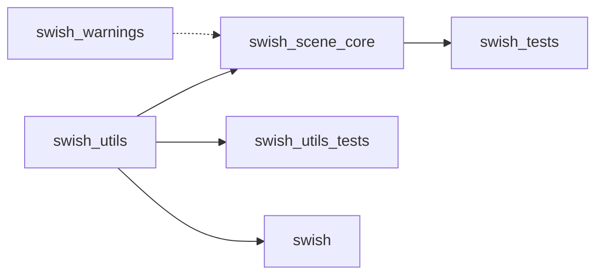

### Files

| File | Change |
|------|--------|
| [CMakeLists.txt](CMakeLists.txt) | new `swish_warnings`, `swish_utils`, `swish_scene_core`; `toml_baker` and `swish` use them; per-target warning/clip-Z/include lines removed |
| [tests/CMakeLists.txt](tests/CMakeLists.txt) | `swish_tests` links `swish_scene_core`; source list and MSVC `/W4` removed; debug tests use shared targets |
| [tests/utils/CMakeLists.txt](tests/utils/CMakeLists.txt) | links `swish_utils` + `swish_warnings` |
| [tests/test_golden_mesh.cpp](tests/test_golden_mesh.cpp) | `kHashesComparable` compiler guard with `SKIP` message |
| [.github/workflows/ci.yml](.github/workflows/ci.yml) | clang Release + Werror, both test targets, `hygiene` job |

**Label:** Largely AI-generated (Claude). Please review.

---

### 2026-10-11 — P0.5 doc drift: Units.h test path, golden README, rule 9, `rel`/`NOREL`, symbol refs, utils plan restored

Fixed six documentation drifts found by the typed-C++ refactor audit; docs and one header comment only, no code or output change.

Technical summary

**Motivation.** Prose had drifted from code: a test path that does not exist, a golden README that contradicted `tests/README.md`, a rule claiming total builder adoption, a removed `releaseValue` name, line-number links that rot, and a utils plan referenced only from a gitignored folder.

**Fix.**
- [Units.h](src/utils/units/Units.h): `Test :` line now `tests/utils/test_units_Units.cpp` (comment-only).
- [tests/golden/README.md](tests/golden/README.md): the "pass in Release and RelWithDebInfo" sentence contradicted [tests/README.md](tests/README.md) (mesh hashes are Release + Clang bound, fail at `-O0` / `-ffp-contract=off` / GCC). Rewritten per fixture: mesh hashes, trajectory tolerance (1e-3 abs + 1e-3 rel, gear exact), `.spv`.
- [CODING_RULES.md](docs/CODING_RULES.md) rule 9: marked "migration in progress", listing the 11 files that still call raw `vkCreate*`.
- `releaseValue` → `rel` / `NOREL` in [RECIPES.md](docs/RECIPES.md) and [FEATURE_RULES.md](docs/FEATURE_RULES.md), matching [Tunables.def](src/debug/Tunables.def). The 2026-09 changelog entry is history and left as is.
- [DESIGN_PATTERNS.md](docs/DESIGN_PATTERNS.md): `file:line` references replaced with symbol references.
- [utils-component-design.md](docs/utils-component-design.md): restored from the gitignored `archive/local/review_2026-09-29/docs/` with a status banner (historical, partly implemented); links to moved or removed files turned into plain text; linked from [docs/README.md](docs/README.md) and [src/utils/README.md](src/utils/README.md).

### Files

| File | Change |
|------|--------|
| [src/utils/units/Units.h](src/utils/units/Units.h) | comment: correct test path |
| [tests/golden/README.md](tests/golden/README.md) | consistent toolchain-bound section |
| [docs/CODING_RULES.md](docs/CODING_RULES.md) | rule 9 migration-in-progress note |
| [docs/RECIPES.md](docs/RECIPES.md), [docs/FEATURE_RULES.md](docs/FEATURE_RULES.md) | `rel` / `NOREL` wording |
| [docs/DESIGN_PATTERNS.md](docs/DESIGN_PATTERNS.md) | line refs to symbol refs |
| [docs/utils-component-design.md](docs/utils-component-design.md) | restored (new tracked file) |
| [docs/README.md](docs/README.md), [src/utils/README.md](src/utils/README.md) | link to restored plan |
| [tasks/todo.md](tasks/todo.md) | P0.5 ticked |

**Label:** Largely AI-generated (Claude). Please review.

---

### 2026-10-10 — Car lights S1–S3: headlight / tail / brake spot lights (debug-only)

Added debug-only car spot lights: a car GLB with named `*_Lamp` nodes (the new Blender rig `assets/blend/porsche_rigged.glb`) now throws two headlight beams and red tail / brake glow onto the road, switched from a new "Car Lights" debug panel; off by default, release output unchanged.

Technical summary

### Motivation

User goal (2026-10-10): lights on the car, with rain on the lenses while driving. Plan and spec:
[tasks/todo.md](tasks/todo.md) "Car lights". This entry covers S0–S3; lens glow (S5) and rain on the lenses (S6) are open.

### What changed

- **Asset (S0).** `assets/blend/porsche_rigged.blend` → `porsche_rigged.glb` (untracked, made in Blender): real scale
  (wheelbase 2.259 m, tyre radius 0.320 m), named pivots, and per-lamp nodes `Headlight_L/R`, `TailLight_L/R`,
  `BrakeLight_L/R`, `RearLightBar`, each with `_Lens` / `_Housing` / `_Emitter` meshes and a `<Anchor>_Lamp`
  KHR_lights_punctual node whose local −Z is the beam (the Empty's own −Z is not, after the exporter's Y-up swap).
- **Loader + CPU (S1).** [src/scene/Entity/CarLights.h](src/scene/Entity/CarLights.h) (new, header-only): exact-name
  `_Lamp` → `CarLightKind`, and `car_spot_lights(anchors, model, state, params)`. `ModelManager::load_car` reads the
  lamp nodes into car space with the same RootNode-relative, $(x,y,z)\to(z,y,-x)$, grounded transform as the vertices.
- **GPU (S2).** `SpotLightData[8]` + `numSpotLights` appended to `LightsUBO` and `lights.glsl`, and a spot loop in
  `lighting.frag`, all under `#ifdef SWISH_DEBUG_UI`. Falloff = the point lights' windowed bounded inverse-square with
  $d_{ref}=0.15R$, times a cone, plus the street lamps' wet halo:

$$
c=\mathrm{smoothstep}(\cos\theta_o,\cos\theta_i,-\hat L\cdot\hat d),\quad
att=\mathrm{win}(d/R)\,\frac{d_{ref}^2}{d_{ref}^2+d^2}\,c,\quad
L_o \mathrel{+}= C I\,att\,\big[(k_D\,\tfrac{\rho}{\pi}+f_s)\,N\!\cdot\!L + att\,w\,k_{halo}\big]
$$

- **Wiring (S3).** `Tunables.def` group `car_lights` (11 rows, NOPUSH): enabled (default **false**), headlights / tail
  on, hold-brake, intensities, ranges, beam half-angles. `App::push_car_to_renderer` builds the lights each frame
  (brake lamps follow `CarEntity::get_brake()`) → `Renderer::set_car_spot_lights` → `CameraUniforms`.

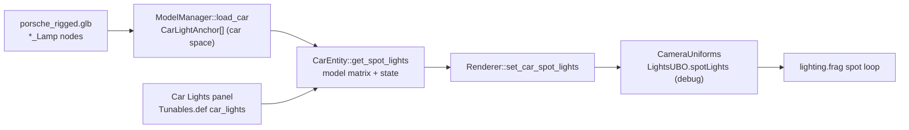

### Verification

`make test-debug` 246/246, `make test` 223/223, 0 first-party warnings, release `.spv` 33/33 unchanged. New
`tests/test_car_lights.cpp` (name mapping, all-off identity, per-switch lamps, world transform); tunable-table counts
updated in `tests/test_debug_params_io.cpp`. Looked at it: window-only screenshots with a temporary night force
(sun / ambient / IBL ≈ 0, chase cam, panel hidden; reverted): headlight pool on the road ahead, red tail/brake pool
behind, 120 fps either way. Lights-off screenshot matches today's image. Not yet done: rain 0 / 1.0 pair (S4).
Noted, pre-existing and unrelated: the large dark patch around the car in the debug build's default preset shows
with the original `porsche.glb` too.

### Files

| File | Change |
|------|--------|
| [src/scene/Entity/CarLights.h](src/scene/Entity/CarLights.h) | new: anchors, state, params, name map, `car_spot_lights` |
| [src/scene/SceneTypes.h](src/scene/SceneTypes.h) | `SpotLightDesc`; debug-only `SpotLightData` + `LightsUBO` fields |
| [src/scene/ModelManager/ModelManager.cpp](src/scene/ModelManager/ModelManager.cpp) | read `_Lamp` nodes into car space |
| [src/scene/Entity/CarEntity.h](src/scene/Entity/CarEntity.h) | light anchors, `get_brake`, `get_spot_lights` |
| [src/renderer/CameraUniforms/CameraUniforms.h](src/renderer/CameraUniforms/CameraUniforms.h) / [.cpp](src/renderer/CameraUniforms/CameraUniforms.cpp) | store + upload spot lights (debug) |
| [src/renderer/Renderer/Renderer.h](src/renderer/Renderer/Renderer.h), [Renderer_State.cpp](src/renderer/Renderer/Renderer_State.cpp) | `set_car_spot_lights` |
| [src/core/App/App.cpp](src/core/App/App.cpp) | per-frame car spot lights from the panel (debug) |
| [src/debug/Tunables.def](src/debug/Tunables.def), [src/debug/DebugUI.cpp](src/debug/DebugUI.cpp) | `car_lights` group + "Car Lights" header + dump |
| [shaders/common/lights.glsl](shaders/common/lights.glsl), [shaders/lighting.frag](shaders/lighting.frag) | debug-only spot struct + loop |
| [tests/test_car_lights.cpp](tests/test_car_lights.cpp), [tests/CMakeLists.txt](tests/CMakeLists.txt), [tests/test_debug_params_io.cpp](tests/test_debug_params_io.cpp) | new test; counts |
| [tasks/todo.md](tasks/todo.md) | "Car lights" spec + slices |

**Label:** Largely AI-generated (Claude), checked by build, tests and screenshots. Please review.

---

### 2026-10-10 — Stub 6-DOF rigid-body chassis on four spring-damper wheel contacts (debug-only, bicycle stays default)

Added a debug-UI "Physics model" toggle that drives the car's pose, including heave, pitch and roll, from a generic 6-DOF `RigidBody` sitting on four spring-damper wheel contacts with friction-circle-limited tire forces; the bicycle model remains the default and the release build is unchanged.

Technical summary

### Motivation

The bicycle model ([Bicycle.h](src/scene/Entity/Bicycle.h)) is planar: pitch, roll and heave are never state, and `App::update_car` snaps body Y to the road. A full chassis model (see [docs/lessons-from-chrono/](docs/lessons-from-chrono/)) is out of scope today, so this is a deliberately thin stub that proves the plumbing: a reusable rigid-body integrator in `utils/`, a four-contact chassis on top of it, and a debug-gated switch in `CarEntity`. Everything is behind `SWISH_DEBUG_UI` and a default-`false` tunable, so the identity path (bicycle) reproduces prior behaviour exactly.

### Approach

| Layer | File | Role |
|-------|------|------|
| Integrator | [src/utils/physics/RigidBody.h](src/utils/physics/RigidBody.h) | GLM-only 6-DOF body: state in the world frame, body-frame inertia, force/torque accumulators, `euler_yxz_from_rotation` for the engine's `Ry Rx Rz` model-matrix order |
| Chassis | [src/scene/Entity/RigidChassis.h](src/scene/Entity/RigidChassis.h) | `PhysicsModel` enum, `make_chassis_params`, four spring-damper contacts, tire forces at the patch, 1/240 s substeps |
| Wiring | [src/scene/Entity/CarEntity.cpp](src/scene/Entity/CarEntity.cpp), [CarEntity.h](src/scene/Entity/CarEntity.h) | `set_physics_model`, `init_rigid_body`, `update_rigid_body` (all `#ifdef SWISH_DEBUG_UI`) |
| Switch | [src/debug/Tunables.def](src/debug/Tunables.def), [src/debug/DebugUI.cpp](src/debug/DebugUI.cpp), [src/core/App/App.cpp](src/core/App/App.cpp) | `rigidBodyChassis` bool (`[car] rigid_body_chassis`, default `false`), "Physics" ImGui header, App maps it to `set_physics_model` |

**Integrator (semi-implicit / symplectic Euler).** Velocity first, then position with the new velocity:

$$v_{n+1} = v_n + h\,\frac{F}{m}, \qquad x_{n+1} = x_n + h\,v_{n+1}$$

Rotation carries angular **momentum** rather than $\omega$. With $I_w = R\,I\,R^\top$:

$$L_{n+1} = L_n + h\,\tau, \qquad \omega = I_w^{-1} L, \qquad q_{n+1} = \exp\!\big(h\,\omega_{\text{mid}}\big)\,q_n$$

where $\omega_{\text{mid}}$ is evaluated at the half-step pose (midpoint rule) and $q$ is renormalised. This is the gyroscopic term: Euler's equation $I\dot\omega = \tau - \omega \times I\omega$ is equivalent to $\dot L = \tau$ in the world frame, so a torque-free asymmetric body conserves $|L|$ to float rounding. An explicit $\omega \times I\omega$ term was tried in design and rejected: it gains energy for a spinning asymmetric body, and the implicit form measured a $-4\%$ drift in $|L|$ over 10 s at $h = 1/240$ s.

**Contact springs.** For wheel $i$ with hub height $y_{h}$ and radius $r$, ground height $y_g$:

$$\text{pen}_i = y_g - (y_{h,i} - r_i) + \delta_i, \qquad F_{n,i} = \max\!\big(0,\; k_i\,\text{pen}_i - c_i\,v_{y,i}\big)$$

$k_i, c_i$ come from the Phase-B design inputs through `spring_from_ride_freq` (`SuspensionParams` $f_n$, $\zeta$), so a mass retarget re-derives them. The preload $\delta_i = F_{\text{static},i}/k_i$ makes the as-modelled ride height the equilibrium, so the mesh does not sink on switch-on. With $\delta = 0$ and four equal springs the static sag is the textbook value:

$$s = \frac{m g}{4k} \qquad (k = 40\,000\ \text{N/m},\ m = 1670\ \text{kg} \Rightarrow s \approx 0.1024\ \text{m})$$

Stability: the stiffest mode is the rear corner, $\omega_n h = 2\pi \cdot 2.0 / 240 = 0.052$, far below the explicit-spring bound.

**Tire force at the patch** (hub minus $r$ up). Lateral force is a saturating linear slip model, then longitudinal force is clamped to the *remaining* friction circle (`friction_circle_fx_max` in [Tire.h](src/scene/Entity/Tire.h)), so cornering and drive/brake share one budget per wheel:

$$F_y = \operatorname{clamp}\!\left(-\frac{C_\alpha\, v_s}{|v_f| + v_{\text{ref}}},\ \pm\mu F_n\right), \qquad |F_x| \le \sqrt{(\mu F_n)^2 - F_y^2}$$

The per-axle longitudinal request comes from the existing `longitudinal_accel` (`split`), shared left/right in proportion to $F_n$. Aero drag acts at the CoG.

### Data flow

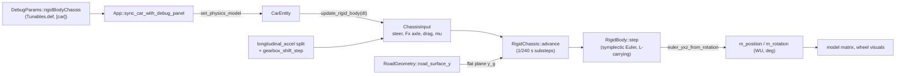

### Behaviour notes

- **Default and release unchanged.** `rigidBodyChassis` defaults to `false`; `set_physics_model` and all rigid-body code compile only under `SWISH_DEBUG_UI`. In the release build `App::car_owns_height` is a `constexpr false`, so the Y snap runs exactly as before.
- **Y snap skipped in rigid mode.** [App.cpp](src/core/App/App.cpp) `update_car` does not snap `pos.y` to the road when the rigid body is active; the chassis owns heave.
- **Switching models** re-seeds the body from the entity pose and the bicycle's speed state; switching back zeroes pitch and roll.
- **Origin rebase / teleport:** the body follows any external shift of `m_position` via `m_rigid_last_pos`.
- **Stub limits** are marked `TODO(stub)`: flat ground plane (no per-wheel road query), no unsprung mass or bump stops, no anti-roll bars or aero downforce, no wheel-spin DOF or Pacejka curve, patch taken straight below the hub, box-approximation inertia, no standstill stick model.

### Tests

| Test | Pins |
|------|------|
| [tests/utils/test_physics_RigidBody.cpp](tests/utils/test_physics_RigidBody.cpp) (6 cases, `[rigidbody]`) | box inertia near 3050 kg m² yaw; free fall matches the semi-implicit solution; accumulators clear and a point force adds its moment; asymmetric torque-free spin conserves $L$; principal-axis spin stays pure; Euler extraction inverts `Ry Rx Rz` |
| [tests/test_rigid_chassis.cpp](tests/test_rigid_chassis.cpp) (5 cases, `[rigidchassis]`) | settles to sag $= mg/4k$; design ride height is the equilibrium; damped energy never increases; $\lVert(F_x,F_y)\rVert \le \mu F_n$; steering yaws a moving chassis |
| [tests/test_debug_params_io.cpp](tests/test_debug_params_io.cpp) (1 case added) | `rigidBodyChassis` persists under `[car]` and defaults to bicycle |

Verification run: `make test` 230/230, `make test-debug` 254/254, 33/33 `.spv`, `-Werror` debug-UI build clean. **Not verified:** no GUI/visual check of the toggle was done (see [tasks/stub-report.md](tasks/stub-report.md)).

### File changes

| File | Change |
|------|--------|
| [src/utils/physics/RigidBody.h](src/utils/physics/RigidBody.h) | New: `RigidBody`, `RigidBodyParams` (box inertia), `euler_yxz_from_rotation` |
| [src/scene/Entity/RigidChassis.h](src/scene/Entity/RigidChassis.h) | New: `PhysicsModel`, `RigidChassisParams`, `make_chassis_params`, `RigidChassis` (contacts + tires) |
| [src/scene/Entity/CarEntity.h](src/scene/Entity/CarEntity.h) | Includes `RigidChassis.h`; `set/get_physics_model`; rigid-body members (debug-gated) |
| [src/scene/Entity/CarEntity.cpp](src/scene/Entity/CarEntity.cpp) | `update()` dispatches to `update_rigid_body`; `init_rigid_body`, `update_rigid_body`, `set_physics_model` |
| [src/core/App/App.cpp](src/core/App/App.cpp) | Skips the road Y snap in rigid mode; maps `dp.rigidBodyChassis` to `set_physics_model` |
| [src/debug/Tunables.def](src/debug/Tunables.def) | New `TUNE_B(rigidBodyChassis, "car", "rigid_body_chassis", false, ...)` |
| [src/debug/DebugUI.cpp](src/debug/DebugUI.cpp) | "Physics" header drawing the `car` tunable group |
| [tests/utils/test_physics_RigidBody.cpp](tests/utils/test_physics_RigidBody.cpp) | New: 6 integrator tests |
| [tests/test_rigid_chassis.cpp](tests/test_rigid_chassis.cpp) | New: 5 chassis tests |
| [tests/test_debug_params_io.cpp](tests/test_debug_params_io.cpp) | Preset round-trip test for the new toggle |
| [tests/CMakeLists.txt](tests/CMakeLists.txt), [tests/utils/CMakeLists.txt](tests/utils/CMakeLists.txt) | Register the new test files |
| [docs/car_system.md](docs/car_system.md) | New "Rigid-body chassis (stub)" section |
| [docs/REPO_MAP.md](docs/REPO_MAP.md), [src/utils/README.md](src/utils/README.md), [docs/GLOSSARY.md](docs/GLOSSARY.md), [docs/debug-ui.md](docs/debug-ui.md) | One-line rows for `physics/`, the toggle and terms |
| [tasks/todo.md](tasks/todo.md), [tasks/stub-report.md](tasks/stub-report.md) | Slice 6 ticked, Review section; new stub report |

**Label:** Largely AI-generated (Claude). Please review.

---

### 2026-10-10 — Driving realism tools (input seam, telemetry/replay, physics bench)

Added a device-agnostic `InputFrame` input seam with a gamepad source, a debug-only telemetry ring with CSV export and input replay, a force-feedback target readout, and a GPU-free physics bench that prints 0-100, 100-0, top-speed and skidpad figures against 992 Turbo S targets.

Technical summary

### Motivation

Driving was keyboard-only (`CarEntity::handle_input` read GLFW keys directly), there was no way to capture or replay a drive, and car-physics realism was judged by eye. Three additive tools close that gap without touching the physics model: (1) an input seam so any device can drive the car, (2) record / CSV / replay for reproducible runs, (3) a bench that measures standard figures of merit on the real `CarEntity::update`. This is a stub track; it is additive to the planned Ch07 `Commands.def` / `InputSampler` work, which will absorb `InputFrame`.

### Approach

| Piece | What it does |
|-------|--------------|
| Input seam | [InputFrame.h](src/utils/input/InputFrame.h): `InputFrame{steer, throttle, brake, steer_mode}` and `IInputSource`. `SteerMode::Rate` (keyboard: only the sign of `steer` matters, ramp at the steer rate, faster return to centre) vs `SteerMode::Target` (analog: `steer * max-lock` is a target angle approached at the steer rate). |
| `CarEntity` entry point | `CarEntity::apply_input_frame(const InputFrame&, float dt)` in [CarEntity.cpp](src/scene/Entity/CarEntity.cpp). `handle_input` now builds a `Rate` frame from the arrow keys (same UP-over-DOWN, LEFT-over-RIGHT precedence) and calls it, so keyboard and every other source share one path. Throttle wins over brake; brake while ~stopped selects reverse. New read-only accessors `get_lateral_velocity`, `get_yaw_rate`, `get_wheel_spin`, `get_corner_suspension` in [CarEntity.h](src/scene/Entity/CarEntity.h). |
| Gamepad mapping | [GamepadMapping.h](src/utils/input/GamepadMapping.h): pure deadzone + expo curve + trigger remap (no GLFW). Feeder: [GlfwGamepadSource.cpp](src/core/Input/GlfwGamepadSource.cpp) (`glfwGetGamepadState`, joystick 0; all-zero `Target` frame when unplugged). Not in the test target. |
| Telemetry | [TelemetryRing.h](src/utils/telemetry/TelemetryRing.h) / [TelemetryRing.cpp](src/utils/telemetry/TelemetryRing.cpp): fixed-capacity ring (default 3600 samples, no allocation after construction), CSV write/read (`%.9g`, exact float round-trip), timestamped path under `build-debug/telemetry/`. |
| Replay | [ReplayDriver.h](src/utils/telemetry/ReplayDriver.h): `IInputSource` over the recorded `InputFrame`s; same inputs + same dt + same build reproduce a run bit-for-bit on a fresh car (test-pinned). |
| Recorder | [TelemetryRecorder.h](src/debug/TelemetryRecorder.h): `sample_from(car, t, input)` is ungated and pure; the `TelemetryRecorder` class is `#ifdef SWISH_DEBUG_UI`. |
| App wiring | [AppDrivingTools.cpp](src/core/App/AppDrivingTools.cpp) (empty without `SWISH_DEBUG_UI`): `step_driving_tools(dt)` returns `false` for keyboard + idle recorder, leaving `handle_input` untouched; otherwise samples gamepad / replay / keyboard frame, runs `apply_input_frame` + `update`, then `on_step`. `sync_driving_tools_panel` handles record/replay edges, CSV export and readouts. Hooked from [App.cpp](src/core/App/App.cpp), members in [App.h](src/core/App/App.h). |
| Debug panel | "Driving tools" header in [DebugUI.cpp](src/debug/DebugUI.cpp) over `drv*` fields in [DebugParams.h](src/debug/DebugParams.h): input source, deadzone/expo, live axis bars, record / replay / export, ring + replay position, FFB readout. Defaults: keyboard, not recording. |
| FFB target | [ForceFeedback.h](src/scene/Entity/ForceFeedback.h): `self_aligning_torque()` plus `IForceFeedbackSink` / `NullForceFeedbackSink`. Computed and displayed only; **no device output**. |
| Bench | [Bench.h](tests/bench/Bench.h): fixed $dt = 1/120$ s loop over the real `CarEntity::update` through `apply_input_frame`; scenarios `zero_to_100`, `braking_100_0`, `top_speed`, `skidpad_40m`. |

### Math

Gamepad stick response: per-axis scaled deadzone with half-width $d$, then an odd expo blend with $e \in [0,1]$:

$$
u(x) = \operatorname{sgn}(x)\,\frac{\max(|x|-d,\,0)}{1-d},
\qquad
y(x) = (1-e)\,u + e\,u^{3}
$$

$u$ is continuous, 0 inside the deadzone and reaches $\pm 1$ at $|x| = 1$; $y$ is monotone with $y(0)=0$, $y(\pm1)=\pm1$. Defaults $d = 0.08$, $e = 0.35$. Triggers (GLFW rest $-1$, pressed $+1$) are remapped $t = (raw+1)/2$, then a one-sided deadzone (0.05).

Front-axle self-aligning torque (bicycle model, right-positive):

$$
M_z = -F_{y,f}\; t_p\; k_{\text{fade}},
\qquad
t_p = t_0\,\max\!\Bigl(0,\;1-\frac{|\alpha_f|}{\alpha_{sat}}\Bigr),
\qquad
\alpha_{sat} = \frac{\mu\, m g\, b/L}{C_{\alpha,f}}
$$

$$
\alpha_f = \frac{v_y + a\,r}{\max(|v_x|,1)} - \operatorname{sgn}(v_x)\,\delta,
\qquad
k_{\text{fade}} = \operatorname{clamp}\!\Bigl(\frac{|v_x|}{3\ \text{m/s}},0,1\Bigr)
$$

Pneumatic trail $t_p$ collapses linearly to 0 at the axle's saturation slip, so the wheel goes light at the limit. Defaults $t_0 = 0.035$ m; the normalized output is $M_z / 6\ \text{N m}$ clamped to $[-1,1]$. $F_{y,f}$ comes from the existing `axle_lateral_forces`, and $\mu$ is the live `effective_mu` (wet-grip lightening follows for free).

### Data flow

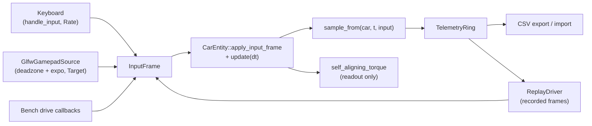

### Bench results

Targets are documented 992 Turbo S figures printed in a table, **not** failing tests. `test_bench.cpp` asserts only that each scenario finishes, is finite, positive, and bitwise-deterministic across two runs.

| Scenario | Measured | Target | Tolerance | Verdict |
|----------|----------|--------|-----------|---------|
| 0-100 km/h | 2.89 s | 2.70 s | 25 % | PASS |
| 100-0 km/h | 36.57 m | 31.5 m | 15 % | OUT |
| Top speed | 329.8 km/h | 330 km/h | 5 % | PASS |
| Skidpad (R = 40 m) | 1.05 g | 1.1 g | 15 % | PASS |

The 100-0 figure is about 16 % long; braking authority is the known gap for a follow-up (no physics change was made here).

### Scope and safety

- **Debug-only tooling.** `AppDrivingTools.cpp`, the recorder class, the panel and the `drv*` fields are gated by `#ifdef SWISH_DEBUG_UI`. With the panel at its defaults the car is driven by `handle_input` exactly as before.
- **Release.** The one ungated production change is routing the keyboard path through `apply_input_frame`; `test_input.cpp` pins it bit-for-bit against the old keyboard behaviour. Release is expected to be byte-identical in output; no shader, `.spv` or golden file was touched, and no golden was regenerated.
- **TODO(stub) items left open:** full FFB model (per-wheel `Fy` with load transfer, mechanical trail/caster, scrub/kingpin, tire relaxation, road texture, damping/friction/inertia) and a real wheel driver behind `IForceFeedbackSink`; replay does not restore start pose, wetness or road bounds, and has no replay-vs-live divergence readout; telemetry has no binary format, decimation, per-wheel slip/load channels, ring plots or crash auto-save; analog trail-braking (throttle + brake together) in `apply_input_frame`; `InputFrame` to be absorbed by Ch07.

### File changes

| File | Change |
|------|--------|
| [src/utils/input/InputFrame.h](src/utils/input/InputFrame.h) | New: `InputFrame`, `SteerMode`, `IInputSource` |
| [src/utils/input/GamepadMapping.h](src/utils/input/GamepadMapping.h) | New: pure deadzone / expo / trigger mapping |
| [src/core/Input/GlfwGamepadSource.h](src/core/Input/GlfwGamepadSource.h), [.cpp](src/core/Input/GlfwGamepadSource.cpp) | New: GLFW gamepad `IInputSource` |
| [src/utils/telemetry/TelemetryRing.h](src/utils/telemetry/TelemetryRing.h), [.cpp](src/utils/telemetry/TelemetryRing.cpp) | New: ring buffer, CSV I/O, timestamped path |
| [src/utils/telemetry/ReplayDriver.h](src/utils/telemetry/ReplayDriver.h) | New: replay `IInputSource` |
| [src/debug/TelemetryRecorder.h](src/debug/TelemetryRecorder.h) | New: `sample_from` + debug-only `TelemetryRecorder` |
| [src/scene/Entity/ForceFeedback.h](src/scene/Entity/ForceFeedback.h) | New: self-aligning torque target, FFB sink interface |
| [src/core/App/AppDrivingTools.cpp](src/core/App/AppDrivingTools.cpp) | New: debug-only step / panel sync (source, record, replay, export, readouts) |
| [src/scene/Entity/CarEntity.h](src/scene/Entity/CarEntity.h), [.cpp](src/scene/Entity/CarEntity.cpp) | `apply_input_frame`; `handle_input` routed through it; new read-only accessors |
| [src/core/App/App.h](src/core/App/App.h), [App.cpp](src/core/App/App.cpp) | Driving-tools members and hook calls (debug-gated) |
| [src/debug/DebugParams.h](src/debug/DebugParams.h) | `drv*` fields |
| [src/debug/DebugUI.cpp](src/debug/DebugUI.cpp) | "Driving tools" panel |
| [tests/bench/Bench.h](tests/bench/Bench.h) | New: bench harness and reference table |
| [tests/test_input.cpp](tests/test_input.cpp) | New: mapping, keyboard bit-equality, analog steer, FFB tests |
| [tests/test_telemetry.cpp](tests/test_telemetry.cpp) | New: ring, CSV round-trip, replay determinism, recorder tests |
| [tests/test_bench.cpp](tests/test_bench.cpp) | New: `[bench]` finish / finite / deterministic test |
| [tests/CMakeLists.txt](tests/CMakeLists.txt) | Register the three test files and `TelemetryRing.cpp` |
| [docs/car_system.md](docs/car_system.md) | New "Driving tools" section |
| [docs/changelog/2026-10.md](docs/changelog/2026-10.md), [CHANGELOG.md](CHANGELOG.md) | This entry and the refreshed index |
| [tasks/todo.md](tasks/todo.md) | Ticked S1-S5 |

**Label:** Largely AI-generated (Claude). Please review.

---

### 2026-10-10 — Car rain interactions stub: per-wheel spray, wet-lens model, slip visual hooks (debug-only)

Added a debug-only stub track for car/rain interaction: a pure per-wheel spray emitter model feeding `SpraySystem::set_emitters`, a CPU lamp-lens wetness model, and Phase C slip/skid/spray-boost hooks on `CarEntity`, all behind `SWISH_DEBUG_UI` and off by default.

Technical summary

### Motivation

The wheel plan's Phase C and the rain system both needed the *interfaces* for car-rain coupling before the full
physics/visuals land: spray came from one fixed origin behind the rear axle, lamp lenses had no wet state, and the car
exposed no slip/lockup signal. This track ships real interfaces, a minimal honest implementation of each, GPU-free
Catch2 tests, and debug-panel readouts. Every estimate that is a placeholder carries a `TODO(stub)` naming what the
full version needs. Release output is unchanged: no release shader was edited and no new behaviour is reachable
without `SWISH_DEBUG_UI`.

### Approach

| Slice | Model | Where |
|-------|-------|-------|
| Per-wheel spray | Pure fn: up to four `SprayEmitter`s from wheel state, road wetness, standing water, slip multiplier | [WheelSpray.h](src/renderer/SpraySystem/WheelSpray.h) |
| Spray consumer | `set_emitters` (debug-only): round-robin one wheel per frame; `count == 0` = legacy single rear-axle origin | [SpraySystem.cpp](src/renderer/SpraySystem/SpraySystem.cpp) |
| Lens wetness | CPU ODE per lens, keyed by glTF node name; std140-ready 16-byte POD | [LensWetness.h](src/renderer/WindshieldRainPass/LensWetness.h) |
| Slip visuals | Per-wheel `{slipRatio, slipAngle, sprayBoost, skid}` + aggregate, read-only from car state | [SlipVisuals.h](src/scene/Entity/SlipVisuals.h), [CarEntity.h](src/scene/Entity/CarEntity.h) |
| Debug wiring | Params, TOML tables, Telemetry rows, per-frame glue | [DebugParams.h](src/debug/DebugParams.h), [DebugParamsIO.cpp](src/debug/DebugParamsIO.cpp), [DebugUI.cpp](src/debug/DebugUI.cpp), [App.cpp](src/core/App/App.cpp) |

**Per-wheel spray rate.** With $w$ = road wetness, $s$ = standing water, $g$ = speed gate, $m$ = slip multiplier
(clamped to $[0, 4]$) and $k$ = `standingBase` = 0.5:

$$g = \mathrm{clamp}\!\left(\frac{|v| - v_{min}}{v_{ref} - v_{min}},\,0,\,1\right),\qquad
\text{rate} = \mathrm{clamp}\big(g \cdot w \cdot (k + (1-k)\,s) \cdot m,\ 0,\ 1\big)$$

with $v_{min} = 0.5$ m and $v_{ref} = 20$ m (in WU/s). The rate is exactly 0 when dry ($w = 0$) or stationary
($|v| \le v_{min}$), and non-decreasing in $w$, $s$, speed and $m$. The cone half angle widens linearly with standing
water, 0.35 rad (dry) to 0.60 rad (flooded). Only emitters with rate > 0 are returned, compacted to the front.

**Lens wetness.** Per lens, coverage $c \in [0,1]$ obeys

$$c' = \text{rain}\cdot k_{wet}\,(1-c) \;-\; \big(a\,k_{clear} + k_{drain}\big)\,c,\qquad
a = \mathrm{smoothstep}(v_{start}, v_{full}, v)$$

where $v$ is car speed in m/s. The steady state is

$$c^{*} = \frac{\text{rain}\cdot k_{wet}}{\text{rain}\cdot k_{wet} + a\,k_{clear} + k_{drain}}$$

With the defaults ($k_{wet}=0.35$, $k_{clear}=3$, $k_{drain}=0.02$, $v_{start}=8$, $v_{full}=25$ m/s): parked in rain 1.0
gives $c^* \approx 0.946$; at full airflow in rain 1.0, $c^* = 0.35/3.37 \approx 0.104$; with rain 0, $c^* = 0$ and a
wet lens drains exponentially (coverage snaps to exactly 0 below $10^{-4}$). Derived outputs:
$\text{dropSize} = d_{min} + (d_{max}-d_{min})\,c$ (0 when dry) and $\text{streak} = c \cdot a$.

**Slip visuals.** Slip angles reuse the bicycle-model axle formula (both wheels of an axle share it). Slip ratio is a
force-utilisation proxy, $\kappa \approx 0.25\cdot\mathrm{clamp}(F_x / (\mu F_z), -1, 1)$, not real wheel speed. Spray boost
ramps by smoothstep from 1 to 3, skid triggers at $|\kappa| > 0.20$ or $|\alpha| > 8^\circ$, and everything is
identity (boost exactly 1.0, no skid) below 2 m/s or under the ramp start. The result is read-only and never fed back
into the physics step.

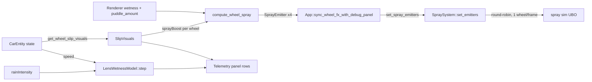

### Debug wiring

- `DebugParams::perWheelSpray` (default `false`): on = App builds four emitters from `CarEntity::get_wheel_contact_world`,
  each evaluated on its own puddle sample, and hands them to the renderer; off = emitters are cleared once on the
  on-to-off edge and the legacy single rear-axle origin is back. SpraySystem is never touched while it is off.
- Lens wetness params (`lensWetRate`, `lensClearSpeedStart`, `lensClearSpeedFull`, `lensClearRate`, `lensDrainRate`)
  default to `LensWetnessParams{}`; slip thresholds (`slip*`) default to `SlipVisualParams{}`. Persisted in the TOML
  tables `[wheel_spray]`, `[lens_wet]` and `[slip]`.
- Telemetry panel rows: per-wheel slip ratio / angle / spray boost / skid (FL, FR, BL, BR) and per-lens
  coverage / drop size / streak for `Headlight_L_Lens`, `Headlight_R_Lens`, `TailLight_L_Lens`, `TailLight_R_Lens`.

### Verification

| Check | Result |
|-------|--------|
| `make test` (release) | 233/233 pass |
| `make test-debug` | 256/256 pass |
| Release `.spv` hashes | 33/33 unchanged; no release shader edited |
| Goldens | untouched (none regenerated) |
| Visual screenshots at rain 0 and 1.0 | **not done** |

New tests: [test_wheel_spray.cpp](tests/test_wheel_spray.cpp) (zero when dry or stationary, monotonic in wetness /
standing water / speed / slip, compaction and bound), [test_lens_wetness.cpp](tests/test_lens_wetness.cpp) (dry, monotonic
in rain, cleared at speed, drains when parked, lens independence, GPU POD layout),
[test_slip_visuals.cpp](tests/test_slip_visuals.cpp) (identity at rest and in rolling, thresholds, monotonic bounded
boost, sign symmetry, fresh `CarEntity` is identity).

### Not done (stub limits)

- Lens wetness is a **CPU model only**: nothing uploads `LensWetnessGpu` to the lighting/emissive path yet.
- No visual verification at rain 0 / 1.0 (project law for visual features); the per-wheel spray look is unjudged.
- Spray still uses the existing sim: cone and size scale are only mapped to lateral spread, and one wheel spawns per
  frame. A real per-emitter cone needs a `spray_sim.comp` change, which moves the release `.spv` hashes.
- Slip ratio is a force proxy and slip angle is per-axle; there is no wheel-speed state yet.
- Full-version TODOs are listed in [docs/rain/README.md](docs/rain/README.md) and [docs/wheels/README.md](docs/wheels/README.md).

### File changes

| File | Change |
|------|--------|
| [src/renderer/SpraySystem/WheelSpray.h](src/renderer/SpraySystem/WheelSpray.h) | New: `SprayEmitter`, `WheelSprayParams`, `wheel_spray_rate`, `compute_wheel_spray` (pure, GPU-free) |
| [src/renderer/SpraySystem/SpraySystem.h](src/renderer/SpraySystem/SpraySystem.h) | Includes `WheelSpray.h`; debug-only `set_emitters` and emitter state |
| [src/renderer/SpraySystem/SpraySystem.cpp](src/renderer/SpraySystem/SpraySystem.cpp) | `update` uses round-robin per-wheel emitters when set (debug-only); `set_emitters` clamps to 4 |
| [src/renderer/Renderer/Renderer.h](src/renderer/Renderer/Renderer.h) | Forward-declares `SprayEmitter`; debug-only `set_spray_emitters` |
| [src/renderer/Renderer/Renderer_State.cpp](src/renderer/Renderer/Renderer_State.cpp) | `set_spray_emitters` forwards to `SpraySystem::set_emitters` |
| [src/renderer/WindshieldRainPass/LensWetness.h](src/renderer/WindshieldRainPass/LensWetness.h) | New: `LensWetnessModel`, `LensWetnessParams/State`, 16-byte `LensWetnessGpu` |
| [src/scene/Entity/SlipVisuals.h](src/scene/Entity/SlipVisuals.h) | New: per-wheel slip / skid / spray-boost model and `compute_slip_visuals` |
| [src/scene/Entity/CarEntity.h](src/scene/Entity/CarEntity.h) | Includes `SlipVisuals.h`; `get_wheel_slip_visuals` (const, read-only) |
| [src/debug/DebugParams.h](src/debug/DebugParams.h) | `perWheelSpray`, `lens*` and `slip*` tunables, `telemetryWheel` / `telemetryLens` readouts |
| [src/debug/DebugParamsIO.cpp](src/debug/DebugParamsIO.cpp) | TOML save/load for `[wheel_spray]`, `[lens_wet]`, `[slip]` |
| [src/debug/DebugUI.cpp](src/debug/DebugUI.cpp) | Per-wheel spray checkbox, lens sliders, slip and lens Telemetry rows |
| [src/core/App/App.h](src/core/App/App.h) | `LensWetnessModel` member, spray-active flag, `sync_wheel_fx_with_debug_panel` |
| [src/core/App/App.cpp](src/core/App/App.cpp) | `sync_wheel_fx_with_debug_panel`: slip telemetry, per-wheel emitters, lens step |
| [tests/CMakeLists.txt](tests/CMakeLists.txt) | Registers the three new test files |
| [tests/test_wheel_spray.cpp](tests/test_wheel_spray.cpp) | New: 4 test cases |
| [tests/test_lens_wetness.cpp](tests/test_lens_wetness.cpp) | New: 5 test cases |
| [tests/test_slip_visuals.cpp](tests/test_slip_visuals.cpp) | New: 5 test cases |
| [tasks/todo.md](tasks/todo.md) | "Stub: car rain interactions" checklist ticked |
| [docs/rain/README.md](docs/rain/README.md) | New section: per-wheel spray, lens wetness, stub status |
| [docs/wheels/README.md](docs/wheels/README.md) | Phase C slip visual hooks note |
| [docs/changelog/2026-10.md](docs/changelog/2026-10.md) | This entry |

**Label:** Largely AI-generated (Claude). Please review.

---

### 2026-10-10 — Stub Vulkan render tools: GPU profiler, frame capture, shader hot-reload, pass declarations

Added four debug-only (`SWISH_DEBUG_UI`) render tools as working stubs: a per-pass GPU timestamp profiler, an F12 frame capture to PPM/PFM, an mtime-polling shader hot-reload with a Composite rebuild hook, and per-pass image read/write declarations with a read-before-write validator, all surfaced in a new "Render tools" debug panel.

Technical summary

### Motivation

There was no way to see where GPU time goes per pass, to save what the renderer actually produced, to iterate on a shader without restarting, or to check that the pass list is ordered consistently with the images each pass uses. Track `render-tools` ([tasks/todo.md](tasks/todo.md), S1-S8) builds the smallest real version of each, so the full versions have a concrete seam to grow from. Everything is gated by `SWISH_DEBUG_UI`; release output is intended to be unchanged (see Verification).

### Approach

| Tool | Where | What it does |
|------|-------|--------------|
| GPU profiler | [GpuProfiler.h](src/renderer/GpuProfiler/GpuProfiler.h), [GpuProfiler.cpp](src/renderer/GpuProfiler/GpuProfiler.cpp), [TimestampMath.h](src/renderer/GpuProfiler/TimestampMath.h) | One `VkQueryPool` of `MAX_FRAMES_IN_FLIGHT * (N + 1)` timestamps. It observes `PassRegistry::record_all` through `IPassObserver` and writes **boundary** timestamps: boundary $i$ before pass $i$, boundary $N$ after the last, so pass $i$ costs $t_{i+1}-t_i$ and the total is the exact sum. Uses `vkCmdWriteTimestamp2` (ALL_COMMANDS) with synchronization2, else `vkCmdWriteTimestamp` (BOTTOM_OF_PIPE). Degrades to `supported == false` when `timestampValidBits == 0` |
| Frame capture | [FrameCapture.h](src/renderer/FrameCapture/FrameCapture.h), [FrameCapture.cpp](src/renderer/FrameCapture/FrameCapture.cpp), [CapturePath.h](src/renderer/FrameCapture/CapturePath.h) | After `record_all`, copies the swapchain image (PRESENT_SRC to TRANSFER_SRC and back) and optionally `Img::Hdr` into host-visible VMA staging buffers. Two frames later, after that slot's fence wait, writes `swish_YYYYMMDD_HHMMSS_mmm[_n].ppm` (and a `.pfm` for the HDR request) to `build-debug/captures/` (override `SWISH_CAPTURE_DIR`). The swapchain gets `TRANSFER_SRC` usage in debug builds only |
| Shader hot-reload | [ShaderHotReload.h](src/renderer/ShaderHotReload/ShaderHotReload.h), [ShaderHotReload.cpp](src/renderer/ShaderHotReload/ShaderHotReload.cpp), [PipelineRebuild.h](src/renderer/PipelineRebuild/PipelineRebuild.h), [PipelineRebuild.cpp](src/renderer/PipelineRebuild/PipelineRebuild.cpp), [PassRebuild.h](src/renderer/Passes/PassRebuild.h) | `poll()` once per frame (rate limit 0.5 s) scans `shaders/` mtimes, recompiles changed `.vert/.frag/.comp` with the CMake glslc command line into the build dir, then runs the `PipelineRebuild` hooks registered for the shader stem. A change under `shaders/common/*.glsl` recompiles every shader and runs all hooks. Compile errors are kept in `status()` and the old `.spv` stays in use. Only `composite` has a hook ([PostProcessManager::rebuild_composite_pipeline](src/renderer/PostProcessManager/PostProcessManager_Pipelines.cpp)) |
| Pass declarations | [PassDeclaration.h](src/renderer/Passes/PassDeclaration.h), [PassDeclarationValidator.h](src/renderer/Passes/PassDeclarationValidator.h), [PassDeclarationValidator.cpp](src/renderer/Passes/PassDeclarationValidator.cpp), [IRenderPass.h](src/renderer/Passes/IRenderPass.h) | `IRenderPass::declare(PassDeclaration&)` (default: nothing) lists the `Img`s a pass reads and writes. `validate_pass_declarations` walks them in `PassList.def` order and warns once per (pass, image) on a read with no earlier write; `Ao`, `AoBlur`, `Lum` are allowlisted (primed or history). Documentation that is checked: it never drives barriers or order |
| UI | [DebugUI.h](src/debug/DebugUI.h), [DebugUI.cpp](src/debug/DebugUI.cpp) | "Render tools" collapsing header fed by a `RenderToolsView` of borrowed read-only pointers plus two callbacks (`requestCapture`, `setHotReloadEnabled`); set from `Renderer::init` |

### Timestamp arithmetic

With $b$ = `timestampValidBits` and $p$ = `timestampPeriod` (nanoseconds per tick):

$$m = \begin{cases} 0 & b = 0 \\ 2^{64}-1 & b \ge 64 \\ 2^{b}-1 & \text{otherwise} \end{cases}
\qquad
\Delta = \big((t_{\text{end}} \,\&\, m) - (t_{\text{begin}} \,\&\, m)\big) \,\&\, m$$

$$\text{ms} = \Delta \cdot p_{\text{ns}} \cdot 10^{-6}$$

The subtraction is taken modulo $2^{b}$ so a counter that wrapped between two boundaries still gives the true span; bits above $b$ are ignored. Deltas are exact in `u64`; the multiply is done in `double` and narrowed to `float`. Displayed values use $\bar{x} \leftarrow$ `exp_smooth`$(\bar{x}, x, k{=}4\,\text{s}^{-1}, dt)$, seeded by the first sample.

### Read-back ring (N-2)

Slot $s = \text{frame} \bmod 2$ owns $N+1$ queries. `drawFrame` waits that slot's fence first, so the slot's previous frame (latency = ring size = 2 frames) is finished and can be read with no wait flag before the slot is reset and re-recorded. `VK_NOT_READY` skips the read and keeps the slot pending.

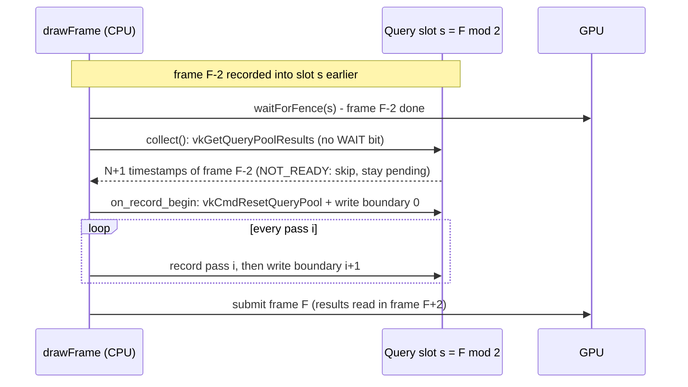

### Wiring

[Renderer.cpp](src/renderer/Renderer/Renderer.cpp) `init` collects and validates the declarations (warnings to stderr and the panel), registers the `composite` hook, inits the profiler and sets it as the registry observer, inits capture and builds the `RenderToolsView`; `cleanup` clears the observer and frees the pool/buffers before the allocator goes. [Renderer_Frame.cpp](src/renderer/Renderer/Renderer_Frame.cpp) calls `m_shaderReload.poll()`, `m_gpuProfiler.collect()` and `m_frameCapture.collect()` right after the fence wait; [Renderer_Record.cpp](src/renderer/Renderer/Renderer_Record.cpp) calls `m_frameCapture.record()` after `record_all`. [AppInput.cpp](src/core/App/AppInput.cpp) binds F12 (`on_capture_frame`, Shift adds the HDR `.pfm`).

### Verification

- Release: 261/261 tests passing. Debug: 284/284 passing. 42 new `TEST_CASE`s, all GPU-free, in `swish_utils_tests` (tags `[gpuprof]`, `[capture]`, `[renderer][hotreload]`, `[renderer][declare]`).
- Release `.spv` hashes: 33/33 identical to [tests/golden/release_spv.sha256](tests/golden/release_spv.sha256) (manual comparison).
- `make check` passes; the clang-format findings are the existing report-only ones.
- **Not verified:** no run on a GPU. The profiler panel, capture output files and live hot-reload were not run or viewed in a window; only builds and unit tests back them.

### Stubbed versus real

| Tool | Real in this change | Stubbed (`TODO(stub)` in the headers) |
|------|--------------------|----------------------------------------|
| Profiler | pool, boundary writes, N-2 read-back, masking, smoothing, UI table | nested sub-workload labels, GPU-vs-CPU bottleneck flag, rolling min/max/p95 history, pipeline-statistics queries, check of the MoltenVK counter against a CPU clock |
| Capture | LDR + HDR copy, name scheme, sRGB encode, `.ppm` / `.pfm` | PNG output (needs a deflate encoder; `include/` has only the stb reader), worker-thread write, burst/timed capture, capture before the overlay, other images by `Img`, frozen-camera re-capture |
| Hot-reload | mtime poll, glslc recompile, error status, Composite rebuild | dependency tracking via glslc depfiles (a `common/*.glsl` edit recompiles everything), worker-thread compile (`poll()` blocks), added/deleted file watching, hooks for every pass other than Composite (they log `TODO(stub)` and need a restart) |
| Declarations | per-pass `declare`, read-before-write validator, panel list | per-subresource / layout-aware and history reads, write-after-write and dead-write warnings, a `PassRegistry` iteration accessor (the validator builds throwaway pass objects in [PassList.cpp](src/renderer/Passes/PassList.cpp)) |

### File changes

| File | Change |
|------|--------|
| [src/renderer/GpuProfiler/GpuProfiler.h](src/renderer/GpuProfiler/GpuProfiler.h), [GpuProfiler.cpp](src/renderer/GpuProfiler/GpuProfiler.cpp) | New: timestamp query pool, `IPassObserver` implementation, `GpuProfileSnapshot` |
| [src/renderer/GpuProfiler/TimestampMath.h](src/renderer/GpuProfiler/TimestampMath.h) | New: Vulkan-free mask, wrap, ticks to ms, slot indexing, smoothing |
| [src/renderer/FrameCapture/FrameCapture.h](src/renderer/FrameCapture/FrameCapture.h), [FrameCapture.cpp](src/renderer/FrameCapture/FrameCapture.cpp) | New: capture state machine, staging copies, file write |
| [src/renderer/FrameCapture/CapturePath.h](src/renderer/FrameCapture/CapturePath.h) | New: file naming, PPM/PFM encoders, half to float, sRGB |
| [src/renderer/ShaderHotReload/ShaderHotReload.h](src/renderer/ShaderHotReload/ShaderHotReload.h), [ShaderHotReload.cpp](src/renderer/ShaderHotReload/ShaderHotReload.cpp) | New: mtime tracker, glslc command, poller (empty TU in release) |
| [src/renderer/PipelineRebuild/PipelineRebuild.h](src/renderer/PipelineRebuild/PipelineRebuild.h), [PipelineRebuild.cpp](src/renderer/PipelineRebuild/PipelineRebuild.cpp) | New: stem-keyed rebuild hook registry |
| [src/renderer/Passes/PassDeclaration.h](src/renderer/Passes/PassDeclaration.h) | New: `PassDeclaration` reads/writes |
| [src/renderer/Passes/PassDeclarationValidator.h](src/renderer/Passes/PassDeclarationValidator.h), [PassDeclarationValidator.cpp](src/renderer/Passes/PassDeclarationValidator.cpp) | New: `img_name`, allowlist, `validate_pass_declarations`, `collect_pass_declarations` |
| [src/renderer/Passes/PassRebuild.h](src/renderer/Passes/PassRebuild.h) | New: `rebuild_composite_pass` entry point |
| [src/renderer/Passes/IRenderPass.h](src/renderer/Passes/IRenderPass.h) | `virtual declare(PassDeclaration&) const`, default empty |
| [src/renderer/Passes/PassRegistry.h](src/renderer/Passes/PassRegistry.h), [PassRegistry.cpp](src/renderer/Passes/PassRegistry.cpp) | Debug-only `IPassObserver` and `set_observer`; `record_all` notifies it around each pass |
| [src/renderer/Passes/PassList.cpp](src/renderer/Passes/PassList.cpp) | `collect_pass_declarations` over the `PassList.def` expansion |
| [src/renderer/Passes/LightingPass.cpp](src/renderer/Passes/LightingPass.cpp), [SsaoPasses.cpp](src/renderer/Passes/SsaoPasses.cpp), [SsrPass.cpp](src/renderer/Passes/SsrPass.cpp), [GodRaysPass.cpp](src/renderer/Passes/GodRaysPass.cpp), [HdrFinalizePass.cpp](src/renderer/Passes/HdrFinalizePass.cpp), [BloomPasses.cpp](src/renderer/Passes/BloomPasses.cpp) | `declare()` overrides |
| [src/renderer/Passes/CompositePass.cpp](src/renderer/Passes/CompositePass.cpp) | `declare()`; `rebuild_composite_pass` (debug) |
| [src/renderer/GeometryProducer/GeometryProducer.h](src/renderer/GeometryProducer/GeometryProducer.h), [DofPass.h](src/renderer/DofPass/DofPass.h), [GlassPass.h](src/renderer/GlassPass/GlassPass.h), [RainSystem.h](src/renderer/RainSystem/RainSystem.h), [SpraySystem.cpp](src/renderer/SpraySystem/SpraySystem.cpp), [TaaPass.h](src/renderer/TaaPass/TaaPass.h), [VelocityPass.h](src/renderer/VelocityPass/VelocityPass.h), [WindshieldRainPass.h](src/renderer/WindshieldRainPass/WindshieldRainPass.h) | `declare()` overrides |
| [src/renderer/PostProcessManager/PostProcessManager.h](src/renderer/PostProcessManager/PostProcessManager.h), [PostProcessManager_Pipelines.cpp](src/renderer/PostProcessManager/PostProcessManager_Pipelines.cpp) | Debug-only `rebuild_composite_pipeline` (build new, `vkDeviceWaitIdle`, swap) |
| [src/renderer/Swapchain/Swapchain.h](src/renderer/Swapchain/Swapchain.h), [Swapchain.cpp](src/renderer/Swapchain/Swapchain.cpp) | Debug-only `TRANSFER_SRC` usage, `getImages()` and `supportsTransferSrc()` accessors |
| [src/renderer/Renderer/Renderer.h](src/renderer/Renderer/Renderer.h), [Renderer.cpp](src/renderer/Renderer/Renderer.cpp), [Renderer_Frame.cpp](src/renderer/Renderer/Renderer_Frame.cpp), [Renderer_Record.cpp](src/renderer/Renderer/Renderer_Record.cpp) | Members, init/cleanup wiring, per-frame poll/collect, capture record, accessors |
| [src/core/App/App.h](src/core/App/App.h), [src/core/App/AppInput.cpp](src/core/App/AppInput.cpp) | F12 binding and `on_capture_frame` (Shift = HDR) |
| [src/debug/DebugUI.h](src/debug/DebugUI.h), [src/debug/DebugUI.cpp](src/debug/DebugUI.cpp) | `RenderToolsView`, `set_render_tools`, "Render tools" panel |
| [CMakeLists.txt](CMakeLists.txt) | Debug target defines `SWISH_SHADER_SRC_DIR` and `SWISH_GLSLC_PATH` |
| [tests/utils/CMakeLists.txt](tests/utils/CMakeLists.txt) | Adds the four test files and the validator / hot-reload sources (hot-reload TU compiled with `SWISH_DEBUG_UI`) |
| [tests/utils/test_renderer_TimestampMath.cpp](tests/utils/test_renderer_TimestampMath.cpp), [test_renderer_CapturePath.cpp](tests/utils/test_renderer_CapturePath.cpp), [test_renderer_ShaderHotReload.cpp](tests/utils/test_renderer_ShaderHotReload.cpp), [test_renderer_PassDeclaration.cpp](tests/utils/test_renderer_PassDeclaration.cpp) | New: 11 + 11 + 11 + 9 test cases |
| [docs/render-pipeline.md](docs/render-pipeline.md), [src/renderer/README.md](src/renderer/README.md) | "Debug render tools" section and subsystem rows |
| [tasks/todo.md](tasks/todo.md), [tasks/stub-report.md](tasks/stub-report.md) | Checklist ticks; new stub report |

**Label:** Largely AI-generated (Claude). Please review.

---

### 2026-10-10 — Pass resource declarations and shader hot-reload stub

Added optional `IRenderPass::declare` image read/write declarations with a debug-time read-before-write validator, and a debug-only shader hot-reload poller that recompiles changed GLSL and rebuilds the Composite pipeline.

Technical summary

**Motivation.** Pass order is an implicit contract (a pass reading an image no earlier pass wrote is a silent bug), and every shader tweak needed an app restart.

**S4 declarations.** `PassDeclaration` lists the `Img` names a pass reads and writes. `IRenderPass::declare` is non-pure and defaults to nothing, so it never changes recording. `validate_pass_declarations` walks the list in order and warns once per (pass, image) on read-before-write; a pass's own writes do not satisfy its own reads. Allowlist (primed outside the list): `Ao`, `AoBlur` (primed white, release has no SSAO), `Lum` (history). `collect_pass_declarations` expands `PassList.def` through the factories on throwaway instances (no `PassRegistry` accessor was added); `Renderer::init` calls it once after `init_all` in debug builds and logs `[PassDeclaration] WARNING`.

**S5 hot-reload.** `ShaderHotReload::poll()` (rate limited, 0.5 s) scans `shaders/` mtimes, runs `glslc <defines> -I shaders/common -I shaders <src> -o <build>/shaders/<file>.spv` (the CMake rule minus the depfile), then triggers `PipelineRebuild` hooks keyed by shader stem. A change under `shaders/common/*.glsl` recompiles every shader and triggers all hooks. Compile errors are logged and kept in `status()`; the old `.spv` stays in use. The Composite hook calls `PostProcessManager::rebuild_composite_pipeline()` (new pipeline built first, then `vkDeviceWaitIdle`, swap).

$$t_{\text{next}} = t + \Delta_{\text{poll}},\quad \Delta_{\text{poll}} = 0.5\,\text{s}$$

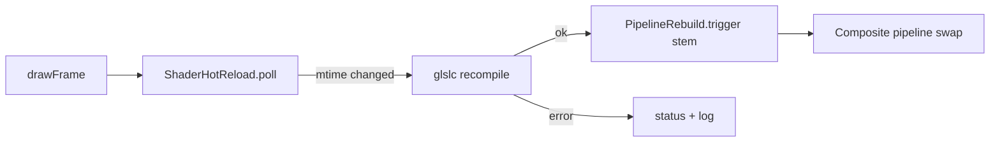

Release output is unchanged: `ShaderHotReload.cpp` is an empty TU without `SWISH_DEBUG_UI`, the Renderer wiring is `#ifdef`-gated, release `.spv` hashes 33/33.

### Files

| File | Change |
|------|--------|
| [src/renderer/Passes/PassDeclaration.h](src/renderer/Passes/PassDeclaration.h) | new: reads/writes builder |
| [src/renderer/Passes/PassDeclarationValidator.h](src/renderer/Passes/PassDeclarationValidator.h), [.cpp](src/renderer/Passes/PassDeclarationValidator.cpp) | new: validator, allowlist, `img_name` |
| [src/renderer/Passes/PassList.cpp](src/renderer/Passes/PassList.cpp) | `collect_pass_declarations` (same `.def` expansion) |
| [src/renderer/Passes/IRenderPass.h](src/renderer/Passes/IRenderPass.h) | `declare()` virtual, include |
| Lighting, Ssr, GodRays, Composite, Ssao/AoBlur, Bloom x3, HdrFinalize passes; Geometry, Windshield, Glass, Dof, Velocity, Rain, Taa, SprayDraw | `declare()` overrides derived from each pass's code |
| [src/renderer/PipelineRebuild/PipelineRebuild.h](src/renderer/PipelineRebuild/PipelineRebuild.h), [.cpp](src/renderer/PipelineRebuild/PipelineRebuild.cpp) | new: stem-keyed `std::function` registry |
| [src/renderer/ShaderHotReload/ShaderHotReload.h](src/renderer/ShaderHotReload/ShaderHotReload.h), [.cpp](src/renderer/ShaderHotReload/ShaderHotReload.cpp) | new: poller, glslc command, status accessors (debug only) |
| [src/renderer/Passes/PassRebuild.h](src/renderer/Passes/PassRebuild.h), [CompositePass.cpp](src/renderer/Passes/CompositePass.cpp) | debug `rebuild_composite_pass` |
| [PostProcessManager.h](src/renderer/PostProcessManager/PostProcessManager.h), [_Pipelines.cpp](src/renderer/PostProcessManager/PostProcessManager_Pipelines.cpp) | `makeFullscreenPipeline` lambda became a private member; debug `rebuild_composite_pipeline` |
| [Renderer.h](src/renderer/Renderer/Renderer.h), [Renderer.cpp](src/renderer/Renderer/Renderer.cpp), [Renderer_Frame.cpp](src/renderer/Renderer/Renderer_Frame.cpp) | debug-gated: validator after init, Composite hook, per-frame poll, status accessors |
| [CMakeLists.txt](CMakeLists.txt) | debug defines `SWISH_SHADER_SRC_DIR`, `SWISH_GLSLC_PATH` |
| [tests/utils/CMakeLists.txt](tests/utils/CMakeLists.txt), `tests/utils/test_renderer_PassDeclaration.cpp`, `tests/utils/test_renderer_ShaderHotReload.cpp` | 20 new GPU-free tests |

---

### 2026-10-03 — Hellcat car profile: `load_car` now loads and renders `assets/Charger/hellcat_car.glb`

Added a third `load_car` profile for the car-only Blender export of the Dodge Charger Hellcat: wheels/steering/glass recovered by node name, base-colour factors and generated tangents applied, and the car material slots raised from 20 to 32.

Technical summary

**Motivation.** The Hellcat GLB has none of the Porsche (`RootNode`) or rig (`Chassis` + `hub_xx`) node names, so it fell into the Porsche path. It also has 32 materials (all unique: the body panels differ by baked per-part normal maps), no TANGENT attribute, untextured materials that carry their colour only in `baseColorFactor`, and glass exported as BLEND (Blender-side fix: a Principled `HELCAT_MAT_TintGlass_EXPORT`, alpha 0.35).

**Approach** ([ModelManager.cpp](src/scene/ModelManager/ModelManager.cpp)):
- Profile detection: `HELCAT_SUSP_FL/FR/RL/RR` + `steering_wheel` + `HELCAT_ASM_SteeringSpin`, only when the `Chassis` rig is absent. Porsche and rig paths are untouched.
- Wheels: `HELCAT_SUSP_xx` (origin = hub centre) is the hub; `wheel_`/`tire_` spin, `brake_` is steer-only. Side comes from the sign of $z$, never from the inconsistent `_L/_R` suffixes.
- Glass: six panes tagged by node name; tint from the material's `baseColorFactor` (alpha 0.35).
- Steering: the spin axis is the `SteeringSpin` node's local $+Y$ in glTF space (Blender local $Z$ after the exporter's Y-up swap). The pivot frame is built as $Z=\hat a$, $X=\hat y\times\hat a$, $Y=\hat a\times X$.
- Base colour: untextured albedo is white and `Submesh::color` carries `baseColorFactor` (gbuffer computes `albedo = tex * color`).
- Tangents: UV-derivative tangents $T=\frac{e_1\,\Delta v_2-e_2\,\Delta v_1}{\Delta u_1\Delta v_2-\Delta u_2\Delta v_1}$, Gram-Schmidt against the normal, handedness so that $(n\times t)\,w$ points toward decreasing $v$ (glTF green = up); $w$ flips under mirrored node transforms. Hellcat only.
- Material slots: `MAT_CAR_20..31` added (`MAT_CAR_LAST`) in [SceneTypes.h](src/scene/SceneTypes.h), [MaterialDescriptors.cpp](src/renderer/MaterialDescriptors/MaterialDescriptors.cpp), [DebugUI.cpp](src/debug/DebugUI.cpp). The Porsche has exactly 20 materials so its output is unchanged; `MAT_COUNT` grows 36 → 48 (12 more descriptor sets).

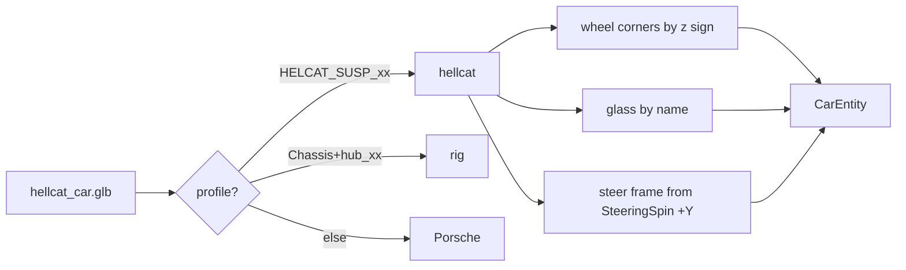

| File | Change |
|---|---|
| [src/scene/ModelManager/ModelManager.cpp](src/scene/ModelManager/ModelManager.cpp) | Hellcat profile, `generate_tangents`, `gltf_read_indices`, `classify_wheel_nodes(hub_prefix)`, 32-slot cap |
| [src/scene/SceneTypes.h](src/scene/SceneTypes.h) | `MAT_CAR_20..31`, `MAT_CAR_LAST`; clearcoat/flake range checks use it |
| [src/renderer/MaterialDescriptors/MaterialDescriptors.cpp](src/renderer/MaterialDescriptors/MaterialDescriptors.cpp) | names for the 12 new slots |
| [src/debug/DebugUI.cpp](src/debug/DebugUI.cpp) | car-slot range uses `MAT_CAR_LAST` |

**Verified.** `make build` clean; 226/227 tests pass (the one failure, the Gearbox validator test, is the in-progress Chapter 01 work and untouched here); golden tests unchanged. `SWISH_CAR=Charger/hellcat_car.glb`: four wheels recovered (radius 0.361 m), six glass primitives, steering pivot (0.221, 0.840, -0.360); cockpit, chase, hood and side cameras viewed.

**Not yet verified / open.** Wheel spin and steering direction under driving input; body reads near-white (silver factor, no metallic/paint model); hood/trunk/doors/wipers/headlight lights are static (Phase B).

---

### 2026-10-01 — Quick fixes before the typed-C++ refactor: input/edit-mode, weather, resize, GLFW teardown

Fixed nine bugs found by the refactor audit: cursor capture and debug edit mode drifting apart, rain leaving the weather preset stale, the resize flag cleared before the renderer read it, the fog/haze sliders labelled km while showing metres, a duplicated shadow line in the debug dump, a double `glfwTerminate`, `EnumCycle` accepting `Count == 0`, and dead Treadmill code and comments.

Technical summary

### Motivation

Phase P0.1 of the typed-C++ system refactor ([tasks/todo.md](tasks/todo.md)). Three read-only audits found these
while mapping the implicit state machines. The owner chose to have them fixed directly, before the refactor, as a
behaviour-change phase on its own branch (`refactor/00-quick-fixes`), so later refactor phases stay behaviour-preserving.

### Fixes

| Bug | Root cause | Fix |
|-----|-----------|-----|
| Esc, then backtick twice, leaves the cursor disabled while mouse deltas are dropped; in edit mode, panel drags turned the camera | `on_toggle_debug_edit` set the GLFW cursor mode directly and never updated `m_cursor_captured`; the ImGui checkbox and Reset wrote `DebugParams::editMode` behind App's back | One writer, `App::set_debug_edit_mode`, which routes through `set_cursor_captured(!edit)`; `sync_debug_edit_mode_from_panel()` at the top of each frame follows a panel-side change; Esc is ignored while in edit mode |
| Rain switched the sky to Cloudy only after a G press, and the next G press seemed to do nothing | A `m_clear_day` flag that started false and was set only by `set_weather_preset`; `Renderer::set_clear_day` changed the renderer's preset without updating `App::m_weather_preset` | Pure `preset_for_rain(preset, rain)` + `is_clear_day` in [WeatherPreset.h](src/scene/WeatherPreset.h); rain goes through `set_weather_preset`; `m_clear_day` and `Renderer::set_clear_day` deleted |
| R did nothing visible in the debug-UI build | `apply_debug_params` copies the rain slider into the renderer every frame | `set_rain_level` also writes `DebugParams::rainIntensity` (debug-only) |
| Window resizes relied on `VK_ERROR_OUT_OF_DATE` alone | `App::poll_events` cleared the resize flag before `drawFrame`'s present check read it | App no longer touches the flag; `Renderer::recreateSwapchain` is its only consumer (any recreate satisfies a pending resize) |
| Fog/haze sliders showed metres labelled "km" | `wu / 1000` is metres (1 m = 1000 WU) | `uu::to_m` / `uu::m`, labels "(m)"; slider numbers unchanged |
| Shadow line printed twice in the dump | A stale copy without `lightSize` | Removed the stale line |
| `glfwTerminate` called twice | `App::shutdown` and `~Window` both run `Window::cleanup` | `m_glfwInitialized` guard |
| `next_enum` divided by zero for `Count == 0` | `CountedEnum` only checked that `Count` exists | Concept also requires `Count > 0` (static_assert test) |
| Helicopter camera printed a meaningless gantry distance | `App::m_treadmill` was never updated after Phase 3a, so `intro_len()` was 0 | Removed the message and the `m_treadmill` member; stale Treadmill comments now name `CorridorDriver` |

### Edit-mode ownership after the fix

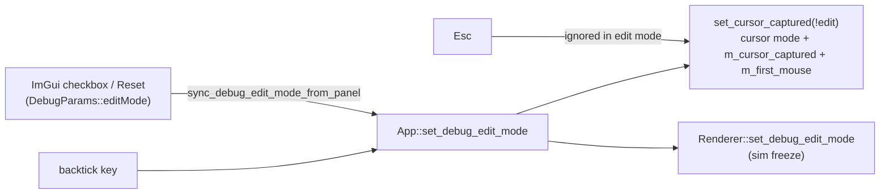

The full state-machine version of this is chapter 08 of the tutorial (`InputMode{Driving, CursorFree, DebugEdit}`).

### Verification

- Release: 219 of 219 tests pass, including the new weather test. Debug UI: 242 of 242 pass. 0 warnings.
- 33 of 33 release `.spv` hashes match `tests/golden/release_spv.sha256`.
- Debug-UI runtime start and shutdown: the log is clean.
- Window-only screenshots were **not** taken. The app's main window is missing from `CGWindowList` in this session, so the key-driven checks (R/G/Esc/backtick, resize) are still open for a manual run.

### Files

| File | Change |
|------|--------|
| [src/core/App/App.cpp](src/core/App/App.cpp) | rain → `preset_for_rain` + debug slider sync; per-frame panel edit-mode sync; resize flag left to the renderer; gantry message removed |
| [src/core/App/App.h](src/core/App/App.h) | `set_debug_edit_mode` / `sync_debug_edit_mode_from_panel`; removed `m_clear_day`, `m_treadmill`, Treadmill include |
| [src/core/App/AppInput.cpp](src/core/App/AppInput.cpp) | edit mode through `set_cursor_captured`; Esc ignored in edit mode |
| [src/core/App/AppInit.cpp](src/core/App/AppInit.cpp) | stale Treadmill comment |
| [src/core/Window/Window.h](src/core/Window/Window.h), [Window.cpp](src/core/Window/Window.cpp) | `m_glfwInitialized` guard; stale tutorial TODO comments replaced by real ones |
| [src/renderer/Renderer/Renderer.cpp](src/renderer/Renderer/Renderer.cpp) | `recreateSwapchain` clears the resize flag |
| [src/renderer/Renderer/Renderer_Frame.cpp](src/renderer/Renderer/Renderer_Frame.cpp) | present step no longer clears the flag itself |
| [src/renderer/Renderer/Renderer.h](src/renderer/Renderer/Renderer.h), [Renderer_State.cpp](src/renderer/Renderer/Renderer_State.cpp) | `set_clear_day` removed |
| [src/debug/DebugUI.cpp](src/debug/DebugUI.cpp) | fog/haze in metres via `Units.h`; duplicate dump line removed |
| [src/scene/WeatherPreset.h](src/scene/WeatherPreset.h) | `is_clear_day`, `preset_for_rain` (constexpr) |
| [src/utils/meta/EnumCycle.h](src/utils/meta/EnumCycle.h) | `CountedEnum` requires `Count > 0` |
| [src/scene/Entity/CarEntity.h](src/scene/Entity/CarEntity.h), [CarEntity.cpp](src/scene/Entity/CarEntity.cpp) | stale Treadmill comments |
| [tests/test_rain.cpp](tests/test_rain.cpp) | rain-vs-preset regression test |
| [tests/utils/test_meta_EnumCycle.cpp](tests/utils/test_meta_EnumCycle.cpp) | `Count == 0` rejected |
| [tasks/todo.md](tasks/todo.md) | typed-C++ refactor plan; P0.0 ticked |

---

### 2026-10-01 — C++23: language standard bumped from C++20, nothing else changed

Raised `CMAKE_CXX_STANDARD` (and `toml_baker`'s `cxx_std`) from 20 to 23 so the typed-C++ tutorial can use `std::expected`, deducing `this`, `std::to_underlying` and `if consteval`. No source changes, and the outputs are identical.

Technical summary

### Motivation

P0.2 of the typed-C++ refactor ([tasks/todo.md](tasks/todo.md)). The owner chose C++23 now, done as a bump on its own so
any toolchain fallout has exactly one cause.

### Change

- [CMakeLists.txt](CMakeLists.txt): `CMAKE_CXX_STANDARD 23`; `toml_baker` `cxx_std_23`. `CMAKE_CXX_EXTENSIONS` stays at
  its default, so the flag is `-std=gnu++23`, matching the previous `gnu++20`. Vendored targets that pin their own
  standard (`c++11`, `gnu++17`) are untouched.
- [.clangd](.clangd): comment updated. `.clang-format` keeps `Standard: c++20`. clang-format has no `c++23` value, and
  `Latest` would reformat files, which is outside this phase.

### Verification

| Check | Result |
|-------|--------|
| Release `make test` (AppleClang 21) | 219/219, 0 warnings |
| Debug-UI `make test-debug` | 242/242, 0 warnings |
| Golden car trajectory + mesh hashes | pass (part of the suites above) |
| 33 release `.spv` hashes | 33/33 OK |
| Arch GCC | not run yet (needs the `arch` host) |

### Files

| File | Change |
|------|--------|
| [CMakeLists.txt](CMakeLists.txt) | C++ standard 20 → 23 (app and `toml_baker`) |
| [.clangd](.clangd) | comment: C++23 |
| [tasks/todo.md](tasks/todo.md) | P0.2 ticked |

---

### 2026-10-01 — Typed-C++ tutorial: index and M1 chapters 01-12, plus doc drift fixes

Added `docs/tutorials/typed-cpp/`: a series index and 12 chapters, each the spec for one M1 refactor phase. Also fixed six stale comments and docs found while writing them.

Technical summary

### Motivation

P0.6 (tutorial scaffold) and part of P0.5 (doc drift) of the typed-C++ refactor ([tasks/todo.md](tasks/todo.md)). The owner
implements each chapter; Claude scaffolds the branch, skeleton and failing tests, then reviews and runs the gate. Three
docs agents wrote the chapters in parallel, and every file:line anchor was read from the code at `33d2c03`. Each file
says it was drafted with AI assistance and that owner review is pending.

### What the chapters found in the code (decisions for the owner)

- **Car golden is tolerance-based.** It checks 1e-3 abs + 1e-3 rel, so passing it doesn't prove the bits are unchanged.
  Ch03 and Ch12 add a Clang-only bit-exact fixture, recorded from the phase's base commit.
- **Heading wrap.** `fmod(y + 180, 360) - 180` gives $(-540°, 180°)$, not $(-180°, 180°]$, and the golden records
  yaw $-306.69°$. Ch12 keeps a verbatim legacy wrap; fixing it is B12.
- **Behaviour changes split out as B-phases:** the FOV-kick reset (B10); rain blocking a clear-day sky on G, and the
  debug Reset rewriting rain (B9); FocusLost freeing the cursor (Ch08, later).
- **Ch01:** the `i < 2` loops in `WindshieldRainPass.cpp` iterate the wetness ping-pong pair, not frames in flight.
  The real 2-frame assumption is `TaaPass.cpp:284`.
- **Ch07:** golden scenario `throttle_then_brake` stops at step 450 and would reverse under a held Down key, so it stays
  on the P0.4 test accessor.

### Chapter map

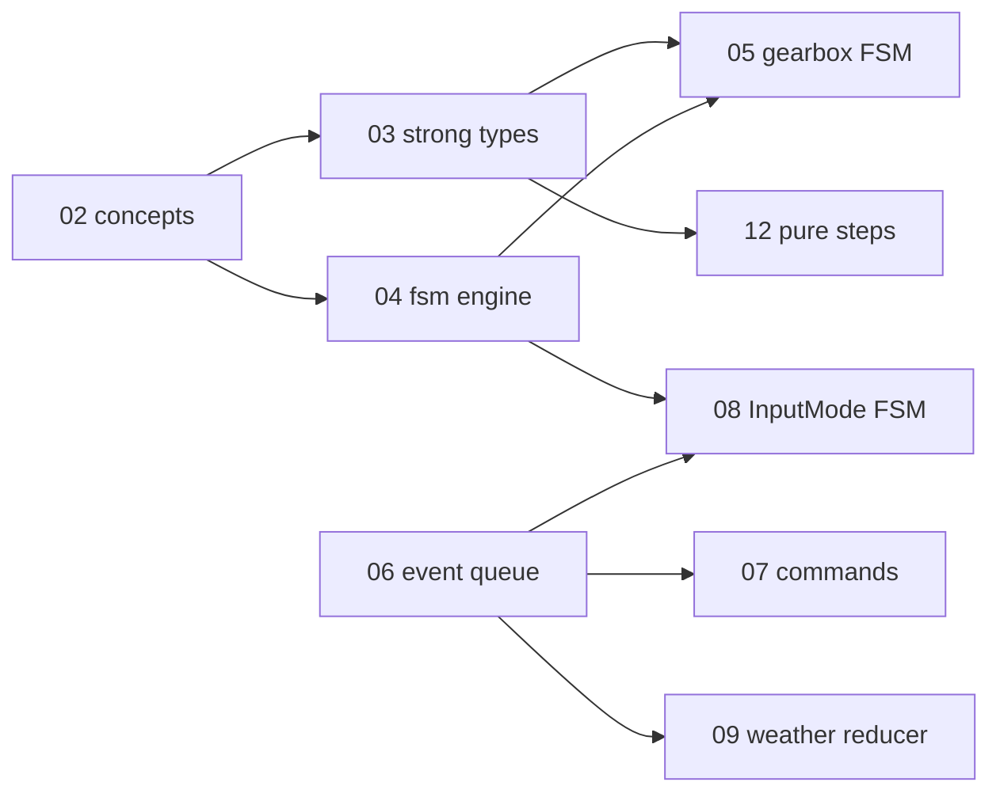

### Files

| File | Change |
|------|--------|
| [docs/tutorials/typed-cpp/00-index.md](docs/tutorials/typed-cpp/00-index.md) | series map: phases, gate, dependencies, conventions |
| `docs/tutorials/typed-cpp/01-…12-*.md` | chapters 01-12 (static_assert, concepts, strong types, fsm engine, gearbox FSM, variant events, X-macro commands, InputMode FSM, weather reducer, camera variant states, RAII/ownership, pure step functions); chapters 05 and 08 aligned to the Ch03/Ch04 API names |
| [docs/README.md](docs/README.md) | row for the series |
| [src/core/README.md](src/core/README.md) | resize flag: read-only `wasResized()`, `poll_events` no longer consumes it |
| [tests/golden/README.md](tests/golden/README.md) | `.spv` hashes unchanged through C++20/23 |
| [src/core/CameraController/CameraController.h](src/core/CameraController/CameraController.h) | comment: FOV-kick baseline is not reset (was claimed) |
| [src/scene/Corridor/CorridorDriver.h](src/scene/Corridor/CorridorDriver.h) | comment: App snaps Y, not `update` |
| [src/scene/README.md](src/scene/README.md) | heading wrap range is $(-540°, 180°)$ |
| [src/utils/math/Smoothing.h](src/utils/math/Smoothing.h) | comment: CarEntity's wrap is not the same trick |

