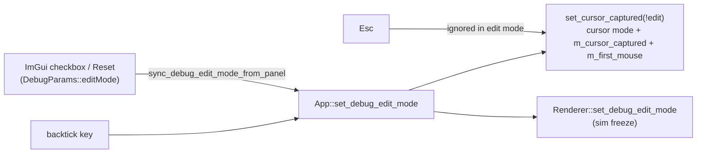

# Changelog — 2026-10

See [CHANGELOG.md](../../CHANGELOG.md) for the index of all entries.

---

### 2026-10-01 — Quick fixes before the typed-C++ refactor: input/edit-mode, weather, resize, GLFW teardown

Fixed nine bugs found by the refactor audit: cursor capture and debug edit mode drifting apart, rain leaving the weather preset stale, the resize flag cleared before the renderer read it, the fog/haze sliders labelled km while showing metres, a duplicated shadow line in the debug dump, a double `glfwTerminate`, `EnumCycle` accepting `Count == 0`, and dead Treadmill code and comments.

Technical summary

### Motivation

Phase P0.1 of the typed-C++ system refactor ([tasks/todo.md](tasks/todo.md)). Three read-only audits found these
while mapping the implicit state machines. The owner chose to have them fixed directly, before the refactor, as a
behaviour-change phase on its own branch (`refactor/00-quick-fixes`), so later refactor phases stay behaviour-preserving.

### Fixes

| Bug | Root cause | Fix |
|-----|-----------|-----|
| Esc, then backtick twice, leaves the cursor disabled while mouse deltas are dropped; in edit mode, panel drags turned the camera | `on_toggle_debug_edit` set the GLFW cursor mode directly and never updated `m_cursor_captured`; the ImGui checkbox and Reset wrote `DebugParams::editMode` behind App's back | One writer, `App::set_debug_edit_mode`, which routes through `set_cursor_captured(!edit)`; `sync_debug_edit_mode_from_panel()` at the top of each frame follows a panel-side change; Esc is ignored while in edit mode |
| Rain switched the sky to Cloudy only after a G press, and the next G press seemed to do nothing | A `m_clear_day` flag that started false and was set only by `set_weather_preset`; `Renderer::set_clear_day` changed the renderer's preset without updating `App::m_weather_preset` | Pure `preset_for_rain(preset, rain)` + `is_clear_day` in [WeatherPreset.h](src/scene/WeatherPreset.h); rain goes through `set_weather_preset`; `m_clear_day` and `Renderer::set_clear_day` deleted |
| R did nothing visible in the debug-UI build | `apply_debug_params` copies the rain slider into the renderer every frame | `set_rain_level` also writes `DebugParams::rainIntensity` (debug-only) |
| Window resizes relied on `VK_ERROR_OUT_OF_DATE` alone | `App::poll_events` cleared the resize flag before `drawFrame`'s present check read it | App no longer touches the flag; `Renderer::recreateSwapchain` is its only consumer (any recreate satisfies a pending resize) |
| Fog/haze sliders showed metres labelled "km" | `wu / 1000` is metres (1 m = 1000 WU) | `uu::to_m` / `uu::m`, labels "(m)"; slider numbers unchanged |
| Shadow line printed twice in the dump | A stale copy without `lightSize` | Removed the stale line |
| `glfwTerminate` called twice | `App::shutdown` and `~Window` both run `Window::cleanup` | `m_glfwInitialized` guard |
| `next_enum` divided by zero for `Count == 0` | `CountedEnum` only checked that `Count` exists | Concept also requires `Count > 0` (static_assert test) |
| Helicopter camera printed a meaningless gantry distance | `App::m_treadmill` was never updated after Phase 3a, so `intro_len()` was 0 | Removed the message and the `m_treadmill` member; stale Treadmill comments now name `CorridorDriver` |

### Edit-mode ownership after the fix

The full state-machine version of this is chapter 08 of the tutorial (`InputMode{Driving, CursorFree, DebugEdit}`).

### Verification

- Release: 219 of 219 tests pass, including the new weather test. Debug UI: 242 of 242 pass. 0 warnings.
- 33 of 33 release `.spv` hashes match `tests/golden/release_spv.sha256`.
- Debug-UI runtime start and shutdown: the log is clean.
- Window-only screenshots were **not** taken. The app's main window is missing from `CGWindowList` in this session, so the key-driven checks (R/G/Esc/backtick, resize) are still open for a manual run.

### Files

| File | Change |
|------|--------|
| [src/core/App/App.cpp](src/core/App/App.cpp) | rain → `preset_for_rain` + debug slider sync; per-frame panel edit-mode sync; resize flag left to the renderer; gantry message removed |
| [src/core/App/App.h](src/core/App/App.h) | `set_debug_edit_mode` / `sync_debug_edit_mode_from_panel`; removed `m_clear_day`, `m_treadmill`, Treadmill include |
| [src/core/App/AppInput.cpp](src/core/App/AppInput.cpp) | edit mode through `set_cursor_captured`; Esc ignored in edit mode |
| [src/core/App/AppInit.cpp](src/core/App/AppInit.cpp) | stale Treadmill comment |
| [src/core/Window/Window.h](src/core/Window/Window.h), [Window.cpp](src/core/Window/Window.cpp) | `m_glfwInitialized` guard; stale tutorial TODO comments replaced by real ones |
| [src/renderer/Renderer/Renderer.cpp](src/renderer/Renderer/Renderer.cpp) | `recreateSwapchain` clears the resize flag |
| [src/renderer/Renderer/Renderer_Frame.cpp](src/renderer/Renderer/Renderer_Frame.cpp) | present step no longer clears the flag itself |
| [src/renderer/Renderer/Renderer.h](src/renderer/Renderer/Renderer.h), [Renderer_State.cpp](src/renderer/Renderer/Renderer_State.cpp) | `set_clear_day` removed |
| [src/debug/DebugUI.cpp](src/debug/DebugUI.cpp) | fog/haze in metres via `Units.h`; duplicate dump line removed |
| [src/scene/WeatherPreset.h](src/scene/WeatherPreset.h) | `is_clear_day`, `preset_for_rain` (constexpr) |
| [src/utils/meta/EnumCycle.h](src/utils/meta/EnumCycle.h) | `CountedEnum` requires `Count > 0` |
| [src/scene/Entity/CarEntity.h](src/scene/Entity/CarEntity.h), [CarEntity.cpp](src/scene/Entity/CarEntity.cpp) | stale Treadmill comments |
| [tests/test_rain.cpp](tests/test_rain.cpp) | rain-vs-preset regression test |
| [tests/utils/test_meta_EnumCycle.cpp](tests/utils/test_meta_EnumCycle.cpp) | `Count == 0` rejected |
| [tasks/todo.md](tasks/todo.md) | typed-C++ refactor plan; P0.0 ticked |

---

### 2026-10-01 — C++23: language standard bumped from C++20, nothing else changed

Raised `CMAKE_CXX_STANDARD` (and `toml_baker`'s `cxx_std`) from 20 to 23 so the typed-C++ tutorial can use `std::expected`, deducing `this`, `std::to_underlying` and `if consteval`. No source changes, and the outputs are identical.

Technical summary

### Motivation

P0.2 of the typed-C++ refactor ([tasks/todo.md](tasks/todo.md)). The owner chose C++23 now, done as a bump on its own so
any toolchain fallout has exactly one cause.

### Change

- [CMakeLists.txt](CMakeLists.txt): `CMAKE_CXX_STANDARD 23`; `toml_baker` `cxx_std_23`. `CMAKE_CXX_EXTENSIONS` stays at
  its default, so the flag is `-std=gnu++23`, matching the previous `gnu++20`. Vendored targets that pin their own
  standard (`c++11`, `gnu++17`) are untouched.
- [.clangd](.clangd): comment updated. `.clang-format` keeps `Standard: c++20`. clang-format has no `c++23` value, and
  `Latest` would reformat files, which is outside this phase.

### Verification

| Check | Result |
|-------|--------|
| Release `make test` (AppleClang 21) | 219/219, 0 warnings |
| Debug-UI `make test-debug` | 242/242, 0 warnings |
| Golden car trajectory + mesh hashes | pass (part of the suites above) |
| 33 release `.spv` hashes | 33/33 OK |
| Arch GCC | not run yet (needs the `arch` host) |

### Files

| File | Change |
|------|--------|
| [CMakeLists.txt](CMakeLists.txt) | C++ standard 20 → 23 (app and `toml_baker`) |
| [.clangd](.clangd) | comment: C++23 |
| [tasks/todo.md](tasks/todo.md) | P0.2 ticked |

