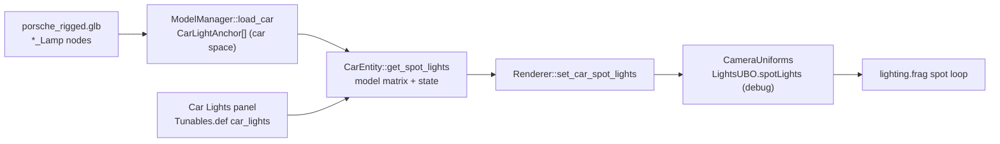
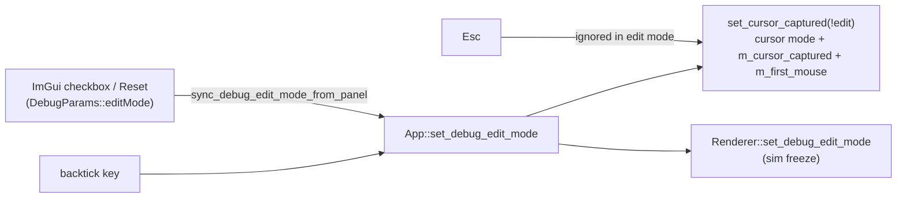
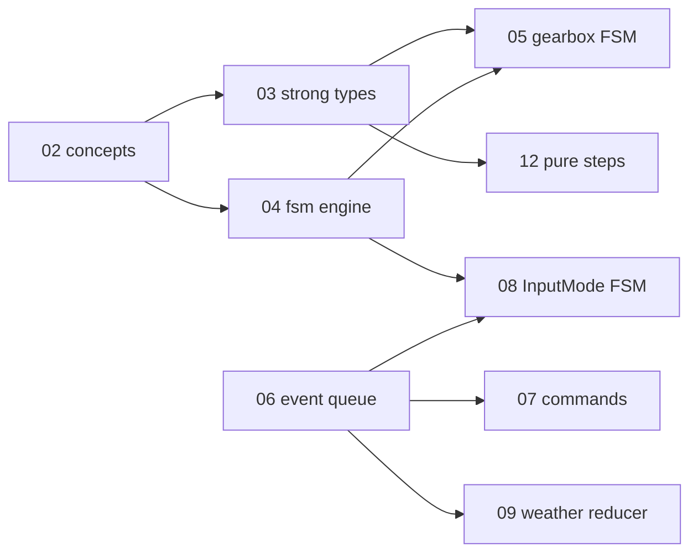

# Changelog — 2026-10

See [CHANGELOG.md](../../CHANGELOG.md) for the index of all entries.

---

### 2026-10-10 — Car lights S1–S3: headlight / tail / brake spot lights (debug-only)

Added debug-only car spot lights: a car GLB with named `*_Lamp` nodes (the new Blender rig `assets/blend/porsche_rigged.glb`) now throws two headlight beams and red tail / brake glow onto the road, switched from a new "Car Lights" debug panel; off by default, release output unchanged.

Technical summary

### Motivation

User goal (2026-10-10): lights on the car, with rain on the lenses while driving. Plan and spec:
[tasks/todo.md](tasks/todo.md) "Car lights". This entry covers S0–S3; lens glow (S5) and rain on the lenses (S6) are open.

### What changed

- **Asset (S0).** `assets/blend/porsche_rigged.blend` → `porsche_rigged.glb` (untracked, made in Blender): real scale
  (wheelbase 2.259 m, tyre radius 0.320 m), named pivots, and per-lamp nodes `Headlight_L/R`, `TailLight_L/R`,
  `BrakeLight_L/R`, `RearLightBar`, each with `_Lens` / `_Housing` / `_Emitter` meshes and a `<Anchor>_Lamp`
  KHR_lights_punctual node whose local −Z is the beam (the Empty's own −Z is not, after the exporter's Y-up swap).
- **Loader + CPU (S1).** [src/scene/Entity/CarLights.h](src/scene/Entity/CarLights.h) (new, header-only): exact-name
  `_Lamp` → `CarLightKind`, and `car_spot_lights(anchors, model, state, params)`. `ModelManager::load_car` reads the
  lamp nodes into car space with the same RootNode-relative, $(x,y,z)\to(z,y,-x)$, grounded transform as the vertices.
- **GPU (S2).** `SpotLightData[8]` + `numSpotLights` appended to `LightsUBO` and `lights.glsl`, and a spot loop in
  `lighting.frag`, all under `#ifdef SWISH_DEBUG_UI`. Falloff = the point lights' windowed bounded inverse-square with
  $d_{ref}=0.15R$, times a cone, plus the street lamps' wet halo:

$$
c=\mathrm{smoothstep}(\cos\theta_o,\cos\theta_i,-\hat L\cdot\hat d),\quad
att=\mathrm{win}(d/R)\,\frac{d_{ref}^2}{d_{ref}^2+d^2}\,c,\quad
L_o \mathrel{+}= C I\,att\,\big[(k_D\,\tfrac{\rho}{\pi}+f_s)\,N\!\cdot\!L + att\,w\,k_{halo}\big]
$$

- **Wiring (S3).** `Tunables.def` group `car_lights` (11 rows, NOPUSH): enabled (default **false**), headlights / tail
  on, hold-brake, intensities, ranges, beam half-angles. `App::push_car_to_renderer` builds the lights each frame
  (brake lamps follow `CarEntity::get_brake()`) → `Renderer::set_car_spot_lights` → `CameraUniforms`.

### Verification

`make test-debug` 246/246, `make test` 223/223, 0 first-party warnings, release `.spv` 33/33 unchanged. New
`tests/test_car_lights.cpp` (name mapping, all-off identity, per-switch lamps, world transform); tunable-table counts
updated in `tests/test_debug_params_io.cpp`. Looked at it: window-only screenshots with a temporary night force
(sun / ambient / IBL ≈ 0, chase cam, panel hidden; reverted): headlight pool on the road ahead, red tail/brake pool
behind, 120 fps either way. Lights-off screenshot matches today's image. Not yet done: rain 0 / 1.0 pair (S4).
Noted, pre-existing and unrelated: the large dark patch around the car in the debug build's default preset shows
with the original `porsche.glb` too.

### Files

| File | Change |
|------|--------|
| [src/scene/Entity/CarLights.h](src/scene/Entity/CarLights.h) | new: anchors, state, params, name map, `car_spot_lights` |
| [src/scene/SceneTypes.h](src/scene/SceneTypes.h) | `SpotLightDesc`; debug-only `SpotLightData` + `LightsUBO` fields |
| [src/scene/ModelManager/ModelManager.cpp](src/scene/ModelManager/ModelManager.cpp) | read `_Lamp` nodes into car space |
| [src/scene/Entity/CarEntity.h](src/scene/Entity/CarEntity.h) | light anchors, `get_brake`, `get_spot_lights` |
| [src/renderer/CameraUniforms/CameraUniforms.h](src/renderer/CameraUniforms/CameraUniforms.h) / [.cpp](src/renderer/CameraUniforms/CameraUniforms.cpp) | store + upload spot lights (debug) |
| [src/renderer/Renderer/Renderer.h](src/renderer/Renderer/Renderer.h), [Renderer_State.cpp](src/renderer/Renderer/Renderer_State.cpp) | `set_car_spot_lights` |
| [src/core/App/App.cpp](src/core/App/App.cpp) | per-frame car spot lights from the panel (debug) |
| [src/debug/Tunables.def](src/debug/Tunables.def), [src/debug/DebugUI.cpp](src/debug/DebugUI.cpp) | `car_lights` group + "Car Lights" header + dump |
| [shaders/common/lights.glsl](shaders/common/lights.glsl), [shaders/lighting.frag](shaders/lighting.frag) | debug-only spot struct + loop |
| [tests/test_car_lights.cpp](tests/test_car_lights.cpp), [tests/CMakeLists.txt](tests/CMakeLists.txt), [tests/test_debug_params_io.cpp](tests/test_debug_params_io.cpp) | new test; counts |
| [tasks/todo.md](tasks/todo.md) | "Car lights" spec + slices |

**Label:** Largely AI-generated (Claude), checked by build, tests and screenshots. Please review.

---

### 2026-10-01 — Quick fixes before the typed-C++ refactor: input/edit-mode, weather, resize, GLFW teardown

Fixed nine bugs found by the refactor audit: cursor capture and debug edit mode drifting apart, rain leaving the weather preset stale, the resize flag cleared before the renderer read it, the fog/haze sliders labelled km while showing metres, a duplicated shadow line in the debug dump, a double `glfwTerminate`, `EnumCycle` accepting `Count == 0`, and dead Treadmill code and comments.

Technical summary

### Motivation

Phase P0.1 of the typed-C++ system refactor ([tasks/todo.md](tasks/todo.md)). Three read-only audits found these
while mapping the implicit state machines. The owner chose to have them fixed directly, before the refactor, as a
behaviour-change phase on its own branch (`refactor/00-quick-fixes`), so later refactor phases stay behaviour-preserving.

### Fixes

| Bug | Root cause | Fix |
|-----|-----------|-----|
| Esc, then backtick twice, leaves the cursor disabled while mouse deltas are dropped; in edit mode, panel drags turned the camera | `on_toggle_debug_edit` set the GLFW cursor mode directly and never updated `m_cursor_captured`; the ImGui checkbox and Reset wrote `DebugParams::editMode` behind App's back | One writer, `App::set_debug_edit_mode`, which routes through `set_cursor_captured(!edit)`; `sync_debug_edit_mode_from_panel()` at the top of each frame follows a panel-side change; Esc is ignored while in edit mode |
| Rain switched the sky to Cloudy only after a G press, and the next G press seemed to do nothing | A `m_clear_day` flag that started false and was set only by `set_weather_preset`; `Renderer::set_clear_day` changed the renderer's preset without updating `App::m_weather_preset` | Pure `preset_for_rain(preset, rain)` + `is_clear_day` in [WeatherPreset.h](src/scene/WeatherPreset.h); rain goes through `set_weather_preset`; `m_clear_day` and `Renderer::set_clear_day` deleted |
| R did nothing visible in the debug-UI build | `apply_debug_params` copies the rain slider into the renderer every frame | `set_rain_level` also writes `DebugParams::rainIntensity` (debug-only) |
| Window resizes relied on `VK_ERROR_OUT_OF_DATE` alone | `App::poll_events` cleared the resize flag before `drawFrame`'s present check read it | App no longer touches the flag; `Renderer::recreateSwapchain` is its only consumer (any recreate satisfies a pending resize) |
| Fog/haze sliders showed metres labelled "km" | `wu / 1000` is metres (1 m = 1000 WU) | `uu::to_m` / `uu::m`, labels "(m)"; slider numbers unchanged |
| Shadow line printed twice in the dump | A stale copy without `lightSize` | Removed the stale line |
| `glfwTerminate` called twice | `App::shutdown` and `~Window` both run `Window::cleanup` | `m_glfwInitialized` guard |
| `next_enum` divided by zero for `Count == 0` | `CountedEnum` only checked that `Count` exists | Concept also requires `Count > 0` (static_assert test) |
| Helicopter camera printed a meaningless gantry distance | `App::m_treadmill` was never updated after Phase 3a, so `intro_len()` was 0 | Removed the message and the `m_treadmill` member; stale Treadmill comments now name `CorridorDriver` |

### Edit-mode ownership after the fix

The full state-machine version of this is chapter 08 of the tutorial (`InputMode{Driving, CursorFree, DebugEdit}`).

### Verification

- Release: 219 of 219 tests pass, including the new weather test. Debug UI: 242 of 242 pass. 0 warnings.
- 33 of 33 release `.spv` hashes match `tests/golden/release_spv.sha256`.
- Debug-UI runtime start and shutdown: the log is clean.
- Window-only screenshots were **not** taken. The app's main window is missing from `CGWindowList` in this session, so the key-driven checks (R/G/Esc/backtick, resize) are still open for a manual run.

### Files

| File | Change |
|------|--------|
| [src/core/App/App.cpp](src/core/App/App.cpp) | rain → `preset_for_rain` + debug slider sync; per-frame panel edit-mode sync; resize flag left to the renderer; gantry message removed |
| [src/core/App/App.h](src/core/App/App.h) | `set_debug_edit_mode` / `sync_debug_edit_mode_from_panel`; removed `m_clear_day`, `m_treadmill`, Treadmill include |
| [src/core/App/AppInput.cpp](src/core/App/AppInput.cpp) | edit mode through `set_cursor_captured`; Esc ignored in edit mode |
| [src/core/App/AppInit.cpp](src/core/App/AppInit.cpp) | stale Treadmill comment |
| [src/core/Window/Window.h](src/core/Window/Window.h), [Window.cpp](src/core/Window/Window.cpp) | `m_glfwInitialized` guard; stale tutorial TODO comments replaced by real ones |
| [src/renderer/Renderer/Renderer.cpp](src/renderer/Renderer/Renderer.cpp) | `recreateSwapchain` clears the resize flag |
| [src/renderer/Renderer/Renderer_Frame.cpp](src/renderer/Renderer/Renderer_Frame.cpp) | present step no longer clears the flag itself |
| [src/renderer/Renderer/Renderer.h](src/renderer/Renderer/Renderer.h), [Renderer_State.cpp](src/renderer/Renderer/Renderer_State.cpp) | `set_clear_day` removed |
| [src/debug/DebugUI.cpp](src/debug/DebugUI.cpp) | fog/haze in metres via `Units.h`; duplicate dump line removed |
| [src/scene/WeatherPreset.h](src/scene/WeatherPreset.h) | `is_clear_day`, `preset_for_rain` (constexpr) |
| [src/utils/meta/EnumCycle.h](src/utils/meta/EnumCycle.h) | `CountedEnum` requires `Count > 0` |
| [src/scene/Entity/CarEntity.h](src/scene/Entity/CarEntity.h), [CarEntity.cpp](src/scene/Entity/CarEntity.cpp) | stale Treadmill comments |
| [tests/test_rain.cpp](tests/test_rain.cpp) | rain-vs-preset regression test |
| [tests/utils/test_meta_EnumCycle.cpp](tests/utils/test_meta_EnumCycle.cpp) | `Count == 0` rejected |
| [tasks/todo.md](tasks/todo.md) | typed-C++ refactor plan; P0.0 ticked |

---

### 2026-10-01 — C++23: language standard bumped from C++20, nothing else changed

Raised `CMAKE_CXX_STANDARD` (and `toml_baker`'s `cxx_std`) from 20 to 23 so the typed-C++ tutorial can use `std::expected`, deducing `this`, `std::to_underlying` and `if consteval`. No source changes, and the outputs are identical.

Technical summary

### Motivation

P0.2 of the typed-C++ refactor ([tasks/todo.md](tasks/todo.md)). The owner chose C++23 now, done as a bump on its own so
any toolchain fallout has exactly one cause.

### Change

- [CMakeLists.txt](CMakeLists.txt): `CMAKE_CXX_STANDARD 23`; `toml_baker` `cxx_std_23`. `CMAKE_CXX_EXTENSIONS` stays at
  its default, so the flag is `-std=gnu++23`, matching the previous `gnu++20`. Vendored targets that pin their own
  standard (`c++11`, `gnu++17`) are untouched.
- [.clangd](.clangd): comment updated. `.clang-format` keeps `Standard: c++20`. clang-format has no `c++23` value, and
  `Latest` would reformat files, which is outside this phase.

### Verification

| Check | Result |
|-------|--------|
| Release `make test` (AppleClang 21) | 219/219, 0 warnings |
| Debug-UI `make test-debug` | 242/242, 0 warnings |
| Golden car trajectory + mesh hashes | pass (part of the suites above) |
| 33 release `.spv` hashes | 33/33 OK |
| Arch GCC | not run yet (needs the `arch` host) |

### Files

| File | Change |
|------|--------|
| [CMakeLists.txt](CMakeLists.txt) | C++ standard 20 → 23 (app and `toml_baker`) |
| [.clangd](.clangd) | comment: C++23 |
| [tasks/todo.md](tasks/todo.md) | P0.2 ticked |

---

### 2026-10-01 — Typed-C++ tutorial: index and M1 chapters 01-12, plus doc drift fixes

Added `docs/tutorials/typed-cpp/`: a series index and 12 chapters, each the spec for one M1 refactor phase. Also fixed six stale comments and docs found while writing them.

Technical summary

### Motivation

P0.6 (tutorial scaffold) and part of P0.5 (doc drift) of the typed-C++ refactor ([tasks/todo.md](tasks/todo.md)). The owner
implements each chapter; Claude scaffolds the branch, skeleton and failing tests, then reviews and runs the gate. Three
docs agents wrote the chapters in parallel, and every file:line anchor was read from the code at `33d2c03`. Each file
says it was drafted with AI assistance and that owner review is pending.

### What the chapters found in the code (decisions for the owner)

- **Car golden is tolerance-based.** It checks 1e-3 abs + 1e-3 rel, so passing it doesn't prove the bits are unchanged.
  Ch03 and Ch12 add a Clang-only bit-exact fixture, recorded from the phase's base commit.
- **Heading wrap.** `fmod(y + 180, 360) - 180` gives $(-540°, 180°)$, not $(-180°, 180°]$, and the golden records
  yaw $-306.69°$. Ch12 keeps a verbatim legacy wrap; fixing it is B12.
- **Behaviour changes split out as B-phases:** the FOV-kick reset (B10); rain blocking a clear-day sky on G, and the
  debug Reset rewriting rain (B9); FocusLost freeing the cursor (Ch08, later).
- **Ch01:** the `i < 2` loops in `WindshieldRainPass.cpp` iterate the wetness ping-pong pair, not frames in flight.
  The real 2-frame assumption is `TaaPass.cpp:284`.
- **Ch07:** golden scenario `throttle_then_brake` stops at step 450 and would reverse under a held Down key, so it stays
  on the P0.4 test accessor.

### Chapter map

### Files

| File | Change |
|------|--------|
| [docs/tutorials/typed-cpp/00-index.md](docs/tutorials/typed-cpp/00-index.md) | series map: phases, gate, dependencies, conventions |
| `docs/tutorials/typed-cpp/01-…12-*.md` | chapters 01-12 (static_assert, concepts, strong types, fsm engine, gearbox FSM, variant events, X-macro commands, InputMode FSM, weather reducer, camera variant states, RAII/ownership, pure step functions); chapters 05 and 08 aligned to the Ch03/Ch04 API names |
| [docs/README.md](docs/README.md) | row for the series |
| [src/core/README.md](src/core/README.md) | resize flag: read-only `wasResized()`, `poll_events` no longer consumes it |
| [tests/golden/README.md](tests/golden/README.md) | `.spv` hashes unchanged through C++20/23 |
| [src/core/CameraController/CameraController.h](src/core/CameraController/CameraController.h) | comment: FOV-kick baseline is not reset (was claimed) |
| [src/scene/Corridor/CorridorDriver.h](src/scene/Corridor/CorridorDriver.h) | comment: App snaps Y, not `update` |
| [src/scene/README.md](src/scene/README.md) | heading wrap range is $(-540°, 180°)$ |
| [src/utils/math/Smoothing.h](src/utils/math/Smoothing.h) | comment: CarEntity's wrap is not the same trick |

