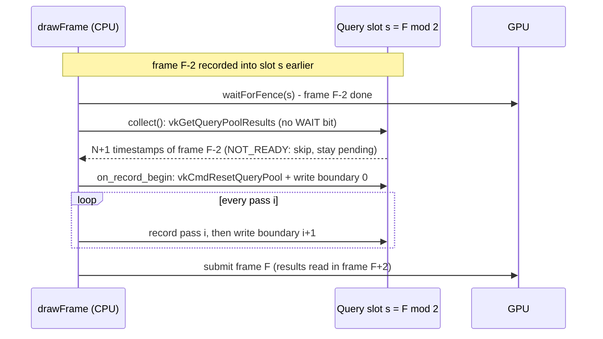
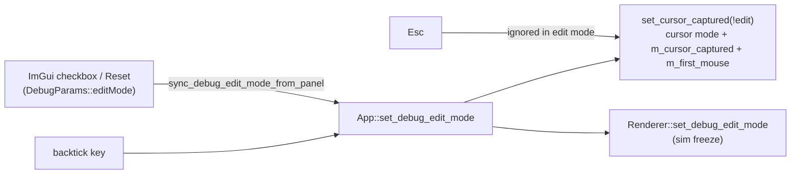
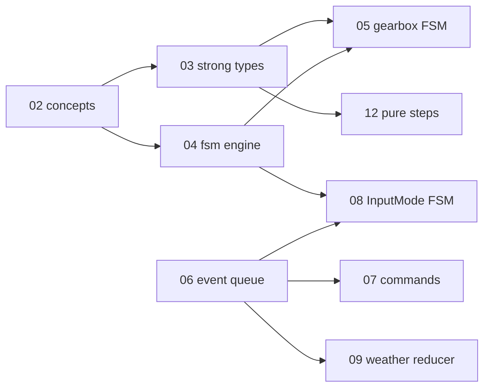
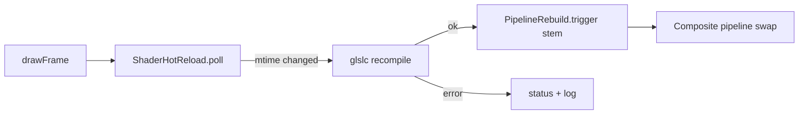

# Changelog — 2026-10

See [CHANGELOG.md](../../CHANGELOG.md) for the index of all entries.

---

### 2026-10-10 — Stub Vulkan render tools: GPU profiler, frame capture, shader hot-reload, pass declarations

Added four debug-only (`SWISH_DEBUG_UI`) render tools as working stubs: a per-pass GPU timestamp profiler, an F12 frame capture to PPM/PFM, an mtime-polling shader hot-reload with a Composite rebuild hook, and per-pass image read/write declarations with a read-before-write validator, all surfaced in a new "Render tools" debug panel.

Technical summary

### Motivation

There was no way to see where GPU time goes per pass, to save what the renderer actually produced, to iterate on a shader without restarting, or to check that the pass list is ordered consistently with the images each pass uses. Track `render-tools` ([tasks/todo.md](tasks/todo.md), S1-S8) builds the smallest real version of each, so the full versions have a concrete seam to grow from. Everything is gated by `SWISH_DEBUG_UI`; release output is intended to be unchanged (see Verification).

### Approach

| Tool | Where | What it does |
|------|-------|--------------|
| GPU profiler | [GpuProfiler.h](src/renderer/GpuProfiler/GpuProfiler.h), [GpuProfiler.cpp](src/renderer/GpuProfiler/GpuProfiler.cpp), [TimestampMath.h](src/renderer/GpuProfiler/TimestampMath.h) | One `VkQueryPool` of `MAX_FRAMES_IN_FLIGHT * (N + 1)` timestamps. It observes `PassRegistry::record_all` through `IPassObserver` and writes **boundary** timestamps: boundary $i$ before pass $i$, boundary $N$ after the last, so pass $i$ costs $t_{i+1}-t_i$ and the total is the exact sum. Uses `vkCmdWriteTimestamp2` (ALL_COMMANDS) with synchronization2, else `vkCmdWriteTimestamp` (BOTTOM_OF_PIPE). Degrades to `supported == false` when `timestampValidBits == 0` |
| Frame capture | [FrameCapture.h](src/renderer/FrameCapture/FrameCapture.h), [FrameCapture.cpp](src/renderer/FrameCapture/FrameCapture.cpp), [CapturePath.h](src/renderer/FrameCapture/CapturePath.h) | After `record_all`, copies the swapchain image (PRESENT_SRC to TRANSFER_SRC and back) and optionally `Img::Hdr` into host-visible VMA staging buffers. Two frames later, after that slot's fence wait, writes `swish_YYYYMMDD_HHMMSS_mmm[_n].ppm` (and a `.pfm` for the HDR request) to `build-debug/captures/` (override `SWISH_CAPTURE_DIR`). The swapchain gets `TRANSFER_SRC` usage in debug builds only |
| Shader hot-reload | [ShaderHotReload.h](src/renderer/ShaderHotReload/ShaderHotReload.h), [ShaderHotReload.cpp](src/renderer/ShaderHotReload/ShaderHotReload.cpp), [PipelineRebuild.h](src/renderer/PipelineRebuild/PipelineRebuild.h), [PipelineRebuild.cpp](src/renderer/PipelineRebuild/PipelineRebuild.cpp), [PassRebuild.h](src/renderer/Passes/PassRebuild.h) | `poll()` once per frame (rate limit 0.5 s) scans `shaders/` mtimes, recompiles changed `.vert/.frag/.comp` with the CMake glslc command line into the build dir, then runs the `PipelineRebuild` hooks registered for the shader stem. A change under `shaders/common/*.glsl` recompiles every shader and runs all hooks. Compile errors are kept in `status()` and the old `.spv` stays in use. Only `composite` has a hook ([PostProcessManager::rebuild_composite_pipeline](src/renderer/PostProcessManager/PostProcessManager_Pipelines.cpp)) |
| Pass declarations | [PassDeclaration.h](src/renderer/Passes/PassDeclaration.h), [PassDeclarationValidator.h](src/renderer/Passes/PassDeclarationValidator.h), [PassDeclarationValidator.cpp](src/renderer/Passes/PassDeclarationValidator.cpp), [IRenderPass.h](src/renderer/Passes/IRenderPass.h) | `IRenderPass::declare(PassDeclaration&)` (default: nothing) lists the `Img`s a pass reads and writes. `validate_pass_declarations` walks them in `PassList.def` order and warns once per (pass, image) on a read with no earlier write; `Ao`, `AoBlur`, `Lum` are allowlisted (primed or history). Documentation that is checked: it never drives barriers or order |
| UI | [DebugUI.h](src/debug/DebugUI.h), [DebugUI.cpp](src/debug/DebugUI.cpp) | "Render tools" collapsing header fed by a `RenderToolsView` of borrowed read-only pointers plus two callbacks (`requestCapture`, `setHotReloadEnabled`); set from `Renderer::init` |

### Timestamp arithmetic

With $b$ = `timestampValidBits` and $p$ = `timestampPeriod` (nanoseconds per tick):

$$m = \begin{cases} 0 & b = 0 \\ 2^{64}-1 & b \ge 64 \\ 2^{b}-1 & \text{otherwise} \end{cases}
\qquad
\Delta = \big((t_{\text{end}} \,\&\, m) - (t_{\text{begin}} \,\&\, m)\big) \,\&\, m$$

$$\text{ms} = \Delta \cdot p_{\text{ns}} \cdot 10^{-6}$$

The subtraction is taken modulo $2^{b}$ so a counter that wrapped between two boundaries still gives the true span; bits above $b$ are ignored. Deltas are exact in `u64`; the multiply is done in `double` and narrowed to `float`. Displayed values use $\bar{x} \leftarrow$ `exp_smooth`$(\bar{x}, x, k{=}4\,\text{s}^{-1}, dt)$, seeded by the first sample.

### Read-back ring (N-2)

Slot $s = \text{frame} \bmod 2$ owns $N+1$ queries. `drawFrame` waits that slot's fence first, so the slot's previous frame (latency = ring size = 2 frames) is finished and can be read with no wait flag before the slot is reset and re-recorded. `VK_NOT_READY` skips the read and keeps the slot pending.

### Wiring

[Renderer.cpp](src/renderer/Renderer/Renderer.cpp) `init` collects and validates the declarations (warnings to stderr and the panel), registers the `composite` hook, inits the profiler and sets it as the registry observer, inits capture and builds the `RenderToolsView`; `cleanup` clears the observer and frees the pool/buffers before the allocator goes. [Renderer_Frame.cpp](src/renderer/Renderer/Renderer_Frame.cpp) calls `m_shaderReload.poll()`, `m_gpuProfiler.collect()` and `m_frameCapture.collect()` right after the fence wait; [Renderer_Record.cpp](src/renderer/Renderer/Renderer_Record.cpp) calls `m_frameCapture.record()` after `record_all`. [AppInput.cpp](src/core/App/AppInput.cpp) binds F12 (`on_capture_frame`, Shift adds the HDR `.pfm`).

### Verification

- Release: 261/261 tests passing. Debug: 284/284 passing. 42 new `TEST_CASE`s, all GPU-free, in `swish_utils_tests` (tags `[gpuprof]`, `[capture]`, `[renderer][hotreload]`, `[renderer][declare]`).
- Release `.spv` hashes: 33/33 identical to [tests/golden/release_spv.sha256](tests/golden/release_spv.sha256) (manual comparison).
- `make check` passes; the clang-format findings are the existing report-only ones.
- **Not verified:** no run on a GPU. The profiler panel, capture output files and live hot-reload were not run or viewed in a window; only builds and unit tests back them.

### Stubbed versus real

| Tool | Real in this change | Stubbed (`TODO(stub)` in the headers) |
|------|--------------------|----------------------------------------|
| Profiler | pool, boundary writes, N-2 read-back, masking, smoothing, UI table | nested sub-workload labels, GPU-vs-CPU bottleneck flag, rolling min/max/p95 history, pipeline-statistics queries, check of the MoltenVK counter against a CPU clock |
| Capture | LDR + HDR copy, name scheme, sRGB encode, `.ppm` / `.pfm` | PNG output (needs a deflate encoder; `include/` has only the stb reader), worker-thread write, burst/timed capture, capture before the overlay, other images by `Img`, frozen-camera re-capture |
| Hot-reload | mtime poll, glslc recompile, error status, Composite rebuild | dependency tracking via glslc depfiles (a `common/*.glsl` edit recompiles everything), worker-thread compile (`poll()` blocks), added/deleted file watching, hooks for every pass other than Composite (they log `TODO(stub)` and need a restart) |
| Declarations | per-pass `declare`, read-before-write validator, panel list | per-subresource / layout-aware and history reads, write-after-write and dead-write warnings, a `PassRegistry` iteration accessor (the validator builds throwaway pass objects in [PassList.cpp](src/renderer/Passes/PassList.cpp)) |

### File changes

| File | Change |
|------|--------|
| [src/renderer/GpuProfiler/GpuProfiler.h](src/renderer/GpuProfiler/GpuProfiler.h), [GpuProfiler.cpp](src/renderer/GpuProfiler/GpuProfiler.cpp) | New: timestamp query pool, `IPassObserver` implementation, `GpuProfileSnapshot` |
| [src/renderer/GpuProfiler/TimestampMath.h](src/renderer/GpuProfiler/TimestampMath.h) | New: Vulkan-free mask, wrap, ticks to ms, slot indexing, smoothing |
| [src/renderer/FrameCapture/FrameCapture.h](src/renderer/FrameCapture/FrameCapture.h), [FrameCapture.cpp](src/renderer/FrameCapture/FrameCapture.cpp) | New: capture state machine, staging copies, file write |
| [src/renderer/FrameCapture/CapturePath.h](src/renderer/FrameCapture/CapturePath.h) | New: file naming, PPM/PFM encoders, half to float, sRGB |
| [src/renderer/ShaderHotReload/ShaderHotReload.h](src/renderer/ShaderHotReload/ShaderHotReload.h), [ShaderHotReload.cpp](src/renderer/ShaderHotReload/ShaderHotReload.cpp) | New: mtime tracker, glslc command, poller (empty TU in release) |
| [src/renderer/PipelineRebuild/PipelineRebuild.h](src/renderer/PipelineRebuild/PipelineRebuild.h), [PipelineRebuild.cpp](src/renderer/PipelineRebuild/PipelineRebuild.cpp) | New: stem-keyed rebuild hook registry |
| [src/renderer/Passes/PassDeclaration.h](src/renderer/Passes/PassDeclaration.h) | New: `PassDeclaration` reads/writes |
| [src/renderer/Passes/PassDeclarationValidator.h](src/renderer/Passes/PassDeclarationValidator.h), [PassDeclarationValidator.cpp](src/renderer/Passes/PassDeclarationValidator.cpp) | New: `img_name`, allowlist, `validate_pass_declarations`, `collect_pass_declarations` |
| [src/renderer/Passes/PassRebuild.h](src/renderer/Passes/PassRebuild.h) | New: `rebuild_composite_pass` entry point |
| [src/renderer/Passes/IRenderPass.h](src/renderer/Passes/IRenderPass.h) | `virtual declare(PassDeclaration&) const`, default empty |
| [src/renderer/Passes/PassRegistry.h](src/renderer/Passes/PassRegistry.h), [PassRegistry.cpp](src/renderer/Passes/PassRegistry.cpp) | Debug-only `IPassObserver` and `set_observer`; `record_all` notifies it around each pass |
| [src/renderer/Passes/PassList.cpp](src/renderer/Passes/PassList.cpp) | `collect_pass_declarations` over the `PassList.def` expansion |
| [src/renderer/Passes/LightingPass.cpp](src/renderer/Passes/LightingPass.cpp), [SsaoPasses.cpp](src/renderer/Passes/SsaoPasses.cpp), [SsrPass.cpp](src/renderer/Passes/SsrPass.cpp), [GodRaysPass.cpp](src/renderer/Passes/GodRaysPass.cpp), [HdrFinalizePass.cpp](src/renderer/Passes/HdrFinalizePass.cpp), [BloomPasses.cpp](src/renderer/Passes/BloomPasses.cpp) | `declare()` overrides |
| [src/renderer/Passes/CompositePass.cpp](src/renderer/Passes/CompositePass.cpp) | `declare()`; `rebuild_composite_pass` (debug) |
| [src/renderer/GeometryProducer/GeometryProducer.h](src/renderer/GeometryProducer/GeometryProducer.h), [DofPass.h](src/renderer/DofPass/DofPass.h), [GlassPass.h](src/renderer/GlassPass/GlassPass.h), [RainSystem.h](src/renderer/RainSystem/RainSystem.h), [SpraySystem.cpp](src/renderer/SpraySystem/SpraySystem.cpp), [TaaPass.h](src/renderer/TaaPass/TaaPass.h), [VelocityPass.h](src/renderer/VelocityPass/VelocityPass.h), [WindshieldRainPass.h](src/renderer/WindshieldRainPass/WindshieldRainPass.h) | `declare()` overrides |
| [src/renderer/PostProcessManager/PostProcessManager.h](src/renderer/PostProcessManager/PostProcessManager.h), [PostProcessManager_Pipelines.cpp](src/renderer/PostProcessManager/PostProcessManager_Pipelines.cpp) | Debug-only `rebuild_composite_pipeline` (build new, `vkDeviceWaitIdle`, swap) |
| [src/renderer/Swapchain/Swapchain.h](src/renderer/Swapchain/Swapchain.h), [Swapchain.cpp](src/renderer/Swapchain/Swapchain.cpp) | Debug-only `TRANSFER_SRC` usage, `getImages()` and `supportsTransferSrc()` accessors |
| [src/renderer/Renderer/Renderer.h](src/renderer/Renderer/Renderer.h), [Renderer.cpp](src/renderer/Renderer/Renderer.cpp), [Renderer_Frame.cpp](src/renderer/Renderer/Renderer_Frame.cpp), [Renderer_Record.cpp](src/renderer/Renderer/Renderer_Record.cpp) | Members, init/cleanup wiring, per-frame poll/collect, capture record, accessors |
| [src/core/App/App.h](src/core/App/App.h), [src/core/App/AppInput.cpp](src/core/App/AppInput.cpp) | F12 binding and `on_capture_frame` (Shift = HDR) |
| [src/debug/DebugUI.h](src/debug/DebugUI.h), [src/debug/DebugUI.cpp](src/debug/DebugUI.cpp) | `RenderToolsView`, `set_render_tools`, "Render tools" panel |
| [CMakeLists.txt](CMakeLists.txt) | Debug target defines `SWISH_SHADER_SRC_DIR` and `SWISH_GLSLC_PATH` |
| [tests/utils/CMakeLists.txt](tests/utils/CMakeLists.txt) | Adds the four test files and the validator / hot-reload sources (hot-reload TU compiled with `SWISH_DEBUG_UI`) |
| [tests/utils/test_renderer_TimestampMath.cpp](tests/utils/test_renderer_TimestampMath.cpp), [test_renderer_CapturePath.cpp](tests/utils/test_renderer_CapturePath.cpp), [test_renderer_ShaderHotReload.cpp](tests/utils/test_renderer_ShaderHotReload.cpp), [test_renderer_PassDeclaration.cpp](tests/utils/test_renderer_PassDeclaration.cpp) | New: 11 + 11 + 11 + 9 test cases |
| [docs/render-pipeline.md](docs/render-pipeline.md), [src/renderer/README.md](src/renderer/README.md) | "Debug render tools" section and subsystem rows |
| [tasks/todo.md](tasks/todo.md), [tasks/stub-report.md](tasks/stub-report.md) | Checklist ticks; new stub report |

**Label:** Largely AI-generated (Claude). Please review.

---

### 2026-10-01 — Quick fixes before the typed-C++ refactor: input/edit-mode, weather, resize, GLFW teardown

Fixed nine bugs found by the refactor audit: cursor capture and debug edit mode drifting apart, rain leaving the weather preset stale, the resize flag cleared before the renderer read it, the fog/haze sliders labelled km while showing metres, a duplicated shadow line in the debug dump, a double `glfwTerminate`, `EnumCycle` accepting `Count == 0`, and dead Treadmill code and comments.

Technical summary

### Motivation

Phase P0.1 of the typed-C++ system refactor ([tasks/todo.md](tasks/todo.md)). Three read-only audits found these
while mapping the implicit state machines. The owner chose to have them fixed directly, before the refactor, as a
behaviour-change phase on its own branch (`refactor/00-quick-fixes`), so later refactor phases stay behaviour-preserving.

### Fixes

| Bug | Root cause | Fix |
|-----|-----------|-----|
| Esc, then backtick twice, leaves the cursor disabled while mouse deltas are dropped; in edit mode, panel drags turned the camera | `on_toggle_debug_edit` set the GLFW cursor mode directly and never updated `m_cursor_captured`; the ImGui checkbox and Reset wrote `DebugParams::editMode` behind App's back | One writer, `App::set_debug_edit_mode`, which routes through `set_cursor_captured(!edit)`; `sync_debug_edit_mode_from_panel()` at the top of each frame follows a panel-side change; Esc is ignored while in edit mode |
| Rain switched the sky to Cloudy only after a G press, and the next G press seemed to do nothing | A `m_clear_day` flag that started false and was set only by `set_weather_preset`; `Renderer::set_clear_day` changed the renderer's preset without updating `App::m_weather_preset` | Pure `preset_for_rain(preset, rain)` + `is_clear_day` in [WeatherPreset.h](src/scene/WeatherPreset.h); rain goes through `set_weather_preset`; `m_clear_day` and `Renderer::set_clear_day` deleted |
| R did nothing visible in the debug-UI build | `apply_debug_params` copies the rain slider into the renderer every frame | `set_rain_level` also writes `DebugParams::rainIntensity` (debug-only) |
| Window resizes relied on `VK_ERROR_OUT_OF_DATE` alone | `App::poll_events` cleared the resize flag before `drawFrame`'s present check read it | App no longer touches the flag; `Renderer::recreateSwapchain` is its only consumer (any recreate satisfies a pending resize) |
| Fog/haze sliders showed metres labelled "km" | `wu / 1000` is metres (1 m = 1000 WU) | `uu::to_m` / `uu::m`, labels "(m)"; slider numbers unchanged |
| Shadow line printed twice in the dump | A stale copy without `lightSize` | Removed the stale line |
| `glfwTerminate` called twice | `App::shutdown` and `~Window` both run `Window::cleanup` | `m_glfwInitialized` guard |
| `next_enum` divided by zero for `Count == 0` | `CountedEnum` only checked that `Count` exists | Concept also requires `Count > 0` (static_assert test) |
| Helicopter camera printed a meaningless gantry distance | `App::m_treadmill` was never updated after Phase 3a, so `intro_len()` was 0 | Removed the message and the `m_treadmill` member; stale Treadmill comments now name `CorridorDriver` |

### Edit-mode ownership after the fix

The full state-machine version of this is chapter 08 of the tutorial (`InputMode{Driving, CursorFree, DebugEdit}`).

### Verification

- Release: 219 of 219 tests pass, including the new weather test. Debug UI: 242 of 242 pass. 0 warnings.
- 33 of 33 release `.spv` hashes match `tests/golden/release_spv.sha256`.
- Debug-UI runtime start and shutdown: the log is clean.
- Window-only screenshots were **not** taken. The app's main window is missing from `CGWindowList` in this session, so the key-driven checks (R/G/Esc/backtick, resize) are still open for a manual run.

### Files

| File | Change |
|------|--------|
| [src/core/App/App.cpp](src/core/App/App.cpp) | rain → `preset_for_rain` + debug slider sync; per-frame panel edit-mode sync; resize flag left to the renderer; gantry message removed |
| [src/core/App/App.h](src/core/App/App.h) | `set_debug_edit_mode` / `sync_debug_edit_mode_from_panel`; removed `m_clear_day`, `m_treadmill`, Treadmill include |
| [src/core/App/AppInput.cpp](src/core/App/AppInput.cpp) | edit mode through `set_cursor_captured`; Esc ignored in edit mode |
| [src/core/App/AppInit.cpp](src/core/App/AppInit.cpp) | stale Treadmill comment |
| [src/core/Window/Window.h](src/core/Window/Window.h), [Window.cpp](src/core/Window/Window.cpp) | `m_glfwInitialized` guard; stale tutorial TODO comments replaced by real ones |
| [src/renderer/Renderer/Renderer.cpp](src/renderer/Renderer/Renderer.cpp) | `recreateSwapchain` clears the resize flag |
| [src/renderer/Renderer/Renderer_Frame.cpp](src/renderer/Renderer/Renderer_Frame.cpp) | present step no longer clears the flag itself |
| [src/renderer/Renderer/Renderer.h](src/renderer/Renderer/Renderer.h), [Renderer_State.cpp](src/renderer/Renderer/Renderer_State.cpp) | `set_clear_day` removed |
| [src/debug/DebugUI.cpp](src/debug/DebugUI.cpp) | fog/haze in metres via `Units.h`; duplicate dump line removed |
| [src/scene/WeatherPreset.h](src/scene/WeatherPreset.h) | `is_clear_day`, `preset_for_rain` (constexpr) |
| [src/utils/meta/EnumCycle.h](src/utils/meta/EnumCycle.h) | `CountedEnum` requires `Count > 0` |
| [src/scene/Entity/CarEntity.h](src/scene/Entity/CarEntity.h), [CarEntity.cpp](src/scene/Entity/CarEntity.cpp) | stale Treadmill comments |
| [tests/test_rain.cpp](tests/test_rain.cpp) | rain-vs-preset regression test |
| [tests/utils/test_meta_EnumCycle.cpp](tests/utils/test_meta_EnumCycle.cpp) | `Count == 0` rejected |
| [tasks/todo.md](tasks/todo.md) | typed-C++ refactor plan; P0.0 ticked |

---

### 2026-10-01 — C++23: language standard bumped from C++20, nothing else changed

Raised `CMAKE_CXX_STANDARD` (and `toml_baker`'s `cxx_std`) from 20 to 23 so the typed-C++ tutorial can use `std::expected`, deducing `this`, `std::to_underlying` and `if consteval`. No source changes, and the outputs are identical.

Technical summary

### Motivation

P0.2 of the typed-C++ refactor ([tasks/todo.md](tasks/todo.md)). The owner chose C++23 now, done as a bump on its own so
any toolchain fallout has exactly one cause.

### Change

- [CMakeLists.txt](CMakeLists.txt): `CMAKE_CXX_STANDARD 23`; `toml_baker` `cxx_std_23`. `CMAKE_CXX_EXTENSIONS` stays at
  its default, so the flag is `-std=gnu++23`, matching the previous `gnu++20`. Vendored targets that pin their own
  standard (`c++11`, `gnu++17`) are untouched.
- [.clangd](.clangd): comment updated. `.clang-format` keeps `Standard: c++20`. clang-format has no `c++23` value, and
  `Latest` would reformat files, which is outside this phase.

### Verification

| Check | Result |
|-------|--------|
| Release `make test` (AppleClang 21) | 219/219, 0 warnings |
| Debug-UI `make test-debug` | 242/242, 0 warnings |
| Golden car trajectory + mesh hashes | pass (part of the suites above) |
| 33 release `.spv` hashes | 33/33 OK |
| Arch GCC | not run yet (needs the `arch` host) |

### Files

| File | Change |
|------|--------|
| [CMakeLists.txt](CMakeLists.txt) | C++ standard 20 → 23 (app and `toml_baker`) |
| [.clangd](.clangd) | comment: C++23 |
| [tasks/todo.md](tasks/todo.md) | P0.2 ticked |

---

### 2026-10-01 — Typed-C++ tutorial: index and M1 chapters 01-12, plus doc drift fixes

Added `docs/tutorials/typed-cpp/`: a series index and 12 chapters, each the spec for one M1 refactor phase. Also fixed six stale comments and docs found while writing them.

Technical summary

### Motivation

P0.6 (tutorial scaffold) and part of P0.5 (doc drift) of the typed-C++ refactor ([tasks/todo.md](tasks/todo.md)). The owner
implements each chapter; Claude scaffolds the branch, skeleton and failing tests, then reviews and runs the gate. Three
docs agents wrote the chapters in parallel, and every file:line anchor was read from the code at `33d2c03`. Each file
says it was drafted with AI assistance and that owner review is pending.

### What the chapters found in the code (decisions for the owner)

- **Car golden is tolerance-based.** It checks 1e-3 abs + 1e-3 rel, so passing it doesn't prove the bits are unchanged.
  Ch03 and Ch12 add a Clang-only bit-exact fixture, recorded from the phase's base commit.
- **Heading wrap.** `fmod(y + 180, 360) - 180` gives $(-540°, 180°)$, not $(-180°, 180°]$, and the golden records
  yaw $-306.69°$. Ch12 keeps a verbatim legacy wrap; fixing it is B12.
- **Behaviour changes split out as B-phases:** the FOV-kick reset (B10); rain blocking a clear-day sky on G, and the
  debug Reset rewriting rain (B9); FocusLost freeing the cursor (Ch08, later).
- **Ch01:** the `i < 2` loops in `WindshieldRainPass.cpp` iterate the wetness ping-pong pair, not frames in flight.
  The real 2-frame assumption is `TaaPass.cpp:284`.
- **Ch07:** golden scenario `throttle_then_brake` stops at step 450 and would reverse under a held Down key, so it stays
  on the P0.4 test accessor.

### Chapter map

### Files

| File | Change |
|------|--------|
| [docs/tutorials/typed-cpp/00-index.md](docs/tutorials/typed-cpp/00-index.md) | series map: phases, gate, dependencies, conventions |
| `docs/tutorials/typed-cpp/01-…12-*.md` | chapters 01-12 (static_assert, concepts, strong types, fsm engine, gearbox FSM, variant events, X-macro commands, InputMode FSM, weather reducer, camera variant states, RAII/ownership, pure step functions); chapters 05 and 08 aligned to the Ch03/Ch04 API names |
| [docs/README.md](docs/README.md) | row for the series |
| [src/core/README.md](src/core/README.md) | resize flag: read-only `wasResized()`, `poll_events` no longer consumes it |
| [tests/golden/README.md](tests/golden/README.md) | `.spv` hashes unchanged through C++20/23 |
| [src/core/CameraController/CameraController.h](src/core/CameraController/CameraController.h) | comment: FOV-kick baseline is not reset (was claimed) |
| [src/scene/Corridor/CorridorDriver.h](src/scene/Corridor/CorridorDriver.h) | comment: App snaps Y, not `update` |
| [src/scene/README.md](src/scene/README.md) | heading wrap range is $(-540°, 180°)$ |
| [src/utils/math/Smoothing.h](src/utils/math/Smoothing.h) | comment: CarEntity's wrap is not the same trick |

### 2026-10-10 — Pass resource declarations and shader hot-reload stub

Added optional `IRenderPass::declare` image read/write declarations with a debug-time read-before-write validator, and a debug-only shader hot-reload poller that recompiles changed GLSL and rebuilds the Composite pipeline.

Technical summary

**Motivation.** Pass order is an implicit contract (a pass reading an image no earlier pass wrote is a silent bug), and every shader tweak needed an app restart.

**S4 declarations.** `PassDeclaration` lists the `Img` names a pass reads and writes. `IRenderPass::declare` is non-pure and defaults to nothing, so it never changes recording. `validate_pass_declarations` walks the list in order and warns once per (pass, image) on read-before-write; a pass's own writes do not satisfy its own reads. Allowlist (primed outside the list): `Ao`, `AoBlur` (primed white, release has no SSAO), `Lum` (history). `collect_pass_declarations` expands `PassList.def` through the factories on throwaway instances (no `PassRegistry` accessor was added); `Renderer::init` calls it once after `init_all` in debug builds and logs `[PassDeclaration] WARNING`.

**S5 hot-reload.** `ShaderHotReload::poll()` (rate limited, 0.5 s) scans `shaders/` mtimes, runs `glslc <defines> -I shaders/common -I shaders <src> -o <build>/shaders/<file>.spv` (the CMake rule minus the depfile), then triggers `PipelineRebuild` hooks keyed by shader stem. A change under `shaders/common/*.glsl` recompiles every shader and triggers all hooks. Compile errors are logged and kept in `status()`; the old `.spv` stays in use. The Composite hook calls `PostProcessManager::rebuild_composite_pipeline()` (new pipeline built first, then `vkDeviceWaitIdle`, swap).

$$t_{\text{next}} = t + \Delta_{\text{poll}},\quad \Delta_{\text{poll}} = 0.5\,\text{s}$$

Release output is unchanged: `ShaderHotReload.cpp` is an empty TU without `SWISH_DEBUG_UI`, the Renderer wiring is `#ifdef`-gated, release `.spv` hashes 33/33.

### Files

| File | Change |
|------|--------|
| [src/renderer/Passes/PassDeclaration.h](src/renderer/Passes/PassDeclaration.h) | new: reads/writes builder |
| [src/renderer/Passes/PassDeclarationValidator.h](src/renderer/Passes/PassDeclarationValidator.h), [.cpp](src/renderer/Passes/PassDeclarationValidator.cpp) | new: validator, allowlist, `img_name` |
| [src/renderer/Passes/PassList.cpp](src/renderer/Passes/PassList.cpp) | `collect_pass_declarations` (same `.def` expansion) |
| [src/renderer/Passes/IRenderPass.h](src/renderer/Passes/IRenderPass.h) | `declare()` virtual, include |
| Lighting, Ssr, GodRays, Composite, Ssao/AoBlur, Bloom x3, HdrFinalize passes; Geometry, Windshield, Glass, Dof, Velocity, Rain, Taa, SprayDraw | `declare()` overrides derived from each pass's code |
| [src/renderer/PipelineRebuild/PipelineRebuild.h](src/renderer/PipelineRebuild/PipelineRebuild.h), [.cpp](src/renderer/PipelineRebuild/PipelineRebuild.cpp) | new: stem-keyed `std::function` registry |
| [src/renderer/ShaderHotReload/ShaderHotReload.h](src/renderer/ShaderHotReload/ShaderHotReload.h), [.cpp](src/renderer/ShaderHotReload/ShaderHotReload.cpp) | new: poller, glslc command, status accessors (debug only) |
| [src/renderer/Passes/PassRebuild.h](src/renderer/Passes/PassRebuild.h), [CompositePass.cpp](src/renderer/Passes/CompositePass.cpp) | debug `rebuild_composite_pass` |
| [PostProcessManager.h](src/renderer/PostProcessManager/PostProcessManager.h), [_Pipelines.cpp](src/renderer/PostProcessManager/PostProcessManager_Pipelines.cpp) | `makeFullscreenPipeline` lambda became a private member; debug `rebuild_composite_pipeline` |
| [Renderer.h](src/renderer/Renderer/Renderer.h), [Renderer.cpp](src/renderer/Renderer/Renderer.cpp), [Renderer_Frame.cpp](src/renderer/Renderer/Renderer_Frame.cpp) | debug-gated: validator after init, Composite hook, per-frame poll, status accessors |
| [CMakeLists.txt](CMakeLists.txt) | debug defines `SWISH_SHADER_SRC_DIR`, `SWISH_GLSLC_PATH` |
| [tests/utils/CMakeLists.txt](tests/utils/CMakeLists.txt), `tests/utils/test_renderer_PassDeclaration.cpp`, `tests/utils/test_renderer_ShaderHotReload.cpp` | 20 new GPU-free tests |

