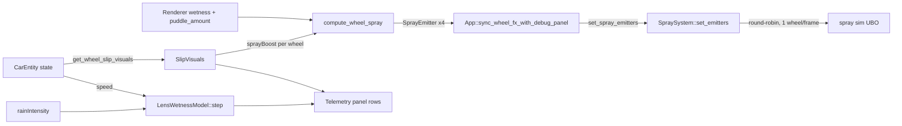
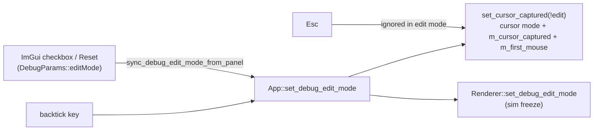
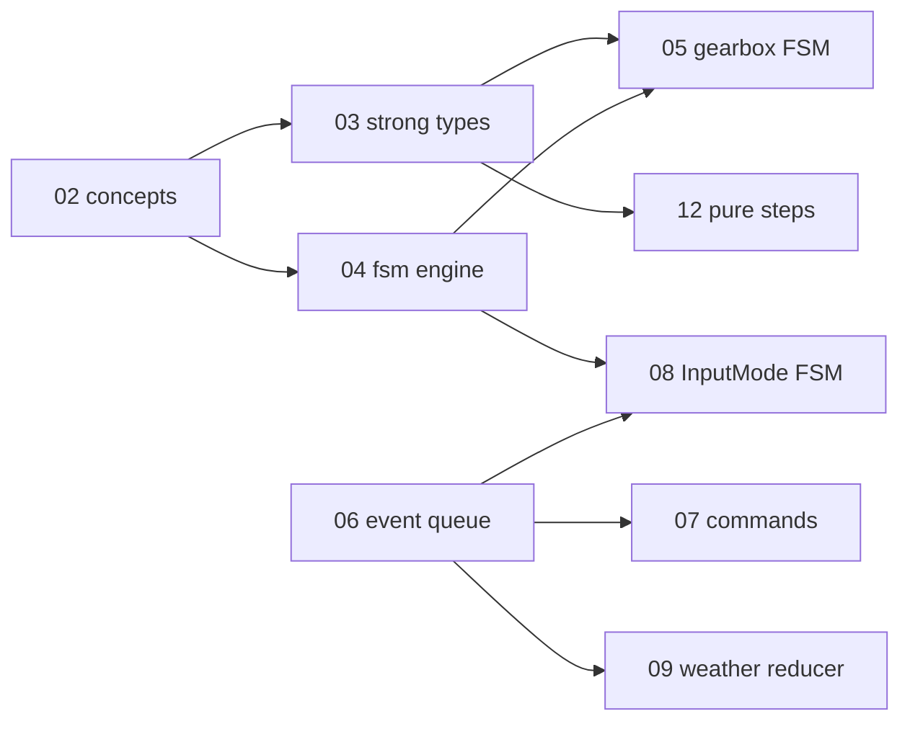

# Changelog — 2026-10

See [CHANGELOG.md](../../CHANGELOG.md) for the index of all entries.

---

### 2026-10-10 — Car rain interactions stub: per-wheel spray, wet-lens model, slip visual hooks (debug-only)

Added a debug-only stub track for car/rain interaction: a pure per-wheel spray emitter model feeding `SpraySystem::set_emitters`, a CPU lamp-lens wetness model, and Phase C slip/skid/spray-boost hooks on `CarEntity`, all behind `SWISH_DEBUG_UI` and off by default.

Technical summary

### Motivation

The wheel plan's Phase C and the rain system both needed the *interfaces* for car-rain coupling before the full
physics/visuals land: spray came from one fixed origin behind the rear axle, lamp lenses had no wet state, and the car
exposed no slip/lockup signal. This track ships real interfaces, a minimal honest implementation of each, GPU-free
Catch2 tests, and debug-panel readouts. Every estimate that is a placeholder carries a `TODO(stub)` naming what the
full version needs. Release output is unchanged: no release shader was edited and no new behaviour is reachable
without `SWISH_DEBUG_UI`.

### Approach

| Slice | Model | Where |
|-------|-------|-------|
| Per-wheel spray | Pure fn: up to four `SprayEmitter`s from wheel state, road wetness, standing water, slip multiplier | [WheelSpray.h](src/renderer/SpraySystem/WheelSpray.h) |
| Spray consumer | `set_emitters` (debug-only): round-robin one wheel per frame; `count == 0` = legacy single rear-axle origin | [SpraySystem.cpp](src/renderer/SpraySystem/SpraySystem.cpp) |
| Lens wetness | CPU ODE per lens, keyed by glTF node name; std140-ready 16-byte POD | [LensWetness.h](src/renderer/WindshieldRainPass/LensWetness.h) |
| Slip visuals | Per-wheel `{slipRatio, slipAngle, sprayBoost, skid}` + aggregate, read-only from car state | [SlipVisuals.h](src/scene/Entity/SlipVisuals.h), [CarEntity.h](src/scene/Entity/CarEntity.h) |
| Debug wiring | Params, TOML tables, Telemetry rows, per-frame glue | [DebugParams.h](src/debug/DebugParams.h), [DebugParamsIO.cpp](src/debug/DebugParamsIO.cpp), [DebugUI.cpp](src/debug/DebugUI.cpp), [App.cpp](src/core/App/App.cpp) |

**Per-wheel spray rate.** With $w$ = road wetness, $s$ = standing water, $g$ = speed gate, $m$ = slip multiplier
(clamped to $[0, 4]$) and $k$ = `standingBase` = 0.5:

$$g = \mathrm{clamp}\!\left(\frac{|v| - v_{min}}{v_{ref} - v_{min}},\,0,\,1\right),\qquad
\text{rate} = \mathrm{clamp}\big(g \cdot w \cdot (k + (1-k)\,s) \cdot m,\ 0,\ 1\big)$$

with $v_{min} = 0.5$ m and $v_{ref} = 20$ m (in WU/s). The rate is exactly 0 when dry ($w = 0$) or stationary
($|v| \le v_{min}$), and non-decreasing in $w$, $s$, speed and $m$. The cone half angle widens linearly with standing
water, 0.35 rad (dry) to 0.60 rad (flooded). Only emitters with rate > 0 are returned, compacted to the front.

**Lens wetness.** Per lens, coverage $c \in [0,1]$ obeys

$$c' = \text{rain}\cdot k_{wet}\,(1-c) \;-\; \big(a\,k_{clear} + k_{drain}\big)\,c,\qquad
a = \mathrm{smoothstep}(v_{start}, v_{full}, v)$$

where $v$ is car speed in m/s. The steady state is

$$c^{*} = \frac{\text{rain}\cdot k_{wet}}{\text{rain}\cdot k_{wet} + a\,k_{clear} + k_{drain}}$$

With the defaults ($k_{wet}=0.35$, $k_{clear}=3$, $k_{drain}=0.02$, $v_{start}=8$, $v_{full}=25$ m/s): parked in rain 1.0
gives $c^* \approx 0.946$; at full airflow in rain 1.0, $c^* = 0.35/3.37 \approx 0.104$; with rain 0, $c^* = 0$ and a
wet lens drains exponentially (coverage snaps to exactly 0 below $10^{-4}$). Derived outputs:
$\text{dropSize} = d_{min} + (d_{max}-d_{min})\,c$ (0 when dry) and $\text{streak} = c \cdot a$.

**Slip visuals.** Slip angles reuse the bicycle-model axle formula (both wheels of an axle share it). Slip ratio is a
force-utilisation proxy, $\kappa \approx 0.25\cdot\mathrm{clamp}(F_x / (\mu F_z), -1, 1)$, not real wheel speed. Spray boost
ramps by smoothstep from 1 to 3, skid triggers at $|\kappa| > 0.20$ or $|\alpha| > 8^\circ$, and everything is
identity (boost exactly 1.0, no skid) below 2 m/s or under the ramp start. The result is read-only and never fed back
into the physics step.

### Debug wiring

- `DebugParams::perWheelSpray` (default `false`): on = App builds four emitters from `CarEntity::get_wheel_contact_world`,
  each evaluated on its own puddle sample, and hands them to the renderer; off = emitters are cleared once on the
  on-to-off edge and the legacy single rear-axle origin is back. SpraySystem is never touched while it is off.
- Lens wetness params (`lensWetRate`, `lensClearSpeedStart`, `lensClearSpeedFull`, `lensClearRate`, `lensDrainRate`)
  default to `LensWetnessParams{}`; slip thresholds (`slip*`) default to `SlipVisualParams{}`. Persisted in the TOML
  tables `[wheel_spray]`, `[lens_wet]` and `[slip]`.
- Telemetry panel rows: per-wheel slip ratio / angle / spray boost / skid (FL, FR, BL, BR) and per-lens
  coverage / drop size / streak for `Headlight_L_Lens`, `Headlight_R_Lens`, `TailLight_L_Lens`, `TailLight_R_Lens`.

### Verification

| Check | Result |
|-------|--------|
| `make test` (release) | 233/233 pass |
| `make test-debug` | 256/256 pass |
| Release `.spv` hashes | 33/33 unchanged; no release shader edited |
| Goldens | untouched (none regenerated) |
| Visual screenshots at rain 0 and 1.0 | **not done** |

New tests: [test_wheel_spray.cpp](tests/test_wheel_spray.cpp) (zero when dry or stationary, monotonic in wetness /
standing water / speed / slip, compaction and bound), [test_lens_wetness.cpp](tests/test_lens_wetness.cpp) (dry, monotonic
in rain, cleared at speed, drains when parked, lens independence, GPU POD layout),
[test_slip_visuals.cpp](tests/test_slip_visuals.cpp) (identity at rest and in rolling, thresholds, monotonic bounded
boost, sign symmetry, fresh `CarEntity` is identity).

### Not done (stub limits)

- Lens wetness is a **CPU model only**: nothing uploads `LensWetnessGpu` to the lighting/emissive path yet.
- No visual verification at rain 0 / 1.0 (project law for visual features); the per-wheel spray look is unjudged.
- Spray still uses the existing sim: cone and size scale are only mapped to lateral spread, and one wheel spawns per
  frame. A real per-emitter cone needs a `spray_sim.comp` change, which moves the release `.spv` hashes.
- Slip ratio is a force proxy and slip angle is per-axle; there is no wheel-speed state yet.
- Full-version TODOs are listed in [docs/rain/README.md](docs/rain/README.md) and [docs/wheels/README.md](docs/wheels/README.md).

### File changes

| File | Change |
|------|--------|
| [src/renderer/SpraySystem/WheelSpray.h](src/renderer/SpraySystem/WheelSpray.h) | New: `SprayEmitter`, `WheelSprayParams`, `wheel_spray_rate`, `compute_wheel_spray` (pure, GPU-free) |
| [src/renderer/SpraySystem/SpraySystem.h](src/renderer/SpraySystem/SpraySystem.h) | Includes `WheelSpray.h`; debug-only `set_emitters` and emitter state |
| [src/renderer/SpraySystem/SpraySystem.cpp](src/renderer/SpraySystem/SpraySystem.cpp) | `update` uses round-robin per-wheel emitters when set (debug-only); `set_emitters` clamps to 4 |
| [src/renderer/Renderer/Renderer.h](src/renderer/Renderer/Renderer.h) | Forward-declares `SprayEmitter`; debug-only `set_spray_emitters` |
| [src/renderer/Renderer/Renderer_State.cpp](src/renderer/Renderer/Renderer_State.cpp) | `set_spray_emitters` forwards to `SpraySystem::set_emitters` |
| [src/renderer/WindshieldRainPass/LensWetness.h](src/renderer/WindshieldRainPass/LensWetness.h) | New: `LensWetnessModel`, `LensWetnessParams/State`, 16-byte `LensWetnessGpu` |
| [src/scene/Entity/SlipVisuals.h](src/scene/Entity/SlipVisuals.h) | New: per-wheel slip / skid / spray-boost model and `compute_slip_visuals` |
| [src/scene/Entity/CarEntity.h](src/scene/Entity/CarEntity.h) | Includes `SlipVisuals.h`; `get_wheel_slip_visuals` (const, read-only) |
| [src/debug/DebugParams.h](src/debug/DebugParams.h) | `perWheelSpray`, `lens*` and `slip*` tunables, `telemetryWheel` / `telemetryLens` readouts |
| [src/debug/DebugParamsIO.cpp](src/debug/DebugParamsIO.cpp) | TOML save/load for `[wheel_spray]`, `[lens_wet]`, `[slip]` |
| [src/debug/DebugUI.cpp](src/debug/DebugUI.cpp) | Per-wheel spray checkbox, lens sliders, slip and lens Telemetry rows |
| [src/core/App/App.h](src/core/App/App.h) | `LensWetnessModel` member, spray-active flag, `sync_wheel_fx_with_debug_panel` |
| [src/core/App/App.cpp](src/core/App/App.cpp) | `sync_wheel_fx_with_debug_panel`: slip telemetry, per-wheel emitters, lens step |
| [tests/CMakeLists.txt](tests/CMakeLists.txt) | Registers the three new test files |
| [tests/test_wheel_spray.cpp](tests/test_wheel_spray.cpp) | New: 4 test cases |
| [tests/test_lens_wetness.cpp](tests/test_lens_wetness.cpp) | New: 5 test cases |
| [tests/test_slip_visuals.cpp](tests/test_slip_visuals.cpp) | New: 5 test cases |
| [tasks/todo.md](tasks/todo.md) | "Stub: car rain interactions" checklist ticked |
| [docs/rain/README.md](docs/rain/README.md) | New section: per-wheel spray, lens wetness, stub status |
| [docs/wheels/README.md](docs/wheels/README.md) | Phase C slip visual hooks note |
| [docs/changelog/2026-10.md](docs/changelog/2026-10.md) | This entry |

**Label:** Largely AI-generated (Claude). Please review.

---

### 2026-10-01 — Quick fixes before the typed-C++ refactor: input/edit-mode, weather, resize, GLFW teardown

Fixed nine bugs found by the refactor audit: cursor capture and debug edit mode drifting apart, rain leaving the weather preset stale, the resize flag cleared before the renderer read it, the fog/haze sliders labelled km while showing metres, a duplicated shadow line in the debug dump, a double `glfwTerminate`, `EnumCycle` accepting `Count == 0`, and dead Treadmill code and comments.

Technical summary

### Motivation

Phase P0.1 of the typed-C++ system refactor ([tasks/todo.md](tasks/todo.md)). Three read-only audits found these
while mapping the implicit state machines. The owner chose to have them fixed directly, before the refactor, as a
behaviour-change phase on its own branch (`refactor/00-quick-fixes`), so later refactor phases stay behaviour-preserving.

### Fixes

| Bug | Root cause | Fix |
|-----|-----------|-----|
| Esc, then backtick twice, leaves the cursor disabled while mouse deltas are dropped; in edit mode, panel drags turned the camera | `on_toggle_debug_edit` set the GLFW cursor mode directly and never updated `m_cursor_captured`; the ImGui checkbox and Reset wrote `DebugParams::editMode` behind App's back | One writer, `App::set_debug_edit_mode`, which routes through `set_cursor_captured(!edit)`; `sync_debug_edit_mode_from_panel()` at the top of each frame follows a panel-side change; Esc is ignored while in edit mode |
| Rain switched the sky to Cloudy only after a G press, and the next G press seemed to do nothing | A `m_clear_day` flag that started false and was set only by `set_weather_preset`; `Renderer::set_clear_day` changed the renderer's preset without updating `App::m_weather_preset` | Pure `preset_for_rain(preset, rain)` + `is_clear_day` in [WeatherPreset.h](src/scene/WeatherPreset.h); rain goes through `set_weather_preset`; `m_clear_day` and `Renderer::set_clear_day` deleted |
| R did nothing visible in the debug-UI build | `apply_debug_params` copies the rain slider into the renderer every frame | `set_rain_level` also writes `DebugParams::rainIntensity` (debug-only) |
| Window resizes relied on `VK_ERROR_OUT_OF_DATE` alone | `App::poll_events` cleared the resize flag before `drawFrame`'s present check read it | App no longer touches the flag; `Renderer::recreateSwapchain` is its only consumer (any recreate satisfies a pending resize) |
| Fog/haze sliders showed metres labelled "km" | `wu / 1000` is metres (1 m = 1000 WU) | `uu::to_m` / `uu::m`, labels "(m)"; slider numbers unchanged |
| Shadow line printed twice in the dump | A stale copy without `lightSize` | Removed the stale line |
| `glfwTerminate` called twice | `App::shutdown` and `~Window` both run `Window::cleanup` | `m_glfwInitialized` guard |
| `next_enum` divided by zero for `Count == 0` | `CountedEnum` only checked that `Count` exists | Concept also requires `Count > 0` (static_assert test) |
| Helicopter camera printed a meaningless gantry distance | `App::m_treadmill` was never updated after Phase 3a, so `intro_len()` was 0 | Removed the message and the `m_treadmill` member; stale Treadmill comments now name `CorridorDriver` |

### Edit-mode ownership after the fix

The full state-machine version of this is chapter 08 of the tutorial (`InputMode{Driving, CursorFree, DebugEdit}`).

### Verification

- Release: 219 of 219 tests pass, including the new weather test. Debug UI: 242 of 242 pass. 0 warnings.
- 33 of 33 release `.spv` hashes match `tests/golden/release_spv.sha256`.
- Debug-UI runtime start and shutdown: the log is clean.
- Window-only screenshots were **not** taken. The app's main window is missing from `CGWindowList` in this session, so the key-driven checks (R/G/Esc/backtick, resize) are still open for a manual run.

### Files

| File | Change |
|------|--------|
| [src/core/App/App.cpp](src/core/App/App.cpp) | rain → `preset_for_rain` + debug slider sync; per-frame panel edit-mode sync; resize flag left to the renderer; gantry message removed |
| [src/core/App/App.h](src/core/App/App.h) | `set_debug_edit_mode` / `sync_debug_edit_mode_from_panel`; removed `m_clear_day`, `m_treadmill`, Treadmill include |
| [src/core/App/AppInput.cpp](src/core/App/AppInput.cpp) | edit mode through `set_cursor_captured`; Esc ignored in edit mode |
| [src/core/App/AppInit.cpp](src/core/App/AppInit.cpp) | stale Treadmill comment |
| [src/core/Window/Window.h](src/core/Window/Window.h), [Window.cpp](src/core/Window/Window.cpp) | `m_glfwInitialized` guard; stale tutorial TODO comments replaced by real ones |
| [src/renderer/Renderer/Renderer.cpp](src/renderer/Renderer/Renderer.cpp) | `recreateSwapchain` clears the resize flag |
| [src/renderer/Renderer/Renderer_Frame.cpp](src/renderer/Renderer/Renderer_Frame.cpp) | present step no longer clears the flag itself |
| [src/renderer/Renderer/Renderer.h](src/renderer/Renderer/Renderer.h), [Renderer_State.cpp](src/renderer/Renderer/Renderer_State.cpp) | `set_clear_day` removed |
| [src/debug/DebugUI.cpp](src/debug/DebugUI.cpp) | fog/haze in metres via `Units.h`; duplicate dump line removed |
| [src/scene/WeatherPreset.h](src/scene/WeatherPreset.h) | `is_clear_day`, `preset_for_rain` (constexpr) |
| [src/utils/meta/EnumCycle.h](src/utils/meta/EnumCycle.h) | `CountedEnum` requires `Count > 0` |
| [src/scene/Entity/CarEntity.h](src/scene/Entity/CarEntity.h), [CarEntity.cpp](src/scene/Entity/CarEntity.cpp) | stale Treadmill comments |
| [tests/test_rain.cpp](tests/test_rain.cpp) | rain-vs-preset regression test |
| [tests/utils/test_meta_EnumCycle.cpp](tests/utils/test_meta_EnumCycle.cpp) | `Count == 0` rejected |
| [tasks/todo.md](tasks/todo.md) | typed-C++ refactor plan; P0.0 ticked |

---

### 2026-10-01 — C++23: language standard bumped from C++20, nothing else changed

Raised `CMAKE_CXX_STANDARD` (and `toml_baker`'s `cxx_std`) from 20 to 23 so the typed-C++ tutorial can use `std::expected`, deducing `this`, `std::to_underlying` and `if consteval`. No source changes, and the outputs are identical.

Technical summary

### Motivation

P0.2 of the typed-C++ refactor ([tasks/todo.md](tasks/todo.md)). The owner chose C++23 now, done as a bump on its own so
any toolchain fallout has exactly one cause.

### Change

- [CMakeLists.txt](CMakeLists.txt): `CMAKE_CXX_STANDARD 23`; `toml_baker` `cxx_std_23`. `CMAKE_CXX_EXTENSIONS` stays at
  its default, so the flag is `-std=gnu++23`, matching the previous `gnu++20`. Vendored targets that pin their own
  standard (`c++11`, `gnu++17`) are untouched.
- [.clangd](.clangd): comment updated. `.clang-format` keeps `Standard: c++20`. clang-format has no `c++23` value, and
  `Latest` would reformat files, which is outside this phase.

### Verification

| Check | Result |
|-------|--------|
| Release `make test` (AppleClang 21) | 219/219, 0 warnings |
| Debug-UI `make test-debug` | 242/242, 0 warnings |
| Golden car trajectory + mesh hashes | pass (part of the suites above) |
| 33 release `.spv` hashes | 33/33 OK |
| Arch GCC | not run yet (needs the `arch` host) |

### Files

| File | Change |
|------|--------|
| [CMakeLists.txt](CMakeLists.txt) | C++ standard 20 → 23 (app and `toml_baker`) |
| [.clangd](.clangd) | comment: C++23 |
| [tasks/todo.md](tasks/todo.md) | P0.2 ticked |

---

### 2026-10-01 — Typed-C++ tutorial: index and M1 chapters 01-12, plus doc drift fixes

Added `docs/tutorials/typed-cpp/`: a series index and 12 chapters, each the spec for one M1 refactor phase. Also fixed six stale comments and docs found while writing them.

Technical summary

### Motivation

P0.6 (tutorial scaffold) and part of P0.5 (doc drift) of the typed-C++ refactor ([tasks/todo.md](tasks/todo.md)). The owner
implements each chapter; Claude scaffolds the branch, skeleton and failing tests, then reviews and runs the gate. Three
docs agents wrote the chapters in parallel, and every file:line anchor was read from the code at `33d2c03`. Each file
says it was drafted with AI assistance and that owner review is pending.

### What the chapters found in the code (decisions for the owner)

- **Car golden is tolerance-based.** It checks 1e-3 abs + 1e-3 rel, so passing it doesn't prove the bits are unchanged.
  Ch03 and Ch12 add a Clang-only bit-exact fixture, recorded from the phase's base commit.
- **Heading wrap.** `fmod(y + 180, 360) - 180` gives $(-540°, 180°)$, not $(-180°, 180°]$, and the golden records
  yaw $-306.69°$. Ch12 keeps a verbatim legacy wrap; fixing it is B12.
- **Behaviour changes split out as B-phases:** the FOV-kick reset (B10); rain blocking a clear-day sky on G, and the
  debug Reset rewriting rain (B9); FocusLost freeing the cursor (Ch08, later).
- **Ch01:** the `i < 2` loops in `WindshieldRainPass.cpp` iterate the wetness ping-pong pair, not frames in flight.
  The real 2-frame assumption is `TaaPass.cpp:284`.
- **Ch07:** golden scenario `throttle_then_brake` stops at step 450 and would reverse under a held Down key, so it stays
  on the P0.4 test accessor.

### Chapter map

### Files

| File | Change |
|------|--------|
| [docs/tutorials/typed-cpp/00-index.md](docs/tutorials/typed-cpp/00-index.md) | series map: phases, gate, dependencies, conventions |
| `docs/tutorials/typed-cpp/01-…12-*.md` | chapters 01-12 (static_assert, concepts, strong types, fsm engine, gearbox FSM, variant events, X-macro commands, InputMode FSM, weather reducer, camera variant states, RAII/ownership, pure step functions); chapters 05 and 08 aligned to the Ch03/Ch04 API names |
| [docs/README.md](docs/README.md) | row for the series |
| [src/core/README.md](src/core/README.md) | resize flag: read-only `wasResized()`, `poll_events` no longer consumes it |
| [tests/golden/README.md](tests/golden/README.md) | `.spv` hashes unchanged through C++20/23 |
| [src/core/CameraController/CameraController.h](src/core/CameraController/CameraController.h) | comment: FOV-kick baseline is not reset (was claimed) |
| [src/scene/Corridor/CorridorDriver.h](src/scene/Corridor/CorridorDriver.h) | comment: App snaps Y, not `update` |
| [src/scene/README.md](src/scene/README.md) | heading wrap range is $(-540°, 180°)$ |
| [src/utils/math/Smoothing.h](src/utils/math/Smoothing.h) | comment: CarEntity's wrap is not the same trick |

