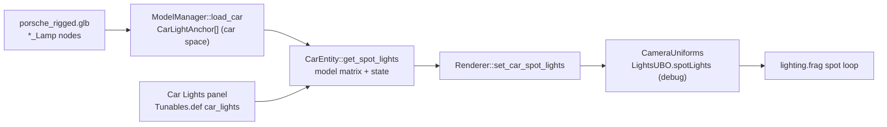
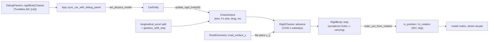
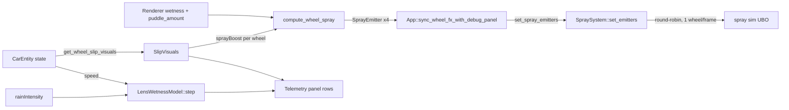
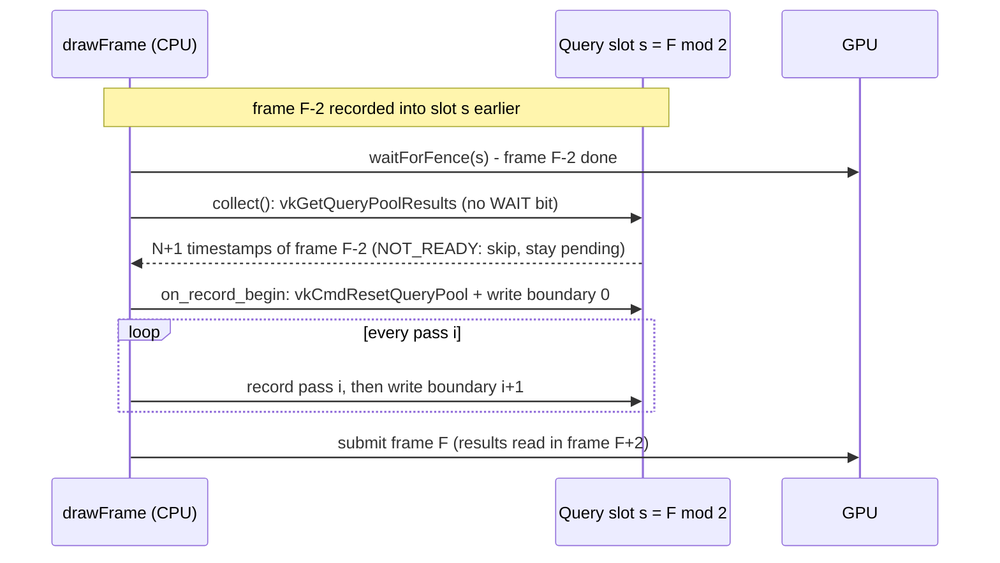
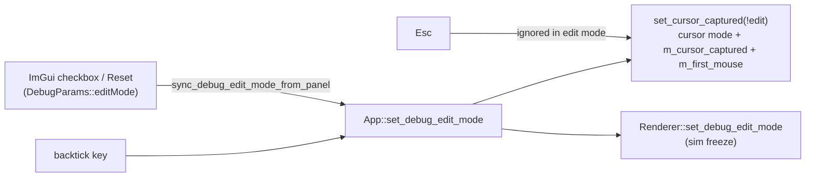
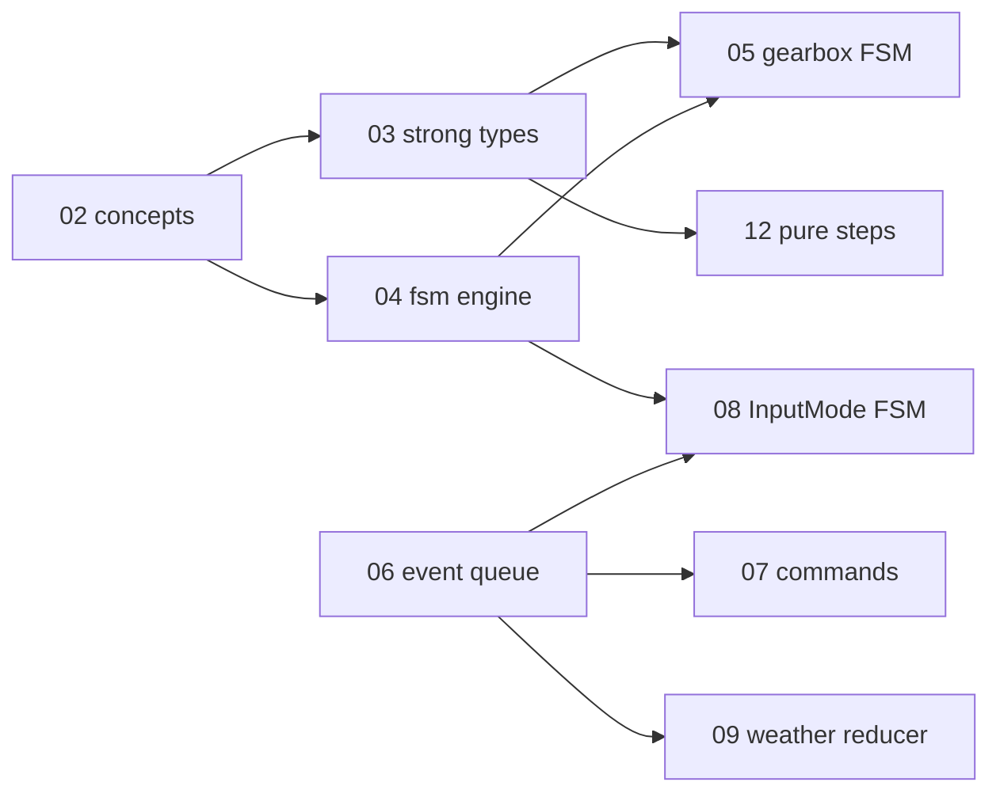
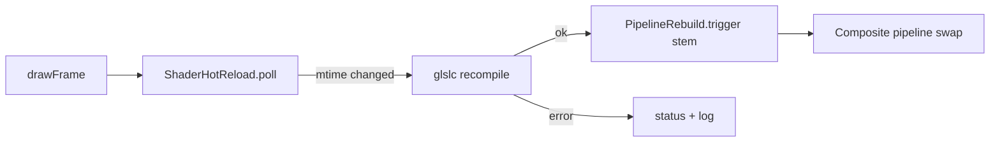

# Changelog — 2026-10

See [CHANGELOG.md](../../CHANGELOG.md) for the index of all entries.

---

### 2026-10-10 — Car lights S1–S3: headlight / tail / brake spot lights (debug-only)

Added debug-only car spot lights: a car GLB with named `*_Lamp` nodes (the new Blender rig `assets/blend/porsche_rigged.glb`) now throws two headlight beams and red tail / brake glow onto the road, switched from a new "Car Lights" debug panel; off by default, release output unchanged.
### 2026-10-10 — Stub 6-DOF rigid-body chassis on four spring-damper wheel contacts (debug-only, bicycle stays default)

Added a debug-UI "Physics model" toggle that drives the car's pose, including heave, pitch and roll, from a generic 6-DOF `RigidBody` sitting on four spring-damper wheel contacts with friction-circle-limited tire forces; the bicycle model remains the default and the release build is unchanged.
### 2026-10-10 — Driving realism tools (input seam, telemetry/replay, physics bench)

Added a device-agnostic `InputFrame` input seam with a gamepad source, a debug-only telemetry ring with CSV export and input replay, a force-feedback target readout, and a GPU-free physics bench that prints 0-100, 100-0, top-speed and skidpad figures against 992 Turbo S targets.
### 2026-10-10 — Car rain interactions stub: per-wheel spray, wet-lens model, slip visual hooks (debug-only)

Added a debug-only stub track for car/rain interaction: a pure per-wheel spray emitter model feeding `SpraySystem::set_emitters`, a CPU lamp-lens wetness model, and Phase C slip/skid/spray-boost hooks on `CarEntity`, all behind `SWISH_DEBUG_UI` and off by default.
### 2026-10-10 — Stub Vulkan render tools: GPU profiler, frame capture, shader hot-reload, pass declarations

Added four debug-only (`SWISH_DEBUG_UI`) render tools as working stubs: a per-pass GPU timestamp profiler, an F12 frame capture to PPM/PFM, an mtime-polling shader hot-reload with a Composite rebuild hook, and per-pass image read/write declarations with a read-before-write validator, all surfaced in a new "Render tools" debug panel.

<details><summary>Technical summary</summary>

### Motivation

User goal (2026-10-10): lights on the car, with rain on the lenses while driving. Plan and spec:
[tasks/todo.md](tasks/todo.md) "Car lights". This entry covers S0–S3; lens glow (S5) and rain on the lenses (S6) are open.

### What changed

- **Asset (S0).** `assets/blend/porsche_rigged.blend` → `porsche_rigged.glb` (untracked, made in Blender): real scale
  (wheelbase 2.259 m, tyre radius 0.320 m), named pivots, and per-lamp nodes `Headlight_L/R`, `TailLight_L/R`,
  `BrakeLight_L/R`, `RearLightBar`, each with `_Lens` / `_Housing` / `_Emitter` meshes and a `<Anchor>_Lamp`
  KHR_lights_punctual node whose local −Z is the beam (the Empty's own −Z is not, after the exporter's Y-up swap).
- **Loader + CPU (S1).** [src/scene/Entity/CarLights.h](src/scene/Entity/CarLights.h) (new, header-only): exact-name
  `_Lamp` → `CarLightKind`, and `car_spot_lights(anchors, model, state, params)`. `ModelManager::load_car` reads the
  lamp nodes into car space with the same RootNode-relative, $(x,y,z)\to(z,y,-x)$, grounded transform as the vertices.
- **GPU (S2).** `SpotLightData[8]` + `numSpotLights` appended to `LightsUBO` and `lights.glsl`, and a spot loop in
  `lighting.frag`, all under `#ifdef SWISH_DEBUG_UI`. Falloff = the point lights' windowed bounded inverse-square with
  $d_{ref}=0.15R$, times a cone, plus the street lamps' wet halo:

$$
c=\mathrm{smoothstep}(\cos\theta_o,\cos\theta_i,-\hat L\cdot\hat d),\quad
att=\mathrm{win}(d/R)\,\frac{d_{ref}^2}{d_{ref}^2+d^2}\,c,\quad
L_o \mathrel{+}= C I\,att\,\big[(k_D\,\tfrac{\rho}{\pi}+f_s)\,N\!\cdot\!L + att\,w\,k_{halo}\big]
$$

- **Wiring (S3).** `Tunables.def` group `car_lights` (11 rows, NOPUSH): enabled (default **false**), headlights / tail
  on, hold-brake, intensities, ranges, beam half-angles. `App::push_car_to_renderer` builds the lights each frame
  (brake lamps follow `CarEntity::get_brake()`) → `Renderer::set_car_spot_lights` → `CameraUniforms`.



### Verification

`make test-debug` 246/246, `make test` 223/223, 0 first-party warnings, release `.spv` 33/33 unchanged. New
`tests/test_car_lights.cpp` (name mapping, all-off identity, per-switch lamps, world transform); tunable-table counts
updated in `tests/test_debug_params_io.cpp`. Looked at it: window-only screenshots with a temporary night force
(sun / ambient / IBL ≈ 0, chase cam, panel hidden; reverted): headlight pool on the road ahead, red tail/brake pool
behind, 120 fps either way. Lights-off screenshot matches today's image. Not yet done: rain 0 / 1.0 pair (S4).
Noted, pre-existing and unrelated: the large dark patch around the car in the debug build's default preset shows
with the original `porsche.glb` too.

### Files

| File | Change |
|------|--------|
| [src/scene/Entity/CarLights.h](src/scene/Entity/CarLights.h) | new: anchors, state, params, name map, `car_spot_lights` |
| [src/scene/SceneTypes.h](src/scene/SceneTypes.h) | `SpotLightDesc`; debug-only `SpotLightData` + `LightsUBO` fields |
| [src/scene/ModelManager/ModelManager.cpp](src/scene/ModelManager/ModelManager.cpp) | read `_Lamp` nodes into car space |
| [src/scene/Entity/CarEntity.h](src/scene/Entity/CarEntity.h) | light anchors, `get_brake`, `get_spot_lights` |
| [src/renderer/CameraUniforms/CameraUniforms.h](src/renderer/CameraUniforms/CameraUniforms.h) / [.cpp](src/renderer/CameraUniforms/CameraUniforms.cpp) | store + upload spot lights (debug) |
| [src/renderer/Renderer/Renderer.h](src/renderer/Renderer/Renderer.h), [Renderer_State.cpp](src/renderer/Renderer/Renderer_State.cpp) | `set_car_spot_lights` |
| [src/core/App/App.cpp](src/core/App/App.cpp) | per-frame car spot lights from the panel (debug) |
| [src/debug/Tunables.def](src/debug/Tunables.def), [src/debug/DebugUI.cpp](src/debug/DebugUI.cpp) | `car_lights` group + "Car Lights" header + dump |
| [shaders/common/lights.glsl](shaders/common/lights.glsl), [shaders/lighting.frag](shaders/lighting.frag) | debug-only spot struct + loop |
| [tests/test_car_lights.cpp](tests/test_car_lights.cpp), [tests/CMakeLists.txt](tests/CMakeLists.txt), [tests/test_debug_params_io.cpp](tests/test_debug_params_io.cpp) | new test; counts |
| [tasks/todo.md](tasks/todo.md) | "Car lights" spec + slices |

**Label:** Largely AI-generated (Claude), checked by build, tests and screenshots. Please review.
The bicycle model ([Bicycle.h](src/scene/Entity/Bicycle.h)) is planar: pitch, roll and heave are never state, and `App::update_car` snaps body Y to the road. A full chassis model (see [docs/lessons-from-chrono/](docs/lessons-from-chrono/)) is out of scope today, so this is a deliberately thin stub that proves the plumbing: a reusable rigid-body integrator in `utils/`, a four-contact chassis on top of it, and a debug-gated switch in `CarEntity`. Everything is behind `SWISH_DEBUG_UI` and a default-`false` tunable, so the identity path (bicycle) reproduces prior behaviour exactly.

### Approach

| Layer | File | Role |
|-------|------|------|
| Integrator | [src/utils/physics/RigidBody.h](src/utils/physics/RigidBody.h) | GLM-only 6-DOF body: state in the world frame, body-frame inertia, force/torque accumulators, `euler_yxz_from_rotation` for the engine's `Ry Rx Rz` model-matrix order |
| Chassis | [src/scene/Entity/RigidChassis.h](src/scene/Entity/RigidChassis.h) | `PhysicsModel` enum, `make_chassis_params`, four spring-damper contacts, tire forces at the patch, 1/240 s substeps |
| Wiring | [src/scene/Entity/CarEntity.cpp](src/scene/Entity/CarEntity.cpp), [CarEntity.h](src/scene/Entity/CarEntity.h) | `set_physics_model`, `init_rigid_body`, `update_rigid_body` (all `#ifdef SWISH_DEBUG_UI`) |
| Switch | [src/debug/Tunables.def](src/debug/Tunables.def), [src/debug/DebugUI.cpp](src/debug/DebugUI.cpp), [src/core/App/App.cpp](src/core/App/App.cpp) | `rigidBodyChassis` bool (`[car] rigid_body_chassis`, default `false`), "Physics" ImGui header, App maps it to `set_physics_model` |

**Integrator (semi-implicit / symplectic Euler).** Velocity first, then position with the new velocity:

$$v_{n+1} = v_n + h\,\frac{F}{m}, \qquad x_{n+1} = x_n + h\,v_{n+1}$$

Rotation carries angular **momentum** rather than $\omega$. With $I_w = R\,I\,R^\top$:

$$L_{n+1} = L_n + h\,\tau, \qquad \omega = I_w^{-1} L, \qquad q_{n+1} = \exp\!\big(h\,\omega_{\text{mid}}\big)\,q_n$$

where $\omega_{\text{mid}}$ is evaluated at the half-step pose (midpoint rule) and $q$ is renormalised. This is the gyroscopic term: Euler's equation $I\dot\omega = \tau - \omega \times I\omega$ is equivalent to $\dot L = \tau$ in the world frame, so a torque-free asymmetric body conserves $|L|$ to float rounding. An explicit $\omega \times I\omega$ term was tried in design and rejected: it gains energy for a spinning asymmetric body, and the implicit form measured a $-4\%$ drift in $|L|$ over 10 s at $h = 1/240$ s.

**Contact springs.** For wheel $i$ with hub height $y_{h}$ and radius $r$, ground height $y_g$:

$$\text{pen}_i = y_g - (y_{h,i} - r_i) + \delta_i, \qquad F_{n,i} = \max\!\big(0,\; k_i\,\text{pen}_i - c_i\,v_{y,i}\big)$$

$k_i, c_i$ come from the Phase-B design inputs through `spring_from_ride_freq` (`SuspensionParams` $f_n$, $\zeta$), so a mass retarget re-derives them. The preload $\delta_i = F_{\text{static},i}/k_i$ makes the as-modelled ride height the equilibrium, so the mesh does not sink on switch-on. With $\delta = 0$ and four equal springs the static sag is the textbook value:

$$s = \frac{m g}{4k} \qquad (k = 40\,000\ \text{N/m},\ m = 1670\ \text{kg} \Rightarrow s \approx 0.1024\ \text{m})$$

Stability: the stiffest mode is the rear corner, $\omega_n h = 2\pi \cdot 2.0 / 240 = 0.052$, far below the explicit-spring bound.

**Tire force at the patch** (hub minus $r$ up). Lateral force is a saturating linear slip model, then longitudinal force is clamped to the *remaining* friction circle (`friction_circle_fx_max` in [Tire.h](src/scene/Entity/Tire.h)), so cornering and drive/brake share one budget per wheel:

$$F_y = \operatorname{clamp}\!\left(-\frac{C_\alpha\, v_s}{|v_f| + v_{\text{ref}}},\ \pm\mu F_n\right), \qquad |F_x| \le \sqrt{(\mu F_n)^2 - F_y^2}$$

The per-axle longitudinal request comes from the existing `longitudinal_accel` (`split`), shared left/right in proportion to $F_n$. Aero drag acts at the CoG.
Driving was keyboard-only (`CarEntity::handle_input` read GLFW keys directly), there was no way to capture or replay a drive, and car-physics realism was judged by eye. Three additive tools close that gap without touching the physics model: (1) an input seam so any device can drive the car, (2) record / CSV / replay for reproducible runs, (3) a bench that measures standard figures of merit on the real `CarEntity::update`. This is a stub track; it is additive to the planned Ch07 `Commands.def` / `InputSampler` work, which will absorb `InputFrame`.

### Approach

| Piece | What it does |
|-------|--------------|
| Input seam | [InputFrame.h](src/utils/input/InputFrame.h): `InputFrame{steer, throttle, brake, steer_mode}` and `IInputSource`. `SteerMode::Rate` (keyboard: only the sign of `steer` matters, ramp at the steer rate, faster return to centre) vs `SteerMode::Target` (analog: `steer * max-lock` is a target angle approached at the steer rate). |
| `CarEntity` entry point | `CarEntity::apply_input_frame(const InputFrame&, float dt)` in [CarEntity.cpp](src/scene/Entity/CarEntity.cpp). `handle_input` now builds a `Rate` frame from the arrow keys (same UP-over-DOWN, LEFT-over-RIGHT precedence) and calls it, so keyboard and every other source share one path. Throttle wins over brake; brake while ~stopped selects reverse. New read-only accessors `get_lateral_velocity`, `get_yaw_rate`, `get_wheel_spin`, `get_corner_suspension` in [CarEntity.h](src/scene/Entity/CarEntity.h). |
| Gamepad mapping | [GamepadMapping.h](src/utils/input/GamepadMapping.h): pure deadzone + expo curve + trigger remap (no GLFW). Feeder: [GlfwGamepadSource.cpp](src/core/Input/GlfwGamepadSource.cpp) (`glfwGetGamepadState`, joystick 0; all-zero `Target` frame when unplugged). Not in the test target. |
| Telemetry | [TelemetryRing.h](src/utils/telemetry/TelemetryRing.h) / [TelemetryRing.cpp](src/utils/telemetry/TelemetryRing.cpp): fixed-capacity ring (default 3600 samples, no allocation after construction), CSV write/read (`%.9g`, exact float round-trip), timestamped path under `build-debug/telemetry/`. |
| Replay | [ReplayDriver.h](src/utils/telemetry/ReplayDriver.h): `IInputSource` over the recorded `InputFrame`s; same inputs + same dt + same build reproduce a run bit-for-bit on a fresh car (test-pinned). |
| Recorder | [TelemetryRecorder.h](src/debug/TelemetryRecorder.h): `sample_from(car, t, input)` is ungated and pure; the `TelemetryRecorder` class is `#ifdef SWISH_DEBUG_UI`. |
| App wiring | [AppDrivingTools.cpp](src/core/App/AppDrivingTools.cpp) (empty without `SWISH_DEBUG_UI`): `step_driving_tools(dt)` returns `false` for keyboard + idle recorder, leaving `handle_input` untouched; otherwise samples gamepad / replay / keyboard frame, runs `apply_input_frame` + `update`, then `on_step`. `sync_driving_tools_panel` handles record/replay edges, CSV export and readouts. Hooked from [App.cpp](src/core/App/App.cpp), members in [App.h](src/core/App/App.h). |
| Debug panel | "Driving tools" header in [DebugUI.cpp](src/debug/DebugUI.cpp) over `drv*` fields in [DebugParams.h](src/debug/DebugParams.h): input source, deadzone/expo, live axis bars, record / replay / export, ring + replay position, FFB readout. Defaults: keyboard, not recording. |
| FFB target | [ForceFeedback.h](src/scene/Entity/ForceFeedback.h): `self_aligning_torque()` plus `IForceFeedbackSink` / `NullForceFeedbackSink`. Computed and displayed only; **no device output**. |
| Bench | [Bench.h](tests/bench/Bench.h): fixed $dt = 1/120$ s loop over the real `CarEntity::update` through `apply_input_frame`; scenarios `zero_to_100`, `braking_100_0`, `top_speed`, `skidpad_40m`. |

### Math

Gamepad stick response: per-axis scaled deadzone with half-width $d$, then an odd expo blend with $e \in [0,1]$:

$$
u(x) = \operatorname{sgn}(x)\,\frac{\max(|x|-d,\,0)}{1-d},
\qquad
y(x) = (1-e)\,u + e\,u^{3}
$$

$u$ is continuous, 0 inside the deadzone and reaches $\pm 1$ at $|x| = 1$; $y$ is monotone with $y(0)=0$, $y(\pm1)=\pm1$. Defaults $d = 0.08$, $e = 0.35$. Triggers (GLFW rest $-1$, pressed $+1$) are remapped $t = (raw+1)/2$, then a one-sided deadzone (0.05).

Front-axle self-aligning torque (bicycle model, right-positive):

$$
M_z = -F_{y,f}\; t_p\; k_{\text{fade}},
\qquad
t_p = t_0\,\max\!\Bigl(0,\;1-\frac{|\alpha_f|}{\alpha_{sat}}\Bigr),
\qquad
\alpha_{sat} = \frac{\mu\, m g\, b/L}{C_{\alpha,f}}
$$

$$
\alpha_f = \frac{v_y + a\,r}{\max(|v_x|,1)} - \operatorname{sgn}(v_x)\,\delta,
\qquad
k_{\text{fade}} = \operatorname{clamp}\!\Bigl(\frac{|v_x|}{3\ \text{m/s}},0,1\Bigr)
$$

Pneumatic trail $t_p$ collapses linearly to 0 at the axle's saturation slip, so the wheel goes light at the limit. Defaults $t_0 = 0.035$ m; the normalized output is $M_z / 6\ \text{N m}$ clamped to $[-1,1]$. $F_{y,f}$ comes from the existing `axle_lateral_forces`, and $\mu$ is the live `effective_mu` (wet-grip lightening follows for free).

### Data flow



### Behaviour notes

- **Default and release unchanged.** `rigidBodyChassis` defaults to `false`; `set_physics_model` and all rigid-body code compile only under `SWISH_DEBUG_UI`. In the release build `App::car_owns_height` is a `constexpr false`, so the Y snap runs exactly as before.
- **Y snap skipped in rigid mode.** [App.cpp](src/core/App/App.cpp) `update_car` does not snap `pos.y` to the road when the rigid body is active; the chassis owns heave.
- **Switching models** re-seeds the body from the entity pose and the bicycle's speed state; switching back zeroes pitch and roll.
- **Origin rebase / teleport:** the body follows any external shift of `m_position` via `m_rigid_last_pos`.
- **Stub limits** are marked `TODO(stub)`: flat ground plane (no per-wheel road query), no unsprung mass or bump stops, no anti-roll bars or aero downforce, no wheel-spin DOF or Pacejka curve, patch taken straight below the hub, box-approximation inertia, no standstill stick model.

### Tests

| Test | Pins |
|------|------|
| [tests/utils/test_physics_RigidBody.cpp](tests/utils/test_physics_RigidBody.cpp) (6 cases, `[rigidbody]`) | box inertia near 3050 kg m² yaw; free fall matches the semi-implicit solution; accumulators clear and a point force adds its moment; asymmetric torque-free spin conserves $L$; principal-axis spin stays pure; Euler extraction inverts `Ry Rx Rz` |
| [tests/test_rigid_chassis.cpp](tests/test_rigid_chassis.cpp) (5 cases, `[rigidchassis]`) | settles to sag $= mg/4k$; design ride height is the equilibrium; damped energy never increases; $\lVert(F_x,F_y)\rVert \le \mu F_n$; steering yaws a moving chassis |
| [tests/test_debug_params_io.cpp](tests/test_debug_params_io.cpp) (1 case added) | `rigidBodyChassis` persists under `[car]` and defaults to bicycle |

Verification run: `make test` 230/230, `make test-debug` 254/254, 33/33 `.spv`, `-Werror` debug-UI build clean. **Not verified:** no GUI/visual check of the toggle was done (see [tasks/stub-report.md](tasks/stub-report.md)).
    KB["Keyboard<br/>(handle_input, Rate)"] --> IF
    GP["GlfwGamepadSource<br/>(deadzone + expo, Target)"] --> IF
    RP["ReplayDriver<br/>(recorded frames)"] --> IF
    BN["Bench drive callbacks"] --> IF
    IF["InputFrame"] --> AIF["CarEntity::apply_input_frame<br/>+ update(dt)"]
    AIF --> SF["sample_from(car, t, input)"]
    SF --> RING["TelemetryRing"]
    RING --> CSV["CSV export / import"]
    RING --> RP
    AIF --> FFB["self_aligning_torque<br/>(readout only)"]
```

### Bench results

Targets are documented 992 Turbo S figures printed in a table, **not** failing tests. `test_bench.cpp` asserts only that each scenario finishes, is finite, positive, and bitwise-deterministic across two runs.

| Scenario | Measured | Target | Tolerance | Verdict |
|----------|----------|--------|-----------|---------|
| 0-100 km/h | 2.89 s | 2.70 s | 25 % | PASS |
| 100-0 km/h | 36.57 m | 31.5 m | 15 % | OUT |
| Top speed | 329.8 km/h | 330 km/h | 5 % | PASS |
| Skidpad (R = 40 m) | 1.05 g | 1.1 g | 15 % | PASS |

The 100-0 figure is about 16 % long; braking authority is the known gap for a follow-up (no physics change was made here).

### Scope and safety

- **Debug-only tooling.** `AppDrivingTools.cpp`, the recorder class, the panel and the `drv*` fields are gated by `#ifdef SWISH_DEBUG_UI`. With the panel at its defaults the car is driven by `handle_input` exactly as before.
- **Release.** The one ungated production change is routing the keyboard path through `apply_input_frame`; `test_input.cpp` pins it bit-for-bit against the old keyboard behaviour. Release is expected to be byte-identical in output; no shader, `.spv` or golden file was touched, and no golden was regenerated.
- **TODO(stub) items left open:** full FFB model (per-wheel `Fy` with load transfer, mechanical trail/caster, scrub/kingpin, tire relaxation, road texture, damping/friction/inertia) and a real wheel driver behind `IForceFeedbackSink`; replay does not restore start pose, wetness or road bounds, and has no replay-vs-live divergence readout; telemetry has no binary format, decimation, per-wheel slip/load channels, ring plots or crash auto-save; analog trail-braking (throttle + brake together) in `apply_input_frame`; `InputFrame` to be absorbed by Ch07.
The wheel plan's Phase C and the rain system both needed the *interfaces* for car-rain coupling before the full
physics/visuals land: spray came from one fixed origin behind the rear axle, lamp lenses had no wet state, and the car
exposed no slip/lockup signal. This track ships real interfaces, a minimal honest implementation of each, GPU-free
Catch2 tests, and debug-panel readouts. Every estimate that is a placeholder carries a `TODO(stub)` naming what the
full version needs. Release output is unchanged: no release shader was edited and no new behaviour is reachable
without `SWISH_DEBUG_UI`.

### Approach

| Slice | Model | Where |
|-------|-------|-------|
| Per-wheel spray | Pure fn: up to four `SprayEmitter`s from wheel state, road wetness, standing water, slip multiplier | [WheelSpray.h](src/renderer/SpraySystem/WheelSpray.h) |
| Spray consumer | `set_emitters` (debug-only): round-robin one wheel per frame; `count == 0` = legacy single rear-axle origin | [SpraySystem.cpp](src/renderer/SpraySystem/SpraySystem.cpp) |
| Lens wetness | CPU ODE per lens, keyed by glTF node name; std140-ready 16-byte POD | [LensWetness.h](src/renderer/WindshieldRainPass/LensWetness.h) |
| Slip visuals | Per-wheel `{slipRatio, slipAngle, sprayBoost, skid}` + aggregate, read-only from car state | [SlipVisuals.h](src/scene/Entity/SlipVisuals.h), [CarEntity.h](src/scene/Entity/CarEntity.h) |
| Debug wiring | Params, TOML tables, Telemetry rows, per-frame glue | [DebugParams.h](src/debug/DebugParams.h), [DebugParamsIO.cpp](src/debug/DebugParamsIO.cpp), [DebugUI.cpp](src/debug/DebugUI.cpp), [App.cpp](src/core/App/App.cpp) |

**Per-wheel spray rate.** With $w$ = road wetness, $s$ = standing water, $g$ = speed gate, $m$ = slip multiplier
(clamped to $[0, 4]$) and $k$ = `standingBase` = 0.5:

$$g = \mathrm{clamp}\!\left(\frac{|v| - v_{min}}{v_{ref} - v_{min}},\,0,\,1\right),\qquad
\text{rate} = \mathrm{clamp}\big(g \cdot w \cdot (k + (1-k)\,s) \cdot m,\ 0,\ 1\big)$$

with $v_{min} = 0.5$ m and $v_{ref} = 20$ m (in WU/s). The rate is exactly 0 when dry ($w = 0$) or stationary
($|v| \le v_{min}$), and non-decreasing in $w$, $s$, speed and $m$. The cone half angle widens linearly with standing
water, 0.35 rad (dry) to 0.60 rad (flooded). Only emitters with rate > 0 are returned, compacted to the front.

**Lens wetness.** Per lens, coverage $c \in [0,1]$ obeys

$$c' = \text{rain}\cdot k_{wet}\,(1-c) \;-\; \big(a\,k_{clear} + k_{drain}\big)\,c,\qquad
a = \mathrm{smoothstep}(v_{start}, v_{full}, v)$$

where $v$ is car speed in m/s. The steady state is

$$c^{*} = \frac{\text{rain}\cdot k_{wet}}{\text{rain}\cdot k_{wet} + a\,k_{clear} + k_{drain}}$$

With the defaults ($k_{wet}=0.35$, $k_{clear}=3$, $k_{drain}=0.02$, $v_{start}=8$, $v_{full}=25$ m/s): parked in rain 1.0
gives $c^* \approx 0.946$; at full airflow in rain 1.0, $c^* = 0.35/3.37 \approx 0.104$; with rain 0, $c^* = 0$ and a
wet lens drains exponentially (coverage snaps to exactly 0 below $10^{-4}$). Derived outputs:
$\text{dropSize} = d_{min} + (d_{max}-d_{min})\,c$ (0 when dry) and $\text{streak} = c \cdot a$.

**Slip visuals.** Slip angles reuse the bicycle-model axle formula (both wheels of an axle share it). Slip ratio is a
force-utilisation proxy, $\kappa \approx 0.25\cdot\mathrm{clamp}(F_x / (\mu F_z), -1, 1)$, not real wheel speed. Spray boost
ramps by smoothstep from 1 to 3, skid triggers at $|\kappa| > 0.20$ or $|\alpha| > 8^\circ$, and everything is
identity (boost exactly 1.0, no skid) below 2 m/s or under the ramp start. The result is read-only and never fed back
into the physics step.



### Debug wiring

- `DebugParams::perWheelSpray` (default `false`): on = App builds four emitters from `CarEntity::get_wheel_contact_world`,
  each evaluated on its own puddle sample, and hands them to the renderer; off = emitters are cleared once on the
  on-to-off edge and the legacy single rear-axle origin is back. SpraySystem is never touched while it is off.
- Lens wetness params (`lensWetRate`, `lensClearSpeedStart`, `lensClearSpeedFull`, `lensClearRate`, `lensDrainRate`)
  default to `LensWetnessParams{}`; slip thresholds (`slip*`) default to `SlipVisualParams{}`. Persisted in the TOML
  tables `[wheel_spray]`, `[lens_wet]` and `[slip]`.
- Telemetry panel rows: per-wheel slip ratio / angle / spray boost / skid (FL, FR, BL, BR) and per-lens
  coverage / drop size / streak for `Headlight_L_Lens`, `Headlight_R_Lens`, `TailLight_L_Lens`, `TailLight_R_Lens`.

### Verification

| Check | Result |
|-------|--------|
| `make test` (release) | 233/233 pass |
| `make test-debug` | 256/256 pass |
| Release `.spv` hashes | 33/33 unchanged; no release shader edited |
| Goldens | untouched (none regenerated) |
| Visual screenshots at rain 0 and 1.0 | **not done** |

New tests: [test_wheel_spray.cpp](tests/test_wheel_spray.cpp) (zero when dry or stationary, monotonic in wetness /
standing water / speed / slip, compaction and bound), [test_lens_wetness.cpp](tests/test_lens_wetness.cpp) (dry, monotonic
in rain, cleared at speed, drains when parked, lens independence, GPU POD layout),
[test_slip_visuals.cpp](tests/test_slip_visuals.cpp) (identity at rest and in rolling, thresholds, monotonic bounded
boost, sign symmetry, fresh `CarEntity` is identity).

### Not done (stub limits)

- Lens wetness is a **CPU model only**: nothing uploads `LensWetnessGpu` to the lighting/emissive path yet.
- No visual verification at rain 0 / 1.0 (project law for visual features); the per-wheel spray look is unjudged.
- Spray still uses the existing sim: cone and size scale are only mapped to lateral spread, and one wheel spawns per
  frame. A real per-emitter cone needs a `spray_sim.comp` change, which moves the release `.spv` hashes.
- Slip ratio is a force proxy and slip angle is per-axle; there is no wheel-speed state yet.
- Full-version TODOs are listed in [docs/rain/README.md](docs/rain/README.md) and [docs/wheels/README.md](docs/wheels/README.md).
There was no way to see where GPU time goes per pass, to save what the renderer actually produced, to iterate on a shader without restarting, or to check that the pass list is ordered consistently with the images each pass uses. Track `render-tools` ([tasks/todo.md](tasks/todo.md), S1-S8) builds the smallest real version of each, so the full versions have a concrete seam to grow from. Everything is gated by `SWISH_DEBUG_UI`; release output is intended to be unchanged (see Verification).

### Approach

| Tool | Where | What it does |
|------|-------|--------------|
| GPU profiler | [GpuProfiler.h](src/renderer/GpuProfiler/GpuProfiler.h), [GpuProfiler.cpp](src/renderer/GpuProfiler/GpuProfiler.cpp), [TimestampMath.h](src/renderer/GpuProfiler/TimestampMath.h) | One `VkQueryPool` of `MAX_FRAMES_IN_FLIGHT * (N + 1)` timestamps. It observes `PassRegistry::record_all` through `IPassObserver` and writes **boundary** timestamps: boundary $i$ before pass $i$, boundary $N$ after the last, so pass $i$ costs $t_{i+1}-t_i$ and the total is the exact sum. Uses `vkCmdWriteTimestamp2` (ALL_COMMANDS) with synchronization2, else `vkCmdWriteTimestamp` (BOTTOM_OF_PIPE). Degrades to `supported == false` when `timestampValidBits == 0` |
| Frame capture | [FrameCapture.h](src/renderer/FrameCapture/FrameCapture.h), [FrameCapture.cpp](src/renderer/FrameCapture/FrameCapture.cpp), [CapturePath.h](src/renderer/FrameCapture/CapturePath.h) | After `record_all`, copies the swapchain image (PRESENT_SRC to TRANSFER_SRC and back) and optionally `Img::Hdr` into host-visible VMA staging buffers. Two frames later, after that slot's fence wait, writes `swish_YYYYMMDD_HHMMSS_mmm[_n].ppm` (and a `.pfm` for the HDR request) to `build-debug/captures/` (override `SWISH_CAPTURE_DIR`). The swapchain gets `TRANSFER_SRC` usage in debug builds only |
| Shader hot-reload | [ShaderHotReload.h](src/renderer/ShaderHotReload/ShaderHotReload.h), [ShaderHotReload.cpp](src/renderer/ShaderHotReload/ShaderHotReload.cpp), [PipelineRebuild.h](src/renderer/PipelineRebuild/PipelineRebuild.h), [PipelineRebuild.cpp](src/renderer/PipelineRebuild/PipelineRebuild.cpp), [PassRebuild.h](src/renderer/Passes/PassRebuild.h) | `poll()` once per frame (rate limit 0.5 s) scans `shaders/` mtimes, recompiles changed `.vert/.frag/.comp` with the CMake glslc command line into the build dir, then runs the `PipelineRebuild` hooks registered for the shader stem. A change under `shaders/common/*.glsl` recompiles every shader and runs all hooks. Compile errors are kept in `status()` and the old `.spv` stays in use. Only `composite` has a hook ([PostProcessManager::rebuild_composite_pipeline](src/renderer/PostProcessManager/PostProcessManager_Pipelines.cpp)) |
| Pass declarations | [PassDeclaration.h](src/renderer/Passes/PassDeclaration.h), [PassDeclarationValidator.h](src/renderer/Passes/PassDeclarationValidator.h), [PassDeclarationValidator.cpp](src/renderer/Passes/PassDeclarationValidator.cpp), [IRenderPass.h](src/renderer/Passes/IRenderPass.h) | `IRenderPass::declare(PassDeclaration&)` (default: nothing) lists the `Img`s a pass reads and writes. `validate_pass_declarations` walks them in `PassList.def` order and warns once per (pass, image) on a read with no earlier write; `Ao`, `AoBlur`, `Lum` are allowlisted (primed or history). Documentation that is checked: it never drives barriers or order |
| UI | [DebugUI.h](src/debug/DebugUI.h), [DebugUI.cpp](src/debug/DebugUI.cpp) | "Render tools" collapsing header fed by a `RenderToolsView` of borrowed read-only pointers plus two callbacks (`requestCapture`, `setHotReloadEnabled`); set from `Renderer::init` |

### Timestamp arithmetic

With $b$ = `timestampValidBits` and $p$ = `timestampPeriod` (nanoseconds per tick):

$$m = \begin{cases} 0 & b = 0 \\ 2^{64}-1 & b \ge 64 \\ 2^{b}-1 & \text{otherwise} \end{cases}
\qquad
\Delta = \big((t_{\text{end}} \,\&\, m) - (t_{\text{begin}} \,\&\, m)\big) \,\&\, m$$

$$\text{ms} = \Delta \cdot p_{\text{ns}} \cdot 10^{-6}$$

The subtraction is taken modulo $2^{b}$ so a counter that wrapped between two boundaries still gives the true span; bits above $b$ are ignored. Deltas are exact in `u64`; the multiply is done in `double` and narrowed to `float`. Displayed values use $\bar{x} \leftarrow$ `exp_smooth`$(\bar{x}, x, k{=}4\,\text{s}^{-1}, dt)$, seeded by the first sample.

### Read-back ring (N-2)

Slot $s = \text{frame} \bmod 2$ owns $N+1$ queries. `drawFrame` waits that slot's fence first, so the slot's previous frame (latency = ring size = 2 frames) is finished and can be read with no wait flag before the slot is reset and re-recorded. `VK_NOT_READY` skips the read and keeps the slot pending.



### Wiring

[Renderer.cpp](src/renderer/Renderer/Renderer.cpp) `init` collects and validates the declarations (warnings to stderr and the panel), registers the `composite` hook, inits the profiler and sets it as the registry observer, inits capture and builds the `RenderToolsView`; `cleanup` clears the observer and frees the pool/buffers before the allocator goes. [Renderer_Frame.cpp](src/renderer/Renderer/Renderer_Frame.cpp) calls `m_shaderReload.poll()`, `m_gpuProfiler.collect()` and `m_frameCapture.collect()` right after the fence wait; [Renderer_Record.cpp](src/renderer/Renderer/Renderer_Record.cpp) calls `m_frameCapture.record()` after `record_all`. [AppInput.cpp](src/core/App/AppInput.cpp) binds F12 (`on_capture_frame`, Shift adds the HDR `.pfm`).

### Verification

- Release: 261/261 tests passing. Debug: 284/284 passing. 42 new `TEST_CASE`s, all GPU-free, in `swish_utils_tests` (tags `[gpuprof]`, `[capture]`, `[renderer][hotreload]`, `[renderer][declare]`).
- Release `.spv` hashes: 33/33 identical to [tests/golden/release_spv.sha256](tests/golden/release_spv.sha256) (manual comparison).
- `make check` passes; the clang-format findings are the existing report-only ones.
- **Not verified:** no run on a GPU. The profiler panel, capture output files and live hot-reload were not run or viewed in a window; only builds and unit tests back them.

### Stubbed versus real

| Tool | Real in this change | Stubbed (`TODO(stub)` in the headers) |
|------|--------------------|----------------------------------------|
| Profiler | pool, boundary writes, N-2 read-back, masking, smoothing, UI table | nested sub-workload labels, GPU-vs-CPU bottleneck flag, rolling min/max/p95 history, pipeline-statistics queries, check of the MoltenVK counter against a CPU clock |
| Capture | LDR + HDR copy, name scheme, sRGB encode, `.ppm` / `.pfm` | PNG output (needs a deflate encoder; `include/` has only the stb reader), worker-thread write, burst/timed capture, capture before the overlay, other images by `Img`, frozen-camera re-capture |
| Hot-reload | mtime poll, glslc recompile, error status, Composite rebuild | dependency tracking via glslc depfiles (a `common/*.glsl` edit recompiles everything), worker-thread compile (`poll()` blocks), added/deleted file watching, hooks for every pass other than Composite (they log `TODO(stub)` and need a restart) |
| Declarations | per-pass `declare`, read-before-write validator, panel list | per-subresource / layout-aware and history reads, write-after-write and dead-write warnings, a `PassRegistry` iteration accessor (the validator builds throwaway pass objects in [PassList.cpp](src/renderer/Passes/PassList.cpp)) |

### File changes

| File | Change |
|------|--------|
| [src/utils/physics/RigidBody.h](src/utils/physics/RigidBody.h) | New: `RigidBody`, `RigidBodyParams` (box inertia), `euler_yxz_from_rotation` |
| [src/scene/Entity/RigidChassis.h](src/scene/Entity/RigidChassis.h) | New: `PhysicsModel`, `RigidChassisParams`, `make_chassis_params`, `RigidChassis` (contacts + tires) |
| [src/scene/Entity/CarEntity.h](src/scene/Entity/CarEntity.h) | Includes `RigidChassis.h`; `set/get_physics_model`; rigid-body members (debug-gated) |
| [src/scene/Entity/CarEntity.cpp](src/scene/Entity/CarEntity.cpp) | `update()` dispatches to `update_rigid_body`; `init_rigid_body`, `update_rigid_body`, `set_physics_model` |
| [src/core/App/App.cpp](src/core/App/App.cpp) | Skips the road Y snap in rigid mode; maps `dp.rigidBodyChassis` to `set_physics_model` |
| [src/debug/Tunables.def](src/debug/Tunables.def) | New `TUNE_B(rigidBodyChassis, "car", "rigid_body_chassis", false, ...)` |
| [src/debug/DebugUI.cpp](src/debug/DebugUI.cpp) | "Physics" header drawing the `car` tunable group |
| [tests/utils/test_physics_RigidBody.cpp](tests/utils/test_physics_RigidBody.cpp) | New: 6 integrator tests |
| [tests/test_rigid_chassis.cpp](tests/test_rigid_chassis.cpp) | New: 5 chassis tests |
| [tests/test_debug_params_io.cpp](tests/test_debug_params_io.cpp) | Preset round-trip test for the new toggle |
| [tests/CMakeLists.txt](tests/CMakeLists.txt), [tests/utils/CMakeLists.txt](tests/utils/CMakeLists.txt) | Register the new test files |
| [docs/car_system.md](docs/car_system.md) | New "Rigid-body chassis (stub)" section |
| [docs/REPO_MAP.md](docs/REPO_MAP.md), [src/utils/README.md](src/utils/README.md), [docs/GLOSSARY.md](docs/GLOSSARY.md), [docs/debug-ui.md](docs/debug-ui.md) | One-line rows for `physics/`, the toggle and terms |
| [tasks/todo.md](tasks/todo.md), [tasks/stub-report.md](tasks/stub-report.md) | Slice 6 ticked, Review section; new stub report |
| [src/utils/input/InputFrame.h](src/utils/input/InputFrame.h) | New: `InputFrame`, `SteerMode`, `IInputSource` |
| [src/utils/input/GamepadMapping.h](src/utils/input/GamepadMapping.h) | New: pure deadzone / expo / trigger mapping |
| [src/core/Input/GlfwGamepadSource.h](src/core/Input/GlfwGamepadSource.h), [.cpp](src/core/Input/GlfwGamepadSource.cpp) | New: GLFW gamepad `IInputSource` |
| [src/utils/telemetry/TelemetryRing.h](src/utils/telemetry/TelemetryRing.h), [.cpp](src/utils/telemetry/TelemetryRing.cpp) | New: ring buffer, CSV I/O, timestamped path |
| [src/utils/telemetry/ReplayDriver.h](src/utils/telemetry/ReplayDriver.h) | New: replay `IInputSource` |
| [src/debug/TelemetryRecorder.h](src/debug/TelemetryRecorder.h) | New: `sample_from` + debug-only `TelemetryRecorder` |
| [src/scene/Entity/ForceFeedback.h](src/scene/Entity/ForceFeedback.h) | New: self-aligning torque target, FFB sink interface |
| [src/core/App/AppDrivingTools.cpp](src/core/App/AppDrivingTools.cpp) | New: debug-only step / panel sync (source, record, replay, export, readouts) |
| [src/scene/Entity/CarEntity.h](src/scene/Entity/CarEntity.h), [.cpp](src/scene/Entity/CarEntity.cpp) | `apply_input_frame`; `handle_input` routed through it; new read-only accessors |
| [src/core/App/App.h](src/core/App/App.h), [App.cpp](src/core/App/App.cpp) | Driving-tools members and hook calls (debug-gated) |
| [src/debug/DebugParams.h](src/debug/DebugParams.h) | `drv*` fields |
| [src/debug/DebugUI.cpp](src/debug/DebugUI.cpp) | "Driving tools" panel |
| [tests/bench/Bench.h](tests/bench/Bench.h) | New: bench harness and reference table |
| [tests/test_input.cpp](tests/test_input.cpp) | New: mapping, keyboard bit-equality, analog steer, FFB tests |
| [tests/test_telemetry.cpp](tests/test_telemetry.cpp) | New: ring, CSV round-trip, replay determinism, recorder tests |
| [tests/test_bench.cpp](tests/test_bench.cpp) | New: `[bench]` finish / finite / deterministic test |
| [tests/CMakeLists.txt](tests/CMakeLists.txt) | Register the three test files and `TelemetryRing.cpp` |
| [docs/car_system.md](docs/car_system.md) | New "Driving tools" section |
| [docs/changelog/2026-10.md](docs/changelog/2026-10.md), [CHANGELOG.md](CHANGELOG.md) | This entry and the refreshed index |
| [tasks/todo.md](tasks/todo.md) | Ticked S1-S5 |
| [src/renderer/GpuProfiler/GpuProfiler.h](src/renderer/GpuProfiler/GpuProfiler.h), [GpuProfiler.cpp](src/renderer/GpuProfiler/GpuProfiler.cpp) | New: timestamp query pool, `IPassObserver` implementation, `GpuProfileSnapshot` |
| [src/renderer/GpuProfiler/TimestampMath.h](src/renderer/GpuProfiler/TimestampMath.h) | New: Vulkan-free mask, wrap, ticks to ms, slot indexing, smoothing |
| [src/renderer/FrameCapture/FrameCapture.h](src/renderer/FrameCapture/FrameCapture.h), [FrameCapture.cpp](src/renderer/FrameCapture/FrameCapture.cpp) | New: capture state machine, staging copies, file write |
| [src/renderer/FrameCapture/CapturePath.h](src/renderer/FrameCapture/CapturePath.h) | New: file naming, PPM/PFM encoders, half to float, sRGB |
| [src/renderer/ShaderHotReload/ShaderHotReload.h](src/renderer/ShaderHotReload/ShaderHotReload.h), [ShaderHotReload.cpp](src/renderer/ShaderHotReload/ShaderHotReload.cpp) | New: mtime tracker, glslc command, poller (empty TU in release) |
| [src/renderer/PipelineRebuild/PipelineRebuild.h](src/renderer/PipelineRebuild/PipelineRebuild.h), [PipelineRebuild.cpp](src/renderer/PipelineRebuild/PipelineRebuild.cpp) | New: stem-keyed rebuild hook registry |
| [src/renderer/Passes/PassDeclaration.h](src/renderer/Passes/PassDeclaration.h) | New: `PassDeclaration` reads/writes |
| [src/renderer/Passes/PassDeclarationValidator.h](src/renderer/Passes/PassDeclarationValidator.h), [PassDeclarationValidator.cpp](src/renderer/Passes/PassDeclarationValidator.cpp) | New: `img_name`, allowlist, `validate_pass_declarations`, `collect_pass_declarations` |
| [src/renderer/Passes/PassRebuild.h](src/renderer/Passes/PassRebuild.h) | New: `rebuild_composite_pass` entry point |
| [src/renderer/Passes/IRenderPass.h](src/renderer/Passes/IRenderPass.h) | `virtual declare(PassDeclaration&) const`, default empty |
| [src/renderer/Passes/PassRegistry.h](src/renderer/Passes/PassRegistry.h), [PassRegistry.cpp](src/renderer/Passes/PassRegistry.cpp) | Debug-only `IPassObserver` and `set_observer`; `record_all` notifies it around each pass |
| [src/renderer/Passes/PassList.cpp](src/renderer/Passes/PassList.cpp) | `collect_pass_declarations` over the `PassList.def` expansion |
| [src/renderer/Passes/LightingPass.cpp](src/renderer/Passes/LightingPass.cpp), [SsaoPasses.cpp](src/renderer/Passes/SsaoPasses.cpp), [SsrPass.cpp](src/renderer/Passes/SsrPass.cpp), [GodRaysPass.cpp](src/renderer/Passes/GodRaysPass.cpp), [HdrFinalizePass.cpp](src/renderer/Passes/HdrFinalizePass.cpp), [BloomPasses.cpp](src/renderer/Passes/BloomPasses.cpp) | `declare()` overrides |
| [src/renderer/Passes/CompositePass.cpp](src/renderer/Passes/CompositePass.cpp) | `declare()`; `rebuild_composite_pass` (debug) |
| [src/renderer/GeometryProducer/GeometryProducer.h](src/renderer/GeometryProducer/GeometryProducer.h), [DofPass.h](src/renderer/DofPass/DofPass.h), [GlassPass.h](src/renderer/GlassPass/GlassPass.h), [RainSystem.h](src/renderer/RainSystem/RainSystem.h), [SpraySystem.cpp](src/renderer/SpraySystem/SpraySystem.cpp), [TaaPass.h](src/renderer/TaaPass/TaaPass.h), [VelocityPass.h](src/renderer/VelocityPass/VelocityPass.h), [WindshieldRainPass.h](src/renderer/WindshieldRainPass/WindshieldRainPass.h) | `declare()` overrides |
| [src/renderer/PostProcessManager/PostProcessManager.h](src/renderer/PostProcessManager/PostProcessManager.h), [PostProcessManager_Pipelines.cpp](src/renderer/PostProcessManager/PostProcessManager_Pipelines.cpp) | Debug-only `rebuild_composite_pipeline` (build new, `vkDeviceWaitIdle`, swap) |
| [src/renderer/Swapchain/Swapchain.h](src/renderer/Swapchain/Swapchain.h), [Swapchain.cpp](src/renderer/Swapchain/Swapchain.cpp) | Debug-only `TRANSFER_SRC` usage, `getImages()` and `supportsTransferSrc()` accessors |
| [src/renderer/Renderer/Renderer.h](src/renderer/Renderer/Renderer.h), [Renderer.cpp](src/renderer/Renderer/Renderer.cpp), [Renderer_Frame.cpp](src/renderer/Renderer/Renderer_Frame.cpp), [Renderer_Record.cpp](src/renderer/Renderer/Renderer_Record.cpp) | Members, init/cleanup wiring, per-frame poll/collect, capture record, accessors |
| [src/core/App/App.h](src/core/App/App.h), [src/core/App/AppInput.cpp](src/core/App/AppInput.cpp) | F12 binding and `on_capture_frame` (Shift = HDR) |
| [src/debug/DebugUI.h](src/debug/DebugUI.h), [src/debug/DebugUI.cpp](src/debug/DebugUI.cpp) | `RenderToolsView`, `set_render_tools`, "Render tools" panel |
| [CMakeLists.txt](CMakeLists.txt) | Debug target defines `SWISH_SHADER_SRC_DIR` and `SWISH_GLSLC_PATH` |
| [tests/utils/CMakeLists.txt](tests/utils/CMakeLists.txt) | Adds the four test files and the validator / hot-reload sources (hot-reload TU compiled with `SWISH_DEBUG_UI`) |
| [tests/utils/test_renderer_TimestampMath.cpp](tests/utils/test_renderer_TimestampMath.cpp), [test_renderer_CapturePath.cpp](tests/utils/test_renderer_CapturePath.cpp), [test_renderer_ShaderHotReload.cpp](tests/utils/test_renderer_ShaderHotReload.cpp), [test_renderer_PassDeclaration.cpp](tests/utils/test_renderer_PassDeclaration.cpp) | New: 11 + 11 + 11 + 9 test cases |
| [docs/render-pipeline.md](docs/render-pipeline.md), [src/renderer/README.md](src/renderer/README.md) | "Debug render tools" section and subsystem rows |
| [tasks/todo.md](tasks/todo.md), [tasks/stub-report.md](tasks/stub-report.md) | Checklist ticks; new stub report |

**Label:** Largely AI-generated (Claude). Please review.

</details>

| [src/renderer/SpraySystem/WheelSpray.h](src/renderer/SpraySystem/WheelSpray.h) | New: `SprayEmitter`, `WheelSprayParams`, `wheel_spray_rate`, `compute_wheel_spray` (pure, GPU-free) |
| [src/renderer/SpraySystem/SpraySystem.h](src/renderer/SpraySystem/SpraySystem.h) | Includes `WheelSpray.h`; debug-only `set_emitters` and emitter state |
| [src/renderer/SpraySystem/SpraySystem.cpp](src/renderer/SpraySystem/SpraySystem.cpp) | `update` uses round-robin per-wheel emitters when set (debug-only); `set_emitters` clamps to 4 |
| [src/renderer/Renderer/Renderer.h](src/renderer/Renderer/Renderer.h) | Forward-declares `SprayEmitter`; debug-only `set_spray_emitters` |
| [src/renderer/Renderer/Renderer_State.cpp](src/renderer/Renderer/Renderer_State.cpp) | `set_spray_emitters` forwards to `SpraySystem::set_emitters` |
| [src/renderer/WindshieldRainPass/LensWetness.h](src/renderer/WindshieldRainPass/LensWetness.h) | New: `LensWetnessModel`, `LensWetnessParams/State`, 16-byte `LensWetnessGpu` |
| [src/scene/Entity/SlipVisuals.h](src/scene/Entity/SlipVisuals.h) | New: per-wheel slip / skid / spray-boost model and `compute_slip_visuals` |
| [src/scene/Entity/CarEntity.h](src/scene/Entity/CarEntity.h) | Includes `SlipVisuals.h`; `get_wheel_slip_visuals` (const, read-only) |
| [src/debug/DebugParams.h](src/debug/DebugParams.h) | `perWheelSpray`, `lens*` and `slip*` tunables, `telemetryWheel` / `telemetryLens` readouts |
| [src/debug/DebugParamsIO.cpp](src/debug/DebugParamsIO.cpp) | TOML save/load for `[wheel_spray]`, `[lens_wet]`, `[slip]` |
| [src/debug/DebugUI.cpp](src/debug/DebugUI.cpp) | Per-wheel spray checkbox, lens sliders, slip and lens Telemetry rows |
| [src/core/App/App.h](src/core/App/App.h) | `LensWetnessModel` member, spray-active flag, `sync_wheel_fx_with_debug_panel` |
| [src/core/App/App.cpp](src/core/App/App.cpp) | `sync_wheel_fx_with_debug_panel`: slip telemetry, per-wheel emitters, lens step |
| [tests/CMakeLists.txt](tests/CMakeLists.txt) | Registers the three new test files |
| [tests/test_wheel_spray.cpp](tests/test_wheel_spray.cpp) | New: 4 test cases |
| [tests/test_lens_wetness.cpp](tests/test_lens_wetness.cpp) | New: 5 test cases |
| [tests/test_slip_visuals.cpp](tests/test_slip_visuals.cpp) | New: 5 test cases |
| [tasks/todo.md](tasks/todo.md) | "Stub: car rain interactions" checklist ticked |
| [docs/rain/README.md](docs/rain/README.md) | New section: per-wheel spray, lens wetness, stub status |
| [docs/wheels/README.md](docs/wheels/README.md) | Phase C slip visual hooks note |
| [docs/changelog/2026-10.md](docs/changelog/2026-10.md) | This entry |

</details>

**Label:** Largely AI-generated (Claude). Please review.

---

### 2026-10-01 — Quick fixes before the typed-C++ refactor: input/edit-mode, weather, resize, GLFW teardown

Fixed nine bugs found by the refactor audit: cursor capture and debug edit mode drifting apart, rain leaving the weather preset stale, the resize flag cleared before the renderer read it, the fog/haze sliders labelled km while showing metres, a duplicated shadow line in the debug dump, a double `glfwTerminate`, `EnumCycle` accepting `Count == 0`, and dead Treadmill code and comments.

<details><summary>Technical summary</summary>

### Motivation

Phase P0.1 of the typed-C++ system refactor ([tasks/todo.md](tasks/todo.md)). Three read-only audits found these
while mapping the implicit state machines. The owner chose to have them fixed directly, before the refactor, as a
behaviour-change phase on its own branch (`refactor/00-quick-fixes`), so later refactor phases stay behaviour-preserving.

### Fixes

| Bug | Root cause | Fix |
|-----|-----------|-----|
| Esc, then backtick twice, leaves the cursor disabled while mouse deltas are dropped; in edit mode, panel drags turned the camera | `on_toggle_debug_edit` set the GLFW cursor mode directly and never updated `m_cursor_captured`; the ImGui checkbox and Reset wrote `DebugParams::editMode` behind App's back | One writer, `App::set_debug_edit_mode`, which routes through `set_cursor_captured(!edit)`; `sync_debug_edit_mode_from_panel()` at the top of each frame follows a panel-side change; Esc is ignored while in edit mode |
| Rain switched the sky to Cloudy only after a G press, and the next G press seemed to do nothing | A `m_clear_day` flag that started false and was set only by `set_weather_preset`; `Renderer::set_clear_day` changed the renderer's preset without updating `App::m_weather_preset` | Pure `preset_for_rain(preset, rain)` + `is_clear_day` in [WeatherPreset.h](src/scene/WeatherPreset.h); rain goes through `set_weather_preset`; `m_clear_day` and `Renderer::set_clear_day` deleted |
| R did nothing visible in the debug-UI build | `apply_debug_params` copies the rain slider into the renderer every frame | `set_rain_level` also writes `DebugParams::rainIntensity` (debug-only) |
| Window resizes relied on `VK_ERROR_OUT_OF_DATE` alone | `App::poll_events` cleared the resize flag before `drawFrame`'s present check read it | App no longer touches the flag; `Renderer::recreateSwapchain` is its only consumer (any recreate satisfies a pending resize) |
| Fog/haze sliders showed metres labelled "km" | `wu / 1000` is metres (1 m = 1000 WU) | `uu::to_m` / `uu::m`, labels "(m)"; slider numbers unchanged |
| Shadow line printed twice in the dump | A stale copy without `lightSize` | Removed the stale line |
| `glfwTerminate` called twice | `App::shutdown` and `~Window` both run `Window::cleanup` | `m_glfwInitialized` guard |
| `next_enum` divided by zero for `Count == 0` | `CountedEnum` only checked that `Count` exists | Concept also requires `Count > 0` (static_assert test) |
| Helicopter camera printed a meaningless gantry distance | `App::m_treadmill` was never updated after Phase 3a, so `intro_len()` was 0 | Removed the message and the `m_treadmill` member; stale Treadmill comments now name `CorridorDriver` |

### Edit-mode ownership after the fix



The full state-machine version of this is chapter 08 of the tutorial (`InputMode{Driving, CursorFree, DebugEdit}`).

### Verification

- Release: 219 of 219 tests pass, including the new weather test. Debug UI: 242 of 242 pass. 0 warnings.
- 33 of 33 release `.spv` hashes match `tests/golden/release_spv.sha256`.
- Debug-UI runtime start and shutdown: the log is clean.
- Window-only screenshots were **not** taken. The app's main window is missing from `CGWindowList` in this session, so the key-driven checks (R/G/Esc/backtick, resize) are still open for a manual run.

### Files

| File | Change |
|------|--------|
| [src/core/App/App.cpp](src/core/App/App.cpp) | rain → `preset_for_rain` + debug slider sync; per-frame panel edit-mode sync; resize flag left to the renderer; gantry message removed |
| [src/core/App/App.h](src/core/App/App.h) | `set_debug_edit_mode` / `sync_debug_edit_mode_from_panel`; removed `m_clear_day`, `m_treadmill`, Treadmill include |
| [src/core/App/AppInput.cpp](src/core/App/AppInput.cpp) | edit mode through `set_cursor_captured`; Esc ignored in edit mode |
| [src/core/App/AppInit.cpp](src/core/App/AppInit.cpp) | stale Treadmill comment |
| [src/core/Window/Window.h](src/core/Window/Window.h), [Window.cpp](src/core/Window/Window.cpp) | `m_glfwInitialized` guard; stale tutorial TODO comments replaced by real ones |
| [src/renderer/Renderer/Renderer.cpp](src/renderer/Renderer/Renderer.cpp) | `recreateSwapchain` clears the resize flag |
| [src/renderer/Renderer/Renderer_Frame.cpp](src/renderer/Renderer/Renderer_Frame.cpp) | present step no longer clears the flag itself |
| [src/renderer/Renderer/Renderer.h](src/renderer/Renderer/Renderer.h), [Renderer_State.cpp](src/renderer/Renderer/Renderer_State.cpp) | `set_clear_day` removed |
| [src/debug/DebugUI.cpp](src/debug/DebugUI.cpp) | fog/haze in metres via `Units.h`; duplicate dump line removed |
| [src/scene/WeatherPreset.h](src/scene/WeatherPreset.h) | `is_clear_day`, `preset_for_rain` (constexpr) |
| [src/utils/meta/EnumCycle.h](src/utils/meta/EnumCycle.h) | `CountedEnum` requires `Count > 0` |
| [src/scene/Entity/CarEntity.h](src/scene/Entity/CarEntity.h), [CarEntity.cpp](src/scene/Entity/CarEntity.cpp) | stale Treadmill comments |
| [tests/test_rain.cpp](tests/test_rain.cpp) | rain-vs-preset regression test |
| [tests/utils/test_meta_EnumCycle.cpp](tests/utils/test_meta_EnumCycle.cpp) | `Count == 0` rejected |
| [tasks/todo.md](tasks/todo.md) | typed-C++ refactor plan; P0.0 ticked |

</details>

---

### 2026-10-01 — C++23: language standard bumped from C++20, nothing else changed

Raised `CMAKE_CXX_STANDARD` (and `toml_baker`'s `cxx_std`) from 20 to 23 so the typed-C++ tutorial can use `std::expected`, deducing `this`, `std::to_underlying` and `if consteval`. No source changes, and the outputs are identical.

<details><summary>Technical summary</summary>

### Motivation

P0.2 of the typed-C++ refactor ([tasks/todo.md](tasks/todo.md)). The owner chose C++23 now, done as a bump on its own so
any toolchain fallout has exactly one cause.

### Change

- [CMakeLists.txt](CMakeLists.txt): `CMAKE_CXX_STANDARD 23`; `toml_baker` `cxx_std_23`. `CMAKE_CXX_EXTENSIONS` stays at
  its default, so the flag is `-std=gnu++23`, matching the previous `gnu++20`. Vendored targets that pin their own
  standard (`c++11`, `gnu++17`) are untouched.
- [.clangd](.clangd): comment updated. `.clang-format` keeps `Standard: c++20`. clang-format has no `c++23` value, and
  `Latest` would reformat files, which is outside this phase.

### Verification

| Check | Result |
|-------|--------|
| Release `make test` (AppleClang 21) | 219/219, 0 warnings |
| Debug-UI `make test-debug` | 242/242, 0 warnings |
| Golden car trajectory + mesh hashes | pass (part of the suites above) |
| 33 release `.spv` hashes | 33/33 OK |
| Arch GCC | not run yet (needs the `arch` host) |

### Files

| File | Change |
|------|--------|
| [CMakeLists.txt](CMakeLists.txt) | C++ standard 20 → 23 (app and `toml_baker`) |
| [.clangd](.clangd) | comment: C++23 |
| [tasks/todo.md](tasks/todo.md) | P0.2 ticked |

</details>

---

### 2026-10-01 — Typed-C++ tutorial: index and M1 chapters 01-12, plus doc drift fixes

Added `docs/tutorials/typed-cpp/`: a series index and 12 chapters, each the spec for one M1 refactor phase. Also fixed six stale comments and docs found while writing them.

<details><summary>Technical summary</summary>

### Motivation

P0.6 (tutorial scaffold) and part of P0.5 (doc drift) of the typed-C++ refactor ([tasks/todo.md](tasks/todo.md)). The owner
implements each chapter; Claude scaffolds the branch, skeleton and failing tests, then reviews and runs the gate. Three
docs agents wrote the chapters in parallel, and every file:line anchor was read from the code at `33d2c03`. Each file
says it was drafted with AI assistance and that owner review is pending.

### What the chapters found in the code (decisions for the owner)

- **Car golden is tolerance-based.** It checks 1e-3 abs + 1e-3 rel, so passing it doesn't prove the bits are unchanged.
  Ch03 and Ch12 add a Clang-only bit-exact fixture, recorded from the phase's base commit.
- **Heading wrap.** `fmod(y + 180, 360) - 180` gives $(-540°, 180°)$, not $(-180°, 180°]$, and the golden records
  yaw $-306.69°$. Ch12 keeps a verbatim legacy wrap; fixing it is B12.
- **Behaviour changes split out as B-phases:** the FOV-kick reset (B10); rain blocking a clear-day sky on G, and the
  debug Reset rewriting rain (B9); FocusLost freeing the cursor (Ch08, later).
- **Ch01:** the `i < 2` loops in `WindshieldRainPass.cpp` iterate the wetness ping-pong pair, not frames in flight.
  The real 2-frame assumption is `TaaPass.cpp:284`.
- **Ch07:** golden scenario `throttle_then_brake` stops at step 450 and would reverse under a held Down key, so it stays
  on the P0.4 test accessor.

### Chapter map



### Files

| File | Change |
|------|--------|
| [docs/tutorials/typed-cpp/00-index.md](docs/tutorials/typed-cpp/00-index.md) | series map: phases, gate, dependencies, conventions |
| `docs/tutorials/typed-cpp/01-…12-*.md` | chapters 01-12 (static_assert, concepts, strong types, fsm engine, gearbox FSM, variant events, X-macro commands, InputMode FSM, weather reducer, camera variant states, RAII/ownership, pure step functions); chapters 05 and 08 aligned to the Ch03/Ch04 API names |
| [docs/README.md](docs/README.md) | row for the series |
| [src/core/README.md](src/core/README.md) | resize flag: read-only `wasResized()`, `poll_events` no longer consumes it |
| [tests/golden/README.md](tests/golden/README.md) | `.spv` hashes unchanged through C++20/23 |
| [src/core/CameraController/CameraController.h](src/core/CameraController/CameraController.h) | comment: FOV-kick baseline is not reset (was claimed) |
| [src/scene/Corridor/CorridorDriver.h](src/scene/Corridor/CorridorDriver.h) | comment: App snaps Y, not `update` |
| [src/scene/README.md](src/scene/README.md) | heading wrap range is $(-540°, 180°)$ |
| [src/utils/math/Smoothing.h](src/utils/math/Smoothing.h) | comment: CarEntity's wrap is not the same trick |

</details>

### 2026-10-10 — Pass resource declarations and shader hot-reload stub

Added optional `IRenderPass::declare` image read/write declarations with a debug-time read-before-write validator, and a debug-only shader hot-reload poller that recompiles changed GLSL and rebuilds the Composite pipeline.

<details><summary>Technical summary</summary>

**Motivation.** Pass order is an implicit contract (a pass reading an image no earlier pass wrote is a silent bug), and every shader tweak needed an app restart.

**S4 declarations.** `PassDeclaration` lists the `Img` names a pass reads and writes. `IRenderPass::declare` is non-pure and defaults to nothing, so it never changes recording. `validate_pass_declarations` walks the list in order and warns once per (pass, image) on read-before-write; a pass's own writes do not satisfy its own reads. Allowlist (primed outside the list): `Ao`, `AoBlur` (primed white, release has no SSAO), `Lum` (history). `collect_pass_declarations` expands `PassList.def` through the factories on throwaway instances (no `PassRegistry` accessor was added); `Renderer::init` calls it once after `init_all` in debug builds and logs `[PassDeclaration] WARNING`.

**S5 hot-reload.** `ShaderHotReload::poll()` (rate limited, 0.5 s) scans `shaders/` mtimes, runs `glslc <defines> -I shaders/common -I shaders <src> -o <build>/shaders/<file>.spv` (the CMake rule minus the depfile), then triggers `PipelineRebuild` hooks keyed by shader stem. A change under `shaders/common/*.glsl` recompiles every shader and triggers all hooks. Compile errors are logged and kept in `status()`; the old `.spv` stays in use. The Composite hook calls `PostProcessManager::rebuild_composite_pipeline()` (new pipeline built first, then `vkDeviceWaitIdle`, swap).

$$t_{\text{next}} = t + \Delta_{\text{poll}},\quad \Delta_{\text{poll}} = 0.5\,\text{s}$$



Release output is unchanged: `ShaderHotReload.cpp` is an empty TU without `SWISH_DEBUG_UI`, the Renderer wiring is `#ifdef`-gated, release `.spv` hashes 33/33.

### Files

| File | Change |
|------|--------|
| [src/renderer/Passes/PassDeclaration.h](src/renderer/Passes/PassDeclaration.h) | new: reads/writes builder |
| [src/renderer/Passes/PassDeclarationValidator.h](src/renderer/Passes/PassDeclarationValidator.h), [.cpp](src/renderer/Passes/PassDeclarationValidator.cpp) | new: validator, allowlist, `img_name` |
| [src/renderer/Passes/PassList.cpp](src/renderer/Passes/PassList.cpp) | `collect_pass_declarations` (same `.def` expansion) |
| [src/renderer/Passes/IRenderPass.h](src/renderer/Passes/IRenderPass.h) | `declare()` virtual, include |
| Lighting, Ssr, GodRays, Composite, Ssao/AoBlur, Bloom x3, HdrFinalize passes; Geometry, Windshield, Glass, Dof, Velocity, Rain, Taa, SprayDraw | `declare()` overrides derived from each pass's code |
| [src/renderer/PipelineRebuild/PipelineRebuild.h](src/renderer/PipelineRebuild/PipelineRebuild.h), [.cpp](src/renderer/PipelineRebuild/PipelineRebuild.cpp) | new: stem-keyed `std::function` registry |
| [src/renderer/ShaderHotReload/ShaderHotReload.h](src/renderer/ShaderHotReload/ShaderHotReload.h), [.cpp](src/renderer/ShaderHotReload/ShaderHotReload.cpp) | new: poller, glslc command, status accessors (debug only) |
| [src/renderer/Passes/PassRebuild.h](src/renderer/Passes/PassRebuild.h), [CompositePass.cpp](src/renderer/Passes/CompositePass.cpp) | debug `rebuild_composite_pass` |
| [PostProcessManager.h](src/renderer/PostProcessManager/PostProcessManager.h), [_Pipelines.cpp](src/renderer/PostProcessManager/PostProcessManager_Pipelines.cpp) | `makeFullscreenPipeline` lambda became a private member; debug `rebuild_composite_pipeline` |
| [Renderer.h](src/renderer/Renderer/Renderer.h), [Renderer.cpp](src/renderer/Renderer/Renderer.cpp), [Renderer_Frame.cpp](src/renderer/Renderer/Renderer_Frame.cpp) | debug-gated: validator after init, Composite hook, per-frame poll, status accessors |
| [CMakeLists.txt](CMakeLists.txt) | debug defines `SWISH_SHADER_SRC_DIR`, `SWISH_GLSLC_PATH` |
| [tests/utils/CMakeLists.txt](tests/utils/CMakeLists.txt), `tests/utils/test_renderer_PassDeclaration.cpp`, `tests/utils/test_renderer_ShaderHotReload.cpp` | 20 new GPU-free tests |

</details>
