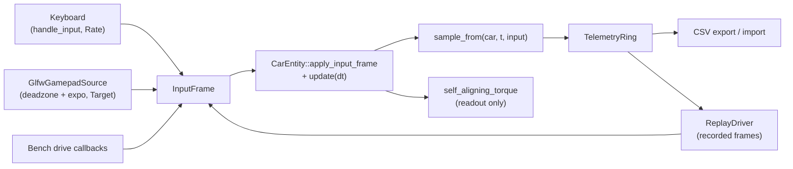
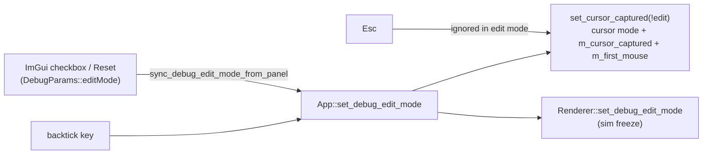
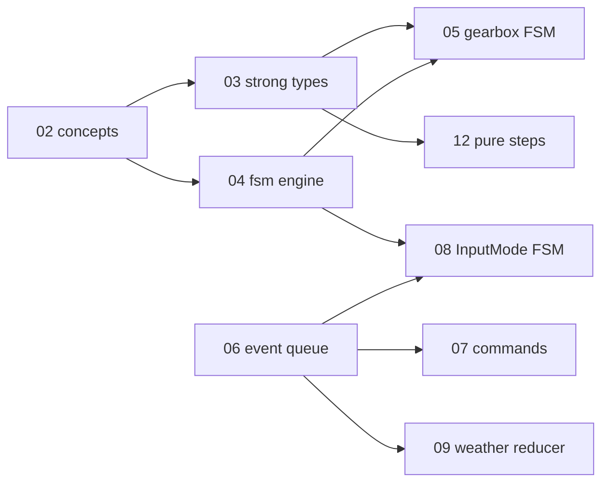

# Changelog — 2026-10

See [CHANGELOG.md](../../CHANGELOG.md) for the index of all entries.

---

### 2026-10-10 — Driving realism tools (input seam, telemetry/replay, physics bench)

Added a device-agnostic `InputFrame` input seam with a gamepad source, a debug-only telemetry ring with CSV export and input replay, a force-feedback target readout, and a GPU-free physics bench that prints 0-100, 100-0, top-speed and skidpad figures against 992 Turbo S targets.

Technical summary

### Motivation

Driving was keyboard-only (`CarEntity::handle_input` read GLFW keys directly), there was no way to capture or replay a drive, and car-physics realism was judged by eye. Three additive tools close that gap without touching the physics model: (1) an input seam so any device can drive the car, (2) record / CSV / replay for reproducible runs, (3) a bench that measures standard figures of merit on the real `CarEntity::update`. This is a stub track; it is additive to the planned Ch07 `Commands.def` / `InputSampler` work, which will absorb `InputFrame`.

### Approach

| Piece | What it does |
|-------|--------------|
| Input seam | [InputFrame.h](src/utils/input/InputFrame.h): `InputFrame{steer, throttle, brake, steer_mode}` and `IInputSource`. `SteerMode::Rate` (keyboard: only the sign of `steer` matters, ramp at the steer rate, faster return to centre) vs `SteerMode::Target` (analog: `steer * max-lock` is a target angle approached at the steer rate). |
| `CarEntity` entry point | `CarEntity::apply_input_frame(const InputFrame&, float dt)` in [CarEntity.cpp](src/scene/Entity/CarEntity.cpp). `handle_input` now builds a `Rate` frame from the arrow keys (same UP-over-DOWN, LEFT-over-RIGHT precedence) and calls it, so keyboard and every other source share one path. Throttle wins over brake; brake while ~stopped selects reverse. New read-only accessors `get_lateral_velocity`, `get_yaw_rate`, `get_wheel_spin`, `get_corner_suspension` in [CarEntity.h](src/scene/Entity/CarEntity.h). |
| Gamepad mapping | [GamepadMapping.h](src/utils/input/GamepadMapping.h): pure deadzone + expo curve + trigger remap (no GLFW). Feeder: [GlfwGamepadSource.cpp](src/core/Input/GlfwGamepadSource.cpp) (`glfwGetGamepadState`, joystick 0; all-zero `Target` frame when unplugged). Not in the test target. |
| Telemetry | [TelemetryRing.h](src/utils/telemetry/TelemetryRing.h) / [TelemetryRing.cpp](src/utils/telemetry/TelemetryRing.cpp): fixed-capacity ring (default 3600 samples, no allocation after construction), CSV write/read (`%.9g`, exact float round-trip), timestamped path under `build-debug/telemetry/`. |
| Replay | [ReplayDriver.h](src/utils/telemetry/ReplayDriver.h): `IInputSource` over the recorded `InputFrame`s; same inputs + same dt + same build reproduce a run bit-for-bit on a fresh car (test-pinned). |
| Recorder | [TelemetryRecorder.h](src/debug/TelemetryRecorder.h): `sample_from(car, t, input)` is ungated and pure; the `TelemetryRecorder` class is `#ifdef SWISH_DEBUG_UI`. |
| App wiring | [AppDrivingTools.cpp](src/core/App/AppDrivingTools.cpp) (empty without `SWISH_DEBUG_UI`): `step_driving_tools(dt)` returns `false` for keyboard + idle recorder, leaving `handle_input` untouched; otherwise samples gamepad / replay / keyboard frame, runs `apply_input_frame` + `update`, then `on_step`. `sync_driving_tools_panel` handles record/replay edges, CSV export and readouts. Hooked from [App.cpp](src/core/App/App.cpp), members in [App.h](src/core/App/App.h). |
| Debug panel | "Driving tools" header in [DebugUI.cpp](src/debug/DebugUI.cpp) over `drv*` fields in [DebugParams.h](src/debug/DebugParams.h): input source, deadzone/expo, live axis bars, record / replay / export, ring + replay position, FFB readout. Defaults: keyboard, not recording. |
| FFB target | [ForceFeedback.h](src/scene/Entity/ForceFeedback.h): `self_aligning_torque()` plus `IForceFeedbackSink` / `NullForceFeedbackSink`. Computed and displayed only; **no device output**. |
| Bench | [Bench.h](tests/bench/Bench.h): fixed $dt = 1/120$ s loop over the real `CarEntity::update` through `apply_input_frame`; scenarios `zero_to_100`, `braking_100_0`, `top_speed`, `skidpad_40m`. |

### Math

Gamepad stick response: per-axis scaled deadzone with half-width $d$, then an odd expo blend with $e \in [0,1]$:

$$
u(x) = \operatorname{sgn}(x)\,\frac{\max(|x|-d,\,0)}{1-d},
\qquad
y(x) = (1-e)\,u + e\,u^{3}
$$

$u$ is continuous, 0 inside the deadzone and reaches $\pm 1$ at $|x| = 1$; $y$ is monotone with $y(0)=0$, $y(\pm1)=\pm1$. Defaults $d = 0.08$, $e = 0.35$. Triggers (GLFW rest $-1$, pressed $+1$) are remapped $t = (raw+1)/2$, then a one-sided deadzone (0.05).

Front-axle self-aligning torque (bicycle model, right-positive):

$$
M_z = -F_{y,f}\; t_p\; k_{\text{fade}},
\qquad
t_p = t_0\,\max\!\Bigl(0,\;1-\frac{|\alpha_f|}{\alpha_{sat}}\Bigr),
\qquad
\alpha_{sat} = \frac{\mu\, m g\, b/L}{C_{\alpha,f}}
$$

$$
\alpha_f = \frac{v_y + a\,r}{\max(|v_x|,1)} - \operatorname{sgn}(v_x)\,\delta,
\qquad
k_{\text{fade}} = \operatorname{clamp}\!\Bigl(\frac{|v_x|}{3\ \text{m/s}},0,1\Bigr)
$$

Pneumatic trail $t_p$ collapses linearly to 0 at the axle's saturation slip, so the wheel goes light at the limit. Defaults $t_0 = 0.035$ m; the normalized output is $M_z / 6\ \text{N m}$ clamped to $[-1,1]$. $F_{y,f}$ comes from the existing `axle_lateral_forces`, and $\mu$ is the live `effective_mu` (wet-grip lightening follows for free).

### Data flow

### Bench results

Targets are documented 992 Turbo S figures printed in a table, **not** failing tests. `test_bench.cpp` asserts only that each scenario finishes, is finite, positive, and bitwise-deterministic across two runs.

| Scenario | Measured | Target | Tolerance | Verdict |
|----------|----------|--------|-----------|---------|
| 0-100 km/h | 2.89 s | 2.70 s | 25 % | PASS |
| 100-0 km/h | 36.57 m | 31.5 m | 15 % | OUT |
| Top speed | 329.8 km/h | 330 km/h | 5 % | PASS |
| Skidpad (R = 40 m) | 1.05 g | 1.1 g | 15 % | PASS |

The 100-0 figure is about 16 % long; braking authority is the known gap for a follow-up (no physics change was made here).

### Scope and safety

- **Debug-only tooling.** `AppDrivingTools.cpp`, the recorder class, the panel and the `drv*` fields are gated by `#ifdef SWISH_DEBUG_UI`. With the panel at its defaults the car is driven by `handle_input` exactly as before.
- **Release.** The one ungated production change is routing the keyboard path through `apply_input_frame`; `test_input.cpp` pins it bit-for-bit against the old keyboard behaviour. Release is expected to be byte-identical in output; no shader, `.spv` or golden file was touched, and no golden was regenerated.
- **TODO(stub) items left open:** full FFB model (per-wheel `Fy` with load transfer, mechanical trail/caster, scrub/kingpin, tire relaxation, road texture, damping/friction/inertia) and a real wheel driver behind `IForceFeedbackSink`; replay does not restore start pose, wetness or road bounds, and has no replay-vs-live divergence readout; telemetry has no binary format, decimation, per-wheel slip/load channels, ring plots or crash auto-save; analog trail-braking (throttle + brake together) in `apply_input_frame`; `InputFrame` to be absorbed by Ch07.

### File changes

| File | Change |
|------|--------|
| [src/utils/input/InputFrame.h](src/utils/input/InputFrame.h) | New: `InputFrame`, `SteerMode`, `IInputSource` |
| [src/utils/input/GamepadMapping.h](src/utils/input/GamepadMapping.h) | New: pure deadzone / expo / trigger mapping |
| [src/core/Input/GlfwGamepadSource.h](src/core/Input/GlfwGamepadSource.h), [.cpp](src/core/Input/GlfwGamepadSource.cpp) | New: GLFW gamepad `IInputSource` |
| [src/utils/telemetry/TelemetryRing.h](src/utils/telemetry/TelemetryRing.h), [.cpp](src/utils/telemetry/TelemetryRing.cpp) | New: ring buffer, CSV I/O, timestamped path |
| [src/utils/telemetry/ReplayDriver.h](src/utils/telemetry/ReplayDriver.h) | New: replay `IInputSource` |
| [src/debug/TelemetryRecorder.h](src/debug/TelemetryRecorder.h) | New: `sample_from` + debug-only `TelemetryRecorder` |
| [src/scene/Entity/ForceFeedback.h](src/scene/Entity/ForceFeedback.h) | New: self-aligning torque target, FFB sink interface |
| [src/core/App/AppDrivingTools.cpp](src/core/App/AppDrivingTools.cpp) | New: debug-only step / panel sync (source, record, replay, export, readouts) |
| [src/scene/Entity/CarEntity.h](src/scene/Entity/CarEntity.h), [.cpp](src/scene/Entity/CarEntity.cpp) | `apply_input_frame`; `handle_input` routed through it; new read-only accessors |
| [src/core/App/App.h](src/core/App/App.h), [App.cpp](src/core/App/App.cpp) | Driving-tools members and hook calls (debug-gated) |
| [src/debug/DebugParams.h](src/debug/DebugParams.h) | `drv*` fields |
| [src/debug/DebugUI.cpp](src/debug/DebugUI.cpp) | "Driving tools" panel |
| [tests/bench/Bench.h](tests/bench/Bench.h) | New: bench harness and reference table |
| [tests/test_input.cpp](tests/test_input.cpp) | New: mapping, keyboard bit-equality, analog steer, FFB tests |
| [tests/test_telemetry.cpp](tests/test_telemetry.cpp) | New: ring, CSV round-trip, replay determinism, recorder tests |
| [tests/test_bench.cpp](tests/test_bench.cpp) | New: `[bench]` finish / finite / deterministic test |
| [tests/CMakeLists.txt](tests/CMakeLists.txt) | Register the three test files and `TelemetryRing.cpp` |
| [docs/car_system.md](docs/car_system.md) | New "Driving tools" section |
| [docs/changelog/2026-10.md](docs/changelog/2026-10.md), [CHANGELOG.md](CHANGELOG.md) | This entry and the refreshed index |
| [tasks/todo.md](tasks/todo.md) | Ticked S1-S5 |

**Label:** Largely AI-generated (Claude). Please review.

---

### 2026-10-01 — Quick fixes before the typed-C++ refactor: input/edit-mode, weather, resize, GLFW teardown

Fixed nine bugs found by the refactor audit: cursor capture and debug edit mode drifting apart, rain leaving the weather preset stale, the resize flag cleared before the renderer read it, the fog/haze sliders labelled km while showing metres, a duplicated shadow line in the debug dump, a double `glfwTerminate`, `EnumCycle` accepting `Count == 0`, and dead Treadmill code and comments.

Technical summary

### Motivation

Phase P0.1 of the typed-C++ system refactor ([tasks/todo.md](tasks/todo.md)). Three read-only audits found these
while mapping the implicit state machines. The owner chose to have them fixed directly, before the refactor, as a
behaviour-change phase on its own branch (`refactor/00-quick-fixes`), so later refactor phases stay behaviour-preserving.

### Fixes

| Bug | Root cause | Fix |
|-----|-----------|-----|
| Esc, then backtick twice, leaves the cursor disabled while mouse deltas are dropped; in edit mode, panel drags turned the camera | `on_toggle_debug_edit` set the GLFW cursor mode directly and never updated `m_cursor_captured`; the ImGui checkbox and Reset wrote `DebugParams::editMode` behind App's back | One writer, `App::set_debug_edit_mode`, which routes through `set_cursor_captured(!edit)`; `sync_debug_edit_mode_from_panel()` at the top of each frame follows a panel-side change; Esc is ignored while in edit mode |
| Rain switched the sky to Cloudy only after a G press, and the next G press seemed to do nothing | A `m_clear_day` flag that started false and was set only by `set_weather_preset`; `Renderer::set_clear_day` changed the renderer's preset without updating `App::m_weather_preset` | Pure `preset_for_rain(preset, rain)` + `is_clear_day` in [WeatherPreset.h](src/scene/WeatherPreset.h); rain goes through `set_weather_preset`; `m_clear_day` and `Renderer::set_clear_day` deleted |
| R did nothing visible in the debug-UI build | `apply_debug_params` copies the rain slider into the renderer every frame | `set_rain_level` also writes `DebugParams::rainIntensity` (debug-only) |
| Window resizes relied on `VK_ERROR_OUT_OF_DATE` alone | `App::poll_events` cleared the resize flag before `drawFrame`'s present check read it | App no longer touches the flag; `Renderer::recreateSwapchain` is its only consumer (any recreate satisfies a pending resize) |
| Fog/haze sliders showed metres labelled "km" | `wu / 1000` is metres (1 m = 1000 WU) | `uu::to_m` / `uu::m`, labels "(m)"; slider numbers unchanged |
| Shadow line printed twice in the dump | A stale copy without `lightSize` | Removed the stale line |
| `glfwTerminate` called twice | `App::shutdown` and `~Window` both run `Window::cleanup` | `m_glfwInitialized` guard |
| `next_enum` divided by zero for `Count == 0` | `CountedEnum` only checked that `Count` exists | Concept also requires `Count > 0` (static_assert test) |
| Helicopter camera printed a meaningless gantry distance | `App::m_treadmill` was never updated after Phase 3a, so `intro_len()` was 0 | Removed the message and the `m_treadmill` member; stale Treadmill comments now name `CorridorDriver` |

### Edit-mode ownership after the fix

The full state-machine version of this is chapter 08 of the tutorial (`InputMode{Driving, CursorFree, DebugEdit}`).

### Verification

- Release: 219 of 219 tests pass, including the new weather test. Debug UI: 242 of 242 pass. 0 warnings.
- 33 of 33 release `.spv` hashes match `tests/golden/release_spv.sha256`.
- Debug-UI runtime start and shutdown: the log is clean.
- Window-only screenshots were **not** taken. The app's main window is missing from `CGWindowList` in this session, so the key-driven checks (R/G/Esc/backtick, resize) are still open for a manual run.

### Files

| File | Change |
|------|--------|
| [src/core/App/App.cpp](src/core/App/App.cpp) | rain → `preset_for_rain` + debug slider sync; per-frame panel edit-mode sync; resize flag left to the renderer; gantry message removed |
| [src/core/App/App.h](src/core/App/App.h) | `set_debug_edit_mode` / `sync_debug_edit_mode_from_panel`; removed `m_clear_day`, `m_treadmill`, Treadmill include |
| [src/core/App/AppInput.cpp](src/core/App/AppInput.cpp) | edit mode through `set_cursor_captured`; Esc ignored in edit mode |
| [src/core/App/AppInit.cpp](src/core/App/AppInit.cpp) | stale Treadmill comment |
| [src/core/Window/Window.h](src/core/Window/Window.h), [Window.cpp](src/core/Window/Window.cpp) | `m_glfwInitialized` guard; stale tutorial TODO comments replaced by real ones |
| [src/renderer/Renderer/Renderer.cpp](src/renderer/Renderer/Renderer.cpp) | `recreateSwapchain` clears the resize flag |
| [src/renderer/Renderer/Renderer_Frame.cpp](src/renderer/Renderer/Renderer_Frame.cpp) | present step no longer clears the flag itself |
| [src/renderer/Renderer/Renderer.h](src/renderer/Renderer/Renderer.h), [Renderer_State.cpp](src/renderer/Renderer/Renderer_State.cpp) | `set_clear_day` removed |
| [src/debug/DebugUI.cpp](src/debug/DebugUI.cpp) | fog/haze in metres via `Units.h`; duplicate dump line removed |
| [src/scene/WeatherPreset.h](src/scene/WeatherPreset.h) | `is_clear_day`, `preset_for_rain` (constexpr) |
| [src/utils/meta/EnumCycle.h](src/utils/meta/EnumCycle.h) | `CountedEnum` requires `Count > 0` |
| [src/scene/Entity/CarEntity.h](src/scene/Entity/CarEntity.h), [CarEntity.cpp](src/scene/Entity/CarEntity.cpp) | stale Treadmill comments |
| [tests/test_rain.cpp](tests/test_rain.cpp) | rain-vs-preset regression test |
| [tests/utils/test_meta_EnumCycle.cpp](tests/utils/test_meta_EnumCycle.cpp) | `Count == 0` rejected |
| [tasks/todo.md](tasks/todo.md) | typed-C++ refactor plan; P0.0 ticked |

---

### 2026-10-01 — C++23: language standard bumped from C++20, nothing else changed

Raised `CMAKE_CXX_STANDARD` (and `toml_baker`'s `cxx_std`) from 20 to 23 so the typed-C++ tutorial can use `std::expected`, deducing `this`, `std::to_underlying` and `if consteval`. No source changes, and the outputs are identical.

Technical summary

### Motivation

P0.2 of the typed-C++ refactor ([tasks/todo.md](tasks/todo.md)). The owner chose C++23 now, done as a bump on its own so
any toolchain fallout has exactly one cause.

### Change

- [CMakeLists.txt](CMakeLists.txt): `CMAKE_CXX_STANDARD 23`; `toml_baker` `cxx_std_23`. `CMAKE_CXX_EXTENSIONS` stays at
  its default, so the flag is `-std=gnu++23`, matching the previous `gnu++20`. Vendored targets that pin their own
  standard (`c++11`, `gnu++17`) are untouched.
- [.clangd](.clangd): comment updated. `.clang-format` keeps `Standard: c++20`. clang-format has no `c++23` value, and
  `Latest` would reformat files, which is outside this phase.

### Verification

| Check | Result |
|-------|--------|
| Release `make test` (AppleClang 21) | 219/219, 0 warnings |
| Debug-UI `make test-debug` | 242/242, 0 warnings |
| Golden car trajectory + mesh hashes | pass (part of the suites above) |
| 33 release `.spv` hashes | 33/33 OK |
| Arch GCC | not run yet (needs the `arch` host) |

### Files

| File | Change |
|------|--------|
| [CMakeLists.txt](CMakeLists.txt) | C++ standard 20 → 23 (app and `toml_baker`) |
| [.clangd](.clangd) | comment: C++23 |
| [tasks/todo.md](tasks/todo.md) | P0.2 ticked |

---

### 2026-10-01 — Typed-C++ tutorial: index and M1 chapters 01-12, plus doc drift fixes

Added `docs/tutorials/typed-cpp/`: a series index and 12 chapters, each the spec for one M1 refactor phase. Also fixed six stale comments and docs found while writing them.

Technical summary

### Motivation

P0.6 (tutorial scaffold) and part of P0.5 (doc drift) of the typed-C++ refactor ([tasks/todo.md](tasks/todo.md)). The owner
implements each chapter; Claude scaffolds the branch, skeleton and failing tests, then reviews and runs the gate. Three
docs agents wrote the chapters in parallel, and every file:line anchor was read from the code at `33d2c03`. Each file
says it was drafted with AI assistance and that owner review is pending.

### What the chapters found in the code (decisions for the owner)

- **Car golden is tolerance-based.** It checks 1e-3 abs + 1e-3 rel, so passing it doesn't prove the bits are unchanged.
  Ch03 and Ch12 add a Clang-only bit-exact fixture, recorded from the phase's base commit.
- **Heading wrap.** `fmod(y + 180, 360) - 180` gives $(-540°, 180°)$, not $(-180°, 180°]$, and the golden records
  yaw $-306.69°$. Ch12 keeps a verbatim legacy wrap; fixing it is B12.
- **Behaviour changes split out as B-phases:** the FOV-kick reset (B10); rain blocking a clear-day sky on G, and the
  debug Reset rewriting rain (B9); FocusLost freeing the cursor (Ch08, later).
- **Ch01:** the `i < 2` loops in `WindshieldRainPass.cpp` iterate the wetness ping-pong pair, not frames in flight.
  The real 2-frame assumption is `TaaPass.cpp:284`.
- **Ch07:** golden scenario `throttle_then_brake` stops at step 450 and would reverse under a held Down key, so it stays
  on the P0.4 test accessor.

### Chapter map

### Files

| File | Change |
|------|--------|
| [docs/tutorials/typed-cpp/00-index.md](docs/tutorials/typed-cpp/00-index.md) | series map: phases, gate, dependencies, conventions |
| `docs/tutorials/typed-cpp/01-…12-*.md` | chapters 01-12 (static_assert, concepts, strong types, fsm engine, gearbox FSM, variant events, X-macro commands, InputMode FSM, weather reducer, camera variant states, RAII/ownership, pure step functions); chapters 05 and 08 aligned to the Ch03/Ch04 API names |
| [docs/README.md](docs/README.md) | row for the series |
| [src/core/README.md](src/core/README.md) | resize flag: read-only `wasResized()`, `poll_events` no longer consumes it |
| [tests/golden/README.md](tests/golden/README.md) | `.spv` hashes unchanged through C++20/23 |
| [src/core/CameraController/CameraController.h](src/core/CameraController/CameraController.h) | comment: FOV-kick baseline is not reset (was claimed) |
| [src/scene/Corridor/CorridorDriver.h](src/scene/Corridor/CorridorDriver.h) | comment: App snaps Y, not `update` |
| [src/scene/README.md](src/scene/README.md) | heading wrap range is $(-540°, 180°)$ |
| [src/utils/math/Smoothing.h](src/utils/math/Smoothing.h) | comment: CarEntity's wrap is not the same trick |

