# Changelog — 2026-11

See [CHANGELOG.md](../../CHANGELOG.md) for the index of all entries.

---

### 2026-11-14 — Added the lighting plan, stub headers, hidden tests and a chapter per phase

Planned the lighting work as 11 phases (L0 to L10) and scaffolded it for the owner to implement: four stub headers, one preset config, 26 hidden tests and a short tutorial chapter per phase. No shader or app source changed, so release output is unchanged. *Largely AI-generated (Claude); owner review pending.*

<details><summary>Technical summary</summary>

**Motivation.** A survey of the lighting code found three blockers for realistic time-of-day lighting: the driven corridor has no street lamps (placement exists only in the retired road), the renderer has no emissive channel, and car lights compile only under `SWISH_DEBUG_UI`. It also found structural shader bugs, the largest being sun colour added to the unshadowed ambient term in [shaders/lighting.frag](../../shaders/lighting.frag). Light intensities are arbitrary numbers and exposure is a fixed 1.55, which cannot cover noon to midnight.

**Decisions** (two grilling rounds, recorded in [tasks/todo.md](../../tasks/todo.md)): six selectable presets (dawn, morning, noon, golden hour, evening, midnight), golden hour signed off first; procedural Hillaire sky with an IBL rebake on switch; physical units with EV100 auto-exposure; headlights, tail and brake lights, sodium street lamps and retroreflective markings at night; shadows for the headlights and the nearest 2 to 4 lamps; emissive as one scalar in a free G-buffer alpha; dry road first, wet pass last; features leave the debug gate phase by phase.

**Approach.** The owner writes the production code. Each stub has final signatures and a `TODO(learning Lx)` body that returns a placeholder; hidden Catch2 tests (`[.learning][lighting]`) define when it is done. GLSL lives only in the chapters, so the 33 `.spv` goldens do not move. Nothing in the app includes the new headers.

The unit model the stubs and chapters share:

$$\text{exposure} = \frac{1}{1.2 \cdot 2^{EV_{100}}} \qquad EV_{100} = \log_2\!\left(\frac{L \cdot 100}{12.5}\right) \qquad I_{\text{point}} = \frac{\Phi}{4\pi} \qquad I_{\text{spot}} = \frac{\Phi}{\pi} \qquad E = \frac{I}{d_m^2}$$

with $L$ in cd/m², $\Phi$ in lumens, $I$ in candela, $E$ in lux and $d_m$ the distance in metres (world units divided by `kWuPerMetre`).

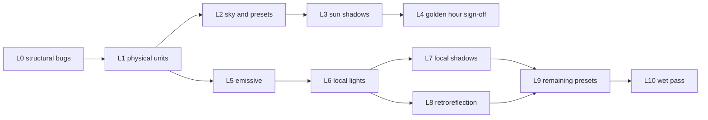

| File | Change |
|------|--------|
| [tasks/todo.md](../../tasks/todo.md) | New "Lighting" section: decisions, phases L0 to L10, scaffold pointers. |
| [src/utils/light/Photometry.h](../../src/utils/light/Photometry.h) | New stub: exposure, EV100, lumens to candela, inverse-square in metres, colour temperature, emissive packing. |
| [src/utils/light/ShadowFit.h](../../src/utils/light/ShadowFit.h) | New stub: stable light up vector, texel snapping, cascade bias, shadow-caster choice with hysteresis. |
| [src/scene/TimeOfDay/TimeOfDay.h](../../src/scene/TimeOfDay/TimeOfDay.h) | New stub: preset struct, sun direction from azimuth and elevation, TOML reader. |
| [src/scene/Corridor/CorridorLamps.h](../../src/scene/Corridor/CorridorLamps.h) | New stub: lamp posts along a centre-line polyline. |
| [config/time_of_day.toml](../../config/time_of_day.toml) | New: six preset tables with approximate starting values; not loaded yet. |
| [tests/utils/test_light_Photometry.cpp](../../tests/utils/test_light_Photometry.cpp) | New hidden tests (7 cases). |
| [tests/utils/test_light_ShadowFit.cpp](../../tests/utils/test_light_ShadowFit.cpp) | New hidden tests (9 cases). |
| [tests/test_time_of_day.cpp](../../tests/test_time_of_day.cpp) | New hidden tests (5 cases). |
| [tests/test_corridor_lamps.cpp](../../tests/test_corridor_lamps.cpp) | New hidden tests (5 cases). |
| [tests/CMakeLists.txt](../../tests/CMakeLists.txt), [tests/utils/CMakeLists.txt](../../tests/utils/CMakeLists.txt) | Listed the four new test files. |
| [docs/tutorials/lighting/](../tutorials/lighting/00-index.md) | New: index plus chapters `L00` to `L10`. |
| [docs/README.md](../README.md), [src/utils/README.md](../../src/utils/README.md), [tasks/code_snippets.md](../../tasks/code_snippets.md) | Index rows and snippet notes for the scaffold. |

**Verification.** Release tree: `swish_tests` and `swish_utils_tests` build with 0 warnings; `ctest` 390/390 (hidden tests are not registered). Run explicitly, the hidden tests fail on the placeholder bodies as intended. Compiled against throwaway reference implementations (kept outside the repo), all 26 hidden cases pass, so every test is satisfiable. Not done: the debug-UI tree was not rebuilt, the app was not launched, and the chapters' in-app checklists are for the owner.

</details>

### 2026-11-15 — Clearcoat energy, one BRDF LUT, and wetness intent (L0.3–L0.5)

Clearcoat now takes its share of energy from the base layer and uses the same split-sum LUT as the base; the wetness dim on reflections is confirmed as intentional.

<details><summary>Technical summary</summary>

**Root cause.** Three independent issues in the car-paint path of [shaders/lighting.frag](../../shaders/lighting.frag):

- L0.3: the base reflection samples [brdfLUT](../../shaders/lighting.frag), but the coat used an analytic fit `envBRDFApprox` (Karis "Mobile"). Two different split-sum approximations on one surface.
- L0.4: the coat is added on top of an unchanged base, so a grazing coat reflects energy the base still spends. The base can exceed 1.0 in total.
- L0.5: the wetness dim (`mix(env, env·(1−0.45·wetness), 0.9·wetness)`) applies to reflections as well as the sky. Reviewed, not a bug: the sky background uses the same dim (`sky * (1 − wetness·0.45)`), so reflected sky matches visible sky.

**Fix.** With Schlick Fresnel at $F_0 = 0.04$ and strength $s$ from `ccFlake.b`:

$$
F_{\text{coat}} = s\,\bigl(0.04 + 0.96\,(1 - N\!\cdot\!V)^5\bigr), \qquad k_{\text{coat}} = 1 - F_{\text{coat}}
$$

Every base-lobe term is multiplied by $k_{\text{coat}}$. The coat's own lobes are added unscaled. When $s = 0$, $k_{\text{coat}} = 1$ exactly, so off-car surfaces keep their previous output.

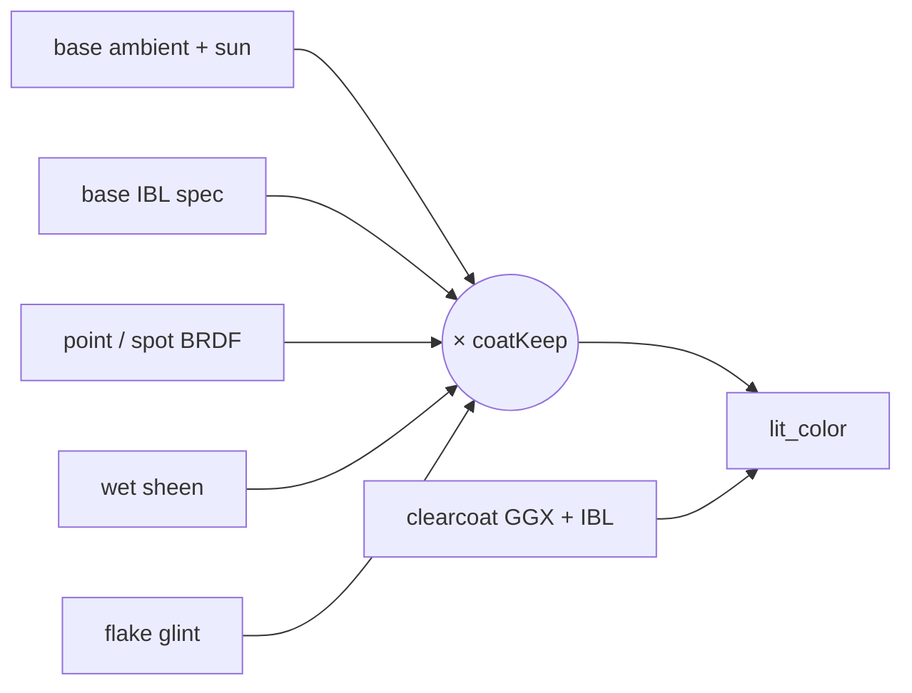

**Not attenuated (deliberate).** The wet-lamp halos (`kHaloStrength`, `kSpotHalo`) are view-independent glow in the air, not surface reflection, so they stay as they were.

**Golden.** `shaders/lighting.frag` changed, so the release `.spv` hash in `tests/golden/release_spv.sha256` no longer matches. That is an intended behaviour change for car paint. The hash check is a manual `shasum -c` (see `tests/golden/README.md`), not part of `ctest`, and `SWISH_UPDATE_GOLDENS` does not touch it. The golden was not regenerated here; when the lighting phase settles, re-record `release_spv.sha256` on purpose from a release build, with the L0 entries as the reason.

**Verification.** Both variants compile with `glslc` (release and `-DSWISH_DEBUG_UI`), exit 0. Not done: app run and visual check. The owner checks the car paint at a grazing angle, in the wet, and at `clearcoat = 0` (should match the previous build).

| File | Change |
|------|--------|
| [shaders/lighting.frag](../../shaders/lighting.frag) | Removed `envBRDFApprox`; added `coatF`/`coatKeep`; coat IBL uses `brdfLUT`; `coatKeep` on base lobes and flake; wetness intent comment; coat comment rewritten. |
| [tasks/todo.md](../../tasks/todo.md) | L0.3, L0.4, L0.5 ticked with the chosen resolution. |
| [docs/changelog/2026-11.md](2026-11.md) | This entry. |

</details>

### 2026-11-15 — Sun intensity, sun sliders, asset metalness, dead sky code (L0.6–L0.10)

Wired `sunDir.w` and the Azimuth/Elevation sliders, made cars read `metallicFactor` from the glTF, deleted the dead analytic sky functions, and traced the release `aoTex` to a primed-white image.

<details><summary>Technical summary</summary>

**Root cause / motivation.** Five leftovers from the lighting audit (see [tasks/todo.md](../../tasks/todo.md) L0):

- L0.6: `camera.sunDir.w` was uploaded as 1.0 and never read, so L1 had nothing to drive.
- L0.7: `DebugParams::sunAzimuth/sunElevation` had sliders but nothing read them; only the gizmo moved the sun.
- L0.8: release `composite.frag` does `hdr *= texture(aoTex)` with no SSAO pass in release.
- L0.9: `SceneGeometry` set metalness to 1 only for `MAT_METAL`, so chrome and wheels in a GLB shaded as dielectric.
- L0.10: `compute_sky_color` / `skyIrradiance` in `lighting.frag` had no callers (ambient comes from the baked irradiance cube).

**Fix.**

- L0.6: $L_{\text{sun}} = \text{sunColor}_{rgb} \cdot \text{sunDir}_w$. The C++ side still sends $w = 1$, so output is unchanged until L1.
- L0.7: with no gizmo, `WeatherController::apply_debug` sets the direction from the sliders. With azimuth $\phi$ and elevation $\theta$ (radians, $\phi = 0$ is $+Z$):

$$
\hat{s} = (\cos\theta \sin\phi,\ \sin\theta,\ \cos\theta \cos\phi)
$$

  `sun_dir_from_az_el` (the L0.7 learning stub) is implemented and its test is no longer hidden. Slider defaults are $\phi = \operatorname{atan2}(0.3, 0.15) = 1.1071$ and $\theta = \arcsin(0.6/\lVert(0.3, 0.6, 0.15)\rVert) = 1.0611$, the angles of the shipped sun, so untouched sliders keep the old direction. Debug builds only.
- L0.8: no change. `PostProcessManager::primeAOTexture` clears the AO blur image to white once, so the multiply is by exactly 1.0. L4.5 decides whether to promote SSAO or drop the multiply.
- L0.9: `ModelManager` stores `clamp(metallicFactor, 0, 1)` in `Submesh::metalness`; `CarEntity` / `ModelEntity` copy it to `DrawCall::metalness`; `SceneGeometry` pushes it as `material.x`. A negative value (non-glTF geometry) keeps the old rule. The debug `MaterialOverride` still wins.
- L0.10: both functions deleted. The `SP_SKY_*` and `SP_SUN_DISC_*` macros stay because the L2 sky-model decision may reuse them.


**Visual risk (owner check).** Porsche body paint has `metallicFactor = 0`, so the paint is unchanged. But the cabin materials carry 0.35 to 0.63 and the wheel 0.83. Those used to render as dielectric; now the cabin loses roughly that share of its diffuse and gains reflection. If the cabin looks too dark or too shiny, that is the asset's data, and the fix is per-material in the asset or an override, not in this code. Cars that omit the factor get the glTF default of 1.0 (for example the Charger chrome slots).

**Verification.** `make test`: 391/391, `make test-debug`: 416/416, 0 warnings in both. Both `lighting.frag` variants compile with `glslc`. `release_spv.sha256`: `lighting.frag.spv` no longer matches (intended; the other 32 match). That golden is a manual `shasum` check, not part of `ctest`, and was not regenerated. Not done: the app was not run. `make format-check` and `make check` report only failures that predate this change (`goals.md` in the repo root, `.obsidian/workspace.json` tracked but ignored, 32 unformatted files); the lines touched here are clean.

| File | Change |
|------|--------|
| [shaders/lighting.frag](../../shaders/lighting.frag) | `sun_radiance` scaled by `sunDir.w`; deleted `compute_sky_color` and `skyIrradiance`. |
| [shaders/ibl_sky.frag](../../shaders/ibl_sky.frag) | Two comments no longer point at the deleted function. |
| [src/scene/SceneTypes.h](../../src/scene/SceneTypes.h) | `metalness` field on `Submesh` and `DrawCall` (default -1 = none). |
| [src/scene/ModelManager/ModelManager.cpp](../../src/scene/ModelManager/ModelManager.cpp) | Read `metallicFactor` into `Submesh::metalness` for car materials. |
| [src/scene/Entity/Entity.cpp](../../src/scene/Entity/Entity.cpp), [src/scene/Entity/CarEntity.cpp](../../src/scene/Entity/CarEntity.cpp) | Copy `metalness` into the opaque draw calls. |
| [src/renderer/SceneGeometry/SceneGeometry.cpp](../../src/renderer/SceneGeometry/SceneGeometry.cpp) | Push the asset metalness, else the per-material default. |
| [src/scene/TimeOfDay/TimeOfDay.h](../../src/scene/TimeOfDay/TimeOfDay.h) | Implemented `sun_dir_from_az_el`; header comment updated. |
| [src/renderer/WeatherController/WeatherController.cpp](../../src/renderer/WeatherController/WeatherController.cpp) | Debug build: sun direction from the sliders when no gizmo. |
| [src/debug/DebugParams.h](../../src/debug/DebugParams.h) | Slider defaults set to the shipped sun's angles. |
| [tests/test_time_of_day.cpp](../../tests/test_time_of_day.cpp) | L0 sun-direction test un-hidden (`.learning` tag dropped). |
| [docs/concepts.md](../concepts.md) | Split-sum IBL row now describes the baked cubes and LUT. |
| [tasks/todo.md](../../tasks/todo.md) | L0.6 to L0.10 ticked with findings. |

</details>

### 2026-11-15 — Padded the composite push-constant block to 64 bytes (L0.11)

Padded the `composite.frag` push block from 52 to 64 bytes so it matches the host struct, and pinned the layout with `offsetof` asserts.

<details><summary>Technical summary</summary>

**Root cause.** The shader's `Params` block in [shaders/composite.frag](../../shaders/composite.frag) was 13 floats, 52 B, not a 16-byte multiple (MoltenVK rule). The host struct `PostProcessParams` was already padded to 64 B, so the pushed range was safe, but the shader and host layouts differed in size and nothing checked that they agree.

**Measured.** `spirv-dis build/shaders/composite.frag.spv | grep "MemberDecorate %Params"` gave `tint` at offset 48 (block end $48 + 4 = 52$). After the change the last member, `_pad5`, is at offset 60, so the block is $60 + 4 = 64$ B.

**Fix.** Added `_pad3`, `_pad4`, `_pad5` after `tint` in the shader. Added `static_assert(offsetof(...))` in [PostProcessManager.h](../../src/renderer/PostProcessManager/PostProcessManager.h) for `texel_x` (16), `fog_density` (24), `brightness` (32), `tint` (48) and `_pad5` (60), so a reordered member fails at compile time. Updated the stale host comment. The new pads are never read, so output is unchanged.

`bloom_extract.frag` (12 B) and `bloom_blur.frag` (32 B) share the same 64 B range and were left alone; they are harmless because the range is larger than their blocks.

**Verification.** `make test`: 391/391, `make test-debug`: 416/416, 0 warnings in both. Re-measured offsets as above. `release_spv.sha256`: `composite.frag.spv` and `lighting.frag.spv` no longer match (intended; not re-recorded; that check is a manual `shasum -c`). Not done: the app was not run; owner confirms the frame looks the same.

| File | Change |
|------|--------|
| [shaders/composite.frag](../../shaders/composite.frag) | Added `_pad3`..`_pad5` to the push block (52 to 64 B). |
| [src/renderer/PostProcessManager/PostProcessManager.h](../../src/renderer/PostProcessManager/PostProcessManager.h) | `offsetof` asserts, `<cstddef>` include, comments updated. |
| [tasks/todo.md](../../tasks/todo.md) | L0.11 ticked. |

</details>

### 2026-11-15 — Re-recorded the release shader hashes for L0.3 to L0.11

Re-recorded `composite.frag.spv` and `lighting.frag.spv` in the release shader golden after the intended L0 shader changes.

<details><summary>Technical summary</summary>

**Why.** The L0 entries above changed [shaders/lighting.frag](../../shaders/lighting.frag) (L0.3 to L0.10) and [shaders/composite.frag](../../shaders/composite.frag) (L0.11) on purpose, so their `.spv` hashes no longer matched.

**What.** Re-recorded only those two lines in [tests/golden/release_spv.sha256](../../tests/golden/release_spv.sha256), from a release build (`SWISH_DEBUG_UI=OFF`, SDK `glslc` 1.4.321.0). The other 31 hashes were unchanged and still match. `shasum -a 256 -c` now reports 33 of 33 OK. `SWISH_UPDATE_GOLDENS` is not involved; this file is a manual check.

| File | Change |
|------|--------|
| [tests/golden/release_spv.sha256](../../tests/golden/release_spv.sha256) | Two lines re-recorded (`composite.frag.spv`, `lighting.frag.spv`). |

</details>

### 2026-11-15 — Physical sun and sky with a fixed pre-exposure (L1.1 to L1.3)

Moved the sun to 100,000 lux and the sky to a nits scale, and put a fixed pre-exposure between the lights and the half-float HDR target, so the frame is unchanged and nothing overflows.

<details><summary>Technical summary</summary>

**Motivation.** The sun was 1.0, the ambient 0.42 and the composite exposure a magic 1.55. L1 gives each a unit. A noon sun is 100,000 lux, but the HDR target is `R16G16B16A16_SFLOAT`, whose largest finite value is 65,504, and bloom thresholds the raw image (1.77). Feeding physical values straight in would overflow and make the whole frame bloom.

**Approach.** Every light is multiplied by a pre-exposure $P$ where it is defined in `lighting.frag`, so the HDR image holds $L \cdot P$. The composite multiplies by $e / P$ to undo it:

$$
\text{HDR} = L \cdot P, \qquad \text{display} = \text{HDR} \cdot \frac{e}{P} = L \cdot e
$$

With $P = 10^{-5}$ and sun $= 10^5$ lux, one old scene unit is exactly one HDR unit, so the shipped frame is identical. The shipped EV100 that reproduces the old composite exposure of 1.55:

$$
EV_{100} = -\log_2(1.2 \cdot 1.55 \cdot P) = -\log_2(1.86\times10^{-5}) \approx 15.7144
$$

That is a real noon value now. Auto-exposure divides the metered HDR luminance by $P$ before the EV formula, and `evCompensation = 1.53` stops reproduces the old `aeKey` of 0.30, because $\log_2(0.30/0.104) \approx 1.53$.

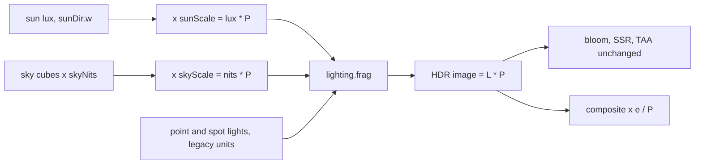

**What did not move.** Point and spot lights, wet halos and the fog colour stay in the old unit scale, which is exactly the pre-exposed scale, so they need no change until L1.4 and L1.5. The ambient gain 0.42 stays: it scales diffuse sky only, and dropping it would brighten the frame.

**Review fixes found on the way.** The L1.1 edit had deleted the shipped grade (`contrast` 1.12, `saturation` 1.2, `brightness` 0) from `CompositePass.cpp`, so release would have lost it; restored. The L1.2 edit referenced `ul::`, `evCompensation`, `evMin` and `evMax` that did not exist, so the debug build could not compile; added. `WeatherController.cpp` had been half renamed to snake_case; restored to the project's camelCase.

**Verification.** `make test`: 396/396 and `make test-debug`: 421/421, 0 warnings in both. Three L1 tests un-hidden, two added for the pre-exposure identity. `lighting.frag` compiles in both variants. `lighting.frag.spv` re-recorded in `release_spv.sha256` (33 of 33 OK). Not done: the app was not run; the owner confirms the frame looks the same.

| File | Change |
|------|--------|
| [src/utils/light/Photometry.h](../../src/utils/light/Photometry.h) | `kLegacyUnitLux`, `kPreExposure`, `hdr_exposure_from_ev100`; `<algorithm>`; dropped stale `[[maybe_unused]]`. |
| [src/renderer/WeatherController/WeatherController.cpp](../../src/renderer/WeatherController/WeatherController.cpp), [.h](../../src/renderer/WeatherController/WeatherController.h) | `Look` gains `sunLux`, `skyNits`; `m_sunLux`, `m_skyNits`; both `set_weather` calls pass them. |
| [src/renderer/CameraUniforms/CameraUniforms.cpp](../../src/renderer/CameraUniforms/CameraUniforms.cpp), [.h](../../src/renderer/CameraUniforms/CameraUniforms.h) | `set_weather` takes sky nits and pre-exposure; written to `weather.yz`. |
| [shaders/lighting.frag](../../shaders/lighting.frag) | `sunScale`, `skyScale`; applied to the sun, irradiance, prefiltered env (base, clearcoat, haze) and the sky background. |
| [shaders/common/camera.glsl](../../shaders/common/camera.glsl), [src/scene/SceneTypes.h](../../src/scene/SceneTypes.h), [docs/data-types.md](../data-types.md) | Comments: `sunDir.w` is lux, `weather.yz` are sky nits and pre-exposure. |
| [src/renderer/Passes/CompositePass.cpp](../../src/renderer/Passes/CompositePass.cpp) | Shipped EV100 15.7144 through `hdr_exposure_from_ev100`; grade lines restored. |
| [src/renderer/Passes/HdrFinalizePass.cpp](../../src/renderer/Passes/HdrFinalizePass.cpp) | Auto-exposure meters `lum / kPreExposure`, publishes the composite multiplier. |
| [src/debug/DebugParams.h](../../src/debug/DebugParams.h) | `evCompensation`, `evMin`, `evMax`. |
| [tests/utils/test_light_Photometry.cpp](../../tests/utils/test_light_Photometry.cpp) | Three L1 tests un-hidden, two pre-exposure tests added. |
| [tests/golden/release_spv.sha256](../../tests/golden/release_spv.sha256) | `lighting.frag.spv` re-recorded. |
| [tasks/todo.md](../../tasks/todo.md) | L1.3 ticked; L1.2 annotated as half done. |

</details>

### 2026-11-15 — Auto-exposure in release, lumens and metres for local lights, bloom in exposed space (L1.2, L1.4 to L1.6)

Finished chapter L1: auto-exposure now runs in release with per-preset EV100 clamps, street lamps and car lights are in lumens with an inverse-square falloff in metres, and bloom thresholds the exposed image. Fixed the sign of `evCompensation`.

<details><summary>Technical summary</summary>

**Motivation.** After L1.3 the sun and sky were physical, but exposure was a fixed number, the local lights were still unitless, and bloom looked at the unexposed image. This entry makes every light and the exposure physical, and documents the result in [docs/lighting-l1.md](../lighting-l1.md).

**L1.2 (auto-exposure in release).** `HdrFinalizePass` no longer hides the luminance pyramid and the CPU adaptation behind `SWISH_DEBUG_UI`. `DebugParams::autoExposure` defaults to `true`, and release reads those defaults. Metering divides the adapted HDR luminance by the pre-exposure $P$, then

$$
EV_{100} = \operatorname{clamp}\!\Bigl(\log_2\tfrac{100\,L}{12.5} - c,\ EV_{\min},\ EV_{\max}\Bigr), \qquad e_{\text{composite}} = \frac{1}{1.2\cdot 2^{EV_{100}}\,P}
$$

The clamps are per weather preset (PartlyCloudy 13.5 to 17.5, Cloudy 13 to 17, VeryCloudy 12.5 to 17, GoldenHour 12 to 16.5), owned by `WeatherController` and carried to the pass in `FrameState`. The old `aeKey`, `aeMin` and `aeMax` are removed (UI, TOML, round-trip test) and replaced by `evCompensation`, `evMin`, `evMax`.

**Sign fix.** Compensation was added to the metered EV, which darkens. A positive value must brighten, so it is subtracted. With $c = \log_2(0.30/0.104) \approx 1.53$ this reproduces the old `aeKey = 0.30` look. The L1.2 guide and the artifact had the same error and are corrected.

**L1.4 and L1.5 (local lights).** `point_candela_from_lumens`, `spot_candela_from_lumens` and `inverse_square_m` are implemented, and a `cone_candela_from_lumens` alternative was added. The street lamp is 16,000 lm, which is $16000/4\pi \approx 1273$ cd. The car lights are `headLumens` 1,200, `tailLumens` 20, `brakeLumens` 300. In `lighting.frag` the point and spot illuminance is

$$
E = \frac{I\cos\theta}{d_m^{2}}\,w(d), \qquad d_m = d_{\mathrm{WU}}\cdot\texttt{weather.w}
$$

with $w(d) = \operatorname{clamp}(1 - (d/R)^4)^2$ and `weather.w = util::units::to_m(1.0f)`, so GLSL never types 1000. A 16,000 lm lamp on a 30 ft pole gives about 15 lux under it, which a test pins to the 10 to 30 lux range of real roads. The wet halo is an art effect, so it keeps its old bounded shape and reach; `kHaloPerCd` maps 1,273 cd back to the old gain of 5.0.

**L1.6 (bloom).** `bloom_extract.frag` multiplies by the exposure before the threshold and keeps its output in raw units, because the composite adds bloom first and multiplies by exposure after, so the intensity needs no retune. The threshold moves to exposed space: $\tau' = 1.77 \times 1.55 \approx 2.74$, which keeps the old look. `frame_exposure` in the new [Exposure.h](../../src/renderer/Passes/Exposure.h) is the one number both passes use.

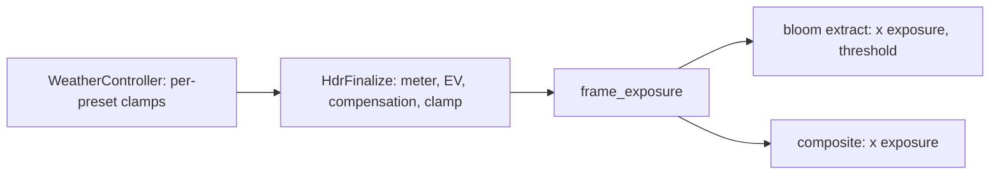

**Look changes to expect.** (1) Auto-exposure replaces the fixed 1.55, so the frame adapts when the view changes. (2) Street lamps and headlights are physically dim next to a 100,000 lux sun, so their direct light is nearly invisible by day; they return at dusk and night once L2 adds those presets. The wet-lamp halos were kept visible on purpose. Neither is visible as a regression in the unit tests; both need the owner check.

**Goldens.** `tests/golden/road_mesh.txt`: only `generate.light_hash` changed, because the lamp intensity is now 1,273 cd instead of 5.0. All 60 geometry assertions passed untouched. Re-recorded on purpose with `SWISH_UPDATE_GOLDENS=1` for that one test. `release_spv.sha256`: `lighting.frag.spv` and `bloom_extract.frag.spv` re-recorded (33 of 33 OK).

**Verification.** `make test`: 400/400 and `make test-debug`: 425/425, 0 warnings in both. Un-hidden `L1: lumens to candela` and `L1: inverse-square falloff works in metres`; added tests for the cone rule (equal to Frostbite at 60 degrees, about 1,631 cd at 28) and the street-lamp illuminance. Both `lighting.frag` variants compile with `glslc`. Not done: the app was not run.

| File | Change |
|------|--------|
| [src/utils/light/Photometry.h](../../src/utils/light/Photometry.h) | Implemented the L1.4 and L1.5 functions; added `cone_candela_from_lumens`. |
| [src/renderer/Passes/Exposure.h](../../src/renderer/Passes/Exposure.h) | New: `kShippedEv100` and `frame_exposure`. |
| [src/renderer/Passes/HdrFinalizePass.cpp](../../src/renderer/Passes/HdrFinalizePass.cpp) | Auto-exposure in both builds; compensation subtracted; clamps from `FrameState`; starts at the shipped exposure. |
| [src/renderer/Passes/IRenderPass.h](../../src/renderer/Passes/IRenderPass.h), [src/renderer/Renderer/Renderer_Frame.cpp](../../src/renderer/Renderer/Renderer_Frame.cpp) | `FrameState::evMin/evMax`, filled from the weather each frame. |
| [src/renderer/WeatherController/WeatherController.cpp](../../src/renderer/WeatherController/WeatherController.cpp), [.h](../../src/renderer/WeatherController/WeatherController.h) | Per-preset `evMin/evMax`, getters, mirrored to the debug panel. |
| [src/renderer/Passes/CompositePass.cpp](../../src/renderer/Passes/CompositePass.cpp), [BloomPasses.cpp](../../src/renderer/Passes/BloomPasses.cpp) | Both read `frame_exposure`; bloom threshold 2.74. |
| [shaders/lighting.frag](../../shaders/lighting.frag) | Candela and metres for point and spot lights; halo keeps its own shape; `kMinLocalHdr`, `kHaloPerCd`. |
| [shaders/bloom_extract.frag](../../shaders/bloom_extract.frag) | Threshold on exposed luminance. |
| [src/renderer/CameraUniforms/CameraUniforms.cpp](../../src/renderer/CameraUniforms/CameraUniforms.cpp), [shaders/common/camera.glsl](../../shaders/common/camera.glsl), [src/scene/SceneTypes.h](../../src/scene/SceneTypes.h) | `weather.w` = metres per WU. |
| [src/scene/RoadScene/RoadScene_Furniture.cpp](../../src/scene/RoadScene/RoadScene_Furniture.cpp) | Street lamp in lumens (`lamp_lumens` 16,000). |
| [src/scene/Entity/CarLights.h](../../src/scene/Entity/CarLights.h), [src/core/App/App.cpp](../../src/core/App/App.cpp), [src/debug/Tunables.def](../../src/debug/Tunables.def) | Car lights in lumens; keys `head_lumens`, `tail_lumens`, `brake_lumens`. |
| [src/debug/DebugParams.h](../../src/debug/DebugParams.h), [DebugUI.cpp](../../src/debug/DebugUI.cpp), [DebugParamsIO.cpp](../../src/debug/DebugParamsIO.cpp) | `autoExposure` default on; `ae*` replaced by `evCompensation`, `evMin`, `evMax`; `bloomThreshold` 2.74. |
| [tests/utils/test_light_Photometry.cpp](../../tests/utils/test_light_Photometry.cpp), [tests/test_car_lights.cpp](../../tests/test_car_lights.cpp), [tests/test_debug_params_io.cpp](../../tests/test_debug_params_io.cpp) | Un-hidden and new tests; renamed fields. |
| [tests/golden/road_mesh.txt](../../tests/golden/road_mesh.txt), [tests/golden/release_spv.sha256](../../tests/golden/release_spv.sha256) | One light hash and two shader hashes re-recorded. |
| [docs/lighting-l1.md](../lighting-l1.md), [docs/README.md](../README.md), [tasks/todo.md](../../tasks/todo.md) | New as-built guide and index row; L1.2 and L1.4 to L1.6 ticked; guide snippets match the code. |

</details>

### 2026-11-15 — Lighting lab: a debug test world with tunnels, overpasses, lamps and a calibration lot

Added a debug-only lighting test world (`SWISH_LAB=1 make debug`) with sky occlusion under roofs, an adaptive pre-exposure for dusk and night, and live read-outs, so the L1 lighting can be watched working.

<details><summary>Technical summary</summary>

**Motivation.** The LIE corridor has no tunnel, no overpass and no street lamps, so auto-exposure, the EV clamps, lumens-based lamps and the bloom change from L1 had nothing to react to. The plan was agreed in an interview and is recorded in [tasks/todo.md](../../tasks/todo.md) under "Lighting lab". Reference: [docs/lighting-lab.md](../lighting-lab.md).

**The world.** [LightingLab.cpp](../../src/scene/LightingLab/LightingLab.cpp) builds, with no Vulkan, a paved box 3.2 km on a side with a wall, five lanes along -Z, two 400 m tunnels (unlit, and lit by a 12,000 lm luminaire every 12.5 m), four overpasses 10/20/40/80 m wide, a 600 m stretch of 16,000 lm street lamps every 40 m, and a calibration lot with reflectance cards (0.90, 0.18, 0.03), a matte and a metal ball and one lamp. `App::build_lab_scene` uploads it. The car is clamped 3 m inside the wall.

**Sky visibility.** Only the sun is shadow-mapped; sky ambient and reflections ignored geometry, so a tunnel stayed bright. Up to 8 roof volumes (boxes open along one axis) are appended to the debug scene-params UBO. Inside a box, with $d$ the distance to the nearer open end and $f$ the fade length,

$$
\text{vis} = \operatorname{mix}\bigl(1,\ \text{floor},\ \operatorname{smoothstep}(0, f, d)\bigr)
$$

multiplies the sky irradiance and both environment reflections. The same function is on the CPU in [SkyVisibility.h](../../src/utils/light/SkyVisibility.h).

**Adaptive pre-exposure.** A fixed $P = 10^{-5}$ puts a 0.5 nit night road at $5\times10^{-6}$ in a half-float target. With `adaptivePreExposure` on (the lab turns it on; default off, so release is unaffected),

$$
P = \frac{1}{1.2\cdot 2^{EV_{100}}\cdot 1.55} \quad\Rightarrow\quad \frac{e}{P} = 1.55
$$

so the composite multiplier is constant and the adaptation lives in $P$. `HdrFinalizePass` now adapts in cd/m² and undoes the pre-exposure each frame slot was shaded with; the Renderer hands `FrameState::preExposure` to the camera UBO every frame.

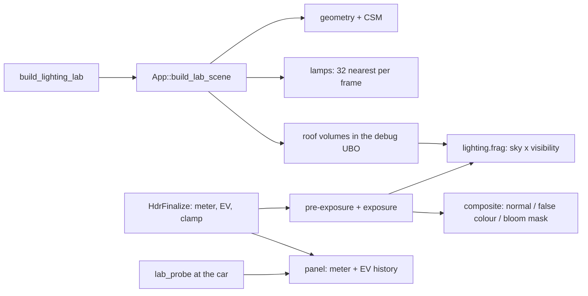

**Panel ("Lighting lab").** Teleport per station; Day / Dusk / Night (100,000 / 400 / 0.3 for sun lux and sky scale, with matching EV clamps); log sliders for sun lux and sky scale; composite views (false colour by exposed value, bloom mask) carried in the first padding lane of the composite push block; an exposure meter with a history plot; and the light under the car (sky visibility, lamp lux).

**Other changes.** The glass sun glint now scales with the sun's lux and the pre-exposure, so it dims at dusk and night. `CarEntity::halt()` stops the car for a teleport.

**Changed from the plan.** The lit tunnel was specified with a lamp every 25 m. A test showed about 2 lux between lamps there, so it is 12,000 lm every 12.5 m (about 19 to 33 lux).

**Known limits.** TAA history lags one frame in brightness while the exposure moves. Windshield rain, the wet-lamp halos and the rain-fog colour are still in the fixed scale, so they are too bright at dusk and night. The probe's sun figure is unshadowed and read from the Elevation slider. Roof volumes are hand-placed.

**Verification.** `make test`: 411/411, `make test-debug`: 436/436, 0 warnings in both. New tests: sky visibility (4 cases), the lab world (6 cases), adaptive pre-exposure (1 case). `lighting.frag`, `composite.frag` and `glass.frag` compile in both variants. `lighting.frag.spv` and `glass.frag.spv` re-recorded (33 of 33 OK); `composite.frag.spv` is unchanged in release.

**Not done: the app was not run.** Owner check list:

1. `SWISH_LAB=1 make debug` starts in the paved box, car at the origin facing the lanes; a normal `make debug` and `make run` are unchanged.
2. Geometry: tunnels, decks, lamp poles, cards and balls are solid from every side (no missing or inside-out faces) and cast sun shadows.
3. Teleport to each station works and the car is stopped.
4. Unlit tunnel: it is dark inside (walls, road and the car), the meter's EV drops, and the image brightens over a second or two; at the exit there is a short flash, then recovery. "Sky visibility" in the panel falls to about 0.02.
5. Overpasses: the 10 m deck only dims; the 80 m deck goes dark. The EV history plot shows the dips.
6. Lit tunnel and, after pressing Night, the lamp stretch: pools of light on the road, "Lamps" reading about 15 to 33 lux under a lamp, bloom on the lamp heads only.
7. Night: no banding or crushed blacks with adaptive pre-exposure on; turn it off to see why it is needed.
8. False colour: sunlit road mostly grey and green, sky yellow or red where it clips. Bloom mask: only lamps and the sun.
9. The wall holds the car at the edge of the box.

| File | Change |
|------|--------|
| [src/scene/LightingLab/LightingLab.h](../../src/scene/LightingLab/LightingLab.h), [.cpp](../../src/scene/LightingLab/LightingLab.cpp) | New: the lab world, stations, wall clamp, light probe. |
| [src/utils/light/SkyVisibility.h](../../src/utils/light/SkyVisibility.h) | New: roof volumes and the visibility function. |
| [src/utils/light/Photometry.h](../../src/utils/light/Photometry.h) | `pre_exposure_for_ev100`, `kShippedHdrExposure`; `hdr_exposure_from_ev100` takes the pre-exposure. |
| [src/renderer/Passes/HdrFinalizePass.cpp](../../src/renderer/Passes/HdrFinalizePass.cpp), [IRenderPass.h](../../src/renderer/Passes/IRenderPass.h) | Adapts in cd/m²; per-slot pre-exposure; publishes pre-exposure and the meter read-out. |
| [src/renderer/Renderer/Renderer_Frame.cpp](../../src/renderer/Renderer/Renderer_Frame.cpp), [src/renderer/CameraUniforms/CameraUniforms.h](../../src/renderer/CameraUniforms/CameraUniforms.h) | Per-frame `set_pre_exposure`; meter copied to the debug params. |
| [src/renderer/WeatherController/WeatherController.cpp](../../src/renderer/WeatherController/WeatherController.cpp) | Sun lux and sky scale mirrored to, and read from, the debug params. |
| [src/renderer/Passes/CompositePass.cpp](../../src/renderer/Passes/CompositePass.cpp), [shaders/composite.frag](../../shaders/composite.frag) | Debug views: false colour, bloom mask. |
| [shaders/lighting.frag](../../shaders/lighting.frag), [src/debug/SceneParamsUniform.h](../../src/debug/SceneParamsUniform.h), [.cpp](../../src/debug/SceneParamsUniform.cpp) | Roof-volume rows and the sky-visibility term (debug). |
| [shaders/glass.frag](../../shaders/glass.frag) | Sun glint scaled by lux and pre-exposure. |
| [src/debug/DebugParams.h](../../src/debug/DebugParams.h), [DebugUI.cpp](../../src/debug/DebugUI.cpp) | Lab fields and the "Lighting lab" panel. |
| [src/core/App/App.h](../../src/core/App/App.h), [App.cpp](../../src/core/App/App.cpp), [AppInit.cpp](../../src/core/App/AppInit.cpp) | `SWISH_LAB`, `build_lab_scene`, wall clamp, teleport, probe. |
| [src/scene/Entity/CarEntity.h](../../src/scene/Entity/CarEntity.h) | `halt()`. |
| [CMakeLists.txt](../../CMakeLists.txt), [tests/CMakeLists.txt](../../tests/CMakeLists.txt), [tests/utils/CMakeLists.txt](../../tests/utils/CMakeLists.txt) | Lab source in the test library; two new test files. |
| [tests/test_lighting_lab.cpp](../../tests/test_lighting_lab.cpp), [tests/utils/test_light_SkyVisibility.cpp](../../tests/utils/test_light_SkyVisibility.cpp), [tests/utils/test_light_Photometry.cpp](../../tests/utils/test_light_Photometry.cpp) | New tests. |
| [tests/golden/release_spv.sha256](../../tests/golden/release_spv.sha256) | Two shader hashes re-recorded. |
| [docs/lighting-lab.md](../lighting-lab.md), [docs/README.md](../README.md), [docs/lighting-l1.md](../lighting-l1.md), [tasks/todo.md](../../tasks/todo.md) | New guide, index row, L1 recipe E updated, lab section marked built. |

</details>

### 2026-11-15 — Lighting L2 to L10, debug first: procedural sky, time of day, shadows, emissive, corridor lamps, retroreflection

Built lighting chapters L2 to L10 behind the debug build: a raymarched sky with six time-of-day presets, sun-shadow fixes, energy compensation, paint flakes, emissive lenses and lamp heads, street lamps on the corridor, a low-beam cutoff and retroreflective lane markings. `make run` is unchanged.

<details><summary>Technical summary</summary>

**Scope and rule.** Decided in an interview recorded in [tasks/todo.md](../../tasks/todo.md): everything in one run, **debug first** (on in `make debug`, off in `make run`), and four items left out (L7 lamp shadows, L8.3 signs, L9.4 mesopic, L10.2 lens rain and layered wet BRDF). Reference: [docs/lighting-l2-l10.md](../lighting-l2-l10.md). `DebugParams` defaults use the new `kDebugBuild`, and the shader code is under `#ifdef SWISH_DEBUG_UI`. Of the 33 release shaders only `ibl_sky.frag.spv` changed.

**L2, the sky.** Single scattering of Rayleigh, Mie and ozone, marched along the view ray with a planet-shadow test, so it stays correct with the sun below the horizon:

$$
L(\mathbf{v}) = E_{\text{toa}} \int_0^{d} T(\mathbf{o}\to\mathbf{x})\,T(\mathbf{x}\to\text{sun})\,\bigl[\beta_R\,\rho_R\,p_R(\mu) + \beta_M\,\rho_M\,p_M(\mu)\bigr]\,ds
$$

The same model exists in [atmosphere.glsl](../../shaders/common/atmosphere.glsl) and [Atmosphere.h](../../src/utils/light/Atmosphere.h); tests pin the C++ copy (about 111,000 lux of direct sun at 60 degrees, a blue zenith near 1,570 cd/m², a red sunset horizon, under 1 cd/m² overhead at -6 degrees). The cube stores sky nits over a per-bake scale of ten times the zenith luminance, so it stays in half-float range from noon to midnight; that scale is the L1 `skyNits`. Sky pixels evaluate the model directly and add the sun or moon disc and stars. Six presets come from `config/time_of_day.toml` (T key, panel); the weather key becomes cloud cover. At night the moon is the directional light.

**L3, shadows.** A stable light up vector (the old `lookAt` with world up degenerates with the sun at the zenith), the cascade centre snapped to texels, a slope-scaled bias, a cascade blend band, and a physical PCSS penumbra. A cascade is orthographic with depth range $3r$ and texels of $2r/N$, so the radius cancels:

$$
w_{\text{texels}} = \Delta z \cdot 3 \tan\theta_{\text{sun}} \cdot N
$$

**L4, materials.** Multiscatter compensation $1 + F_0\,(1/E - 1)$ with $E$ = `dfg.x + dfg.y` from the split-sum LUT; the wet sheen bounded to the reflection the base lobe did not take; flakes on body paint; a Karis-weighted four-tap bloom extract with weights $1/(1 + Y e)$.

**L5, emissive.** `PushConstantData` gained `extra` (128 B, still within the guaranteed limit): x is the emissive strength, already pre-exposed, written to the normal buffer's alpha; y is the retro flag, written to the albedo buffer's alpha. Lens nodes of the rigged car glow while their lamp is on; lamp heads glow while lamps are on.

**L6 and L8, lamps and retroreflection.** Poles on the corridor median every 60 m with one 2,100 K downward spot each ($I = \Phi / (2\pi(1-\cos 70^\circ)) \approx 7{,}740$ cd for 32,000 lm). The spot limit is 40, the car's lights first and then the nearest lamps. Headlights use the cone rule with an 8 to 16 degree beam and a cutoff above the beam axis. Lane markings are tagged retroreflective and get a $\cos^{64}$ lobe around the light direction in the spot loop.

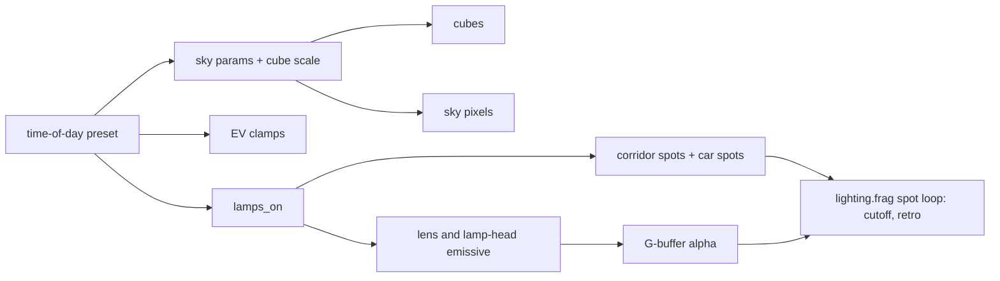

**Not built, and deviations from the agreed defaults.** The L4.4 bloom mip pyramid (only the Karis extract). The cheaper bake (the irradiance convolution is shared with release). Release promotions L2.2, L3.4, L4.5 and L6.3, and the L4.6 sign-off, stay open by decision.

**Known limits.** No multiple scattering (a 1.2 lift stands in). Every sky change is a synchronous rebake. The debug glass disc is always the physical one. A lens the loader classifies as glass will not glow. Paint is found by material name. Windshield rain and wet halos ignore the time of day.

**Verification.** `make test`: 432/432, `make test-debug`: 457/457, 0 warnings in both. New or un-hidden tests: atmosphere (5), time of day (4), shadow fit (4), corridor lamp posts (5), colour temperature (1), mesh shapes (1), lab emissive (1). All touched shaders compile in both variants. `ibl_sky.frag.spv` re-recorded (33 of 33 OK). **Not done: the app was not run.** The owner check list is at the end of [docs/lighting-l2-l10.md](../lighting-l2-l10.md).

| File | Change |
|------|--------|
| [shaders/common/atmosphere.glsl](../../shaders/common/atmosphere.glsl), [src/utils/light/Atmosphere.h](../../src/utils/light/Atmosphere.h) | New: the sky model in GLSL and C++. |
| [shaders/ibl_sky.frag](../../shaders/ibl_sky.frag), [src/renderer/IBLManager/IBLManager.cpp](../../src/renderer/IBLManager/IBLManager.cpp), [.h](../../src/renderer/IBLManager/IBLManager.h) | Atmosphere bake mode, `bake_atmosphere`. |
| [shaders/lighting.frag](../../shaders/lighting.frag) | Sky pixels, shadow bias / blend / penumbra, energy compensation, sheen bound, emissive, beam cutoff, retro lobe, sky-coloured rain fog (all debug). |
| [shaders/gbuffer.frag](../../shaders/gbuffer.frag), [shaders/glass.frag](../../shaders/glass.frag), [shaders/bloom_extract.frag](../../shaders/bloom_extract.frag), [shaders/common/lights.glsl](../../shaders/common/lights.glsl) | Emissive and retro lanes; physical glass disc; Karis extract; 40 spot slots (debug). |
| [src/renderer/WeatherController/WeatherController.cpp](../../src/renderer/WeatherController/WeatherController.cpp), [.h](../../src/renderer/WeatherController/WeatherController.h) | `apply_procedural_sky`, preset loading, weather as cloud cover. |
| [src/scene/TimeOfDay/TimeOfDay.h](../../src/scene/TimeOfDay/TimeOfDay.h), [src/utils/light/ShadowFit.h](../../src/utils/light/ShadowFit.h), [src/scene/Corridor/CorridorLamps.h](../../src/scene/Corridor/CorridorLamps.h), [src/utils/light/Photometry.h](../../src/utils/light/Photometry.h) | Learning stubs implemented (presets, shadow fit, lamp posts, colour temperature). |
| [src/renderer/GeometryProducer/GeometryProducer.cpp](../../src/renderer/GeometryProducer/GeometryProducer.cpp), [src/renderer/SceneGeometry/SceneGeometry.cpp](../../src/renderer/SceneGeometry/SceneGeometry.cpp), [.h](../../src/renderer/SceneGeometry/SceneGeometry.h) | Stable cascade fit; emissive scale and paint flakes per draw. |
| [src/renderer/CameraUniforms/CameraUniforms.cpp](../../src/renderer/CameraUniforms/CameraUniforms.cpp), [.h](../../src/renderer/CameraUniforms/CameraUniforms.h), [src/renderer/Renderer/Renderer.h](../../src/renderer/Renderer/Renderer.h), [Renderer_State.cpp](../../src/renderer/Renderer/Renderer_State.cpp), [Renderer_Frame.cpp](../../src/renderer/Renderer/Renderer_Frame.cpp) | World spot lights, nearest first; spot counts for the panel. |
| [src/scene/SceneTypes.h](../../src/scene/SceneTypes.h) | `Submesh::is_paint/lens`, `DrawCall::emissiveNits/retro/isPaint`, `PushConstantData::extra`, `MAX_SPOT_LIGHTS` 40, spot `cutoff`. |
| [src/scene/Corridor/CorridorScene.cpp](../../src/scene/Corridor/CorridorScene.cpp), [.h](../../src/scene/Corridor/CorridorScene.h), [CorridorDriver.cpp](../../src/scene/Corridor/CorridorDriver.cpp) | Street lamps (debug), retro tags, lamps handed to the renderer. |
| [src/scene/RoadScene/MeshShapes.h](../../src/scene/RoadScene/MeshShapes.h), [src/scene/LightingLab/LightingLab.cpp](../../src/scene/LightingLab/LightingLab.cpp) | Shared box / ball shapes; glowing lamp heads in the lab. |
| [src/scene/ModelManager/ModelManager.cpp](../../src/scene/ModelManager/ModelManager.cpp), [src/scene/Entity/CarEntity.h](../../src/scene/Entity/CarEntity.h), [CarEntity.cpp](../../src/scene/Entity/CarEntity.cpp), [Entity.cpp](../../src/scene/Entity/Entity.cpp), [CarLights.h](../../src/scene/Entity/CarLights.h) | Paint and lens tags, lens luminance, wettable exterior, beam cutoff and cone rule. |
| [src/debug/DebugParams.h](../../src/debug/DebugParams.h), [DebugUI.cpp](../../src/debug/DebugUI.cpp), [SceneParamsUniform.h](../../src/debug/SceneParamsUniform.h), [.cpp](../../src/debug/SceneParamsUniform.cpp), [Tunables.def](../../src/debug/Tunables.def) | `kDebugBuild`, L2 to L10 controls, two panel sections, sky rows in the debug UBO, tighter default beam. |
| [src/core/App/App.cpp](../../src/core/App/App.cpp), [App.h](../../src/core/App/App.h), [AppInit.cpp](../../src/core/App/AppInit.cpp), [AppInput.cpp](../../src/core/App/AppInput.cpp) | T key, lamps in the corridor build, car lights and lenses per preset. |
| tests: [test_light_Atmosphere.cpp](../../tests/utils/test_light_Atmosphere.cpp), [test_light_ShadowFit.cpp](../../tests/utils/test_light_ShadowFit.cpp), [test_light_Photometry.cpp](../../tests/utils/test_light_Photometry.cpp), [test_time_of_day.cpp](../../tests/test_time_of_day.cpp), [test_corridor_lamps.cpp](../../tests/test_corridor_lamps.cpp), [test_lighting_lab.cpp](../../tests/test_lighting_lab.cpp), [tests/utils/CMakeLists.txt](../../tests/utils/CMakeLists.txt) | New and un-hidden tests. |
| [tests/golden/release_spv.sha256](../../tests/golden/release_spv.sha256) | `ibl_sky.frag.spv` re-recorded. |
| [docs/lighting-l2-l10.md](../lighting-l2-l10.md), [docs/README.md](../README.md), [docs/lighting-lab.md](../lighting-lab.md), [tasks/todo.md](../../tasks/todo.md) | New reference, index row, lab note, chapter ticks. |

</details>

### 2026-11-15 — Car showcase: four lab places, rectangle area lights, paint looks, grounding shadow, wet car, bloom pyramid

Added a studio, a parking garage, a gas canopy and a night street to the lighting lab, lit by new rectangle area lights, with a panel for the car's paint, surface and lights (debug builds only; `make run` unchanged).

<details><summary>Technical summary</summary>

**Motivation.** The lab could show roads and lamps but had no place for judging the car itself, and the engine had only point and spot lights, so nothing made the broad soft highlights a car's paint is judged by. Reference: [docs/car-showcase.md](../car-showcase.md). Largely AI-generated; not yet run in the app by the owner or the author.

**Approach.**

- **Rectangle lights** ([src/scene/SceneTypes.h](../../src/scene/SceneTypes.h), [shaders/common/lights.glsl](../../shaders/common/lights.glsl), [shaders/lighting.frag](../../shaders/lighting.frag)): up to 16, nearest first, in a debug-only tail of the lights UBO. Diffuse from the rectangle's solid angle, specular and clear coat from a representative point:

$$
E \approx L\,\Omega\,\max(0,\ n\cdot\omega_c)
$$

- **Grounding shadow:** the car as one box (`carBoxCenter`, `carBoxHalf`); five rays per rectangle light from each shaded point.
- **Places** ([src/scene/LightingLab/LightingLab.cpp](../../src/scene/LightingLab/LightingLab.cpp)): 3 + 12 + 8 + 6 = 29 rectangle lights; roof volumes grew from 8 to 12 with closed, one-end and all-sides kinds ([src/utils/light/SkyVisibility.h](../../src/utils/light/SkyVisibility.h)).
- **Car looks** ([src/scene/Entity/CarLooks.h](../../src/scene/Entity/CarLooks.h)): `paint_look` (finish, colour, clean / wet / dusty) through the existing material overrides; `car_material_fix` by material name.
- **Wet car:** a per-draw flag packed into the albedo alpha next to the retroreflection flag; film and beaded drops in the car's frame.
- **Bloom pyramid** ([src/renderer/Passes/BloomPyramidPass.cpp](../../src/renderer/Passes/BloomPyramidPass.cpp), [shaders/bloom_combine.frag](../../shaders/bloom_combine.frag)): three more blur levels blended back with alpha weights, energy preserved:

$$
B = 0.21\,B_0 + 0.21\,B_1 + 0.28\,B_2 + 0.30\,B_3
$$

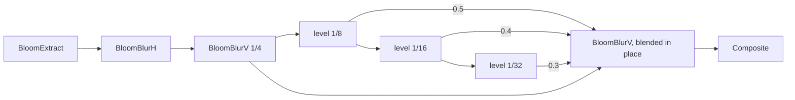

**Release build.** All shader edits are under `#ifdef SWISH_DEBUG_UI`; the 33 recorded release `.spv` hashes still match. `bloom_combine.frag.spv` is a new file and its hash was added (it is compiled but not loaded in release).

**Verification.** `make test` 438/438, `make test-debug` 463/463, 0 warnings. Not launched.

| File | Change |
|------|--------|
| [src/scene/SceneTypes.h](../../src/scene/SceneTypes.h) | `RectLightData`, `RectLightDesc`, `CarOccluder`, `MAX_RECT_LIGHTS`; `DrawCall::roughnessMul`, `surfaceWet`; `Submesh` fix fields. |
| [shaders/common/lights.glsl](../../shaders/common/lights.glsl) | Debug tail of the lights UBO: rectangle lights and the car box. |
| [shaders/lighting.frag](../../shaders/lighting.frag) | Rectangle-light loop, car-box occlusion, wet car surface and drops, 12 roof volumes (debug). |
| [shaders/gbuffer.frag](../../shaders/gbuffer.frag) | Albedo alpha packs the retro flag or the car-wet amount (debug). |
| [shaders/bloom_combine.frag](../../shaders/bloom_combine.frag) | New: one pyramid level out with its blend weight in alpha. |
| [src/renderer/Passes/BloomPyramidPass.cpp](../../src/renderer/Passes/BloomPyramidPass.cpp), [src/renderer/Passes/PassList.def](../../src/renderer/Passes/PassList.def) | New debug pass after `BloomBlurV`. |
| [src/renderer/CameraUniforms/CameraUniforms.h](../../src/renderer/CameraUniforms/CameraUniforms.h), [CameraUniforms.cpp](../../src/renderer/CameraUniforms/CameraUniforms.cpp) | `set_rect_lights` (nearest first), `set_car_occluder`. |
| [src/renderer/Renderer/Renderer.h](../../src/renderer/Renderer/Renderer.h), [Renderer.cpp](../../src/renderer/Renderer/Renderer.cpp) | Debug entry points for rectangle lights and the car box. |
| [src/renderer/SceneGeometry/SceneGeometry.cpp](../../src/renderer/SceneGeometry/SceneGeometry.cpp) | Pushes the roughness multiplier and the wet flag per draw. |
| [src/scene/LightingLab/LightingLab.h](../../src/scene/LightingLab/LightingLab.h), [LightingLab.cpp](../../src/scene/LightingLab/LightingLab.cpp) | Four places, four stations, `rects`, station time of day. |
| [src/utils/light/SkyVisibility.h](../../src/utils/light/SkyVisibility.h), [src/debug/SceneParamsUniform.h](../../src/debug/SceneParamsUniform.h) | 12 roof volumes; closed, one-end and all-sides kinds. |
| [src/scene/Entity/CarLooks.h](../../src/scene/Entity/CarLooks.h) | New: paint looks and material fixes. |
| [src/scene/Entity/CarEntity.h](../../src/scene/Entity/CarEntity.h), [CarEntity.cpp](../../src/scene/Entity/CarEntity.cpp), [src/scene/ModelManager/ModelManager.cpp](../../src/scene/ModelManager/ModelManager.cpp) | Paint material list, material fixes, wet flag on the car's draws. |
| [src/core/App/App.h](../../src/core/App/App.h), [App.cpp](../../src/core/App/App.cpp), [AppInit.cpp](../../src/core/App/AppInit.cpp) | Upload rectangle lights, car box, turntable camera, car-lights mode, paint look, teleport time of day. |
| [src/debug/DebugParams.h](../../src/debug/DebugParams.h), [src/debug/DebugUI.cpp](../../src/debug/DebugUI.cpp) | Showcase fields and the "Car showcase" panel section. |
| [tests/test_car_looks.cpp](../../tests/test_car_looks.cpp), [tests/test_lighting_lab.cpp](../../tests/test_lighting_lab.cpp), [tests/utils/test_light_SkyVisibility.cpp](../../tests/utils/test_light_SkyVisibility.cpp), [tests/utils/test_renderer_PassRegistry.cpp](../../tests/utils/test_renderer_PassRegistry.cpp), [tests/CMakeLists.txt](../../tests/CMakeLists.txt) | New and extended tests; pinned pass order gains `BloomPyramid`. |
| [tests/golden/release_spv.sha256](../../tests/golden/release_spv.sha256) | One new line for `bloom_combine.frag.spv`. |
| [docs/car-showcase.md](../car-showcase.md), [docs/README.md](../README.md), [docs/lighting-lab.md](../lighting-lab.md), [tasks/todo.md](../../tasks/todo.md), [tasks/upcoming-tests.md](../../tasks/upcoming-tests.md) | New reference, index row, lab stations, plan ticks, owner check list. |

</details>

### 2026-11-20 — Rain impact splashes (debug only): crown rings and droplets on the road

Added debug-only rain impact splashes: an expanding crown ring and up to four droplets per splash, drawn from a world-fixed cell grid around the camera, with no buffers and no compute pass.

<details><summary>Technical summary</summary>

**Motivation.** Todo A2 (impact splashes) was open. The technique comes from the "burn to Gaussians" effect in `willeastcott/splat-walk`. That repo has no licence, so only the idea was studied and no code was copied. Each instance is a stateless function of a stable hash and a time, its phase weights are packed into one `uint`, and the fragment shader picks its shape from them. Plan and decisions: [tasks/todo.md](../../tasks/todo.md), "Rain impact splashes".

**Approach.** [shaders/rain_splash.vert](../../shaders/rain_splash.vert) snaps a $G \times G$ grid ($G = 64$) to world cells of size $s$ around the camera. Cell $(i, j)$ has hash key $k$. It fires once per period $P$ at offset $h(k)$, with spawn chance $p = \text{intensity} \times \text{density}$ per cycle:

$$t_\text{local} = \operatorname{fract}\!\left(\frac{t}{P} + h(k)\right) P, \qquad r(t_\text{local}) = R\left(1 - e^{-t_\text{local}/\tau}\right)$$

Instance `cell * 5 + sub` is either a ring quad lying flat on the road plane ($sub = 0$) or a droplet billboard ($sub = 1..4$). A droplet follows $\mathbf{x}(t) = \mathbf{c} + \tfrac12 v_0 t\,\hat{\mathbf{d}} + (v_0 t - \tfrac12 g t^2)\,\hat{\mathbf{y}}$ and is culled once it lands. [shaders/rain_splash.frag](../../shaders/rain_splash.frag) unpacks `(ring, dot, fade, variation)`. It draws a `fwidth`-anti-aliased band at $|uv| = 0.85$, which fades out when sub-pixel, or a soft-edged disc. Droplets are weighted 0.35 (`kDropWeight`): at full weight they read as white hail specks in the app, and the crown ring is what reads as a splash. Additive, in rain.frag's colour. The road plane is `carPosition.y` plus an offset, the same ground assumption the spray emitter makes.


Splashes are gated on rain intensity, because `record_draws` returns early below 0.001. The whole path is under `#ifdef SWISH_DEBUG_UI`. The release executable is unchanged. Release does compile the two new `.spv` files, but the golden check `shasum -c` covers only the listed 34 files, so it still passes.

**Limits.** The road is a flat plane at the car's height, so splashes sit slightly off on ramps and embankments. There are no splashes on the car body (depth-buffer hits are a later option). An origin rebase reshuffles the hash pattern for a frame.

**Verification.** `make test` 438/438. `make test-debug` 463/463. `make format-check` is clean. The release `.spv` golden passes. `make check` still fails on its two pre-existing hard checks (stray root files, tracked `.obsidian/workspace.json`). Looked at in the app (`make debug`, window-only screenshots, startup rain level temporarily forced to heavy and then reverted). At exaggerated settings the rings and droplets both draw and sit on the road. At defaults, after the tuning above, the droplets are faint specks. Most rings are sub-pixel in an 800×632 window, so the shader fades them out. At rain 0 there are no splashes. GPU time and a validation-layer run are not done.

| File | Change |
|------|--------|
| [shaders/rain_splash.vert](../../shaders/rain_splash.vert) | New: cell grid, phase, ring/droplet placement, packed `flat uint`. |
| [shaders/rain_splash.frag](../../shaders/rain_splash.frag) | New: ring band or droplet disc from the packed weights, additive. |
| [src/renderer/RainSystem/RainSystem.h](../../src/renderer/RainSystem/RainSystem.h) | Debug-only `SplashPush` (64 B), grid constants, splash pipeline members; `record_draws` takes the camera set. |
| [src/renderer/RainSystem/RainSystem.cpp](../../src/renderer/RainSystem/RainSystem.cpp) | Debug-only push packing in `beginFrame`, splash draw after the near streaks, pipeline create/cleanup. |
| [src/debug/Tunables.def](../../src/debug/Tunables.def) | New `rain_splash` group (13 rows). |
| [src/debug/DebugUI.cpp](../../src/debug/DebugUI.cpp) | Draws and dumps the `rain_splash` group under "Wet / Rain". |
| [tests/test_debug_params_io.cpp](../../tests/test_debug_params_io.cpp) | Tunable table size 39 to 52, bool rows 8 to 9, float rows 31 to 43, new group allowed. |
| [tasks/todo.md](../../tasks/todo.md) | Plan, decisions and step ticks. |

</details>

### 2026-11-20 — Rain look pass: AgX pink-cast fix, time-of-day config copy, overcast rain sky, fog, wet gloss, windshield beads

Fixed the AgX tonemap matrices (they were transposed, tinting every frame pink in both builds), fixed the debug build always loading golden-hour lighting, and tuned heavy rain toward the owner's Long Island Expressway reference photos: overcast with no sun, 150 m rain fog, glossy wet asphalt, lensing windshield beads, fainter splash rings.

<details><summary>Technical summary</summary>

**Motivation.** The owner supplied five photos of the LIE in heavy rain: flat neutral-grey overcast, haze that washes everything to grey within 100–200 m, a glossy wet road, and dense windshield beads with dark rims. At rain 1.0 the debug build showed a low golden sun and the whole frame was pink. Notes, sources and the owner's todo: [tasks/rain-splash-owner-todo.md](../../tasks/rain-splash-owner-todo.md).

**1. AgX matrices transposed (bug, both builds).** GLSL `mat3(...)` takes columns. [shaders/composite.frag](../../shaders/composite.frag) had the reference AgX rows typed as columns. On a neutral input the inset then gives $(0.927, 1.035, 1.038)$ and the outset $(1.091, 0.956, 0.953)$, so grey 0.18 came out as sRGB (62,51,51) instead of (55,55,55). Checked in Python against both orders. The matrices are now written column by column. The release `composite.frag.spv` golden line was updated on purpose: the release image loses its pink cast. No other `.spv` changed.

**2. Debug build always golden hour (bug, debug only).** `WeatherController::load_time_of_day_presets` reads `config_dir()/time_of_day.toml`, but CMake copied only `car.toml`, so every time-of-day slot fell back to the golden-hour defaults. [CMakeLists.txt](../../CMakeLists.txt) now copies it too. The stale "NOT LOADED YET" header in [config/time_of_day.toml](../../config/time_of_day.toml) is fixed.

**3. Rain means overcast (debug procedural sky).** In [WeatherController.cpp](../../src/renderer/WeatherController/WeatherController.cpp), with rain intensity $r$:

$$c_{rain} = \operatorname{smoothstep}(0, 0.6, r),\quad \text{cover} = \max(\text{cloudCover}, c_{rain}),\quad \text{clarity} \le 1 - c_{rain},\quad EV_{min,max} \mathrel{-}= 4\,c_{rain}$$

Heavy overcast is about EV100 10–12, while the clear presets clamp at 13–16. Without the shift the frame went black. The sliders keep their own values.

**4. Fog and wet gloss (debug defaults).** `fogMax` goes from 0 to 0.9, and `fogDist63` from 1.2 km to 150 m. The fog is wetness-gated in `lighting.frag`, so dry roads are unchanged. `wetRoughness` is 0.35 in debug and keeps 1.0 in release through the registry's `rel` slot (its first use), following Lagarde's ×2.5 wet gloss. [tests/test_debug_params_io.cpp](../../tests/test_debug_params_io.cpp) now expects this one override.

**5. Windshield beads (debug-gated in [windshield_rain.frag](../../shaders/windshield_rain.frag)).** The refraction offset is ×2.3, since a bead is a fisheye lens (Garg & Nayar 2004). A dark rim (`smoothstep(0.04, 0.16, |n.xy|)`, down to 35%) is where rays leave at grazing angles.

**6. Splashes.** Rings are lifted 1.5 cm off the plane (they z-fought into "C" arcs), weighted 0.5, and default to 8 cm radius. Droplets are weighted 0.35.

**7. HDRIs.** Added Poly Haven CC0 `mud_road_puresky_2k` and `kloofendal_misty_morning_puresky_2k` (chosen by looking at them in the browser) to [HdriCatalog.h](../../src/renderer/IBLManager/HdriCatalog.h) and [assets/CREDITS.md](../../assets/CREDITS.md). The files are local because `assets/Sky/` is gitignored.

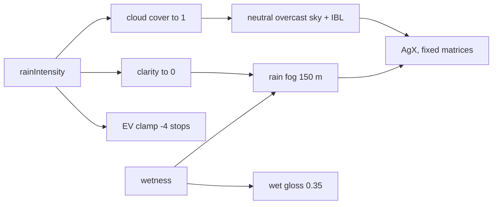

**Verification.** `make test` 438/438. `make test-debug` 463/463. `make format-check` is clean. Release `.spv` golden passes with the one updated line. Looked at in the app with window-only screenshots, heavy rain temporarily forced at startup and then reverted:
- The sky samples neutral (about 181,165,164 before, grey after).
- Fog washes the distance out.
- Beads read with dark rims.
- Rings are small and faint.

Not done: the road is still darker and less mirror-like than the references, the cabin reads near black, the new HDRIs were not compared in the app, and there was no validation-layer run.

| File | Change |
|------|--------|
| [shaders/composite.frag](../../shaders/composite.frag) | AgX inset/outset matrices in column order. |
| [tests/golden/release_spv.sha256](../../tests/golden/release_spv.sha256) | `composite.frag.spv` hash (intended). |
| [CMakeLists.txt](../../CMakeLists.txt) | Copy `time_of_day.toml` to the build config dir. |
| [config/time_of_day.toml](../../config/time_of_day.toml) | Header now says it is loaded (debug). |
| [src/renderer/WeatherController/WeatherController.cpp](../../src/renderer/WeatherController/WeatherController.cpp) | Rain drives cloud cover, clarity and the EV clamp (procedural sky, debug). |
| [src/debug/DebugParams.h](../../src/debug/DebugParams.h) | `fogMax` 0.9, `fogDist63` 150000 WU. |
| [src/debug/Tunables.def](../../src/debug/Tunables.def) | `wetRoughness` debug 0.35 / release 1.0; splash ring radius 80, ring width 0.12. |
| [tests/test_debug_params_io.cpp](../../tests/test_debug_params_io.cpp) | Expects the `wetRoughness` release override. |
| [shaders/windshield_rain.frag](../../shaders/windshield_rain.frag) | Debug-gated fisheye refraction and dark bead rim. |
| [shaders/rain_splash.vert](../../shaders/rain_splash.vert) | Ring lift, ring weight 0.5, droplet weight 0.35. |
| [src/renderer/IBLManager/HdriCatalog.h](../../src/renderer/IBLManager/HdriCatalog.h), [assets/CREDITS.md](../../assets/CREDITS.md) | Two overcast HDRIs and their credits. |
| [tasks/rain-splash-owner-todo.md](../../tasks/rain-splash-owner-todo.md) | Sources, reference notes, next steps. |

</details>

### 2026-11-20 — Rain P1: any rain swaps the sky to a rain-coupled overcast HDRI (debug)

Any rain now shows the Misty Morning overcast HDRI, with no sun, clarity 0 and sky-coloured rain fog, even with the procedural sky ticked. Dry weather returns to the procedural sky, and the weather preset can no longer override the rain HDRI.

<details><summary>Technical summary</summary>

**Motivation.** This is rain round 3, phase P1 (owner decisions in [tasks/todo.md](../../tasks/todo.md)). Before it, the HDRI path had no rain coupling, and rain switching the preset to Cloudy loaded `quarry_cloudy` (hills on the horizon). Rain on the procedural path gave a featureless dome.

**Approach.**
- One rule, `procedural_sky_active(p) = skyProcedural && rainIntensity <= 0` ([DebugParams.h](../../src/debug/DebugParams.h)). [WeatherController::apply_debug](../../src/renderer/WeatherController/WeatherController.cpp) and the shader flag in [SceneParamsUniform.cpp](../../src/debug/SceneParamsUniform.cpp) both read it.
- On the HDRI branch, rain sets clarity 0 and sun lux 0, lowers the EV clamp by `rainEvShift` (default 0: the HDRI path is on the legacy scale, and 3 washed the road white), and loads `rainEnvironmentHdri` (default 9, Misty Morning).
- Loading an HDRI clears `m_skyBaked`, so the procedural sky rebakes when it is dry again.
- The round-2 rain coupling inside `apply_procedural_sky` is removed, because rain never reaches that branch now.
- [lighting.frag](../../shaders/lighting.frag) (debug block): the rain-fog airlight is always the sky cube's horizon colour (mip 3), so the fog matches the HDRI.
- New panel controls "Rain HDRI" and "Rain EV shift" ([DebugUI.cpp](../../src/debug/DebugUI.cpp)), saved as `[sky] rain_environment_hdri` and `rain_ev_shift` ([DebugParamsIO.cpp](../../src/debug/DebugParamsIO.cpp)).

$$f = \left(1 - e^{-d\,w/d_{63}}\right) f_{max},\qquad L = L_s(1-f) + L_\text{sky}(\text{horizon})\,f$$

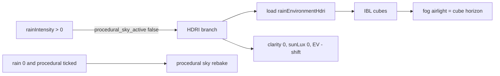

**Verification.** `make test` 438/438. `make test-debug` 463/463. Format is clean. The release `.spv` golden is unchanged, because every change is debug-gated. Looked at in the app (window-only screenshots, startup heavy rain forced temporarily and then reverted), with the R key cycling 1.0 → 0 → 0.35. The log shows Misty Morning loading on each rain entry and the procedural sky returning at 0. Tuning guide: [docs/rain/tuning-notes.md](../rain/tuning-notes.md), "Phase P1".

| File | Change |
|------|--------|
| [src/debug/DebugParams.h](../../src/debug/DebugParams.h) | `rainEnvironmentHdri`, `rainEvShift`, `procedural_sky_active()`. |
| [src/debug/DebugParamsIO.cpp](../../src/debug/DebugParamsIO.cpp) | Save/load the two fields under `[sky]`. |
| [src/debug/DebugUI.cpp](../../src/debug/DebugUI.cpp) | "Rain HDRI" combo, "Rain EV shift" slider. |
| [src/debug/SceneParamsUniform.cpp](../../src/debug/SceneParamsUniform.cpp) | Shader procedural flag uses the shared rule. |
| [src/renderer/WeatherController/WeatherController.cpp](../../src/renderer/WeatherController/WeatherController.cpp) | Rain HDRI branch, coupling, `m_skyBaked` reset; procedural rain coupling removed. |
| [shaders/lighting.frag](../../shaders/lighting.frag) | Debug rain-fog colour from the sky cube on both sky paths. |
| [docs/rain/tuning-notes.md](../rain/tuning-notes.md), [docs/rain/README.md](../rain/README.md) | New tuning guide (Phase 0 + P1) and a link to it. |
| [tasks/todo.md](../../tasks/todo.md) | Round-3 decisions, P1 ticked. |

</details>

### 2026-11-20 — Rain P1b: rain-sky wetness latch, sky fade-in, two more rain skies (debug)

The rain sky now holds until the road dries (this fixes the dark "noon" right after rain), fades in over 20 s when rain starts, and has two more overcast skies to choose from (Kloofendal Overcast, ambientCG Storm Sky).

<details><summary>Technical summary</summary>

**Root cause of "dark dry noon".** When rain stopped, the sky swapped straight back to the clear procedural sky. Wetness decays at $0.012\,\mathrm{s^{-1}}$, so the road stayed soaked for minutes, and `lighting.frag` darkens the sky by up to $0.45\,w$. The result was a dark blue sky over a wet road. Dry startup noon was never affected.

**Fix.**
- A latch, `rainSkyActive`. Any rain sets it. It clears once wetness $< w_{clear}$ (`rainSkyClearWetness`, 0.15). [WeatherController::apply_debug](../../src/renderer/WeatherController/WeatherController.cpp) now takes last frame's wetness from [Renderer_State.cpp](../../src/renderer/Renderer/Renderer_State.cpp).
- `procedural_sky_active()` reads the latch, and is now gated to debug builds. The release build broke when the helper read a debug-only field; that was caught by `make test` and fixed.
- A fade-in, `rainSkyBlend`. It ramps from 0 to 1 over `rainSkyFadeSeconds` (20 s, steady clock) and goes to the shader as `atmoFlags.z`. [lighting.frag](../../shaders/lighting.frag) mixes the analytic procedural sky into the HDRI background while it is below 1. Only the visible sky fades; the IBL light swaps at once (one cube set).

$$t_{clear} = \frac{\ln(w_0/w_{clear})}{0.012} \approx 158\ \text{s},\qquad L_{sky} = \operatorname{mix}(L_{proc}, L_{HDRI}, \min(1, t/T_{fade}))$$

**New skies.** Poly Haven `kloofendal_overcast_puresky_2k`, and ambientCG `DaySkyHDRI068B`, whose EXR was converted to `.hdr` with headless Blender because stb_image has no EXR. Both are catalog entries 10 and 11 and are credited in [assets/CREDITS.md](../../assets/CREDITS.md). Heavy-rain comparison: Misty stays the default and Storm is closest to the owner's photo 1. Notes: [docs/rain/tuning-notes.md](../rain/tuning-notes.md), "Phase P1b".

**Verification.**
- `make test` 438/438, release golden unchanged, `make test-debug` 463/463, format clean.
- In the app: a 4-HDRI capture loop (4 builds), dry startup noon, and the fade at 1 / 6 / 14 s after R. A temporary `printf` showed the blend ramping 0.01 to 0.19 in 4 s; it has been removed.

| File | Change |
|------|--------|
| [src/debug/DebugParams.h](../../src/debug/DebugParams.h) | `rainSkyClearWetness`, `rainSkyActive`, `rainSkyFadeSeconds`, `rainSkyBlend`; helper gated to debug. |
| [src/debug/DebugParamsIO.cpp](../../src/debug/DebugParamsIO.cpp), [src/debug/DebugUI.cpp](../../src/debug/DebugUI.cpp) | Save/load and sliders for the clear wetness and fade time. |
| [src/debug/SceneParamsUniform.cpp](../../src/debug/SceneParamsUniform.cpp), [SceneParamsUniform.h](../../src/debug/SceneParamsUniform.h) | `atmoFlags.z` = fade. |
| [src/renderer/WeatherController/WeatherController.cpp](../../src/renderer/WeatherController/WeatherController.cpp), [WeatherController.h](../../src/renderer/WeatherController/WeatherController.h) | Latch, fade clock, `apply_debug(d, wetness)`. |
| [src/renderer/Renderer/Renderer_State.cpp](../../src/renderer/Renderer/Renderer_State.cpp) | Passes wetness. |
| [shaders/lighting.frag](../../shaders/lighting.frag) | Debug background fade procedural → HDRI. |
| [src/renderer/IBLManager/HdriCatalog.h](../../src/renderer/IBLManager/HdriCatalog.h), [assets/CREDITS.md](../../assets/CREDITS.md) | Two skies and their credits. |
| [docs/rain/tuning-notes.md](../rain/tuning-notes.md), [tasks/todo.md](../../tasks/todo.md) | P1b notes, P1b ticked. |

</details>

### 2026-11-20 — Debug panel readable: Roboto 17 px at HiDPI, high-contrast style, sRGB-correct colours, full-window panel

Made the debug controls window readable: a crisp 17 px Roboto font at the screen's Retina scale, a dark high-contrast style with roomier spacing, colours no longer washed out by the sRGB swapchain, and the panel filling its (now larger) window.

<details><summary>Technical summary</summary>

**Motivation.** The owner (2026-11-20): "the imgui for config is really thin and hard to see". There were three causes:
- ImGui's default 13 px ProggyClean bitmap font.
- The "swish - debug" window floated at its default small size inside a 440×900 OS window.
- The panel swapchain is `B8G8R8A8_SRGB`, so ImGui's sRGB-authored colours were encoded a second time and the whole panel turned a washed mid-grey.

**Fix** (all debug-only, in [src/debug/DebugUI.cpp](../../src/debug/DebugUI.cpp)):
- `apply_readable_style()` loads `Roboto-Medium.ttf` from the fetched ImGui sources (`SWISH_IMGUI_FONT_DIR`, set in [CMakeLists.txt](../../CMakeLists.txt)). It rasterises at $17 \times s$ px, where $s$ is `glfwGetWindowContentScale`, and sets `FontGlobalScale = 1/s`. If the file is missing it falls back to the default font at 1.35×.
- Style: padding 8×5, spacing 8×7, scrollbar 16, frame borders on, and high-contrast colours.
- All style colours are linearised, $c_{lin} = c^{2.2}$, so they show as authored on the sRGB target.
- The OS window opens at 560×1000. The panel window is pinned to (0,0) at `io.DisplaySize`, with no move, resize or title bar.

**Verification.** `make test-debug` 463/463, `make test` 438/438, release golden unchanged, format clean. Looked at the controls window in the app (window capture by CGWindow id): the text is crisp and the contrast is high. Ad-hoc colours pushed in code (the "WET" label, the rpm bar) are still sRGB-authored, so they stay slightly light.

| File | Change |
|------|--------|
| [src/debug/DebugUI.cpp](../../src/debug/DebugUI.cpp) | `apply_readable_style()`, 560×1000 window, full-window panel. |
| [CMakeLists.txt](../../CMakeLists.txt) | `SWISH_IMGUI_FONT_DIR` (debug target only). |
| [tasks/todo.md](../../tasks/todo.md) | UI1 ticked. |

</details>

### 2026-11-20 — Rain P2: fixed SSAO normal sign (black wet road), Lekner–Dorf wet darkening, water F0 (debug)

Fixed the black road in rain: SSAO's reconstructed normal pointed into the surface, so the open road read as fully occluded. Also replaced the wet porosity multiply with the Lekner–Dorf wet-albedo formula and set the wet film's F0 to water's 0.02.

<details><summary>Technical summary</summary>

**Root cause.** On screenshots, the road/sky linear luminance was 0.08 against 0.28 in the owner's LIE photo. Physics predicts about 0.4 (diffuse $A_w L$ plus water-film Fresnel $F(\theta)L$, $F \approx 0.34$ at 10–15° grazing). Two experiments:
- Wet roughness forced to 0.02: a *black* mirror road while the car hood reflected the sky.
- `ssao = 1` forced: road/sky 0.74 sRGB.

[shaders/ssao.frag](../../shaders/ssao.frag) builds $\mathbf n = \operatorname{normalize}(\partial_x P \times \partial_y P)$, whose sign depends on the screen axes (Vulkan y-down, reverse-Z). On the road it pointed into the surface, so the hemisphere flip sent every tap below the asphalt and AO came out about 0. `specAO` then removed the reflections. The sun (not AO-gated) hid this in dry weather.

**Fixes** (all `#ifdef SWISH_DEBUG_UI`; release `.spv` hashes unchanged, since SSAO is a debug pass):
- `ssao.frag`: `if (dot(n, -P) < 0) n = -n`.
- [lighting.frag](../../shaders/lighting.frag): Lekner–Dorf per channel, $a_w = a[1+0.08(1-a)]$, $A = \frac{(1-R_1)a_w}{1-p(1-a_w)}$, wet albedo $= 1-A$, with $R_1 = 0.02$ and $p = 0.475$ (paper opened and checked). Asphalt 0.10 becomes 0.070.
- `lighting.frag`: wet dielectric F0 goes from 0.04 toward 0.02 (water–air), not up to 0.06.
- [Tunables.def](../../src/debug/Tunables.def): the "Wet porosity" label notes that it is release-only.

$$L_{road} \approx A_w L + \left[F_0 + (1-F_0)(1-\cos\theta)^5\right] L$$

**Verification.**
- `make test` 438/438, release golden unchanged, `make test-debug` 463/463, format clean.
- In the app (heavy rain forced temporarily and reverted, chase view): road/sky went from 50/157 to 147/180 sRGB, against the owner's photos at 0.56–0.79.
- Dry startup checked: no regression.

Not done: SSR strength (no traffic to judge it by), and a larger SSAO radius for car contact shadows. Notes: [docs/rain/tuning-notes.md](../rain/tuning-notes.md), "Phase P2".

| File | Change |
|------|--------|
| [shaders/ssao.frag](../../shaders/ssao.frag) | Normal faces the camera (debug). |
| [shaders/lighting.frag](../../shaders/lighting.frag) | Lekner–Dorf wet albedo; water F0 (debug). |
| [src/debug/Tunables.def](../../src/debug/Tunables.def) | Wet porosity label. |
| [docs/rain/tuning-notes.md](../rain/tuning-notes.md), [tasks/todo.md](../../tasks/todo.md) | P2 notes and tick. |

</details>

### 2026-11-20 — Rain P2b: SSR catches near reflections (0.4 m first step, normal fix), larger AO radius, dimmer splashes (debug)

The wet road now reflects the car, lane lines and barrier. SSR's first march step was 8 m, so every reflection closer than that was missed. Also raised the SSAO radius for more contact darkening and dimmed the splashes, which read as white circles on the brighter road.

<details><summary>Technical summary</summary>

**Cause.** [ssr.frag](../../shaders/ssr.frag) steps $s_k = s_0 \cdot 1.4^k$ with $s_0 = $ `ssrStride` $= 8063$ WU, so the first sample already lands 8 m out and near reflections are always missed. The geometric normal also had the SSAO sign flip (P2), which pushed the Fresnel term to 1.

**Fix** (debug only; release unchanged):
- `ssrStride` is 400 WU in debug through the registry `rel` slot (release keeps 8063). $d_{12} \approx 56$ m, still beyond `ssrMaxDist`.
- The SSR normal faces the camera (`#ifdef SWISH_DEBUG_UI`).
- `ssaoRadius` 400 → 1000 WU. SSAO is a debug pass.
- Splash brightness 0.6 → 0.35.
- [tests/test_debug_params_io.cpp](../../tests/test_debug_params_io.cpp) now allows the `ssrStride` override.

**Verification.** `make test` 438/438, release golden unchanged, `make test-debug` 463/463, format clean. In the app (heavy rain forced temporarily and reverted): the chase view shows the car mirrored on the wet road, and the hood view shows the lane lines and barrier reflecting. Not solved: the underbody contact shadow (SSAO can't see under the car; an analytic car occluder is suggested), and SSR is added rather than swapped for the env reflection. Notes: [docs/rain/tuning-notes.md](../rain/tuning-notes.md), "Phase P2b".

| File | Change |
|------|--------|
| [shaders/ssr.frag](../../shaders/ssr.frag) | Normal faces the camera (debug). |
| [src/debug/Tunables.def](../../src/debug/Tunables.def) | `ssrStride` debug 400 / release 8063; splash brightness 0.35. |
| [src/debug/DebugParams.h](../../src/debug/DebugParams.h) | `ssaoRadius` 1000. |
| [tests/test_debug_params_io.cpp](../../tests/test_debug_params_io.cpp) | `ssrStride` override expectations. |
| [docs/rain/tuning-notes.md](../rain/tuning-notes.md), [tasks/todo.md](../../tasks/todo.md) | P2b notes and tick. |

</details>

### 2026-11-20 — Rain P2c: analytic car-underbody sky visibility (contact shadow + no sky mirrored under the car, debug)

The car now sits on the wet road. The road under and around it loses the sky that the car's body blocks, measured with 8 cosine-weighted rays against the car's box for diffuse light and one mirror ray for reflections.

<details><summary>Technical summary</summary>

**Motivation.** After P2 and P2b the car looked like it floated in overcast rain. There is no sun shadow under overcast, and SSAO cannot see occluders hidden from the camera (the underbody).

**Fix** ([lighting.frag](../../shaders/lighting.frag), debug only). Within 6 m of the car's box (`lights.carBox*`, already uploaded by `App::update_camera`, on with `groundingShadow`):
- $V_d = 1 - \frac{1}{8}\sum_k b(\mathbf p, \mathbf p + 5\,\text{m}\,\boldsymbol\omega_k)$, where $\boldsymbol\omega_k$ are 8 cosine-weighted directions: golden-angle disk points lifted to the hemisphere (Malley).
- $V_s = 1 - b(\mathbf p, \mathbf p + 5\,\text{m}\,\mathbf r)$ along the mirror ray.
- `skyIrr *= V_d` and `envColor *= V_s`.
- Points inside the box (the car itself) are never blocked.

**Verification.** `make test` 438/438, release golden unchanged, `make test-debug` 463/463, format clean. In the app (heavy rain, chase view): visible contact darkening, and the road behind the car mirrors the car instead of the sky. Notes: [docs/rain/tuning-notes.md](../rain/tuning-notes.md), "Phase P2c".

| File | Change |
|------|--------|
| [shaders/lighting.frag](../../shaders/lighting.frag) | Car-box diffuse and specular sky visibility (debug). |
| [docs/rain/tuning-notes.md](../rain/tuning-notes.md), [tasks/todo.md](../../tasks/todo.md) | P2c notes and tick. |

</details>

### 2026-11-20 — Rain P2d: SSR swaps out the env reflection at hits; car-occluded reflections mirror the car body (debug)

Screen-space reflections now replace the sky reflection where they hit, instead of adding on top of it. The road behind the car now mirrors the car body (0.45× the sky) instead of going black where the sky is hidden and SSR misses.

<details><summary>Technical summary</summary>

**Before**, the composite gave $L_{lit} + w L_{hit}$, so the env reflection was double-counted at hits. **Now**, [lighting.frag](../../shaders/lighting.frag) writes the luminance $\bar E$ of its env-specular term (split-sum env plus wet sheen, after haze and fog) into HDR alpha; no other consumer reads alpha. [ssr.frag](../../shaders/ssr.frag) outputs $f\,(w L_{hit} - \min(I,1)\,\bar E)$, and [composite.frag](../../shaders/composite.frag) clamps $\ge 0$. So at hits $L \approx L_{diff} + E(1-f) + f w L_{hit}$.

Doing this exposed black patches behind the car: P2c zeroed the sky reflection where SSR could not resolve the body. P2c's specular visibility is now $1 - (1-k_{car})\,b$ with $k_{car} = 0.45$ (a light car body under overcast).

All changes are `#ifdef SWISH_DEBUG_UI`, so release `.spv` hashes are unchanged.

**Verification.** `make test` 438/438, release golden unchanged, `make test-debug` 463/463, format clean. In the app (R ×2 to heavy rain, about 30 s, chase view): a soft mirrored car behind the car, puddles mirroring the poles, and no black or negative patches. Notes: [docs/rain/tuning-notes.md](../rain/tuning-notes.md), "Phase P2d".

| File | Change |
|------|--------|
| [shaders/lighting.frag](../../shaders/lighting.frag) | `envSpecTerm`; HDR alpha = env-reflection luminance; car-occluded reflections at 0.45 (debug). |
| [shaders/ssr.frag](../../shaders/ssr.frag) | Subtract the env reflection at hits (debug). |
| [shaders/composite.frag](../../shaders/composite.frag) | Clamp HDR ≥ 0 after the SSR add (debug). |
| [docs/rain/tuning-notes.md](../rain/tuning-notes.md), [tasks/todo.md](../../tasks/todo.md) | P2d notes and tick. |

</details>

### 2026-11-20 — Rain P3: wheel-track ruts hold standing water on the corridor lanes (debug)

Added wheel-track ruts: two bands per lane, in the tyre paths of lanes 1–3, that turn into thin linear puddles in the rain (flatter, mirror, slightly darker). Their positions come from the road UVs and the corridor's lane layout.

<details><summary>Technical summary</summary>

**Approach** (all debug; release `.spv` hashes unchanged):
- [shaders/common/ruts.glsl](../../shaders/common/ruts.glsl): $r = e^{-d^2/2\sigma^2}\,\operatorname{mix}(0.55, 1, \text{wear})$, with $d$ the distance to the nearest wheel path at ±850 WU from the lane centre. Lanes start at $x_0 = 1600.2$ WU and are 3657.6 WU wide (corridor config).
- [gbuffer.frag](../../shaders/gbuffer.frag): the lateral position comes from $u \times$ the asphalt tile, pushed in `extra.w` (the push block is at MoltenVK's 128 B). The rut is packed into the road tag as $0.55 + 0.45r$.
- [lighting.frag](../../shaders/lighting.frag) and [ssr.frag](../../shaders/ssr.frag) decode it. Rut water joins the puddle term; lighting also mixes roughness toward `rutRoughness` and applies albedo $\times(1 - 0.4w_r)$.
- Plumbing: `PaintTuning::rutUvTile` ([SceneTypes.h](../../src/scene/SceneTypes.h), [GeometryProducer.cpp](../../src/renderer/GeometryProducer/GeometryProducer.cpp), [SceneGeometry.cpp](../../src/renderer/SceneGeometry/SceneGeometry.cpp)). Scene-params lanes `wetParams.w` and `paintParams.z` ([SceneParamsUniform](../../src/debug/SceneParamsUniform.cpp)). SSR `SsrParams::rutWater`, read in the shader as `_pad1`, because member names enter the SPIR-V hash.
- New [Tunables.def](../../src/debug/Tunables.def) group `ruts` (4 rows), shown in the panel under Wet / Rain.

**Bugs found while building it** (diagnostics, then fixed):
- The corridor's lane origin is the median plus inner shoulder, with 12 ft lanes, not `RoadGeometry::kBarrierRight` with 13 ft lanes. The ruts first landed mid-lane.
- Ruts as a `max()` on wetness changed nothing on an already-wet road. They now feed the puddle term.

**Verification.**
- `make test` 439/439, including the new drift guard "ruts.glsl cross-section matches the corridor config" in [tests/test_road_params.cpp](../../tests/test_road_params.cpp).
- Release golden unchanged. `make test-debug` 464/464 (tunable counts updated). Format clean.
- In the app (heavy rain forced temporarily, simulation paused so the car stays in lane): the mask diagnostic shows two bands per lane. In the final frame, wheel paths read 30–72 against 80–84 between them. Subtle under a uniform overcast; strengthen with `rutWater`.

Notes: [docs/rain/tuning-notes.md](../rain/tuning-notes.md), "Phase P3".

| File | Change |
|------|--------|
| [shaders/common/ruts.glsl](../../shaders/common/ruts.glsl) | New: rut profile and corridor lane constants. |
| [shaders/gbuffer.frag](../../shaders/gbuffer.frag) | Rut packed into the road tag (debug). |
| [shaders/lighting.frag](../../shaders/lighting.frag) | Rut decode → puddle, roughness, darkening (debug). |
| [shaders/ssr.frag](../../shaders/ssr.frag) | Rut decode → puddle (debug). |
| [src/scene/SceneTypes.h](../../src/scene/SceneTypes.h), [src/renderer/GeometryProducer/GeometryProducer.cpp](../../src/renderer/GeometryProducer/GeometryProducer.cpp), [src/renderer/SceneGeometry/SceneGeometry.cpp](../../src/renderer/SceneGeometry/SceneGeometry.cpp) | Asphalt UV tile to `extra.w`. |
| [src/debug/SceneParamsUniform.cpp](../../src/debug/SceneParamsUniform.cpp), [SceneParamsUniform.h](../../src/debug/SceneParamsUniform.h) | Rut water and roughness in spare UBO lanes. |
| [src/renderer/PostProcessManager/PostProcessManager.h](../../src/renderer/PostProcessManager/PostProcessManager.h), [src/renderer/Passes/SsrPass.cpp](../../src/renderer/Passes/SsrPass.cpp) | `SsrParams::rutWater`. |
| [src/debug/Tunables.def](../../src/debug/Tunables.def), [src/debug/DebugUI.cpp](../../src/debug/DebugUI.cpp) | `ruts` group and its panel. |
| [tests/test_road_params.cpp](../../tests/test_road_params.cpp), [tests/test_debug_params_io.cpp](../../tests/test_debug_params_io.cpp) | Drift guard; tunable counts. |
| [docs/rain/tuning-notes.md](../rain/tuning-notes.md), [tasks/todo.md](../../tasks/todo.md) | P3 notes and tick. |

</details>

### 2026-11-20 — Rain P4: procedural rain ripples on standing water (debug)

Added procedural rain ripples: drops on puddles and rut water now send out thin concentric rings that grow and fade, built from an analytic wave packet on a jittered world grid, with no texture.

<details><summary>Technical summary</summary>

**Approach** (debug-only, release `.spv` unchanged):
- [lighting.frag](../../shaders/lighting.frag) `rippleGradient()`: a $3\times3$-cell sum of $\nabla h$ with $h = \sin(kx)\,e^{-x^2/2w^2}(1 - t/T)^2$, $x = d - vt$. Each cell fires per period at a hashed phase, with about 70% spawn chance.
- The normal is tilted by $-(\partial_x h, 0, \partial_z h) \cdot 0.02C \cdot$ strength $\cdot$ puddle, only where puddle $\times$ upFacing $> 0.02$.
- Inputs: a steady-clock rain clock in `shadowParams.w`, and ripple strength (× $\min(2r, 1)$) plus cell size in `iblParams.zw` ([SceneParamsUniform.cpp](../../src/debug/SceneParamsUniform.cpp)).
- New `ripples` tunable group (3 rows) in [Tunables.def](../../src/debug/Tunables.def) and the panel.

$$\frac{dh}{dd} = \Big(k\cos kx - \tfrac{x}{w^2}\sin kx\Big)e^{-x^2/2w^2}\Big(1-\tfrac{t}{T}\Big)^2$$

**Verification.** `make test` 439/439, release golden unchanged, `make test-debug` 464/464 (tunable counts updated), format clean. In the app (heavy rain forced temporarily and reverted): concentric rings at various phases on puddles and in the ruts, with the asphalt texture outside them. Notes: [docs/rain/tuning-notes.md](../rain/tuning-notes.md), "Phase P4".

| File | Change |
|------|--------|
| [shaders/lighting.frag](../../shaders/lighting.frag) | `rippleGradient()`, normal tilt on standing water (debug). |
| [src/debug/SceneParamsUniform.cpp](../../src/debug/SceneParamsUniform.cpp), [SceneParamsUniform.h](../../src/debug/SceneParamsUniform.h) | Rain clock; ripple strength and cell in spare lanes. |
| [src/debug/Tunables.def](../../src/debug/Tunables.def), [src/debug/DebugUI.cpp](../../src/debug/DebugUI.cpp) | `ripples` group and its panel. |
| [tests/test_debug_params_io.cpp](../../tests/test_debug_params_io.cpp) | Tunable counts. |
| [docs/rain/tuning-notes.md](../rain/tuning-notes.md), [tasks/todo.md](../../tasks/todo.md) | P4 notes; round 3 complete. |

</details>

### 2026-11-20 — Renderer R8/R10/E3/E4/E5 finished, car-light docs, task pruning

Fixed a crash-on-exit in `Renderer::cleanup` (the device was released, then used), finished the init/resize pass split, added GPU fence and swapchain acquire timeouts, fps in the title bar, and an atomic pipeline-cache write. Documented the car-light node names and pruned `tasks/todo.md` (verified done items ticked, obsolete ones removed, nine finished sections archived).

<details><summary>Technical summary</summary>

**R8 (bug).** The half-finished teardown in [Renderer.cpp](../../src/renderer/Renderer/Renderer.cpp) ran `m_device.reset()` and `m_context->cleanup()`, then called `m_device->getDevice()` five more times and `m_context->cleanup()` again. That is a null dereference on every exit. It was never hit in agent runs, because those killed the app. New order: every device user, then `m_device->cleanup(); m_device.reset();`, then the instance (guarded) and `m_context.reset()`. Verified with Cmd+Q in the app: **exit code 0 in both builds**.

**R10.** Callers use `init_passes()` and `resize_passes()`; the old `init_passes(bool)` is deleted ([Renderer.h](../../src/renderer/Renderer/Renderer.h)).

**E3.**
- [SyncObjects.cpp](../../src/renderer/SyncObjects/SyncObjects.cpp): the fence wait is 5 s, then a `std::runtime_error` (GPU hang).
- [Renderer_Frame.cpp](../../src/renderer/Renderer/Renderer_Frame.cpp): acquire is 5 s. `VK_TIMEOUT` or `VK_NOT_READY` logs once and skips the frame, checked before the `is_presentable` throw. This is safe because the fence is reset only after a successful acquire.

**E4.** [App.cpp](../../src/core/App/App.cpp) sets the title to `swish  |  N fps` every 0.5 s of wall-clock time, in both builds (an intended release change). `frame_delta` is untouched. Verified in the app: `swish  |  31 fps`.

**E5.** [Device.cpp](../../src/renderer/Pipeline/Device/Device.cpp): the pipeline cache is written to `.tmp` and then `std::filesystem::rename`d, so a kill mid-write can't truncate it.

**Docs.** [car-asset-pipeline.md](../car-asset-pipeline.md) has a new "Car light nodes" table (`<Anchor>_Lamp`, beam = local −Z, exact names). [car_system.md](../car_system.md) has a "Car lights" data-flow paragraph.

**Task pruning.** [tasks/todo.md](../../tasks/todo.md) ticks 30 items with evidence notes and deletes 6 obsolete ones (a duplicate lens-rain task, the superseded weather-presets-as-data item, a stale stub report, and others). Nine fully-done sections moved verbatim to [tasks/archive/2026-11.md](../../tasks/archive/2026-11.md). [scripts/check_root.sh](../../scripts/check_root.sh) now allowlists the owner's tracked `goals.md`, `.cursor/` and `shader-playground/`. `make check` still fails on `Untitled.md` (empty, untracked) and `.obsidian/workspace.json` (tracked but ignored); both are left for the owner.

**Verification.** `make test` 439/439, release golden unchanged, `make test-debug` 464/464, format clean, and the app runs above. One release launch hit a transient `VK_ERROR_DEVICE_LOST` ("innocent victim of GPU error/recovery") right after a killed debug instance; it did not reproduce on retry.

| File | Change |
|------|--------|
| [src/renderer/Renderer/Renderer.cpp](../../src/renderer/Renderer/Renderer.cpp), [Renderer.h](../../src/renderer/Renderer/Renderer.h) | R8 teardown order; R10 split. |
| [src/renderer/SyncObjects/SyncObjects.cpp](../../src/renderer/SyncObjects/SyncObjects.cpp), [src/renderer/Renderer/Renderer_Frame.cpp](../../src/renderer/Renderer/Renderer_Frame.cpp) | E3 timeouts. |
| [src/core/App/App.cpp](../../src/core/App/App.cpp) | E4 fps title. |
| [src/renderer/Pipeline/Device/Device.cpp](../../src/renderer/Pipeline/Device/Device.cpp) | E5 atomic cache write. |
| [docs/car-asset-pipeline.md](../car-asset-pipeline.md), [docs/car_system.md](../car_system.md) | Car-light docs (S7). |
| [tasks/todo.md](../../tasks/todo.md), [tasks/archive/2026-11.md](../../tasks/archive/2026-11.md) | Pruning and archive. |
| [scripts/check_root.sh](../../scripts/check_root.sh) | Allowlist owner root files. |

</details>

### 2026-11-20 — E1: HDRI swap hitch measured (bake dominates); prefilter roughness-0 early-out

Measured the rain-onset HDRI swap (load ~20 ms, idle wait ~0.05 ms, bake ~120–140 ms) and made the specular prefilter skip its 256-tap loop at roughness 0. That cut the bake by about 6%, which shows the hitch needs an async or frame-split bake (L2.4).

<details><summary>Technical summary</summary>

**Measure.** `IBLManager::set_hdri` now logs `load / idle wait / bake` in ms ([IBLManager.cpp](../../src/renderer/IBLManager/IBLManager.cpp); `m_lastBakeIdleMs` in [IBLManager.h](../../src/renderer/IBLManager/IBLManager.h)). Mid-run swap to Misty Morning: load 22.3 ms, idle 0.04 ms, bake 118.0 ms.

**Fix A.** At roughness 0, `importanceSampleGGX` gives $H = N$ for all 256 samples ($a = 0 \Rightarrow \cos\theta_H = 1$), so the average is one fetch. [ibl_prefilter.frag](../../shaders/ibl_prefilter.frag) returns `texture(envMap, N)` there. The result is identical up to float summation rounding. A/B at startup with rain forced: bake 140.3 ms → 131.8 ms. The release `ibl_prefilter.frag.spv` golden line was re-recorded on purpose.

**Conclusion.** Mip 0 is about 6% of the bake. The rest is the other mips, the irradiance convolution and the equirect conversion, all inside one `vkQueueWaitIdle`. Next step: plan options B/C/D, an async or frame-split bake (L2.4).

| File | Change |
|------|--------|
| [src/renderer/IBLManager/IBLManager.cpp](../../src/renderer/IBLManager/IBLManager.cpp), [IBLManager.h](../../src/renderer/IBLManager/IBLManager.h) | Swap timing log. |
| [shaders/ibl_prefilter.frag](../../shaders/ibl_prefilter.frag) | Roughness-0 early return. |
| [tests/golden/release_spv.sha256](../../tests/golden/release_spv.sha256) | `ibl_prefilter.frag.spv` (intended). |
| [tasks/todo.md](../../tasks/todo.md) | E1 measure and fix ticked with numbers. |

</details>

### 2026-11-20 — L2.4: rain-onset sky swap ~165 ms → ~22 ms (filtered-sampling IBL bake, background HDRI decode + upload)

The stall when rain starts dropped from about 165 ms to about 22 ms. The IBL bake now uses filtered importance sampling over a mip-mapped env cube (about 130 ms down to 5–10 ms), and the rain HDRI is decoded on a worker thread and uploaded while it is still dry.

<details><summary>Technical summary</summary>

**Cause** (measured with the E1 timing log): the 32² irradiance convolution took about 15,800 fetches per texel (about 97 M total), and the prefilter took 256 full-resolution taps per texel. On top of that, each swap decoded the `.hdr` (~20 ms) and uploaded 32 MB through three synchronous submits.

**Fix.**
- [IBLManager](../../src/renderer/IBLManager/IBLManager.cpp): the env cube has `kEnvMips = 9` levels built by `buildEnvMips()` (linear blits; `COLOR→XSRC`, `UNDEF→XDST→XSRC`, then `XSRC→READ`). Sampler `maxLod = kEnvMips`.
- [ibl_irradiance.frag](../../shaders/ibl_irradiance.frag): 0.1 rad steps, lod-matched reads.
- [ibl_prefilter.frag](../../shaders/ibl_prefilter.frag): 64 samples with $\text{lod} = \frac12\log_2(\Omega_s/\Omega_p) + 1$, $\Omega_s = 1/(N\,D/4)$.
- `prefetch_hdri()` decodes on `std::async` (stb_image v2.30 keeps its state thread-local). `poll_prefetch()` uploads the result as the resident equirect while dry. `loadEquirect` skips both when the path is resident.
- [WeatherController::apply_debug](../../src/renderer/WeatherController/WeatherController.cpp) prefetches the rain HDRI before the procedural early return. That placement bug was found with a temporary diagnostic.

Release changes on purpose: the IBL convolutions are faster and less aliased, so `ibl_irradiance.frag.spv` and `ibl_prefilter.frag.spv` goldens were re-recorded. The prefetch is debug-only, because the rain HDRI path is.

**Verification.**
- Warm bake 4.9–6.2 ms (×3).
- Mid-run swap, with rain triggered at t = 10 s by temporary code (removed): load 0.0004 ms, idle 12.5 ms, bake 9.7 ms.
- The rain frame looks the same (no IBL artifacts).
- `make test` 439/439, `make test-debug` 464/464, format clean.

Left: the ~12 ms `vkQueueWaitIdle` before the bake, which could become a fence-based async submit with barriers across submissions. Notes: [docs/rain/tuning-notes.md](../rain/tuning-notes.md), "L2.4".

| File | Change |
|------|--------|
| [src/renderer/IBLManager/IBLManager.cpp](../../src/renderer/IBLManager/IBLManager.cpp), [IBLManager.h](../../src/renderer/IBLManager/IBLManager.h) | Env mips; prefetch, decode and upload split; resident equirect. |
| [shaders/ibl_irradiance.frag](../../shaders/ibl_irradiance.frag), [shaders/ibl_prefilter.frag](../../shaders/ibl_prefilter.frag) | Filtered sampling. |
| [src/renderer/WeatherController/WeatherController.cpp](../../src/renderer/WeatherController/WeatherController.cpp), [WeatherController.h](../../src/renderer/WeatherController/WeatherController.h) | Rain HDRI prefetch and poll. |
| [tests/golden/release_spv.sha256](../../tests/golden/release_spv.sha256) | Two IBL shader hashes (intended). |
| [tasks/todo.md](../../tasks/todo.md), [docs/rain/tuning-notes.md](../rain/tuning-notes.md) | L2.4 ticked; notes. |

</details>

### 2026-11-20 — Spray v2: tyre spray reads as water (droplet streaks + faint mist from all four wheels, debug)

Tyre spray no longer reads as a white fog blob. All four wheels now throw small streaked tread droplets plus a faint capillary mist from their contact patches (CURRENT.md issue 2).

<details><summary>Technical summary</summary>

**Cause.** One emitter behind the rear axle spawned 4096 additive 0.45 m sprites that summed to a white blob under the brighter rain exposure. The per-wheel emitter stub was off and round-robin (one wheel per frame).

**Fix** (debug-gated, release `.spv` unchanged):
- [SpraySystem](../../src/renderer/SpraySystem/SpraySystem.cpp) writes every emitter into the sim UBO (`wheel[4]`, `wheelInfo`).
- [spray_sim.comp](../../shaders/spray_sim.comp): particle $i$ spawns from emitter $i \bmod n$. 80% are ballistic tread droplets (short life, die on the road, slight outward throw); 20% are drag-dominated mist. The class is the sign of the size.
- [spray.vert](../../shaders/spray.vert) and [spray.frag](../../shaders/spray.frag): droplets are hard cores streaked up to ×6; mist is a wide faint growing gaussian.
- `perWheelSpray` defaults on ([DebugParams.h](../../src/debug/DebugParams.h)).

**Verification.** `make test` 439/439, release golden unchanged, `make test-debug` 464/464, format clean. In the app (heavy rain forced temporarily, Up held 5 s, chase view), there were two rounds: the first was too strong (needle fan); after tuning, fine streaks per wheel over a faint mist. Also seen: the car drifts left into the barrier when driving straight, which predates this change and is noted for task 5. The test scripts' AppleScript window match was case-insensitive and raised the debug panel instead of the game; it now matches on "fps". Notes: [docs/rain/tuning-notes.md](../rain/tuning-notes.md), "Spray v2".

| File | Change |
|------|--------|
| [src/renderer/SpraySystem/SpraySystem.cpp](../../src/renderer/SpraySystem/SpraySystem.cpp), [SpraySystem.h](../../src/renderer/SpraySystem/SpraySystem.h) | All-wheel UBO, droplet constants (debug). |
| [shaders/spray_sim.comp](../../shaders/spray_sim.comp), [shaders/spray.vert](../../shaders/spray.vert), [shaders/spray.frag](../../shaders/spray.frag) | Two-class per-wheel spray (debug). |
| [src/debug/DebugParams.h](../../src/debug/DebugParams.h) | `perWheelSpray` on. |
| [docs/rain/tuning-notes.md](../rain/tuning-notes.md) | Spray v2 notes. |

</details>

### 2026-11-20 — L10.2: lamp and car-light reflections streak on the wet road; rain wets and beads the car (lens rain) (debug)

Lamp and car-light reflections now stretch into streaks on the wet road (an anisotropic GGX lobe on wet up-facing surfaces). A wet road also wets and beads the car's exterior, lamp lenses included.

<details><summary>Technical summary</summary>

**Streaks.** [lighting.frag](../../shaders/lighting.frag) `wetStreakSpec()` is anisotropic GGX with the long axis along the view direction projected onto the surface ($\alpha_\parallel = 0.45$) and the short axis across it ($\alpha_\perp = 0.05$). It is blended into the point-light and car-spot specular by `wetLocal × upFacing`. Tunables (`wet_streaks` group) are packed into `roofCount.yzw` ([SceneParamsUniform.cpp](../../src/debug/SceneParamsUniform.cpp)).

**Lens rain.** `carRainWet` (on): [App.cpp](../../src/core/App/App.cpp) sets the car's surface wetness to `max(showcase wet, road wetness)` and makes the exterior wettable while the road is wet. The existing showcase bead shader then covers body and lenses.

All changes are debug-only; release `.spv` hashes are unchanged.

**Verification.** `make test` 439/439, release golden unchanged, `make test-debug` 464/464 (tunable counts updated to 63 / 13 / 50), format clean. In the app (heavy rain; car lights, brake and lamps forced on temporarily and reverted): the brake-light reflection streaks toward the camera. Gap: no rain at night yet. Notes: [docs/rain/tuning-notes.md](../rain/tuning-notes.md), "L10.2".

| File | Change |
|------|--------|
| [shaders/lighting.frag](../../shaders/lighting.frag) | `wetStreakSpec`, blended in both light loops. |
| [src/debug/Tunables.def](../../src/debug/Tunables.def), [src/debug/DebugUI.cpp](../../src/debug/DebugUI.cpp), [src/debug/SceneParamsUniform.cpp](../../src/debug/SceneParamsUniform.cpp) | `wet_streaks` group and packing. |
| [src/core/App/App.cpp](../../src/core/App/App.cpp) | Rain wets and beads the car. |
| [tests/test_debug_params_io.cpp](../../tests/test_debug_params_io.cpp) | Counts. |
| [tasks/todo.md](../../tasks/todo.md), [docs/rain/tuning-notes.md](../rain/tuning-notes.md) | L10.2 ticked; notes. |

</details>

### 2026-11-20 — Small items: `VK_CHECK_LOG` on teardown, F3 render-scale key (debug), first-order lag on the hydroplane water film

Teardown no longer throws on a lost device: it logs the error. In the debug build, F3 cycles the SSAA render scale 1.0x → 1.5x → 2.0x. Hydroplaning now builds up and fades over about 0.12 s at a puddle edge, not in a single frame.

<details><summary>Technical summary</summary>

**`VK_CHECK_LOG`.** [Check.h](../../src/utils/vulkan/Check.h) adds a macro that evaluates once, logs `file:line` and the `VkResult` name on failure, and returns the result without throwing. Teardown paths use it: `Renderer::wait_for_idle()` ([Renderer.cpp](../../src/renderer/Renderer/Renderer.cpp)) and `DebugUI::cleanup()` ([DebugUI.cpp](../../src/debug/DebugUI.cpp)). A destructor that throws during unwinding calls `std::terminate`. A device-lost error at exit should be logged, and cleanup should go on.

**F3 render scale (debug).** `App::on_cycle_render_scale()` ([AppInput.cpp](../../src/core/App/AppInput.cpp)) cycles `DebugParams::ssaaScale` through 1.0, 1.5 and 2.0 and sets `ssaaApplyRequested`. The renderer then rebuilds the offscreen chain at the top of the next frame. The panel slider and preset still work. Still open: a better downsample kernel above 1.5x.

**Hydroplane film lag.** The tyre's film depth is now a first-order lag of the sampled puddle film ([WetGrip.h](../../src/scene/Entity/WetGrip.h) `film_lag`, state `CarEntity::m_film_over_tread`):

$$h_{n+1} = h_n + (h^\ast - h_n)\left(1 - e^{-\Delta t/\tau}\right),\qquad \tau = 0.12\ \text{s}$$

This form is exact for any $\Delta t$, so it does not depend on frame rate. A zero target from zero stays exactly zero, so the dry road is bit-identical. The puddle mask is a step at the pool's edge. Without the lag, grip switched between dry-wet and planing within one frame.

**Verification.** `make test` 441/441 (car goldens unchanged), `make test-debug` 466/466, format clean, release `.spv` unchanged. In the debug app, four F3 presses logged `1x, 1.5x, 2x, 1x` with no Vulkan errors.

| File | Change |
|------|--------|
| [src/utils/vulkan/Check.h](../../src/utils/vulkan/Check.h) | `VK_CHECK_LOG`. |
| [src/renderer/Renderer/Renderer.cpp](../../src/renderer/Renderer/Renderer.cpp), [src/debug/DebugUI.cpp](../../src/debug/DebugUI.cpp) | Teardown waits use `VK_CHECK_LOG`. |
| [tests/utils/test_vulkan_Check.cpp](../../tests/utils/test_vulkan_Check.cpp) | Never throws, evaluates once. |
| [src/core/App/App.h](../../src/core/App/App.h), [src/core/App/AppInput.cpp](../../src/core/App/AppInput.cpp) | F3 render-scale key (debug key table). |
| [src/scene/Entity/WetGrip.h](../../src/scene/Entity/WetGrip.h), [src/scene/Entity/CarEntity.h](../../src/scene/Entity/CarEntity.h), [src/scene/Entity/CarEntity.cpp](../../src/scene/Entity/CarEntity.cpp) | `film_lag`, lagged film state. |
| [tests/test_car_physics.cpp](../../tests/test_car_physics.cpp) | `film_lag` response test. |
| [tasks/todo.md](../../tasks/todo.md) | Items ticked or narrowed. |

</details>

### 2026-11-20 — Wheel Phase C (wheelspin and lockup visuals) and Phase B2 weight transfer (squat, dive, roll)

The drawn wheels now spin up at the traction cap and slow toward lockup at the brake cap (ABS on by default). The body squats under power, dives under braking and rolls in corners, while the wheels stay on the road. Both apply to the release build too: this is an intentional behaviour change.

<details><summary>Technical summary</summary>

**Motivation.** The wheels always turned at exactly the rolling speed and the body never moved under load (Phase C and B2 were open in `tasks/todo.md`). The signals were already there. The longitudinal solve caps each axle's tyre force at $\mu F_z$ (traction cap on drive, brake cap on the pedal). `m_long_force` and `m_yaw_rate` give $a_x$ and $a_y$.

**Phase C, visual wheel slip** ([WheelKinematics.h](../../src/scene/Entity/WheelKinematics.h)). The axle's friction use is $u = F_x/(\mu F_z)$. The slip target is $\kappa^\ast = \mathrm{sign}(u)\,\mathrm{smoothstep}(0.92, 1, |u|)\,\kappa_{cap}$. $\kappa_{cap}$ is 0.15 on drive, 0.15 when braking with ABS, and 1 (locked) with ABS off. $\kappa$ chases the target with an exact first-order step: $\tau$ = 0.12 s spin, 0.10 s lock, 0.08 s recover. Drawn speed is $\omega r = v + \kappa\max(|v|, 3\,\text{m/s})$, clamped so a braking slip never turns the wheel backwards. With $\kappa = 0$ the code takes the old $v/r$ path, so normal driving is bit-identical. The wet $\mu$ (decision 4, already coupled) brings the caps sooner in rain. [SlipVisuals.h](../../src/scene/Entity/SlipVisuals.h) now reports this per-wheel $\kappa$ as the slip ratio instead of the force-use proxy (the proxy stays for callers without a wheel rig).

**Phase B2, weight transfer.** Per-corner load change:

$$\Delta F_z = \mp\frac{m a_x h}{2L} - s\,\frac{m_{axle} a_y (h - h_{rc})}{t}$$

The roll-centre height is $h_{rc} = 0.12$ m [est]. The load change drives a second set of corner springs (`m_body_susp`), using the same rates, damping, substep and ARB shift as the road springs. The model is linear, so it superposes. `body_attitude_from_travel` fits heave, pitch and roll to the four compressions. Only the body draws through `get_body_model_matrix()`, which is pivoted at the hub centroid and is the exact identity at rest; road wheels keep `car_model`. The seat and hood cameras attach to the body matrix ([CameraController.cpp](../../src/core/CameraController/CameraController.cpp)), so the eye rides with the dash. The look direction stays level with the horizon.

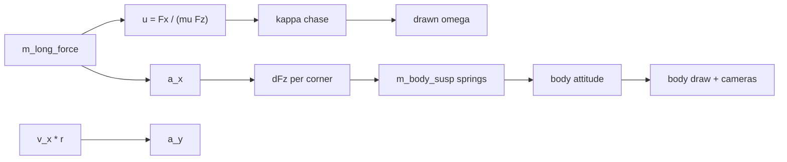

**Also fixed.** In [scripts/check_root.sh](../../scripts/check_root.sh), an apostrophe in a comment inside the single-quoted allowlist (added in 7312a60) broke `make check`.

**Verification.** `make test` 444/444, `make test-debug` 469/469, format clean, release `.spv` unchanged.
- New tests: slip targets, lockup ramp (still turning after one frame, under 6 % of rolling speed by 0.3 s), never backwards, moment balance $2\Delta F_z L = m a_x h$, attitude signs.
- New CarEntity test: braking pitches the nose down 0.5–3.5°, a right turn drops the left side, rest gives exactly `get_model_matrix()`.
- Changed test: the old "full throttle draws exactly $v/r$" check now expects rear spin at the cap and re-sync after the pedal is released, per the Phase C spec.
- Car goldens unchanged.

In the app (debug, chase cam), the car drove, braked and steered with no errors. A 2–3° pitch is hard to judge in a still from behind, so the owner check in the app is still open: [docs/wheels/tuning-notes.md](../wheels/tuning-notes.md).

| File | Change |
|------|--------|
| [src/scene/Entity/WheelKinematics.h](../../src/scene/Entity/WheelKinematics.h) | `WheelSlipParams`, slip target/step/omega; `corner_load_transfer_n`, `BodyAttitude`, `body_attitude_from_travel`. |
| [src/scene/Entity/CarEntity.h](../../src/scene/Entity/CarEntity.h), [src/scene/Entity/CarEntity.cpp](../../src/scene/Entity/CarEntity.cpp) | Slip state in `advance_wheel_spin`; body springs and attitude in `update_wheel_visuals`; body submeshes use the body matrix; `get_body_model_matrix`, `set_abs`. |
| [src/scene/Entity/SlipVisuals.h](../../src/scene/Entity/SlipVisuals.h) | Optional per-wheel `kappa` input. |
| [src/core/CameraController/CameraController.cpp](../../src/core/CameraController/CameraController.cpp) | Car-local camera points ride the body. |
| [tests/test_wheel_articulation.cpp](../../tests/test_wheel_articulation.cpp) | Three new cases; launch test updated. |
| [scripts/check_root.sh](../../scripts/check_root.sh) | Quoting fix. |
| [docs/wheels/README.md](../wheels/README.md), [docs/wheels/tuning-notes.md](../wheels/tuning-notes.md), [tasks/todo.md](../../tasks/todo.md) | As-built, new tuning notes with sources, ticks. |

</details>

---

### 2026-11-20 — Extended the LIE corridor to Riverhead (A1, A2)

Extended the baked corridor from exit 49 to the Riverhead end of I-495: 70.41 real miles compressed to 30.0, with the tunnel-to-exit-49 stretch kept at 18 miles. *Largely AI-generated (Claude); owner review pending.*

<details><summary>Technical summary</summary>

**Motivation.** The plan in [tasks/todo.md](tasks/todo.md) ("LIE full route") needs the whole route before elevation, exits and physics work can start.

**What changed**

- The OSM bounding box now reaches Riverhead. The Overpass ramp query takes proximity from the mainline's nodes; the old `around.lie` form on the way set returned no `motorway_link` ways on the wider pull.
- The map frame (tangent-plane origin and rotation) is pinned in the config. It used to be derived from the whole chain, so widening the extract rotated every existing station by 1.18 degrees (552 m at exit 49).
- The mainline walk bridges a hole in the extract: one eastbound way near exit 68 has no `ref` tag and is not pulled (110 m, bridged with a straight line).
- Compression is solved in two zones, so adding road in the east does not move the road in the west.

$$L' = \underbrace{\Delta x \sum_{i<k} \max\big(w_i + c_W(1-w_i),\, g_i\big)}_{18\ \text{mi}} + \underbrace{\Delta x \sum_{i\ge k} \max\big(w_i + c_E(1-w_i),\, g_i\big)}_{12\ \text{mi}}$$

with $w_i$ the landmark weight, $g_i = \min(1, R_\text{floor}/R_i)$ the curvature floor and $k$ the station 400 m past exit 49. Solved: $c_W = 0.1858$, $c_E = 0.1721$.

**Result.** 4,828 stations (was 2,896), 10 landmark exits (27, 31, 38, 46, 48, 49, 53, 62, 64, 68). Tightest curve is still the real 99 m tunnel ramp; road under 500 m radius is 1.18 km against 1.05 km real.

**Known limits**

- The August OSM cache (`data/osm/`, git-ignored) was overwritten by the re-pull, so the old bake cannot be reproduced exactly. With the frame pinned, the west stations differ from the committed asset by up to 6.6 m (OSM edits since August).
- The header stores one compression factor; it now holds the west value.
- The debug build loads the asset and runs (log shows `29.994 mi`). The east end has not been looked at.

| File | Change |
|------|--------|
| [config/lie_corridor.toml](config/lie_corridor.toml) | Wider bbox, pinned frame, four east landmarks, terminus `end`, west zone, 30 mi target |
| [tools/lie_corridor.py](tools/lie_corridor.py) | Node-based ramp query, pinned frame, hole bridge, two-zone solve, `compact` takes the scale profile |
| [assets/corridor/lie_corridor_full.bin](assets/corridor/lie_corridor_full.bin) | New debug-build asset: 4,828 stations, 10 landmarks (see the A3 entry; the release asset is unchanged) |
| [tasks/todo.md](tasks/todo.md) | Plan section, A1 and A2 ticked |
| [docs/lie-reference/README.md](docs/lie-reference/README.md) | New reference sheet |

</details>

---

### 2026-11-20 — Added real elevation and banking to the corridor asset (A3)

Baked USGS ground heights and curve banking into a new debug-only corridor asset; release still loads the August 18-mile flat asset, byte for byte. *Largely AI-generated (Claude); owner review pending.*

<details><summary>Technical summary</summary>

**Motivation.** The road was dead flat. Hills and banked curves are needed before the 6-DOF physics (phase B) and the ramps (phase C).

**Approach**

- `python3 tools/lie_corridor.py elev` pulls 2,267 heights (every 50 m of real route) from the USGS 3DEP service into [data/dem/lie_i495_elev.csv](data/dem/lie_i495_elev.csv). The cache is tracked, so the bake needs no network.
- Compaction steepens each real grade $g$ to $g / f$. The profile is low-passed, clamped to 5 % grade, then smoothed until the vertical acceleration at 70 mph is under 0.6 m/s²:

$$\left|\frac{dz}{ds}\right| \le G, \qquad a_v = v^2 \left|\frac{d^2 z}{ds^2}\right| \le a_\text{max}$$

- Banking comes from curvature: $e = \operatorname{clamp}(k\,v^2 / (gR), \pm e_\text{max})$, with $k = 0.4$ and $e_\text{max} = 6\%$.
- Asset format v2: each station gains `y` (WU, relative to the start station) and `bank`. The loader still reads v1 and fills both with 0.
- Debug-first: the tool now writes `lie_corridor_full.bin`, which only the debug build loads. `lie_corridor.bin` was restored to the committed file (sha256 `d1635eb7…`).

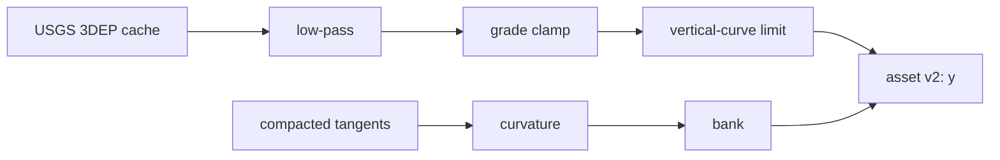

**Result.** Ground -1.6 to 75.4 m becomes a profile of -0.3 to 73.1 m; max grade 5.00 %, max vertical acceleration 0.59 m/s², max bank 6.00 %. Tests: 470 pass (debug), 445 pass (release). Both builds start and load the right asset (30 mi and 18 mi).

**Not done.** The mesh and the car still use the flat height; that is step A5. The height model is bare ground, so viaducts and the tunnel are wrong until bridge and tunnel tags are used. Nothing was looked at in the app beyond start-up.

| File | Change |
|------|--------|
| [tools/lie_corridor.py](tools/lie_corridor.py) | `elev` subcommand, `vertical_profile`, `superelevation`, asset v2 writer |
| [config/lie_corridor.toml](config/lie_corridor.toml) | `[elevation]` section; output is now `lie_corridor_full.bin` |
| [data/dem/lie_i495_elev.csv](data/dem/lie_i495_elev.csv) | New: cached USGS heights |
| [assets/corridor/lie_corridor_full.bin](assets/corridor/lie_corridor_full.bin) | New: debug asset, v2 |
| [src/scene/Corridor/CorridorAsset.h](src/scene/Corridor/CorridorAsset.h) | Station gains `y`, `bank`; version 2; v1 still loads |
| [src/scene/Corridor/CorridorAlignment.h](src/scene/Corridor/CorridorAlignment.h), [.cpp](src/scene/Corridor/CorridorAlignment.cpp) | `Sample` carries interpolated `y` and `bank` |
| [src/core/App/AppInit.cpp](src/core/App/AppInit.cpp) | Debug build loads the full asset |
| [tests/test_corridor.cpp](tests/test_corridor.cpp) | Height/bank interpolation checks; v1 load test |
| [docs/corridor/tuning-notes.md](docs/corridor/tuning-notes.md) | New: knobs, ranges, formulas, sources, pipeline diagram |

</details>

---

### 2026-11-20 — Added the exit table and districts to the corridor asset (A4)

Baked all 108 real LIE exits (number, direction, sign text) and three districts into the debug corridor asset, with a next-exit readout in the debug log. Release is unchanged. *Largely AI-generated (Claude); owner review pending.*

<details><summary>Technical summary</summary>

**Motivation.** Signs (D3), ramps (C2), the HUD (C3b) and the district scenery kits (D5) all need to know where each exit is and what its sign says.

**Approach**

- An exit is an OSM `motorway_junction` node on an I-495 mainline way. Its sign text is the `destination` and `destination:ref` of the `motorway_link` way that starts at that node. Direction comes from the mainline way the node sits on.
- Each exit is snapped to the chain (300 m tolerance, because the westbound carriageway is off the eastbound reference line) and mapped to its compacted station.
- Districts start where the first mainline way tagged `tiger:county` begins. Nassau uses an authored override (`start_exit = "33"`), because OSM's Nassau tags only begin near exit 35.
- The blocks are appended after the landmarks as `tag, count, records`, so the header and the v1 release asset are untouched. The loader reads blocks until end of file; a truncated or unknown block throws.

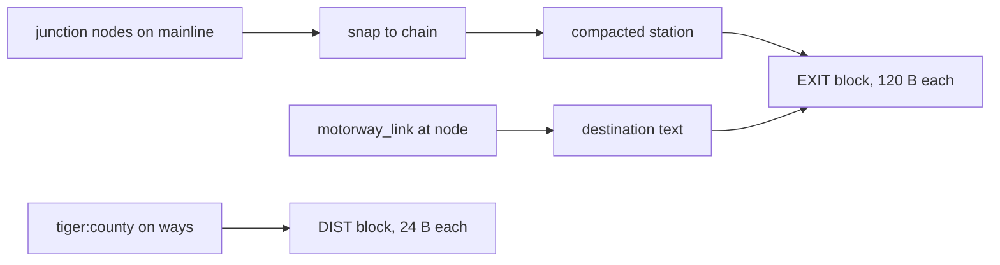

**Result.** 108 exits (57 eastbound, 51 westbound), every one with sign text. Districts: Queens from 0 mi, Nassau from 8.41 mi, Suffolk from 17.12 mi. Tests: 471 pass (debug), 446 pass (release). Debug log at start: `Queens, next exit 13 in 0.72 mi: Borden Avenue`.

**Limits.** The Queens/Nassau line is placed from memory at exit 33 and needs checking against a map. Sign text is OSM's wording, not checked against photos. Text longer than 75 characters is cut (the Riverhead end: 59 characters, fits).

| File | Change |
|------|--------|
| [tools/lie_corridor.py](tools/lie_corridor.py) | `extract_exits`, district placement, EXIT and DIST blocks |
| [config/lie_corridor.toml](config/lie_corridor.toml) | `districts` table |
| [assets/corridor/lie_corridor_full.bin](assets/corridor/lie_corridor_full.bin) | Re-baked with both blocks |
| [src/scene/Corridor/CorridorAsset.h](src/scene/Corridor/CorridorAsset.h) | `CorridorExit`, `CorridorDistrict`, trailing-block loader |
| [src/scene/Corridor/CorridorAlignment.h](src/scene/Corridor/CorridorAlignment.h), [.cpp](src/scene/Corridor/CorridorAlignment.cpp) | `exits()`, `districts()`, `next_exit()`, `district_at()` |
| [src/scene/Corridor/CorridorDriver.cpp](src/scene/Corridor/CorridorDriver.cpp) | Debug log line: district and next exit |
| [tests/test_corridor.cpp](tests/test_corridor.cpp) | Block load, direction-aware lookup, truncated-block test |
| [docs/corridor/tuning-notes.md](docs/corridor/tuning-notes.md) | A4 section |

</details>

---

### 2026-11-20 — Made the debug corridor mesh and the car follow hills and banking (A5)

The debug build's road, barrier, markings, grass and lamps now follow the baked height and cross slope, and the car rides the surface. Release is unchanged. *Largely AI-generated (Claude); owner review pending.*

<details><summary>Technical summary</summary>

**Motivation.** A3 stored height and bank in the asset; nothing drew or drove on them.

**Approach**

- `SweepFrame` gained `up` (the surface normal). `build_sweep_frames` takes an optional bank per station: the frame's `right` gets `y = -bank`, so a point at lateral $t$ sits at $y_c - e\,t$, and `up` is $\operatorname{normalize}(\text{right} \times \text{along})$. With no banks passed the frames are the old flat ones, so the release mesh is the same.
- Frame arc is now plan length (height dropped), so dash spacing and UVs keep the station spacing on a grade.
- `CorridorAlignment::surface_y(s, t)` $= y_\text{road} + y(s) - e(s)\,t$.
- Car: the corridor update re-aims the existing flat height query at `surface_y` under the car each frame, and the height snap in `App` moved to after that update. This is a stop-gap: the car rides the hills but does not pitch or roll with them until the 6-DOF chassis (B4).

**Result.** Tests: 473 pass (debug), 448 pass (release). Debug build viewed after a 25 s drive from the start: road, barrier, lamp and grass intact, no cracks at tile seams, 111 fps.

**Limits.** At 5 % grade the level car puts the front wheels about 6 cm into the road and the rear 6 cm above it. Rain splashes and puddles still assume one road height. Only the first mile was looked at; the steep stretches and the east end were not.

| File | Change |
|------|--------|
| [src/scene/SceneTypes.h](src/scene/SceneTypes.h) | `SweepFrame::up` |
| [src/scene/RoadScene/MeshBuilder.h](src/scene/RoadScene/MeshBuilder.h), [.cpp](src/scene/RoadScene/MeshBuilder.cpp) | Optional banks, plan-length arc, per-frame normals |
| [src/scene/Corridor/CorridorScene.cpp](src/scene/Corridor/CorridorScene.cpp) | Centreline height, banks, lamp base height |
| [src/scene/Corridor/CorridorAlignment.h](src/scene/Corridor/CorridorAlignment.h) | `surface_y` |
| [src/scene/Corridor/CorridorDriver.cpp](src/scene/Corridor/CorridorDriver.cpp) | Height query follows the car |
| [src/core/App/App.cpp](src/core/App/App.cpp) | Height snap moved after the corridor update |
| [tests/test_corridor.cpp](tests/test_corridor.cpp), [tests/test_road_scene.cpp](tests/test_road_scene.cpp) | `surface_y` and sweep-frame tests |

</details>

---

### 2026-11-20 — Added a fixed-rate physics substep to the debug build (B1)

The debug build now integrates the car in equal slices no longer than 1/240 s, so handling no longer depends on frame rate. Release still takes one step per frame. *Largely AI-generated (Claude); owner review pending.*

<details><summary>Technical summary</summary>

**Motivation.** The car was integrated with one explicit Euler step per frame (up to 1/15 s). Euler's error grows with the step, so the car behaved differently at 30 and 144 fps, and stiff tyre and suspension models (B2-B4) would blow up.

**Approach.** `CarEntity::update` splits the frame into $n = \lceil \Delta t \cdot f \rceil$ equal slices and calls the old body (now `step`) $n$ times. Equal slices leave no leftover time, so no accumulator and no render interpolation are needed. The price: the slice length varies a little with frame rate ($1/240$ s at 30 fps, $1/288$ s at 144 fps), so results converge but are not bit-identical across frame rates.

**Result.** New slider "Physics substep (Hz, 0 = per frame)" in the Physics panel, default 240. Tests: 475 pass (debug), 450 pass (release). A step-steer test shows the 30-vs-144 fps gap in yaw rate falls to under a quarter of the unsubstepped gap.

| File | Change |
|------|--------|
| [src/scene/Entity/CarEntity.cpp](src/scene/Entity/CarEntity.cpp), [.h](src/scene/Entity/CarEntity.h) | `update` slices the frame; old body is `step`; `set_substep_hz` |
| [src/scene/Entity/Longitudinal.h](src/scene/Entity/Longitudinal.h) | `substep_count` |
| [src/debug/Tunables.def](src/debug/Tunables.def) | `carSubstepHz` |
| [src/core/App/App.cpp](src/core/App/App.cpp) | Pushes the slider to the car |
| [tests/test_car_physics.cpp](tests/test_car_physics.cpp), [tests/test_debug_params_io.cpp](tests/test_debug_params_io.cpp) | Two substep tests; tunable counts 63 to 64, 50 to 51 |

</details>

---

### 2026-11-20 — Gave the 6-DOF chassis spinning wheels, a real tyre curve, ABS, traction control, anti-roll bars, downforce and wall contact (B2-B5a, B5c)

The debug-only rigid-body car now has a spin state per wheel, a combined-slip tyre curve with a grip peak, working ABS and traction control, anti-roll bars, speed-dependent downforce, per-wheel contact on sloped road and slide-along wall contact. It is still off by default; the bicycle model and release are unchanged. *Largely AI-generated (Claude); owner review pending.*

<details><summary>Technical summary</summary>

**Motivation.** The stub clamped a linear tyre force at $\mu F_z$ and took axle forces that were already grip-limited, so wheels could not spin or lock and grip had no peak.

**Model** ([RigidChassis.h](src/scene/Entity/RigidChassis.h), [TireCurve.h](src/scene/Entity/TireCurve.h))

- Slip per wheel: $\kappa = (\omega r - v_f)/\max(|v_f|, 3)$, $\tan\alpha = -v_s/\max(|v_f|, 3)$.
- Combined slip by the similarity method: $\rho = \sqrt{(\kappa/\kappa_p)^2 + (\tan\alpha/\tan\alpha_p)^2}$, then one magic-formula curve gives the force size and the slip direction gives its direction:

$$F = \mu(F_z)\,F_z\,\sin\!\big(C \arctan(B\rho)\big), \quad B = \tan\frac{\pi}{2C}, \quad (F_x, F_y) = \frac{F}{\rho}\Big(\frac{\kappa}{\kappa_p}, \frac{\tan\alpha}{\tan\alpha_p}\Big)$$

  $B$ puts the peak at $\rho = 1$. With $C = 1.45$ a full slide keeps 76 % of peak grip.
- Load sensitivity: $\mu(F_z) = \mu_0\,[1 - k\,(F_z/F_{z0} - 1)]$.
- Wheel spin: $I\dot\omega = T_d - T_b - F_x r$. The wheel's time constant is far below the 1/240 s step, so the update is implicit in the tyre's slip stiffness $S$: $\omega \leftarrow \omega + h\,(T_d - F_x r)/(I + h S r)$. Brake torque is Coulomb and can hold the wheel at zero.
- ABS fades brake torque over $-\kappa \in [0.12, 0.20]$; traction control fades drive torque over $\kappa \in [0.12, 0.22]$.
- Anti-roll bar: $\Delta F_z = k_\text{arb}(z_L - z_R)$ moved across an axle. Downforce: $\tfrac12 \rho v^2 C_L A$ per axle, with the rear wing deploying between 30 and 36 m/s.
- Ground is a sloped plane, so each wheel finds its own height and the body pitches and rolls with the road.
- Wall contact: the speed into the wall is removed (no bounce) and the car loses $0.4\times$ that from its sliding speed.

**Car glue** ([CarEntity.cpp](src/scene/Entity/CarEntity.cpp)). Engine force now goes to the wheels as torque without the old grip clamp; engine speed follows the driven wheels; off-throttle engine braking; brakes are 1.4 g of torque at 62 % front.

**Checks.** Tests: 481 pass (debug), 456 pass (release). New: tyre curve peak and friction limit, static 40/60 weight split, ABS (wheels keep turning, more than 0.85 g, shorter than locked), traction control, pitch on a 5 % slope, anti-roll bars. A scripted launch-and-brake in the app (temporary code, removed): 0 to 37 m/s through three gears, then braking, no instability.

**Not done.** B5b (bumps from the road surface) waits for D1. B5d (skid marks, smoke) not started. B6 keyboard feel and B7 owner A/B not done. Steering and wall contact were not exercised in the app. Synthetic key input stopped reaching the app this session, so no hand-driven check.

| File | Change |
|------|--------|
| [src/scene/Entity/TireCurve.h](src/scene/Entity/TireCurve.h) | New: combined-slip tyre curve |
| [src/scene/Entity/RigidChassis.h](src/scene/Entity/RigidChassis.h) | Wheel spin, ABS/TC, anti-roll bars, downforce, `GroundPlane`, `ChassisTuning` |
| [src/scene/Entity/CarEntity.cpp](src/scene/Entity/CarEntity.cpp), [.h](src/scene/Entity/CarEntity.h) | Torque glue, aero, `set_chassis_tuning`, `wall_contact` |
| [src/scene/RoadGeometry/RoadGeometry.h](src/scene/RoadGeometry/RoadGeometry.h), [.cpp](src/scene/RoadGeometry/RoadGeometry.cpp) | `set_plane_surface`, two-argument height query |
| [src/scene/Corridor/CorridorAlignment.h](src/scene/Corridor/CorridorAlignment.h), [CorridorDriver.cpp](src/scene/Corridor/CorridorDriver.cpp) | `surface_slope`; plane and wall contact fed to the car |
| [src/debug/Tunables.def](src/debug/Tunables.def), [src/core/App/App.cpp](src/core/App/App.cpp) | Ten sliders for the model |
| [tests/test_rigid_chassis.cpp](tests/test_rigid_chassis.cpp), [tests/test_debug_params_io.cpp](tests/test_debug_params_io.cpp) | Six new tests; tunable counts |

</details>

---

### 2026-11-20 — Ported the exit ramp, service road and crossover generators to corridor frames (C1)

Exit ramps, service roads and median crossovers can now be swept along the real (curving, climbing, banked) LIE alignment; the debug build places one demo ramp and service road from a "Corridor" panel. Release is unchanged. *Largely AI-generated (Claude); owner review pending.*

<details><summary>Technical summary</summary>

**Motivation.** The retired generators in [RoadScene_Ramps.cpp](src/scene/RoadScene/RoadScene_Ramps.cpp) assume Z is "along" and X is "across". The corridor needs them in station/lateral frames with heights from the profile (C1 of the LIE full-route plan). The originals stay byte-identical: the golden mesh test and the lighting lab use them.

**Approach.** One path type in [CorridorRamps.h](src/scene/Corridor/CorridorRamps.h) covers all three shapes. Offset and height ease with one smoothstep:

$$t(s) = t_0 + (t_1 - t_0)\,S(u), \quad y(s) = \text{surface\_y}(s, t) + |e|\,\tfrac{w}{2} + dy_0 + (dy_1 - dy_0)\,S(u), \quad S(u) = 3u^2 - 2u^3$$

Bank is 0; the $|e|\,w/2$ term puts the level band on the high edge of the mainline plane so grass (same plane) does not show through (seen in the app before the fix). The tangent includes the sideways drift $dt/ds$ so the band stays square to the path. Sizes come from `road::kExit` in [RoadParams.h](src/scene/RoadScene/RoadParams.h). `corridor_path_frames` clips to a segment's station range while $u$ uses the full range, so a ramp crossing a segment edge splits into two halves of one curve.

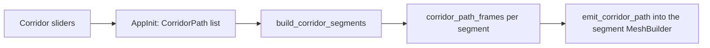

**Debug demo.** `corridorRampDemo` (on), `corridorRampAheadM` (0 m past the car start), `corridorRampDyM` (0 m). Segments are built once, so a slider change rebuilds the scene through `SceneManager::set_active_scene(0)` after 0.5 s without edits. Release passes no paths: its segments are unchanged (golden and release tests green).

**Checks.** `make test-debug` 485 pass (was 481), `make test` 460 pass (was 456). Four new tests: service road height and offset (frames and emitted vertex), ramp start at mainline height and end on the service road's near lane, split at a segment edge meets itself, crossover end points. Viewed in `make debug` (window screenshot): the ramp leaves the right shoulder with white edge lines and diverges toward the service road. Slider rebuild was not exercised in the app (no reliable synthetic input).

**Not done.** Not drivable (C3). No gore chevrons, guardrail or signs (D2/D3). Markings not tagged retroreflective. Crossover has a generator and a test but no placement.

| File | Change |
|------|--------|
| [src/scene/Corridor/CorridorRamps.h](src/scene/Corridor/CorridorRamps.h), [.cpp](src/scene/Corridor/CorridorRamps.cpp) | New: `CorridorPath`, ramp / service road / crossover factories, frames, emit |
| [src/scene/Corridor/CorridorScene.cpp](src/scene/Corridor/CorridorScene.cpp), [.h](src/scene/Corridor/CorridorScene.h) | `build_corridor_segments` takes optional paths, emits them per segment |
| [src/core/App/AppInit.cpp](src/core/App/AppInit.cpp) | Debug: builds the demo paths from the sliders |
| [src/core/App/App.cpp](src/core/App/App.cpp), [App.h](src/core/App/App.h) | Debug: rebuild after a settled slider change |
| [src/debug/Tunables.def](src/debug/Tunables.def), [src/debug/DebugUI.cpp](src/debug/DebugUI.cpp) | Three "corridor" tunables, "Corridor" panel header, dump |
| [CMakeLists.txt](CMakeLists.txt) | `CorridorRamps.cpp` in `swish_scene_core` |
| [tests/test_corridor.cpp](tests/test_corridor.cpp) | Four `[ramps]` tests |
| [tests/test_debug_params_io.cpp](tests/test_debug_params_io.cpp) | Tunable counts 74 to 77 (floats 60 to 62, bools 14 to 15), group `corridor` |
| [docs/endless-road.md](docs/endless-road.md), [docs/corridor/tuning-notes.md](docs/corridor/tuning-notes.md) | Architecture note, knobs, sources |
| [tasks/todo.md](tasks/todo.md), [tasks/upcoming-tests.md](tasks/upcoming-tests.md) | C1 done; in-app checks |

</details>

---

### 2026-11-20 — Baked real LIE service-road extents into the corridor asset (C2a)

The debug corridor asset now records where the North and South Service Roads run, per side, with lane counts, from a new OpenStreetMap pull plus an exit-number rule for the gaps. Nothing is drawn yet (C2b); release is unchanged. *Largely AI-generated (Claude); owner review pending.*

<details><summary>Technical summary</summary>

**Motivation.** C2 builds real continuous service roads, not per-exit stubs, so the bake needs their extents. OSM tags them with `unsigned_ref` NY 906A (South SR, eastbound) and NY 906B (North SR, westbound) from the Nassau line to about exit 65.

**Approach.** New `fetch_srvr` stage in [tools/lie_corridor.py](tools/lie_corridor.py) writes `data/osm/lie_service_roads.json` (Overpass `way["unsigned_ref"~"NY 906[AB]"]...; out geom;`); the shared `overpass_post` now writes to a temp file and retries on HTTP 429/503/504. `bake` projects each way's end nodes onto the mainline with the exit table's nearest-vertex lookup (`to_index`, which also returns the signed lateral for a side check), merges spans per side across gaps under `merge_gap_m` (150 real m), takes lanes as the median of OSM `lanes` values 1..3 (default 2), and fills Queens and the stretch from the last OSM range to exit 68 by rule. The result is a new optional trailing block `SRVR` of `CorridorServiceRoad {double s0, s1; u8 westbound, lanes, source, pad[5]}` (24 B) in [CorridorAsset.h](src/scene/Corridor/CorridorAsset.h), read by `CorridorAlignment::service_roads()`. v1 and older v2 files load with an empty list. `data/osm/` was backed up to `data/osm_backup_2026-11-20/` (now git-ignored) before the pull.

$$\text{merge if } i_0^{\text{next}} - i_1 < \left\lfloor \frac{150\ \text{m}}{\Delta s} \right\rfloor, \qquad \text{lanes} = \operatorname{clamp}\big(\operatorname{median}\{\ell \in \text{OSM} : 1 \le \ell \le 3\}\big), \ \text{default } 2$$

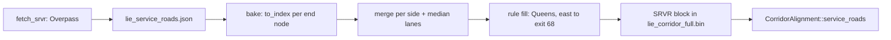

**Result.** EB/South: 6 OSM ranges (37.11 real mi -> 15.60 baked mi) + 2 rule (16.63 -> 8.97). WB/North: 5 OSM (38.12 -> 15.57) + 2 rule (17.76 -> 9.74). The real EB/WB break near Woodbury Rd (about 14.6 to 16.0 baked mi) is kept. The bake asserts the ranges are sorted, inside the route and on both sides. Rest of the asset is byte-identical to before (block appended last).

**Checks.** `make test-debug` 486 pass (was 485), `make test` 461 (was 460). New test: SRVR block round-trip and absent block = empty. No unit test loads the real asset (it is not tracked), so the real-data sanity checks are asserts in the bake.

| File | Change |
|------|--------|
| [tools/lie_corridor.py](tools/lie_corridor.py) | `fetch_srvr` stage, `overpass_post` with retry, `to_index`, `service_roads()`, SRVR packing |
| [config/lie_corridor.toml](config/lie_corridor.toml) | `[service_roads]`: extract path, bbox, `merge_gap_m`, `end_exit` |
| [src/scene/Corridor/CorridorAsset.h](src/scene/Corridor/CorridorAsset.h) | `CorridorServiceRoad`, `kCorridorSrvrTag`, loader branch |
| [src/scene/Corridor/CorridorAlignment.h](src/scene/Corridor/CorridorAlignment.h) | `service_roads()` |
| [tests/test_corridor.cpp](tests/test_corridor.cpp) | Round-trip / absent-block test |
| `assets/corridor/lie_corridor_full.bin` | Re-baked with the SRVR block (release `lie_corridor.bin` untouched) |
| [.gitignore](.gitignore) | Ignore `data/osm_backup_*/` |
| [docs/endless-road.md](docs/endless-road.md), [docs/corridor/tuning-notes.md](docs/corridor/tuning-notes.md) | Block note; knobs, results, sources |
| [tasks/todo.md](tasks/todo.md) | C2a done |

</details>

---

### 2026-11-21 — Built diamond interchanges, service roads and crossroad cuts on the LIE corridor (C2b)

The debug corridor now has about 30 standard diamonds: continuous one-way service roads with curbs and MUTCD markings, four ramps per crossroad with gore chevrons, and a crossroad bridge over a mainline cut the car drives through. Release is unchanged. *Largely AI-generated (Claude); owner review pending.*

<details><summary>Technical summary</summary>

**Motivation.** C2a baked where the real service roads run; C1 gave a single demo ramp. The plan (C2) asks for one generator that turns the exit table into diamonds, with the mainline dipping under each crossroad (the typical Nassau/Suffolk arrangement) and photoreal detail.

**Approach.**
- **Grade in one place.** [CorridorAlignment](src/scene/Corridor/CorridorAlignment.h) gained `CorridorCrossroad`, `set_grading`, `dip(s)` and `ground_y(s)`; `surface_y` and `surface_slope` subtract the dip, so the mainline mesh (frames use `y - dip`), lamps, slope and car height share it. Without grading (`dip` = 0) release arithmetic is bit-identical.
$$d(s) = \max_k D_k\left(1 - S\!\left(\frac{|s - c_k|}{L}\right)\right), \quad S(u) = 3u^2 - 2u^3, \quad D_k = \max\!\left(D,\ h_{deck} + 16\,\text{ft} + 0.1\,\text{m} + |e|\,E\right)$$
  Peak added grade $1.5 D / L = 2.8\,\%$ at the defaults (6.5 m, 350 m).
- **Pairing.** `corridor_crossroads` in [CorridorRamps.cpp](src/scene/Corridor/CorridorRamps.cpp) groups exits by leading ref digits, puts the crossroad midway between mean EB and WB diverges (lone: 400 m past), drops crossroads under 900 m from the previous and inside the end pads, sizes ramps 300 to 500 m from the diverges and the neighbour gap. Real asset: 58 exit numbers, 30 crossroads, 13 deepened for bank (max 7.30 m).
- **Paths.** `CorridorPath` gained `kind`, `side` (lateral outward from the mainline edge), `lanes`, ground weight `g0/g1` and height window `h0/h1`; `corridor_path_at` evaluates it (inverse smoothstep finds a ramp's nose and touch so it is level with the shoulder in the gore and with the service road at the merge). `corridor_diamond_paths` splits each side's service roads at crossroads, adds 2-lane stubs where OSM has none, and emits four ramps per crossroad.
- **Mesh.** New [CorridorDiamonds.cpp](src/scene/Corridor/CorridorDiamonds.cpp): graded verge (gore slope, cut slope, level grass from explicit points), service roads (6 in curbs both sides with gaps where ramps cross, yellow left / white right 4 in lines per MUTCD 3A.05, 10/30 ft dashes, crosswalk + 24 in stop bar), ramps (8 in channelizing line, yellow/white edges, diagonal gore chevrons), crossroad (deck, 42 in parapets, three wall piers, curbs, double yellow, lane and edge lines, continental crosswalks). [MeshBuilder](src/scene/RoadScene/MeshBuilder.h) gained `emit_strip` and public `batch_mark` / `close_batch`. Lamps skip 25 m around a crossroad.

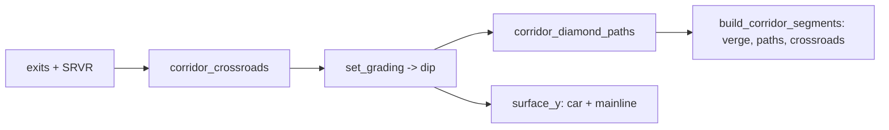

**Checks.** `make test-debug` 489 pass (was 486), `make test` 464 (was 461). New tests: dip 0 far / full depth at the crossroad / half at the smoothstep midpoint; service road at `ground_y` at its offset on both sides and ramp ends on the shoulder plane and the service road (+ lift), inner edge on the service road's edge line; 30 crossroads on the real asset with spacing, depth and ramp-length bounds. `make check`: only the pre-existing `Untitled.md` / `.obsidian/workspace.json` failures. Counts: 41 segments, 25,449 draws, per segment max 24,700 vertices / 716 draws (lamps about 480 of them), crossroad 548 to 556 vertices in 4 draws.

**Looked at** (`make debug`, window screenshots, temporary start-station / camera overrides since removed): gore V with chevrons, ramp diverging and merging, service road curbs and paint, stop bar and crosswalk, bridge with parapets and piers over the cut, WB mirror, no seam at a 1.2 km segment edge. Screenshots in [docs/corridor/img/](docs/corridor/img/).

**Found, not fixed (owner call).** [shaders/lighting.frag](shaders/lighting.frag) shades `depth < 0.0001` as sky. With reverse-Z and the 10 WU (1 cm) near plane, depth $\approx n/z$ falls below that at $z = 10/10^{-4} = 10^5$ WU = 100 m, so everything past 100 m renders as sky in both builds (`ssao`, `ssr`, `dof`, `godrays` use the same threshold). Changing it to `depth <= 0.0` showed the full corridor; it was reverted because it changes release output and is renderer scope. Screenshots were taken with that temporary fix.

**Not done.** Not drivable onto service roads or ramps (C3). No traffic lights or cross-street stubs (C3a), barriers / retaining walls (D2), signs (D3). Service-road ends away from a crossroad stop square; lane-count changes between OSM ranges are abrupt; the ramp starts at full width over the shoulder (no taper). The car starts accelerating on its own about 5 s after spawn in the debug build; seen during the checks, not investigated (not from this change).

| File | Change |
|------|--------|
| [src/scene/Corridor/CorridorAlignment.h](src/scene/Corridor/CorridorAlignment.h), [.cpp](src/scene/Corridor/CorridorAlignment.cpp) | `CorridorCrossroad`, `set_grading`, `dip`, `ground_y`; dip in `surface_y` / `surface_slope` |
| [src/scene/Corridor/CorridorRamps.h](src/scene/Corridor/CorridorRamps.h), [.cpp](src/scene/Corridor/CorridorRamps.cpp) | `diamond::` dimensions, path fields, `corridor_path_at`, `ramp_u_from_offset`, `corridor_cross_half`, `corridor_crossroads`, `corridor_diamond_paths` |
| [src/scene/Corridor/CorridorDiamonds.h](src/scene/Corridor/CorridorDiamonds.h), [.cpp](src/scene/Corridor/CorridorDiamonds.cpp) | New: `CorridorLook`, verge, service road / ramp, crossroad emitters |
| [src/scene/Corridor/CorridorScene.cpp](src/scene/Corridor/CorridorScene.cpp), [.h](src/scene/Corridor/CorridorScene.h) | Dipped mainline frames, graded verge, diamond paths, crossroads, lamp skip |
| [src/scene/RoadScene/MeshBuilder.h](src/scene/RoadScene/MeshBuilder.h), [.cpp](src/scene/RoadScene/MeshBuilder.cpp) | `emit_strip`, `batch_mark`, `close_batch` |
| [src/core/App/AppInit.cpp](src/core/App/AppInit.cpp), [App.cpp](src/core/App/App.cpp), [App.h](src/core/App/App.h) | Debug: grading + diamond paths from the sliders; rebuild key |
| [src/debug/Tunables.def](src/debug/Tunables.def), [src/debug/DebugUI.cpp](src/debug/DebugUI.cpp) | Demo sliders replaced by `corridorDiamonds`, `corridorDipDepthM`, `corridorDipHalfM`, `corridorSrStripM` |
| [tests/test_corridor.cpp](tests/test_corridor.cpp) | Three `[diamonds]` tests |
| [tests/test_debug_params_io.cpp](tests/test_debug_params_io.cpp) | Tunable counts 77 to 78, floats 62 to 63 |
| [docs/endless-road.md](docs/endless-road.md), [docs/corridor/tuning-notes.md](docs/corridor/tuning-notes.md), [docs/corridor/img/](docs/corridor/img/) | Architecture section, knobs, formulas, sources, screenshots |
| [tasks/todo.md](tasks/todo.md), [tasks/upcoming-tests.md](tasks/upcoming-tests.md), [tasks/autonomous-run-2026-11-20.md](tasks/autonomous-run-2026-11-20.md) | C2 done, in-app checks, run log |

</details>

### 2026-11-21 — Made the LIE ramps, service roads and crossroad run drivable (C3)

In the debug build the car can now leave the mainline at a gore, drive the exit ramp onto the service road, cross the crossroad along it and take the entrance ramp back, with both car models. The grass and median still stop it, and a dead-end service road holds it. Release is unchanged. *Largely AI-generated (Claude); owner review pending.*

<details><summary>Technical summary</summary>

**Motivation.** C2b drew about 30 diamonds, but the car was still clamped to its own carriageway: the ramps were walls. C3 in the plan asks for one drivable-surface query over mainline, ramps, service roads and crossroad, used for both the lateral bounds and the height.

**Approach.**
- **Pieces at a station.** [CorridorBounds.cpp](src/scene/Corridor/CorridorBounds.cpp) builds the pieces on the committed side at $s$: the mainline carriageway (painted inner line to shoulder outer edge; full width in a turn-around pad), every ramp and service-road path covering $s$ (centre and height from `corridor_path_at`), and the service road's band carried across each crossroad deck at the deck height. Declared in the new [CorridorSurface.h](src/scene/Corridor/CorridorSurface.h):
  - `drive_spans`: intervals shrunk by the 0.3 m inset, sorted and merged where they overlap, $A(s) = \bigcup_i [lo_i + \delta, hi_i - \delta]$. At a gore the ramp overlaps the shoulder until its nose, so the windows join; past the nose grass separates them.
  - `drive_surface`: the highest piece whose interval holds the lateral, with its height and its grade along $s$.
  - `carriageway_bounds` is now `drive_spans` with no paths, which gives the same arithmetic as before.
- **Driver.** [CorridorDriver](src/scene/Corridor/CorridorDriver.cpp) clamps the car to the nearest window. If that window is more than `road::diamond::kDeadEnd` = 3 m away and the car was on a side road last frame, the road ended under it: the car is held at last frame's spot, with a wall contact along the tangent. The height plane comes from `drive_surface`. The mainline keeps the analytic `surface_slope`; other pieces are level across, so their slope is $(g\,t_x,\ g\,t_z)$. Telemetry prints the piece and height. The paths come from `set_paths`, called in [AppInit.cpp](src/core/App/AppInit.cpp) after the segments are built (empty in release).
- **Slider.** `corridorDriveOff` (on) switches back to the old clamp for A/B.

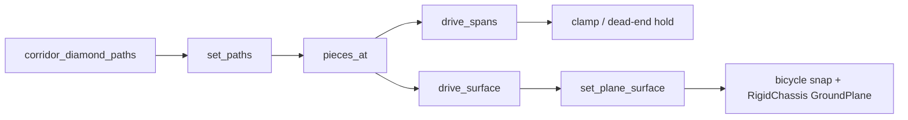

**Checks.** `make test-debug` 492 pass (was 489), `make test` 467 (was 464). New `[drive]` tests: a ramp at mid-length returns the ramp height (well above the dipped mainline); the grass strip is off-surface and outside every window; at a gore one window covers lane and ramp, while near the landing grass splits mainline from service road plus ramp; mainline-only windows equal `carriageway_bounds` exactly; the service road stays inside a window across the crossroad with steps under 20 WU per 0.25 m and passes over the deck. `make check`: only the pre-existing `Untitled.md` / `.obsidian/workspace.json` failures.

**Driven** (`make debug`, temporary scripted steer/throttle and start station, since removed). Bicycle model at crossroad 0 and 6-DOF at crossroad 1 (5 % bank): lane, ramp, service, cross, service, ramp, lane. The 1 Hz height trace was smooth throughout, with no fall-through and no stall at the gore. 6-DOF at a stub end (crossroad 15, EB): held at 23.516 km with steady height. A temporary 0.25 m sweep over all 60 diamond routes found every point inside a window. The largest seam step after removing the road's grade was 131 WU (13 cm), always at a ramp's mainline end on a 5 to 6 % banked curve: the C2b ramp band is level at the bank's high edge, $|e|\,w + 3$ WU above the shoulder, and the mesh has the same step. Screenshots: [exit ramp](docs/corridor/img/c3-exit-ramp.png), [service road](docs/corridor/img/c3-service-road.png).

**Choices (owner asleep).** One ground plane under the car centre for both car models, not one per wheel; the seams are coplanar within the step above. A dead end holds the car where its centre leaves the pavement, so the nose overhangs about 2 m of grass. The crossroad can only be crossed straight along the service road (turning is C3a).

**Not done.** Per-wheel piece query for the 6-DOF chassis. Banking the ramp to the shoulder's cross slope until the nose, which would remove the 13 cm step (mesh and physics together). End curbs at service-road dead ends. The dead-end hold is not unit-tested (it lives in `update()`); listed in [upcoming-tests.md](tasks/upcoming-tests.md).

| File | Change |
|------|--------|
| [src/scene/Corridor/CorridorSurface.h](src/scene/Corridor/CorridorSurface.h) | New: `DrivePiece`, `DriveSurface`, `DriveSpan`, `drive_surface`, `drive_spans` |
| [src/scene/Corridor/CorridorBounds.cpp](src/scene/Corridor/CorridorBounds.cpp) | Piece list, surface and span queries; `carriageway_bounds` delegates |
| [src/scene/Corridor/CorridorDriver.h](src/scene/Corridor/CorridorDriver.h), [.cpp](src/scene/Corridor/CorridorDriver.cpp) | `set_paths`, public `kLaneInset`, window clamp, dead-end hold, piece height and slope, telemetry piece |
| [src/scene/RoadScene/RoadParams.h](src/scene/RoadScene/RoadParams.h) | `diamond::kDeadEnd` |
| [src/core/App/AppInit.cpp](src/core/App/AppInit.cpp) | Hands the diamond paths to the driver |
| [src/debug/Tunables.def](src/debug/Tunables.def) | `corridorDriveOff` |
| [tests/test_corridor.cpp](tests/test_corridor.cpp) | Three `[drive]` tests |
| [tests/test_debug_params_io.cpp](tests/test_debug_params_io.cpp) | Tunable counts 78 to 79, bools 15 to 16 |
| [docs/endless-road.md](docs/endless-road.md), [docs/corridor/tuning-notes.md](docs/corridor/tuning-notes.md), [docs/corridor/img/](docs/corridor/img/) | Architecture section, knobs, formulas, measurements, sources, screenshots |
| [tasks/todo.md](tasks/todo.md), [tasks/upcoming-tests.md](tasks/upcoming-tests.md), [tasks/autonomous-run-2026-11-20.md](tasks/autonomous-run-2026-11-20.md) | C3 done, in-app checks, decisions and run log |

</details>

### 2026-11-21 — Added cross-street stubs, span-wire traffic signals and the HOV lane to the LIE corridor (C3a)

In the debug build each crossroad now runs on past both service roads as a 90 m street with curbs, sidewalks, 2+2 lanes, a double yellow, stop bars and crosswalks, and its end hides behind a low crest. Each service-road intersection has a Long Island style span-wire signal whose lenses cycle. The mainline has the HOV lane from exit 32 to exit 64 with a double-white buffer, broken access zones and diamond symbols. Release is unchanged. *Largely AI-generated (Claude); owner review pending.*

<details><summary>Technical summary</summary>

**Motivation.** The plan's C3a item. C2b stopped each crossroad at the grass edge, about 18 m past the service road, with a square end the driver could see. There were no signals at the service-road intersections, and the mainline's median lane had no HOV markings. The real LIE has HOV lanes from exit 32 to exit 64 (Wikipedia "Interstate 495 (New York)", HOV section).

**Approach.**
- **Stubs** ([CorridorDiamonds.cpp](src/scene/Corridor/CorridorDiamonds.cpp) `emit_crossroad`). On each side the crossroad now ends at the stub end $e = o + L$, where $o$ is the service road's outer edge (`crossroad_sr_outer`) and $L$ is the `corridorStubM` slider (90 m). A crest profile $p(t)$ is added to the strip's height. It rises over the last 45 m to $H$ = 1.8 m at 15 m before the end, then falls to $-2.5$ m at the end. From road level the line of sight passes over the crest, so the end is never seen:
  $$p(d) = H\,S\!\left(\tfrac{d-d_0}{d_1-d_0}\right)\ (d_0<d\le d_1),\qquad p(d) = H - (H+D)\,S\!\left(\tfrac{d-d_1}{e-d_1}\right)\ (d>d_1),\qquad S(u)=3u^2-2u^3$$
  with $d_0 = \max(T, e - 45\,\text{m})$, so the profile never starts inside the corridor verge. Every slab, paint and pavement quad is cut at 2.5 m knots over the crest. Pavement and grass use plan-space UVs so the texture continues across the cuts. A 5 ft sidewalk runs behind each curb, and a grass apron ($\pm$50 m along the mainline, starting 3 m under the verge and 3 WU below it) sits under the stub. Lane lines and the double yellow now stop at the crosswalks (no paint over the bars). There are two new 24 in stop bars per side: inbound, 4 ft outside the outer crosswalk, and outbound, 4 ft before the service road. Right-hand traffic means the inbound lanes on side $\pm1$ are on the $a$ half with the same sign.
- **Signals** (`emit_signals`). Research: Wikimedia Commons photos of LIE service-road intersections (Lakeville Road, Lake Success 2024; exit 37 Roslyn Heights 2021) show span wire on steel strain poles with black 3-section heads and no backplates. That design was used. There are two octagonal strain poles on the diagonal corners and a messenger wire sagging 0.6 m in 10 pieces. 12 in heads hang 0.35 m below the wire over every approach lane: the service road (facing upstream), crossroad inbound and crossroad outbound. Each head has tunnel visors. The lenses are 12-gon discs batched per (phase group, colour): 6 draws per crossroad. `CorridorSegment::signals` records their draw indices. Each frame, `App` sets colour and emissive through the new debug-only `Renderer::set_corridor_draw_glow`. `signal_lit` runs a two-phase fixed cycle (`corridorSignalCycleS`, 60 s): green, then 4 s amber (ITE change interval), then 1 s all red; group 1 runs half a cycle behind. Lit luminance comes from the ITE VTCSH minimum intensities over a 12 in lens: red 5,000, amber 12,500, green 6,500 cd/m².
- **HOV** (`corridor_hov`, `emit_hov`). The range is the stations of exits 32 and 64. The lane 1|2 dashed line is replaced by two 8 in white lines 2 ft apart (MUTCD 3D.02 buffer-separated, left side). They are solid, and broken (10 ft / 30 ft, drawing C) in a 1,000 ft access zone ending 1,000 ft before each exit's diverge in its travel direction. The zones are a fixed pattern because there is no data. Diamond outlines are 2.5 ft x 12 ft with 6 in lines (MUTCD 3D.01 minimums), centred in the narrowed HOV lane every 1,000 ft (the 3D.01 freeway spacing). Paint is emitted per tile with `corridor_mainline_frames` (the tile's own stations, dip and bank), so per-draw culling stays tight. The mainline tile loop draws the lane 1|2 dashes only outside the HOV range.

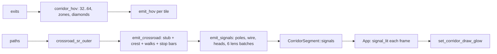

**Draw calls** (debug, measured with the C3a parts switched off by a temporary flag, since removed): corridor 25,449 to 26,128 (+679, +2.7 %); 35 of 41 segments changed, largest per-segment increase +32, largest segment 716 to 734. That is 180 lens draws (30 crossroads x 6) plus apron, steel and housing batches, plus the HOV lines per tile and one diamond batch per segment.

**Checks.** `make test-debug` 495 pass (was 492), `make test` 470 (was 467). New `[c3a]` tests: one stub per crossroad side with $t_1 - t_0 = L$, starting past the service road; the HOV range equals the stations of exits 32 and 64 on the real asset, diamonds 1,000 ft apart inside it, zones sorted, merged and inside the range; signal phases always light exactly one lens per group and never show green both ways. Visual checks in `make debug` used a temporary start station and camera override plus the handoff's sky-depth workaround, all removed: the signal seen from the service-road approach (green lit, crossroad heads side-on), the stub end from the chase camera (crest hides the end, no hard cut), the HOV buffer and a diamond from the cockpit, and helicopter views of both EB and WB intersections and an access zone changing to solid. Screenshots: [signal](docs/corridor/img/c3a-signal-from-sr.png), [stub end](docs/corridor/img/c3a-stub-end.png), [HOV](docs/corridor/img/c3a-hov-buffer-diamond.png).

**Choices (owner asleep).** Span wire, black heads, no backplate (photos, not the brief's mast arm or backplate). One global signal phase, not one per intersection: the lenses then batch into 6 draws per crossroad. The stubs are not drivable (a 2D turn off a 1D corridor frame is its own item). HOV signs are left for D3 (text signs).

**Seen, not fixed.** The crossroad deck renders almost black at the shipped low sun. The cause is the 42 in parapets' shadow plus very low ambient in shadow (renderer/CSM, pre-existing in the C2b screenshots); lowering the deck slab changed nothing. The lenses read as dim at dusk because the ITE minimums are far below a real LED's output and there is no bloom on them; this is for the lighting phase.

| File | Change |
|------|--------|
| [src/scene/Corridor/CorridorDiamonds.h](src/scene/Corridor/CorridorDiamonds.h), [.cpp](src/scene/Corridor/CorridorDiamonds.cpp) | Stub, crest, walks, apron, stop bars, crosswalk gaps in `emit_crossroad`; `emit_signals`; `corridor_mainline_frames`; `emit_hov` |
| [src/scene/Corridor/CorridorRamps.h](src/scene/Corridor/CorridorRamps.h), [.cpp](src/scene/Corridor/CorridorRamps.cpp) | `CrossStub`, `crossroad_sr_outer`, `corridor_cross_stubs`, `SignalLens`, `signal_lit`, lens colour and luminance, `CorridorHov`, `corridor_hov` |
| [src/scene/Corridor/CorridorAlignment.h](src/scene/Corridor/CorridorAlignment.h) | `set_cross_stub` / `cross_stub` |
| [src/scene/Corridor/CorridorScene.h](src/scene/Corridor/CorridorScene.h), [.cpp](src/scene/Corridor/CorridorScene.cpp) | `CorridorSegment::signals`; HOV range skips lane 1\|2 dashes; calls `emit_hov`; passes lens list |
| [src/scene/RoadScene/RoadParams.h](src/scene/RoadScene/RoadParams.h) | Stub, signal and HOV dimensions in `road::diamond` |
| [src/renderer/SceneGeometry/SceneGeometry.h](src/renderer/SceneGeometry/SceneGeometry.h), [GeometryProducer.h](src/renderer/GeometryProducer/GeometryProducer.h), [Renderer.h](src/renderer/Renderer/Renderer.h), [Renderer_State.cpp](src/renderer/Renderer/Renderer_State.cpp) | Debug-only `set_corridor_draw_glow` (colour + emissive of one draw) |
| [src/core/App/App.h](src/core/App/App.h), [App.cpp](src/core/App/App.cpp), [AppInit.cpp](src/core/App/AppInit.cpp) | Rebuild key now 5 floats (stub length); stub set on the alignment; lens list; per-frame signal cycle |
| [src/debug/Tunables.def](src/debug/Tunables.def) | `corridorStubM`, `corridorSignalCycleS` |
| [tests/test_corridor.cpp](tests/test_corridor.cpp) | Three `[c3a]` tests |
| [tests/test_debug_params_io.cpp](tests/test_debug_params_io.cpp) | Tunable counts 79 to 81, floats 63 to 65 |
| [docs/endless-road.md](docs/endless-road.md), [docs/corridor/tuning-notes.md](docs/corridor/tuning-notes.md), [docs/corridor/img/](docs/corridor/img/) | Architecture section, knobs, formulas, sources, screenshots |
| [tasks/todo.md](tasks/todo.md), [tasks/upcoming-tests.md](tasks/upcoming-tests.md), [tasks/autonomous-run-2026-11-20.md](tasks/autonomous-run-2026-11-20.md) | C3a done, in-app checks, decisions and run log |

</details>

### 2026-11-21 — Added an in-game HUD strip and route minimap to the debug build (C3b)

The debug build now draws a nav-style strip over the game window: speed in mph, district, road piece (mainline, ramp, service road, crossroad) and the next exit in the travel direction with its distance. A corner minimap shows the whole route or 2 km around the car. Both show in drive and edit mode; H or the `HUD strip + minimap` tunable toggles them. Release is unchanged. *Largely AI-generated (Claude); owner review pending.*

<details><summary>Technical summary</summary>

**Motivation.** The plan's C3b item. The cockpit gauge cluster is baked texture pixels (no needle node), so the car had no speed readout on screen. The corridor state (district, next exit, piece) was only in the 1 Hz stdout line.

**Approach.** The debug panel's ImGui context belongs to the detached controls window, so it cannot draw on the game window. [HudOverlay](src/debug/HudOverlay.cpp) owns a **second** ImGui context with its own Vulkan backend. It has no GLFW backend, no input and no windows: everything goes through the background draw list. Every call saves and restores the current context, so the panel never sees it. A new `PASS_DEBUG(HudOverlay)` after `Composite` ([HudOverlayPass.cpp](src/renderer/Passes/HudOverlayPass.cpp)) records a LOAD render pass (PRESENT_SRC in and out) on **Composite's own framebuffer**. Same format and samples make the passes compatible, so there are no extra framebuffers and nothing to rebuild on resize. The game swapchain is linear, so the authored sRGB colours are decoded with $c^{2.2}$.

[AppHud.cpp](src/core/App/AppHud.cpp) fills `DebugParams::hud` ([HudFeed](src/debug/HudFeed.h)) each frame from what App already owns: `CarEntity` speed, position and forward, and the `CorridorDriver` station, side and the new `piece()` accessor. It reads the district and next exit from `CorridorAlignment`. The minimap geometry is built once: the route at no more than 2,000 points, the service-road stretches offset by `outer_edge + sr_strip`, and one tick per exit.

Pure helpers in `HudFeed.h`, unit-tested:

$$v_\text{mph} = \frac{3600\,v_\text{m/s}}{5280 \cdot 0.3048},\qquad d_\text{mi} = \frac{|s_x - s|}{\text{WU per mile}}\cdot\frac{L_\text{real}}{L_\text{baked}},\qquad \mathbf p = \mathbf o + \tfrac{S}{2} + (\mathbf w - \mathbf c)\,\frac{S}{2h}$$

The ratio undoes the compaction (70.41 real mi baked to 30.0 mi). The map is $-z$ up: world frame, not geographic north.


**Checks.** `make test-debug` 496 pass (was 495), `make test` 471 (was 470). New `[hud]` test: mph, miles with and without compaction, map centre and edge. The pass-order test now ends with `HudOverlay` in the debug list; the release list is unchanged. Viewed in `make debug` (window-only captures; temporary chase-camera and local-map defaults, both reverted). The strip reads on asphalt and the minimap reads on sky. The cockpit view puts both over the dark interior, also readable. The first triangle arrow read backwards at map size, so it is now a notched chevron. Screenshot: [c3b-hud.png](docs/corridor/img/c3b-hud.png).

**Choices (owner asleep).** Second ImGui context and a pass on the composite framebuffer, rather than putting the panel back on the game window. H key (free; T is time of day, backtick edit/drive). The tunables live in the `corridor` group, so no new panel header or test whitelist was needed. Layout is authored at 1080 px tall and scales with the window height, with a floor of 0.8 so an 800x600 window stays legible. Distances are real miles. The 2 km local view is in baked metres. Speed is the forward speed's magnitude.

| File | Change |
|------|--------|
| [src/debug/HudFeed.h](src/debug/HudFeed.h) | New: feed struct + `hud::mph`, `hud::miles`, `hud::map_px` |
| [src/debug/HudOverlay.h](src/debug/HudOverlay.h), [.cpp](src/debug/HudOverlay.cpp) | New: second ImGui context, LOAD render pass, strip + minimap drawing |
| [src/renderer/Passes/HudOverlayPass.cpp](src/renderer/Passes/HudOverlayPass.cpp), [PassList.def](src/renderer/Passes/PassList.def) | New debug pass after Composite |
| [src/renderer/Passes/IRenderPass.h](src/renderer/Passes/IRenderPass.h) | `PassResources::hud` (debug) |
| [src/renderer/Renderer/Renderer.h](src/renderer/Renderer/Renderer.h), [Renderer.cpp](src/renderer/Renderer/Renderer.cpp) | Own, init (in `debug_init`) and clean up `HudOverlay` |
| [src/core/App/AppHud.cpp](src/core/App/AppHud.cpp) | New: `App::sync_hud` fills the feed, builds the minimap geometry once |
| [src/core/App/App.h](src/core/App/App.h), [App.cpp](src/core/App/App.cpp), [AppInput.cpp](src/core/App/AppInput.cpp) | `sync_hud` call, `on_toggle_hud` on H |
| [src/scene/Corridor/CorridorDriver.h](src/scene/Corridor/CorridorDriver.h) | `piece()` accessor |
| [src/debug/DebugParams.h](src/debug/DebugParams.h), [Tunables.def](src/debug/Tunables.def) | `hud` field (debug); `hudShow`, `hudMapLocal` |
| [tests/test_hud.cpp](tests/test_hud.cpp), [tests/CMakeLists.txt](tests/CMakeLists.txt) | New `[hud]` test |
| [tests/test_debug_params_io.cpp](tests/test_debug_params_io.cpp) | Tunable counts 81 to 83, bools 16 to 18 |
| [tests/utils/test_renderer_PassRegistry.cpp](tests/utils/test_renderer_PassRegistry.cpp) | Debug pass order ends with `HudOverlay` |
| [docs/debug-ui.md](docs/debug-ui.md), [docs/corridor/tuning-notes.md](docs/corridor/tuning-notes.md), [docs/corridor/img/c3b-hud.png](docs/corridor/img/c3b-hud.png) | HUD section, knobs, screenshot |
| [tasks/todo.md](tasks/todo.md), [tasks/upcoming-tests.md](tasks/upcoming-tests.md), [tasks/autonomous-run-2026-11-20.md](tasks/autonomous-run-2026-11-20.md) | C3b done, in-app checks, decisions and run log |

</details>

### 2026-11-21 — Built the Queens-Midtown Tunnel, its Queens portal and plaza, and a Riverhead roundabout at the route ends (C4)

The debug build now starts the drive inside the Queens-Midtown Tunnel. The tube has white glazed tile walls with blue and gold stripes, safety walks, a ceiling and two continuous LED luminaire rows. Its own lights light it, and it reads darker than outside. The car leaves through a headwall portal onto the widened former toll plaza, which has a cashless gantry and a U-turn opening. At Riverhead the right lane drops and the expressway ends at a fictional single-lane roundabout that turns the car onto the westbound side, with blank sign boards (text comes in D3) and a barrier round the ring. Both ends drive for the bicycle and 6-DOF car models. Release is unchanged. *Largely AI-generated (Claude); owner review pending.*

<details><summary>Technical summary</summary>

**Motivation.** The plan's C4 item: the full route had open road where the tube under the East River is (station 0 is the Manhattan approach; the car spawned at 340 m, inside the real tube) and a bare 220 m median pad at each end.

**Where the ends sit.** OSM tunnel way 658498546 ends at the Queens portal (-73.95407, 40.74145), which the 2026-11-20 bake puts 80 m before the EB exit 13 diverge, so `corridor_ends` derives the portal from the exit table ($s_P \approx 1{,}422$ m). The roundabout is placed from the last station: $s_c = L - 10\,\text{m} - R_o$.

**Approach.** One new struct `CorridorEnds` on `CorridorAlignment` (`set_ends`, never set in release, so every query keeps its old answer). The plaza widening and the east lane drop are folded into `sample().lanes`, so mesh, verge, paint and the drive clamp follow without extra code. The east bank eases to 0 over the taper, so the ring is level. Queries are in [CorridorEnds.cpp](src/scene/Corridor/CorridorEnds.cpp) (GPU-free, linked into the tests) and mesh is in [CorridorEndsMesh.cpp](src/scene/Corridor/CorridorEndsMesh.cpp):

```mermaid
graph LR
  X[exit 13 + last station] --> C[corridor_ends] --> A[CorridorAlignment::set_ends]
  A --> S[sample: plaza lanes, lane drop, bank runout]
  A --> B[drive_spans: tube between walk curbs, ring_spans]
  A --> M[emit_tunnel / emit_median / emit_road_end]
  A --> D[CorridorDriver: tube lights, roof boxes, EV floor]
```

- **Tube.** Walls at the walk edges, four tile bands per wall on whole course pairs. A new `MAT_TILE` material uses a procedural 3 x 6 in running-bond texture ([tools/gen_tunnel_tile.py](tools/gen_tunnel_tile.py)). The ceiling faces down. The lane line is solid (no lane changes) and the west end is capped in a dark 30 m lead-in. Drivable span: $[p_i + c,\; p_o - c]$ with $c = 0.65$ m from each walk curb.
- **Lights.** `corridor_tunnel_lights` puts one spot every 6 m over the lanes. Its intensity is set for a target road illuminance $E$ (slider `corridorTunnelLux`, 120 lx):
  $$E = \frac{I}{h^2}\sum_k \cos^3\theta_k \;\Rightarrow\; I = \frac{E\,h^2}{\sum_k \cos^3\theta_k},\qquad \theta_k = \arctan\frac{k\,\Delta}{h}$$
  CIE 88 zones: a ×10 threshold zone for 50 m inside the WB (entering) portal, then a linear transition over 100 m, and a ×5 exit zone over the last 60 m of the EB tube. Inside the tube the driver sends only the car's own tube, because spots are unshadowed and would light the other tube through the wall. The luminaire rows are emissive draws with a new `DrawCall::selfLit` flag (lit by day; `SceneGeometry::record_draws` gains `selfLitScale`).
- **Darker than outside.** The driver sends up to 12 roof boxes (25 m tube chunks; the portal chunk is open at its -Z end) as sky-occlusion volumes. Three debug-only lines in [lighting.frag](shaders/lighting.frag) make a roof volume also take away the 0.25 shadow floor, the haze and the rain fog. Closed or one-ended volumes also hide the sun: CSM did not shadow the tube interior. While the car is in the tube, the auto-exposure EV100 floor drops to 4.5, so the eye adapts.
- **Lane paint fix (graded asset).** A lane-wide asphalt quad on a fast-changing bank folds along its diagonal by up to 13 WU, which is more than the 5 WU paint lift. The tube's lane line showed as dashes (found by looking). On the v2 asset each lane is now its own band, folded back into one draw, so every lane line sits on a band edge.
- **Portal and plaza.** Headwall with two openings, coping, an 80 m grassed cover and 2:1 slopes behind wing walls, so nothing behind the portal shows from the plaza. The plaza widens 1.5 lanes each side. A cashless gantry 45 m out (box truss on three posts, reader and camera per lane). U-turn opening at $s_P + 130$ m. `emit_median` builds the barrier with the opening exact (the old pad rule was per 300 m tile). Diamonds and service roads start at $s_P + 250$ m.
- **Riverhead.** Lane drop over the MUTCD taper $L = W S = 12\,\text{ft} \times 45 = 540$ ft. Splitter island with a crash cushion on the WB nose. Roundabout $R_o = 24$ m, $R_i = 17$ m: truck apron, curbed grass mound, yellow edge along the island, white outer edge, yield teeth, outer curb and concrete barrier everywhere but the entry. The mainline stops where its corner meets the ring, $s_m = s_c - \sqrt{R_o^2 - e^2}$. The drivable windows are
  $$w_o = \sqrt{R_o^2 - (s - s_c)^2},\qquad w_i = \sqrt{R_i^2 - (s - s_c)^2}:\quad [-w_o, -w_i] \cup [w_i, w_o]\ \text{(else } [-w_o, w_o]\text{)}$$
  `in_turnaround` holds from $s_c - R_o$, so the side re-commits by the sign of the lateral. An empty span list (the far rim) holds the car. Blank boards: END 495 at 1 mile, EXIT 73 at 1/2 mile, roundabout warning, Riverhead, I-495 WEST, and W1-8 chevrons on the island.

**Checks.** `make test-debug` 500 pass (was 496), `make test` 475 (was 471); the release `.spv` hashes are unchanged. Four `[c4]` tests: no ends means no change; the tube drives start to portal between the walls; an EB-lane to WB-lane path around the ring stays on the drivable spans; tube lights exist, are boosted at the WB threshold and stop at the portal. Draws: 25,831 (was 26,128: the tube and plaza drop the old service-road stubs). Viewed in `make debug` with window-only captures, a temporary spawn override and the temporary `depth <= 0` sky fix (both removed): [inside](docs/corridor/img/c4-tunnel-inside.png), [exit](docs/corridor/img/c4-tunnel-exit.png), [portal](docs/corridor/img/c4-portal-plaza.png), [approach](docs/corridor/img/c4-roundabout-approach.png), [ring](docs/corridor/img/c4-roundabout-ring.png). The roundabout was not driven round in the app.

**Choices (owner asleep).** Spawn stays at the baked start, about 1.08 km inside the tube (drive the tube, emerge at the plaza). The wall palette is white with blue and gold stripes, after the 2017-18 re-tiling (Wikipedia); the stripe layout is a guess. The gantry stands at Queens as the brief asked, although the real cashless gantries are at the Manhattan end (Wikipedia, OSM `toll_gantry` nodes). The roundabout is fictional: the real LIE becomes CR 58 at a signal, and the mainline is the final exit. The U-turn opening is fictional. Luminaire lens luminance is cut to 1,500 cd/m² (about 9,000 is physical) because the bloom is wide.

| File | Change |
|------|--------|
| [src/scene/Corridor/CorridorEnds.h](src/scene/Corridor/CorridorEnds.h), [CorridorEnds.cpp](src/scene/Corridor/CorridorEnds.cpp) | New: `corridor_ends`, `ring_spans`, `corridor_tunnel_lights`, `corridor_tunnel_roofs` |
| [src/scene/Corridor/CorridorEndsMesh.cpp](src/scene/Corridor/CorridorEndsMesh.cpp) | New: tube, portal, cover, gantry, median with exact opening, signs, splitter, roundabout, grass |
| [src/scene/Corridor/CorridorAlignment.h](src/scene/Corridor/CorridorAlignment.h), [.cpp](src/scene/Corridor/CorridorAlignment.cpp) | `CorridorEnds`, `set_ends`, `in_tunnel`, `main_end`; plaza lanes, lane drop and bank runout in `sample`; ends in `in_turnaround` |
| [src/scene/Corridor/CorridorBounds.cpp](src/scene/Corridor/CorridorBounds.cpp) | Tube span between the walk curbs; mainline stops at `main_end`; ring windows |
| [src/scene/Corridor/CorridorDriver.h](src/scene/Corridor/CorridorDriver.h), [.cpp](src/scene/Corridor/CorridorDriver.cpp) | Empty spans hold the car; tube lights, roof boxes, tube EV floor (debug) |
| [src/scene/Corridor/CorridorScene.cpp](src/scene/Corridor/CorridorScene.cpp) | Mainline stops at `main_end`; per-lane asphalt bands on v2; solid tube lane line; `emit_median`; C4 emitters; no lamps in the tube, plaza or past the median |
| [src/scene/Corridor/CorridorRamps.cpp](src/scene/Corridor/CorridorRamps.cpp) | Diamonds and service roads clear the tube, plaza and lane drop |
| [src/scene/Corridor/CorridorDiamonds.h](src/scene/Corridor/CorridorDiamonds.h), [.cpp](src/scene/Corridor/CorridorDiamonds.cpp) | Shared mesh helpers moved to `cmesh` (`at`, `face`, `hexa`, `minus`, `obox`, `rod`, `pole`) |
| [src/scene/RoadScene/RoadParams.h](src/scene/RoadScene/RoadParams.h) | `road::ends` sizes |
| [src/scene/SceneTypes.h](src/scene/SceneTypes.h) | `MAT_TILE`, `DrawCall::selfLit` |
| [src/renderer/MaterialDescriptors/MaterialDescriptors.cpp](src/renderer/MaterialDescriptors/MaterialDescriptors.cpp) | `tile` texture slot |
| [src/renderer/SceneGeometry/SceneGeometry.h](src/renderer/SceneGeometry/SceneGeometry.h), [.cpp](src/renderer/SceneGeometry/SceneGeometry.cpp), [GeometryProducer.cpp](src/renderer/GeometryProducer/GeometryProducer.cpp) | `selfLitScale` = pre-exposure for self-lit draws |
| [shaders/lighting.frag](shaders/lighting.frag) | Debug only: roof volumes scale the shadow floor, haze and rain fog; closed / one-ended ones hide the sun |
| [src/core/App/AppInit.cpp](src/core/App/AppInit.cpp) | `set_ends` before the diamonds (debug asset) |
| [src/debug/Tunables.def](src/debug/Tunables.def) | `corridorTunnelLux` |
| [CMakeLists.txt](CMakeLists.txt) | `CorridorEnds.cpp` in `swish_scene_core` |
| [textures/tile.jpg](textures/tile.jpg), [tile_normal.png](textures/tile_normal.png), [tile_roughness.jpg](textures/tile_roughness.jpg), [tools/gen_tunnel_tile.py](tools/gen_tunnel_tile.py) | Procedural tile set and its generator |
| [tests/test_corridor.cpp](tests/test_corridor.cpp), [tests/test_debug_params_io.cpp](tests/test_debug_params_io.cpp) | Four `[c4]` tests; tunable counts 83 to 84, floats 65 to 66 |
| [docs/endless-road.md](docs/endless-road.md), [docs/corridor/tuning-notes.md](docs/corridor/tuning-notes.md), [docs/corridor/img/](docs/corridor/img/) | C4 section, knobs, five screenshots |
| [tasks/todo.md](tasks/todo.md), [tasks/upcoming-tests.md](tasks/upcoming-tests.md), [tasks/autonomous-run-2026-11-20.md](tasks/autonomous-run-2026-11-20.md) | C4 done, in-app checks, decisions and run log |

</details>

### 2026-11-21 — Sky test reads only the clear depth (debug)

Fixed geometry past 100 m being shaded as sky in the debug build: the sky test now matches only the reverse-Z clear value.

<details><summary>Technical summary</summary>

**Root cause.** The near plane is 10 WU and the projection is reverse-Z, so depth is roughly

$$d \approx \frac{z_n}{z} \quad\Rightarrow\quad d < 10^{-4} \iff z > \frac{10\ \text{WU}}{10^{-4}} = 10^5\ \text{WU} = 100\ \text{m}.$$

Every pass that tested `depth < 0.0001` for "sky" therefore treated all geometry beyond 100 m as sky: the lit pass painted it with the env map, SSAO skipped it, god-rays emitted from it and DoF fully blurred it. The C2b and C4 agents both hit it (far tunnel tube and corridor showed sky colour). The depth buffer is `D32_SFLOAT` cleared to exactly 0.0, so `depth <= 0.0` is exact.

**Fix.** Debug build only (`#ifdef SWISH_DEBUG_UI`), release untouched and its `.spv` hashes unchanged; promoting it to release is an owner call (intended behaviour change, golden update).

| File | Change |
|------|--------|
| [shaders/lighting.frag](shaders/lighting.frag) | Sky branch `depth <= 0.0` in debug |
| [shaders/ssao.frag](shaders/ssao.frag) | Sky skip and sample skip `<= 0.0` in debug |
| [shaders/godrays.frag](shaders/godrays.frag) | Emit only from clear depth in debug |
| [shaders/dof.frag](shaders/dof.frag) | Sky blur only for clear depth in debug |
| [tasks/autonomous-run-2026-11-20.md](tasks/autonomous-run-2026-11-20.md) | Decision logged |

**Checks.** `make test-debug` 500 pass, `make test` 475 pass (release `.spv` golden unchanged). Viewed in `make debug` inside the tunnel: the tube recedes dark to the far end, matching the C4 agent's capture taken with the same temporary fix.

</details>

### 2026-11-21 — Road surface per stretch: concrete joints, patches, worn paint, markers, rumble strips (D1, debug)

Added per-stretch pavement to the debug corridor: asphalt (fresh / worn / patched) through exit 64 and jointed concrete east of it, with shader-side joints, sealed cracks, patches, wheel-path polish, faded paint, raised markers and shoulder rumble strips.

<details><summary>Technical summary</summary>

**Motivation.** Plan item D1 (tasks/todo.md "LIE full route"): the whole 30-mile mainline used one asphalt texture. The real LIE switches from asphalt to concrete at exit 64 (Wikipedia, I-495 route description) and shows patches, sealant, worn paint, reflectors and rumble strips. B5b (bumps) needs the same per-stretch kind.

**Approach.** One source of truth in [config/lie_corridor.toml](config/lie_corridor.toml) `[surface]` (rows keyed by eastbound exit), baked by [tools/lie_corridor.py](tools/lie_corridor.py) into an optional `SURF` block (16-byte `CorridorPavement`, old assets still load as `Pavement::Legacy`). `CorridorAlignment::surface_at(s)` reads it. [CorridorScene.cpp](src/scene/Corridor/CorridorScene.cpp) picks the lane material per 300 m tile (`MAT_CONCRETE`, new `MAT_ASPHALT_FRESH`, or `MAT_ASPHALT`) and tags lane, shoulder and marking draws (`DrawCall::surface`, `arc0`). [SceneGeometry.cpp](src/renderer/SceneGeometry/SceneGeometry.cpp) pushes two debug-only rows (`pave`, `pave2`); [shaders/common/pavement.glsl](shaders/common/pavement.glsl) draws the detail in [gbuffer.frag](shaders/gbuffer.frag). No new geometry, no G-buffer change; markers reuse the retroreflective alpha code.

```mermaid
graph LR
    T["toml [surface]"] --> B["bake SURF"] --> Q["surface_at(s)"] --> M["CorridorScene tags draws"] --> G["gbuffer.frag pavement.glsl"]
```

Lines are box-filtered against the pixel footprint so sub-pixel joints fade instead of shimmering:

$$c(d) = \operatorname{clamp}\!\left(\frac{\min(d + f/2,\ w/2) - \max(d - f/2,\ -w/2)}{f},\ 0,\ 1\right),\quad f = \text{fwidth}(d)$$

Joints and markers stay on the global station grid via $t = v + (s_0 \bmod S)$ with $s_0$ = tile start station. Defaults: joints 15 ft (NYSDOT JPCP, unverified), markers $2N = 80$ ft mid-gap (MUTCD 3B.11), rumble 7 x 16 in at 12 in (FHWA T 5040.39). Asphalt012's rust-red crack stains are filled from shifted clean copies by [tools/gen_asphalt_fresh.py](tools/gen_asphalt_fresh.py).

| File | Change |
|------|--------|
| [config/lie_corridor.toml](config/lie_corridor.toml) | `[surface]` stretch table with sources / guesses |
| [tools/lie_corridor.py](tools/lie_corridor.py) | `pavement_ranges`, `SURF` block in `write_asset` |
| [assets/corridor/lie_corridor_full.bin](assets/corridor/lie_corridor_full.bin) | Re-baked: identical prefix plus the `SURF` block |
| [src/scene/Corridor/CorridorAsset.h](src/scene/Corridor/CorridorAsset.h) | `Pavement`, `CorridorPavement`, `kCorridorSurfTag`, loader |
| [src/scene/Corridor/CorridorAlignment.h](src/scene/Corridor/CorridorAlignment.h), [.cpp](src/scene/Corridor/CorridorAlignment.cpp) | `surface_at(s)` |
| [src/scene/Corridor/CorridorScene.cpp](src/scene/Corridor/CorridorScene.cpp) | Lane material per tile, draw tags, paint UVs (debug asset only) |
| [src/scene/SceneTypes.h](src/scene/SceneTypes.h) | `MAT_ASPHALT_FRESH`, `DrawCall::surface/arc0`, debug `pave/pave2`, `PaintTuning` pavement fields |
| [src/renderer/MaterialDescriptors/MaterialDescriptors.cpp](src/renderer/MaterialDescriptors/MaterialDescriptors.cpp) | `asphalt_fresh` texture slot |
| [src/renderer/SceneGeometry/SceneGeometry.cpp](src/renderer/SceneGeometry/SceneGeometry.cpp) | Tagged pavement is road; pushes `pave/pave2` (debug) |
| [src/renderer/GeometryProducer/GeometryProducer.cpp](src/renderer/GeometryProducer/GeometryProducer.cpp) | Sliders into `PaintTuning` |
| [src/debug/Tunables.def](src/debug/Tunables.def) | Six `surface_*` sliders in the corridor group |
| [shaders/common/pavement.glsl](shaders/common/pavement.glsl) | New: all pavement detail |
| [shaders/gbuffer.frag](shaders/gbuffer.frag) | Debug push rows, tiling breakup, `pavementDetail` call, retro from the result |
| [textures/asphalt_fresh.jpg](textures/asphalt_fresh.jpg), [_normal](textures/asphalt_fresh_normal.jpg), [_roughness](textures/asphalt_fresh_roughness.jpg), [tools/gen_asphalt_fresh.py](tools/gen_asphalt_fresh.py) | Cleaned Asphalt012 set and its generator |
| [assets/CREDITS.md](assets/CREDITS.md) | Asphalt012 / Concrete012 (CC0) row |
| [tests/test_corridor.cpp](tests/test_corridor.cpp), [tests/test_debug_params_io.cpp](tests/test_debug_params_io.cpp) | Two `[surface]` tests; tunable counts 84 to 90, floats 66 to 72 |
| [docs/surface/README.md](docs/surface/README.md), [docs/surface/tuning-notes.md](docs/surface/tuning-notes.md), [docs/data-types.md](docs/data-types.md), [docs/README.md](docs/README.md), [docs/corridor/img/](docs/corridor/img/) | Architecture with sources, knobs, push layout, nine `d1-*` screenshots |
| [tasks/todo.md](tasks/todo.md), [tasks/upcoming-tests.md](tasks/upcoming-tests.md), [tasks/autonomous-run-2026-11-20.md](tasks/autonomous-run-2026-11-20.md) | D1 done, in-app checks, decisions |

**Checks.** `make test-debug` 502 pass, `make test` 477 pass, release `.spv` hashes 34/34 OK, `make check` only the two older failures. Viewed in `make debug` (chase and cockpit, noon) on concrete (25.8 mi), patched (5 mi), fresh (19 mi) and worn (15 mi) stretches, at rain 0 and rain 1.0; fixed red crack stains on Asphalt012, black paint-loss blotches on concrete and over-dark rumble grooves before saving.

</details>

### 2026-11-21 — LIE landmark reference notes (D0)

Filled the 12 landmark notes and a district-by-district kit sheet in the LIE reference, with 15 openly licensed photos.

<details><summary>Technical summary</summary>

**Motivation.** D1-D6 need sourced facts (median, barrier, lamps, gantries, overpasses, vegetation) per district rather than memory.

**Result.** Seven landmarks are well sourced (13/14, 17, 22, 31, 33, 44, 68); 39, 49, 53, 62 and 73 are partial. Key findings: HOV lane exits 32-64; east of exit 64 concrete, wide grass median, no lamps, pitch-pine barrens; Nassau sound walls are red-brown brick-textured precast; galvanised truss gantries throughout; the Queens toll plaza is gone (cashless since 2017, gantries at the Manhattan portals). Photos are CC BY / CC BY-SA / public domain, checked on the Commons API, 1280 px. Street View panoramas were not opened.

| File | Change |
|------|--------|
| [docs/lie-reference/README.md](docs/lie-reference/README.md) | 12 landmark notes, corridor-wide kit section, sources, "to check" marks |
| [docs/lie-reference/photos/](docs/lie-reference/photos/) | 15 photos by exit |
| [docs/lie-reference/photos/CREDITS.md](docs/lie-reference/photos/CREDITS.md) | File, author, licence, source per photo |
| [tasks/todo.md](tasks/todo.md), [tasks/autonomous-run-2026-11-20.md](tasks/autonomous-run-2026-11-20.md) | D0 done, findings logged |

</details>

### 2026-11-21 — Corridor edges: NJ median barrier, wide grass median east of exit 64, W-beam, sound walls, ditches (D2, debug)

Replaced the box median with a real 32 in New Jersey barrier, parted the carriageways round a grass median with a cable barrier east of exit 64, and added W-beam pier shields, red-brown brick sound walls in Nassau and roadside ditches; the car now stops at the barrier face it sees. Release is unchanged. *Largely AI-generated (Claude); owner review pending.*

<details><summary>Technical summary</summary>

**Motivation.** Plan item D2 (tasks/todo.md "LIE full route"). The median was a 30 x 34 in box; the outer edges had no barriers and no walls; the cut slope ran straight from the shoulder; the car's median clamp sat at the yellow line, 0.6 m short of the barrier. The reference sheet ([docs/lie-reference/README.md](docs/lie-reference/README.md), corridor-wide kit) gives a concrete safety-shape median west of exit 64, a wide grass median east of it, W-beam on steel posts, and red-brown brick-textured precast sound walls in Nassau.

**Approach.** New [CorridorEdges.h](src/scene/Corridor/CorridorEdges.h) / [.cpp](src/scene/Corridor/CorridorEdges.cpp): `corridor_edges` computes station ranges once (wide median, sound walls, W-beam), `emit_median` and `emit_edges` sweep profiles per 300 m tile. All sizes are in `road::edges` ([RoadParams.h](src/scene/RoadScene/RoadParams.h)).

- **NJ barrier.** Profile from the toe: 3 in vertical, 55° face to 13 in, 84° face to 32 in. Runs $10/\tan 55^\circ = 7.0$ in and $19/\tan 84^\circ = 2.0$ in, so a 24 in base carries a 6 in top. Swept with continuous UVs, end caps where a run ends (U-turn opening, wide median, splitter), concrete footing strip either side of the toe, none in the tube. Median lamp poles stand on a 1.5 m widened block. The median pier under each crossroad is narrowed to the toe plus 1 cm.
- **Wide median.** `CorridorAlignment::Sample` gained `med` (median half-width). `median_extra(s)` eases a slider-set extra in over 500 m, from 1 km past the last exit 64 record (the HOV paint ends there) to 600 m before the east lane drop. New `outer_edge / paint_inner / paint_outer(const Sample&)` overloads carry it, so ramps, service roads, crossroads, verge, HUD and bounds move with the carriageways. The mainline mesh sweeps each carriageway off its own frames shifted by $\pm w(s)$ with the bank carried ($y_c - b\,w$), so every constant-lateral band, line and dash is unchanged code. Grass median with a shallow V swale ($\min(0.5\text{ m}, 0.04\,m)$), a three-cable barrier (21, 25, 30 in) on S3x5.7 posts at 15 ft with 20 m ground anchors, and a yellow attenuator on each NJ end facing the opposite traffic. No median lamps there (nycroads.com and Wikipedia: none east of exit 64).
- **W-beam.** 31 in rail top (MGS), M180 W profile swept both faces, 8 in blockouts, posts at 6 ft 3 in, last 25 ft turned down to the ground. Runs shield the crossroad piers, 45 m upstream and 15 m downstream, broken where a ramp is within reach of the posts. Piers moved to 2.0 m past the shoulder (deflection room behind the rail).
- **Sound walls.** 0.2 m brick panels (new `MAT_BRICK`, ambientCG Bricks054, CC0) on a 0.6 m plinth between 0.45 m concrete posts every 6.1 m, height slider (4.5 m), 1.2 m inside the strip top. Placed in every gap of at least 400 m between diamonds (ramps and decks with a 40 m margin): all of Nassau both ways, Queens westbound east of exit 31; the Suffolk tan stretch at exits 62-63 is coded but no gap is long enough. 9 walls, 13.2 km.
- **Ditch.** The cut slope from the shoulder (or a ramp's outer edge) is now a 1V:6H foreslope to a 0.45 m ditch, a 0.6 m flat bottom, then a backslope $y = y_0 + \Delta\left(\tfrac{t}{2} + \tfrac{3t^2 - 2t^3}{2}\right)$ rounded at toe and top. The whole verge is one draw per tile side (was three). `corridor_verge_y` returns the same height for wall feet and rail posts.
- **Contact.** `mainline_span` clamps the car centre at NJ toe + `kCurbClear` (0.65 m, the tunnel's rule) where the barrier stands, at the painted line in the wide median, and at the rail face minus `kCurbClear` where a W-beam runs. Both car models use the same clamp; the 6-DOF one gets the existing `wall_contact` impulse.
- **Mips (debug).** No material texture had a mip chain and the sampler clamped to level 0, so the 1 m brick tile rendered as moire past 20 m. Debug now builds a box-filtered RGBA8 chain on the CPU and samples it (`maxLod = VK_LOD_CLAMP_NONE`); this also calms every road texture at range. Release uploads level 0 only, as before.

```mermaid
graph LR
  X[exit table + districts] --> E1[corridor_edges: wide median]
  E1 --> C[corridor_crossroads + diamond paths]
  C --> E2[corridor_edges: walls + rails clear of ramps]
  E2 --> S[sample.med, rail_face]
  S --> B[mainline_span clamp]
  S --> M[build_corridor_segments: shifted frames, emit_median, emit_edges, ditch verge]
```

**Draw calls** (debug, full route): 23,385 corridor draws. Sound walls and W-beam add 180 (measured by clearing their ranges with a temporary flag, since removed). Structural changes per 300 m tile: verge 3 to 1 draw per side, median 3 to 2, +2 in the wide median (grass, cables), +1 pedestal batch per segment.

| File | Change |
|------|--------|
| [src/scene/Corridor/CorridorEdges.h](src/scene/Corridor/CorridorEdges.h), [.cpp](src/scene/Corridor/CorridorEdges.cpp) | New: edge ranges, NJ profile, median (NJ / wide grass + cable), sound walls, W-beam |
| [src/scene/Corridor/CorridorAlignment.h](src/scene/Corridor/CorridorAlignment.h), [.cpp](src/scene/Corridor/CorridorAlignment.cpp) | `CorridorEdges`, `Sample::med`, `median_extra`, `rail_face`, Sample-based edge overloads |
| [src/scene/Corridor/CorridorBounds.cpp](src/scene/Corridor/CorridorBounds.cpp) | Clamp at the NJ toe and the W-beam face |
| [src/scene/Corridor/CorridorScene.cpp](src/scene/Corridor/CorridorScene.cpp) | Per-carriageway shifted frames, new median and edges calls, lamp pedestals, no lamps in the wide median |
| [src/scene/Corridor/CorridorDiamonds.h](src/scene/Corridor/CorridorDiamonds.h), [.cpp](src/scene/Corridor/CorridorDiamonds.cpp) | Ditch verge (one draw), `corridor_verge_y`, piers moved out, median pier narrowed, Sample-based edges |
| [src/scene/Corridor/CorridorRamps.cpp](src/scene/Corridor/CorridorRamps.cpp), [src/core/App/AppHud.cpp](src/core/App/AppHud.cpp) | Sample-based edges (follow the wide median) |
| [src/scene/Corridor/CorridorEnds.h](src/scene/Corridor/CorridorEnds.h), [CorridorEndsMesh.cpp](src/scene/Corridor/CorridorEndsMesh.cpp) | Old box median removed |
| [src/scene/RoadScene/RoadParams.h](src/scene/RoadScene/RoadParams.h) | `road::edges` sizes with sources |
| [src/scene/SceneTypes.h](src/scene/SceneTypes.h), [src/renderer/MaterialDescriptors/MaterialDescriptors.cpp](src/renderer/MaterialDescriptors/MaterialDescriptors.cpp) | `MAT_BRICK` slot |
| [src/renderer/TextureManager/TextureManager.cpp](src/renderer/TextureManager/TextureManager.cpp), [ResourceManager.h](src/renderer/ResourceManager/ResourceManager.h), [.cpp](src/renderer/ResourceManager/ResourceManager.cpp), [GpuResource.h](src/renderer/GpuResource/GpuResource.h) | Debug mip chain; optional level count on the upload helpers (default 1) |
| [src/core/App/AppInit.cpp](src/core/App/AppInit.cpp), [App.cpp](src/core/App/App.cpp), [App.h](src/core/App/App.h) | Edges set before and after the paths, D2 log line, rebuild key 5 to 8 |
| [src/debug/Tunables.def](src/debug/Tunables.def) | `edge_wide_median_m`, `edge_wall_h_m`, `edge_ditch_m` |
| [CMakeLists.txt](CMakeLists.txt) | `CorridorDiamonds.cpp`, `CorridorEdges.cpp` in the test library |
| [textures/brick.jpg](textures/brick.jpg), [_normal](textures/brick_normal.jpg), [_roughness](textures/brick_roughness.jpg), [assets/Bricks054_1K-JPG/](assets/Bricks054_1K-JPG/), [assets/CREDITS.md](assets/CREDITS.md) | Bricks054 (CC0) and its credit |
| [tests/test_corridor.cpp](tests/test_corridor.cpp), [tests/test_debug_params_io.cpp](tests/test_debug_params_io.cpp) | Four `[d2]` tests; tunable counts 90 to 93, floats 72 to 75 |
| [docs/endless-road.md](docs/endless-road.md), [docs/corridor/tuning-notes.md](docs/corridor/tuning-notes.md), [docs/corridor/img/](docs/corridor/img/) | Architecture with sources, knobs, eight `d2-*` screenshots |
| [tasks/todo.md](tasks/todo.md), [tasks/upcoming-tests.md](tasks/upcoming-tests.md), [tasks/autonomous-run-2026-11-20.md](tasks/autonomous-run-2026-11-20.md) | D2 done, in-app checks, decisions |

**Checks.** `make test-debug` 506 pass, `make test` 481 pass (release `.spv` and mesh goldens included), `make check` only the two older failures. Viewed in `make debug` (chase cam, noon): NJ close-up with the car against it, the barrier end and attenuator, a Nassau wall from the mainline and from the service road, a cut slope with the W-beam under a crossroad, the grass median east of 64. Drove into the median with both car models (scripted throttle and an 8° yaw, removed): both stop with the body side on the barrier toe. Fixed before saving: brick moire (mips), dark brick tint, the wide median overlapping the HOV paint.

</details>

### 2026-11-21 — Guide signs: exit gantries at 1 mile and 1/2 mile, gore signs, mile markers, exit 73 boards (D3, debug)

Added MUTCD-style green guide signs baked from the exit table: galvanised box-truss gantries before every diamond exit, an EXIT gore sign on breakaway posts at each gore, enhanced mile markers every 0.2 real mile, and text on the C4 exit 73 boards. Release is unchanged. *Largely AI-generated (Claude); owner review pending.*

<details><summary>Technical summary</summary>

**Motivation.** Plan item D3 (tasks/todo.md "LIE full route"). The corridor had no guide signs; C4 left five blank boards at the Riverhead end. The reference sheet ([docs/lie-reference/README.md](docs/lie-reference/README.md)) lists galvanised steel truss gantries as the corridor-wide kit. L8.3 (retroreflective signs) waited on signs existing.

**Approach.**

- **Offline atlases.** [tools/sign_corridor.py](tools/sign_corridor.py) (`python3 tools/sign_generator.py corridor`) reads the `EXIT` block of `lie_corridor_full.bin`, groups records per (exit number, direction) the same way `corridor_crossroads` pairs them (`atoi(ref)`), and draws at 2x then downsamples: [assets/signs/sign_panels.png](assets/signs/sign_panels.png) (4096², 116 advance panels + 3 distance strips) and [assets/signs/sign_kit.png](assets/signs/sign_kit.png) (2048²: 116 gore signs, mile-marker pieces, exit 73 boards, W2-6, W1-8). Font: Overpass Bold (SIL OFL 1.1, a Highway Gothic-derived face), [assets/fonts/overpass/](assets/fonts/overpass/). Route shields from `destRef`: Interstate (red/blue, white outline), NY route (white, black border), county route (blue pentagon, yellow); parkways (`N East`, `SA`) become a text line. Destinations: at most two lines (MUTCD 2E.10), MUTCD abbreviations (Ave, Blvd, Pkwy, Expwy, Rd, St, Dr, Ln, Br), OSM spelling fixes (Patchoque, Searington, Cuny). One ramp serving 49N and 49S gets "EXIT 49 N-S". The generator asserts every legend fits (cap height ≥ 26 px ≈ 12 in, width ≤ 452 px) and writes pixel rects plus fit metadata to [SignAtlas.h](src/scene/Corridor/SignAtlas.h). The atlases load in the debug build only (`assets/signs/`), into two new slots `MAT_SIGN_PANEL` / `MAT_SIGN_KIT`.
- **Placement.** [CorridorSigns.h](src/scene/Corridor/CorridorSigns.h) / [.cpp](src/scene/Corridor/CorridorSigns.cpp). Gores come from the diamonds' exit ramps (offset grows along travel): the station where the ramp's inner edge is 4 m past the shoulder. Faces show REAL miles (the HUD's unit), placed at the baked equivalent $d_b = d_r \cdot 5280\,\text{ft} \cdot L_b / L_r$ (1 mile = 685.5 m on this bake). Collapse rule with room $R$ = travel distance from the previous gore + 100 m to this gore:

$$\text{gantries}(R) = \begin{cases} \{1, \tfrac12\} & R \ge 1\text{ mi} \\ \{\tfrac12\} & \tfrac12 \le R < 1 \\ \{\tfrac14\} & \tfrac14 \le R < \tfrac12 \\ \varnothing & \text{else} \end{cases}$$

  so a face always shows the distance it stands at. A gantry inside a crossroad deck (±(half-width + 30 m)) or in its 150 m sight shadow downstream (the dip hides it from afar) steps upstream of the deck, or past the shadow when that would land before the previous gore; a median column within 2.5 m of a lamp pole steps 5 m upstream. Mile markers every 0.2 real mile from the Manhattan end (portal + 100 m to the lane drop), skipped where a ramp overlaps the spot or within 30 m of a gore sign.
- **Geometry.** Gantry: square box truss (1.37 m, 4.5 in chords as 8-sided pipes, Warren lacing on all four faces, end frames) spanning the median column (on the NJ line, or off the inner shoulder in the wide median) to 2 m past the shoulder (past a merging ramp when one is alongside); twin 12.75 in pipe columns braced every 1.5 m on concrete pedestals; sign bottom $y_{road,max} + 17$ ft (MUTCD 2A.18) over the right lane; three vertical mounting beams clipped to the front chords. Sign = main panel + distance strip + exit tab (separate quads, seamless border), aluminium back box with a stiffener rib per foot. Gore sign: 1.6 m E5-1a on two posts with slip-base and hinge plates, 2.1 m bottom. Marker: shield/direction, mile, tenth stacked on one U-channel post. One batch per pass per segment: steel, backs, footings, panel faces, kit faces.
- **Material.** Faces carry `retro = 1` (the L8.2 headlight retroreflection lobe; L8.3 can refine for sheeting), metalness 0, roughness multiplier `sign_sheen` (0.45). Truss metalness 0.3 (weathered zinc patina). Backs are mill aluminium (`MAT_METAL`).
- **Exit 73 boards.** C4's blanks now carry END 495 1 MILE, EXIT 73 CR 58 EAST Old Country Rd / Riverhead 1/2 MILE, the W2-6 roundabout diamond (content pre-rotated for the turned quad), CR 58 EAST Riverhead / Orient, I-495 WEST New York, and W1-8 chevrons. The first two moved to their real-mile distances (685 / 343 m before the ring); the W2-6 to 250 m and the destination board to 150 m.

```mermaid
graph LR
  A[lie_corridor_full.bin EXIT block] --> G[tools/sign_corridor.py]
  G --> P[assets/signs/*.png]
  G --> H[SignAtlas.h rects + fit]
  C[crossroads + exit ramps] --> S[corridor_signs: gores, collapse rule, deck/lamp steps, markers]
  H --> S
  S --> E[emit_signs per segment: 5 batches]
  P --> T[TextureManager debug load -> MAT_SIGN_PANEL / MAT_SIGN_KIT]
```

**Counts** (debug, full route): 119 gantries, 60 gore signs, 493 mile markers; corridor draws 23,385 to 23,571 (+186, at most 5 per segment).

| File | Change |
|------|--------|
| [tools/sign_corridor.py](tools/sign_corridor.py), [tools/sign_generator.py](tools/sign_generator.py), [tools/README.md](tools/README.md) | New corridor generator; `corridor` subcommand, font path parameter |
| [assets/signs/sign_panels.png](assets/signs/sign_panels.png), [sign_kit.png](assets/signs/sign_kit.png) | Baked atlases |
| [assets/fonts/overpass/](assets/fonts/overpass/), [assets/CREDITS.md](assets/CREDITS.md) | Overpass Bold (OFL 1.1) with licence and credit |
| [src/scene/Corridor/SignAtlas.h](src/scene/Corridor/SignAtlas.h) | Generated pixel rects and fit metadata |
| [src/scene/Corridor/CorridorSigns.h](src/scene/Corridor/CorridorSigns.h), [.cpp](src/scene/Corridor/CorridorSigns.cpp) | New: collapse rule, sites, gantry / gore / marker mesh |
| [src/scene/Corridor/CorridorEndsMesh.cpp](src/scene/Corridor/CorridorEndsMesh.cpp) | Exit 73 boards textured; first two at real-mile distances |
| [src/scene/Corridor/CorridorScene.h](src/scene/Corridor/CorridorScene.h), [.cpp](src/scene/Corridor/CorridorScene.cpp) | Optional `CorridorSigns*` emitted per segment |
| [src/scene/Corridor/CorridorAlignment.h](src/scene/Corridor/CorridorAlignment.h), [CorridorRamps.cpp](src/scene/Corridor/CorridorRamps.cpp) | `CorridorCrossroad::exitNo` |
| [src/scene/RoadScene/RoadParams.h](src/scene/RoadScene/RoadParams.h) | `road::signs` sizes |
| [src/scene/SceneTypes.h](src/scene/SceneTypes.h), [src/renderer/MaterialDescriptors/MaterialDescriptors.cpp](src/renderer/MaterialDescriptors/MaterialDescriptors.cpp) | `MAT_SIGN_PANEL`, `MAT_SIGN_KIT` |
| [src/core/App/AppInit.cpp](src/core/App/AppInit.cpp), [App.cpp](src/core/App/App.cpp), [App.h](src/core/App/App.h) | Debug atlas load, sites + D3 log line, rebuild key 8 to 10 |
| [src/debug/Tunables.def](src/debug/Tunables.def) | `signs`, `sign_sheen` |
| [CMakeLists.txt](CMakeLists.txt) | `CorridorSigns.cpp` in the test library |
| [tests/test_corridor.cpp](tests/test_corridor.cpp), [tests/test_debug_params_io.cpp](tests/test_debug_params_io.cpp) | Three `[d3]` tests; tunable counts 93 to 95 (bools 19, floats 76) |
| [docs/endless-road.md](docs/endless-road.md), [docs/corridor/tuning-notes.md](docs/corridor/tuning-notes.md), [docs/corridor/img/](docs/corridor/img/) | Architecture with sources, knobs, six `d3-*` screenshots |
| [tasks/todo.md](tasks/todo.md), [tasks/upcoming-tests.md](tasks/upcoming-tests.md), [tasks/autonomous-run-2026-11-20.md](tasks/autonomous-run-2026-11-20.md) | D3 done, in-app checks, decisions |

**Checks.** `make test-debug` 509 pass, `make test` 484 pass (release `.spv` and mesh goldens included), `make check` only the two older failures. Viewed in `make debug` (cockpit, 1600x1000 temporary window and spawn override, both removed): exit 24 1 MILE gantry at 45 m and 200 m, the exit 22A-E gore sign at 40 m and 230 m, mile marker 8.0, the exit 73 board and the W2-6 diamond. Fixed after looking: the tab legend was too small (tab 40 to 64 px), a gantry 50 m past a deck was hidden by it (sight-shadow rule), mile markers skipped whole ramp lengths (now only where the ramp overlaps the spot). Not verified: westbound faces from the driver's seat, night retroreflection, the truss renders near black against the low sun (lamp poles do too; existing lighting issue).

</details>

### 2026-11-21 — Overpasses at OSM crossings: steel, concrete, stone-arch and LIRR bridges, LIE bridges over roads, restyled crossroad decks (D4, debug)

Added bridges where OpenStreetMap says a road or the railroad crosses the LIE, and where the LIE crosses a road, in four styles with girders, bearings, caps, piers, spill-through abutments, approach fills and parapets; restyled the C2b crossroad decks the same way; fixed the debug sun shadow map being cast from below the ground and added ground-bounce light so bridge undersides no longer render black. Release is unchanged. *Largely AI-generated (Claude); owner review pending.*

<details><summary>Technical summary</summary>

**Motivation.** Plan item D4 (tasks/todo.md "LIE full route"). The corridor's only structures were the C2b crossroad boxes, which read near black from the chase cam. The reference sheet ([docs/lie-reference/README.md](docs/lie-reference/README.md)) lists green-painted steel girder bridges in Queens, concrete in Suffolk, stone-faced parkway bridges and LIRR bridges.

**Data.** New `fetch_xing` subcommand in [tools/lie_corridor.py](tools/lie_corridor.py) (generic user agent, writes the new `data/osm/lie_crossings.json`; `lie_i495.osm.xml` untouched, `data/osm/` backed up first): `bridge` ways (`highway=*`, `railway=rail`) within 30 m of the I-495 motorway ways, plus roads and tracks within 30 m of the LIE's own bridge ways. `bake` keeps a way when its polyline cuts the mainline chain (road/rail over) or cuts an LIE bridge way (LIE over), projects the cut to a compacted station, measures the skew $\varphi = \operatorname{atan2}(\hat d\cdot\hat t, \hat d\cdot\hat r)$ (clamped to ±40°), sizes the width from `width`, else `lanes` × 3.6 m + walks or shoulders, else per-class defaults, absorbs sidewalk footways into the street bridge beside them and merges same-kind footprints closer than 25 m (twin decks, street corners). Style: rail = through-girder; `style_by_name` in [config/lie_corridor.toml](config/lie_corridor.toml) (Cross Island, Sagtikos, Northern State, Grand Central = stone; Van Wyck = concrete); else Queens/Nassau steel, Suffolk concrete. Result: 145 crossings (78 road over, 2 rail over, 65 LIE over) in a new optional `XING` block (`CorridorCrossing`, 44 B, packer and [CorridorAsset.h](src/scene/Corridor/CorridorAsset.h) byte-identical; old assets load with an empty list; the asset's first 187,656 bytes are unchanged).

**Merge rule.** [corridor_bridges](src/scene/Corridor/CorridorBridges.cpp): a crossing whose footprint (deck half-width / cos φ plus reach × |tan φ|, plus 15 m of approach fill) overlaps a crossroad's diamond $[s_c - L_b - j,\ s_c + L_a + j]$ is that crossroad: the nearest road-over gives it its style, the rest are dropped. Also dropped: tunnel, plaza and east end; LIE-over in a dip or the wide median; overlaps (wider kept). Kept: 38 bridges (22 road over, 1 rail over, 15 LIE over; 23 steel, 13 concrete, 1 stone (Sagtikos), 1 through-girder (Oyster Bay Branch)).

**Geometry** ([CorridorBridges.cpp](src/scene/Corridor/CorridorBridges.cpp), sizes in `road::bridges`). A skewed deck frame $P(a,t) = O + a\,\hat e_a + t\,\hat e_t$ (over: $\hat e_a = \hat f$, $\hat e_t = \hat r + \hat f\tan\varphi$) so piers stay parallel to the traffic below and girders follow the crossing. Over: soffit = highest mainline/ground point under the deck + clearance (`bridge_clear_ft`, 16 ft 6 in); 9 in slab with drip notch on a 2 in haunch; plate girders (steel: flanges, web, fascia stiffeners every 3 m, X cross-frames; concrete: precast I-beams with end diaphragms) at 2.6 m; elastomeric bearings at every span end; pier caps; median wall pier at the NJ toe width (D2), shoulder piers 2 m past the shoulder as multi-column bents (steel) or wall piers (concrete) behind the D2 W-beam shields; spill-through abutments with concrete slope paving under the deck ends, toe $t_{toe}$ past the service road (or a 30 ft clear zone) and

$$t_{abut} = t_{toe} + \tfrac12 w_{cap} + 2\,(y_{seat} - y_g)$$

(1V:2H); approach fills with 1V:2H sides, a level 10 m then a 120 m smoothstep to grade and a C3a crest end; asphalt, curbs, 5 ft walks, double yellow and edge lines; F-shape parapets (NJ runs, break at 10 in, vertical back) and an 8 ft chain-link frame in Queens/Nassau. Stone: segmental arches per span (rise $\min(0.15\,L, 3\text{ m})$), ashlar fascia (ambientCG Bricks066, CC0, new `MAT_STONE`, debug-only load from `assets/structures/`), concrete vault, stone piers, full-height abutments and wing walls, stone parapet with coping. LIRR: two deep plate girders with stiffeners over a concrete floor, ballast, ties square to the rails, running rails, level embankment ending in a 1V:2H slope. LIE over a road: the mainline (and any service road) gets a deck in its own frame (girders along the LIE, bank and grade in the frame), U-walls either side of the under-road with seats under the decks and a coping elsewhere, the under-road at the 14 ft 6 in clearance climbing to grade over 85 m; the verge is cut along a straight station range and the skew wedges filled with grass. Crossroads: the old box deck, 42 in box parapets and box piers are replaced by the same deck in the crossroad's style. Lamps, sound walls, gantries and mile markers keep clear of the bridges; W-beam shields cover the new shoulder piers. Drivability is unchanged (LIE-over decks are under the existing mainline surface).

**Two renderer fixes found by looking (debug only, owner call to promote).**
- *Sun shadow map from below.* [GeometryProducer::compute_cascades](src/renderer/GeometryProducer/GeometryProducer.cpp) placed the light camera at `center - sunDir * R` while `sunDir` points at the sun, so the cascades were rendered from under the ground: geometry below a surface shadowed it (the LIE-over decks blacked out the mainline; lowering the caster moved the shadow toward the camera). Debug now uses `center + sunDir * R`: bridges cast proper shadows, the car gets a contact shadow. This is the likely root of the "raising the sun blacks out the near road" and "crossroad deck near black" findings.
- *Ground bounce.* The sky cube's lower half is a dimmed horizon, not the sunlit road, so every face turned from the sun read about 1 % of the road's brightness. [lighting.frag](shaders/lighting.frag) (debug) adds the road's own rendered irradiance reflected by a Lambertian ground: $E_b = \rho\,E_g\,\tfrac{1 - N_y}{2}$, $\rho$ = `ground_bounce` (0.15), $E_g$ = sky irradiance at the zenith (as the road receives it) + sun on the horizontal. The view factor is clamped, which also stops a NaN normal (car glass) spreading into a black block through bloom/TAA.

```mermaid
graph LR
  O[Overpass: bridges near I-495] --> J[data/osm/lie_crossings.json]
  J --> B[bake: cut chain / cut LIE bridge, skew, width, merge twins, style]
  B --> X[XING block]
  X --> M[corridor_bridges: merge with crossroads, drop overlaps]
  M --> R[crossroad styles]
  M --> A[al.bridges]
  A --> E[edges busy + shields, lamps, signs, verge holes]
  A --> D[emit_bridge per segment]
  R --> C[emit_crossroad -> emit_deck]
```

**Counts.** Corridor draws 23,571 (D3) to 23,840 (+269: restyled crossroad decks +90, bridges and split walls the rest). Sound walls stop 40 m short of a bridge footprint instead of needing a 400 m bridge-free gap: 9.7 km of wall (13.2 km without bridges). Mile markers skip bridge footprints (493 to 425).

| File | Change |
|------|--------|
| [tools/lie_corridor.py](tools/lie_corridor.py), [config/lie_corridor.toml](config/lie_corridor.toml) | `fetch_xing`, crossing projection, merge, style, `XING` block; `[crossings]`; generic user agent |
| `data/osm/lie_crossings.json` (git-ignored), [assets/corridor/lie_corridor_full.bin](assets/corridor/lie_corridor_full.bin) | New extract; debug asset re-baked with the block (release asset untouched) |
| [src/scene/Corridor/CorridorAsset.h](src/scene/Corridor/CorridorAsset.h) | `CrossingKind`, `BridgeStyle`, `CorridorCrossing`, optional `XING` block |
| [src/scene/Corridor/CorridorAlignment.h](src/scene/Corridor/CorridorAlignment.h) | `CorridorBridge`, crossroad `style`, `crossings()`, `set_bridges()`, `near_bridge()` |
| [src/scene/Corridor/CorridorBridges.h](src/scene/Corridor/CorridorBridges.h), [.cpp](src/scene/Corridor/CorridorBridges.cpp) | New: merge rule, deck frame, girder/arch/through-girder decks, supports, abutments, fills, LIE-over trench |
| [src/scene/Corridor/CorridorDiamonds.h](src/scene/Corridor/CorridorDiamonds.h), [.cpp](src/scene/Corridor/CorridorDiamonds.cpp) | `hexa` texture tile; crossroad deck through `emit_deck` |
| [src/scene/Corridor/CorridorScene.cpp](src/scene/Corridor/CorridorScene.cpp) | Bridges per segment, verge holes, lamps off decks |
| [src/scene/Corridor/CorridorEdges.cpp](src/scene/Corridor/CorridorEdges.cpp), [CorridorSigns.cpp](src/scene/Corridor/CorridorSigns.cpp) | Walls stop short of bridges, shields at the new piers; gantries and markers off bridge footprints |
| [src/scene/RoadScene/RoadParams.h](src/scene/RoadScene/RoadParams.h) | `road::bridges` sizes |
| [src/scene/SceneTypes.h](src/scene/SceneTypes.h), [src/renderer/MaterialDescriptors/MaterialDescriptors.cpp](src/renderer/MaterialDescriptors/MaterialDescriptors.cpp) | `MAT_STONE` (white fallback in release, never drawn) |
| [assets/structures/](assets/structures/), [assets/Bricks066_1K-JPG/](assets/Bricks066_1K-JPG/), [assets/CREDITS.md](assets/CREDITS.md) | CC0 stone set and credit |
| [src/renderer/GeometryProducer/GeometryProducer.cpp](src/renderer/GeometryProducer/GeometryProducer.cpp) | Debug: light camera on the sun side |
| [shaders/lighting.frag](shaders/lighting.frag), [src/debug/SceneParamsUniform.cpp](src/debug/SceneParamsUniform.cpp) | Debug: ground bounce (`atmoFlags.w`) |
| [src/core/App/AppInit.cpp](src/core/App/AppInit.cpp), [App.cpp](src/core/App/App.cpp), [App.h](src/core/App/App.h) | Bridges built after the diamonds, D4 log line, stone texture load (debug), rebuild key 10 to 12 |
| [src/debug/Tunables.def](src/debug/Tunables.def) | `bridges`, `bridge_clear_ft`, `ground_bounce` |
| [CMakeLists.txt](CMakeLists.txt) | `CorridorBridges.cpp` in the test library |
| [tests/test_corridor.cpp](tests/test_corridor.cpp), [tests/test_debug_params_io.cpp](tests/test_debug_params_io.cpp) | Three `[d4]` tests; tunable counts 95 to 98 (bools 20, floats 78), `[reflection]` keys 4 |
| [docs/endless-road.md](docs/endless-road.md), [docs/corridor/tuning-notes.md](docs/corridor/tuning-notes.md), [docs/corridor/img/](docs/corridor/img/) | Architecture with sources, knobs, nine `d4-*` screenshots |
| [tasks/todo.md](tasks/todo.md), [tasks/upcoming-tests.md](tasks/upcoming-tests.md), [tasks/autonomous-run-2026-11-20.md](tasks/autonomous-run-2026-11-20.md) | D4 done, in-app checks, decisions |

**Checks.** `make test-debug` 512 pass, `make test` 487 pass (release `.spv` hashes and mesh goldens pass), `make check` only the two older failures. Viewed in `make debug` (temporary spawn and camera hooks, removed): steel overpass approach and from under it (Queens green, Nassau grey), concrete I-beams from under, the Sagtikos stone arch from 85 m and inside, the LIRR through-girder from 70 m and under, the restyled exit 40 crossroad deck, an LIE-over from the shoulder. Fixed after looking: black undersides (ground bounce), black block over the car (NaN through the bounce term; and a degenerate-quad NaN guard), LIE-over road black (shadow map from below), stretched screenshots. Not viewed: the trench and under-road from inside, the LIE-over service-road decks, a stone LIE-over (none survives the merge), a rail-under LIE-over (none survives), LIRR ties and rails up close, night.

</details>

### 2026-11-21 — District kits: street lamps per district, trees and buildings past the edges, a Manhattan skyline card (D5, debug)

Gave each stretch of the LIE its own roadside: Queens median twin-arm lamps and outer singles, Nassau and west Suffolk shoulder lamps with shoebox or drop-lens cobra heads, no lamps east of exit 64; trees (oak, maple, pitch pine, scrub oak) and buildings (LIC glass towers, Maspeth warehouses, LeFrak City brick slabs, houses, Lake Success and Melville offices, Riverhead barns) out to a new far ground; a Midtown skyline card at the west end that keeps its bearing and size at any range. Batching the lamps cut the corridor from 23,840 to 8,674 draw calls. Release is unchanged. *Largely AI-generated (Claude); owner review pending.*

<details><summary>Technical summary</summary>

**Motivation.** Plan item D5 (tasks/todo.md "LIE full route"); spec = the "By district" table in [docs/lie-reference/README.md](docs/lie-reference/README.md). Lamps stood on the median every 60 m from the portal to the wide median whatever the district (D0 finding: none should stand east of exit 64), each pole cost 24 draws, and nothing stood past the 120 ft of grass.

**District kits** (`road::dressing::kKits` in [RoadParams.h](src/scene/RoadScene/RoadParams.h), keyed by exit number like D2's `kWideFromExit`): 13 stretches (LIC, Maspeth, LeFrak City, Flushing Meadows, Bayside, Alley Pond, Lake Success, Nassau suburbs, Nassau east, Melville, west Suffolk, pine barrens, Riverhead), each with a tree chance per 10 m cell, species weights, two building types with a chance per lot and a floor range, and the lamp style. [dress_kit](src/scene/Corridor/CorridorDressing.cpp) returns the last kit whose exit lies at or before $s$ (`exit_s` moved out of `CorridorEdges.cpp`'s anonymous namespace).

**Lamps** ([emit_lamps](src/scene/Corridor/CorridorDressing.cpp), replaces the inline L6.1 block in [CorridorScene.cpp](src/scene/Corridor/CorridorScene.cpp)). Queens: twin arms on the median on the old 60 m grid (D3 gantry posts already dodge it) plus outer singles every 120 m; Nassau / west Suffolk: right-shoulder singles every 65 m, staggered between sides, 2 m past the shoulder (behind the W-beam), 12.2 m mounting height, 4.5 m upswept arm, shoebox heads west of exit 40 and drop-lens cobras east of it; kit `None` east of exit 65's first record (last exit 64 record is 103 m before it). Poles skip ramps and gores, gantry columns, gore signs and mile markers. Octagonal poles, two-rod arms, housings, lenses (20,000 cd/m² as before) and NJ pedestals are one draw each per segment; one sodium spot per pole (twin: 32,000 lm at the pole; single: 16,000 lm at the head), 838 along the route.

**Far ground.** The graded verge ([emit_corridor_verge](src/scene/Corridor/CorridorDiamonds.cpp)) gets one more strip in the same draw, 0.2 m below level ground (C3a aprons, stubs and D4 approach fills win the depth test), out to `dress_far_m` past the grass. [corridor_far_ground](src/scene/Corridor/CorridorDiamonds.cpp) cuts it back on the inside of a curve so its far edge never folds over:

$$f \le \max\!\Big(0,\ k\,R - (E + g)\Big),\qquad R \approx \frac{2d}{\sin\Delta\psi},\ d = 50\text{ m},\ k = 0.8$$

($E$ outer edge, $g$ grass extent, $\Delta\psi$ the heading change over $s \pm d$), and to 0 near an LIE-over trench.

**Trees and buildings** ([emit_dressing](src/scene/Corridor/CorridorDressing.cpp)), per 300 m tile and side, kit at the tile middle (the D1 shortcut), at most two draws (buildings; trees with the new `DrawCall::noShadow`). Buildings: lots on a grid along the road, rows outward from $\max(E + 28\text{ m},\ \text{path edge} + 14\text{ m})$, kept off crossroad aprons and stubs and off bridge approaches in the skewed deck frame ($|s - s_b - t\tan\varphi| < h_a + 10$ m), stacked 256 px facade bands so floors line up, hip roofs on houses and barns. Trees: one chance per 10 m cell from $E + 12$ m (AASHTO 30 ft clear zone plus margin),

$$p = \text{trees}\cdot\text{density}\cdot(0.3 + 1.4\,n(s,t)),$$

$n$ a 60 m value noise (groves and clearings), never inside a lot. Crossed double-sided cards whose normals lean toward the road and up the crown: radial or face normals gave a dark fin on every edge-on card, straight-up normals a flat sky grey. Hash: murmur3 finaliser per (cell, row, side), so a tile never depends on its neighbours.

**Textures** ([tools/gen_dressing.py](tools/gen_dressing.py), procedural, seeded, no third-party source; debug-only load from `assets/dressing/`): a 2048² atlas (four tree cards with pinholes closed and leaf colour bled into the clear texels so the box-filtered mips fade to foliage, not black; four house backs; tileable apartment brick, office ribbon, glass curtain wall and warehouse bands; shingle, membrane and barn siding) and a 4096 × 1024 Midtown skyline (Empire State, Chrysler, One Vanderbilt, 432 Park, Central Park Tower, 111 W 57th, Hudson Yards, UN Secretariat, One WTC far left, about 900 filler blocks). New slots `MAT_DRESSING`, `MAT_SKYLINE`.

**Skyline** ([skyline_segment / skyline_model](src/scene/Corridor/CorridorDressing.cpp), placed by [CorridorDriver](src/scene/Corridor/CorridorDriver.cpp) each frame through a new debug `Renderer::set_corridor_draw_model`). The card's origin is Midtown, 1.3 km past the tube's Manhattan end on the line from the Queens portal. The camera far plane is 2.4 km, so the card is drawn at $D$ = 2 km and scaled about the camera:

$$p' = c + k\,(a + R_y v - c),\qquad k = \min(1, D/R)$$

which keeps every point's bearing and elevation angle exactly as at the true range $R$ (no parallax error) while the scene's distance haze (≈ 0.45 at 2 km, max 0.5) fades it. Hidden past 16 km; `skyline` toggle.

```mermaid
graph LR
  K[kKits by exit] --> L[emit_lamps: median twin / shoulder single / none]
  K --> D[emit_dressing per tile side]
  F[corridor_far_ground] --> V[verge far strip]
  F --> D
  D --> T[tree cards, noShadow]
  D --> B[buildings: facade bands + roofs]
  S[skyline_segment] --> C[CorridorDriver: skyline_model per frame]
```

**Draw calls.** 23,840 (D4) → 8,674: lamps went from 24 draws per pole (about 15,000) to at most 4 per 1.2 km segment; dressing adds at most 4 per 300 m tile; the skyline 1.

| File | Change |
|------|--------|
| [src/scene/Corridor/CorridorDressing.h](src/scene/Corridor/CorridorDressing.h), [.cpp](src/scene/Corridor/CorridorDressing.cpp) | New: kit lookup, lamps, trees + buildings, skyline card and model |
| [src/scene/Corridor/CorridorScene.cpp](src/scene/Corridor/CorridorScene.cpp), [.h](src/scene/Corridor/CorridorScene.h) | Lamp block → `emit_lamps`; `emit_dressing` per tile |
| [src/scene/Corridor/CorridorDiamonds.cpp](src/scene/Corridor/CorridorDiamonds.cpp), [.h](src/scene/Corridor/CorridorDiamonds.h) | Far-ground strip in the verge draw; `corridor_far_ground` |
| [src/scene/Corridor/CorridorEdges.cpp](src/scene/Corridor/CorridorEdges.cpp), [.h](src/scene/Corridor/CorridorEdges.h) | `exit_s` shared |
| [src/scene/Corridor/CorridorAlignment.h](src/scene/Corridor/CorridorAlignment.h) | `CorridorEdges::far`, `dress` |
| [src/scene/Corridor/CorridorDriver.cpp](src/scene/Corridor/CorridorDriver.cpp), [.h](src/scene/Corridor/CorridorDriver.h) | Skyline instance + model per frame (debug) |
| [src/scene/RoadScene/RoadParams.h](src/scene/RoadScene/RoadParams.h) | `road::dressing`: kits, building specs, tree, lamp and skyline sizes |
| [src/scene/SceneTypes.h](src/scene/SceneTypes.h) | `MAT_DRESSING`, `MAT_SKYLINE`, `DrawCall::noShadow` |
| [src/renderer/MaterialDescriptors/MaterialDescriptors.cpp](src/renderer/MaterialDescriptors/MaterialDescriptors.cpp) | Slot names |
| [src/renderer/SceneGeometry/SceneGeometry.cpp](src/renderer/SceneGeometry/SceneGeometry.cpp), [.h](src/renderer/SceneGeometry/SceneGeometry.h) | Shadow pass skips `noShadow`; debug `set_draw_model` |
| [src/renderer/GeometryProducer/GeometryProducer.h](src/renderer/GeometryProducer/GeometryProducer.h), [src/renderer/Renderer/Renderer.h](src/renderer/Renderer/Renderer.h), [Renderer_State.cpp](src/renderer/Renderer/Renderer_State.cpp) | `set_corridor_draw_model` (debug) |
| [src/core/App/AppInit.cpp](src/core/App/AppInit.cpp), [App.cpp](src/core/App/App.cpp), [App.h](src/core/App/App.h) | Load `assets/dressing`, far/density into the edges, skyline segment, rebuild key 12 → 15 |
| [src/debug/Tunables.def](src/debug/Tunables.def) | `dressing`, `dress_density`, `dress_far_m`, `skyline` |
| [CMakeLists.txt](CMakeLists.txt) | `CorridorDressing.cpp` in the test library |
| [tools/gen_dressing.py](tools/gen_dressing.py), `assets/dressing/*.png` | New generator and textures |
| [tests/test_corridor.cpp](tests/test_corridor.cpp), [tests/test_debug_params_io.cpp](tests/test_debug_params_io.cpp) | Three D5 tests; tunable counts 102 / 22 / 80 |
| [assets/CREDITS.md](assets/CREDITS.md), [docs/endless-road.md](docs/endless-road.md), [docs/corridor/tuning-notes.md](docs/corridor/tuning-notes.md), `docs/corridor/img/d5-*.png` | Credit row, architecture, tuning notes, screenshots |
| [tasks/todo.md](tasks/todo.md), [tasks/upcoming-tests.md](tasks/upcoming-tests.md), [tasks/autonomous-run-2026-11-20.md](tasks/autonomous-run-2026-11-20.md) | D5 done, in-app checks, decisions |

**Checks.** `make test-debug` 515 pass, `make test` 490 pass (release `.spv` hashes and mesh goldens pass), `make check` only the two older failures. Viewed in `make debug` (temporary spawn, camera and window hooks, removed): Queens WB toward the portal (median twins, LIC towers, skyline), LeFrak City, Flushing Meadows, Nassau walls with shoulder lamps, Nassau houses behind the service road, Melville offices at exit 49, pine barrens with no lamps, Riverhead barns, night in Nassau and Queens. Fixed after looking: grey see-through trees (black mip bleed, pinholes), flat grey then near-black then finned tree shading (normals), double-hazed skyline, sparse pine barrens understory. Not viewed: dusk, rain, the far-ground edge from a high camera, LIE-over trench with the far ground, every kit boundary.

</details>

### 2026-11-21 — Landmarks: Unisphere and NYS Pavilion, Queens vent building, Calvary headstones, landmark boards, stone Cross Island deck, landmark diamonds (D6, debug)

Hand-detailed the 12 LIE landmarks from the reference notes: the Unisphere and NYS Pavilion north of exit 22 behind a park-lawn sightline, the Queens-Midtown Tunnel vent building over the portal (and no Queens toll gantry, which has not existed since 2017), Calvary Cemetery headstones at exit 17, a stone-faced Cross Island Parkway deck, county-line, HOV, Great Neck / Manhasset and 62N attraction boards, Melville street trees and a pine-oak mix from exit 62. Exits 17, 39 and 44 now keep their own interchange and signs. Draws 8,674 to 8,710. Release is unchanged. *Largely AI-generated (Claude); owner review pending.*

<details><summary>Technical summary</summary>

**Motivation.** Plan item D6 (tasks/todo.md "LIE full route"), the last D item; spec = "Landmark notes" in [docs/lie-reference/README.md](docs/lie-reference/README.md). Looking at the route showed a structural gap first: `corridor_crossroads` keeps the first exit in station order and drops anything within 900 m, so exits 17, 39 and 44 had no diamond and no signs (the gantry at Glen Cove Road read EXIT 38).

**Diamond priority** ([CorridorRamps.cpp](src/scene/Corridor/CorridorRamps.cpp)): a landmark exit (`road::landmarks::kExits`: 17 22 31 33 39 44 49 62 68) replaces a closer plain neighbour. 53 is left out: its diamond would absorb the D4 Sagtikos stone arch. Crossroads with route ends 30 to 29; the LIC viaduct crossings that crossroad 16 used to swallow became LIE-over bridges (38 to 44 bridges).

**Deck styles** ([landmark_styles](src/scene/Corridor/CorridorLandmarks.cpp)): after D4's restyle, `kStyles` sets exit 22 (Van Wyck) and 44 (NY-135) concrete and exit 31 (Cross Island Pkwy) stone-faced.

**Spots** ([emit_landmarks](src/scene/Corridor/CorridorLandmarks.cpp), table `kSpots`): station = mean of the exit's first and last records plus a baked offset, lateral distance and side measured on OSM (nearest LIE way point). Unisphere: 20 meridians and 11 parallels of 0.5 m ribs on an 18.3 m globe tilted 23.5°, top at 43 m, continent plates both faces, three orbit rings, tripod. NYS Pavilion: towers 18.3 / 45.7 / 68.9 m with deck drums, Tent of Tomorrow ellipse of 16 columns and a ring at 30.5 m. Queens vent building: orange-brick box with an Art Deco setback, piers and coping, over the EB tube 280 m behind the portal on a Borden Ave street pad at the cap level. A tree-free wedge keeps the Unisphere in view; a tree at $(s, t)$ on its side is skipped when

$$t < L \ \wedge\ |s - s_L| < c + B\,\max\!\left(0,\ 1 - t/L\right),\qquad c = 40\text{ m},\ B = 350\text{ m}$$

so any driver within $B + c$ of its station looks along a line inside the wedge. $B$ = 150 m hid it behind roadside trees from everywhere outside the crossroad dip.

**Queens plaza** ([CorridorEndsMesh.cpp](src/scene/Corridor/CorridorEndsMesh.cpp)): the C4 cashless gantry block is deleted (Wikipedia: open-road tolling from 2017-01-10, readers at the Manhattan portals); `kGantryS/H/D/W` removed. The plaza's paved footprint and U-turn stay.

**Boards** ([corridor_signs / board](src/scene/Corridor/CorridorSigns.cpp), table `kBoards`, faces from [tools/sign_corridor.py](tools/sign_corridor.py) into the kit atlas strip right of the chevron, `sign_atlas::kLandmarkBoards`): NASSAU / QUEENS COUNTY LINE, HOV LANE BEGINS LEFT LANE 1/2 MILE, Great Neck / Manhasset EXIT 33, ATTRACTIONS AT EXIT 62N (six plain-name panels). Each goes to the nearest spot (25 m steps, upstream first) off a deck, 60 m from another board, with its footprint inside any ramp's inner edge; the first rule (step off ramps only) parked two boards on crossroad 32's deck, and a board past a ramp stands on the cut slope out of sight. They ride the D3 passes (no new draws where a segment already has signs); lamps dodge them.

**Kits** ([RoadParams.h](src/scene/RoadScene/RoadParams.h) `road::dressing::Kit` gains `graves`, `srTrees`): exit 17 kit = Calvary headstones (3 × 2.4 m cells, tablets, 15 % family dies, 3 % obelisks, straight rows from the tree line out 90 m, one granite batch per tile side); Maspeth warehouses moved from exit 15 to 18 (the EB 17 record bakes before WB 15, so a 15 kit would never show); exit 48 kit = street-tree row 3 m past the service roads' outer curb every 12 m with 12 % gaps; new exit 62 kit with 45 % pitch pine.

```mermaid
graph LR
  X[kExits] --> CR[corridor_crossroads] --> B4[D4 restyle] --> ST[kStyles] --> DK[crossroad decks]
  SP[kSpots] --> EL[emit_landmarks] --> U[Unisphere, Pavilion, vent tower]
  SP --> W[sightline wedge] --> TR[D5 trees]
  BD[kBoards] --> CS[corridor_signs] --> ES[emit_signs passes]
  K[kKits graves, srTrees] --> ED[emit_dressing]
```

**Checked, nothing added:** exit 39 sign set (EB Glen Cove Rd / Hempstead, WB Glen Cove Rd / Glen Cove: OSM, matching Wikipedia; the glen-cove-lie.md wording was a placeholder); exit 53 arch (D4); exit 68 wide grass median, concrete, pine barrens, no lamps (D2 + D5); exit 73 END 495 / EXIT 73 boards, lane drop and ring (C4 + D3).

**Draw calls** 8,674 (D5) to 8,710 (+36).

| File | Change |
|------|--------|
| [src/scene/Corridor/CorridorLandmarks.h](src/scene/Corridor/CorridorLandmarks.h), [.cpp](src/scene/Corridor/CorridorLandmarks.cpp) | New: spot station, deck styles, Unisphere / Pavilion / vent tower mesh |
| [src/scene/Corridor/CorridorSigns.h](src/scene/Corridor/CorridorSigns.h), [.cpp](src/scene/Corridor/CorridorSigns.cpp) | `SignBoard`, placement, board passes |
| [src/scene/Corridor/SignAtlas.h](src/scene/Corridor/SignAtlas.h), `assets/signs/sign_kit.png`, [tools/sign_corridor.py](tools/sign_corridor.py) | Landmark board faces (`kLandmarkBoards`); panels and the rest of the kit unchanged |
| [src/scene/Corridor/CorridorDressing.cpp](src/scene/Corridor/CorridorDressing.cpp) | Headstones, service-road tree row, sightline wedge; lamps dodge boards |
| [src/scene/Corridor/CorridorRamps.cpp](src/scene/Corridor/CorridorRamps.cpp) | Landmark exits win the diamond slot |
| [src/scene/Corridor/CorridorEndsMesh.cpp](src/scene/Corridor/CorridorEndsMesh.cpp), [CorridorEnds.h](src/scene/Corridor/CorridorEnds.h) | Queens toll gantry removed |
| [src/scene/Corridor/CorridorScene.cpp](src/scene/Corridor/CorridorScene.cpp) | `emit_landmarks` per segment |
| [src/scene/Corridor/CorridorAlignment.h](src/scene/Corridor/CorridorAlignment.h) | `CorridorEdges::graves`, `landmarks` |
| [src/scene/RoadScene/RoadParams.h](src/scene/RoadScene/RoadParams.h) | `road::landmarks`; kit columns and rows; gantry constants removed |
| [src/core/App/AppInit.cpp](src/core/App/AppInit.cpp), [App.cpp](src/core/App/App.cpp), [App.h](src/core/App/App.h) | Toggle into the edges, deck styles, boards cleared when off, rebuild key 15 to 17 |
| [src/debug/Tunables.def](src/debug/Tunables.def) | `landmarks`, `landmark_graves` |
| [CMakeLists.txt](CMakeLists.txt) | `CorridorLandmarks.cpp` in the test library |
| [tests/test_corridor.cpp](tests/test_corridor.cpp), [tests/test_debug_params_io.cpp](tests/test_debug_params_io.cpp) | D6 test; tunable counts 104 / 23 / 81 |
| [docs/lie-reference/README.md](docs/lie-reference/README.md), [photos/CREDITS.md](docs/lie-reference/photos/CREDITS.md), `photos/exit-62/I-495_Exit_62N_Attraction_Sign.jpg` | "Built (D6)" per landmark; 62N photo (DanTD, CC BY-SA 3.0) |
| [docs/endless-road.md](docs/endless-road.md), [docs/corridor/tuning-notes.md](docs/corridor/tuning-notes.md), `docs/corridor/img/d6-*.png` | Architecture, knobs, 17 screenshots |
| [tasks/todo.md](tasks/todo.md), [tasks/upcoming-tests.md](tasks/upcoming-tests.md), [tasks/autonomous-run-2026-11-20.md](tasks/autonomous-run-2026-11-20.md) | D6 done, in-app checks, decisions |

**Checks.** `make test-debug` 516 pass, `make test` 491 pass (release `.spv` hashes and mesh goldens pass), `make check` only the two older failures. Viewed in `make debug` (temporary spawn and camera hooks, removed): QMT portal with the vent tower and no gantry, Calvary headstones and the exit 17 deck, Unisphere and Pavilion from the road and from above, the stone exit 31 deck, HOV / county-line / Great Neck / 62N boards, the exit 39 gantry, the exit 44 concrete deck, Melville street trees, Sagtikos arch, exit 68 pine barrens, exit 73 END board and lane drop. Fixed after looking: Unisphere hidden by trees (wedge, then a wider base), headstones too dark and too many tall obelisks, boards parked on a deck or behind a ramp. Not viewed: night, rain, WB boards' faces, the LIC viaduct bridges up close, every new diamond's ramps.

</details>

### 2026-11-21 — 60 fps frame cap and idle while minimized (perf P2)

Capped the main loop at 60 fps and made it idle while the window is minimized or hidden, so a 120 Hz ProMotion display no longer doubles the GPU work.

<details><summary>Technical summary</summary>

**Motivation.** The fan ran loud under `make debug`. The swapchain always uses FIFO ([Swapchain.cpp](src/renderer/Swapchain/Swapchain.cpp)), which paces to the display refresh: 120 fps on ProMotion. Nothing else limited the loop. A minimized window also kept rendering, because macOS can report a nonzero framebuffer size for it, so the zero-size wait in `recreateSwapchain` never triggers. Owner decision (perf grilling, 2026-11-21): cap at 60.

**Fix.** In `App::run` ([App.cpp](src/core/App/App.cpp)):
- A `steady_clock` deadline advances by $T = \tfrac{1}{60}\,\text{s}$ each frame, and the loop calls `sleep_until` on it. If a frame overruns, the deadline resyncs to now instead of bursting to catch up.
- While `GLFW_ICONIFIED` is set or `GLFW_VISIBLE` is clear, the loop calls `glfwWaitEventsTimeout(0.1)` and skips the frame. `last_frame_time` and the deadline reset so restoring the window gives no `dt` spike.

$$t_{n+1} = \max\big(t_n + T,\ t_{\text{now}}\big)$$

Both builds are affected. Rendered output per frame is unchanged; only frame rate changes.

| File | Change |
|------|--------|
| [src/core/App/App.cpp](src/core/App/App.cpp) | 60 fps deadline limiter; idle while minimized or hidden |
| [tasks/todo.md](tasks/todo.md) | Perf plan P1-P10; P2 marked done |

**Checks.** `make test` 491 pass, `make test-debug` 516 pass, no new warnings. Not run in the app: the owner should check that the title bar shows about 60 fps, that minimizing drops CPU/GPU in Activity Monitor, and that driving still feels smooth.

</details>

### 2026-11-21 — Queens network bake: BQE, GCP, Van Wyck, Clearview and Cross Island as their own alignments, plus a junction table (N1, debug)

Baked five more Queens roads from OSM and USGS data as separate alignments in the LIE's station format, placed through the LIE's compaction warp with exact junctions, plus a network file with 9 junctions, 9 work-zone walls and 293 ramp polylines. Nothing loads them yet (N2), so release and the LIE assets are unchanged. *Largely AI-generated (Claude); owner review pending.*

<details><summary>Technical summary</summary>

**Motivation.** Plan item N1 ("Queens network" in [tasks/todo.md](tasks/todo.md)): the corridor is one road, and the network phases need each new road baked by the same tool and format, with a junction table linking `(road, s)` pairs.

**Pipeline** ([tools/queens_network.py](tools/queens_network.py), config [config/queens_network.toml](config/queens_network.toml)). It imports [tools/lie_corridor.py](tools/lie_corridor.py) for every geometry step. The LIE tool gains only `cmd_bake(write=False)`, which returns the warp frames, and a shared `write_elev_csv`. Re-baking the LIE gives byte-identical assets.

```mermaid
graph LR
  F[fetch_net: Overpass per road] --> C[midpoint centreline]
  E[elev_net: USGS 3DEP per road] --> B
  L[LIE bake in memory] --> W[LIE warp]
  C --> J[junctions] --> W --> B[per-link floor compaction + rotation]
  B --> R[queens_ID_full.bin x5]
  B --> N[queens_network_full.bin]
```

- **Fetch.** One Overpass pull per road, written to `data/osm/queens_<id>.json`: mainline `motorway` ways by `ref` (`I 278`, `I 678`, `I 295`) or `name` (Grand Central, Cross Island), the `motorway_link` ways within 200 m, and the junction nodes. `data/osm/` was backed up to `data/osm_backup_2026-11-21/` first; `lie_i495.osm.xml` was not touched. overpass-api.de answered 429 / 502 and timed out once; the fetch retries and falls over to a mirror.
- **Centreline.** Both carriageways are walked (minimum turn, hole bridge) and the midpoint is taken. Lanes per side = the smaller side.
- **Warp.** For a real point $p$: solve $P_z(s) = p_z$ on the real LIE, take $d = p_x - P_x(s)$, and map $W(p) = C(s_c(s)) + d\,\hat x$. Then $\det \partial W/\partial p = f(s) \ge 0.179$ over every road point. The first version used the local normal and folded (det -103 on the GCP 4 km north of the LIE).
- **Per-link fit.** $f_i = \max(c_k, \min(1, R_\text{floor}/R_i))$, with $c_k$ solved so the compacted chord equals the placed one, then $T_k(z) = a_k (z - C_{j_k}) + Q_k$ with $a_k = (Q_{k+1}-Q_k)/(C_{j_{k+1}}-C_{j_k})$; $|a_k| = 1$ on every link except the BQE (1.044, $c = 1$). Seams cross-fade over $\pm 800$ m real, and the junction stays exact.

**Results.** Link scales: BQE 1.044; GCP 0.797, 0.959, 0.578, 0.913; Van Wyck 0.954; Clearview 0.984; CIP 0.994. Minimum drivable radius: BQE 273, GCP 234, Van Wyck 411, Clearview 273, CIP 437 m. All five are real tight curves (exempt). Under the 500 m floor without being tight in reality: GCP 0.28 km (the seams), Van Wyck 0.02 km. Worst link-endpoint miss: 0.018 m.

**C++.** [CorridorNetworkAsset.h](src/scene/Corridor/CorridorNetworkAsset.h): `NetworkRoad`, `NetworkJunction`, `NetworkWall`, `NetworkRamp`, `NetworkRampPoint` (packed, static-asserted) and `load_corridor_network` (magic `SWLN` v1, tagged blocks until EOF, bounds-checked ramp spans). Nothing loads it at runtime yet.

| File | Change |
|---|---|
| [tools/queens_network.py](tools/queens_network.py) | New: `fetch_net`, `elev_net`, `bake_net` |
| [tools/lie_corridor.py](tools/lie_corridor.py) | `cmd_bake(write=False)` returns the warp frames; `write_elev_csv` split out of `cmd_elev` |
| [config/queens_network.toml](config/queens_network.toml) | New: per-road selectors, seeds, walls, tails; junction hints; fit knobs |
| [src/scene/Corridor/CorridorNetworkAsset.h](src/scene/Corridor/CorridorNetworkAsset.h) | New: network asset records and parser |
| [tests/test_queens_network.cpp](tests/test_queens_network.cpp), [tests/CMakeLists.txt](tests/CMakeLists.txt) | New: road table + all six assets parse, 9 junctions / 9 walls / ramps in range, every junction within 0.5 m on both roads, minimum radius pins |
| `assets/corridor/queens_{bqe,gcp,vanwyck,clearview,cip}_full.bin`, `queens_network_full.bin` | New baked assets |
| [docs/endless-road.md](docs/endless-road.md) | "Queens network bake (N1)" section |
| [docs/corridor/tuning-notes.md](docs/corridor/tuning-notes.md) | N1 knobs, warp and fit math, measurements, sources |
| [tasks/todo.md](tasks/todo.md), [tasks/autonomous-run-2026-11-21-queens.md](tasks/autonomous-run-2026-11-21-queens.md) | N1 ticked; decisions logged |

**Checks.** `make test-debug` 520 pass, `make test` 495 pass. `make check` fails only its existing `.obsidian/workspace.json` ignored-but-tracked check. `shasum` of `lie_corridor.bin` / `lie_corridor_full.bin` is the same before and after. Not run in the app: nothing draws these assets yet.

</details>

### 2026-11-21 — Keyboard counter-steer assist, ramped pedals, 6-DOF chassis compiled in release (realism A0-A2)

Added a keyboard counter-steer assist and ramped throttle/brake (debug defaults on, release off), and moved the 6-DOF chassis out of the debug-only build so it can become the default later.

<details><summary>Technical summary</summary>

**Motivation** ([tasks/realism-ideas.md](tasks/realism-ideas.md) §0): on arrow keys a highway slide could not be caught (full key = $1.5\arctan(L\mu g/v^2) \approx 2°$ at 30 m/s), and the pedals were binary, so a lift dumped about 760 N of rear load in one frame. The 6-DOF chassis was compiled only with `SWISH_DEBUG_UI`, blocking B7, and computed engine torque once per frame when substeps were off.

**A0.** The `#ifdef SWISH_DEBUG_UI` gates around the physics-model selector, `update_rigid_body`, `init_rigid_body`, `wall_contact` and the substep loop are gone ([CarEntity.h](src/scene/Entity/CarEntity.h), [CarEntity.cpp](src/scene/Entity/CarEntity.cpp)). Release never selects `RigidBody` and keeps `m_substep_hz = 0`, so it still takes one bicycle step per frame. The rigid model now always slices at $\ge$ `kRigidSubstepHz` = 240 Hz.

**A1 counter-steer assist** ([KeyboardSteer.h](src/scene/Entity/KeyboardSteer.h) `keyboard_steer_deg`):

$$\delta_c = \arctan\frac{v_l + a r}{|v_x|},\quad w = k\,\mathrm{clamp}\!\left(\tfrac{v_x - 3}{5}, 0, 1\right),\quad \delta = (1-w)\,s\,\delta_{lim} + w(\delta_c + s\,\alpha_{max})$$

A centred stick gives zero front slip, so the car straightens itself; full opposite key is a real counter-steer. `assist = 0` returns exactly `s * limit`.

**A2 pedal ramps** (`pedal_step`): $\dot u = \pm R$, rate 0 = instant. DOWN zeroes the throttle at once because `apply_input_frame` lets throttle win.

```mermaid
graph LR
    K[arrow keys] --> S[stick ramp] --> D[keyboard_steer_deg: grip limit blended with front-travel angle] --> F[InputFrame.steer]
    K --> P[pedal_step ramps] --> F2[InputFrame throttle/brake]
    F --> A[apply_input_frame] --> U[update: substeps, rigid >= 240 Hz]
```

| File | Change |
|------|--------|
| [src/scene/Entity/KeyboardSteer.h](src/scene/Entity/KeyboardSteer.h) | Assist + pedal-ramp params (defaults off); `front_travel_angle_rad`, `keyboard_steer_deg`, `pedal_step` |
| [src/scene/Entity/CarEntity.cpp](src/scene/Entity/CarEntity.cpp) | Keyboard frame uses the ramps and the assist; 6-DOF path and substep loop ungated; rigid model forced to ≥ 240 Hz |
| [src/scene/Entity/CarEntity.h](src/scene/Entity/CarEntity.h) | Ungated selector and rigid members; `kRigidSubstepHz`; `get_keyboard_steer`; ramp state |
| [src/debug/Tunables.def](src/debug/Tunables.def) | 6 `car` rows: assist, assist slip, throttle/brake rise/fall (debug-only, NOREL) |
| [src/core/App/App.cpp](src/core/App/App.cpp) | Pushes the new rows into `KeyboardSteerParams` (debug only) |
| [tests/test_keyboard_steer.cpp](tests/test_keyboard_steer.cpp) | Assist off = shipped; centred stick zeroes front slip; fade at low speed/reverse; ramp timing; DOWN drops throttle |
| [tests/test_debug_params_io.cpp](tests/test_debug_params_io.cpp) | Tunable counts 104 → 110, 81 → 87 floats |
| [docs/wheels/tuning-notes.md](docs/wheels/tuning-notes.md) | Knobs, ranges, math, what to try |
| [tasks/todo.md](tasks/todo.md) | B6 progress note |

**Checks.** `make test` 500 pass (car golden unchanged, so release driving is identical), `make test-debug` 525 pass, no new warnings. Not run in the app: the owner should check that a lift-off slide is catchable on arrow keys with the rigid model, and compare with assist 0.

</details>

---

### 2026-11-21 — Made the Queens network drivable: five new roads, 293 junction ramps, road-id handoff (N2a)

Added the Queens network runtime to the debug build: the BQE, GCP, Van Wyck, Clearview and Cross Island roads are built next to the LIE, all 293 OSM junction ramps are drawn as free-path ramps, and the car moves between roads only through a ramp at the same height. Release is unchanged. *Largely AI-generated (Claude); owner check in the app pending.*

<details><summary>Technical summary</summary>

**Motivation.** N1 baked one alignment per road and a junction table, but the runtime knew one road: `CorridorDriver` tracked a single LIE station, and every `CorridorPath` was a band offset from the LIE. N2a needs several alignments in one world frame, ramps that join two of them, and a driver that never lets an overpassing road grab the car.

**Approach.**
- [CorridorNetwork](../../src/scene/Corridor/CorridorNetwork.h) loads the network table and roads 1 to 5 (road 0, the LIE, is borrowed). It builds each ramp as a resampled world polyline with height: attached ends are snapped into the road's carriageway, ends within 3 m are welded, and the stretch lying on a road rides that road's plane (height and bank). Between the pins the height is the smoothed N1 profile plus a linear correction, so both ends are exact: $y(u) = \tilde y(u) + o_a + (o_b - o_a)\frac{u-u_a}{u_b-u_a}$.
- Handoff ([CorridorNetwork.cpp](../../src/scene/Corridor/CorridorNetwork.cpp) `step`): the car stays on its piece while the piece holds it. Otherwise it moves to a candidate that holds it within $\Delta y_{\max} = 1$ m of its height: from a road, that road's ramps; from a ramp, its two roads first, then other ramps. Roads are never candidates from a road.
- [CorridorNetworkMesh.cpp](../../src/scene/Corridor/CorridorNetworkMesh.cpp): roads through the unchanged `build_corridor_segments`; one segment per junction for its ramps (asphalt, yellow and white edge lines, parapets, deck edge, soffit, piers), one draw per material.
- [CorridorDriver](../../src/scene/Corridor/CorridorDriver.cpp) keeps the LIE's C3 rule. When the car leaves every LIE piece onto a ramp at its height, `CorridorNetwork` takes over until a ramp hands it back to road 0. "Jump to road" teleport in the Corridor panel.

```mermaid
graph LR
  A[LIE piece holds car?] -->|yes| A
  A -->|no| B[enter_ramp: ramp holds car within 1 m]
  B --> C[ramp holds car?]
  C -->|yes| C
  C -->|no| D[road at an end, else another ramp, within 1 m]
  D -->|road 0| A
  D -->|road 1..5| E[road holds car?]
  E -->|no| B
```

**Measured.** All 293 ramps drawn; 101 join two drivable roads and 96 land on their target road with every handoff within 1 m (the five exceptions are N1 data, listed in the tuning notes). Draw calls registered: +3,528 (57 segments). `make debug` 800x600: 60 fps on the BQE and GCP, 55 fps at the LIE x Van Wyck junction. Screenshots: [BQE](../../docs/corridor/img/n2a-bqe.png), [BQE junction](../../docs/corridor/img/n2a-bqe-junction.png), [GCP](../../docs/corridor/img/n2a-gcp-flushing.png), [ramp](../../docs/corridor/img/n2a-vanwyck-ramps.png).

| File | Change |
|---|---|
| [src/scene/Corridor/CorridorNetwork.h](../../src/scene/Corridor/CorridorNetwork.h) | New: `CorridorNetwork`, `NetRamp`, `NetPos`, `NetStep` |
| [src/scene/Corridor/CorridorNetwork.cpp](../../src/scene/Corridor/CorridorNetwork.cpp) | New: load, ramp build, projection, handoff `step`, `place` |
| [src/scene/Corridor/CorridorNetworkMesh.cpp](../../src/scene/Corridor/CorridorNetworkMesh.cpp) | New: road and junction-ramp segments |
| [src/scene/Corridor/CorridorDriver.h](../../src/scene/Corridor/CorridorDriver.h) | Debug: network member, `NetPos`, `net_update`, `net_jump`; `m_prevY` |
| [src/scene/Corridor/CorridorDriver.cpp](../../src/scene/Corridor/CorridorDriver.cpp) | Network mode off the LIE, ramp entry from the LIE, jump teleport, `[network]` telemetry |
| [src/scene/Corridor/CorridorScene.cpp](../../src/scene/Corridor/CorridorScene.cpp), [CorridorDiamonds.h](../../src/scene/Corridor/CorridorDiamonds.h) | `corridor_look()` made public for the network mesh |
| [src/scene/RoadScene/RoadParams.h](../../src/scene/RoadScene/RoadParams.h) | `road::network` constants |
| [src/core/App/AppInit.cpp](../../src/core/App/AppInit.cpp) | Debug: load the network, append its segments |
| [src/debug/Tunables.def](../../src/debug/Tunables.def) | `netJumpRoad`, `netJumpKm`, `netJump` |
| [CMakeLists.txt](../../CMakeLists.txt) | `CorridorNetwork.cpp` in `swish_scene_core` |
| [tests/test_queens_network.cpp](../../tests/test_queens_network.cpp) | 4 runtime tests: drive every ramp, never held at an end, overpass never switches, height filter |
| [tests/test_debug_params_io.cpp](../../tests/test_debug_params_io.cpp) | Tunable pins 110 to 113 (24 bool, 89 float) |
| [docs/endless-road.md](../../docs/endless-road.md), [docs/corridor/tuning-notes.md](../../docs/corridor/tuning-notes.md), [tasks/todo.md](../../tasks/todo.md), [tasks/autonomous-run-2026-11-21-queens.md](../../tasks/autonomous-run-2026-11-21-queens.md) | N2a section, knobs + handoff rule, N2 split into N2a / N2b, decision rows |
| [docs/corridor/img/](../../docs/corridor/img/) | 4 screenshots `n2a-*.png` |

</details>

---

### 2026-11-22 — Closed every Queens network end with a MUTCD freeway work zone and a horizon tail (N2b)

Added a full work zone at each of the nine network walls in the debug build: ROAD WORK / LANE CLOSED / lane-ends and the NY work-zone speeding sign at MUTCD freeway spacing, drum tapers, flashing Type C arrow boards, a median U-turn gap the car can drive through, barricades with ROAD CLOSED, a sand-barrel cushion and a full-width concrete barrier, then an unpainted road to the horizon. Release is unchanged. *Largely AI-generated (Claude); owner check in the app pending.*

<details><summary>Technical summary</summary>

**Motivation.** N2a held the car at each wall with nothing there, and the road ran on painted past it. Decision 2 and 12 of the Queens plan ask for a work-zone closure with a U-turn and a road to the horizon; the run log fixes the numbers (MUTCD freeway sign spacing, $L = WS$ uncompressed).

**Approach.**
- Layout ([CorridorWorkZone.cpp](../../src/scene/Corridor/CorridorWorkZone.cpp)): per wall, $N$ lanes, $L = WS = 600$ ft per closed lane with $2L$ tangents, $T = (3N-5)L$; signs at $A$, $A+B$, $A+B+C$ = 1,000 / 2,500 / 5,140 ft before the taper; buffer 425 ft (Table 6B-2); device spacing $\le S$, $2S$, 40 ft (NYSDOT), 20 ft. Where the transition does not fit between the wall and the nearest junction, $L$ and the buffer scale by $k \ge 0.1$ (Van Wyck north 0.21, Clearview north 0.50).
- Driving: median openings on the alignment ([CorridorAlignment](../../src/scene/Corridor/CorridorAlignment.h) `add_opening`) cut the box barrier exactly ([CorridorScene.cpp](../../src/scene/Corridor/CorridorScene.cpp)) and count as turn-around pads, replacing the network roads' data-end pads; `CorridorNetwork::step` re-commits the side in a gap; ramps joining a road past its wall are closed.
- Tail: paint clipped to the barrier faces (`set_paint_range`, clipped frames in a cut tile); data past the wall, else an extruded unpainted road to `wz_tail_m`; debris past the wall.
- Mesh ([CorridorWorkZoneMesh.cpp](../../src/scene/Corridor/CorridorWorkZoneMesh.cpp)): smooth-shaded 36 in drums (four 6 in retroreflective bands, top orange, rubber base), 28 in cones, Type III barricades with 45° stripes down to the centre, sign posts and atlas faces, a trailer arrow board with a solar panel, NJ-profile barrier segments, sand barrels, millings pile; one draw per material per 300 m cluster. Arrow lamps and barricade lights are `selfLit` flashers driven by `CorridorDriver` (arrow at `wz_arrow_fpm`, lights at 60 /min).
- Sign faces: [tools/sign_corridor.py](../../tools/sign_corridor.py) adds W20-1, W20-5 / W20-5a (1-3 lanes), W4-2R, R11-2, EXIT CLOSED, G20-2 and NYR9-11 to free cells of `sign_kit.png` (`sign_atlas::kWorkZone`); `sign_panels.png` and every existing kit pixel are unchanged.
- N6 kit: `exit_closure` (EXIT CLOSED zone past a ramp gore), placed nowhere yet.
- Screenshots: debug-only `SWISH_SPAWN="road,s_m,dir,laneOff"` spawn and `SWISH_CAMERA` view, documented in [scripts/arch/snap.sh](../../scripts/arch/snap.sh); shots taken on the Arch box.

```mermaid
graph LR
  W[WALL record] --> L[work_zone: signs, tapers, gap, closure, debris]
  W --> O[add_opening + set_paint_range at load]
  L --> M[emit_work_zone + tail segment]
  M --> F[flashers -> CorridorDriver glow]
  O --> D[step: U-turn re-commit, hold at wall]
```

**Measured.** Work zones 370 draws; road meshes -442 (no paint past walls): network 3,528 to 3,456 registered draws. Arrow board verified flashing (on and off frames). Screenshots: [BQE gap](../../docs/corridor/img/n2b-bqe-gap.png), [BQE overhead](../../docs/corridor/img/n2b-bqe-overhead.png), [W4-2R](../../docs/corridor/img/n2b-bqe-lane-ends.png), [GCP arrow board](../../docs/corridor/img/n2b-gcp-arrow-board.png), [GCP wall](../../docs/corridor/img/n2b-gcp-wall.png), [CIP south](../../docs/corridor/img/n2b-cip-south.png).

| File | Change |
|---|---|
| [src/scene/Corridor/CorridorWorkZone.h](../../src/scene/Corridor/CorridorWorkZone.h), [.cpp](../../src/scene/Corridor/CorridorWorkZone.cpp) | New: work-zone layout, `exit_closure`, gap / face helpers |
| [src/scene/Corridor/CorridorWorkZoneMesh.cpp](../../src/scene/Corridor/CorridorWorkZoneMesh.cpp) | New: kit mesh and extruded tail |
| [src/scene/Corridor/CorridorNetwork.h](../../src/scene/Corridor/CorridorNetwork.h), [.cpp](../../src/scene/Corridor/CorridorNetwork.cpp) | Openings and paint range at load, `work_zones`, side re-commit in a gap, closed ramps past walls |
| [src/scene/Corridor/CorridorNetworkMesh.cpp](../../src/scene/Corridor/CorridorNetworkMesh.cpp) | One segment per work zone |
| [src/scene/Corridor/CorridorAlignment.h](../../src/scene/Corridor/CorridorAlignment.h), [.cpp](../../src/scene/Corridor/CorridorAlignment.cpp) | `add_opening`, `set_paint_range`; openings replace data-end pads |
| [src/scene/Corridor/CorridorScene.cpp](../../src/scene/Corridor/CorridorScene.cpp) | Barrier cut at openings; paint clipped to the range (defaults reproduce the old path) |
| [src/scene/Corridor/CorridorDriver.h](../../src/scene/Corridor/CorridorDriver.h), [.cpp](../../src/scene/Corridor/CorridorDriver.cpp) | Flashers; `SWISH_SPAWN` spawn (debug) |
| [src/scene/Corridor/SignAtlas.h](../../src/scene/Corridor/SignAtlas.h), [assets/signs/sign_kit.png](../../assets/signs/sign_kit.png), [tools/sign_corridor.py](../../tools/sign_corridor.py) | Work-zone faces |
| [src/scene/RoadScene/RoadParams.h](../../src/scene/RoadScene/RoadParams.h) | `road::workzone` |
| [src/core/App/AppInit.cpp](../../src/core/App/AppInit.cpp) | Debug: slider params, flashers, `SWISH_CAMERA`, work-zone draw count in the log |
| [src/debug/Tunables.def](../../src/debug/Tunables.def) | `wzSignSpacing`, `wzDrums`, `wzArrowFpm`, `wzTailM` |
| [CMakeLists.txt](../../CMakeLists.txt) | `CorridorWorkZone.cpp` in `swish_scene_core` |
| [tests/test_queens_network.cpp](../../tests/test_queens_network.cpp) | 4 tests: MUTCD distances and spacing, U-turn gap drivable / barrier holds, tail not drivable, N6 kit |
| [tests/test_debug_params_io.cpp](../../tests/test_debug_params_io.cpp) | Tunable pins 113 to 117 (93 float) |
| [scripts/arch/snap.sh](../../scripts/arch/snap.sh) | Header: `SWISH_SPAWN`, `SWISH_CAMERA` |
| [docs/endless-road.md](../../docs/endless-road.md), [docs/corridor/tuning-notes.md](../../docs/corridor/tuning-notes.md), [tasks/todo.md](../../tasks/todo.md), [tasks/autonomous-run-2026-11-21-queens.md](../../tasks/autonomous-run-2026-11-21-queens.md) | Work zones section, knobs + math, N2b tick, decisions + progress |
| [docs/corridor/img/](../../docs/corridor/img/) | 6 screenshots `n2b-*.png` |

**Checks.** `make test-debug` 533 pass, `make test` 508 pass (mesh and car goldens unchanged), `make check` only the pre-existing `.obsidian` ignored-but-tracked failure.

</details>

---

### 2026-11-22 — Made the BQE a real road with the real LIE x BQE interchange, the Astoria Y and its own guide signs (N3)

Rebuilt the BQE in the debug build: a concrete viaduct with NJ parapets and pier bents from the LIE to Queens Blvd, a walled trench under the LIRR and the 7 train, a second viaduct to Northern Blvd, 3 lanes then 2 + 2 at the Astoria Y, 23 real overpasses, and Interstate guide signs. The exit 17 diamond is replaced by the OSM interchange (whole ramp chains, flyovers lifted to 16 ft clearance), every movement through it drives end to end, and ramps no longer paint edge lines across a carriageway. Release is unchanged. *Largely AI-generated (Claude); owner check in the app pending.*

<details><summary>Technical summary</summary>

**Motivation.** N2a/N2b left the BQE an at-grade road with grass verges, two-lane where OSM tags a split, and a junction made of 55 OSM fragments tied to roads by a 25 m distance rule (wrong roads, 3 pinned bad ramps, a ramp riding over the LIE lanes). roads.md section 1 describes a viaduct, a trench and a viaduct; the plan's N3 asks for the real junction, the Y, BQE signs and a drivable loop.

**Approach.**
- Bake ([tools/queens_network.py](../../tools/queens_network.py), [config/queens_network.toml](../../config/queens_network.toml)): per-road `profile` (forced viaduct / trench heights over the DEM by real latitude), `lane_floor`, `corridor` overrides (1 / 2 ft shoulders), a `GRND` ground block and a concrete `SURF` row ([tools/lie_corridor.py](../../tools/lie_corridor.py) `write_asset(ground=)`), the BQE's `XING` crossings via the LIE's D4 rule, the east Y leg and crossings fetched once (`fetch_net`), ramps as whole OSM chains attached by shared node, far pieces joined through the chain, lanes from OSM, and LIE-side points through a carriageway-aware LIE frame blended with the BQE's.
- Structures ([CorridorViaduct.cpp](../../src/scene/Corridor/CorridorViaduct.cpp)): `road_structures` classifies $h = y - g$; viaduct parapets, fascia, soffit, bents, green girders over the LIE; trench walls; ground bands; overpasses (decks, girders, ballast, rails); NJ median. Verge holes in [CorridorScene.cpp](../../src/scene/Corridor/CorridorScene.cpp).
- Junction runtime ([CorridorNetwork.cpp](../../src/scene/Corridor/CorridorNetwork.cpp)): travel-side end attach, $\delta(u) = \max_k n_k\,\sigma(1 - |u-u_k|/W)\,\sigma(\cdot)$ clearance bumps, one-way handoffs, fork siblings. LIE diamonds 16 / 17 dropped ([CorridorRamps.cpp](../../src/scene/Corridor/CorridorRamps.cpp)), D4 BQE crossing skipped ([CorridorBridges.cpp](../../src/scene/Corridor/CorridorBridges.cpp)).
- Ramp mesh ([CorridorNetworkMesh.cpp](../../src/scene/Corridor/CorridorNetworkMesh.cpp)): clipped to past the road's outer edge where it rides its road (fixes the yellow line across a carriageway), white gore line, lane dashes, per-ramp width.
- Signs ([CorridorSigns.cpp](../../src/scene/Corridor/CorridorSigns.cpp), [tools/sign_corridor.py](../../tools/sign_corridor.py)): `road::network::kGuideSigns`, kit-atlas boards on trusses (two per truss at the Y), gore signs; LIE exit 17 joins the D3 exit list. `sign_kit.png` grows to 2048 x 3072.

```mermaid
graph LR
  C[toml + OSM] --> B[bake_net] --> A[BQE asset: profile, SURF, XING, GRND]
  B --> R[network: ramp chains, lanes]
  A --> S[road_structures] --> M[viaduct / trench / overpass mesh]
  R --> K[build_ramps + clear_ramps + siblings] --> D[step: one-way, forks]
  T[kGuideSigns] --> G[add_guide_signs]
```

**Measured.** Ramps 293 to 184; 39 movements drivable; network draws 3,456 to 3,449, corridor 12,144; 60 fps at the junction (Arch RTX 3060). Screenshots: [junction](../../docs/corridor/img/n3-junction-lie.png), [overhead](../../docs/corridor/img/n3-junction-overhead.png), [flyovers](../../docs/corridor/img/n3-flyover.png), [viaduct](../../docs/corridor/img/n3-viaduct.png), [dusk](../../docs/corridor/img/n3-viaduct-dusk.png), [LIRR dip](../../docs/corridor/img/n3-lirr-dip.png), [Y gantry](../../docs/corridor/img/n3-astoria-y.png), [Y split](../../docs/corridor/img/n3-astoria-split.png).

| File | Change |
|---|---|
| [src/scene/Corridor/CorridorViaduct.h](../../src/scene/Corridor/CorridorViaduct.h), [.cpp](../../src/scene/Corridor/CorridorViaduct.cpp) | New: structure spans, viaduct / trench / overpass / NJ median mesh |
| [src/scene/Corridor/CorridorNetwork.h](../../src/scene/Corridor/CorridorNetwork.h), [.cpp](../../src/scene/Corridor/CorridorNetwork.cpp) | Structures + verge holes at load, ramp lanes / width, travel-side attach, `clear_ramps`, siblings, one-way handoffs |
| [src/scene/Corridor/CorridorNetworkMesh.cpp](../../src/scene/Corridor/CorridorNetworkMesh.cpp) | Structures, overpasses and signs per road; ramp clipping, gore line, lane dashes |
| [src/scene/Corridor/CorridorNetworkAsset.h](../../src/scene/Corridor/CorridorNetworkAsset.h) | `NetworkRamp::lanes` (was padding) |
| [src/scene/Corridor/CorridorAsset.h](../../src/scene/Corridor/CorridorAsset.h), [CorridorAlignment.h](../../src/scene/Corridor/CorridorAlignment.h), [.cpp](../../src/scene/Corridor/CorridorAlignment.cpp) | `GRND` block, `terrain_y`, verge holes |
| [src/scene/Corridor/CorridorScene.cpp](../../src/scene/Corridor/CorridorScene.cpp) | Verge holes; NJ median on a road with terrain |
| [src/scene/Corridor/CorridorSigns.h](../../src/scene/Corridor/CorridorSigns.h), [.cpp](../../src/scene/Corridor/CorridorSigns.cpp) | Board gantries, net gores, `add_guide_signs`, LIE exit 17 in the exit list, trusses on the parapet |
| [src/scene/Corridor/CorridorRamps.cpp](../../src/scene/Corridor/CorridorRamps.cpp), [CorridorBridges.cpp](../../src/scene/Corridor/CorridorBridges.cpp) | Skip junction exits / owned crossings |
| [src/scene/Corridor/SignAtlas.h](../../src/scene/Corridor/SignAtlas.h), [assets/signs/sign_kit.png](../../assets/signs/sign_kit.png), [tools/sign_corridor.py](../../tools/sign_corridor.py) | N3 boards and gores, kit atlas 2048 x 3072 |
| [src/scene/RoadScene/RoadParams.h](../../src/scene/RoadScene/RoadParams.h) | N3 constants, `kJunctionExits`, `kOwnedCrossings`, `kGuideSigns` |
| [src/core/App/AppInit.cpp](../../src/core/App/AppInit.cpp) | Debug: structure / sign sliders, `SWISH_TOD` |
| [src/debug/Tunables.def](../../src/debug/Tunables.def) | `netPierM`, `netWallAboveM`, `netSigns` |
| [tools/queens_network.py](../../tools/queens_network.py), [tools/lie_corridor.py](../../tools/lie_corridor.py), [config/queens_network.toml](../../config/queens_network.toml) | Profile, ground, crossings, legs, ramp chains, LIE frame |
| [assets/corridor/queens_*_full.bin](../../assets/corridor/) | Re-baked (LIE assets byte-identical) |
| [data/osm/queens_bqe_legs.json](../../data/osm/queens_bqe_legs.json), [queens_bqe_xing.json](../../data/osm/queens_bqe_xing.json) | New OSM pulls (backup `data/osm_backup_2026-11-22/`) |
| [CMakeLists.txt](../../CMakeLists.txt) | `CorridorViaduct.cpp` in `swish_scene_core` |
| [tests/test_queens_network.cpp](../../tests/test_queens_network.cpp) | Movement tests (all junctions, the loop, the Y), profile, signs, clearance; pinned bad ramps removed |
| [tests/test_corridor.cpp](../../tests/test_corridor.cpp), [tests/test_debug_params_io.cpp](../../tests/test_debug_params_io.cpp) | Gore count + 2; tunable pins 117 to 120 |
| [scripts/arch/snap.sh](../../scripts/arch/snap.sh), [remote_shot.sh](../../scripts/arch/remote_shot.sh) | `SWISH_TOD`; fps from the window title |
| [docs/endless-road.md](../../docs/endless-road.md), [docs/corridor/tuning-notes.md](../../docs/corridor/tuning-notes.md), [tasks/todo.md](../../tasks/todo.md), [tasks/autonomous-run-2026-11-21-queens.md](../../tasks/autonomous-run-2026-11-21-queens.md) | N3 section, knobs + math, tick, decisions + progress |
| [docs/corridor/img/](../../docs/corridor/img/) | 8 screenshots `n3-*.png` |

**Checks.** `make test-debug`, `make test` green (goldens unchanged), `make check` only the pre-existing `.obsidian` ignored-but-tracked failure.

</details>

### 2026-11-22 — Made the GCP a parkway with the real exit 22 cloverleaf and closed the LIE-BQE-GCP loop (N4)

Rebuilt the Grand Central Parkway in the debug build: the LIE's exit 22 diamond is replaced by the OSM cloverleaf (C/D roads through the Horace Harding service roads folded into the LIE, 7 of 8 movements), the GCP and its C/D roads pass in a trench under a new LIE girder bridge, Briarwood gets its walled trench, 39 real overpasses (stone arches at Jewel Ave / 69th Rd), parkway-style guide signs with a GCP trailblazer, and the loop LIE, BQE, GCP, LIE drives both ways. Release is unchanged. *Largely AI-generated (Claude); owner check in the app pending.*

<details><summary>Technical summary</summary>

**Motivation.** After N3 the GCP was a plain at-grade road: the LIE's exit 22 diamond sat on the cloverleaf, only 2 of its movements were drivable (GCP C/D loops), the LIE crossed 3 m over the GCP with no structure, and there were no GCP signs. The plan's N4 asks for the real junctions at exit 22 and Astoria, the parkway profile from roads.md, GCP signs and a loop test.

**Root causes found.** (1) The cloverleaf's LIE side runs through the Horace Harding Expwy service roads (secondary), which no extract held, so 12 of 21 pieces dead-ended. (2) The LIE frame compacts LIE stations, and at a crossing that axis is the GCP's lateral: its C/D roads landed on its lanes. (3) `clear_ramps` chose over / under per point, so a ramp near level with a road flipped mid-run and tore by 10 m. (4) Ramps a little under a road's grass verge showed only their paint.

**Approach.**
- Bake ([tools/queens_network.py](../../tools/queens_network.py), [config/queens_network.toml](../../config/queens_network.toml)): `lie_links` + `lie_gcp`; `fetch_net` pulls every `motorway_link` and one-way secondary / tertiary way within 1.5 km of an owned junction (`queens_jlinks_<id>.json`); LIE links serve owned junctions only (the Van Wyck's wait for N5); service-road ends walk to the LIE and attach, slip ramps drop; T-merges split; `unsqueeze_m` keeps real LIE scale near the crossing, $s_c = C(s) + \operatorname{sign}(d)(1-c)\int_0^{|d|}(1 - \sigma(\frac{x - r_0}{r_1 - r_0}))\,dx$. GCP: `profile_axis = "lon"`, Briarwood trench, `lane_floor`, 2 / 8 ft shoulders, `crossings` with `crossing_styles` / `crossing_exclude`.
- The LIE over the GCP ([CorridorBridges.cpp](../../src/scene/Corridor/CorridorBridges.cpp), [CorridorNetwork.cpp](../../src/scene/Corridor/CorridorNetwork.cpp)): `kNetUnder` crossings become 42 m half-width girder decks on piers, 1.4 m deeper, walls only inside the LIE corridor, no D4 under-road; at load the GCP takes $y = \min(y_0,\ y_{low} + (y_0 - y_{low})\,\sigma(\frac{d - d_f}{L}))$ and its junction's ramp points move with it.
- Ramp clearance ([CorridorNetwork.cpp](../../src/scene/Corridor/CorridorNetwork.cpp)): one side per run of points over a road (mean gap), ramps beside a road are not crossings, shallow verge sinks lifted (30 m ease).
- Stone arches ([CorridorViaduct.cpp](../../src/scene/Corridor/CorridorViaduct.cpp)): `emit_overpass` uses D4's `emit_arch` for a stone-styled crossing (now exported with `arch_rise`).
- Signs ([tools/sign_corridor.py](../../tools/sign_corridor.py), [SignAtlas.h](../../src/scene/Corridor/SignAtlas.h)): `draw_pkwy` trailblazer, 5 GCP boards, gores "10" / "4", kit atlas 2048 x 3200 (old cells pixel-identical); `kGuideSigns` rows for GCP exits 10 / 4, the confirmation boards and LIE exit 22.
- Debug screenshots: `SWISH_HELI="radius_m,yaw,pitch"` ([AppInit.cpp](../../src/core/App/AppInit.cpp), [CameraController.h](../../src/core/CameraController/CameraController.h)).

```mermaid
graph LR
  J[jlinks fetch] --> B[bake_net: service walk, unsqueeze, GCP profile + XING]
  B --> N[queens_network_full.bin, queens_gcp_full.bin]
  D[D4: LIE bridge b.net] --> L[CorridorNetwork::load: GCP sag + C/D ramps]
  N --> L --> C[build_ramps + clear_ramps: verge lift, one side per run]
  C --> T[N4 loop test: LIE-BQE-GCP-LIE both ways]
```

**Measured.** Exit 22: 21 ramps, 13 movements; GCP drops 5.08 m under the LIE (8.13 m under its pavement). Network draws 3,449 to 3,488, corridor 12,137; 48-60 fps on the Arch RTX 3060 (headless output). LIE, BQE, Van Wyck, Clearview and CIP assets byte-identical. Screenshots: [exit 22 overhead](../../docs/corridor/img/n4-exit22-overhead.png), [bridge](../../docs/corridor/img/n4-exit22-bridge.png), [underpass](../../docs/corridor/img/n4-exit22-underpass.png), [Astoria Y](../../docs/corridor/img/n4-astoria-y.png), [arches](../../docs/corridor/img/n4-gcp-arches.png), [trench](../../docs/corridor/img/n4-gcp-trench.png), [EXIT 10](../../docs/corridor/img/n4-gcp-exit10-sign.png), [EXIT 4](../../docs/corridor/img/n4-gcp-exit4-sign.png), [confirmation](../../docs/corridor/img/n4-gcp-confirm.png), [exit 10 gore](../../docs/corridor/img/n4-loop-handoff.png). Open: BQE SB to LIE EB still has no OSM chain; LIE EB to GCP EB has none; a BQE east-leg piece passes under the GCP WB lanes with no GCP structure; ramps hugging a road's edge can still sink into its shoulder.

| File | Change |
|---|---|
| [src/scene/Corridor/CorridorNetwork.h](../../src/scene/Corridor/CorridorNetwork.h), [.cpp](../../src/scene/Corridor/CorridorNetwork.cpp) | `load(underBlend)`: GCP sag under a LIE bridge with its ramps; `clear_ramps`: verge lift, one side per run, beside-not-across |
| [src/scene/Corridor/CorridorBridges.h](../../src/scene/Corridor/CorridorBridges.h), [.cpp](../../src/scene/Corridor/CorridorBridges.cpp) | `b.net` girder bridge (wider, deeper, piers, short walls, no under-road / aprons); `lie_over_flat`; `emit_arch`, `arch_rise` exported |
| [src/scene/Corridor/CorridorAlignment.h](../../src/scene/Corridor/CorridorAlignment.h) | `CorridorBridge::net`, `set_station_y` |
| [src/scene/Corridor/CorridorViaduct.cpp](../../src/scene/Corridor/CorridorViaduct.cpp) | Stone-arch overpasses |
| [src/scene/RoadScene/RoadParams.h](../../src/scene/RoadScene/RoadParams.h) | `kJunctionExits` + 22, `kNetUnder`, `kUnder*`, `kVergeSink`, N4 `kGuideSigns` rows |
| [src/scene/Corridor/SignAtlas.h](../../src/scene/Corridor/SignAtlas.h), [assets/signs/sign_kit.png](../../assets/signs/sign_kit.png), [tools/sign_corridor.py](../../tools/sign_corridor.py) | Parkway trailblazer, 5 boards, 2 gores, atlas 2048 x 3200 |
| [src/debug/Tunables.def](../../src/debug/Tunables.def), [src/core/App/AppInit.cpp](../../src/core/App/AppInit.cpp), [src/core/CameraController/CameraController.h](../../src/core/CameraController/CameraController.h) | `netUnderBlendM` slider; debug `SWISH_HELI` |
| [tools/queens_network.py](../../tools/queens_network.py), [config/queens_network.toml](../../config/queens_network.toml) | Junction link fetch, service-road attach / walk, slip drop, T-split, unsqueeze, lon profiles, crossing styles / exclude, GCP parkway section |
| [assets/corridor/queens_gcp_full.bin](../../assets/corridor/queens_gcp_full.bin), [queens_network_full.bin](../../assets/corridor/queens_network_full.bin) | Re-baked |
| [data/osm/queens_jlinks_lie_bqe.json](../../data/osm/queens_jlinks_lie_bqe.json), [queens_jlinks_lie_gcp.json](../../data/osm/queens_jlinks_lie_gcp.json), [queens_gcp_xing.json](../../data/osm/queens_gcp_xing.json) | New OSM pulls (backup `data/osm_backup_2026-11-22-n4/`) |
| [tests/test_queens_network.cpp](../../tests/test_queens_network.cpp) | Graded fixture, loop test both ways, underpass, 7 of 8 movements, GCP signs; clearance test covers the Y and exit 22 |
| [tests/test_corridor.cpp](../../tests/test_corridor.cpp), [tests/test_debug_params_io.cpp](../../tests/test_debug_params_io.cpp) | Crossroads 30 to 29, gores + 2; tunable pins 120 / 95 to 121 / 96 |
| [docs/endless-road.md](../../docs/endless-road.md), [docs/corridor/tuning-notes.md](../../docs/corridor/tuning-notes.md), [tasks/todo.md](../../tasks/todo.md), [tasks/autonomous-run-2026-11-21-queens.md](../../tasks/autonomous-run-2026-11-21-queens.md) | N4 section, knobs + math, tick, decisions + progress |
| [docs/corridor/img/](../../docs/corridor/img/) | 10 screenshots `n4-*.png` |

**Checks.** `make test-debug` 542 and `make test` 517 green (goldens unchanged), `make check` only the pre-existing `.obsidian` ignored-but-tracked failure (new soft warning: `tests/test_queens_network.cpp` 864 lines).

</details>

### 2026-11-22 — Built the Van Wyck, Clearview and Cross Island rungs with their real LIE and GCP junctions (N5)

Built the three Queens ladder rungs in the debug build: the LIE junctions at exits 22 (Van Wyck), 27 (Clearview) and 31 (Cross Island) come from OSM and replace the LIE diamonds at 26-28 and 31, Kew Gardens, the Clearview four-level stack and GCP x CIP are drivable, the Van Wyck crosses the LIE on its own viaduct and the Clearview and CIP pass under new LIE girder bridges, the rungs get viaducts, overpasses and guide signs (Interstate style on the Van Wyck and Clearview, parkway style on the CIP), and ramps no longer sink into a road's shoulder. Release is unchanged. *Largely AI-generated (Claude); owner check in the app pending.*

<details><summary>Technical summary</summary>

**Motivation.** After N4 the three rungs were plain roads: their LIE ends had only the N1 ramps (Van Wyck 0 drivable movements, CIP 1), the LIE diamonds 27 / 28 / 31 sat on the junctions, the D4 bridges over the Clearview and CIP were merged into those diamonds, the rungs had no structures, overpasses or signs, and N4 left ramps hugging a road's edge sunk into its shoulder.

**Root causes found.** (1) The LIE's own links at the rungs were not in the ramp set (`lie_links`), and the Van Wyck's C/D runs on the Horace Harding service roads. (2) Signed connectors tagged `secondary` / `tertiary` (no name, a `destination`) were treated as service roads. (3) The ramp pin stopped at half a ramp, so a 280 m C/D riding the GCP's lane for 220 m at the CIP never took the car. (4) Off a ramp the car could be handed to its from-road at the far end (a C/D welded on beside its road). (5) The verge lift skipped a ramp band over a road's shoulder. (6) Welded ends kept their height, so short pieces could not reach clearance; in the stack an upper ramp's climb ran into the GCP above it. (7) N4's sag only lowered a road under a LIE bridge; the CIP lies under the trench floor, so the piers floated. (8) The Overpass `around` crossing query returned nothing for the Clearview and the CIP.

**Approach.**
- Bake ([tools/queens_network.py](../../tools/queens_network.py), [config/queens_network.toml](../../config/queens_network.toml)): `lie_links` + `lie_vw` / `lie_clearview` / `lie_cip` (junction-wide link fetch), `srv_junctions` + `lie_vw`, chains may continue between exit 22 and the Van Wyck, signed connectors become links, rung `profile = []` (GRND), `crossings` (`"bbox"` for the Clearview and CIP), CIP parkway shoulders.
- Runtime ([CorridorNetwork.cpp](../../src/scene/Corridor/CorridorNetwork.cpp)): the rung under a LIE bridge meets the trench floor either way, $y = y_{low} + (y_0 - y_{low})\,\sigma(\frac{d - d_f}{L})$; pins past half way while within `kPinPastDy` of the road; shoulder lift $n_k = y_{road}(s, \pm\max(0, |t| - w)) + 2\,\text{cm} - y_k$ for $0 < n_k < 2$ m; `kClearPasses` rounds of lift, crossings, ramp crossings with headroom $h_k = y_{road} - c - y_k$ (the lower ramp drops by the rest) and re-welds at the group mean; hand-off only to the road at the end left by.
- Structures ([CorridorViaduct.cpp](../../src/scene/Corridor/CorridorViaduct.cpp)): a deck spans any network road below it (girders, no piers in its lanes).
- LIE ([RoadParams.h](../../src/scene/RoadScene/RoadParams.h)): `kJunctionExits` + 26, 27, 28, 31; `kOwnedCrossings` + "Van Wyck"; `kNetUnder` + "Clearview", "Cross Island"; 20 `kGuideSigns` rows.
- Signs ([tools/sign_corridor.py](../../tools/sign_corridor.py), [SignAtlas.h](../../src/scene/Corridor/SignAtlas.h)): 12 boards, 9 gores, kit atlas 2048 x 4096 (earlier cells pixel-identical; the gore row moves).
- Slider `net_hug_ease_m` ([Tunables.def](../../src/debug/Tunables.def), [AppInit.cpp](../../src/core/App/AppInit.cpp)).

```mermaid
graph LR
  F[fetch_net: rung jlinks, rung XING] --> B[bake_net: connectors, VW C/D, GRND]
  B --> L[CorridorNetwork::load: rungs meet the LIE trench floor]
  L --> R[build_ramps: pins past half way]
  R --> K[clear_ramps x8: shoulder lift, crossings + headroom, re-weld]
  K --> S[step: hand-off to the road at the end left by]
  S --> T[N5 tests: rung walks, LIE bridges, signs, no shoulder sinks]
```

**Measured.** Ramps 186 to 199; drivable movements: LIE x VW 0 to 3, LIE x Clearview 3 to 8 (full cloverleaf), LIE x CIP 1 to 4, GCP x CIP 8 clean to 10; every junction now ends each movement on its target road; exit 22 serves all eight cloverleaf movements (LIE EB to GCP EB, listed missing in N4, is pinned). Shoulder sinks over 0.25 m: 62 to 0. Clearance at every junction: 0 points short (one double-welded 80 m piece exempt). Overpasses: Van Wyck 25, Clearview 15, CIP 16. Draws: network 3,488 to 3,549, corridor 12,029; 49-60 fps on the Arch RTX 3060. LIE, BQE and GCP assets byte-identical. Open: BQE SB to LIE EB still has no OSM chain; Kew Gardens joins the Van Wyck and the GCP only GCP EB to VW SB and VW NB to GCP WB in OSM; ramp grades reach 54-93 % over 12 m next to pins and welds (92 of 199 ramps over 12 %, N7).

| File | Change |
|---|---|
| [src/scene/Corridor/CorridorNetwork.h](../../src/scene/Corridor/CorridorNetwork.h), [.cpp](../../src/scene/Corridor/CorridorNetwork.cpp) | `load(hugEase)`; rung sag both ways; pins past half way; shoulder lift; clearance rounds with headroom, lower-ramp drop and re-welds; hand-off by end |
| [src/scene/Corridor/CorridorViaduct.h](../../src/scene/Corridor/CorridorViaduct.h), [.cpp](../../src/scene/Corridor/CorridorViaduct.cpp) | Structures span any network road below |
| [src/scene/Corridor/CorridorNetworkMesh.cpp](../../src/scene/Corridor/CorridorNetworkMesh.cpp) | Every other road passed as an under-road |
| [src/scene/RoadScene/RoadParams.h](../../src/scene/RoadScene/RoadParams.h) | `kJunctionExits`, `kOwnedCrossings`, `kNetUnder`, N5 `kGuideSigns`, `kHugEase`, `kClearPasses`, `kPinPastDy` |
| [src/scene/Corridor/SignAtlas.h](../../src/scene/Corridor/SignAtlas.h), [assets/signs/sign_kit.png](../../assets/signs/sign_kit.png), [tools/sign_corridor.py](../../tools/sign_corridor.py) | 12 boards, 9 gores, two gore rows, atlas 2048 x 4096 |
| [src/debug/Tunables.def](../../src/debug/Tunables.def), [src/core/App/AppInit.cpp](../../src/core/App/AppInit.cpp) | `netHugEaseM` slider |
| [tools/queens_network.py](../../tools/queens_network.py), [config/queens_network.toml](../../config/queens_network.toml) | Rung junctions in `lie_links` / `srv_junctions`, signed connectors, chains across exit 22 / VW, bbox crossings, rung GRND, CIP shoulders |
| [assets/corridor/queens_vanwyck_full.bin](../../assets/corridor/queens_vanwyck_full.bin), [queens_clearview_full.bin](../../assets/corridor/queens_clearview_full.bin), [queens_cip_full.bin](../../assets/corridor/queens_cip_full.bin), [queens_network_full.bin](../../assets/corridor/queens_network_full.bin) | Re-baked |
| [data/osm/](../../data/osm/) | `queens_jlinks_lie_vw` / `lie_clearview` / `lie_cip.json`, `queens_vanwyck` / `clearview` / `cip_xing.json` (backup `data/osm_backup_2026-11-22-n5/`) |
| [tests/test_queens_network.cpp](../../tests/test_queens_network.cpp) | N5 rung walks, LIE bridges and diamonds, rung signs, shoulder sinks; movements and clearance at every junction; exit 22 eight of eight; sign counts |
| [tests/test_corridor.cpp](../../tests/test_corridor.cpp), [tests/test_debug_params_io.cpp](../../tests/test_debug_params_io.cpp) | Crossroads 29 to 26, gores + 4; tunable pins 121 / 96 to 122 / 97 |
| [docs/endless-road.md](../../docs/endless-road.md), [docs/corridor/tuning-notes.md](../../docs/corridor/tuning-notes.md), [tasks/todo.md](../../tasks/todo.md), [tasks/autonomous-run-2026-11-21-queens.md](../../tasks/autonomous-run-2026-11-21-queens.md), [tasks/code_snippets.md](../../tasks/code_snippets.md) | N5 section, knobs + math, tick, decisions + progress, snippet |
| [docs/corridor/img/](../../docs/corridor/img/) | 14 screenshots `n5-*.png` |

**Checks.** `make test-debug` 546 and `make test` 521 green (goldens unchanged), `make check` only the pre-existing `.obsidian` ignored-but-tracked failure.

</details>

### 2026-11-22 — Solved the network ramp grades and closed and signed every local exit on the new roads (N6)

Rebuilt the network ramp profiles so they stay at or under 8 % wherever the compact layout has room (N5 left 54-93 % next to pins and welds), closed every local exit on the BQE, GCP, Van Wyck, Clearview and Cross Island with a gore, a stub and the EXIT CLOSED kit so the car cannot leave the network through them, and signed every exit on those roads with advance, exit-direction and gore signs (overhead on the Interstates, roadside posts on the parkways). Debug build only; release is unchanged. *Largely AI-generated (Claude); owner check in the app pending.*

<details><summary>Technical summary</summary>

**Motivation.** N5 left ramp grades of 54-93 % over 12 m next to road pins and welds (120 of 199 ramps over 8 %): N1's DEM + layer heights met the pins, the re-welds and the clearance bumps within a few metres, and a box filter broke clearance. Decision 8 (local exits signed but closed) had only the N2b `exit_closure` kit, placed nowhere; the network roads' local exits were not built (their links fell outside every junction), and junction ramps leading to local streets were plain dead ends the car could drive to the end of.

**Approach.**
- Grade solve ([CorridorNetwork.cpp](../../src/scene/Corridor/CorridorNetwork.cpp) `grade_ramps`): a system of difference constraints over the ramp graph (welds are shared heights) with grade $|y_{k+1} - y_k| \le g\,\Delta u$, pins fixed, clearance as one-sided bounds $y \ge \min(y^0, y_{road} + c)$ / $y \le \max(y^0, y_{road} - c)$, ramp over ramp $y_a - y_b \ge \min(c, y^0_a - y^0_b)$, shoulder floors. The band comes from longest / shortest-path relaxation (Bellman-Ford); the profile is $\tfrac12(\lfloor t \rfloor_g + \lceil t \rceil_g)$ of the N5 profile $t$ clamped into the band, a 12 m box, the fit again. A ramp with an empty band gets 2 % more grade until it fits.
- Closed exits: the bake adds a stub per exit node whose link is no network ramp ([tools/queens_network.py](../../tools/queens_network.py), `stub_m`, RAMP `stub` byte from the pad); at runtime a ramp is live when a road is reachable past its end, and a dead ramp off a network road or a live ramp is closed: `stop` = barricades - 9 m, no hand-off past it except to a live ramp, its own mesh segment with `exit_closure` ([CorridorNetworkMesh.cpp](../../src/scene/Corridor/CorridorNetworkMesh.cpp), [CorridorWorkZone.cpp](../../src/scene/Corridor/CorridorWorkZone.cpp)).
- Signs: [tools/sign_corridor.py](../../tools/sign_corridor.py) writes `kNetExits` (every exit on a network road's span), 37 boards without a distance line (one cell per legend), 27 gore cells and an exit-direction arrow strip (kit atlas 2048 x 7104, earlier cells pixel-identical); [CorridorSigns.cpp](../../src/scene/Corridor/CorridorSigns.cpp) `add_exit_signs` (advance boards by the D3 collapse rule with the D3 distance strip, exit-direction sign 60 m before the gore, gore sign, EXIT CLOSED plaque under a closed exit's boards) and parkway posts (GCP, CIP; `kParkways`); `network_signs` in [CorridorNetwork.cpp](../../src/scene/Corridor/CorridorNetwork.cpp).
- Sliders `net_max_grade`, `wz_exit_gore_m` ([Tunables.def](../../src/debug/Tunables.def), [AppInit.cpp](../../src/core/App/AppInit.cpp)).

```mermaid
graph LR
  B[bake_net: + 34 stubs] --> L[load] --> C[clear_ramps] --> G[grade_ramps]
  G --> K[closed: dead off a network road or a live ramp]
  K --> H[step: held at the barricades]
  K --> M[mesh: closed-exit segments + exit_closure]
  T[sign_corridor.py: kNetExits] --> S[network_signs: rows + add_exit_signs] --> M
```

**Measured.** 233 ramps: 210 at or under 8 %, 22 at 8.2-10.6 % (tight compact junctions), one LIE x CIP pair 19.9 % (was 51.7 %; open). Closed: BQE 9, GCP 27, Van Wyck 5, Clearview 2, CIP 5 off the roads plus 15 fork branches (34 baked stubs). Signs: 136 boards, 67 gore signs, 86 boards with the plaque. Draws: network 3,549 to 4,329, corridor 12,809; 60 fps (capped) on the Arch RTX 3060. Every N3-N5 movement, loop, hand-off, clearance and shoulder test stays green. LIE, BQE, GCP, Van Wyck, Clearview and CIP road assets byte-identical (only the network file changes).

| File | Change |
|---|---|
| [src/scene/Corridor/CorridorNetwork.h](../../src/scene/Corridor/CorridorNetwork.h), [.cpp](../../src/scene/Corridor/CorridorNetwork.cpp) | `grade_ramps`; `NetRamp::dead / closed / stop / end()`; closed-exit rule; hold and no hand-off past the stop; `load(maxGrade, exitGore)`; `network_signs` (`exitAt` by nearest ramp, left exits, `clearOf`) |
| [src/scene/Corridor/CorridorNetworkAsset.h](../../src/scene/Corridor/CorridorNetworkAsset.h) | RAMP `stub` byte (from the pad; size unchanged) |
| [src/scene/Corridor/CorridorNetworkMesh.cpp](../../src/scene/Corridor/CorridorNetworkMesh.cpp) | Ramp segment lambda; one segment per closed exit with its kit; signs from `network_signs` |
| [src/scene/Corridor/CorridorWorkZone.cpp](../../src/scene/Corridor/CorridorWorkZone.cpp) | `exit_closure` at a closed ramp's stop |
| [src/scene/Corridor/CorridorSigns.h](../../src/scene/Corridor/CorridorSigns.h), [.cpp](../../src/scene/Corridor/CorridorSigns.cpp) | `SignGantry` post / strip / arrow / crop / closed / left / clear; `add_exit_signs`, `is_parkway`; parkway rows on posts |
| [src/scene/RoadScene/RoadParams.h](../../src/scene/RoadScene/RoadParams.h) | `kMaxGrade`, `kGradeSmooth`, `kMaxGradeTight`, `kParkways`, `kPostScale`, `kPostLift`, `kPostOut`, `kDirBefore`, `kClosedW`, `kExitHold` |
| [src/scene/Corridor/SignAtlas.h](../../src/scene/Corridor/SignAtlas.h), [assets/signs/sign_kit.png](../../assets/signs/sign_kit.png), [tools/sign_corridor.py](../../tools/sign_corridor.py) | `kNetExits`, 37 boards, 27 gores, `kNetArrow`, atlas 2048 x 7104 |
| [tools/queens_network.py](../../tools/queens_network.py), [config/queens_network.toml](../../config/queens_network.toml), [assets/corridor/queens_network_full.bin](../../assets/corridor/queens_network_full.bin) | Stubs (`stub_m`), RAMP `stub` byte; re-baked (199 to 233 ramps) |
| [src/debug/Tunables.def](../../src/debug/Tunables.def), [src/core/App/AppInit.cpp](../../src/core/App/AppInit.cpp) | `netMaxGrade`, `wzExitGoreM` |
| [tests/test_queens_network.cpp](../../tests/test_queens_network.cpp) | N6 grade test, closed exits per road vs the bake with a drive past each closure, signs per road; closed ramps exempt from the never-held test |
| [tests/test_debug_params_io.cpp](../../tests/test_debug_params_io.cpp) | Tunable pins 122 / 97 to 124 / 99 |
| [docs/endless-road.md](../../docs/endless-road.md), [docs/corridor/tuning-notes.md](../../docs/corridor/tuning-notes.md), [tasks/todo.md](../../tasks/todo.md), [tasks/autonomous-run-2026-11-21-queens.md](../../tasks/autonomous-run-2026-11-21-queens.md), [tasks/code_snippets.md](../../tasks/code_snippets.md) | N6 section, knobs + math, tick, decisions + progress, snippet |
| [docs/corridor/img/](../../docs/corridor/img/) | 14 screenshots `n6-*.png` |

**Checks.** `make test-debug` 549 and `make test` 524 green (goldens unchanged), `make check` only the pre-existing `.obsidian` ignored-but-tracked failure.

</details>

### 2026-11-22 — Gave each Queens network road its own roadside look and laid one continuous ground under the network (N7)

Dressed the BQE, GCP, Van Wyck, Clearview and Cross Island from a per-road table (LIE district kits, lamp kinds, W-beam, sound walls, pavement), laid one continuous graded ground under the whole network out to the far plane (no void past the verges, no floating verge plateaus, no ramp seam under the grass), lit the viaduct and ramp soffits by giving them downward normals, and brought the LIE x CIP ramp pair from 19.9 % to 10.8 % with parkway headroom. Debug build only; release and the lighting shader are unchanged. *Largely AI-generated (Claude); owner check in the app pending.*

<details><summary>Technical summary</summary>

**Motivation.** N2a-N6 built the network roads bare: no kits, lamps or rails, ground only on each road's own verge strip (the void showed past it, a verge on a road above the DEM floated as a plateau, bare slabs showed at junctions), ramp asphalt about 10 cm under the grass verge where a ramp rode its road, deck undersides that read pitch dark, and one LIE x CIP ramp pair at 19.9 % (N6 open items).

**Approach.**
- Per-road look table: `look` rows in [queens_network.toml](../../config/queens_network.toml) (real lat / lon range, LIE D5 kit by exit number, lamp, edge, pavement) baked by [tools/queens_network.py](../../tools/queens_network.py) into a new `LOOK` block ([tools/lie_corridor.py](../../tools/lie_corridor.py) `write_asset`, [CorridorAsset.h](../../src/scene/Corridor/CorridorAsset.h) `CorridorLookRow`), the pavement column overriding SURF (BQE trench and GCP west concrete). LIE assets and the network file byte-identical; the road assets gained the block (BQE / GCP SURF changed as intended).
- `CorridorNetwork::dress` ([CorridorNetwork.cpp](../../src/scene/Corridor/CorridorNetwork.cpp)) builds the ground and sets each road's edges: D5 density / far, graves, W-beam and sound-wall spans from the rows minus structures and attached-ramp stretches, per-side verge cuts where a ramp lies over the verge ([CorridorAlignment.h](../../src/scene/Corridor/CorridorAlignment.h) `side_holes`, [CorridorScene.cpp](../../src/scene/Corridor/CorridorScene.cpp)). [CorridorDressing.cpp](../../src/scene/Corridor/CorridorDressing.cpp): kit and lamp from the row, heights on the verge / structure band / ground, keep-out from other pavement (trees 12 m, buildings 14 m); network roads get lamps and rails ([CorridorNetworkMesh.cpp](../../src/scene/Corridor/CorridorNetworkMesh.cpp)); their D5 far strip is replaced by the ground ([CorridorDiamonds.cpp](../../src/scene/Corridor/CorridorDiamonds.cpp)).
- Ground ([CorridorGround.cpp](../../src/scene/Corridor/CorridorGround.cpp)): an inverse-distance DEM blend held between the cut and fill slopes of every at-grade pavement band,
  $$H = \min\!\Big(\max\big(H_{dem} - 0.3,\ \max_f (y_f - \sigma - 0.5e)\big),\ \min_f (y_f - \sigma + 0.5e)\Big),$$
  $e$ = distance past the band minus a cell diagonal (no grid triangle over pavement); 16 m tiles near the network, 96 m tiles 1 m lower to 2.6 km past it.
- Soffits: `cmesh::soffit` emits the N3 viaduct and N2a ramp soffits with down normals (`emit_strip` always faced them up, so they were shaded inside their own deck's shadow from the sky only); the D4 ground bounce now lights them. No shader edit.
- Grade: `grade_ramps` uses `kParkwayClearFt` (12.5 ft) + deck over a parkway and, under a road, + the LIE girder depth for a parkway's ramp; the pair is 10.8 %, 17 ramps over 8 % (was 22 + the pair).
- Load order: [AppInit.cpp](../../src/core/App/AppInit.cpp) loads the network before the LIE mesh so the LIE's dressing keeps off the network ramps; slider `net_dress` ([Tunables.def](../../src/debug/Tunables.def)).

```mermaid
graph LR
  T[toml look rows] --> B[bake: LOOK + SURF] --> L[CorridorNetwork::load] --> D[dress]
  D --> G[CorridorGround: DEM blend, cut / fill bounds] --> M[grass tiles]
  D --> E[edges, verge cuts] --> S[build_corridor_segments: kits, lamps, rails, walls]
  G --> K[keep-out + heights for every dressing]
```

**Measured.** Network 5,630 draws (N6 4,329), corridor 14,110; 55-60 fps on the Arch RTX 3060 headless 1920 x 1080. Tests: `make test-debug` 551 / `make test` green (see the run log).

| File | Change |
|---|---|
| [config/queens_network.toml](../../config/queens_network.toml) | `look` rows per road |
| [tools/queens_network.py](../../tools/queens_network.py) | look index per sample, LOOK rows, pavement override |
| [tools/lie_corridor.py](../../tools/lie_corridor.py) | `write_asset(look=)`, LOOK tag |
| [assets/corridor/queens_*_full.bin](../../assets/corridor/) | re-baked: LOOK block, BQE / GCP SURF |
| [src/scene/Corridor/CorridorAsset.h](../../src/scene/Corridor/CorridorAsset.h) | `CorridorLookRow`, `CorridorEdgeKind`, LOOK parse |
| [src/scene/Corridor/CorridorAlignment.h](../../src/scene/Corridor/CorridorAlignment.h) | `look_rows` / `look_at`, per-side verge holes, `CorridorEdges::ground` / `netRoad` |
| [src/scene/Corridor/CorridorGround.h](../../src/scene/Corridor/CorridorGround.h), [.cpp](../../src/scene/Corridor/CorridorGround.cpp) | new: network ground field, keep-out query, grass tiles |
| [src/scene/Corridor/CorridorNetwork.h](../../src/scene/Corridor/CorridorNetwork.h), [.cpp](../../src/scene/Corridor/CorridorNetwork.cpp) | `dress`, `ground()`, parkway clearance in `grade_ramps` |
| [src/scene/Corridor/CorridorNetworkMesh.cpp](../../src/scene/Corridor/CorridorNetworkMesh.cpp) | lamps on network roads, ground tiles, ramp soffit normals |
| [src/scene/Corridor/CorridorViaduct.cpp](../../src/scene/Corridor/CorridorViaduct.cpp) | viaduct soffit normals |
| [src/scene/Corridor/CorridorDiamonds.h](../../src/scene/Corridor/CorridorDiamonds.h), [.cpp](../../src/scene/Corridor/CorridorDiamonds.cpp) | `cmesh::soffit`; no D5 far strip on terrain roads |
| [src/scene/Corridor/CorridorDressing.cpp](../../src/scene/Corridor/CorridorDressing.cpp) | kits / lamps by LOOK row, ground heights, keep-out |
| [src/scene/Corridor/CorridorScene.cpp](../../src/scene/Corridor/CorridorScene.cpp) | per-side verge holes; rails / walls on network roads |
| [src/scene/RoadScene/RoadParams.h](../../src/scene/RoadScene/RoadParams.h) | `kGround*`, `kParkwayClearFt` |
| [src/core/App/AppInit.cpp](../../src/core/App/AppInit.cpp) | network loads and dresses before the LIE mesh; LIE keep-out |
| [src/debug/Tunables.def](../../src/debug/Tunables.def) | `net_dress` |
| [CMakeLists.txt](../../CMakeLists.txt) | CorridorGround.cpp in `swish_scene_core` |
| [tests/test_queens_network.cpp](../../tests/test_queens_network.cpp) | N7 look-row and ground tests; grade cap without the pair exception; parkway clearance; BQE trench concrete |
| [tests/test_debug_params_io.cpp](../../tests/test_debug_params_io.cpp) | tunable counts |
| [docs/endless-road.md](../endless-road.md), [docs/corridor/tuning-notes.md](../corridor/tuning-notes.md) | N7 sections |
| [docs/corridor/img/](../corridor/img/) `n7-*.png` | 12 screenshots |
| [tasks/todo.md](../../tasks/todo.md), [tasks/autonomous-run-2026-11-21-queens.md](../../tasks/autonomous-run-2026-11-21-queens.md) | N7 tick, decisions, progress |

</details>

### 2026-11-22 — Built the Queens network landmarks: gas station, CIP stone arch, Astoria and Jamaica underpasses, LaGuardia, Citi Field, Kew Gardens steel and the Throgs Neck (N8)

Added the decision 9 landmarks to the Queens network as procedural meshes in the existing materials, placed from real coordinates in the network config: the Cunningham Park gas station with a lit price sign, the stone arches where the GCP crosses the CIP, the Astoria Blvd elevated station over the GCP, the Jamaica Yard plate-girder bridge, the LaGuardia fence, runways, Terminal B and tower, Citi Field and Arthur Ashe Stadium, light-blue steel under the Kew Gardens ramps, and the Throgs Neck Bridge on the horizon. Debug build only; release is unchanged. *Largely AI-generated (Claude); owner check in the app pending.*

<details><summary>Technical summary</summary>

**Motivation.** Decision 9 of the Queens network plan ([tasks/todo.md](../../tasks/todo.md)): reuse the kits and add the landmarks the owner named, verified in N0 ([landmarks.md](../queens-network-reference/landmarks.md)). N1-N7 had built the roads, junctions, work zones and look, but no landmark.

**Approach.**
- Data: `landmarks` rows in [queens_network.toml](../../config/queens_network.toml) (kind, road, one or two real lat / lon points). [tools/queens_network.py](../../tools/queens_network.py) projects each point onto its road's real centreline and writes compact station + real lateral (the ramps' frame rule; the along offset kept past a data end) into a new `LMRK` block of `queens_network_full.bin` ([CorridorNetworkAsset.h](../../src/scene/Corridor/CorridorNetworkAsset.h) `NetworkLandmark`, road index validated). Road and LIE assets byte-identical.
- Meshes: [CorridorNetLandmarks.cpp](../../src/scene/Corridor/CorridorNetLandmarks.cpp), one segment per row, sizes in `road::netmarks` ([RoadParams.h](../../src/scene/RoadScene/RoadParams.h)). The arch reuses D4 `emit_arch`; Jamaica Yard replaces the yard-lead OSM crossings it covers (`landmark_replaces`, [CorridorNetworkMesh.cpp](../../src/scene/Corridor/CorridorNetworkMesh.cpp)); Astoria stands on the existing 31st St bridge.
- Buildings slide along their lateral (10 m steps) to the nearest spot clear of every road and ramp (`landmark_lat`): a LIE x Van Wyck ramp crossed Citi Field after the compaction (slid 120 m).
- Keep-out circles in the N7 ground's pavement hash ([CorridorGround.cpp](../../src/scene/Corridor/CorridorGround.cpp)): footprints, the airfield, sightline fans to the stadiums and terminal (the D6 wedge), lines from nearby walls toward the Throgs Neck.
- Far segment: `CorridorSegment::far` / `CorridorPlacement::far` ([CorridorScene.h](../../src/scene/Corridor/CorridorScene.h)); [CorridorDriver.cpp](../../src/scene/Corridor/CorridorDriver.cpp) draws it like the skyline card without facing the camera (`skyline_model(face, dist)`, [CorridorDressing.cpp](../../src/scene/Corridor/CorridorDressing.cpp)), at $D$ = 1 km:
  $$x' = c + k\,(x - c), \qquad k = \min(1, D / R),$$
  then enlarged by `lm_far_scale` (default 3) about its base, since a 6 m tower leg at 5 km is about one pixel on a 1080p, 65 deg frame (3.6 arcmin per pixel, the eye resolves 1).
- Lights: emissive canopy panels, windows, runway and stadium lamps (with the street lamps), self-lit LED price digits (`lm_sign_nits`), two 4,000 K canopy spots in the lamp list.
- Sliders ([Tunables.def](../../src/debug/Tunables.def)): `net_landmarks`, `lm_sign_nits`, `lm_far_scale` (live); `StructureParams::landmarks` / `signNits` ([CorridorViaduct.h](../../src/scene/Corridor/CorridorViaduct.h)), set in [AppInit.cpp](../../src/core/App/AppInit.cpp).

```mermaid
graph LR
  T[toml landmarks] --> B[bake_net: s, lateral per point] --> L[LMRK]
  L --> P[landmark_lat: slide clear of pavement] --> S[network_landmark_segments]
  P --> K[landmark_keepout] --> G[CorridorGround keep-out: no trees]
  L --> J[landmark_replaces: Jamaica Yard skips emit_overpass]
  S --> F[far: Throgs Neck] --> D[CorridorDriver: scale about the camera, then lm_far_scale]
```

**Measured.** Network 5,675 draws (N7 5,630), corridor 14,154; 47-52 fps on the Arch RTX 3060 headless 1920 x 1080 across the landmark views (floor 30). Tests: `make test-debug` 554, `make test` 529 green. Screenshots: [docs/corridor/img/](../corridor/img/) `n8-*.png` (hood camera).

| File | Change |
|---|---|
| [config/queens_network.toml](../../config/queens_network.toml) | `landmarks` rows |
| [tools/queens_network.py](../../tools/queens_network.py) | landmark projection, `LMRK` block |
| [assets/corridor/queens_network_full.bin](../../assets/corridor/) | re-baked: + `LMRK` (12 rows); the rest byte-identical |
| [src/scene/Corridor/CorridorNetworkAsset.h](../../src/scene/Corridor/CorridorNetworkAsset.h) | `NetworkLandmark`, LMRK parse and validation |
| [src/scene/Corridor/CorridorNetLandmarks.cpp](../../src/scene/Corridor/CorridorNetLandmarks.cpp) | new: every landmark, lateral slide, keep-out |
| [src/scene/Corridor/CorridorNetwork.h](../../src/scene/Corridor/CorridorNetwork.h) | landmark declarations |
| [src/scene/Corridor/CorridorNetworkMesh.cpp](../../src/scene/Corridor/CorridorNetworkMesh.cpp) | landmark segments; Jamaica Yard crossings skipped |
| [src/scene/Corridor/CorridorGround.cpp](../../src/scene/Corridor/CorridorGround.cpp) | landmark keep-out circles |
| [src/scene/Corridor/CorridorScene.h](../../src/scene/Corridor/CorridorScene.h) | `far` on segment and placement |
| [src/scene/Corridor/CorridorDriver.cpp](../../src/scene/Corridor/CorridorDriver.cpp) | far segments placed each frame (debug) |
| [src/scene/Corridor/CorridorDressing.h](../../src/scene/Corridor/CorridorDressing.h), [.cpp](../../src/scene/Corridor/CorridorDressing.cpp) | `skyline_model(face, dist)` |
| [src/scene/Corridor/CorridorViaduct.h](../../src/scene/Corridor/CorridorViaduct.h) | `StructureParams::landmarks`, `signNits` |
| [src/scene/RoadScene/RoadParams.h](../../src/scene/RoadScene/RoadParams.h) | `road::netmarks` |
| [src/core/App/AppInit.cpp](../../src/core/App/AppInit.cpp) | landmark sliders into `StructureParams` |
| [src/debug/Tunables.def](../../src/debug/Tunables.def) | `net_landmarks`, `lm_far_scale`, `lm_sign_nits` |
| [CMakeLists.txt](../../CMakeLists.txt) | CorridorNetLandmarks.cpp in `swish_scene_core` |
| [tests/test_queens_network.cpp](../../tests/test_queens_network.cpp) | N8: every row builds, one far segment, Jamaica / Astoria crossings, buildings clear of pavement, Throgs Neck ahead of the Clearview wall |
| [tests/test_debug_params_io.cpp](../../tests/test_debug_params_io.cpp) | tunable counts |
| [docs/endless-road.md](../endless-road.md), [docs/corridor/tuning-notes.md](../corridor/tuning-notes.md) | N8 sections |
| [docs/corridor/img/](../corridor/img/) `n8-*.png` | 10 screenshots |
| [tasks/todo.md](../../tasks/todo.md), [tasks/autonomous-run-2026-11-21-queens.md](../../tasks/autonomous-run-2026-11-21-queens.md) | N8 tick, decisions, progress |

</details>

### 2026-11-22 — Made the HUD and minimap follow the car onto every Queens network road (N9)

Fixed the HUD reading "Mainline / EXIT 13 Borden Avenue" on the BQE, GCP and rungs: off the LIE the strip now shows the road's shield, name and signed direction, its next exit (orange EXIT n CLOSED when closed) at the real distance, ROAD ENDS before a work-zone wall and the landing road on a ramp; the minimap draws all six roads and every ramp with the current piece lit and frames the network off the LIE; the debug panel gets one jump button per road.

<details><summary>Technical summary</summary>

**Root cause.** [AppHud.cpp](../../src/core/App/AppHud.cpp) read only the LIE driver state (`station()`, `piece()`, the LIE's exits) and the minimap was built from the LIE alignment alone. Off the LIE the driver's `NetPos` (road + s, or ramp + u, N2a) was never read, so the strip kept the last LIE answer and the 30-mile route frame shrank the network to a few pixels.

**Fix.**
- [CorridorNetHud.cpp](../../src/scene/Corridor/CorridorNetHud.cpp) (new, pure, in `swish_scene_core`): `network_hud(net, pos, roadEnds)` returns district, shield, road + direction, tab, shield line, places, real distance and the orange flag; `network_map_lines(net)` returns roads 1..5 (drivable span) then every ramp; `net_direction(road, side)`.
- The next exit is the nearest record ahead on the carriageway inside the walls; closed = `net_exit_site` (the N6 sign lookup, lifted out of `network_signs` in [CorridorNetwork.cpp](../../src/scene/Corridor/CorridorNetwork.cpp) unchanged) says closed or no ramp leaves there. ROAD ENDS replaces it when a wall is nearer and within `hud_road_ends_mi`. On a ramp the welded chain is followed (8 hops) to its landing road; direction from the end tangent against that road.
- Direction letters are the routes' signed cardinals per road (`road::network::kHudRoads`, [RoadParams.h](../../src/scene/RoadScene/RoadParams.h)), from the toml's from -> to bearing: the world frame is the LIE's (it runs along -z), so a compact-geometry chord gave the wrong letters (the first test run caught it).
- [HudFeed.h](../../src/debug/HudFeed.h): `shield`, `tab` (was `exitRef`), `warn`, the network lines, their box, `lit`; `hud::map_frame` shared by the draw and the tests. [HudOverlay.cpp](../../src/debug/HudOverlay.cpp): Interstate shield tab, orange work-zone tab, network lines dim with the current one lit, QUEENS frame off the LIE. LIE path unchanged.
- [DebugUI.cpp](../../src/debug/DebugUI.cpp): "Jump to road:" buttons (one per road, sets the N2a jump). [CorridorDriver.cpp](../../src/scene/Corridor/CorridorDriver.cpp): `SWISH_SPAWN=ramp<k>,u`.
- [scripts/arch/remote_shot.sh](../../scripts/arch/remote_shot.sh): the focus dispatch warps the cursor to the window centre; `hl.dsp.cursor.move` now parks it on another output before `grim`.

Distance shown:

$$d_{mi} = \frac{|s_{exit} - s_{car}| \cdot L_{real} / L_{baked}}{5280\,\text{ft}}$$

```mermaid
graph LR
  D[CorridorDriver::net_pos] --> A[AppHud::sync_hud]
  A -->|LIE, no ramp| L[LIE strip, unchanged]
  A -->|network| N[network_hud] --> F[HudFeed]
  M[network_map_lines, once] --> F --> O[HudOverlay strip + minimap]
```

Release: the network HUD runs only in the debug build (AppHud, HudOverlay, DebugUI are `SWISH_DEBUG_UI`); `make test` 535 green including the golden mesh hashes. Debug: `make test-debug` 560 green (6 new N9 tests). 41-56 fps on the Arch RTX 3060 headless 1920 x 1080. Screenshots: [docs/corridor/img/](../corridor/img/) `n9-*.png`.

| File | Change |
|---|---|
| [src/scene/Corridor/CorridorNetHud.cpp](../../src/scene/Corridor/CorridorNetHud.cpp) | new: network HUD text, direction, minimap lines |
| [src/scene/Corridor/CorridorNetwork.h](../../src/scene/Corridor/CorridorNetwork.h) | `NetHud`, `network_hud`, `net_direction`, `network_map_lines`, `net_exit_site` declarations |
| [src/scene/Corridor/CorridorNetwork.cpp](../../src/scene/Corridor/CorridorNetwork.cpp) | `net_exit_site` lifted out of `network_signs` |
| [src/scene/Corridor/CorridorDriver.cpp](../../src/scene/Corridor/CorridorDriver.cpp) | `SWISH_SPAWN=ramp<k>,u` (debug) |
| [src/scene/RoadScene/RoadParams.h](../../src/scene/RoadScene/RoadParams.h) | `kHudRoads`, `kHudRampHops`, `kHudMapEvery` |
| [src/core/App/AppHud.cpp](../../src/core/App/AppHud.cpp) | network path, minimap lines, lit piece |
| [src/debug/HudFeed.h](../../src/debug/HudFeed.h) | network fields, `tab` / `warn` / `shield`, `hud::map_frame` |
| [src/debug/HudOverlay.cpp](../../src/debug/HudOverlay.cpp) | shield tab, orange tab, network lines, QUEENS frame |
| [src/debug/DebugUI.cpp](../../src/debug/DebugUI.cpp) | jump-to-road buttons |
| [src/debug/Tunables.def](../../src/debug/Tunables.def) | `hud_road_ends_mi` |
| [CMakeLists.txt](../../CMakeLists.txt) | CorridorNetHud.cpp in `swish_scene_core` |
| [tests/test_net_hud.cpp](../../tests/test_net_hud.cpp), [tests/CMakeLists.txt](../../tests/CMakeLists.txt) | new: directions, next exit per road, closed exits, ROAD ENDS, ramps, minimap frame |
| [tests/test_debug_params_io.cpp](../../tests/test_debug_params_io.cpp) | tunable counts |
| [scripts/arch/remote_shot.sh](../../scripts/arch/remote_shot.sh), [scripts/arch/snap.sh](../../scripts/arch/snap.sh) | cursor parked off the shot; ramp spawn documented |
| [docs/endless-road.md](../endless-road.md), [docs/corridor/tuning-notes.md](../corridor/tuning-notes.md) | N9 sections |
| [docs/corridor/img/](../corridor/img/) `n9-*.png` | 8 screenshots |
| [tasks/todo.md](../../tasks/todo.md), [tasks/autonomous-run-2026-11-21-queens.md](../../tasks/autonomous-run-2026-11-21-queens.md) | N9 tick, decisions, progress |

</details>
