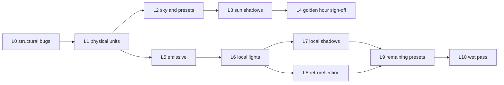
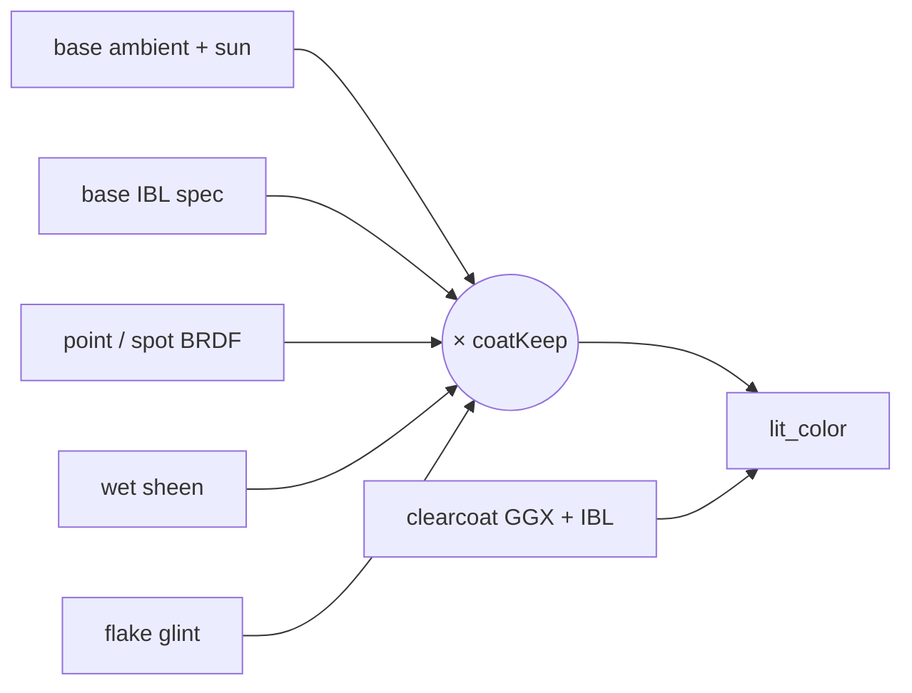
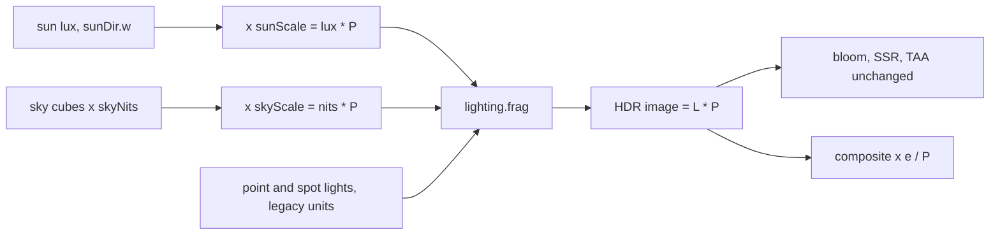
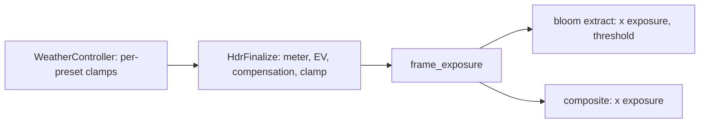
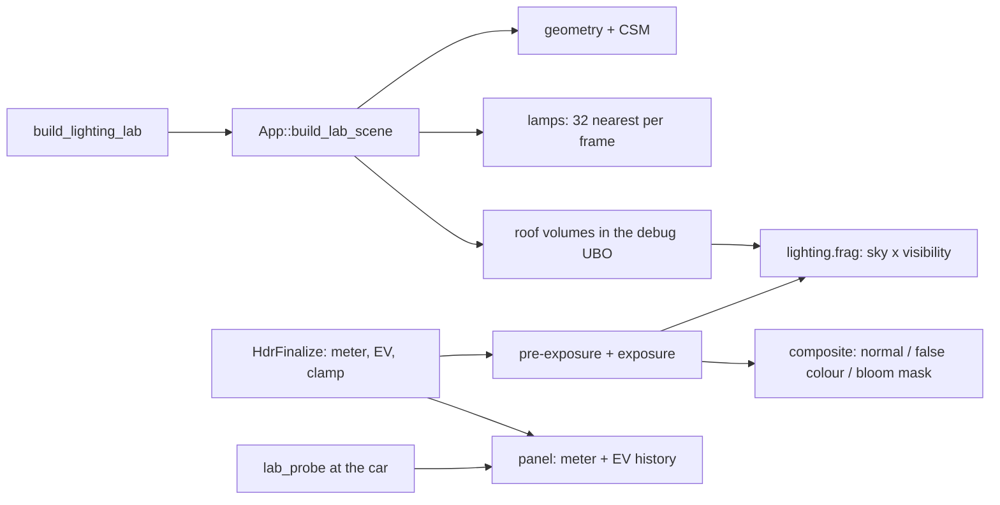
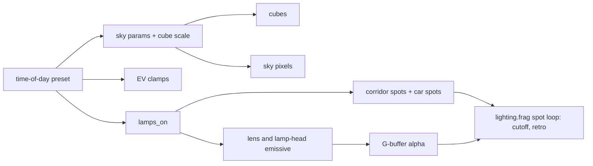
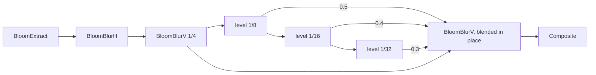
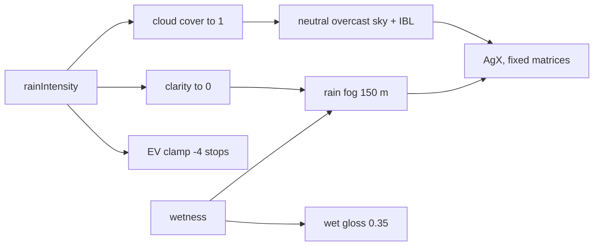
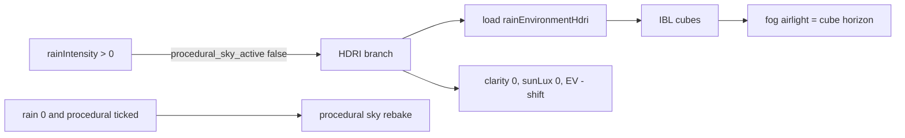

# Changelog — 2026-11

See [CHANGELOG.md](../../CHANGELOG.md) for the index of all entries.

---

### 2026-11-14 — Added the lighting plan, stub headers, hidden tests and a chapter per phase

Planned the lighting work as 11 phases (L0 to L10) and scaffolded it for the owner to implement: four stub headers, one preset config, 26 hidden tests and a short tutorial chapter per phase. No shader or app source changed, so release output is unchanged. *Largely AI-generated (Claude); owner review pending.*

Technical summary

**Motivation.** A survey of the lighting code found three blockers for realistic time-of-day lighting: the driven corridor has no street lamps (placement exists only in the retired road), the renderer has no emissive channel, and car lights compile only under `SWISH_DEBUG_UI`. It also found structural shader bugs, the largest being sun colour added to the unshadowed ambient term in [shaders/lighting.frag](../../shaders/lighting.frag). Light intensities are arbitrary numbers and exposure is a fixed 1.55, which cannot cover noon to midnight.

**Decisions** (two grilling rounds, recorded in [tasks/todo.md](../../tasks/todo.md)): six selectable presets (dawn, morning, noon, golden hour, evening, midnight), golden hour signed off first; procedural Hillaire sky with an IBL rebake on switch; physical units with EV100 auto-exposure; headlights, tail and brake lights, sodium street lamps and retroreflective markings at night; shadows for the headlights and the nearest 2 to 4 lamps; emissive as one scalar in a free G-buffer alpha; dry road first, wet pass last; features leave the debug gate phase by phase.

**Approach.** The owner writes the production code. Each stub has final signatures and a `TODO(learning Lx)` body that returns a placeholder; hidden Catch2 tests (`[.learning][lighting]`) define when it is done. GLSL lives only in the chapters, so the 33 `.spv` goldens do not move. Nothing in the app includes the new headers.

The unit model the stubs and chapters share:

$$\text{exposure} = \frac{1}{1.2 \cdot 2^{EV_{100}}} \qquad EV_{100} = \log_2\!\left(\frac{L \cdot 100}{12.5}\right) \qquad I_{\text{point}} = \frac{\Phi}{4\pi} \qquad I_{\text{spot}} = \frac{\Phi}{\pi} \qquad E = \frac{I}{d_m^2}$$

with $L$ in cd/m², $\Phi$ in lumens, $I$ in candela, $E$ in lux and $d_m$ the distance in metres (world units divided by `kWuPerMetre`).

| File | Change |
|------|--------|
| [tasks/todo.md](../../tasks/todo.md) | New "Lighting" section: decisions, phases L0 to L10, scaffold pointers. |
| [src/utils/light/Photometry.h](../../src/utils/light/Photometry.h) | New stub: exposure, EV100, lumens to candela, inverse-square in metres, colour temperature, emissive packing. |
| [src/utils/light/ShadowFit.h](../../src/utils/light/ShadowFit.h) | New stub: stable light up vector, texel snapping, cascade bias, shadow-caster choice with hysteresis. |
| [src/scene/TimeOfDay/TimeOfDay.h](../../src/scene/TimeOfDay/TimeOfDay.h) | New stub: preset struct, sun direction from azimuth and elevation, TOML reader. |
| [src/scene/Corridor/CorridorLamps.h](../../src/scene/Corridor/CorridorLamps.h) | New stub: lamp posts along a centre-line polyline. |
| [config/time_of_day.toml](../../config/time_of_day.toml) | New: six preset tables with approximate starting values; not loaded yet. |
| [tests/utils/test_light_Photometry.cpp](../../tests/utils/test_light_Photometry.cpp) | New hidden tests (7 cases). |
| [tests/utils/test_light_ShadowFit.cpp](../../tests/utils/test_light_ShadowFit.cpp) | New hidden tests (9 cases). |
| [tests/test_time_of_day.cpp](../../tests/test_time_of_day.cpp) | New hidden tests (5 cases). |
| [tests/test_corridor_lamps.cpp](../../tests/test_corridor_lamps.cpp) | New hidden tests (5 cases). |
| [tests/CMakeLists.txt](../../tests/CMakeLists.txt), [tests/utils/CMakeLists.txt](../../tests/utils/CMakeLists.txt) | Listed the four new test files. |
| [docs/tutorials/lighting/](../tutorials/lighting/00-index.md) | New: index plus chapters `L00` to `L10`. |
| [docs/README.md](../README.md), [src/utils/README.md](../../src/utils/README.md), [tasks/code_snippets.md](../../tasks/code_snippets.md) | Index rows and snippet notes for the scaffold. |

**Verification.** Release tree: `swish_tests` and `swish_utils_tests` build with 0 warnings; `ctest` 390/390 (hidden tests are not registered). Run explicitly, the hidden tests fail on the placeholder bodies as intended. Compiled against throwaway reference implementations (kept outside the repo), all 26 hidden cases pass, so every test is satisfiable. Not done: the debug-UI tree was not rebuilt, the app was not launched, and the chapters' in-app checklists are for the owner.

### 2026-11-15 — Clearcoat energy, one BRDF LUT, and wetness intent (L0.3–L0.5)

Clearcoat now takes its share of energy from the base layer and uses the same split-sum LUT as the base; the wetness dim on reflections is confirmed as intentional.

Technical summary

**Root cause.** Three independent issues in the car-paint path of [shaders/lighting.frag](../../shaders/lighting.frag):

- L0.3: the base reflection samples [brdfLUT](../../shaders/lighting.frag), but the coat used an analytic fit `envBRDFApprox` (Karis "Mobile"). Two different split-sum approximations on one surface.
- L0.4: the coat is added on top of an unchanged base, so a grazing coat reflects energy the base still spends. The base can exceed 1.0 in total.
- L0.5: the wetness dim (`mix(env, env·(1−0.45·wetness), 0.9·wetness)`) applies to reflections as well as the sky. Reviewed, not a bug: the sky background uses the same dim (`sky * (1 − wetness·0.45)`), so reflected sky matches visible sky.

**Fix.** With Schlick Fresnel at $F_0 = 0.04$ and strength $s$ from `ccFlake.b`:

$$
F_{\text{coat}} = s\,\bigl(0.04 + 0.96\,(1 - N\!\cdot\!V)^5\bigr), \qquad k_{\text{coat}} = 1 - F_{\text{coat}}
$$

Every base-lobe term is multiplied by $k_{\text{coat}}$. The coat's own lobes are added unscaled. When $s = 0$, $k_{\text{coat}} = 1$ exactly, so off-car surfaces keep their previous output.

**Not attenuated (deliberate).** The wet-lamp halos (`kHaloStrength`, `kSpotHalo`) are view-independent glow in the air, not surface reflection, so they stay as they were.

**Golden.** `shaders/lighting.frag` changed, so the release `.spv` hash in `tests/golden/release_spv.sha256` no longer matches. That is an intended behaviour change for car paint. The hash check is a manual `shasum -c` (see `tests/golden/README.md`), not part of `ctest`, and `SWISH_UPDATE_GOLDENS` does not touch it. The golden was not regenerated here; when the lighting phase settles, re-record `release_spv.sha256` on purpose from a release build, with the L0 entries as the reason.

**Verification.** Both variants compile with `glslc` (release and `-DSWISH_DEBUG_UI`), exit 0. Not done: app run and visual check. The owner checks the car paint at a grazing angle, in the wet, and at `clearcoat = 0` (should match the previous build).

| File | Change |
|------|--------|
| [shaders/lighting.frag](../../shaders/lighting.frag) | Removed `envBRDFApprox`; added `coatF`/`coatKeep`; coat IBL uses `brdfLUT`; `coatKeep` on base lobes and flake; wetness intent comment; coat comment rewritten. |
| [tasks/todo.md](../../tasks/todo.md) | L0.3, L0.4, L0.5 ticked with the chosen resolution. |
| [docs/changelog/2026-11.md](2026-11.md) | This entry. |

### 2026-11-15 — Sun intensity, sun sliders, asset metalness, dead sky code (L0.6–L0.10)

Wired `sunDir.w` and the Azimuth/Elevation sliders, made cars read `metallicFactor` from the glTF, deleted the dead analytic sky functions, and traced the release `aoTex` to a primed-white image.

Technical summary

**Root cause / motivation.** Five leftovers from the lighting audit (see [tasks/todo.md](../../tasks/todo.md) L0):

- L0.6: `camera.sunDir.w` was uploaded as 1.0 and never read, so L1 had nothing to drive.
- L0.7: `DebugParams::sunAzimuth/sunElevation` had sliders but nothing read them; only the gizmo moved the sun.
- L0.8: release `composite.frag` does `hdr *= texture(aoTex)` with no SSAO pass in release.
- L0.9: `SceneGeometry` set metalness to 1 only for `MAT_METAL`, so chrome and wheels in a GLB shaded as dielectric.
- L0.10: `compute_sky_color` / `skyIrradiance` in `lighting.frag` had no callers (ambient comes from the baked irradiance cube).

**Fix.**

- L0.6: $L_{\text{sun}} = \text{sunColor}_{rgb} \cdot \text{sunDir}_w$. The C++ side still sends $w = 1$, so output is unchanged until L1.
- L0.7: with no gizmo, `WeatherController::apply_debug` sets the direction from the sliders. With azimuth $\phi$ and elevation $\theta$ (radians, $\phi = 0$ is $+Z$):

$$
\hat{s} = (\cos\theta \sin\phi,\ \sin\theta,\ \cos\theta \cos\phi)
$$

  `sun_dir_from_az_el` (the L0.7 learning stub) is implemented and its test is no longer hidden. Slider defaults are $\phi = \operatorname{atan2}(0.3, 0.15) = 1.1071$ and $\theta = \arcsin(0.6/\lVert(0.3, 0.6, 0.15)\rVert) = 1.0611$, the angles of the shipped sun, so untouched sliders keep the old direction. Debug builds only.
- L0.8: no change. `PostProcessManager::primeAOTexture` clears the AO blur image to white once, so the multiply is by exactly 1.0. L4.5 decides whether to promote SSAO or drop the multiply.
- L0.9: `ModelManager` stores `clamp(metallicFactor, 0, 1)` in `Submesh::metalness`; `CarEntity` / `ModelEntity` copy it to `DrawCall::metalness`; `SceneGeometry` pushes it as `material.x`. A negative value (non-glTF geometry) keeps the old rule. The debug `MaterialOverride` still wins.
- L0.10: both functions deleted. The `SP_SKY_*` and `SP_SUN_DISC_*` macros stay because the L2 sky-model decision may reuse them.

**Visual risk (owner check).** Porsche body paint has `metallicFactor = 0`, so the paint is unchanged. But the cabin materials carry 0.35 to 0.63 and the wheel 0.83. Those used to render as dielectric; now the cabin loses roughly that share of its diffuse and gains reflection. If the cabin looks too dark or too shiny, that is the asset's data, and the fix is per-material in the asset or an override, not in this code. Cars that omit the factor get the glTF default of 1.0 (for example the Charger chrome slots).

**Verification.** `make test`: 391/391, `make test-debug`: 416/416, 0 warnings in both. Both `lighting.frag` variants compile with `glslc`. `release_spv.sha256`: `lighting.frag.spv` no longer matches (intended; the other 32 match). That golden is a manual `shasum` check, not part of `ctest`, and was not regenerated. Not done: the app was not run. `make format-check` and `make check` report only failures that predate this change (`goals.md` in the repo root, `.obsidian/workspace.json` tracked but ignored, 32 unformatted files); the lines touched here are clean.

| File | Change |
|------|--------|
| [shaders/lighting.frag](../../shaders/lighting.frag) | `sun_radiance` scaled by `sunDir.w`; deleted `compute_sky_color` and `skyIrradiance`. |
| [shaders/ibl_sky.frag](../../shaders/ibl_sky.frag) | Two comments no longer point at the deleted function. |
| [src/scene/SceneTypes.h](../../src/scene/SceneTypes.h) | `metalness` field on `Submesh` and `DrawCall` (default -1 = none). |
| [src/scene/ModelManager/ModelManager.cpp](../../src/scene/ModelManager/ModelManager.cpp) | Read `metallicFactor` into `Submesh::metalness` for car materials. |
| [src/scene/Entity/Entity.cpp](../../src/scene/Entity/Entity.cpp), [src/scene/Entity/CarEntity.cpp](../../src/scene/Entity/CarEntity.cpp) | Copy `metalness` into the opaque draw calls. |
| [src/renderer/SceneGeometry/SceneGeometry.cpp](../../src/renderer/SceneGeometry/SceneGeometry.cpp) | Push the asset metalness, else the per-material default. |
| [src/scene/TimeOfDay/TimeOfDay.h](../../src/scene/TimeOfDay/TimeOfDay.h) | Implemented `sun_dir_from_az_el`; header comment updated. |
| [src/renderer/WeatherController/WeatherController.cpp](../../src/renderer/WeatherController/WeatherController.cpp) | Debug build: sun direction from the sliders when no gizmo. |
| [src/debug/DebugParams.h](../../src/debug/DebugParams.h) | Slider defaults set to the shipped sun's angles. |
| [tests/test_time_of_day.cpp](../../tests/test_time_of_day.cpp) | L0 sun-direction test un-hidden (`.learning` tag dropped). |
| [docs/concepts.md](../concepts.md) | Split-sum IBL row now describes the baked cubes and LUT. |
| [tasks/todo.md](../../tasks/todo.md) | L0.6 to L0.10 ticked with findings. |

### 2026-11-15 — Padded the composite push-constant block to 64 bytes (L0.11)

Padded the `composite.frag` push block from 52 to 64 bytes so it matches the host struct, and pinned the layout with `offsetof` asserts.

Technical summary

**Root cause.** The shader's `Params` block in [shaders/composite.frag](../../shaders/composite.frag) was 13 floats, 52 B, not a 16-byte multiple (MoltenVK rule). The host struct `PostProcessParams` was already padded to 64 B, so the pushed range was safe, but the shader and host layouts differed in size and nothing checked that they agree.

**Measured.** `spirv-dis build/shaders/composite.frag.spv | grep "MemberDecorate %Params"` gave `tint` at offset 48 (block end $48 + 4 = 52$). After the change the last member, `_pad5`, is at offset 60, so the block is $60 + 4 = 64$ B.

**Fix.** Added `_pad3`, `_pad4`, `_pad5` after `tint` in the shader. Added `static_assert(offsetof(...))` in [PostProcessManager.h](../../src/renderer/PostProcessManager/PostProcessManager.h) for `texel_x` (16), `fog_density` (24), `brightness` (32), `tint` (48) and `_pad5` (60), so a reordered member fails at compile time. Updated the stale host comment. The new pads are never read, so output is unchanged.

`bloom_extract.frag` (12 B) and `bloom_blur.frag` (32 B) share the same 64 B range and were left alone; they are harmless because the range is larger than their blocks.

**Verification.** `make test`: 391/391, `make test-debug`: 416/416, 0 warnings in both. Re-measured offsets as above. `release_spv.sha256`: `composite.frag.spv` and `lighting.frag.spv` no longer match (intended; not re-recorded; that check is a manual `shasum -c`). Not done: the app was not run; owner confirms the frame looks the same.

| File | Change |
|------|--------|
| [shaders/composite.frag](../../shaders/composite.frag) | Added `_pad3`..`_pad5` to the push block (52 to 64 B). |
| [src/renderer/PostProcessManager/PostProcessManager.h](../../src/renderer/PostProcessManager/PostProcessManager.h) | `offsetof` asserts, `<cstddef>` include, comments updated. |
| [tasks/todo.md](../../tasks/todo.md) | L0.11 ticked. |

### 2026-11-15 — Re-recorded the release shader hashes for L0.3 to L0.11

Re-recorded `composite.frag.spv` and `lighting.frag.spv` in the release shader golden after the intended L0 shader changes.

Technical summary

**Why.** The L0 entries above changed [shaders/lighting.frag](../../shaders/lighting.frag) (L0.3 to L0.10) and [shaders/composite.frag](../../shaders/composite.frag) (L0.11) on purpose, so their `.spv` hashes no longer matched.

**What.** Re-recorded only those two lines in [tests/golden/release_spv.sha256](../../tests/golden/release_spv.sha256), from a release build (`SWISH_DEBUG_UI=OFF`, SDK `glslc` 1.4.321.0). The other 31 hashes were unchanged and still match. `shasum -a 256 -c` now reports 33 of 33 OK. `SWISH_UPDATE_GOLDENS` is not involved; this file is a manual check.

| File | Change |
|------|--------|
| [tests/golden/release_spv.sha256](../../tests/golden/release_spv.sha256) | Two lines re-recorded (`composite.frag.spv`, `lighting.frag.spv`). |

### 2026-11-15 — Physical sun and sky with a fixed pre-exposure (L1.1 to L1.3)

Moved the sun to 100,000 lux and the sky to a nits scale, and put a fixed pre-exposure between the lights and the half-float HDR target, so the frame is unchanged and nothing overflows.

Technical summary

**Motivation.** The sun was 1.0, the ambient 0.42 and the composite exposure a magic 1.55. L1 gives each a unit. A noon sun is 100,000 lux, but the HDR target is `R16G16B16A16_SFLOAT`, whose largest finite value is 65,504, and bloom thresholds the raw image (1.77). Feeding physical values straight in would overflow and make the whole frame bloom.

**Approach.** Every light is multiplied by a pre-exposure $P$ where it is defined in `lighting.frag`, so the HDR image holds $L \cdot P$. The composite multiplies by $e / P$ to undo it:

$$
\text{HDR} = L \cdot P, \qquad \text{display} = \text{HDR} \cdot \frac{e}{P} = L \cdot e
$$

With $P = 10^{-5}$ and sun $= 10^5$ lux, one old scene unit is exactly one HDR unit, so the shipped frame is identical. The shipped EV100 that reproduces the old composite exposure of 1.55:

$$
EV_{100} = -\log_2(1.2 \cdot 1.55 \cdot P) = -\log_2(1.86\times10^{-5}) \approx 15.7144
$$

That is a real noon value now. Auto-exposure divides the metered HDR luminance by $P$ before the EV formula, and `evCompensation = 1.53` stops reproduces the old `aeKey` of 0.30, because $\log_2(0.30/0.104) \approx 1.53$.

**What did not move.** Point and spot lights, wet halos and the fog colour stay in the old unit scale, which is exactly the pre-exposed scale, so they need no change until L1.4 and L1.5. The ambient gain 0.42 stays: it scales diffuse sky only, and dropping it would brighten the frame.

**Review fixes found on the way.** The L1.1 edit had deleted the shipped grade (`contrast` 1.12, `saturation` 1.2, `brightness` 0) from `CompositePass.cpp`, so release would have lost it; restored. The L1.2 edit referenced `ul::`, `evCompensation`, `evMin` and `evMax` that did not exist, so the debug build could not compile; added. `WeatherController.cpp` had been half renamed to snake_case; restored to the project's camelCase.

**Verification.** `make test`: 396/396 and `make test-debug`: 421/421, 0 warnings in both. Three L1 tests un-hidden, two added for the pre-exposure identity. `lighting.frag` compiles in both variants. `lighting.frag.spv` re-recorded in `release_spv.sha256` (33 of 33 OK). Not done: the app was not run; the owner confirms the frame looks the same.

| File | Change |
|------|--------|
| [src/utils/light/Photometry.h](../../src/utils/light/Photometry.h) | `kLegacyUnitLux`, `kPreExposure`, `hdr_exposure_from_ev100`; `<algorithm>`; dropped stale `[[maybe_unused]]`. |
| [src/renderer/WeatherController/WeatherController.cpp](../../src/renderer/WeatherController/WeatherController.cpp), [.h](../../src/renderer/WeatherController/WeatherController.h) | `Look` gains `sunLux`, `skyNits`; `m_sunLux`, `m_skyNits`; both `set_weather` calls pass them. |
| [src/renderer/CameraUniforms/CameraUniforms.cpp](../../src/renderer/CameraUniforms/CameraUniforms.cpp), [.h](../../src/renderer/CameraUniforms/CameraUniforms.h) | `set_weather` takes sky nits and pre-exposure; written to `weather.yz`. |
| [shaders/lighting.frag](../../shaders/lighting.frag) | `sunScale`, `skyScale`; applied to the sun, irradiance, prefiltered env (base, clearcoat, haze) and the sky background. |
| [shaders/common/camera.glsl](../../shaders/common/camera.glsl), [src/scene/SceneTypes.h](../../src/scene/SceneTypes.h), [docs/data-types.md](../data-types.md) | Comments: `sunDir.w` is lux, `weather.yz` are sky nits and pre-exposure. |
| [src/renderer/Passes/CompositePass.cpp](../../src/renderer/Passes/CompositePass.cpp) | Shipped EV100 15.7144 through `hdr_exposure_from_ev100`; grade lines restored. |
| [src/renderer/Passes/HdrFinalizePass.cpp](../../src/renderer/Passes/HdrFinalizePass.cpp) | Auto-exposure meters `lum / kPreExposure`, publishes the composite multiplier. |
| [src/debug/DebugParams.h](../../src/debug/DebugParams.h) | `evCompensation`, `evMin`, `evMax`. |
| [tests/utils/test_light_Photometry.cpp](../../tests/utils/test_light_Photometry.cpp) | Three L1 tests un-hidden, two pre-exposure tests added. |
| [tests/golden/release_spv.sha256](../../tests/golden/release_spv.sha256) | `lighting.frag.spv` re-recorded. |
| [tasks/todo.md](../../tasks/todo.md) | L1.3 ticked; L1.2 annotated as half done. |

### 2026-11-15 — Auto-exposure in release, lumens and metres for local lights, bloom in exposed space (L1.2, L1.4 to L1.6)

Finished chapter L1: auto-exposure now runs in release with per-preset EV100 clamps, street lamps and car lights are in lumens with an inverse-square falloff in metres, and bloom thresholds the exposed image. Fixed the sign of `evCompensation`.

Technical summary

**Motivation.** After L1.3 the sun and sky were physical, but exposure was a fixed number, the local lights were still unitless, and bloom looked at the unexposed image. This entry makes every light and the exposure physical, and documents the result in [docs/lighting-l1.md](../lighting-l1.md).

**L1.2 (auto-exposure in release).** `HdrFinalizePass` no longer hides the luminance pyramid and the CPU adaptation behind `SWISH_DEBUG_UI`. `DebugParams::autoExposure` defaults to `true`, and release reads those defaults. Metering divides the adapted HDR luminance by the pre-exposure $P$, then

$$
EV_{100} = \operatorname{clamp}\!\Bigl(\log_2\tfrac{100\,L}{12.5} - c,\ EV_{\min},\ EV_{\max}\Bigr), \qquad e_{\text{composite}} = \frac{1}{1.2\cdot 2^{EV_{100}}\,P}
$$

The clamps are per weather preset (PartlyCloudy 13.5 to 17.5, Cloudy 13 to 17, VeryCloudy 12.5 to 17, GoldenHour 12 to 16.5), owned by `WeatherController` and carried to the pass in `FrameState`. The old `aeKey`, `aeMin` and `aeMax` are removed (UI, TOML, round-trip test) and replaced by `evCompensation`, `evMin`, `evMax`.

**Sign fix.** Compensation was added to the metered EV, which darkens. A positive value must brighten, so it is subtracted. With $c = \log_2(0.30/0.104) \approx 1.53$ this reproduces the old `aeKey = 0.30` look. The L1.2 guide and the artifact had the same error and are corrected.

**L1.4 and L1.5 (local lights).** `point_candela_from_lumens`, `spot_candela_from_lumens` and `inverse_square_m` are implemented, and a `cone_candela_from_lumens` alternative was added. The street lamp is 16,000 lm, which is $16000/4\pi \approx 1273$ cd. The car lights are `headLumens` 1,200, `tailLumens` 20, `brakeLumens` 300. In `lighting.frag` the point and spot illuminance is

$$
E = \frac{I\cos\theta}{d_m^{2}}\,w(d), \qquad d_m = d_{\mathrm{WU}}\cdot\texttt{weather.w}
$$

with $w(d) = \operatorname{clamp}(1 - (d/R)^4)^2$ and `weather.w = util::units::to_m(1.0f)`, so GLSL never types 1000. A 16,000 lm lamp on a 30 ft pole gives about 15 lux under it, which a test pins to the 10 to 30 lux range of real roads. The wet halo is an art effect, so it keeps its old bounded shape and reach; `kHaloPerCd` maps 1,273 cd back to the old gain of 5.0.

**L1.6 (bloom).** `bloom_extract.frag` multiplies by the exposure before the threshold and keeps its output in raw units, because the composite adds bloom first and multiplies by exposure after, so the intensity needs no retune. The threshold moves to exposed space: $\tau' = 1.77 \times 1.55 \approx 2.74$, which keeps the old look. `frame_exposure` in the new [Exposure.h](../../src/renderer/Passes/Exposure.h) is the one number both passes use.

**Look changes to expect.** (1) Auto-exposure replaces the fixed 1.55, so the frame adapts when the view changes. (2) Street lamps and headlights are physically dim next to a 100,000 lux sun, so their direct light is nearly invisible by day; they return at dusk and night once L2 adds those presets. The wet-lamp halos were kept visible on purpose. Neither is visible as a regression in the unit tests; both need the owner check.

**Goldens.** `tests/golden/road_mesh.txt`: only `generate.light_hash` changed, because the lamp intensity is now 1,273 cd instead of 5.0. All 60 geometry assertions passed untouched. Re-recorded on purpose with `SWISH_UPDATE_GOLDENS=1` for that one test. `release_spv.sha256`: `lighting.frag.spv` and `bloom_extract.frag.spv` re-recorded (33 of 33 OK).

**Verification.** `make test`: 400/400 and `make test-debug`: 425/425, 0 warnings in both. Un-hidden `L1: lumens to candela` and `L1: inverse-square falloff works in metres`; added tests for the cone rule (equal to Frostbite at 60 degrees, about 1,631 cd at 28) and the street-lamp illuminance. Both `lighting.frag` variants compile with `glslc`. Not done: the app was not run.

| File | Change |
|------|--------|
| [src/utils/light/Photometry.h](../../src/utils/light/Photometry.h) | Implemented the L1.4 and L1.5 functions; added `cone_candela_from_lumens`. |
| [src/renderer/Passes/Exposure.h](../../src/renderer/Passes/Exposure.h) | New: `kShippedEv100` and `frame_exposure`. |
| [src/renderer/Passes/HdrFinalizePass.cpp](../../src/renderer/Passes/HdrFinalizePass.cpp) | Auto-exposure in both builds; compensation subtracted; clamps from `FrameState`; starts at the shipped exposure. |
| [src/renderer/Passes/IRenderPass.h](../../src/renderer/Passes/IRenderPass.h), [src/renderer/Renderer/Renderer_Frame.cpp](../../src/renderer/Renderer/Renderer_Frame.cpp) | `FrameState::evMin/evMax`, filled from the weather each frame. |
| [src/renderer/WeatherController/WeatherController.cpp](../../src/renderer/WeatherController/WeatherController.cpp), [.h](../../src/renderer/WeatherController/WeatherController.h) | Per-preset `evMin/evMax`, getters, mirrored to the debug panel. |
| [src/renderer/Passes/CompositePass.cpp](../../src/renderer/Passes/CompositePass.cpp), [BloomPasses.cpp](../../src/renderer/Passes/BloomPasses.cpp) | Both read `frame_exposure`; bloom threshold 2.74. |
| [shaders/lighting.frag](../../shaders/lighting.frag) | Candela and metres for point and spot lights; halo keeps its own shape; `kMinLocalHdr`, `kHaloPerCd`. |
| [shaders/bloom_extract.frag](../../shaders/bloom_extract.frag) | Threshold on exposed luminance. |
| [src/renderer/CameraUniforms/CameraUniforms.cpp](../../src/renderer/CameraUniforms/CameraUniforms.cpp), [shaders/common/camera.glsl](../../shaders/common/camera.glsl), [src/scene/SceneTypes.h](../../src/scene/SceneTypes.h) | `weather.w` = metres per WU. |
| [src/scene/RoadScene/RoadScene_Furniture.cpp](../../src/scene/RoadScene/RoadScene_Furniture.cpp) | Street lamp in lumens (`lamp_lumens` 16,000). |
| [src/scene/Entity/CarLights.h](../../src/scene/Entity/CarLights.h), [src/core/App/App.cpp](../../src/core/App/App.cpp), [src/debug/Tunables.def](../../src/debug/Tunables.def) | Car lights in lumens; keys `head_lumens`, `tail_lumens`, `brake_lumens`. |
| [src/debug/DebugParams.h](../../src/debug/DebugParams.h), [DebugUI.cpp](../../src/debug/DebugUI.cpp), [DebugParamsIO.cpp](../../src/debug/DebugParamsIO.cpp) | `autoExposure` default on; `ae*` replaced by `evCompensation`, `evMin`, `evMax`; `bloomThreshold` 2.74. |
| [tests/utils/test_light_Photometry.cpp](../../tests/utils/test_light_Photometry.cpp), [tests/test_car_lights.cpp](../../tests/test_car_lights.cpp), [tests/test_debug_params_io.cpp](../../tests/test_debug_params_io.cpp) | Un-hidden and new tests; renamed fields. |
| [tests/golden/road_mesh.txt](../../tests/golden/road_mesh.txt), [tests/golden/release_spv.sha256](../../tests/golden/release_spv.sha256) | One light hash and two shader hashes re-recorded. |
| [docs/lighting-l1.md](../lighting-l1.md), [docs/README.md](../README.md), [tasks/todo.md](../../tasks/todo.md) | New as-built guide and index row; L1.2 and L1.4 to L1.6 ticked; guide snippets match the code. |

### 2026-11-15 — Lighting lab: a debug test world with tunnels, overpasses, lamps and a calibration lot

Added a debug-only lighting test world (`SWISH_LAB=1 make debug`) with sky occlusion under roofs, an adaptive pre-exposure for dusk and night, and live read-outs, so the L1 lighting can be watched working.

Technical summary

**Motivation.** The LIE corridor has no tunnel, no overpass and no street lamps, so auto-exposure, the EV clamps, lumens-based lamps and the bloom change from L1 had nothing to react to. The plan was agreed in an interview and is recorded in [tasks/todo.md](../../tasks/todo.md) under "Lighting lab". Reference: [docs/lighting-lab.md](../lighting-lab.md).

**The world.** [LightingLab.cpp](../../src/scene/LightingLab/LightingLab.cpp) builds, with no Vulkan, a paved box 3.2 km on a side with a wall, five lanes along -Z, two 400 m tunnels (unlit, and lit by a 12,000 lm luminaire every 12.5 m), four overpasses 10/20/40/80 m wide, a 600 m stretch of 16,000 lm street lamps every 40 m, and a calibration lot with reflectance cards (0.90, 0.18, 0.03), a matte and a metal ball and one lamp. `App::build_lab_scene` uploads it. The car is clamped 3 m inside the wall.

**Sky visibility.** Only the sun is shadow-mapped; sky ambient and reflections ignored geometry, so a tunnel stayed bright. Up to 8 roof volumes (boxes open along one axis) are appended to the debug scene-params UBO. Inside a box, with $d$ the distance to the nearer open end and $f$ the fade length,

$$
\text{vis} = \operatorname{mix}\bigl(1,\ \text{floor},\ \operatorname{smoothstep}(0, f, d)\bigr)
$$

multiplies the sky irradiance and both environment reflections. The same function is on the CPU in [SkyVisibility.h](../../src/utils/light/SkyVisibility.h).

**Adaptive pre-exposure.** A fixed $P = 10^{-5}$ puts a 0.5 nit night road at $5\times10^{-6}$ in a half-float target. With `adaptivePreExposure` on (the lab turns it on; default off, so release is unaffected),

$$
P = \frac{1}{1.2\cdot 2^{EV_{100}}\cdot 1.55} \quad\Rightarrow\quad \frac{e}{P} = 1.55
$$

so the composite multiplier is constant and the adaptation lives in $P$. `HdrFinalizePass` now adapts in cd/m² and undoes the pre-exposure each frame slot was shaded with; the Renderer hands `FrameState::preExposure` to the camera UBO every frame.

**Panel ("Lighting lab").** Teleport per station; Day / Dusk / Night (100,000 / 400 / 0.3 for sun lux and sky scale, with matching EV clamps); log sliders for sun lux and sky scale; composite views (false colour by exposed value, bloom mask) carried in the first padding lane of the composite push block; an exposure meter with a history plot; and the light under the car (sky visibility, lamp lux).

**Other changes.** The glass sun glint now scales with the sun's lux and the pre-exposure, so it dims at dusk and night. `CarEntity::halt()` stops the car for a teleport.

**Changed from the plan.** The lit tunnel was specified with a lamp every 25 m. A test showed about 2 lux between lamps there, so it is 12,000 lm every 12.5 m (about 19 to 33 lux).

**Known limits.** TAA history lags one frame in brightness while the exposure moves. Windshield rain, the wet-lamp halos and the rain-fog colour are still in the fixed scale, so they are too bright at dusk and night. The probe's sun figure is unshadowed and read from the Elevation slider. Roof volumes are hand-placed.

**Verification.** `make test`: 411/411, `make test-debug`: 436/436, 0 warnings in both. New tests: sky visibility (4 cases), the lab world (6 cases), adaptive pre-exposure (1 case). `lighting.frag`, `composite.frag` and `glass.frag` compile in both variants. `lighting.frag.spv` and `glass.frag.spv` re-recorded (33 of 33 OK); `composite.frag.spv` is unchanged in release.

**Not done: the app was not run.** Owner check list:

1. `SWISH_LAB=1 make debug` starts in the paved box, car at the origin facing the lanes; a normal `make debug` and `make run` are unchanged.
2. Geometry: tunnels, decks, lamp poles, cards and balls are solid from every side (no missing or inside-out faces) and cast sun shadows.
3. Teleport to each station works and the car is stopped.
4. Unlit tunnel: it is dark inside (walls, road and the car), the meter's EV drops, and the image brightens over a second or two; at the exit there is a short flash, then recovery. "Sky visibility" in the panel falls to about 0.02.
5. Overpasses: the 10 m deck only dims; the 80 m deck goes dark. The EV history plot shows the dips.
6. Lit tunnel and, after pressing Night, the lamp stretch: pools of light on the road, "Lamps" reading about 15 to 33 lux under a lamp, bloom on the lamp heads only.
7. Night: no banding or crushed blacks with adaptive pre-exposure on; turn it off to see why it is needed.
8. False colour: sunlit road mostly grey and green, sky yellow or red where it clips. Bloom mask: only lamps and the sun.
9. The wall holds the car at the edge of the box.

| File | Change |
|------|--------|
| [src/scene/LightingLab/LightingLab.h](../../src/scene/LightingLab/LightingLab.h), [.cpp](../../src/scene/LightingLab/LightingLab.cpp) | New: the lab world, stations, wall clamp, light probe. |
| [src/utils/light/SkyVisibility.h](../../src/utils/light/SkyVisibility.h) | New: roof volumes and the visibility function. |
| [src/utils/light/Photometry.h](../../src/utils/light/Photometry.h) | `pre_exposure_for_ev100`, `kShippedHdrExposure`; `hdr_exposure_from_ev100` takes the pre-exposure. |
| [src/renderer/Passes/HdrFinalizePass.cpp](../../src/renderer/Passes/HdrFinalizePass.cpp), [IRenderPass.h](../../src/renderer/Passes/IRenderPass.h) | Adapts in cd/m²; per-slot pre-exposure; publishes pre-exposure and the meter read-out. |
| [src/renderer/Renderer/Renderer_Frame.cpp](../../src/renderer/Renderer/Renderer_Frame.cpp), [src/renderer/CameraUniforms/CameraUniforms.h](../../src/renderer/CameraUniforms/CameraUniforms.h) | Per-frame `set_pre_exposure`; meter copied to the debug params. |
| [src/renderer/WeatherController/WeatherController.cpp](../../src/renderer/WeatherController/WeatherController.cpp) | Sun lux and sky scale mirrored to, and read from, the debug params. |
| [src/renderer/Passes/CompositePass.cpp](../../src/renderer/Passes/CompositePass.cpp), [shaders/composite.frag](../../shaders/composite.frag) | Debug views: false colour, bloom mask. |
| [shaders/lighting.frag](../../shaders/lighting.frag), [src/debug/SceneParamsUniform.h](../../src/debug/SceneParamsUniform.h), [.cpp](../../src/debug/SceneParamsUniform.cpp) | Roof-volume rows and the sky-visibility term (debug). |
| [shaders/glass.frag](../../shaders/glass.frag) | Sun glint scaled by lux and pre-exposure. |
| [src/debug/DebugParams.h](../../src/debug/DebugParams.h), [DebugUI.cpp](../../src/debug/DebugUI.cpp) | Lab fields and the "Lighting lab" panel. |
| [src/core/App/App.h](../../src/core/App/App.h), [App.cpp](../../src/core/App/App.cpp), [AppInit.cpp](../../src/core/App/AppInit.cpp) | `SWISH_LAB`, `build_lab_scene`, wall clamp, teleport, probe. |
| [src/scene/Entity/CarEntity.h](../../src/scene/Entity/CarEntity.h) | `halt()`. |
| [CMakeLists.txt](../../CMakeLists.txt), [tests/CMakeLists.txt](../../tests/CMakeLists.txt), [tests/utils/CMakeLists.txt](../../tests/utils/CMakeLists.txt) | Lab source in the test library; two new test files. |
| [tests/test_lighting_lab.cpp](../../tests/test_lighting_lab.cpp), [tests/utils/test_light_SkyVisibility.cpp](../../tests/utils/test_light_SkyVisibility.cpp), [tests/utils/test_light_Photometry.cpp](../../tests/utils/test_light_Photometry.cpp) | New tests. |
| [tests/golden/release_spv.sha256](../../tests/golden/release_spv.sha256) | Two shader hashes re-recorded. |
| [docs/lighting-lab.md](../lighting-lab.md), [docs/README.md](../README.md), [docs/lighting-l1.md](../lighting-l1.md), [tasks/todo.md](../../tasks/todo.md) | New guide, index row, L1 recipe E updated, lab section marked built. |

### 2026-11-15 — Lighting L2 to L10, debug first: procedural sky, time of day, shadows, emissive, corridor lamps, retroreflection

Built lighting chapters L2 to L10 behind the debug build: a raymarched sky with six time-of-day presets, sun-shadow fixes, energy compensation, paint flakes, emissive lenses and lamp heads, street lamps on the corridor, a low-beam cutoff and retroreflective lane markings. `make run` is unchanged.

Technical summary

**Scope and rule.** Decided in an interview recorded in [tasks/todo.md](../../tasks/todo.md): everything in one run, **debug first** (on in `make debug`, off in `make run`), and four items left out (L7 lamp shadows, L8.3 signs, L9.4 mesopic, L10.2 lens rain and layered wet BRDF). Reference: [docs/lighting-l2-l10.md](../lighting-l2-l10.md). `DebugParams` defaults use the new `kDebugBuild`, and the shader code is under `#ifdef SWISH_DEBUG_UI`. Of the 33 release shaders only `ibl_sky.frag.spv` changed.

**L2, the sky.** Single scattering of Rayleigh, Mie and ozone, marched along the view ray with a planet-shadow test, so it stays correct with the sun below the horizon:

$$
L(\mathbf{v}) = E_{\text{toa}} \int_0^{d} T(\mathbf{o}\to\mathbf{x})\,T(\mathbf{x}\to\text{sun})\,\bigl[\beta_R\,\rho_R\,p_R(\mu) + \beta_M\,\rho_M\,p_M(\mu)\bigr]\,ds
$$

The same model exists in [atmosphere.glsl](../../shaders/common/atmosphere.glsl) and [Atmosphere.h](../../src/utils/light/Atmosphere.h); tests pin the C++ copy (about 111,000 lux of direct sun at 60 degrees, a blue zenith near 1,570 cd/m², a red sunset horizon, under 1 cd/m² overhead at -6 degrees). The cube stores sky nits over a per-bake scale of ten times the zenith luminance, so it stays in half-float range from noon to midnight; that scale is the L1 `skyNits`. Sky pixels evaluate the model directly and add the sun or moon disc and stars. Six presets come from `config/time_of_day.toml` (T key, panel); the weather key becomes cloud cover. At night the moon is the directional light.

**L3, shadows.** A stable light up vector (the old `lookAt` with world up degenerates with the sun at the zenith), the cascade centre snapped to texels, a slope-scaled bias, a cascade blend band, and a physical PCSS penumbra. A cascade is orthographic with depth range $3r$ and texels of $2r/N$, so the radius cancels:

$$
w_{\text{texels}} = \Delta z \cdot 3 \tan\theta_{\text{sun}} \cdot N
$$

**L4, materials.** Multiscatter compensation $1 + F_0\,(1/E - 1)$ with $E$ = `dfg.x + dfg.y` from the split-sum LUT; the wet sheen bounded to the reflection the base lobe did not take; flakes on body paint; a Karis-weighted four-tap bloom extract with weights $1/(1 + Y e)$.

**L5, emissive.** `PushConstantData` gained `extra` (128 B, still within the guaranteed limit): x is the emissive strength, already pre-exposed, written to the normal buffer's alpha; y is the retro flag, written to the albedo buffer's alpha. Lens nodes of the rigged car glow while their lamp is on; lamp heads glow while lamps are on.

**L6 and L8, lamps and retroreflection.** Poles on the corridor median every 60 m with one 2,100 K downward spot each ($I = \Phi / (2\pi(1-\cos 70^\circ)) \approx 7{,}740$ cd for 32,000 lm). The spot limit is 40, the car's lights first and then the nearest lamps. Headlights use the cone rule with an 8 to 16 degree beam and a cutoff above the beam axis. Lane markings are tagged retroreflective and get a $\cos^{64}$ lobe around the light direction in the spot loop.

**Not built, and deviations from the agreed defaults.** The L4.4 bloom mip pyramid (only the Karis extract). The cheaper bake (the irradiance convolution is shared with release). Release promotions L2.2, L3.4, L4.5 and L6.3, and the L4.6 sign-off, stay open by decision.

**Known limits.** No multiple scattering (a 1.2 lift stands in). Every sky change is a synchronous rebake. The debug glass disc is always the physical one. A lens the loader classifies as glass will not glow. Paint is found by material name. Windshield rain and wet halos ignore the time of day.

**Verification.** `make test`: 432/432, `make test-debug`: 457/457, 0 warnings in both. New or un-hidden tests: atmosphere (5), time of day (4), shadow fit (4), corridor lamp posts (5), colour temperature (1), mesh shapes (1), lab emissive (1). All touched shaders compile in both variants. `ibl_sky.frag.spv` re-recorded (33 of 33 OK). **Not done: the app was not run.** The owner check list is at the end of [docs/lighting-l2-l10.md](../lighting-l2-l10.md).

| File | Change |
|------|--------|
| [shaders/common/atmosphere.glsl](../../shaders/common/atmosphere.glsl), [src/utils/light/Atmosphere.h](../../src/utils/light/Atmosphere.h) | New: the sky model in GLSL and C++. |
| [shaders/ibl_sky.frag](../../shaders/ibl_sky.frag), [src/renderer/IBLManager/IBLManager.cpp](../../src/renderer/IBLManager/IBLManager.cpp), [.h](../../src/renderer/IBLManager/IBLManager.h) | Atmosphere bake mode, `bake_atmosphere`. |
| [shaders/lighting.frag](../../shaders/lighting.frag) | Sky pixels, shadow bias / blend / penumbra, energy compensation, sheen bound, emissive, beam cutoff, retro lobe, sky-coloured rain fog (all debug). |
| [shaders/gbuffer.frag](../../shaders/gbuffer.frag), [shaders/glass.frag](../../shaders/glass.frag), [shaders/bloom_extract.frag](../../shaders/bloom_extract.frag), [shaders/common/lights.glsl](../../shaders/common/lights.glsl) | Emissive and retro lanes; physical glass disc; Karis extract; 40 spot slots (debug). |
| [src/renderer/WeatherController/WeatherController.cpp](../../src/renderer/WeatherController/WeatherController.cpp), [.h](../../src/renderer/WeatherController/WeatherController.h) | `apply_procedural_sky`, preset loading, weather as cloud cover. |
| [src/scene/TimeOfDay/TimeOfDay.h](../../src/scene/TimeOfDay/TimeOfDay.h), [src/utils/light/ShadowFit.h](../../src/utils/light/ShadowFit.h), [src/scene/Corridor/CorridorLamps.h](../../src/scene/Corridor/CorridorLamps.h), [src/utils/light/Photometry.h](../../src/utils/light/Photometry.h) | Learning stubs implemented (presets, shadow fit, lamp posts, colour temperature). |
| [src/renderer/GeometryProducer/GeometryProducer.cpp](../../src/renderer/GeometryProducer/GeometryProducer.cpp), [src/renderer/SceneGeometry/SceneGeometry.cpp](../../src/renderer/SceneGeometry/SceneGeometry.cpp), [.h](../../src/renderer/SceneGeometry/SceneGeometry.h) | Stable cascade fit; emissive scale and paint flakes per draw. |
| [src/renderer/CameraUniforms/CameraUniforms.cpp](../../src/renderer/CameraUniforms/CameraUniforms.cpp), [.h](../../src/renderer/CameraUniforms/CameraUniforms.h), [src/renderer/Renderer/Renderer.h](../../src/renderer/Renderer/Renderer.h), [Renderer_State.cpp](../../src/renderer/Renderer/Renderer_State.cpp), [Renderer_Frame.cpp](../../src/renderer/Renderer/Renderer_Frame.cpp) | World spot lights, nearest first; spot counts for the panel. |
| [src/scene/SceneTypes.h](../../src/scene/SceneTypes.h) | `Submesh::is_paint/lens`, `DrawCall::emissiveNits/retro/isPaint`, `PushConstantData::extra`, `MAX_SPOT_LIGHTS` 40, spot `cutoff`. |
| [src/scene/Corridor/CorridorScene.cpp](../../src/scene/Corridor/CorridorScene.cpp), [.h](../../src/scene/Corridor/CorridorScene.h), [CorridorDriver.cpp](../../src/scene/Corridor/CorridorDriver.cpp) | Street lamps (debug), retro tags, lamps handed to the renderer. |
| [src/scene/RoadScene/MeshShapes.h](../../src/scene/RoadScene/MeshShapes.h), [src/scene/LightingLab/LightingLab.cpp](../../src/scene/LightingLab/LightingLab.cpp) | Shared box / ball shapes; glowing lamp heads in the lab. |
| [src/scene/ModelManager/ModelManager.cpp](../../src/scene/ModelManager/ModelManager.cpp), [src/scene/Entity/CarEntity.h](../../src/scene/Entity/CarEntity.h), [CarEntity.cpp](../../src/scene/Entity/CarEntity.cpp), [Entity.cpp](../../src/scene/Entity/Entity.cpp), [CarLights.h](../../src/scene/Entity/CarLights.h) | Paint and lens tags, lens luminance, wettable exterior, beam cutoff and cone rule. |
| [src/debug/DebugParams.h](../../src/debug/DebugParams.h), [DebugUI.cpp](../../src/debug/DebugUI.cpp), [SceneParamsUniform.h](../../src/debug/SceneParamsUniform.h), [.cpp](../../src/debug/SceneParamsUniform.cpp), [Tunables.def](../../src/debug/Tunables.def) | `kDebugBuild`, L2 to L10 controls, two panel sections, sky rows in the debug UBO, tighter default beam. |
| [src/core/App/App.cpp](../../src/core/App/App.cpp), [App.h](../../src/core/App/App.h), [AppInit.cpp](../../src/core/App/AppInit.cpp), [AppInput.cpp](../../src/core/App/AppInput.cpp) | T key, lamps in the corridor build, car lights and lenses per preset. |
| tests: [test_light_Atmosphere.cpp](../../tests/utils/test_light_Atmosphere.cpp), [test_light_ShadowFit.cpp](../../tests/utils/test_light_ShadowFit.cpp), [test_light_Photometry.cpp](../../tests/utils/test_light_Photometry.cpp), [test_time_of_day.cpp](../../tests/test_time_of_day.cpp), [test_corridor_lamps.cpp](../../tests/test_corridor_lamps.cpp), [test_lighting_lab.cpp](../../tests/test_lighting_lab.cpp), [tests/utils/CMakeLists.txt](../../tests/utils/CMakeLists.txt) | New and un-hidden tests. |
| [tests/golden/release_spv.sha256](../../tests/golden/release_spv.sha256) | `ibl_sky.frag.spv` re-recorded. |
| [docs/lighting-l2-l10.md](../lighting-l2-l10.md), [docs/README.md](../README.md), [docs/lighting-lab.md](../lighting-lab.md), [tasks/todo.md](../../tasks/todo.md) | New reference, index row, lab note, chapter ticks. |

### 2026-11-15 — Car showcase: four lab places, rectangle area lights, paint looks, grounding shadow, wet car, bloom pyramid

Added a studio, a parking garage, a gas canopy and a night street to the lighting lab, lit by new rectangle area lights, with a panel for the car's paint, surface and lights (debug builds only; `make run` unchanged).

Technical summary

**Motivation.** The lab could show roads and lamps but had no place for judging the car itself, and the engine had only point and spot lights, so nothing made the broad soft highlights a car's paint is judged by. Reference: [docs/car-showcase.md](../car-showcase.md). Largely AI-generated; not yet run in the app by the owner or the author.

**Approach.**

- **Rectangle lights** ([src/scene/SceneTypes.h](../../src/scene/SceneTypes.h), [shaders/common/lights.glsl](../../shaders/common/lights.glsl), [shaders/lighting.frag](../../shaders/lighting.frag)): up to 16, nearest first, in a debug-only tail of the lights UBO. Diffuse from the rectangle's solid angle, specular and clear coat from a representative point:

$$
E \approx L\,\Omega\,\max(0,\ n\cdot\omega_c)
$$

- **Grounding shadow:** the car as one box (`carBoxCenter`, `carBoxHalf`); five rays per rectangle light from each shaded point.
- **Places** ([src/scene/LightingLab/LightingLab.cpp](../../src/scene/LightingLab/LightingLab.cpp)): 3 + 12 + 8 + 6 = 29 rectangle lights; roof volumes grew from 8 to 12 with closed, one-end and all-sides kinds ([src/utils/light/SkyVisibility.h](../../src/utils/light/SkyVisibility.h)).
- **Car looks** ([src/scene/Entity/CarLooks.h](../../src/scene/Entity/CarLooks.h)): `paint_look` (finish, colour, clean / wet / dusty) through the existing material overrides; `car_material_fix` by material name.
- **Wet car:** a per-draw flag packed into the albedo alpha next to the retroreflection flag; film and beaded drops in the car's frame.
- **Bloom pyramid** ([src/renderer/Passes/BloomPyramidPass.cpp](../../src/renderer/Passes/BloomPyramidPass.cpp), [shaders/bloom_combine.frag](../../shaders/bloom_combine.frag)): three more blur levels blended back with alpha weights, energy preserved:

$$
B = 0.21\,B_0 + 0.21\,B_1 + 0.28\,B_2 + 0.30\,B_3
$$

**Release build.** All shader edits are under `#ifdef SWISH_DEBUG_UI`; the 33 recorded release `.spv` hashes still match. `bloom_combine.frag.spv` is a new file and its hash was added (it is compiled but not loaded in release).

**Verification.** `make test` 438/438, `make test-debug` 463/463, 0 warnings. Not launched.

| File | Change |
|------|--------|
| [src/scene/SceneTypes.h](../../src/scene/SceneTypes.h) | `RectLightData`, `RectLightDesc`, `CarOccluder`, `MAX_RECT_LIGHTS`; `DrawCall::roughnessMul`, `surfaceWet`; `Submesh` fix fields. |
| [shaders/common/lights.glsl](../../shaders/common/lights.glsl) | Debug tail of the lights UBO: rectangle lights and the car box. |
| [shaders/lighting.frag](../../shaders/lighting.frag) | Rectangle-light loop, car-box occlusion, wet car surface and drops, 12 roof volumes (debug). |
| [shaders/gbuffer.frag](../../shaders/gbuffer.frag) | Albedo alpha packs the retro flag or the car-wet amount (debug). |
| [shaders/bloom_combine.frag](../../shaders/bloom_combine.frag) | New: one pyramid level out with its blend weight in alpha. |
| [src/renderer/Passes/BloomPyramidPass.cpp](../../src/renderer/Passes/BloomPyramidPass.cpp), [src/renderer/Passes/PassList.def](../../src/renderer/Passes/PassList.def) | New debug pass after `BloomBlurV`. |
| [src/renderer/CameraUniforms/CameraUniforms.h](../../src/renderer/CameraUniforms/CameraUniforms.h), [CameraUniforms.cpp](../../src/renderer/CameraUniforms/CameraUniforms.cpp) | `set_rect_lights` (nearest first), `set_car_occluder`. |
| [src/renderer/Renderer/Renderer.h](../../src/renderer/Renderer/Renderer.h), [Renderer.cpp](../../src/renderer/Renderer/Renderer.cpp) | Debug entry points for rectangle lights and the car box. |
| [src/renderer/SceneGeometry/SceneGeometry.cpp](../../src/renderer/SceneGeometry/SceneGeometry.cpp) | Pushes the roughness multiplier and the wet flag per draw. |
| [src/scene/LightingLab/LightingLab.h](../../src/scene/LightingLab/LightingLab.h), [LightingLab.cpp](../../src/scene/LightingLab/LightingLab.cpp) | Four places, four stations, `rects`, station time of day. |
| [src/utils/light/SkyVisibility.h](../../src/utils/light/SkyVisibility.h), [src/debug/SceneParamsUniform.h](../../src/debug/SceneParamsUniform.h) | 12 roof volumes; closed, one-end and all-sides kinds. |
| [src/scene/Entity/CarLooks.h](../../src/scene/Entity/CarLooks.h) | New: paint looks and material fixes. |
| [src/scene/Entity/CarEntity.h](../../src/scene/Entity/CarEntity.h), [CarEntity.cpp](../../src/scene/Entity/CarEntity.cpp), [src/scene/ModelManager/ModelManager.cpp](../../src/scene/ModelManager/ModelManager.cpp) | Paint material list, material fixes, wet flag on the car's draws. |
| [src/core/App/App.h](../../src/core/App/App.h), [App.cpp](../../src/core/App/App.cpp), [AppInit.cpp](../../src/core/App/AppInit.cpp) | Upload rectangle lights, car box, turntable camera, car-lights mode, paint look, teleport time of day. |
| [src/debug/DebugParams.h](../../src/debug/DebugParams.h), [src/debug/DebugUI.cpp](../../src/debug/DebugUI.cpp) | Showcase fields and the "Car showcase" panel section. |
| [tests/test_car_looks.cpp](../../tests/test_car_looks.cpp), [tests/test_lighting_lab.cpp](../../tests/test_lighting_lab.cpp), [tests/utils/test_light_SkyVisibility.cpp](../../tests/utils/test_light_SkyVisibility.cpp), [tests/utils/test_renderer_PassRegistry.cpp](../../tests/utils/test_renderer_PassRegistry.cpp), [tests/CMakeLists.txt](../../tests/CMakeLists.txt) | New and extended tests; pinned pass order gains `BloomPyramid`. |
| [tests/golden/release_spv.sha256](../../tests/golden/release_spv.sha256) | One new line for `bloom_combine.frag.spv`. |
| [docs/car-showcase.md](../car-showcase.md), [docs/README.md](../README.md), [docs/lighting-lab.md](../lighting-lab.md), [tasks/todo.md](../../tasks/todo.md), [tasks/upcoming-tests.md](../../tasks/upcoming-tests.md) | New reference, index row, lab stations, plan ticks, owner check list. |

### 2026-11-20 — Rain impact splashes (debug only): crown rings and droplets on the road

Added debug-only rain impact splashes: an expanding crown ring and up to four droplets per splash, drawn from a world-fixed cell grid around the camera, with no buffers and no compute pass.

Technical summary

**Motivation.** Todo A2 (impact splashes) was open. The technique comes from the "burn to Gaussians" effect in `willeastcott/splat-walk`. That repo has no licence, so only the idea was studied and no code was copied. Each instance is a stateless function of a stable hash and a time, its phase weights are packed into one `uint`, and the fragment shader picks its shape from them. Plan and decisions: [tasks/todo.md](../../tasks/todo.md), "Rain impact splashes".

**Approach.** [shaders/rain_splash.vert](../../shaders/rain_splash.vert) snaps a $G \times G$ grid ($G = 64$) to world cells of size $s$ around the camera. Cell $(i, j)$ has hash key $k$. It fires once per period $P$ at offset $h(k)$, with spawn chance $p = \text{intensity} \times \text{density}$ per cycle:

$$t_\text{local} = \operatorname{fract}\!\left(\frac{t}{P} + h(k)\right) P, \qquad r(t_\text{local}) = R\left(1 - e^{-t_\text{local}/\tau}\right)$$

Instance `cell * 5 + sub` is either a ring quad lying flat on the road plane ($sub = 0$) or a droplet billboard ($sub = 1..4$). A droplet follows $\mathbf{x}(t) = \mathbf{c} + \tfrac12 v_0 t\,\hat{\mathbf{d}} + (v_0 t - \tfrac12 g t^2)\,\hat{\mathbf{y}}$ and is culled once it lands. [shaders/rain_splash.frag](../../shaders/rain_splash.frag) unpacks `(ring, dot, fade, variation)`. It draws a `fwidth`-anti-aliased band at $|uv| = 0.85$, which fades out when sub-pixel, or a soft-edged disc. Droplets are weighted 0.35 (`kDropWeight`): at full weight they read as white hail specks in the app, and the crown ring is what reads as a splash. Additive, in rain.frag's colour. The road plane is `carPosition.y` plus an offset, the same ground assumption the spray emitter makes.

Splashes are gated on rain intensity, because `record_draws` returns early below 0.001. The whole path is under `#ifdef SWISH_DEBUG_UI`. The release executable is unchanged. Release does compile the two new `.spv` files, but the golden check `shasum -c` covers only the listed 34 files, so it still passes.

**Limits.** The road is a flat plane at the car's height, so splashes sit slightly off on ramps and embankments. There are no splashes on the car body (depth-buffer hits are a later option). An origin rebase reshuffles the hash pattern for a frame.

**Verification.** `make test` 438/438. `make test-debug` 463/463. `make format-check` is clean. The release `.spv` golden passes. `make check` still fails on its two pre-existing hard checks (stray root files, tracked `.obsidian/workspace.json`). Looked at in the app (`make debug`, window-only screenshots, startup rain level temporarily forced to heavy and then reverted). At exaggerated settings the rings and droplets both draw and sit on the road. At defaults, after the tuning above, the droplets are faint specks. Most rings are sub-pixel in an 800×632 window, so the shader fades them out. At rain 0 there are no splashes. GPU time and a validation-layer run are not done.

| File | Change |
|------|--------|
| [shaders/rain_splash.vert](../../shaders/rain_splash.vert) | New: cell grid, phase, ring/droplet placement, packed `flat uint`. |
| [shaders/rain_splash.frag](../../shaders/rain_splash.frag) | New: ring band or droplet disc from the packed weights, additive. |
| [src/renderer/RainSystem/RainSystem.h](../../src/renderer/RainSystem/RainSystem.h) | Debug-only `SplashPush` (64 B), grid constants, splash pipeline members; `record_draws` takes the camera set. |
| [src/renderer/RainSystem/RainSystem.cpp](../../src/renderer/RainSystem/RainSystem.cpp) | Debug-only push packing in `beginFrame`, splash draw after the near streaks, pipeline create/cleanup. |
| [src/debug/Tunables.def](../../src/debug/Tunables.def) | New `rain_splash` group (13 rows). |
| [src/debug/DebugUI.cpp](../../src/debug/DebugUI.cpp) | Draws and dumps the `rain_splash` group under "Wet / Rain". |
| [tests/test_debug_params_io.cpp](../../tests/test_debug_params_io.cpp) | Tunable table size 39 to 52, bool rows 8 to 9, float rows 31 to 43, new group allowed. |
| [tasks/todo.md](../../tasks/todo.md) | Plan, decisions and step ticks. |

### 2026-11-20 — Rain look pass: AgX pink-cast fix, time-of-day config copy, overcast rain sky, fog, wet gloss, windshield beads

Fixed the AgX tonemap matrices (they were transposed, tinting every frame pink in both builds), fixed the debug build always loading golden-hour lighting, and tuned heavy rain toward the owner's Long Island Expressway reference photos: overcast with no sun, 150 m rain fog, glossy wet asphalt, lensing windshield beads, fainter splash rings.

Technical summary

**Motivation.** The owner supplied five photos of the LIE in heavy rain: flat neutral-grey overcast, haze that washes everything to grey within 100–200 m, a glossy wet road, and dense windshield beads with dark rims. At rain 1.0 the debug build showed a low golden sun and the whole frame was pink. Notes, sources and the owner's todo: [tasks/rain-splash-owner-todo.md](../../tasks/rain-splash-owner-todo.md).

**1. AgX matrices transposed (bug, both builds).** GLSL `mat3(...)` takes columns. [shaders/composite.frag](../../shaders/composite.frag) had the reference AgX rows typed as columns. On a neutral input the inset then gives $(0.927, 1.035, 1.038)$ and the outset $(1.091, 0.956, 0.953)$, so grey 0.18 came out as sRGB (62,51,51) instead of (55,55,55). Checked in Python against both orders. The matrices are now written column by column. The release `composite.frag.spv` golden line was updated on purpose: the release image loses its pink cast. No other `.spv` changed.

**2. Debug build always golden hour (bug, debug only).** `WeatherController::load_time_of_day_presets` reads `config_dir()/time_of_day.toml`, but CMake copied only `car.toml`, so every time-of-day slot fell back to the golden-hour defaults. [CMakeLists.txt](../../CMakeLists.txt) now copies it too. The stale "NOT LOADED YET" header in [config/time_of_day.toml](../../config/time_of_day.toml) is fixed.

**3. Rain means overcast (debug procedural sky).** In [WeatherController.cpp](../../src/renderer/WeatherController/WeatherController.cpp), with rain intensity $r$:

$$c_{rain} = \operatorname{smoothstep}(0, 0.6, r),\quad \text{cover} = \max(\text{cloudCover}, c_{rain}),\quad \text{clarity} \le 1 - c_{rain},\quad EV_{min,max} \mathrel{-}= 4\,c_{rain}$$

Heavy overcast is about EV100 10–12, while the clear presets clamp at 13–16. Without the shift the frame went black. The sliders keep their own values.

**4. Fog and wet gloss (debug defaults).** `fogMax` goes from 0 to 0.9, and `fogDist63` from 1.2 km to 150 m. The fog is wetness-gated in `lighting.frag`, so dry roads are unchanged. `wetRoughness` is 0.35 in debug and keeps 1.0 in release through the registry's `rel` slot (its first use), following Lagarde's ×2.5 wet gloss. [tests/test_debug_params_io.cpp](../../tests/test_debug_params_io.cpp) now expects this one override.

**5. Windshield beads (debug-gated in [windshield_rain.frag](../../shaders/windshield_rain.frag)).** The refraction offset is ×2.3, since a bead is a fisheye lens (Garg & Nayar 2004). A dark rim (`smoothstep(0.04, 0.16, |n.xy|)`, down to 35%) is where rays leave at grazing angles.

**6. Splashes.** Rings are lifted 1.5 cm off the plane (they z-fought into "C" arcs), weighted 0.5, and default to 8 cm radius. Droplets are weighted 0.35.

**7. HDRIs.** Added Poly Haven CC0 `mud_road_puresky_2k` and `kloofendal_misty_morning_puresky_2k` (chosen by looking at them in the browser) to [HdriCatalog.h](../../src/renderer/IBLManager/HdriCatalog.h) and [assets/CREDITS.md](../../assets/CREDITS.md). The files are local because `assets/Sky/` is gitignored.

**Verification.** `make test` 438/438. `make test-debug` 463/463. `make format-check` is clean. Release `.spv` golden passes with the one updated line. Looked at in the app with window-only screenshots, heavy rain temporarily forced at startup and then reverted:
- The sky samples neutral (about 181,165,164 before, grey after).
- Fog washes the distance out.
- Beads read with dark rims.
- Rings are small and faint.

Not done: the road is still darker and less mirror-like than the references, the cabin reads near black, the new HDRIs were not compared in the app, and there was no validation-layer run.

| File | Change |
|------|--------|
| [shaders/composite.frag](../../shaders/composite.frag) | AgX inset/outset matrices in column order. |
| [tests/golden/release_spv.sha256](../../tests/golden/release_spv.sha256) | `composite.frag.spv` hash (intended). |
| [CMakeLists.txt](../../CMakeLists.txt) | Copy `time_of_day.toml` to the build config dir. |
| [config/time_of_day.toml](../../config/time_of_day.toml) | Header now says it is loaded (debug). |
| [src/renderer/WeatherController/WeatherController.cpp](../../src/renderer/WeatherController/WeatherController.cpp) | Rain drives cloud cover, clarity and the EV clamp (procedural sky, debug). |
| [src/debug/DebugParams.h](../../src/debug/DebugParams.h) | `fogMax` 0.9, `fogDist63` 150000 WU. |
| [src/debug/Tunables.def](../../src/debug/Tunables.def) | `wetRoughness` debug 0.35 / release 1.0; splash ring radius 80, ring width 0.12. |
| [tests/test_debug_params_io.cpp](../../tests/test_debug_params_io.cpp) | Expects the `wetRoughness` release override. |
| [shaders/windshield_rain.frag](../../shaders/windshield_rain.frag) | Debug-gated fisheye refraction and dark bead rim. |
| [shaders/rain_splash.vert](../../shaders/rain_splash.vert) | Ring lift, ring weight 0.5, droplet weight 0.35. |
| [src/renderer/IBLManager/HdriCatalog.h](../../src/renderer/IBLManager/HdriCatalog.h), [assets/CREDITS.md](../../assets/CREDITS.md) | Two overcast HDRIs and their credits. |
| [tasks/rain-splash-owner-todo.md](../../tasks/rain-splash-owner-todo.md) | Sources, reference notes, next steps. |

### 2026-11-20 — Rain P1: any rain swaps the sky to a rain-coupled overcast HDRI (debug)

Any rain now shows the Misty Morning overcast HDRI, with no sun, clarity 0 and sky-coloured rain fog, even with the procedural sky ticked. Dry weather returns to the procedural sky, and the weather preset can no longer override the rain HDRI.

Technical summary

**Motivation.** This is rain round 3, phase P1 (owner decisions in [tasks/todo.md](../../tasks/todo.md)). Before it, the HDRI path had no rain coupling, and rain switching the preset to Cloudy loaded `quarry_cloudy` (hills on the horizon). Rain on the procedural path gave a featureless dome.

**Approach.**
- One rule, `procedural_sky_active(p) = skyProcedural && rainIntensity <= 0` ([DebugParams.h](../../src/debug/DebugParams.h)). [WeatherController::apply_debug](../../src/renderer/WeatherController/WeatherController.cpp) and the shader flag in [SceneParamsUniform.cpp](../../src/debug/SceneParamsUniform.cpp) both read it.
- On the HDRI branch, rain sets clarity 0 and sun lux 0, lowers the EV clamp by `rainEvShift` (default 0: the HDRI path is on the legacy scale, and 3 washed the road white), and loads `rainEnvironmentHdri` (default 9, Misty Morning).
- Loading an HDRI clears `m_skyBaked`, so the procedural sky rebakes when it is dry again.
- The round-2 rain coupling inside `apply_procedural_sky` is removed, because rain never reaches that branch now.
- [lighting.frag](../../shaders/lighting.frag) (debug block): the rain-fog airlight is always the sky cube's horizon colour (mip 3), so the fog matches the HDRI.
- New panel controls "Rain HDRI" and "Rain EV shift" ([DebugUI.cpp](../../src/debug/DebugUI.cpp)), saved as `[sky] rain_environment_hdri` and `rain_ev_shift` ([DebugParamsIO.cpp](../../src/debug/DebugParamsIO.cpp)).

$$f = \left(1 - e^{-d\,w/d_{63}}\right) f_{max},\qquad L = L_s(1-f) + L_\text{sky}(\text{horizon})\,f$$

**Verification.** `make test` 438/438. `make test-debug` 463/463. Format is clean. The release `.spv` golden is unchanged, because every change is debug-gated. Looked at in the app (window-only screenshots, startup heavy rain forced temporarily and then reverted), with the R key cycling 1.0 → 0 → 0.35. The log shows Misty Morning loading on each rain entry and the procedural sky returning at 0. Tuning guide: [docs/rain/tuning-notes.md](../rain/tuning-notes.md), "Phase P1".

| File | Change |
|------|--------|
| [src/debug/DebugParams.h](../../src/debug/DebugParams.h) | `rainEnvironmentHdri`, `rainEvShift`, `procedural_sky_active()`. |
| [src/debug/DebugParamsIO.cpp](../../src/debug/DebugParamsIO.cpp) | Save/load the two fields under `[sky]`. |
| [src/debug/DebugUI.cpp](../../src/debug/DebugUI.cpp) | "Rain HDRI" combo, "Rain EV shift" slider. |
| [src/debug/SceneParamsUniform.cpp](../../src/debug/SceneParamsUniform.cpp) | Shader procedural flag uses the shared rule. |
| [src/renderer/WeatherController/WeatherController.cpp](../../src/renderer/WeatherController/WeatherController.cpp) | Rain HDRI branch, coupling, `m_skyBaked` reset; procedural rain coupling removed. |
| [shaders/lighting.frag](../../shaders/lighting.frag) | Debug rain-fog colour from the sky cube on both sky paths. |
| [docs/rain/tuning-notes.md](../rain/tuning-notes.md), [docs/rain/README.md](../rain/README.md) | New tuning guide (Phase 0 + P1) and a link to it. |
| [tasks/todo.md](../../tasks/todo.md) | Round-3 decisions, P1 ticked. |

### 2026-11-20 — Rain P1b: rain-sky wetness latch, sky fade-in, two more rain skies (debug)

The rain sky now holds until the road dries (this fixes the dark "noon" right after rain), fades in over 20 s when rain starts, and has two more overcast skies to choose from (Kloofendal Overcast, ambientCG Storm Sky).

Technical summary

**Root cause of "dark dry noon".** When rain stopped, the sky swapped straight back to the clear procedural sky. Wetness decays at $0.012\,\mathrm{s^{-1}}$, so the road stayed soaked for minutes, and `lighting.frag` darkens the sky by up to $0.45\,w$. The result was a dark blue sky over a wet road. Dry startup noon was never affected.

**Fix.**
- A latch, `rainSkyActive`. Any rain sets it. It clears once wetness $< w_{clear}$ (`rainSkyClearWetness`, 0.15). [WeatherController::apply_debug](../../src/renderer/WeatherController/WeatherController.cpp) now takes last frame's wetness from [Renderer_State.cpp](../../src/renderer/Renderer/Renderer_State.cpp).
- `procedural_sky_active()` reads the latch, and is now gated to debug builds. The release build broke when the helper read a debug-only field; that was caught by `make test` and fixed.
- A fade-in, `rainSkyBlend`. It ramps from 0 to 1 over `rainSkyFadeSeconds` (20 s, steady clock) and goes to the shader as `atmoFlags.z`. [lighting.frag](../../shaders/lighting.frag) mixes the analytic procedural sky into the HDRI background while it is below 1. Only the visible sky fades; the IBL light swaps at once (one cube set).

$$t_{clear} = \frac{\ln(w_0/w_{clear})}{0.012} \approx 158\ \text{s},\qquad L_{sky} = \operatorname{mix}(L_{proc}, L_{HDRI}, \min(1, t/T_{fade}))$$

**New skies.** Poly Haven `kloofendal_overcast_puresky_2k`, and ambientCG `DaySkyHDRI068B`, whose EXR was converted to `.hdr` with headless Blender because stb_image has no EXR. Both are catalog entries 10 and 11 and are credited in [assets/CREDITS.md](../../assets/CREDITS.md). Heavy-rain comparison: Misty stays the default and Storm is closest to the owner's photo 1. Notes: [docs/rain/tuning-notes.md](../rain/tuning-notes.md), "Phase P1b".

**Verification.**
- `make test` 438/438, release golden unchanged, `make test-debug` 463/463, format clean.
- In the app: a 4-HDRI capture loop (4 builds), dry startup noon, and the fade at 1 / 6 / 14 s after R. A temporary `printf` showed the blend ramping 0.01 to 0.19 in 4 s; it has been removed.

| File | Change |
|------|--------|
| [src/debug/DebugParams.h](../../src/debug/DebugParams.h) | `rainSkyClearWetness`, `rainSkyActive`, `rainSkyFadeSeconds`, `rainSkyBlend`; helper gated to debug. |
| [src/debug/DebugParamsIO.cpp](../../src/debug/DebugParamsIO.cpp), [src/debug/DebugUI.cpp](../../src/debug/DebugUI.cpp) | Save/load and sliders for the clear wetness and fade time. |
| [src/debug/SceneParamsUniform.cpp](../../src/debug/SceneParamsUniform.cpp), [SceneParamsUniform.h](../../src/debug/SceneParamsUniform.h) | `atmoFlags.z` = fade. |
| [src/renderer/WeatherController/WeatherController.cpp](../../src/renderer/WeatherController/WeatherController.cpp), [WeatherController.h](../../src/renderer/WeatherController/WeatherController.h) | Latch, fade clock, `apply_debug(d, wetness)`. |
| [src/renderer/Renderer/Renderer_State.cpp](../../src/renderer/Renderer/Renderer_State.cpp) | Passes wetness. |
| [shaders/lighting.frag](../../shaders/lighting.frag) | Debug background fade procedural → HDRI. |
| [src/renderer/IBLManager/HdriCatalog.h](../../src/renderer/IBLManager/HdriCatalog.h), [assets/CREDITS.md](../../assets/CREDITS.md) | Two skies and their credits. |
| [docs/rain/tuning-notes.md](../rain/tuning-notes.md), [tasks/todo.md](../../tasks/todo.md) | P1b notes, P1b ticked. |

### 2026-11-20 — Debug panel readable: Roboto 17 px at HiDPI, high-contrast style, sRGB-correct colours, full-window panel

Made the debug controls window readable: a crisp 17 px Roboto font at the screen's Retina scale, a dark high-contrast style with roomier spacing, colours no longer washed out by the sRGB swapchain, and the panel filling its (now larger) window.

Technical summary

**Motivation.** The owner (2026-11-20): "the imgui for config is really thin and hard to see". There were three causes:
- ImGui's default 13 px ProggyClean bitmap font.
- The "swish - debug" window floated at its default small size inside a 440×900 OS window.
- The panel swapchain is `B8G8R8A8_SRGB`, so ImGui's sRGB-authored colours were encoded a second time and the whole panel turned a washed mid-grey.

**Fix** (all debug-only, in [src/debug/DebugUI.cpp](../../src/debug/DebugUI.cpp)):
- `apply_readable_style()` loads `Roboto-Medium.ttf` from the fetched ImGui sources (`SWISH_IMGUI_FONT_DIR`, set in [CMakeLists.txt](../../CMakeLists.txt)). It rasterises at $17 \times s$ px, where $s$ is `glfwGetWindowContentScale`, and sets `FontGlobalScale = 1/s`. If the file is missing it falls back to the default font at 1.35×.
- Style: padding 8×5, spacing 8×7, scrollbar 16, frame borders on, and high-contrast colours.
- All style colours are linearised, $c_{lin} = c^{2.2}$, so they show as authored on the sRGB target.
- The OS window opens at 560×1000. The panel window is pinned to (0,0) at `io.DisplaySize`, with no move, resize or title bar.

**Verification.** `make test-debug` 463/463, `make test` 438/438, release golden unchanged, format clean. Looked at the controls window in the app (window capture by CGWindow id): the text is crisp and the contrast is high. Ad-hoc colours pushed in code (the "WET" label, the rpm bar) are still sRGB-authored, so they stay slightly light.

| File | Change |
|------|--------|
| [src/debug/DebugUI.cpp](../../src/debug/DebugUI.cpp) | `apply_readable_style()`, 560×1000 window, full-window panel. |
| [CMakeLists.txt](../../CMakeLists.txt) | `SWISH_IMGUI_FONT_DIR` (debug target only). |
| [tasks/todo.md](../../tasks/todo.md) | UI1 ticked. |

### 2026-11-20 — Rain P2: fixed SSAO normal sign (black wet road), Lekner–Dorf wet darkening, water F0 (debug)

Fixed the black road in rain: SSAO's reconstructed normal pointed into the surface, so the open road read as fully occluded. Also replaced the wet porosity multiply with the Lekner–Dorf wet-albedo formula and set the wet film's F0 to water's 0.02.

Technical summary

**Root cause.** On screenshots, the road/sky linear luminance was 0.08 against 0.28 in the owner's LIE photo. Physics predicts about 0.4 (diffuse $A_w L$ plus water-film Fresnel $F(\theta)L$, $F \approx 0.34$ at 10–15° grazing). Two experiments:
- Wet roughness forced to 0.02: a *black* mirror road while the car hood reflected the sky.
- `ssao = 1` forced: road/sky 0.74 sRGB.

[shaders/ssao.frag](../../shaders/ssao.frag) builds $\mathbf n = \operatorname{normalize}(\partial_x P \times \partial_y P)$, whose sign depends on the screen axes (Vulkan y-down, reverse-Z). On the road it pointed into the surface, so the hemisphere flip sent every tap below the asphalt and AO came out about 0. `specAO` then removed the reflections. The sun (not AO-gated) hid this in dry weather.

**Fixes** (all `#ifdef SWISH_DEBUG_UI`; release `.spv` hashes unchanged, since SSAO is a debug pass):
- `ssao.frag`: `if (dot(n, -P) < 0) n = -n`.
- [lighting.frag](../../shaders/lighting.frag): Lekner–Dorf per channel, $a_w = a[1+0.08(1-a)]$, $A = \frac{(1-R_1)a_w}{1-p(1-a_w)}$, wet albedo $= 1-A$, with $R_1 = 0.02$ and $p = 0.475$ (paper opened and checked). Asphalt 0.10 becomes 0.070.
- `lighting.frag`: wet dielectric F0 goes from 0.04 toward 0.02 (water–air), not up to 0.06.
- [Tunables.def](../../src/debug/Tunables.def): the "Wet porosity" label notes that it is release-only.

$$L_{road} \approx A_w L + \left[F_0 + (1-F_0)(1-\cos\theta)^5\right] L$$

**Verification.**
- `make test` 438/438, release golden unchanged, `make test-debug` 463/463, format clean.
- In the app (heavy rain forced temporarily and reverted, chase view): road/sky went from 50/157 to 147/180 sRGB, against the owner's photos at 0.56–0.79.
- Dry startup checked: no regression.

Not done: SSR strength (no traffic to judge it by), and a larger SSAO radius for car contact shadows. Notes: [docs/rain/tuning-notes.md](../rain/tuning-notes.md), "Phase P2".

| File | Change |
|------|--------|
| [shaders/ssao.frag](../../shaders/ssao.frag) | Normal faces the camera (debug). |
| [shaders/lighting.frag](../../shaders/lighting.frag) | Lekner–Dorf wet albedo; water F0 (debug). |
| [src/debug/Tunables.def](../../src/debug/Tunables.def) | Wet porosity label. |
| [docs/rain/tuning-notes.md](../rain/tuning-notes.md), [tasks/todo.md](../../tasks/todo.md) | P2 notes and tick. |

### 2026-11-20 — Rain P2b: SSR catches near reflections (0.4 m first step, normal fix), larger AO radius, dimmer splashes (debug)

The wet road now reflects the car, lane lines and barrier. SSR's first march step was 8 m, so every reflection closer than that was missed. Also raised the SSAO radius for more contact darkening and dimmed the splashes, which read as white circles on the brighter road.

Technical summary

**Cause.** [ssr.frag](../../shaders/ssr.frag) steps $s_k = s_0 \cdot 1.4^k$ with $s_0 = $ `ssrStride` $= 8063$ WU, so the first sample already lands 8 m out and near reflections are always missed. The geometric normal also had the SSAO sign flip (P2), which pushed the Fresnel term to 1.

**Fix** (debug only; release unchanged):
- `ssrStride` is 400 WU in debug through the registry `rel` slot (release keeps 8063). $d_{12} \approx 56$ m, still beyond `ssrMaxDist`.
- The SSR normal faces the camera (`#ifdef SWISH_DEBUG_UI`).
- `ssaoRadius` 400 → 1000 WU. SSAO is a debug pass.
- Splash brightness 0.6 → 0.35.
- [tests/test_debug_params_io.cpp](../../tests/test_debug_params_io.cpp) now allows the `ssrStride` override.

**Verification.** `make test` 438/438, release golden unchanged, `make test-debug` 463/463, format clean. In the app (heavy rain forced temporarily and reverted): the chase view shows the car mirrored on the wet road, and the hood view shows the lane lines and barrier reflecting. Not solved: the underbody contact shadow (SSAO can't see under the car; an analytic car occluder is suggested), and SSR is added rather than swapped for the env reflection. Notes: [docs/rain/tuning-notes.md](../rain/tuning-notes.md), "Phase P2b".

| File | Change |
|------|--------|
| [shaders/ssr.frag](../../shaders/ssr.frag) | Normal faces the camera (debug). |
| [src/debug/Tunables.def](../../src/debug/Tunables.def) | `ssrStride` debug 400 / release 8063; splash brightness 0.35. |
| [src/debug/DebugParams.h](../../src/debug/DebugParams.h) | `ssaoRadius` 1000. |
| [tests/test_debug_params_io.cpp](../../tests/test_debug_params_io.cpp) | `ssrStride` override expectations. |
| [docs/rain/tuning-notes.md](../rain/tuning-notes.md), [tasks/todo.md](../../tasks/todo.md) | P2b notes and tick. |

### 2026-11-20 — Rain P2c: analytic car-underbody sky visibility (contact shadow + no sky mirrored under the car, debug)

The car now sits on the wet road. The road under and around it loses the sky that the car's body blocks, measured with 8 cosine-weighted rays against the car's box for diffuse light and one mirror ray for reflections.

Technical summary

**Motivation.** After P2 and P2b the car looked like it floated in overcast rain. There is no sun shadow under overcast, and SSAO cannot see occluders hidden from the camera (the underbody).

**Fix** ([lighting.frag](../../shaders/lighting.frag), debug only). Within 6 m of the car's box (`lights.carBox*`, already uploaded by `App::update_camera`, on with `groundingShadow`):
- $V_d = 1 - \frac{1}{8}\sum_k b(\mathbf p, \mathbf p + 5\,\text{m}\,\boldsymbol\omega_k)$, where $\boldsymbol\omega_k$ are 8 cosine-weighted directions: golden-angle disk points lifted to the hemisphere (Malley).
- $V_s = 1 - b(\mathbf p, \mathbf p + 5\,\text{m}\,\mathbf r)$ along the mirror ray.
- `skyIrr *= V_d` and `envColor *= V_s`.
- Points inside the box (the car itself) are never blocked.

**Verification.** `make test` 438/438, release golden unchanged, `make test-debug` 463/463, format clean. In the app (heavy rain, chase view): visible contact darkening, and the road behind the car mirrors the car instead of the sky. Notes: [docs/rain/tuning-notes.md](../rain/tuning-notes.md), "Phase P2c".

| File | Change |
|------|--------|
| [shaders/lighting.frag](../../shaders/lighting.frag) | Car-box diffuse and specular sky visibility (debug). |
| [docs/rain/tuning-notes.md](../rain/tuning-notes.md), [tasks/todo.md](../../tasks/todo.md) | P2c notes and tick. |

### 2026-11-20 — Rain P2d: SSR swaps out the env reflection at hits; car-occluded reflections mirror the car body (debug)

Screen-space reflections now replace the sky reflection where they hit, instead of adding on top of it. The road behind the car now mirrors the car body (0.45× the sky) instead of going black where the sky is hidden and SSR misses.

Technical summary

**Before**, the composite gave $L_{lit} + w L_{hit}$, so the env reflection was double-counted at hits. **Now**, [lighting.frag](../../shaders/lighting.frag) writes the luminance $\bar E$ of its env-specular term (split-sum env plus wet sheen, after haze and fog) into HDR alpha; no other consumer reads alpha. [ssr.frag](../../shaders/ssr.frag) outputs $f\,(w L_{hit} - \min(I,1)\,\bar E)$, and [composite.frag](../../shaders/composite.frag) clamps $\ge 0$. So at hits $L \approx L_{diff} + E(1-f) + f w L_{hit}$.

Doing this exposed black patches behind the car: P2c zeroed the sky reflection where SSR could not resolve the body. P2c's specular visibility is now $1 - (1-k_{car})\,b$ with $k_{car} = 0.45$ (a light car body under overcast).

All changes are `#ifdef SWISH_DEBUG_UI`, so release `.spv` hashes are unchanged.

**Verification.** `make test` 438/438, release golden unchanged, `make test-debug` 463/463, format clean. In the app (R ×2 to heavy rain, about 30 s, chase view): a soft mirrored car behind the car, puddles mirroring the poles, and no black or negative patches. Notes: [docs/rain/tuning-notes.md](../rain/tuning-notes.md), "Phase P2d".

| File | Change |
|------|--------|
| [shaders/lighting.frag](../../shaders/lighting.frag) | `envSpecTerm`; HDR alpha = env-reflection luminance; car-occluded reflections at 0.45 (debug). |
| [shaders/ssr.frag](../../shaders/ssr.frag) | Subtract the env reflection at hits (debug). |
| [shaders/composite.frag](../../shaders/composite.frag) | Clamp HDR ≥ 0 after the SSR add (debug). |
| [docs/rain/tuning-notes.md](../rain/tuning-notes.md), [tasks/todo.md](../../tasks/todo.md) | P2d notes and tick. |

### 2026-11-20 — Rain P3: wheel-track ruts hold standing water on the corridor lanes (debug)

Added wheel-track ruts: two bands per lane, in the tyre paths of lanes 1–3, that turn into thin linear puddles in the rain (flatter, mirror, slightly darker). Their positions come from the road UVs and the corridor's lane layout.

Technical summary

**Approach** (all debug; release `.spv` hashes unchanged):
- [shaders/common/ruts.glsl](../../shaders/common/ruts.glsl): $r = e^{-d^2/2\sigma^2}\,\operatorname{mix}(0.55, 1, \text{wear})$, with $d$ the distance to the nearest wheel path at ±850 WU from the lane centre. Lanes start at $x_0 = 1600.2$ WU and are 3657.6 WU wide (corridor config).
- [gbuffer.frag](../../shaders/gbuffer.frag): the lateral position comes from $u \times$ the asphalt tile, pushed in `extra.w` (the push block is at MoltenVK's 128 B). The rut is packed into the road tag as $0.55 + 0.45r$.
- [lighting.frag](../../shaders/lighting.frag) and [ssr.frag](../../shaders/ssr.frag) decode it. Rut water joins the puddle term; lighting also mixes roughness toward `rutRoughness` and applies albedo $\times(1 - 0.4w_r)$.
- Plumbing: `PaintTuning::rutUvTile` ([SceneTypes.h](../../src/scene/SceneTypes.h), [GeometryProducer.cpp](../../src/renderer/GeometryProducer/GeometryProducer.cpp), [SceneGeometry.cpp](../../src/renderer/SceneGeometry/SceneGeometry.cpp)). Scene-params lanes `wetParams.w` and `paintParams.z` ([SceneParamsUniform](../../src/debug/SceneParamsUniform.cpp)). SSR `SsrParams::rutWater`, read in the shader as `_pad1`, because member names enter the SPIR-V hash.
- New [Tunables.def](../../src/debug/Tunables.def) group `ruts` (4 rows), shown in the panel under Wet / Rain.

**Bugs found while building it** (diagnostics, then fixed):
- The corridor's lane origin is the median plus inner shoulder, with 12 ft lanes, not `RoadGeometry::kBarrierRight` with 13 ft lanes. The ruts first landed mid-lane.
- Ruts as a `max()` on wetness changed nothing on an already-wet road. They now feed the puddle term.

**Verification.**
- `make test` 439/439, including the new drift guard "ruts.glsl cross-section matches the corridor config" in [tests/test_road_params.cpp](../../tests/test_road_params.cpp).
- Release golden unchanged. `make test-debug` 464/464 (tunable counts updated). Format clean.
- In the app (heavy rain forced temporarily, simulation paused so the car stays in lane): the mask diagnostic shows two bands per lane. In the final frame, wheel paths read 30–72 against 80–84 between them. Subtle under a uniform overcast; strengthen with `rutWater`.

Notes: [docs/rain/tuning-notes.md](../rain/tuning-notes.md), "Phase P3".

| File | Change |
|------|--------|
| [shaders/common/ruts.glsl](../../shaders/common/ruts.glsl) | New: rut profile and corridor lane constants. |
| [shaders/gbuffer.frag](../../shaders/gbuffer.frag) | Rut packed into the road tag (debug). |
| [shaders/lighting.frag](../../shaders/lighting.frag) | Rut decode → puddle, roughness, darkening (debug). |
| [shaders/ssr.frag](../../shaders/ssr.frag) | Rut decode → puddle (debug). |
| [src/scene/SceneTypes.h](../../src/scene/SceneTypes.h), [src/renderer/GeometryProducer/GeometryProducer.cpp](../../src/renderer/GeometryProducer/GeometryProducer.cpp), [src/renderer/SceneGeometry/SceneGeometry.cpp](../../src/renderer/SceneGeometry/SceneGeometry.cpp) | Asphalt UV tile to `extra.w`. |
| [src/debug/SceneParamsUniform.cpp](../../src/debug/SceneParamsUniform.cpp), [SceneParamsUniform.h](../../src/debug/SceneParamsUniform.h) | Rut water and roughness in spare UBO lanes. |
| [src/renderer/PostProcessManager/PostProcessManager.h](../../src/renderer/PostProcessManager/PostProcessManager.h), [src/renderer/Passes/SsrPass.cpp](../../src/renderer/Passes/SsrPass.cpp) | `SsrParams::rutWater`. |
| [src/debug/Tunables.def](../../src/debug/Tunables.def), [src/debug/DebugUI.cpp](../../src/debug/DebugUI.cpp) | `ruts` group and its panel. |
| [tests/test_road_params.cpp](../../tests/test_road_params.cpp), [tests/test_debug_params_io.cpp](../../tests/test_debug_params_io.cpp) | Drift guard; tunable counts. |
| [docs/rain/tuning-notes.md](../rain/tuning-notes.md), [tasks/todo.md](../../tasks/todo.md) | P3 notes and tick. |

### 2026-11-20 — Rain P4: procedural rain ripples on standing water (debug)

Added procedural rain ripples: drops on puddles and rut water now send out thin concentric rings that grow and fade, built from an analytic wave packet on a jittered world grid, with no texture.

Technical summary

**Approach** (debug-only, release `.spv` unchanged):
- [lighting.frag](../../shaders/lighting.frag) `rippleGradient()`: a $3\times3$-cell sum of $\nabla h$ with $h = \sin(kx)\,e^{-x^2/2w^2}(1 - t/T)^2$, $x = d - vt$. Each cell fires per period at a hashed phase, with about 70% spawn chance.
- The normal is tilted by $-(\partial_x h, 0, \partial_z h) \cdot 0.02C \cdot$ strength $\cdot$ puddle, only where puddle $\times$ upFacing $> 0.02$.
- Inputs: a steady-clock rain clock in `shadowParams.w`, and ripple strength (× $\min(2r, 1)$) plus cell size in `iblParams.zw` ([SceneParamsUniform.cpp](../../src/debug/SceneParamsUniform.cpp)).
- New `ripples` tunable group (3 rows) in [Tunables.def](../../src/debug/Tunables.def) and the panel.

$$\frac{dh}{dd} = \Big(k\cos kx - \tfrac{x}{w^2}\sin kx\Big)e^{-x^2/2w^2}\Big(1-\tfrac{t}{T}\Big)^2$$

**Verification.** `make test` 439/439, release golden unchanged, `make test-debug` 464/464 (tunable counts updated), format clean. In the app (heavy rain forced temporarily and reverted): concentric rings at various phases on puddles and in the ruts, with the asphalt texture outside them. Notes: [docs/rain/tuning-notes.md](../rain/tuning-notes.md), "Phase P4".

| File | Change |
|------|--------|
| [shaders/lighting.frag](../../shaders/lighting.frag) | `rippleGradient()`, normal tilt on standing water (debug). |
| [src/debug/SceneParamsUniform.cpp](../../src/debug/SceneParamsUniform.cpp), [SceneParamsUniform.h](../../src/debug/SceneParamsUniform.h) | Rain clock; ripple strength and cell in spare lanes. |
| [src/debug/Tunables.def](../../src/debug/Tunables.def), [src/debug/DebugUI.cpp](../../src/debug/DebugUI.cpp) | `ripples` group and its panel. |
| [tests/test_debug_params_io.cpp](../../tests/test_debug_params_io.cpp) | Tunable counts. |
| [docs/rain/tuning-notes.md](../rain/tuning-notes.md), [tasks/todo.md](../../tasks/todo.md) | P4 notes; round 3 complete. |

