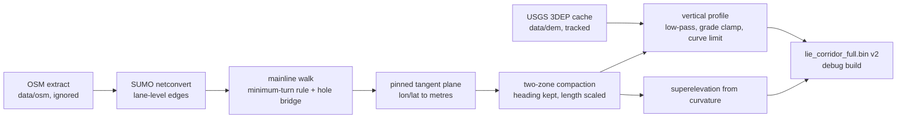

# Corridor tuning notes

> Largely AI-generated (Claude), 2026-11-20; owner review pending. Follows the "tuning notes every phase" rule.

Every knob is in [`config/lie_corridor.toml`](../../config/lie_corridor.toml). After a change, run
`python3 tools/lie_corridor.py bake` (no network needed) and restart `make debug`. The bake prints an audit
line for each stage; read it before driving.

## How the bake is built (architecture)

It is an offline pipeline of pure functions over one array of stations (10 m apart). Each stage reads the
previous stage's array and writes a new one, so any stage can be re-run or tested alone. The engine only
reads the final packed file; it never sees OSM or the elevation service.

- Release loads `lie_corridor.bin` (August bake, 18 mi, flat, format v1). Debug loads `lie_corridor_full.bin`
  (30 mi, with height and bank, format v2). The loader accepts both.
- A3 only stores height and bank. The mesh and the car still use the flat `road_y_wu` until A5.

## A2: compression (route length)

| Knob | Now | Range | Effect |
|------|-----|-------|--------|
| `target_length_miles` | 30.0 | 26-40 | Whole route. Below about 26 the east zone cannot meet the curvature floor. |
| `west_zone_length_miles` | 18.0 | fixed | Tunnel to exit 49. Changing it moves the road already built. |
| `landmark_exits` | 10 exits | add freely | Each keeps 900 m either side at real scale (costs about 1.1 mi each). |
| `landmark_radius_m` | 900 | 500-1500 | Real-scale window around a landmark. |
| `curvature_floor_radius_m` | 500 | 400-600 | No curve is squeezed tighter than this. 600 was infeasible at 18 mi. |

Scale per station, solved separately for each zone:

$$f_i = \max\!\big(w_i + c\,(1 - w_i),\; g_i\big), \qquad g_i = \min\!\big(1,\; R_\text{floor}/R_i\big), \qquad L' = \Delta x \sum_i f_i$$

$L'$ is monotonic in $c$, so bisection finds the $c$ that hits the target. Current: $c_W = 0.1858$, $c_E = 0.1721$.

## A3: elevation

| Knob | Now | Range | Effect |
|------|-----|-------|--------|
| `smooth_m` | 300 | 150-600 | Low-pass window. Lower keeps more small hills and more bridge spikes. |
| `max_grade` | 0.05 | 0.03-0.06 | Steepest slope. Real freeways: 3-5 %. |
| `design_speed_mps` | 31.3 | 26.8-35.8 | Speed the limits are checked at (60-80 mph). |
| `max_vertical_accel` | 0.6 | 0.3-1.5 | m/s² over crests and dips. 0.3 is a real freeway; above about 1.5 the car goes light. |
| `bank_fraction` | 0.4 | 0-1 | Share of cornering force the cross slope carries. 0 = flat curves. |
| `max_bank` | 0.06 | 0.04-0.08 | Cross-slope cap. |
| `bank_smooth_m` | 100 | 50-200 | Length of the roll-in to a banked curve. |

Why smoothing is needed: compaction shortens the road but not the hills, so a real grade $g$ becomes

$$g' = g / f$$

up to 5.8 times steeper at $f = 0.172$. The profile is therefore limited three ways:

$$\left|\frac{dz}{ds}\right| \le G, \qquad a_v = v^2 \left|\frac{d^2z}{ds^2}\right| \le a_\text{max}, \qquad e = \operatorname{clamp}\!\left(k\,\frac{v^2}{g R},\; \pm e_\text{max}\right)$$

The second limit is the vertical-curve rule in another form. Highway texts write it as $L = K A$ ($A$ = grade
change in percent, $K$ = metres per 1 % change); then $a_v = v^2 / (100 K)$, so $a_\text{max} = 0.6$ at 70 mph is
$K \approx 16$ m per percent. The third is the curve balance $e + f_s = v^2 / (g R)$ with the cross slope taking the
share $k$.

Current audit: raw ground -1.6 to 75.4 m, profile -0.3 to 73.1 m, max grade 5.00 %, max $a_v$ 0.59 m/s², max bank
6.00 % (at the 99 m tunnel ramp).

Known limits:

- The model is bare ground. At viaducts it gives the ground under the bridge; in the tunnel it gives the river
  surface, not the tube. Step C4 (tunnel) and D4 (overpasses) need OSM `bridge`, `tunnel` and `layer` tags.
- Bank uses one design speed everywhere.

## A4: exits and districts

| Knob | Now | Effect |
|------|-----|--------|
| `districts` | Queens, Nassau (`start_exit = "33"`), Suffolk | Order and names of the roadside kits. `start_exit` overrides the OSM county tag. |

How it is stored: two optional blocks after the landmarks, each `u32 tag, u32 count, records`. This is the
chunked-file pattern (as in RIFF or PNG): old readers and old files keep working because the fixed header never
changes. In code: `CorridorAlignment::exits()`, `next_exit(s, westbound)`, `district_at(s)`.

To fix one sign's wording, edit the `destination` tag in OpenStreetMap, or add a correction table to the bake
(not built yet). To see the table, run `make debug` and read the `[corridor]` lines in the terminal.

## Sources

- AASHTO, *A Policy on Geometric Design of Highways and Streets* (the "Green Book"): grades, $K$ values, $e_\text{max}$.
- Mannering and Washburn, *Principles of Highway Engineering and Traffic Analysis*, chapter 3 (geometric design).
- San José State University, Mineta Transportation Institute, [Highway Geometric Design slides](https://transweb.sjsu.edu/sites/default/files/Geometric%20Design%20Slides.pdf).
- Michigan Tech, B. Alkire, [CE 3401 lecture notes](https://pages.mtu.edu/~balkire/indexnew.html): vertical alignment, length of vertical curves, horizontal alignment.
- USGS 3D Elevation Program (3DEP), public domain: the height data.

The two slide links came from a web search on 2026-11-20 and were not opened and checked page by page.

## C1: ramps and service roads (debug demo)

Panel: `make debug`, header "Corridor". A change rebuilds the whole corridor 0.5 s after the slider stops (about
the scene-load time; the screen freezes briefly).

Retired in C2b (the three demo sliders `corridorRampDemo`, `corridorRampAheadM`, `corridorRampDyM` are gone; the
real diamonds below replace the demo). The C1 factories stay for tests and later use.

Fixed sizes (`road::kExit`, feet): ramp width 14, length decel 328.5 + diverge 671.5 + connect 200 = 1,200;
service lanes 2 x 12; service inner edge 40 + 14 + 10 = 64 past the outer shoulder edge.

Offset and height along the path both follow smoothstep:

$$t(s) = t_0 + (t_1 - t_0)\,S(u), \qquad y(s) = \text{surface\_y}(s, t) + |e(s)|\,\tfrac{w}{2} + dy_0 + (dy_1 - dy_0)\,S(u), \qquad S(u) = 3u^2 - 2u^3$$

With $dy = 3$ m over 1,200 ft (366 m) the steepest grade is $S'_{max} = 1.5$ times the mean, $1.5 \cdot 3/366 =
1.2\,\%$, far under the 5 to 8 % a ramp may have. A real ramp to an overpass climbs about 7 m; at `dy = 7` m the peak
grade is 2.9 %.

Known limits: no gore chevrons, guardrail or signs (D2/D3); markings are not tagged retroreflective; bank is 0 on
the ramp too, so on a banked curve its inner edge can sit up to $|e| w$ (about 8 cm at 2 %) above the shoulder.

Sources (not opened): AASHTO Green Book ch. 10 (ramp and terminal design, deceleration lengths); Mannering and
Washburn ch. 3; Michigan Tech CE 3401 notes (vertical curves). See also [endless-road.md](../endless-road.md).

## C2a: service-road extents

Config `[service_roads]` in [config/lie_corridor.toml](../../config/lie_corridor.toml). Pull once with
`python3 tools/lie_corridor.py fetch_srvr` (writes `data/osm/lie_service_roads.json`; git-ignored, back it up);
`bake` then needs no network.

| Knob | Now | Effect |
|------|-----|--------|
| `merge_gap_m` | 150 real m | Breaks shorter than this (a cross-street intersection, a split way) close up. Longer breaks are real gaps and stay (e.g. EB near Woodbury Rd, exits 44-46). Ranges shorter than the gap after merging are dropped as stubs. |
| `end_exit` | `"68"` | Rule fill east of the last OSM stretch stops at this exit (per side). |
| Lane clamp | 1..3 (code) | Lanes per range = median of OSM `lanes` values 1..3 over the merged ways; 4 and 5 are turn-bay counts at intersections and get no vote; no vote at all = 2. |
| Rule-fill lanes | 2 (code) | Queens (Horace Harding) and the stretch east of the last OSM range. |

Station of a way = nearest chain vertex to each end node (300 m tolerance, the same lookup the exit table uses),
so a range is $[\min(i_a, i_b), \max(i_a, i_b)]$ in real station index, merged when $i_0^{next} - i_1 < \lfloor
150 / \Delta s \rfloor$, then mapped to compacted stations. Rule ranges: Queens from the drive start to
$\min(\text{Nassau line}, \text{first OSM } s_0)$; east from the last OSM $s_1$ to that side's exit 68.

Result of the 2026-11-20 bake (512 ways fetched, none named Sunrise):

| Side | OSM ranges | OSM real mi -> baked mi | Rule ranges | Rule real mi -> baked mi |
|------|-----------|-------------------------|-------------|--------------------------|
| EB / South (906A) | 6 | 37.11 -> 15.60 | 2 | 16.63 -> 8.97 |
| WB / North (906B) | 5 | 38.12 -> 15.57 | 2 | 17.76 -> 9.74 |

Side check: 2 of about 1,000 way end nodes project on the far side of the centreline (ramps crossing over), so the
906A = south / 906B = north mapping holds.

Sources: Wikipedia, "Long Island Expressway" (service roads, exit 68 end); eastcoastroads.com LIE photo logs
(one-way service roads, ramp order); OpenStreetMap ways tagged `unsigned_ref=NY 906A/906B`, ODbL. Wikipedia and the
photo logs were read by the research agent, not re-opened for this item.

## C2b: diamonds, service roads and the crossroad cut

Panel: `make debug`, header "Corridor". A settled change rebuilds the corridor after 0.5 s (brief freeze).

| Knob | Default | Range | Effect |
|------|---------|-------|--------|
| `corridorDiamonds` | on | on/off | Diamonds, service roads, crossroads and the mainline dip. Off = plain mainline (the graded verge stays). |
| `corridorDipDepthM` | 6.5 m | 0 to 10 m | Mainline cut depth under each crossroad (raised per crossroad where bank needs it, see below). |
| `corridorDipHalfM` | 350 m | 100 to 800 m | Half-length of each cut. Above about 450 m neighbouring cuts (900 m apart minimum) start to merge (deepest wins). |
| `corridorSrStripM` | 10 m | 5 to 20 m | Grass from the mainline outer shoulder edge to the service road's inner curb. Must stay above one ramp width (4.27 m) or ramps cannot leave the shoulder before touching the curb. |

Fixed in code (`diamond::` in [CorridorRamps.h](../../src/scene/Corridor/CorridorRamps.h)): curb 6 in top x 6 in
reveal, edge line 4 in, 0.30 m gutter from curb face to line, stop bar 24 in, gore channelizing line 8 in, ramp
14 ft, ramp joins the service road 60 m before the crossroad, ramp length 300 to 500 m, crossroad deck 1.2 m,
clearance 16 ft, parapet 42 in x 0.45 m, overlay lift 3 WU (ramp over shoulder / service road, under the 5 WU paint).

**Dip.** With crossroads $c_k$, per-crossroad depth $D_k$ and half-length $L$:

$$d(s) = \max_k D_k\left(1 - S\!\left(\frac{|s - c_k|}{L}\right)\right)\ \text{for } |s - c_k| < L, \qquad S(u) = 3u^2 - 2u^3, \qquad y_{main}(s, t) = y_0 + y(s) - e(s)\,t - d(s)$$

Steepest added grade is $1.5\,D/L = 1.5 \cdot 6.5 / 350 = 2.8\,\%$ at $u = 1/2$, on top of the profile grade (the
bake clamps that to 5 %). Clearance under the deck is guaranteed by raising the depth where the mainline is banked:

$$D_k = \max\left(D,\ h_{deck} + 16\,\text{ft} + 0.1\,\text{m} + |e(c_k)|\,E(c_k)\right)$$

with $E$ the outer edge offset. On the 2026-11-20 asset 30 crossroads come out, 13 raised (max 7.30 m at 14.07 km).
At $u = 11/350$ (deck edge) the cut is still $0.997\,D$, so the deck sits over a flat-bottomed dip.

**Pairing.** Exit records grouped by the ref's leading digits (`49N`, `49S` -> 49). Paired: crossroad midway
between the mean EB and mean WB diverge. Lone EB diverge: +400 m; lone WB: -400 m. Sorted, then any crossroad
closer than 900 m to the last kept one is dropped, as are crossroads within the end pads (turnaround + 700 m).
58 exit numbers -> 30 crossroads. Ramp length before: $\text{clamp}(c - 60 - \text{EB diverge}, 300, \min(500, \tfrac{gap}{2} - 80))$ m, after the same with the WB diverge, so neighbouring diamonds never overlap.

**Ramp height.** Offset eases over the whole ramp; height only between the nose $u_n$ (inner edge leaves the
mainline edge) and the touch $u_t$ (outer edge reaches the service road's inner curb), solved with the inverse
smoothstep $u = \tfrac12 - \sin\!\big(\tfrac13 \arcsin(1 - 2y)\big)$. The ramp therefore stays coplanar with the
shoulder in the gore and with the service road at the merge; the slope bands fill the rest.

**Verge (graded asset only).** Per station: A = mainline edge (dipped, banked), B / C = ramp inner / outer edge
when a ramp covers the station, D = strip top at level ground, G = end of grass. Bands A-B (gore slope), C-D (cut
slope), D-G (level grass). Cut slopes reach about 1:1.5 at full depth; real depressed LIE sections often use
retaining walls there instead (D2).

**Counts (2026-11-20 asset, debug build).** 41 segments, 25,449 draws total; per segment max 24,700 vertices and
716 draws, average 21,395 vertices. Each crossroad is 548 to 556 vertices in 4 draws (asphalt, concrete, white,
yellow). The street lamps are still the largest draw cost (about 480 draws per segment, 6 per box).

**Choices made without the owner.** Service-road left edge line is yellow, not white: MUTCD 3A.05 makes the left
edge of a one-way roadway yellow, and both service roads are one way with their mainline. Crossroads closer than
900 m are dropped (Queens and exits 40-43 lose several). Where no OSM service road carries a ramp landing (east of
exit 68, the EB break near Woodbury Rd), a 2-lane stub runs 150 m past the ramps. Service-road ends away from a
crossroad stop square (no end curb). Lane-count changes between adjacent OSM ranges are abrupt.

Sources (none opened in this session; standard references):
- FHWA, *Manual on Uniform Traffic Control Devices* (MUTCD), Part 3: 3A.05 colours, 3A.06 line widths, 3B.04
  broken lines (10 ft dash / 30 ft gap), 3B.06 edge lines, 3B.16 stop lines (12 to 24 in, 4 ft before a
  crosswalk), 3B.18 crosswalks, 3B.24 chevron and diagonal gore markings.
- AASHTO, *A Policy on Geometric Design of Highways and Streets*: ch. 4 (curbs), ch. 10 (diamond interchanges,
  ramp terminals, 16 ft Interstate vertical clearance), ch. 3 (vertical curves).
- Mannering and Washburn, *Principles of Highway Engineering and Traffic Analysis*, ch. 3.
- Michigan Tech CE 3401 (B. Alkire) and University of Washington CEE 320 lecture notes on vertical alignment and
  interchanges.
- Screenshots: [diamond overview](img/c2b-diamond-overview.png), [dip](img/c2b-dip-under-crossroad.png),
  [service road](img/c2b-service-road.png), [gore](img/c2b-gore-chevrons.png). Taken with a temporary far-sky shader
  fix and an elevated chase camera (see the C2b changelog entry); the stock debug build shows nothing past 100 m.

## C3: drivable ramps, service roads and the crossroad run

Panel: `make debug`, header "Corridor". Takes effect on the next frame (no rebuild).

| Knob | Default | Range | Effect |
|------|---------|-------|--------|
| `corridorDriveOff` | on | on/off | On: the car may leave the mainline at a gore, drive the ramps and service roads, and cross each crossroad along the service road. Off: the old per-side carriageway clamp (A/B). |

Fixed in code: `CorridorDriver::kLaneInset` = 300 WU (0.3 m; the car centre stays this far inside each piece's
paved edge, as before), `road::diamond::kDeadEnd` = 3 m in [RoadParams.h](../../src/scene/RoadScene/RoadParams.h)
(a lateral correction longer than this while on a side road means the road ended: hold the car instead of jumping
it across the grass). The hold only applies if the station moved less than 20 m since the last frame.

**Pieces.** At station $s$ on the committed side, each piece gives a lateral interval and a height:

| Piece | Interval | Height |
|-------|----------|--------|
| Mainline | painted inner line to the shoulder's outer edge (full width in a turn-around pad) | $y_0 + y(s) - e(s)\,t - d(s)$ |
| Ramp, service road | $[\ell - w,\ \ell + w]$, centre $\ell$ and half-width $w$ from `corridor_path_at` | path height (level across) |
| Crossroad | the service road's band carried over $\lvert s - c\rvert \le h_c$ | $y_g(c) + 2\,\text{WU} + g_c\,(s - c)$, as the deck mesh |

The allowed windows are the intervals shrunk by the inset $\delta$ on each edge, sorted and merged where they overlap:

$$A(s) = \bigcup_i \,[\,lo_i + \delta,\ hi_i - \delta\,], \qquad t' = \arg\min_{t \in A(s)} |t - t_{car}|$$

The height under the car is the highest piece whose interval holds $t$. Seams are coplanar to within a few WU, so
this choice never sinks a wheel. Slope: the mainline keeps the analytic `surface_slope` (bank and grade). The other
pieces are level across, so they only have a grade along the tangent: $\partial y/\partial x = g\,t_x$,
$\partial y/\partial z = g\,t_z$, with $g$ a central difference over half a station spacing.

**Gore window.** The ramp starts flush with the shoulder (inner edge on the edge line). With inset $\delta$ the
mainline and ramp windows stay joined until the ramp's inner edge is $2\delta = 0.6$ m short of the shoulder edge,
just before the nose. After that the gap grows and the car stays on the side it chose.

**Measured (temporary sweep, removed).** All 60 diamond routes on the 2026-11-20 asset (30 crossroads x 2 sides)
were sampled every 0.25 m along lane, exit ramp, service road, crossroad and entrance ramp. Every point was inside a
window. The largest seam step, after removing the road's own grade, was 131 WU (13 cm). It always occurs where the
centre moves from the shoulder onto a ramp's mainline end on a 5 to 6 % banked curve. Cause: the C2b ramp band is
level at the high edge of the bank, $|e|\,w + 3\,\text{WU}$ above the shoulder at its centre. The mesh has the same
step, so physics matches what is drawn. On flat stretches the step is 3 WU.

**Choices made without the owner.**
- One ground plane under the car centre for both car models. The 6-DOF chassis does not query each wheel's piece:
  seams are coplanar to within the step above, and `RigidChassis` takes one `GroundPlane` per step. Per-wheel planes
  would need a world-to-corridor projection per wheel every substep.
- A side road that ends (OSM extent end, stub end) holds the car where its centre leaves the pavement, so the nose
  overhangs about 2 m of grass. No end curb or barrier is drawn there yet (C2b leaves the end square).
- Crossroad: only straight across along the service road. Turning onto the crossroad is C3a.

Screenshots (6-DOF chase camera, scripted drive, stock shaders): [exit ramp](img/c3-exit-ramp.png),
[service road before the crossroad](img/c3-service-road.png).

Sources (not opened in this session; standard references): AASHTO Green Book ch. 10 (ramp terminals, gore, the
recovery area beyond the edge line) and ch. 3 (superelevation, which is why the banked ramp start shows a step);
Mannering and Washburn ch. 3; Michigan Tech CE 3401 (B. Alkire) lecture notes on cross-section and superelevation;
Ericson, *Real-Time Collision Detection* (2005), ch. 5 (closest point on an interval, used for the clamp).

## C3a: cross-street stubs, signals and the HOV lane

Debug build only. Sliders in the "Corridor" panel; sizes in `road::diamond` ([RoadParams.h](../../src/scene/RoadScene/RoadParams.h)).

| Knob | Default | Range | Effect |
|------|---------|-------|--------|
| `corridorStubM` (`[corridor] stub_m`) | 90 m | 60 to 150 | Stub length past each service road's outer edge; rebuilds after 0.5 s |
| `corridorSignalCycleS` (`[corridor] signal_cycle_s`) | 60 s | 20 to 180 | Full two-phase signal cycle; live, no rebuild |
| `kStubFade` / `kStubCrest` | 45 / 15 m | | Crest rise starts 45 m before the end and peaks 15 m before it |
| `kCrestH` / `kStubDrop` | 1.8 / 2.5 m | | Crest height above ground; end depth below ground |
| `kApronHalf` | 50 m | | Grass apron half-width along the mainline under each stub |
| `kSidewalk` | 1.52 m (5 ft) | | Walk behind each stub curb |
| `kPoleH`, `kSpanH`, `kSpanSag` | 9 / 7.9 / 0.6 m | | Strain pole, wire attach height, mid-span sag |
| `kHeadW`, `kSection`, `kHeadD`, `kLensR`, `kVisor` | 0.36 / 0.36 / 0.25 / 0.15 / 0.24 m | | 12 in 3-section head |
| `kAmberS`, `kAllRedS` | 4 / 1 s | | Change and clearance intervals inside each half cycle |
| `kHovBuffer`, `kHovLine` | 0.61 / 0.20 m | | Buffer line centre spacing (2 ft), line width (8 in) |
| `kDiamondWFt`, `kDiamondLFt`, `kDiamondLineFt` | 2.5 / 12 / 0.5 ft | | MUTCD 3D.01 minimums |
| `kDiamondSpacingFt` | 1,000 ft | | MUTCD 3D.01 upper freeway spacing |
| `kHovZoneFt`, `kHovZoneLeadFt` | 1,000 / 1,000 ft | | Access zone length, and its end before each exit's diverge |

**Crest.** With $d = |t|$, end $e = o + L$, $d_0 = \max(T, e - 45\,\text{m})$ and $d_1 = e - 15\,\text{m}$:

$$p(d) = \begin{cases} 0 & d \le d_0 \\ H\,S\!\left(\frac{d-d_0}{d_1-d_0}\right) & d_0 < d \le d_1 \\ H - (H + D)\,S\!\left(\frac{d-d_1}{e-d_1}\right) & d > d_1 \end{cases}\qquad S(u) = 3u^2 - 2u^3$$

An eye $h_e$ = 1.1 m above the road at distance $x_c$ before the crest sees ground beyond it only above the ray
$y(x) = h_e + (H - h_e)\,x / x_c$. Past the crest the stub falls, so the end ($-D$) stays hidden whenever $H > h_e$. Keep
`kCrestH` above about 1.2 m. Lower values show the end from a low cockpit.

**Signal cycle.** With cycle $C$ and half $C/2$, group $g$ uses $p = (t + g\,C/2) \bmod C$:
green while $p < C/2 - A - R$, amber until $C/2 - R$, red after. The cycle is clamped to at least $2(A + R) + 2$ s, so green
never vanishes. Group 0 is the service road and group 1 the crossroad. Green never shows both ways (unit test).

**Lens luminance.** $L = I / A$ with $A = \pi (0.1524\,\text{m})^2 = 0.073\,\text{m}^2$ and the ITE VTCSH LED
minimums $I$ = 365 / 910 / 475 cd, giving 5,000 / 12,500 / 6,500 cd/m². Real modules run brighter, and with no bloom the
lenses read dim at dusk. Raise this in the lighting phase rather than here.

**HOV access zones.** EB: $[s_x - \ell - z,\ s_x - \ell]$; WB: $[s_x + \ell,\ s_x + \ell + z]$, for every exit
diverge $s_x$ inside the range, clipped to it, then sorted and merged. 2026-11-20 asset: range 12.668 to 41.314 km,
27 EB and 21 WB zones.

**Choices made without the owner.** Span wire, black heads, no backplate (photos). Mast arms and yellow
retroreflective backplate borders appear on newer NYSDOT jobs but not in the LIE service-road photos found. One global
phase for all intersections (6 lens draws per crossroad instead of 6 per intersection with offsets). Stubs are not drivable.
Fixed access-zone pattern. HOV signs (R3-10 / R3-11 series) wait for D3.

Sources: see [endless-road.md](../endless-road.md#cross-street-stubs-signals-and-the-hov-lane-c3a-2026-11-21).
MUTCD 2009 ch. 3D and the Wikipedia I-495 HOV section were opened; the Commons photos were viewed; ITE VTCSH, NYSDOT signal
guidance, Mannering and Washburn ch. 7 and UW CEE 320 signalized-intersection notes were not opened.

## C3b: HUD strip and route minimap

Debug build only. Toggles in the "Corridor" panel; layout constants in [HudOverlay.cpp](../../src/debug/HudOverlay.cpp).

| Knob | Default | Effect |
|------|---------|--------|
| `hudShow` (`[corridor] hud`, H key) | on | Strip + minimap on the game window |
| `hudMapLocal` (`[corridor] hud_map_local`) | off | Minimap 2 km around the car; off = whole route |
| scale `k` | $\max(H/1080, 0.8)$ | Every size is authored at 1080 px tall; the floor keeps 800x600 legible |
| strip | 900 x 86 px, 28 px from the bottom, bg alpha 0.62 | Dark panel that reads on sky and asphalt |
| minimap | 220 px, 24 px margin, bg alpha 0.55 | Route at no more than 2,000 points |

**Distance to the next exit** is in real miles: $d = |s_x - s| \cdot (L_\text{real}/L_\text{baked}) / \text{WU per mile}$, with
WU per mile $= 5280 \cdot$ `kWuPerFt`. On the 2026-11-20 asset the ratio is $70.41/30.0 \approx 2.35$. The local 2 km map window
is in baked metres.

**Choices made without the owner.** World-frame map ($-z$ up), not rotated to geographic north. The exit tab is MUTCD green
(guide-sign colour, MUTCD 2009 ch. 2E). Exit ticks are shorter and fainter in the whole-route view, because about 100 of them
crowd 220 px.

Sources: MUTCD 2009 ch. 2E (guide signs, exit numbering) and NHTSA *Visual-Manual Driver Distraction Guidelines for In-Vehicle
Electronic Devices* (2013, 2 s single-glance target, the reason the strip is one line of large type). Neither was opened this session.

## C4: tunnel, plaza and Riverhead roundabout

Debug build only. One live slider; the rest are fixed sizes in `road::ends` ([RoadParams.h](../../src/scene/RoadScene/RoadParams.h)).

| Knob | Default | Range / note | Effect |
|------|---------|--------------|--------|
| `corridorTunnelLux` (`[corridor] tunnel_lux`) | 120 lx | 20 to 400 | Interior road illuminance; spot candela $I = E h^2 / \sum\cos^3\theta_k$ |
| `kLightSpacing` | 6 m | | One spot per 6 m over the lane centre (33 spot slots cover about +-100 m) |
| `kThreshLen`, `kThreshBoost`, `kTransLen` | 50 m, x10, 100 m | CIE 88 threshold / transition | WB tube entering from the plaza |
| `kExitLen`, `kExitBoost` | 60 m, x5 | CIE 88 exit zone | EB tube before the portal |
| `kStripNits` | 1,500 cd/m² | physical ~9,000 | Luminaire row lens; lowered because the bloom is wide |
| `kTunnelEvMin` | EV100 4.5 | preset floors 13.5-14 | Auto-exposure floor while the car is in the tube (eye adaptation) |
| roof floor | 0.002 | `corridor_tunnel_roofs` | Sky light left deep in the tube (0.03 tinted the walls blue) |
| `kCeilH`, `kWalkW`, `kWalkH` | 4.3 m, 0.75 m, 0.30 m | | Tube section; posted clearance 12 ft 1 in |
| `kCurbClear` | 0.65 m | | Car centre kept this far (plus the 0.3 m inset) from a walk curb |
| `kBandLo`, `kBandH`, `kGoldH` | 14, 4, 2 courses | 3 in courses | Blue then gold stripe on white tile (layout unverified) |
| `kPlazaLanes`, in / hold / out | 1.5 lanes, 60 / 60 / 150 m | | Former toll plaza widening |
| `kGantryS`, `kGantryH` | 45 m, 5.5 m | | Gantry past the portal, truss underside |
| `kPadS`, `kPadLen` | 130 m, 40 m | | U-turn opening (fictional) |
| `kRingRo`, `kRingRi` | 24 m, 17 m | FHWA single-lane ICD 27-55 m | Roundabout outer edge and island |
| `kTaperFt` | 540 ft | MUTCD $L = WS$ | Lane drop before the splitter |

**Why the EV floor.** Interior road luminance at 120 lx on asphalt ($\rho \approx 0.1$) is $L = \rho E/\pi \approx 4$ cd/m²,
so $\text{EV}_{100} = \log_2(L \cdot 100 / 12.5) \approx 5$. The daylight presets clamp at 13.5 or more, 8 stops brighter,
which renders the tube black. The floor is only lowered while the car is in the tube; `aeSpeed` gives the dark entry and
bright exit.

Sources: CIE 88:2004, ANSI/IES RP-22-11, MUTCD 2009 Table 6C-4, NCHRP 672 (none opened this session); Wikipedia
"Queens–Midtown Tunnel" (opened).

## D2: edges (NJ barrier, wide median, W-beam, sound walls, ditch)

Debug build only. Three sliders in the `corridor` group (a settled change rebuilds the corridor after 0.5 s); the rest
are fixed sizes in `road::edges` ([RoadParams.h](../../src/scene/RoadScene/RoadParams.h)).

| Knob | Default | Range / note | Effect |
|------|---------|--------------|--------|
| `edgeWideMedianM` (`[corridor] edge_wide_median_m`) | 20 m | 2 to 40 | Median width east of exit 64, between the inner shoulder edges; extra half-width $w = \max(0, W/2 - m_0)$ |
| `edgeWallHM` (`edge_wall_h_m`) | 4.5 m | 3 to 6 | Sound-wall height above the ground at the wall (FHWA: LIE walls 10-17 ft) |
| `edgeDitchM` (`edge_ditch_m`) | 0.45 m | 0 to 1 | Roadside ditch depth; 0 = the old straight cut slope (with rounding) |
| `kNj*` | 3 / 13 / 32 in, 24 in base | AASHTO RDG 6.5 | NJ profile; faces 55° and 84° |
| `kPedestalLen`, `kPedestalHalf` | 1.5 m, 0.30 m | | Widened block under a median lamp pole (the pole is wider than the 6 in top) |
| `kRailTop`, `kRailDepth`, `kRailCrest` | 0.787, 0.311, 0.083 m | MGS 31 in, M180 | W-beam height and section |
| `kPostSpacingFt`, `kBlockout`, `kPost` | 6.25 ft, 8 in, 6 in | | Post spacing, blockout depth, post width |
| `kRailOffset` | 0.60 m | 2 ft | Rail face past the shoulder edge; the clamp is the face minus `kCurbClear` |
| `kRailEnd` | 25 ft | turned-down end | Rail drops to the ground over the last 25 ft |
| `kShieldUp`, `kShieldDown` | 45 m, 15 m | | Run past each crossroad pier, upstream / downstream in travel direction |
| `kPierOffset` | 2.0 m | | Pier centre past the shoulder edge (room behind the rail) |
| `kWallPost`, `kWallPostW`, `kWallBase`, `kWallT` | 6.1, 0.45, 0.6, 0.2 m | | Post spacing and width, plinth height, panel thickness |
| `kWallBack` | 1.2 m | | Wall inside the strip top (the service road's curb) |
| `kWallGapMin`, `kWallMargin` | 400 m, 40 m | | Shortest wall; clearance to ramps and decks |
| `kBrickTile` | 1.083 m | 16 courses of 2 2/3 in | Bricks054 texture square |
| `kForeslope`, `kDitchFlat` | 1V:6H, 0.6 m | AASHTO RDG ch. 3 | Ditch foreslope, flat bottom |
| `kWideLead`, `kWideEase`, `kWideTail` | 1,000, 500, 600 m | | Wide median starts past the last exit 64 record, eases, ends before the lane drop |
| `kCableH`, `kCablePostFt` | 21 / 25 / 30 in, 15 ft | typical 3-cable, to check | Cable heights, post spacing |

**Clamp.** The car centre is clamped, not its corners, so the body side meets the face only when the car is parallel to
it. NJ zone: $t_{min} = t_{toe} + c + i$ with $t_{toe} = 12$ in, $c = 0.65$ m (`kCurbClear`), $i = 0.3$ m
(`kLaneInset`): the 911's 1.85 m body then stops 2.5 cm off the toe. W-beam: $t_{max} = t_{face} - c - i$.

**Backslope.** With $W$ = strip width left after the ditch and $t = d / W$:

$$y(t) = y_0 + \Delta\left(\tfrac{t}{2} + \tfrac{3t^2 - 2t^3}{2}\right), \qquad \max\left|\frac{dy}{dd}\right| = 1.25\,\frac{\Delta}{W}$$

so the steepest point is a quarter steeper than a straight slope, and both ends are rounded. Under a 6.5 m cut with
the default 10 m strip that is still about 1V:0.9H; widen `corridor sr_strip_m` for gentler slopes.

**Wide median frames.** Each carriageway sweeps off centre points shifted by $\pm w(s)$ along the right vector, with
$y_c - b\,(\pm w)$ for bank $b$, so the frame centre sits on the banked plane at its true lateral and all paint offsets
stay the same constants.

Sources (not opened this session): AASHTO Roadside Design Guide, 4th ed. 2011 (ch. 3 roadside topography and
drainage, ch. 5 roadside barriers, ch. 6 median barriers); AASHTO M180 (W-beam); MASH 2016; FHWA "W-beam guardrail"
and "safety-shape concrete barrier" eligibility memos; FHWA Highway Traffic Noise Barrier Design Handbook; NYSDOT
Standard Sheets 606-xx (guide rail) and 619 (median barrier); Purdue / UW CEE 320 roadside safety lecture notes. Read:
the D0 reference sheet (exit-33 wall, exit-49 guardrail photos).

## D3: guide signs

Debug build only. Two sliders in the `corridor` group (a settled change rebuilds the corridor after 0.5 s); the rest
are fixed sizes in `road::signs` ([RoadParams.h](../../src/scene/RoadScene/RoadParams.h)). Text changes need
`python3 tools/sign_generator.py corridor` (rewrites the atlases and `SignAtlas.h`).

| Knob | Default | Range / note | Effect |
|------|---------|--------------|--------|
| `corridorSigns` (`[corridor] signs`) | on | | Gantries, gore signs, mile markers (the exit 73 boards stay) |
| `signSheen` (`sign_sheen`) | 0.45 | 0.2 to 1.0 | Roughness multiplier on sign faces (1 = matte); retroreflection is the L8.2 lobe |
| `kPanelW` | 6.10 m | 20 ft | Panel width; tab, panel and strip heights follow the atlas pixel aspect (1.19 cm/px) |
| `kClearFt` | 17 ft | MUTCD 2A.18 | Sign bottom over the highest point of lanes and shoulders |
| `kQuarterMi`, `kHalfMi`, `kOneMi` | 0.25, 0.5, 1 real mi | | Advance distances, placed at $d_b = d_r \cdot 5280\,\text{ft} \cdot L_b/L_r$ (685.5 m per mile here) |
| `kAfterGore` | 100 m | | Earliest advance gantry past the previous gore (the collapse room starts here) |
| `kDeckClear`, `kDeckHide` | 30 m, 150 m | | Gantry kept off a crossroad deck edge; sight shadow past a deck |
| `kLampClear` | 2.5 m | | Median column moved 5 m upstream when this close to a lamp pole |
| `kTrussSide`, `kChord`, `kLacing`, `kBay` | 1.37 m, 4.5 in, 0.06 m, 1.37 m | AASHTO sign-structure practice | Box truss section, pipes, Warren bay |
| `kColumn`, `kColumnGap`, `kPostOut` | 12.75 in, 1.2 m, 2.0 m | | Twin columns, spacing along the road, outer column past the shoulder |
| `kStiffener` | 1 ft | | Rib spacing on the panel back |
| `kGoreW`, `kGoreLift`, `kGoreGap` | 1.6 m, 2.1 m, 4 m | E5-1a | Gore sign size, bottom height, ramp clearance where it stands |
| `kMarkerW`, `kMarkerLift`, `kMarkerOut`, `kMarkerStepMi` | 0.46 m, 1.2 m, 1.0 m, 0.2 mi | D10 enhanced | Marker width, bottom, offset past the shoulder, spacing |
| generator `MIN_CAP` | 26 px | ≈ 12 in | Smallest destination cap height allowed; the build fails below it |

**Collapse rule.** With room $R$ from the previous gore + `kAfterGore` to this gore: $R \ge 1$ mi gives 1 mile and
1/2 mile gantries; $\tfrac12 \le R < 1$ only 1/2 mile; $\tfrac14 \le R < \tfrac12$ one at 1/4 mile; less, none. On this
bake gets 119 gantries for 60 exit ramps (30 diamonds, both directions).

**Legibility.** A 16 in legend (35 px) is legible to a driver at about 40 ft per inch, so 640 ft (195 m). On a 1600 px
window with a 65° horizontal field of view one pixel spans $pprox 0.71$ mrad, so at 200 m a 16 in letter is about
3 px: the panel reads as a sign, the words do not. In the app they read from about 100 m in (seen at 45 m and 100 m).

Sources (not opened this session): MUTCD 2009 ch. 2A, 2D, 2E, 2H; FHWA Standard Highway Signs; AASHTO sign-structure
specification; NYSDOT sign-structure standard sheets; Purdue CE 361 / UW CEE 320 traffic control device lectures.

## D4: overpasses

Debug build only. Three sliders (a settled change rebuilds the corridor after 0.5 s; `ground_bounce` is live); the
rest are fixed sizes in `road::bridges` ([RoadParams.h](../../src/scene/RoadScene/RoadParams.h)) and the `[crossings]`
table in [config/lie_corridor.toml](../../config/lie_corridor.toml) (re-bake with `python3 tools/lie_corridor.py bake`).

| Knob | Default | Range / note | Effect |
|------|---------|--------------|--------|
| `corridorBridges` (`[corridor] bridges`) | on | | OSM bridges (crossroads keep their restyled deck either way) |
| `bridgeClearFt` (`bridge_clear_ft`) | 16.5 ft | 14 to 20 | Soffit over the highest mainline / ground point under the deck (NYSDOT 16 ft 6 in over an Interstate, unverified) |
| `groundBounce` (`[reflection] ground_bounce`) | 0.15 | 0 to 0.4; 0 = old look | Ground albedo for light bounced off the road onto faces turned from the sun |
| `kUnderClearFt` | 14.5 ft | | Clearance over a road under the LIE |
| `kSlab`, `kHaunch`, `kGirderD`, `kSpacing`, `kOverhang` | 0.23, 0.05, 1.2, 2.6, 0.9 m | depth ≈ span / 25 | Deck build-up; girder centres across the deck |
| `kFlangeW`, `kFlangeT`, `kWebT`, `kStiffStep` | 0.40, 0.04, 0.02, 3.0 m | web thickened to read at range | Painted plate girder |
| `kBeamTop`, `kBeamBot`, `kBeamWeb`, `kBeamFl` | 1.07, 0.66, 0.18, 0.15 m | NEBT-like | Precast I-beam |
| `kBearingW/L/H` | 0.6 x 0.45 x 0.12 m | | Elastomeric pad at every span end |
| `kCapH`, `kCapW`, `kColR`, `kColStep`, `kWallPier` | 1.07, 1.2, 0.457, 6.0, 0.9 m | | Caps, 36 in columns of a bent, wall pier |
| `kToeClear`, `kClearZone`, `kSpill` | 1.5 m, 9 m, 2 | 1V:2H | Spill-slope toe past the service road or the 30 ft clear zone; slope ratio |
| `kApproachFlat`, `kApproachLen` | 10 m, 120 m | | Level, then smoothstep down to grade (about 5 % mean, 8 % peak) |
| `kFBreakIn` | 10 in | F-shape | Parapet slope break; NJ angles, vertical back |
| `kFenceH`, `kFencePost` | 8 ft, 10 ft | | Chain-link frame on Queens / Nassau parapets (mesh omitted: no alpha-tested material) |
| `kArchRise`, `kArchRiseMax`, `kSpandrel`, `kStoneParapet`, `kStonePier`, `kWing` | 0.15, 3 m, 0.75 m, 1.0 m, 1.5 m, 6 m | | Segmental arch rise per span, cover over the crown, stone parts |
| `kFloorD`, `kThroughH`, `kThroughStiff` | 0.9, 2.4, 1.6 m | | LIRR floor depth, girder height above the floor, stiffener spacing |
| `kTrack`, `kGauge`, `kTieStep`, `kTieL`, `kRailApproach` | 5.5, 1.435, 0.61, 2.6, 80 m | | Track bed per track, gauge, 24 in tie spacing, tie length, level approach |
| `kLieFlat`, `kLieClimb`, `kTrenchWall`, `kLieCover` | 8, 85, 0.6, 0.08 m | | Under-road level past the deck edge, climb to grade, U-wall thickness, asphalt over the LIE deck slab |
| `kMergePad` | 20 m | | Footprints closer than this are one structure |
| `[crossings] twin_m` | 25 m real | | Same-kind crossings merged in the bake (one-way pairs, street corners) |
| `[crossings] max_skew_deg` | 40° | | Skew clamp |
| `[crossings] style_by_name` | parkways stone, Van Wyck concrete | regex | Landmark styles over the district rule |

**Abutment reach.** The deck ends where a 1V:2H spill slope from the seat meets the toe:
$t_{abut} = t_{toe} + \tfrac12 w_{cap} + 2\,(y_{seat} - y_g)$, with $y_{seat} = y_{soffit} - h_{bearing} - h_{cap}$. With a
service road ($t_{toe}$ = outer curb + 1.5 m) a Nassau overpass spans about 30 m from the shoulder pier to the abutment.

**Arch.** Segmental circle through the springs with rise $R$ over half-span $h$: radius $\rho = (h^2 + R^2)/(2R)$,
intrados $y(t) = y_s + \sqrt{\rho^2 - (t - t_c)^2} - (\rho - R)$.

**Ground bounce.** A Lambertian ground of albedo $\rho$ under irradiance $E_g$ has radiance $\rho E_g/\pi$; a surface with
normal $N$ sees the lower half-space with view factor $(1 - N_y)/2$, so $E_b = \rho E_g (1 - N_y)/2$. Asphalt is about
0.1, concrete 0.3, grass 0.2: 0.15 is a corridor mean.

Sources (not opened this session): AASHTO LRFD Bridge Design Specifications (girder depth to span, bearings, deck
overhang); NYSDOT Bridge Manual (vertical clearance 16 ft 6 in over Interstates, 14 ft 6 in local; F-shape bridge
railing; spill-through abutments with slope protection); AASHTO Roadside Design Guide (30 ft clear zone, pier shields);
FHWA *Bridge Inspector's Reference Manual* (bearing and abutment types); Purdue CE 470 / UW CEE 451 steel and concrete
bridge lectures; Sillion and Puech, *Radiosity and Global Illumination* (form factors) for the bounce term.

## D5: district kits, lamps, skyline

Debug build only. Four sliders in the `corridor` group (`dressing`, `dress_density`, `dress_far_m` rebuild the corridor
0.5 s after they settle; `skyline` is live); the rest are fixed in `road::dressing`
([RoadParams.h](../../src/scene/RoadScene/RoadParams.h)). Textures: `python3 tools/gen_dressing.py` (seeded).

| Knob | Default | Range / note | Effect |
|------|---------|--------------|--------|
| `corridorDressing` (`[corridor] dressing`) | on | | Trees, buildings and the far ground (lamps follow `corridorLamps`) |
| `dressDensity` (`dress_density`) | 1.0 | 0 to 2 | Multiplies every kit's tree chance and building rate |
| `dressFarM` (`dress_far_m`) | 250 m | 0 to 500; 0 = old 120 ft grass edge | Far ground past the grass; trees and buildings stop 3-5 m short of its edge |
| `skylineShow` (`skyline`) | on | | Midtown card at the west end |
| `kKits[]` | 13 stretches | exit number, trees, species, 2 building types + rates, floors, lamp | One row per stretch; edit to move a boundary or change a district |
| `kCell` | 10 m | | Tree grid; one chance per cell |
| `kTreeIn`, `kBldgIn` | 12 m, 28 m | past the shoulder edge | Clear zone (AASHTO 30 ft + margin); nearest building |
| `kPathClear`, `kBldgPathClear` | 5 m, 14 m | | Past a ramp or service-road edge |
| `kTreeH[4]` | oak 14-22, maple 12-19, pitch pine 13-20, scrub oak 3-5.5 m | | Card height range per species |
| `kTreeAspect[4]` | 0.95, 0.85, 0.75, 1.7 | width / height | Card shape |
| `kSink`, `kFarSink` | 0.3 m, 0.2 m | | Bases sink into the ground; far ground sits under aprons / stubs |
| `kFarCurve` | 0.8 | 0.5 to 0.95 | Far edge at most this fraction of the curve radius |
| `kCrossPad`, `kApproach` | 10 m, 150 m | | Clearance round crossroad aprons / bridge decks; approach / trench run kept clear |
| `kPoleH` | 12.2 m | 40 ft | Shoulder pole mounting height (Queens median keeps 10 m, L6.1) |
| `kShoulderSpacing` | 65 m | 60 to 70 m (reference, to check) | Nassau / west Suffolk shoulder poles, staggered between sides |
| `kQueensOuter` | 120 m | | Queens outer-edge singles, offset 30 m from the median grid |
| `kPoleOut`, `kArmReach` | 2.0 m, 4.5 m | | Pole past the shoulder edge (behind the W-beam); upswept arm |
| `kSignClear` | 4 m | + column gap | Pole off a gantry column, gore sign or mile marker |
| `kSkyDist`, `kSkyBack`, `kSkyMaxR` | 2 km, 1.3 km, 16 km | `kSkyDist` < 2.4 km far plane | Card draw distance; Midtown past the Manhattan portal; hide range |
| `kSkyW`, `kSkyH` | 4.5 km x 560 m | texture scale | Card size at range R |

**Tree chance.** $p = \text{trees}\cdot\text{density}\cdot(0.3 + 1.4\,n)$ with $n\in[0,1]$ a 60 m bilinear value noise:
mean $\approx$ trees · density, groves up to 1.7×, clearings down to 0.3×. Pine barrens 0.85 with 35 % scrub oak makes
the understorey wall in photo `exit-68/`; Queens LIC and Maspeth 0.08 are street trees only.

**Far ground on a curve.** Rows at lateral $t$ on the inside of a curve of radius $R$ fold over once $t > R$. With
$R \approx 2d/\sin\Delta\psi$ ($d$ = 50 m) the far edge is held at $k R$; the tightest compacted curves (160 m near the
portal, about 250 m at 10 km and 21 km) shorten it there.

**Skyline scale.** Drawn at $D$ and scaled by $k = D/R$ about the camera $c$: $p' = c + k(p - c)$. A point at height
$h$ above the eye and range $R$ keeps its elevation angle $\arctan(h/R)$ and bearing, so the card reads at its true
size and direction as you drive away; only the distance haze sees 2 km instead of $R$ (0.45 vs the 0.5 maximum).

**Lamps.** One spot per pole: twin = $\Phi$ 32,000 lm (two 16,000 lm heads) at the pole, single = 16,000 lm at the head,
$I = \Phi / (2\pi(1 - \cos\theta))$ over the 70° cone (`cone_candela_from_lumens`). Shoulder poles every 65 m at
12.2 m give a spacing-to-height ratio of 5.3, inside the 3-6 range IES RP-8 uses for continuous freeway lighting.

Sources (not opened this session): AASHTO *Roadside Design Guide* ch. 3 (clear zone); IES RP-8 *Roadway Lighting*
and FHWA *Lighting Handbook* (2012) (mounting height, spacing, freeway luminaires); NYSDOT *Highway Design Manual*
ch. 12 (lighting); Brookhaven National Laboratory pine barrens papers (2016, 2019) for the pitch pine / scrub oak
structure; Pharr et al., *Physically Based Rendering* ch. 4 and MIT 6.837 lectures on billboards and alpha-tested
foliage; Wikipedia I-495 and nycroads.com for lighting history (none east of exit 64).

## D6: landmarks

Debug build only. Two sliders in the `corridor` group (both rebuild the corridor 0.5 s after they settle); the rest
are fixed in `road::landmarks` and `road::dressing` ([RoadParams.h](../../src/scene/RoadScene/RoadParams.h)). Board
faces: `python3 tools/sign_generator.py corridor` (writes `assets/signs/sign_kit.png` and `SignAtlas.h`).

| Knob | Default | Range / note | Effect |
|------|---------|--------------|--------|
| `corridorLandmarks` (`[corridor] landmarks`) | on | | Unisphere, NYS Pavilion, Queens vent building, landmark boards, deck styles at exits 22 / 31 / 44, sightline wedge |
| `landmarkGraves` (`landmark_graves`) | 1.0 | 0 to 2 | Calvary headstone density multiplier (0 = none; needs `dressing` on) |
| `kSpots[]` | 3 rows | exit, along (baked m), lat (real m, + = right of EB), prop, clear | One-off structures; offsets measured on OSM (nearest LIE way point) |
| `kSightBase`, `Spot::clear` | 350 m, 40 m (Unisphere) | 0 = no wedge | Tree-free wedge from the road to the spot: half-width `clear` at the spot, `clear + kSightBase` at the road |
| `kGlobeR`, `kGlobeTop`, `kGlobeTilt` | 18.3 m, 43 m, 23.5° | 120 ft globe, 140 ft overall | Unisphere size and axis tilt |
| `kMeridians`, `kParallels`, `kGlobeRib` | 20, 11, 0.5 m | thinner ribs alias past 500 m | Lattice density |
| `kRingR` | 1.18 R | | Orbit ring radius |
| `kTowerH[3]`, `kDeckR[3]` | 18.3 / 45.7 / 68.9 m; 8 / 9.5 / 11 m | 60 / 150 / 226 ft | Pavilion observation towers and their decks |
| `kTentA`, `kTentB`, `kTentH` | 50 m, 38 m, 30.5 m | | Tent of Tomorrow column ellipse and ring height |
| `kVentL`, `kVentW`, `kVentH` | 36 m, 20 m, 30.5 m | footprint a pick, height 100 ft | Queens vent building |
| `kVentStep`, `kVentInset` | 6 m, 3 m | | Art Deco setback stage |
| `kPadPast` | 60 m | | Borden Ave street pad runs this far past the tower |
| `kStyles[]` | 22 concrete, 31 stone, 44 concrete | BridgeStyle 1 / 2 | Crossroad deck style per exit |
| `kExits[]` | 17 22 31 33 39 44 49 62 68 | not 53 | A landmark exit takes the diamond slot from a closer plain neighbour |
| `kBoards[]` | 5 rows | exit, side, before (baked m), cell, w, h, lift | Roadside boards; placed at the nearest spot (25 m steps, upstream first) off a deck, clear of ramps and 60 m from another board |
| `kBoardOut` | 2.5 m | | Board centre past the shoulder edge |
| `Kit::graves` | 0.85 (exit 17 kit) | chance per cell | Headstone field |
| `kGraveS`, `kGraveT`, `kGraveDeep` | 3.0 m, 2.4 m, 90 m | | Grave cell along / across, field depth past the tree line |
| `kTablet`, `kDie`, `kObelisk` | 0.75 x 0.9 x 0.2 m; 1.6 x 1.1 x 0.6 m; 0.6 x 3.2 m | heights x 0.75 to 1.25 | Stone sizes |
| `kDieShare`, `kObeliskShare` | 0.15, 0.06 | | Share of family dies and obelisks |
| `Kit::srTrees`, `kSrTreeOut` | 12 m (exit 48 kit), 3 m | 0 = none | Street-tree row along the service roads' outer curb, 12 % gaps |

**Sightline wedge.** A tree at $(s, t)$ on the spot's side is skipped when

$$t < L \quad\text{and}\quad |s - s_L| < c + B\,\max\!\left(0,\ 1 - \frac{t}{L}\right)$$

with $L$ = |spot lateral|, $c$ = `clear`, $B$ = `kSightBase`. A driver at $s_v$ with $|s_v - s_L| \le B + c$ looks
along a line whose station offset at lateral $t$ is $(s_v - s_L)(1 - t/L)$, always inside the wedge. The C2 dip hides the far view within about 350 m of the exit 22 crossroad, so the base must reach past it: 150 m left the
Unisphere hidden from every point outside the dip; 350 m shows it from about 450 m before the exit and leaves a bare
lawn north of the road.

**Spot geometry.** Distance and side are real (547 m and 307 m left of EB at exit 22, 24 m right of EB at the vent
building); the along offset is in baked metres from the mean of the exit's first and last records, so bearings are
only approximate where the compaction squeezes the road (it preserves heading, so the angle off the road is close).

**Board atlas.** The kit atlas strip right of the C4 chevron (x 288-2048, y 1760-2048) holds the five boards at
0.84 cm/px; short boards stack two per column. Wording: county lines "NASSAU COUNTY LINE" / "QUEENS COUNTY LINE"
(NYSDOT style, unverified); HOV and Great Neck / Manhasset copied from photos `exit-33/`; 62N panel layout from the
2000 photo `exit-62/I-495_Exit_62N_Attraction_Sign.jpg`, plain names in place of the attraction logos.

Sources: Wikipedia, *Unisphere* and *New York State Pavilion* (dimensions, from memory, not re-opened); Wikipedia,
*Queens–Midtown Tunnel* (vent building, cashless tolling, flood doors; read 2026-11-21); OSM `data/osm/lie_i495.osm.xml`
(offsets); Commons photos `exit-33/`, `exit-62/` (viewed); MUTCD 2009 Ch. 2D (county line I-5 style), 2G (HOV), 2J
(attraction signs) (not opened).
