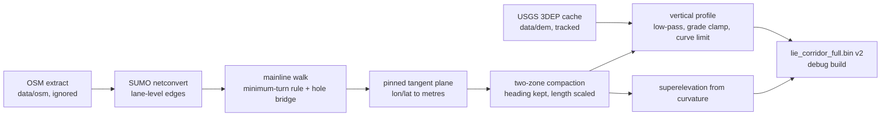
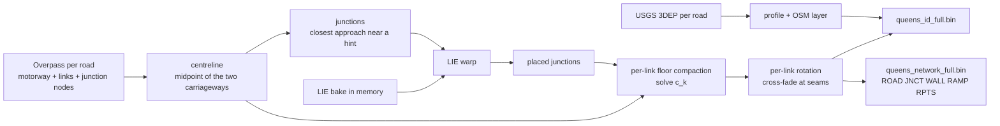

# Corridor tuning notes

> Largely AI-generated (Claude), 2026-11-20; owner review pending. Follows the "tuning notes every phase" rule.

Every knob is in [`config/lie_corridor.toml`](../../config/lie_corridor.toml). After a change, run
`python3 tools/lie_corridor.py bake` (no network needed) and restart `make debug`. The bake prints an audit
line for each stage; read it before driving.

## How the bake is built (architecture)

It is an offline pipeline of pure functions over one array of stations (10 m apart). Each stage reads the
previous stage's array and writes a new one, so any stage can be re-run or tested alone. The engine only
reads the final packed file; it never sees OSM or the elevation service.

- Release loads `lie_corridor.bin` (August bake, 18 mi, flat, format v1). Debug loads `lie_corridor_full.bin`
  (30 mi, with height and bank, format v2). The loader accepts both.
- A3 only stores height and bank. The mesh and the car still use the flat `road_y_wu` until A5.

## A2: compression (route length)

| Knob | Now | Range | Effect |
|------|-----|-------|--------|
| `target_length_miles` | 30.0 | 26-40 | Whole route. Below about 26 the east zone cannot meet the curvature floor. |
| `west_zone_length_miles` | 18.0 | fixed | Tunnel to exit 49. Changing it moves the road already built. |
| `landmark_exits` | 10 exits | add freely | Each keeps 900 m either side at real scale (costs about 1.1 mi each). |
| `landmark_radius_m` | 900 | 500-1500 | Real-scale window around a landmark. |
| `curvature_floor_radius_m` | 500 | 400-600 | No curve is squeezed tighter than this. 600 was infeasible at 18 mi. |

Scale per station, solved separately for each zone:

$$f_i = \max\!\big(w_i + c\,(1 - w_i),\; g_i\big), \qquad g_i = \min\!\big(1,\; R_\text{floor}/R_i\big), \qquad L' = \Delta x \sum_i f_i$$

$L'$ is monotonic in $c$, so bisection finds the $c$ that hits the target. Current: $c_W = 0.1858$, $c_E = 0.1721$.

## A3: elevation

| Knob | Now | Range | Effect |
|------|-----|-------|--------|
| `smooth_m` | 300 | 150-600 | Low-pass window. Lower keeps more small hills and more bridge spikes. |
| `max_grade` | 0.05 | 0.03-0.06 | Steepest slope. Real freeways: 3-5 %. |
| `design_speed_mps` | 31.3 | 26.8-35.8 | Speed the limits are checked at (60-80 mph). |
| `max_vertical_accel` | 0.6 | 0.3-1.5 | m/s² over crests and dips. 0.3 is a real freeway; above about 1.5 the car goes light. |
| `bank_fraction` | 0.4 | 0-1 | Share of cornering force the cross slope carries. 0 = flat curves. |
| `max_bank` | 0.06 | 0.04-0.08 | Cross-slope cap. |
| `bank_smooth_m` | 100 | 50-200 | Length of the roll-in to a banked curve. |

Why smoothing is needed: compaction shortens the road but not the hills, so a real grade $g$ becomes

$$g' = g / f$$

up to 5.8 times steeper at $f = 0.172$. The profile is therefore limited three ways:

$$\left|\frac{dz}{ds}\right| \le G, \qquad a_v = v^2 \left|\frac{d^2z}{ds^2}\right| \le a_\text{max}, \qquad e = \operatorname{clamp}\!\left(k\,\frac{v^2}{g R},\; \pm e_\text{max}\right)$$

The second limit is the vertical-curve rule in another form. Highway texts write it as $L = K A$ ($A$ = grade
change in percent, $K$ = metres per 1 % change); then $a_v = v^2 / (100 K)$, so $a_\text{max} = 0.6$ at 70 mph is
$K \approx 16$ m per percent. The third is the curve balance $e + f_s = v^2 / (g R)$ with the cross slope taking the
share $k$.

Current audit: raw ground -1.6 to 75.4 m, profile -0.3 to 73.1 m, max grade 5.00 %, max $a_v$ 0.59 m/s², max bank
6.00 % (at the 99 m tunnel ramp).

Known limits:

- The model is bare ground. At viaducts it gives the ground under the bridge; in the tunnel it gives the river
  surface, not the tube. Step C4 (tunnel) and D4 (overpasses) need OSM `bridge`, `tunnel` and `layer` tags.
- Bank uses one design speed everywhere.

## A4: exits and districts

| Knob | Now | Effect |
|------|-----|--------|
| `districts` | Queens, Nassau (`start_exit = "33"`), Suffolk | Order and names of the roadside kits. `start_exit` overrides the OSM county tag. |

How it is stored: two optional blocks after the landmarks, each `u32 tag, u32 count, records`. This is the
chunked-file pattern (as in RIFF or PNG): old readers and old files keep working because the fixed header never
changes. In code: `CorridorAlignment::exits()`, `next_exit(s, westbound)`, `district_at(s)`.

To fix one sign's wording, edit the `destination` tag in OpenStreetMap, or add a correction table to the bake
(not built yet). To see the table, run `make debug` and read the `[corridor]` lines in the terminal.

## Sources

- AASHTO, *A Policy on Geometric Design of Highways and Streets* (the "Green Book"): grades, $K$ values, $e_\text{max}$.
- Mannering and Washburn, *Principles of Highway Engineering and Traffic Analysis*, chapter 3 (geometric design).
- San José State University, Mineta Transportation Institute, [Highway Geometric Design slides](https://transweb.sjsu.edu/sites/default/files/Geometric%20Design%20Slides.pdf).
- Michigan Tech, B. Alkire, [CE 3401 lecture notes](https://pages.mtu.edu/~balkire/indexnew.html): vertical alignment, length of vertical curves, horizontal alignment.
- USGS 3D Elevation Program (3DEP), public domain: the height data.

The two slide links came from a web search on 2026-11-20 and were not opened and checked page by page.

## C1: ramps and service roads (debug demo)

Panel: `make debug`, header "Corridor". A change rebuilds the whole corridor 0.5 s after the slider stops (about
the scene-load time; the screen freezes briefly).

Retired in C2b (the three demo sliders `corridorRampDemo`, `corridorRampAheadM`, `corridorRampDyM` are gone; the
real diamonds below replace the demo). The C1 factories stay for tests and later use.

Fixed sizes (`road::kExit`, feet): ramp width 14, length decel 328.5 + diverge 671.5 + connect 200 = 1,200;
service lanes 2 x 12; service inner edge 40 + 14 + 10 = 64 past the outer shoulder edge.

Offset and height along the path both follow smoothstep:

$$t(s) = t_0 + (t_1 - t_0)\,S(u), \qquad y(s) = \text{surface\_y}(s, t) + |e(s)|\,\tfrac{w}{2} + dy_0 + (dy_1 - dy_0)\,S(u), \qquad S(u) = 3u^2 - 2u^3$$

With $dy = 3$ m over 1,200 ft (366 m) the steepest grade is $S'_{max} = 1.5$ times the mean, $1.5 \cdot 3/366 =
1.2\,\%$, far under the 5 to 8 % a ramp may have. A real ramp to an overpass climbs about 7 m; at `dy = 7` m the peak
grade is 2.9 %.

Known limits: no gore chevrons, guardrail or signs (D2/D3); markings are not tagged retroreflective; bank is 0 on
the ramp too, so on a banked curve its inner edge can sit up to $|e| w$ (about 8 cm at 2 %) above the shoulder.

Sources (not opened): AASHTO Green Book ch. 10 (ramp and terminal design, deceleration lengths); Mannering and
Washburn ch. 3; Michigan Tech CE 3401 notes (vertical curves). See also [endless-road.md](../endless-road.md).

## C2a: service-road extents

Config `[service_roads]` in [config/lie_corridor.toml](../../config/lie_corridor.toml). Pull once with
`python3 tools/lie_corridor.py fetch_srvr` (writes `data/osm/lie_service_roads.json`; git-ignored, back it up);
`bake` then needs no network.

| Knob | Now | Effect |
|------|-----|--------|
| `merge_gap_m` | 150 real m | Breaks shorter than this (a cross-street intersection, a split way) close up. Longer breaks are real gaps and stay (e.g. EB near Woodbury Rd, exits 44-46). Ranges shorter than the gap after merging are dropped as stubs. |
| `end_exit` | `"68"` | Rule fill east of the last OSM stretch stops at this exit (per side). |
| Lane clamp | 1..3 (code) | Lanes per range = median of OSM `lanes` values 1..3 over the merged ways; 4 and 5 are turn-bay counts at intersections and get no vote; no vote at all = 2. |
| Rule-fill lanes | 2 (code) | Queens (Horace Harding) and the stretch east of the last OSM range. |

Station of a way = nearest chain vertex to each end node (300 m tolerance, the same lookup the exit table uses),
so a range is $[\min(i_a, i_b), \max(i_a, i_b)]$ in real station index, merged when $i_0^{next} - i_1 < \lfloor
150 / \Delta s \rfloor$, then mapped to compacted stations. Rule ranges: Queens from the drive start to
$\min(\text{Nassau line}, \text{first OSM } s_0)$; east from the last OSM $s_1$ to that side's exit 68.

Result of the 2026-11-20 bake (512 ways fetched, none named Sunrise):

| Side | OSM ranges | OSM real mi -> baked mi | Rule ranges | Rule real mi -> baked mi |
|------|-----------|-------------------------|-------------|--------------------------|
| EB / South (906A) | 6 | 37.11 -> 15.60 | 2 | 16.63 -> 8.97 |
| WB / North (906B) | 5 | 38.12 -> 15.57 | 2 | 17.76 -> 9.74 |

Side check: 2 of about 1,000 way end nodes project on the far side of the centreline (ramps crossing over), so the
906A = south / 906B = north mapping holds.

Sources: Wikipedia, "Long Island Expressway" (service roads, exit 68 end); eastcoastroads.com LIE photo logs
(one-way service roads, ramp order); OpenStreetMap ways tagged `unsigned_ref=NY 906A/906B`, ODbL. Wikipedia and the
photo logs were read by the research agent, not re-opened for this item.

## C2b: diamonds, service roads and the crossroad cut

Panel: `make debug`, header "Corridor". A settled change rebuilds the corridor after 0.5 s (brief freeze).

| Knob | Default | Range | Effect |
|------|---------|-------|--------|
| `corridorDiamonds` | on | on/off | Diamonds, service roads, crossroads and the mainline dip. Off = plain mainline (the graded verge stays). |
| `corridorDipDepthM` | 6.5 m | 0 to 10 m | Mainline cut depth under each crossroad (raised per crossroad where bank needs it, see below). |
| `corridorDipHalfM` | 350 m | 100 to 800 m | Half-length of each cut. Above about 450 m neighbouring cuts (900 m apart minimum) start to merge (deepest wins). |
| `corridorSrStripM` | 10 m | 5 to 20 m | Grass from the mainline outer shoulder edge to the service road's inner curb. Must stay above one ramp width (4.27 m) or ramps cannot leave the shoulder before touching the curb. |

Fixed in code (`diamond::` in [CorridorRamps.h](../../src/scene/Corridor/CorridorRamps.h)): curb 6 in top x 6 in
reveal, edge line 4 in, 0.30 m gutter from curb face to line, stop bar 24 in, gore channelizing line 8 in, ramp
14 ft, ramp joins the service road 60 m before the crossroad, ramp length 300 to 500 m, crossroad deck 1.2 m,
clearance 16 ft, parapet 42 in x 0.45 m, overlay lift 3 WU (ramp over shoulder / service road, under the 5 WU paint).

**Dip.** With crossroads $c_k$, per-crossroad depth $D_k$ and half-length $L$:

$$d(s) = \max_k D_k\left(1 - S\!\left(\frac{|s - c_k|}{L}\right)\right)\ \text{for } |s - c_k| < L, \qquad S(u) = 3u^2 - 2u^3, \qquad y_{main}(s, t) = y_0 + y(s) - e(s)\,t - d(s)$$

Steepest added grade is $1.5\,D/L = 1.5 \cdot 6.5 / 350 = 2.8\,\%$ at $u = 1/2$, on top of the profile grade (the
bake clamps that to 5 %). Clearance under the deck is guaranteed by raising the depth where the mainline is banked:

$$D_k = \max\left(D,\ h_{deck} + 16\,\text{ft} + 0.1\,\text{m} + |e(c_k)|\,E(c_k)\right)$$

with $E$ the outer edge offset. On the 2026-11-20 asset 30 crossroads come out, 13 raised (max 7.30 m at 14.07 km).
At $u = 11/350$ (deck edge) the cut is still $0.997\,D$, so the deck sits over a flat-bottomed dip.

**Pairing.** Exit records grouped by the ref's leading digits (`49N`, `49S` -> 49). Paired: crossroad midway
between the mean EB and mean WB diverge. Lone EB diverge: +400 m; lone WB: -400 m. Sorted, then any crossroad
closer than 900 m to the last kept one is dropped, as are crossroads within the end pads (turnaround + 700 m).
58 exit numbers -> 30 crossroads. Ramp length before: $\text{clamp}(c - 60 - \text{EB diverge}, 300, \min(500, \tfrac{gap}{2} - 80))$ m, after the same with the WB diverge, so neighbouring diamonds never overlap.

**Ramp height.** Offset eases over the whole ramp; height only between the nose $u_n$ (inner edge leaves the
mainline edge) and the touch $u_t$ (outer edge reaches the service road's inner curb), solved with the inverse
smoothstep $u = \tfrac12 - \sin\!\big(\tfrac13 \arcsin(1 - 2y)\big)$. The ramp therefore stays coplanar with the
shoulder in the gore and with the service road at the merge; the slope bands fill the rest.

**Verge (graded asset only).** Per station: A = mainline edge (dipped, banked), B / C = ramp inner / outer edge
when a ramp covers the station, D = strip top at level ground, G = end of grass. Bands A-B (gore slope), C-D (cut
slope), D-G (level grass). Cut slopes reach about 1:1.5 at full depth; real depressed LIE sections often use
retaining walls there instead (D2).

**Counts (2026-11-20 asset, debug build).** 41 segments, 25,449 draws total; per segment max 24,700 vertices and
716 draws, average 21,395 vertices. Each crossroad is 548 to 556 vertices in 4 draws (asphalt, concrete, white,
yellow). The street lamps are still the largest draw cost (about 480 draws per segment, 6 per box).

**Choices made without the owner.** Service-road left edge line is yellow, not white: MUTCD 3A.05 makes the left
edge of a one-way roadway yellow, and both service roads are one way with their mainline. Crossroads closer than
900 m are dropped (Queens and exits 40-43 lose several). Where no OSM service road carries a ramp landing (east of
exit 68, the EB break near Woodbury Rd), a 2-lane stub runs 150 m past the ramps. Service-road ends away from a
crossroad stop square (no end curb). Lane-count changes between adjacent OSM ranges are abrupt.

Sources (none opened in this session; standard references):
- FHWA, *Manual on Uniform Traffic Control Devices* (MUTCD), Part 3: 3A.05 colours, 3A.06 line widths, 3B.04
  broken lines (10 ft dash / 30 ft gap), 3B.06 edge lines, 3B.16 stop lines (12 to 24 in, 4 ft before a
  crosswalk), 3B.18 crosswalks, 3B.24 chevron and diagonal gore markings.
- AASHTO, *A Policy on Geometric Design of Highways and Streets*: ch. 4 (curbs), ch. 10 (diamond interchanges,
  ramp terminals, 16 ft Interstate vertical clearance), ch. 3 (vertical curves).
- Mannering and Washburn, *Principles of Highway Engineering and Traffic Analysis*, ch. 3.
- Michigan Tech CE 3401 (B. Alkire) and University of Washington CEE 320 lecture notes on vertical alignment and
  interchanges.
- Screenshots: [diamond overview](img/c2b-diamond-overview.png), [dip](img/c2b-dip-under-crossroad.png),
  [service road](img/c2b-service-road.png), [gore](img/c2b-gore-chevrons.png). Taken with a temporary far-sky shader
  fix and an elevated chase camera (see the C2b changelog entry); the stock debug build shows nothing past 100 m.

## C3: drivable ramps, service roads and the crossroad run

Panel: `make debug`, header "Corridor". Takes effect on the next frame (no rebuild).

| Knob | Default | Range | Effect |
|------|---------|-------|--------|
| `corridorDriveOff` | on | on/off | On: the car may leave the mainline at a gore, drive the ramps and service roads, and cross each crossroad along the service road. Off: the old per-side carriageway clamp (A/B). |

Fixed in code: `CorridorDriver::kLaneInset` = 300 WU (0.3 m; the car centre stays this far inside each piece's
paved edge, as before), `road::diamond::kDeadEnd` = 3 m in [RoadParams.h](../../src/scene/RoadScene/RoadParams.h)
(a lateral correction longer than this while on a side road means the road ended: hold the car instead of jumping
it across the grass). The hold only applies if the station moved less than 20 m since the last frame.

**Pieces.** At station $s$ on the committed side, each piece gives a lateral interval and a height:

| Piece | Interval | Height |
|-------|----------|--------|
| Mainline | painted inner line to the shoulder's outer edge (full width in a turn-around pad) | $y_0 + y(s) - e(s)\,t - d(s)$ |
| Ramp, service road | $[\ell - w,\ \ell + w]$, centre $\ell$ and half-width $w$ from `corridor_path_at` | path height (level across) |
| Crossroad | the service road's band carried over $\lvert s - c\rvert \le h_c$ | $y_g(c) + 2\,\text{WU} + g_c\,(s - c)$, as the deck mesh |

The allowed windows are the intervals shrunk by the inset $\delta$ on each edge, sorted and merged where they overlap:

$$A(s) = \bigcup_i \,[\,lo_i + \delta,\ hi_i - \delta\,], \qquad t' = \arg\min_{t \in A(s)} |t - t_{car}|$$

The height under the car is the highest piece whose interval holds $t$. Seams are coplanar to within a few WU, so
this choice never sinks a wheel. Slope: the mainline keeps the analytic `surface_slope` (bank and grade). The other
pieces are level across, so they only have a grade along the tangent: $\partial y/\partial x = g\,t_x$,
$\partial y/\partial z = g\,t_z$, with $g$ a central difference over half a station spacing.

**Gore window.** The ramp starts flush with the shoulder (inner edge on the edge line). With inset $\delta$ the
mainline and ramp windows stay joined until the ramp's inner edge is $2\delta = 0.6$ m short of the shoulder edge,
just before the nose. After that the gap grows and the car stays on the side it chose.

**Measured (temporary sweep, removed).** All 60 diamond routes on the 2026-11-20 asset (30 crossroads x 2 sides)
were sampled every 0.25 m along lane, exit ramp, service road, crossroad and entrance ramp. Every point was inside a
window. The largest seam step, after removing the road's own grade, was 131 WU (13 cm). It always occurs where the
centre moves from the shoulder onto a ramp's mainline end on a 5 to 6 % banked curve. Cause: the C2b ramp band is
level at the high edge of the bank, $|e|\,w + 3\,\text{WU}$ above the shoulder at its centre. The mesh has the same
step, so physics matches what is drawn. On flat stretches the step is 3 WU.

**Choices made without the owner.**
- One ground plane under the car centre for both car models. The 6-DOF chassis does not query each wheel's piece:
  seams are coplanar to within the step above, and `RigidChassis` takes one `GroundPlane` per step. Per-wheel planes
  would need a world-to-corridor projection per wheel every substep.
- A side road that ends (OSM extent end, stub end) holds the car where its centre leaves the pavement, so the nose
  overhangs about 2 m of grass. No end curb or barrier is drawn there yet (C2b leaves the end square).
- Crossroad: only straight across along the service road. Turning onto the crossroad is C3a.

Screenshots (6-DOF chase camera, scripted drive, stock shaders): [exit ramp](img/c3-exit-ramp.png),
[service road before the crossroad](img/c3-service-road.png).

Sources (not opened in this session; standard references): AASHTO Green Book ch. 10 (ramp terminals, gore, the
recovery area beyond the edge line) and ch. 3 (superelevation, which is why the banked ramp start shows a step);
Mannering and Washburn ch. 3; Michigan Tech CE 3401 (B. Alkire) lecture notes on cross-section and superelevation;
Ericson, *Real-Time Collision Detection* (2005), ch. 5 (closest point on an interval, used for the clamp).

## C3a: cross-street stubs, signals and the HOV lane

Debug build only. Sliders in the "Corridor" panel; sizes in `road::diamond` ([RoadParams.h](../../src/scene/RoadScene/RoadParams.h)).

| Knob | Default | Range | Effect |
|------|---------|-------|--------|
| `corridorStubM` (`[corridor] stub_m`) | 90 m | 60 to 150 | Stub length past each service road's outer edge; rebuilds after 0.5 s |
| `corridorSignalCycleS` (`[corridor] signal_cycle_s`) | 60 s | 20 to 180 | Full two-phase signal cycle; live, no rebuild |
| `kStubFade` / `kStubCrest` | 45 / 15 m | | Crest rise starts 45 m before the end and peaks 15 m before it |
| `kCrestH` / `kStubDrop` | 1.8 / 2.5 m | | Crest height above ground; end depth below ground |
| `kApronHalf` | 50 m | | Grass apron half-width along the mainline under each stub |
| `kSidewalk` | 1.52 m (5 ft) | | Walk behind each stub curb |
| `kPoleH`, `kSpanH`, `kSpanSag` | 9 / 7.9 / 0.6 m | | Strain pole, wire attach height, mid-span sag |
| `kHeadW`, `kSection`, `kHeadD`, `kLensR`, `kVisor` | 0.36 / 0.36 / 0.25 / 0.15 / 0.24 m | | 12 in 3-section head |
| `kAmberS`, `kAllRedS` | 4 / 1 s | | Change and clearance intervals inside each half cycle |
| `kHovBuffer`, `kHovLine` | 0.61 / 0.20 m | | Buffer line centre spacing (2 ft), line width (8 in) |
| `kDiamondWFt`, `kDiamondLFt`, `kDiamondLineFt` | 2.5 / 12 / 0.5 ft | | MUTCD 3D.01 minimums |
| `kDiamondSpacingFt` | 1,000 ft | | MUTCD 3D.01 upper freeway spacing |
| `kHovZoneFt`, `kHovZoneLeadFt` | 1,000 / 1,000 ft | | Access zone length, and its end before each exit's diverge |

**Crest.** With $d = |t|$, end $e = o + L$, $d_0 = \max(T, e - 45\,\text{m})$ and $d_1 = e - 15\,\text{m}$:

$$p(d) = \begin{cases} 0 & d \le d_0 \\ H\,S\!\left(\frac{d-d_0}{d_1-d_0}\right) & d_0 < d \le d_1 \\ H - (H + D)\,S\!\left(\frac{d-d_1}{e-d_1}\right) & d > d_1 \end{cases}\qquad S(u) = 3u^2 - 2u^3$$

An eye $h_e$ = 1.1 m above the road at distance $x_c$ before the crest sees ground beyond it only above the ray
$y(x) = h_e + (H - h_e)\,x / x_c$. Past the crest the stub falls, so the end ($-D$) stays hidden whenever $H > h_e$. Keep
`kCrestH` above about 1.2 m. Lower values show the end from a low cockpit.

**Signal cycle.** With cycle $C$ and half $C/2$, group $g$ uses $p = (t + g\,C/2) \bmod C$:
green while $p < C/2 - A - R$, amber until $C/2 - R$, red after. The cycle is clamped to at least $2(A + R) + 2$ s, so green
never vanishes. Group 0 is the service road and group 1 the crossroad. Green never shows both ways (unit test).

**Lens luminance.** $L = I / A$ with $A = \pi (0.1524\,\text{m})^2 = 0.073\,\text{m}^2$ and the ITE VTCSH LED
minimums $I$ = 365 / 910 / 475 cd, giving 5,000 / 12,500 / 6,500 cd/m². Real modules run brighter, and with no bloom the
lenses read dim at dusk. Raise this in the lighting phase rather than here.

**HOV access zones.** EB: $[s_x - \ell - z,\ s_x - \ell]$; WB: $[s_x + \ell,\ s_x + \ell + z]$, for every exit
diverge $s_x$ inside the range, clipped to it, then sorted and merged. 2026-11-20 asset: range 12.668 to 41.314 km,
27 EB and 21 WB zones.

**Choices made without the owner.** Span wire, black heads, no backplate (photos). Mast arms and yellow
retroreflective backplate borders appear on newer NYSDOT jobs but not in the LIE service-road photos found. One global
phase for all intersections (6 lens draws per crossroad instead of 6 per intersection with offsets). Stubs are not drivable.
Fixed access-zone pattern. HOV signs (R3-10 / R3-11 series) wait for D3.

Sources: see [endless-road.md](../endless-road.md#cross-street-stubs-signals-and-the-hov-lane-c3a-2026-11-21).
MUTCD 2009 ch. 3D and the Wikipedia I-495 HOV section were opened; the Commons photos were viewed; ITE VTCSH, NYSDOT signal
guidance, Mannering and Washburn ch. 7 and UW CEE 320 signalized-intersection notes were not opened.

## C3b: HUD strip and route minimap

Debug build only. Toggles in the "Corridor" panel; layout constants in [HudOverlay.cpp](../../src/debug/HudOverlay.cpp).

| Knob | Default | Effect |
|------|---------|--------|
| `hudShow` (`[corridor] hud`, H key) | on | Strip + minimap on the game window |
| `hudMapLocal` (`[corridor] hud_map_local`) | off | Minimap 2 km around the car; off = whole route |
| scale `k` | $\max(H/1080, 0.8)$ | Every size is authored at 1080 px tall; the floor keeps 800x600 legible |
| strip | 900 x 86 px, 28 px from the bottom, bg alpha 0.62 | Dark panel that reads on sky and asphalt |
| minimap | 220 px, 24 px margin, bg alpha 0.55 | Route at no more than 2,000 points |

**Distance to the next exit** is in real miles: $d = |s_x - s| \cdot (L_\text{real}/L_\text{baked}) / \text{WU per mile}$, with
WU per mile $= 5280 \cdot$ `kWuPerFt`. On the 2026-11-20 asset the ratio is $70.41/30.0 \approx 2.35$. The local 2 km map window
is in baked metres.

**Choices made without the owner.** World-frame map ($-z$ up), not rotated to geographic north. The exit tab is MUTCD green
(guide-sign colour, MUTCD 2009 ch. 2E). Exit ticks are shorter and fainter in the whole-route view, because about 100 of them
crowd 220 px.

Sources: MUTCD 2009 ch. 2E (guide signs, exit numbering) and NHTSA *Visual-Manual Driver Distraction Guidelines for In-Vehicle
Electronic Devices* (2013, 2 s single-glance target, the reason the strip is one line of large type). Neither was opened this session.

## C4: tunnel, plaza and Riverhead roundabout

Debug build only. One live slider; the rest are fixed sizes in `road::ends` ([RoadParams.h](../../src/scene/RoadScene/RoadParams.h)).

| Knob | Default | Range / note | Effect |
|------|---------|--------------|--------|
| `corridorTunnelLux` (`[corridor] tunnel_lux`) | 120 lx | 20 to 400 | Interior road illuminance; spot candela $I = E h^2 / \sum\cos^3\theta_k$ |
| `kLightSpacing` | 6 m | | One spot per 6 m over the lane centre (33 spot slots cover about +-100 m) |
| `kThreshLen`, `kThreshBoost`, `kTransLen` | 50 m, x10, 100 m | CIE 88 threshold / transition | WB tube entering from the plaza |
| `kExitLen`, `kExitBoost` | 60 m, x5 | CIE 88 exit zone | EB tube before the portal |
| `kStripNits` | 1,500 cd/m² | physical ~9,000 | Luminaire row lens; lowered because the bloom is wide |
| `kTunnelEvMin` | EV100 4.5 | preset floors 13.5-14 | Auto-exposure floor while the car is in the tube (eye adaptation) |
| roof floor | 0.002 | `corridor_tunnel_roofs` | Sky light left deep in the tube (0.03 tinted the walls blue) |
| `kCeilH`, `kWalkW`, `kWalkH` | 4.3 m, 0.75 m, 0.30 m | | Tube section; posted clearance 12 ft 1 in |
| `kCurbClear` | 0.65 m | | Car centre kept this far (plus the 0.3 m inset) from a walk curb |
| `kBandLo`, `kBandH`, `kGoldH` | 14, 4, 2 courses | 3 in courses | Blue then gold stripe on white tile (layout unverified) |
| `kPlazaLanes`, in / hold / out | 1.5 lanes, 60 / 60 / 150 m | | Former toll plaza widening |
| `kGantryS`, `kGantryH` | 45 m, 5.5 m | | Gantry past the portal, truss underside |
| `kPadS`, `kPadLen` | 130 m, 40 m | | U-turn opening (fictional) |
| `kRingRo`, `kRingRi` | 24 m, 17 m | FHWA single-lane ICD 27-55 m | Roundabout outer edge and island |
| `kTaperFt` | 540 ft | MUTCD $L = WS$ | Lane drop before the splitter |

**Why the EV floor.** Interior road luminance at 120 lx on asphalt ($\rho \approx 0.1$) is $L = \rho E/\pi \approx 4$ cd/m²,
so $\text{EV}_{100} = \log_2(L \cdot 100 / 12.5) \approx 5$. The daylight presets clamp at 13.5 or more, 8 stops brighter,
which renders the tube black. The floor is only lowered while the car is in the tube; `aeSpeed` gives the dark entry and
bright exit.

Sources: CIE 88:2004, ANSI/IES RP-22-11, MUTCD 2009 Table 6C-4, NCHRP 672 (none opened this session); Wikipedia
"Queens–Midtown Tunnel" (opened).

## D2: edges (NJ barrier, wide median, W-beam, sound walls, ditch)

Debug build only. Three sliders in the `corridor` group (a settled change rebuilds the corridor after 0.5 s); the rest
are fixed sizes in `road::edges` ([RoadParams.h](../../src/scene/RoadScene/RoadParams.h)).

| Knob | Default | Range / note | Effect |
|------|---------|--------------|--------|
| `edgeWideMedianM` (`[corridor] edge_wide_median_m`) | 20 m | 2 to 40 | Median width east of exit 64, between the inner shoulder edges; extra half-width $w = \max(0, W/2 - m_0)$ |
| `edgeWallHM` (`edge_wall_h_m`) | 4.5 m | 3 to 6 | Sound-wall height above the ground at the wall (FHWA: LIE walls 10-17 ft) |
| `edgeDitchM` (`edge_ditch_m`) | 0.45 m | 0 to 1 | Roadside ditch depth; 0 = the old straight cut slope (with rounding) |
| `kNj*` | 3 / 13 / 32 in, 24 in base | AASHTO RDG 6.5 | NJ profile; faces 55° and 84° |
| `kPedestalLen`, `kPedestalHalf` | 1.5 m, 0.30 m | | Widened block under a median lamp pole (the pole is wider than the 6 in top) |
| `kRailTop`, `kRailDepth`, `kRailCrest` | 0.787, 0.311, 0.083 m | MGS 31 in, M180 | W-beam height and section |
| `kPostSpacingFt`, `kBlockout`, `kPost` | 6.25 ft, 8 in, 6 in | | Post spacing, blockout depth, post width |
| `kRailOffset` | 0.60 m | 2 ft | Rail face past the shoulder edge; the clamp is the face minus `kCurbClear` |
| `kRailEnd` | 25 ft | turned-down end | Rail drops to the ground over the last 25 ft |
| `kShieldUp`, `kShieldDown` | 45 m, 15 m | | Run past each crossroad pier, upstream / downstream in travel direction |
| `kPierOffset` | 2.0 m | | Pier centre past the shoulder edge (room behind the rail) |
| `kWallPost`, `kWallPostW`, `kWallBase`, `kWallT` | 6.1, 0.45, 0.6, 0.2 m | | Post spacing and width, plinth height, panel thickness |
| `kWallBack` | 1.2 m | | Wall inside the strip top (the service road's curb) |
| `kWallGapMin`, `kWallMargin` | 400 m, 40 m | | Shortest wall; clearance to ramps and decks |
| `kBrickTile` | 1.083 m | 16 courses of 2 2/3 in | Bricks054 texture square |
| `kForeslope`, `kDitchFlat` | 1V:6H, 0.6 m | AASHTO RDG ch. 3 | Ditch foreslope, flat bottom |
| `kWideLead`, `kWideEase`, `kWideTail` | 1,000, 500, 600 m | | Wide median starts past the last exit 64 record, eases, ends before the lane drop |
| `kCableH`, `kCablePostFt` | 21 / 25 / 30 in, 15 ft | typical 3-cable, to check | Cable heights, post spacing |

**Clamp.** The car centre is clamped, not its corners, so the body side meets the face only when the car is parallel to
it. NJ zone: $t_{min} = t_{toe} + c + i$ with $t_{toe} = 12$ in, $c = 0.65$ m (`kCurbClear`), $i = 0.3$ m
(`kLaneInset`): the 911's 1.85 m body then stops 2.5 cm off the toe. W-beam: $t_{max} = t_{face} - c - i$.

**Backslope.** With $W$ = strip width left after the ditch and $t = d / W$:

$$y(t) = y_0 + \Delta\left(\tfrac{t}{2} + \tfrac{3t^2 - 2t^3}{2}\right), \qquad \max\left|\frac{dy}{dd}\right| = 1.25\,\frac{\Delta}{W}$$

so the steepest point is a quarter steeper than a straight slope, and both ends are rounded. Under a 6.5 m cut with
the default 10 m strip that is still about 1V:0.9H; widen `corridor sr_strip_m` for gentler slopes.

**Wide median frames.** Each carriageway sweeps off centre points shifted by $\pm w(s)$ along the right vector, with
$y_c - b\,(\pm w)$ for bank $b$, so the frame centre sits on the banked plane at its true lateral and all paint offsets
stay the same constants.

Sources (not opened this session): AASHTO Roadside Design Guide, 4th ed. 2011 (ch. 3 roadside topography and
drainage, ch. 5 roadside barriers, ch. 6 median barriers); AASHTO M180 (W-beam); MASH 2016; FHWA "W-beam guardrail"
and "safety-shape concrete barrier" eligibility memos; FHWA Highway Traffic Noise Barrier Design Handbook; NYSDOT
Standard Sheets 606-xx (guide rail) and 619 (median barrier); Purdue / UW CEE 320 roadside safety lecture notes. Read:
the D0 reference sheet (exit-33 wall, exit-49 guardrail photos).

## D3: guide signs

Debug build only. Two sliders in the `corridor` group (a settled change rebuilds the corridor after 0.5 s); the rest
are fixed sizes in `road::signs` ([RoadParams.h](../../src/scene/RoadScene/RoadParams.h)). Text changes need
`python3 tools/sign_generator.py corridor` (rewrites the atlases and `SignAtlas.h`).

| Knob | Default | Range / note | Effect |
|------|---------|--------------|--------|
| `corridorSigns` (`[corridor] signs`) | on | | Gantries, gore signs, mile markers (the exit 73 boards stay) |
| `signSheen` (`sign_sheen`) | 0.45 | 0.2 to 1.0 | Roughness multiplier on sign faces (1 = matte); retroreflection is the L8.2 lobe |
| `kPanelW` | 6.10 m | 20 ft | Panel width; tab, panel and strip heights follow the atlas pixel aspect (1.19 cm/px) |
| `kClearFt` | 17 ft | MUTCD 2A.18 | Sign bottom over the highest point of lanes and shoulders |
| `kQuarterMi`, `kHalfMi`, `kOneMi` | 0.25, 0.5, 1 real mi | | Advance distances, placed at $d_b = d_r \cdot 5280\,\text{ft} \cdot L_b/L_r$ (685.5 m per mile here) |
| `kAfterGore` | 100 m | | Earliest advance gantry past the previous gore (the collapse room starts here) |
| `kDeckClear`, `kDeckHide` | 30 m, 150 m | | Gantry kept off a crossroad deck edge; sight shadow past a deck |
| `kLampClear` | 2.5 m | | Median column moved 5 m upstream when this close to a lamp pole |
| `kTrussSide`, `kChord`, `kLacing`, `kBay` | 1.37 m, 4.5 in, 0.06 m, 1.37 m | AASHTO sign-structure practice | Box truss section, pipes, Warren bay |
| `kColumn`, `kColumnGap`, `kPostOut` | 12.75 in, 1.2 m, 2.0 m | | Twin columns, spacing along the road, outer column past the shoulder |
| `kStiffener` | 1 ft | | Rib spacing on the panel back |
| `kGoreW`, `kGoreLift`, `kGoreGap` | 1.6 m, 2.1 m, 4 m | E5-1a | Gore sign size, bottom height, ramp clearance where it stands |
| `kMarkerW`, `kMarkerLift`, `kMarkerOut`, `kMarkerStepMi` | 0.46 m, 1.2 m, 1.0 m, 0.2 mi | D10 enhanced | Marker width, bottom, offset past the shoulder, spacing |
| generator `MIN_CAP` | 26 px | ≈ 12 in | Smallest destination cap height allowed; the build fails below it |

**Collapse rule.** With room $R$ from the previous gore + `kAfterGore` to this gore: $R \ge 1$ mi gives 1 mile and
1/2 mile gantries; $\tfrac12 \le R < 1$ only 1/2 mile; $\tfrac14 \le R < \tfrac12$ one at 1/4 mile; less, none. On this
bake gets 119 gantries for 60 exit ramps (30 diamonds, both directions).

**Legibility.** A 16 in legend (35 px) is legible to a driver at about 40 ft per inch, so 640 ft (195 m). On a 1600 px
window with a 65° horizontal field of view one pixel spans $pprox 0.71$ mrad, so at 200 m a 16 in letter is about
3 px: the panel reads as a sign, the words do not. In the app they read from about 100 m in (seen at 45 m and 100 m).

Sources (not opened this session): MUTCD 2009 ch. 2A, 2D, 2E, 2H; FHWA Standard Highway Signs; AASHTO sign-structure
specification; NYSDOT sign-structure standard sheets; Purdue CE 361 / UW CEE 320 traffic control device lectures.

## D4: overpasses

Debug build only. Three sliders (a settled change rebuilds the corridor after 0.5 s; `ground_bounce` is live); the
rest are fixed sizes in `road::bridges` ([RoadParams.h](../../src/scene/RoadScene/RoadParams.h)) and the `[crossings]`
table in [config/lie_corridor.toml](../../config/lie_corridor.toml) (re-bake with `python3 tools/lie_corridor.py bake`).

| Knob | Default | Range / note | Effect |
|------|---------|--------------|--------|
| `corridorBridges` (`[corridor] bridges`) | on | | OSM bridges (crossroads keep their restyled deck either way) |
| `bridgeClearFt` (`bridge_clear_ft`) | 16.5 ft | 14 to 20 | Soffit over the highest mainline / ground point under the deck (NYSDOT 16 ft 6 in over an Interstate, unverified) |
| `groundBounce` (`[reflection] ground_bounce`) | 0.15 | 0 to 0.4; 0 = old look | Ground albedo for light bounced off the road onto faces turned from the sun |
| `kUnderClearFt` | 14.5 ft | | Clearance over a road under the LIE |
| `kSlab`, `kHaunch`, `kGirderD`, `kSpacing`, `kOverhang` | 0.23, 0.05, 1.2, 2.6, 0.9 m | depth ≈ span / 25 | Deck build-up; girder centres across the deck |
| `kFlangeW`, `kFlangeT`, `kWebT`, `kStiffStep` | 0.40, 0.04, 0.02, 3.0 m | web thickened to read at range | Painted plate girder |
| `kBeamTop`, `kBeamBot`, `kBeamWeb`, `kBeamFl` | 1.07, 0.66, 0.18, 0.15 m | NEBT-like | Precast I-beam |
| `kBearingW/L/H` | 0.6 x 0.45 x 0.12 m | | Elastomeric pad at every span end |
| `kCapH`, `kCapW`, `kColR`, `kColStep`, `kWallPier` | 1.07, 1.2, 0.457, 6.0, 0.9 m | | Caps, 36 in columns of a bent, wall pier |
| `kToeClear`, `kClearZone`, `kSpill` | 1.5 m, 9 m, 2 | 1V:2H | Spill-slope toe past the service road or the 30 ft clear zone; slope ratio |
| `kApproachFlat`, `kApproachLen` | 10 m, 120 m | | Level, then smoothstep down to grade (about 5 % mean, 8 % peak) |
| `kFBreakIn` | 10 in | F-shape | Parapet slope break; NJ angles, vertical back |
| `kFenceH`, `kFencePost` | 8 ft, 10 ft | | Chain-link frame on Queens / Nassau parapets (mesh omitted: no alpha-tested material) |
| `kArchRise`, `kArchRiseMax`, `kSpandrel`, `kStoneParapet`, `kStonePier`, `kWing` | 0.15, 3 m, 0.75 m, 1.0 m, 1.5 m, 6 m | | Segmental arch rise per span, cover over the crown, stone parts |
| `kFloorD`, `kThroughH`, `kThroughStiff` | 0.9, 2.4, 1.6 m | | LIRR floor depth, girder height above the floor, stiffener spacing |
| `kTrack`, `kGauge`, `kTieStep`, `kTieL`, `kRailApproach` | 5.5, 1.435, 0.61, 2.6, 80 m | | Track bed per track, gauge, 24 in tie spacing, tie length, level approach |
| `kLieFlat`, `kLieClimb`, `kTrenchWall`, `kLieCover` | 8, 85, 0.6, 0.08 m | | Under-road level past the deck edge, climb to grade, U-wall thickness, asphalt over the LIE deck slab |
| `kMergePad` | 20 m | | Footprints closer than this are one structure |
| `[crossings] twin_m` | 25 m real | | Same-kind crossings merged in the bake (one-way pairs, street corners) |
| `[crossings] max_skew_deg` | 40° | | Skew clamp |
| `[crossings] style_by_name` | parkways stone, Van Wyck concrete | regex | Landmark styles over the district rule |

**Abutment reach.** The deck ends where a 1V:2H spill slope from the seat meets the toe:
$t_{abut} = t_{toe} + \tfrac12 w_{cap} + 2\,(y_{seat} - y_g)$, with $y_{seat} = y_{soffit} - h_{bearing} - h_{cap}$. With a
service road ($t_{toe}$ = outer curb + 1.5 m) a Nassau overpass spans about 30 m from the shoulder pier to the abutment.

**Arch.** Segmental circle through the springs with rise $R$ over half-span $h$: radius $\rho = (h^2 + R^2)/(2R)$,
intrados $y(t) = y_s + \sqrt{\rho^2 - (t - t_c)^2} - (\rho - R)$.

**Ground bounce.** A Lambertian ground of albedo $\rho$ under irradiance $E_g$ has radiance $\rho E_g/\pi$; a surface with
normal $N$ sees the lower half-space with view factor $(1 - N_y)/2$, so $E_b = \rho E_g (1 - N_y)/2$. Asphalt is about
0.1, concrete 0.3, grass 0.2: 0.15 is a corridor mean.

Sources (not opened this session): AASHTO LRFD Bridge Design Specifications (girder depth to span, bearings, deck
overhang); NYSDOT Bridge Manual (vertical clearance 16 ft 6 in over Interstates, 14 ft 6 in local; F-shape bridge
railing; spill-through abutments with slope protection); AASHTO Roadside Design Guide (30 ft clear zone, pier shields);
FHWA *Bridge Inspector's Reference Manual* (bearing and abutment types); Purdue CE 470 / UW CEE 451 steel and concrete
bridge lectures; Sillion and Puech, *Radiosity and Global Illumination* (form factors) for the bounce term.

## D5: district kits, lamps, skyline

Debug build only. Four sliders in the `corridor` group (`dressing`, `dress_density`, `dress_far_m` rebuild the corridor
0.5 s after they settle; `skyline` is live); the rest are fixed in `road::dressing`
([RoadParams.h](../../src/scene/RoadScene/RoadParams.h)). Textures: `python3 tools/gen_dressing.py` (seeded).

| Knob | Default | Range / note | Effect |
|------|---------|--------------|--------|
| `corridorDressing` (`[corridor] dressing`) | on | | Trees, buildings and the far ground (lamps follow `corridorLamps`) |
| `dressDensity` (`dress_density`) | 1.0 | 0 to 2 | Multiplies every kit's tree chance and building rate |
| `dressFarM` (`dress_far_m`) | 250 m | 0 to 500; 0 = old 120 ft grass edge | Far ground past the grass; trees and buildings stop 3-5 m short of its edge |
| `skylineShow` (`skyline`) | on | | Midtown card at the west end |
| `kKits[]` | 13 stretches | exit number, trees, species, 2 building types + rates, floors, lamp | One row per stretch; edit to move a boundary or change a district |
| `kCell` | 10 m | | Tree grid; one chance per cell |
| `kTreeIn`, `kBldgIn` | 12 m, 28 m | past the shoulder edge | Clear zone (AASHTO 30 ft + margin); nearest building |
| `kPathClear`, `kBldgPathClear` | 5 m, 14 m | | Past a ramp or service-road edge |
| `kTreeH[4]` | oak 14-22, maple 12-19, pitch pine 13-20, scrub oak 3-5.5 m | | Card height range per species |
| `kTreeAspect[4]` | 0.95, 0.85, 0.75, 1.7 | width / height | Card shape |
| `kSink`, `kFarSink` | 0.3 m, 0.2 m | | Bases sink into the ground; far ground sits under aprons / stubs |
| `kFarCurve` | 0.8 | 0.5 to 0.95 | Far edge at most this fraction of the curve radius |
| `kCrossPad`, `kApproach` | 10 m, 150 m | | Clearance round crossroad aprons / bridge decks; approach / trench run kept clear |
| `kPoleH` | 12.2 m | 40 ft | Shoulder pole mounting height (Queens median keeps 10 m, L6.1) |
| `kShoulderSpacing` | 65 m | 60 to 70 m (reference, to check) | Nassau / west Suffolk shoulder poles, staggered between sides |
| `kQueensOuter` | 120 m | | Queens outer-edge singles, offset 30 m from the median grid |
| `kPoleOut`, `kArmReach` | 2.0 m, 4.5 m | | Pole past the shoulder edge (behind the W-beam); upswept arm |
| `kSignClear` | 4 m | + column gap | Pole off a gantry column, gore sign or mile marker |
| `kSkyDist`, `kSkyBack`, `kSkyMaxR` | 2 km, 1.3 km, 16 km | `kSkyDist` < 2.4 km far plane | Card draw distance; Midtown past the Manhattan portal; hide range |
| `kSkyW`, `kSkyH` | 4.5 km x 560 m | texture scale | Card size at range R |

**Tree chance.** $p = \text{trees}\cdot\text{density}\cdot(0.3 + 1.4\,n)$ with $n\in[0,1]$ a 60 m bilinear value noise:
mean $\approx$ trees · density, groves up to 1.7×, clearings down to 0.3×. Pine barrens 0.85 with 35 % scrub oak makes
the understorey wall in photo `exit-68/`; Queens LIC and Maspeth 0.08 are street trees only.

**Far ground on a curve.** Rows at lateral $t$ on the inside of a curve of radius $R$ fold over once $t > R$. With
$R \approx 2d/\sin\Delta\psi$ ($d$ = 50 m) the far edge is held at $k R$; the tightest compacted curves (160 m near the
portal, about 250 m at 10 km and 21 km) shorten it there.

**Skyline scale.** Drawn at $D$ and scaled by $k = D/R$ about the camera $c$: $p' = c + k(p - c)$. A point at height
$h$ above the eye and range $R$ keeps its elevation angle $\arctan(h/R)$ and bearing, so the card reads at its true
size and direction as you drive away; only the distance haze sees 2 km instead of $R$ (0.45 vs the 0.5 maximum).

**Lamps.** One spot per pole: twin = $\Phi$ 32,000 lm (two 16,000 lm heads) at the pole, single = 16,000 lm at the head,
$I = \Phi / (2\pi(1 - \cos\theta))$ over the 70° cone (`cone_candela_from_lumens`). Shoulder poles every 65 m at
12.2 m give a spacing-to-height ratio of 5.3, inside the 3-6 range IES RP-8 uses for continuous freeway lighting.

Sources (not opened this session): AASHTO *Roadside Design Guide* ch. 3 (clear zone); IES RP-8 *Roadway Lighting*
and FHWA *Lighting Handbook* (2012) (mounting height, spacing, freeway luminaires); NYSDOT *Highway Design Manual*
ch. 12 (lighting); Brookhaven National Laboratory pine barrens papers (2016, 2019) for the pitch pine / scrub oak
structure; Pharr et al., *Physically Based Rendering* ch. 4 and MIT 6.837 lectures on billboards and alpha-tested
foliage; Wikipedia I-495 and nycroads.com for lighting history (none east of exit 64).

## D6: landmarks

Debug build only. Two sliders in the `corridor` group (both rebuild the corridor 0.5 s after they settle); the rest
are fixed in `road::landmarks` and `road::dressing` ([RoadParams.h](../../src/scene/RoadScene/RoadParams.h)). Board
faces: `python3 tools/sign_generator.py corridor` (writes `assets/signs/sign_kit.png` and `SignAtlas.h`).

| Knob | Default | Range / note | Effect |
|------|---------|--------------|--------|
| `corridorLandmarks` (`[corridor] landmarks`) | on | | Unisphere, NYS Pavilion, Queens vent building, landmark boards, deck styles at exits 22 / 31 / 44, sightline wedge |
| `landmarkGraves` (`landmark_graves`) | 1.0 | 0 to 2 | Calvary headstone density multiplier (0 = none; needs `dressing` on) |
| `kSpots[]` | 3 rows | exit, along (baked m), lat (real m, + = right of EB), prop, clear | One-off structures; offsets measured on OSM (nearest LIE way point) |
| `kSightBase`, `Spot::clear` | 350 m, 40 m (Unisphere) | 0 = no wedge | Tree-free wedge from the road to the spot: half-width `clear` at the spot, `clear + kSightBase` at the road |
| `kGlobeR`, `kGlobeTop`, `kGlobeTilt` | 18.3 m, 43 m, 23.5° | 120 ft globe, 140 ft overall | Unisphere size and axis tilt |
| `kMeridians`, `kParallels`, `kGlobeRib` | 20, 11, 0.5 m | thinner ribs alias past 500 m | Lattice density |
| `kRingR` | 1.18 R | | Orbit ring radius |
| `kTowerH[3]`, `kDeckR[3]` | 18.3 / 45.7 / 68.9 m; 8 / 9.5 / 11 m | 60 / 150 / 226 ft | Pavilion observation towers and their decks |
| `kTentA`, `kTentB`, `kTentH` | 50 m, 38 m, 30.5 m | | Tent of Tomorrow column ellipse and ring height |
| `kVentL`, `kVentW`, `kVentH` | 36 m, 20 m, 30.5 m | footprint a pick, height 100 ft | Queens vent building |
| `kVentStep`, `kVentInset` | 6 m, 3 m | | Art Deco setback stage |
| `kPadPast` | 60 m | | Borden Ave street pad runs this far past the tower |
| `kStyles[]` | 22 concrete, 31 stone, 44 concrete | BridgeStyle 1 / 2 | Crossroad deck style per exit |
| `kExits[]` | 17 22 31 33 39 44 49 62 68 | not 53 | A landmark exit takes the diamond slot from a closer plain neighbour |
| `kBoards[]` | 5 rows | exit, side, before (baked m), cell, w, h, lift | Roadside boards; placed at the nearest spot (25 m steps, upstream first) off a deck, clear of ramps and 60 m from another board |
| `kBoardOut` | 2.5 m | | Board centre past the shoulder edge |
| `Kit::graves` | 0.85 (exit 17 kit) | chance per cell | Headstone field |
| `kGraveS`, `kGraveT`, `kGraveDeep` | 3.0 m, 2.4 m, 90 m | | Grave cell along / across, field depth past the tree line |
| `kTablet`, `kDie`, `kObelisk` | 0.75 x 0.9 x 0.2 m; 1.6 x 1.1 x 0.6 m; 0.6 x 3.2 m | heights x 0.75 to 1.25 | Stone sizes |
| `kDieShare`, `kObeliskShare` | 0.15, 0.06 | | Share of family dies and obelisks |
| `Kit::srTrees`, `kSrTreeOut` | 12 m (exit 48 kit), 3 m | 0 = none | Street-tree row along the service roads' outer curb, 12 % gaps |

**Sightline wedge.** A tree at $(s, t)$ on the spot's side is skipped when

$$t < L \quad\text{and}\quad |s - s_L| < c + B\,\max\!\left(0,\ 1 - \frac{t}{L}\right)$$

with $L$ = |spot lateral|, $c$ = `clear`, $B$ = `kSightBase`. A driver at $s_v$ with $|s_v - s_L| \le B + c$ looks
along a line whose station offset at lateral $t$ is $(s_v - s_L)(1 - t/L)$, always inside the wedge. The C2 dip hides the far view within about 350 m of the exit 22 crossroad, so the base must reach past it: 150 m left the
Unisphere hidden from every point outside the dip; 350 m shows it from about 450 m before the exit and leaves a bare
lawn north of the road.

**Spot geometry.** Distance and side are real (547 m and 307 m left of EB at exit 22, 24 m right of EB at the vent
building); the along offset is in baked metres from the mean of the exit's first and last records, so bearings are
only approximate where the compaction squeezes the road (it preserves heading, so the angle off the road is close).

**Board atlas.** The kit atlas strip right of the C4 chevron (x 288-2048, y 1760-2048) holds the five boards at
0.84 cm/px; short boards stack two per column. Wording: county lines "NASSAU COUNTY LINE" / "QUEENS COUNTY LINE"
(NYSDOT style, unverified); HOV and Great Neck / Manhasset copied from photos `exit-33/`; 62N panel layout from the
2000 photo `exit-62/I-495_Exit_62N_Attraction_Sign.jpg`, plain names in place of the attraction logos.

Sources: Wikipedia, *Unisphere* and *New York State Pavilion* (dimensions, from memory, not re-opened); Wikipedia,
*Queens–Midtown Tunnel* (vent building, cashless tolling, flood doors; read 2026-11-21); OSM `data/osm/lie_i495.osm.xml`
(offsets); Commons photos `exit-33/`, `exit-62/` (viewed); MUTCD 2009 Ch. 2D (county line I-5 style), 2G (HOV), 2J
(attraction signs) (not opened).

## N1: Queens network bake

> Largely AI-generated (Claude), 2026-11-21; owner review pending.

Five more roads (BQE, GCP, Van Wyck, Clearview, Cross Island), each baked as its own alignment in the LIE's v2
station format, plus a network table. Debug-only assets; nothing loads them yet (N2). Knobs:
[`config/queens_network.toml`](../../config/queens_network.toml). Re-bake with `python3 tools/queens_network.py
bake_net` (needs no network: `fetch_net` and `elev_net` cache to `data/osm/queens_<id>.json` and
`data/dem/queens_<id>_elev.csv`). The LIE bake is re-run in memory for the warp and never written.

| Knob | Value | Range tried | Effect |
|---|---|---|---|
| `roads.<id>.select` / `exclude` | tag regexes | | Mainline ways (`highway=motorway` implied). BQE excludes the GCP's I-278 overlap |
| `roads.<id>.from` / `to` | lat, lon | | Walk seeds; the forward walk sets the +s direction |
| `roads.<id>.walls` | `[end, junction, real m]` | | Work-zone wall that far past a junction, outward. No wall at an end = the data end (BQE north) |
| `roads.<id>.tail_m` | 3000 | | Compact metres of undrivable road past a wall, clamped to the data |
| `junctions.<id>` | road a, road b, hint | | Hints are the N0a OSM centres; `search_m` = 800 |
| `blend_m` | 800 m | 250, 500, 800, 1200 | Cross-fade of the two link fits at an interior junction. GCP km under the floor that are not tight in reality: 0.43, 0.39, 0.28, 0.39 |
| `curvature_floor_radius_m` | 500 m | | Same floor as the LIE, applied inside each link |
| `exempt_radius_m` | 500 m | | Real curves tighter than this are reported as real, not invented |
| `layer_m` | 6.5 m | | Height per OSM layer (about 5 m clearance plus 1.5 m deck) |
| `junction_ramp_radius_m` | 700 m | | A `motorway_link` belongs to the nearest junction within this |
| `road_end_tol_m` | 25 m | | A ramp end attaches to a mainline carriageway within this, else 255 |

**Warp.** A real point $p = (x, z)$ (engine metres in the LIE's pinned tangent plane) gets a station on the real
LIE and a lateral along the corridor's fixed cross axis $\hat{x}$ (right of eastbound):

$$P_z(s) = p_z,\qquad d = p_x - P_x(s),\qquad W(p) = C\big(s_c(s)\big) + d\,\hat{x}$$

with $P$ the real LIE, $C$ the compact LIE and $s_c$ the compaction map ($ds_c/ds = f(s)$). Because compaction keeps
heading, $C'(s_c)\,f = f\,P'(s)$, and the Jacobian is

$$\det\frac{\partial W}{\partial p} = f(s) \in [0.18, 1] > 0,$$

so the warp never folds, at any distance off the LIE, provided $P_z$ is monotone (asserted over real s = 1 to 30 km).
The first version used the local normal $W = C + d\,\hat{n}(s)$. It folded: det = -103 on the GCP 4.0 km north of the
LIE, past the LIE's centres of curvature, where the nearest-point projection jumps. The fixed axis measures the same
lateral on straight road and is exact on the LIE.

**Per-link fit.** Split a road at its junctions $j_0 < \dots < j_K$. Inside link $k$, compress arc length as the LIE
does, with heading kept:

$$f_i = \max\!\Big(c_k,\ \min\big(1, R_\text{floor}/R_i\big)\Big),\qquad C_{i+1} = C_i + f_i\,\Delta s\,\hat t_i,$$

with $c_k$ solved by bisection so that $|C_{j_{k+1}} - C_{j_k}| = |Q_{k+1} - Q_k|$, where $Q = W(P_j)$ are the placed
junctions. Then the two-point similarity, in complex form,

$$T_k(z) = a_k\,(z - C_{j_k}) + Q_k,\qquad a_k = \frac{Q_{k+1} - Q_k}{C_{j_{k+1}} - C_{j_k}},$$

maps both link ends exactly. When $c_k \in (0, 1)$, $|a_k| = 1$ and $T_k$ is a pure rotation, so the floor still
holds after it. End links (to the walls and tails) use the neighbouring link's $T$. At an interior junction the two
fits cross-fade:

$$T(z) = (1 - w)\,T_{m-1}(z) + w\,T_m(z),\qquad w = \operatorname{smoothstep}\!\Big(\frac{s - s_m + b}{2b}\Big),$$

and at $s = s_m$ both terms equal $Q_m$, so the junction stays exact. The two-point similarity is the exact
solution of 2-D Procrustes alignment with two correspondences (scale, rotation, translation; no reflection).

**Measured (2026-11-21 bake).** Link scale = compact / real arc length.

| Road | Link | Scale | $c_k$ | Rotation | Min radius (drivable) | Under 500 m but not tight in reality |
|---|---|---|---|---|---|---|
| BQE | lie_bqe to bqe_gcp | 1.044 | 1 (similarity x1.044) | -15.3 deg | 273 m (real 250) | 0 |
| GCP | bqe_gcp to lie_gcp | 0.797 | 0.763 | +27.4 deg | | |
| GCP | lie_gcp to gcp_vw | 0.959 | 0.948 | +15.6 deg | | |
| GCP | gcp_vw to gcp_clearview | 0.578 | 0.241 | -9.7 deg | | |
| GCP | gcp_clearview to gcp_cip | 0.913 | 0.908 | -0.8 deg | 234 m (real 234) | 0.28 km (min 328 m, at the seams) |
| Van Wyck | lie_vw to gcp_vw | 0.954 | 0.945 | +6.9 deg | 411 m (real 405) | 0.02 km (min 477 m) |
| Clearview | lie_clearview to gcp_clearview | 0.984 | 0.984 | +6.9 deg | 273 m (real 180) | 0 |
| CIP | lie_cip to gcp_cip | 0.994 | 0.994 | +7.0 deg | 437 m (real 419) | 0 |

GCP seam kinks before the cross-fade: 11.8, 25.4 and 8.9 deg. Scales are near 1 on the north-south rungs and about
0.58 where the GCP parallels the LIE: the warp keeps lateral distance and compresses only along the LIE. That is
not the plan's "about 1.7:1" everywhere. Scaling the lateral by $f$ as well would give 1.7:1, but a road parallel
to the LIE would then weave in and out as $f$ changes along the LIE. All five minimum radii are real tight curves
(exempt). The leftover sub-floor metres are the GCP seam cross-fades. Worst link-endpoint miss: 0.018 m. Junction
laterals: within 1.0 m on every crossing; the Astoria merge keeps the real 105 m gap (79.7 m after the warp) on the
GCP side.

Grade separation at the junctions (road a minus road b, m): lie_bqe -11.0, bqe_gcp +2.5, lie_gcp +3.2, lie_vw -15.8,
gcp_vw -8.7, lie_clearview +3.1, gcp_clearview +20.8, lie_cip +9.8, gcp_cip +22.9. The two GCP stacks (Clearview
and Cross Island) sit high because OSM tags the GCP main line `layer=3` there.

Sources: CMU 16-385 *Computer Vision* (Gkioulekas), lecture "Image alignment / 2D transformations": fitting
similarity and affine transforms from point correspondences by least squares; Umeyama, "Least-squares estimation
of transformation parameters between two point patterns", IEEE PAMI 13(4), 1991 (the closed-form Procrustes
solution; with two points it reduces to the complex ratio above). Neither was opened this session. OSM extracts
pulled 2026-11-21; USGS 3DEP via the same ImageServer as the LIE.

## N2a: Queens network runtime

> Written by AI (Claude), 2026-11-21. Code: [CorridorNetwork.h](../../src/scene/Corridor/CorridorNetwork.h),
> [CorridorNetwork.cpp](../../src/scene/Corridor/CorridorNetwork.cpp) (ramps + handoff, unit-tested),
> [CorridorNetworkMesh.cpp](../../src/scene/Corridor/CorridorNetworkMesh.cpp) (mesh). Debug build only.

**Knobs** (`road::network` in [RoadParams.h](../../src/scene/RoadScene/RoadParams.h); metres unless noted; rebuild):

| Knob | Value | Range tried / sane | What it does |
|---|---|---|---|
| `kRampLaneFt`, `kShoulderLFt`, `kShoulderRFt` | 14, 4, 8 ft | lane 12 to 16 ft | ramp paved width 26 ft; yellow line 4 ft in from the left, white 8 ft in from the right |
| `kStep` | 4 | 2 to 10 | ramp resample spacing (mesh and queries) |
| `kSmoothXZ` | 10 | 5 to 20 | plan box filter (two passes): removes OSM node kinks; ends stay put |
| `kSmoothY` | 40 | 20 to 80 | height box filter (two passes): a 6.5 m layer step spreads over ~160 m (~4 %) |
| `kWeld` | 3 | 1 to 5 | ramp ends this close share one point (426 of 586 ends are within 1 m of another) |
| `kLift` | 0.02 | 0.005 to 0.05 | ramp asphalt above the road it rides on (hides the road paint, no z-fight) |
| `kHandoffDy` | 1.0 | 0.3 to 1.5 | a piece is a handoff candidate only within this height of the car |
| `kBankEase` | 30 | 10 to 60 | the road bank a ramp borrows while it rides on the road eases to level over this |
| `kParapetH`, `kParapetW`, `kDeck` | 0.81, 0.30, 1.2 | | parapet (32 in), deck edge and soffit depth |
| `kPierEvery`, `kPierMinH`, `kPierW` | 30, 4, 1.4 | | a pier column every 30 m where the deck stands 4 m or more over the DEM ground |

Live: `netJumpRoad`, `netJumpKm`, `netJump` in the Corridor panel ("jump to road" teleport; the checkbox clears itself).

**Ramp build.** (1) An end attached to road $r$ is projected onto $r$, its lateral clamped into the carriageway
window shrunk by the ramp half-width, and its height set to $r$'s surface plus `kLift`. An end past $r$'s pavement
joins nothing (`from`/`to` = 255). (2) Ends within `kWeld` of each other on the OSM points form one cluster; a
road-attached member sets the cluster's point, else the mean. (3) The xz shift to the targets is eased linearly
along the ramp; resample at `kStep`; smooth plan and profile. (4) From each attached end inward, while the ramp
band overlaps $r$'s pavement, the ramp rides $r$'s plane: $y = y_r(s, t) + \text{lift}$ and the bank turned into
the ramp's lateral, $b = b_r\,(\hat t_{\text{ramp}} \cdot \hat t_r)$. (5) Between the pins, height = smoothed
profile + a correction eased linearly between the two anchors:

$$y(u) = \tilde y(u) + o_a + (o_b - o_a)\,\frac{u - u_a}{u_b - u_a}, \qquad o_{a,b} = y_{\text{anchor}} - \tilde y(u_{a,b})$$

so both ends are exact and a flyover keeps its relative rise.

**Handoff rule** (`CorridorNetwork::step`). The car is on one piece $P$ (a road or a ramp). Let $H(P, x, z)$ be
"$P$ holds the car": for a road, $s$ inside its walls and the lateral inside a drive span on the committed side;
for a ramp, $0 \le u \le L$ and $|\ell| \le w/2 - \text{inset}$. With $y_{\text{prev}}$ the surface height under
the car last frame:

$$P' = \begin{cases} P & H(P, x, z) \\ \arg\min_{Q \in C(P)} |y_Q(x,z) - y_{\text{prev}}| & \text{else, over } Q \text{ with } H(Q, x, z) \wedge |y_Q - y_{\text{prev}}| \le \Delta y_{\max} \\ P \text{ (clamped)} & \text{no such } Q \end{cases}$$

$C(\text{road } r)$ = the ramps attached to $r$; $C(\text{ramp})$ = its two roads first (a road that holds the car
wins, so a merge lands on it), then every other ramp. Roads are never candidates from a road, so a road crossing
overhead (or underneath) cannot take the car, and a ramp over or under it fails the height test. The LIE keeps its
own C3 rule (diamonds, service roads); only when the car leaves every LIE piece does it ask `enter_ramp`.

**Measured (2026-11-21 bake).** All 293 ramps built and drawn (cheap: one draw per material per junction). 101 ramps
join two drivable roads; driving each along its centreline, 96 land on their target road with every handoff inside
$\Delta y_{\max}$. Exceptions (N3 work): two GCP to LIE links at exit 22 lie inside the GCP pavement (N1 puts the GCP
only 3.0 m under the LIE there, so the car never leaves the GCP), a 9 m stub at Kew Gardens, a 34 m LIE to GCP link,
and one that lands back on its own road. Short OSM fragments between levels give steep grades (worst: a 33 m link
between the LIE and the BQE rises 11 m). 7 ramp ends sit past the Van Wyck north wall: the car stops at their end
until the N2b work zone. Draw calls registered: +3,528 (57 segments: 48 road + 9 junction ramp segments; LIE 8,709),
of which only the visible window is recorded. Frame rate in `make debug` at 800x600: 60 fps on the BQE and GCP, 55
fps at the LIE x Van Wyck junction (densest spot visited).

Sources: MIT 6.006 *Introduction to Algorithms* (Demaine, Ku, Solomon), lectures 9 to 11 on graphs (adjacency
representation, the network here is a graph with roads as edges and junctions as nodes); Ericson, *Real-Time
Collision Detection*, ch. 5.1 (closest point on a segment, the ramp projection); AASHTO *Green Book* ch. 10 (ramp
widths, shoulders) and ch. 3 (superelevation). Not opened this session.

## N2b: work zones

> Written by AI (Claude), 2026-11-22. Owner review pending. Spec: [workzone.md](../queens-network-reference/workzone.md).

Code: [CorridorWorkZone.h](../../src/scene/Corridor/CorridorWorkZone.h) (layout, tested),
[CorridorWorkZoneMesh.cpp](../../src/scene/Corridor/CorridorWorkZoneMesh.cpp) (mesh), constants in `road::workzone`
([RoadParams.h](../../src/scene/RoadScene/RoadParams.h)). Debug build only.

**Knobs** (Corridor panel; the first three apply on the next corridor rebuild or restart, the flash rate is live):

| Slider | Default | Range | What it does |
|---|---|---|---|
| `wz_sign_spacing` | 1.0 | 0.25-2 | Scales the advance-sign A / B / C spacing (1 = MUTCD freeway) |
| `wz_drums` | 1.0 | 0.25-2 | Channelizer count: device spacing is divided by it |
| `wz_arrow_fpm` | 30 | 10-60 | Arrow-board flashes per minute; MUTCD allows 25-40 at 50 % duty |
| `wz_tail_m` | 2,400 | 0-4,000 | Horizon tail past the wall: asset data, else extruded along the end tangent |

Fixed constants worth trying: `kSpeedMph` (50, the posted parkway speed; sets $L$, device spacing and the buffer),
`kGapLen` / `kGapClear` (60 m U-turn gap ending 25 m before the hold), `kFaceBack` (8 m from the hold to the barrier
face: room for the car nose, barricades and the sand-barrel cushion), `kTaperMinK` (0.1).

**Taper and spacing.** Merging taper per closed lane (MUTCD Table 6B-4, $S \ge 45$ mph), tangent $2L$ between tapers
(6N.11), so closing $N-1$ of $N$ lanes needs

$$L = W S = 12\ \text{ft} \times 50 = 600\ \text{ft} = 182.9\ \text{m}, \qquad T = (N-1)L + 2(N-2)L = (3N-5)L$$

($T = 4L = 731.5$ m for three lanes). Advance signs stand $A$, $A+B$, $A+B+C$ before the first taper:
$1{,}000$, $2{,}500$ and $5{,}140$ ft ($304.8$, $762.0$, $1{,}566.7$ m), not compressed (driver reaction time does
not scale with the map). Device spacing: at most $S$ ft in a taper, $2S$ in a tangent, 40 ft (NYSDOT) in the buffer,
20 ft in the closing taper into the crossover; the code rounds each run's device count up, so spacing $\le$ the limit:

$$n = \left\lceil \frac{\ell}{s_{\max} / k_d} \right\rceil$$

with $k_d$ = `wz_drums`. Buffer: MUTCD Table 6B-2, 425 ft at 50 mph.

**Short links.** The transition ($T$ + buffer + gap) must fit between the wall and the nearest junction on the road
(minus 30 m). If not, $L$ and the buffer shrink by $k = \max(0.1, (a - g)/(T + B))$; signs keep their MUTCD distances
upstream of the squeezed taper (they may stand past the junction, as real advance signs do). 2026-11-21 bake: seven
walls at $k = 1$; Van Wyck north $k = 0.21$ (295 m to the LIE junction) and Clearview north $k = 0.50$ (271 m to the
GCP junction), CIP south $k = 1$, Van Wyck south $k = 0.97$.

**Measured.** 370 draws for the nine kits (one draw per material per 300 m cluster); the road meshes lost 442 draws
(no paint past the walls), so the network went from 3,528 to 3,456 registered draws. Arrow lamps are `selfLit` (they
showed nothing by day before that fix) and flash at $T = 60 / f = 2$ s.

Sources: FHWA MUTCD 11th ed. (2023) Part 6, Tables 6B-1, 6B-2, 6B-4, sections 6K.01-6K.07, 6L.06, 6M.02 (read for
N0, see workzone.md); NYSDOT Section 619 standard sheets 619-01, 619-10, 619-24, 619-30; Mannering and Washburn,
*Principles of Highway Engineering and Traffic Analysis*, ch. 5 (queueing at lane closures, not opened this
session); Purdue CE 361 *Transportation Engineering* lecture notes on work-zone capacity and merge control (not opened
this session).

## N3: BQE and its junctions

> Written by AI (Claude), 2026-11-22. Owner review pending. Reference: [roads.md](../queens-network-reference/roads.md)
> section 1 and the junction table.

Code: [CorridorViaduct.h](../../src/scene/Corridor/CorridorViaduct.h), [CorridorNetwork.cpp](../../src/scene/Corridor/CorridorNetwork.cpp)
(`clear_ramps`, siblings), [CorridorNetworkMesh.cpp](../../src/scene/Corridor/CorridorNetworkMesh.cpp) (`ramp_cut`,
signs), constants in `road::network` ([RoadParams.h](../../src/scene/RoadScene/RoadParams.h)), bake settings in
`[roads.bqe]` ([queens_network.toml](../../config/queens_network.toml)). Debug build only.

**Knobs** (Corridor panel; apply on the next corridor rebuild or restart):

| Slider | Default | Range | What it does |
|---|---|---|---|
| `net_pier_m` | 30 | 15-60 | Pier-bent spacing under network viaducts (Maspeth BQE spans 25-40 m) |
| `net_wall_above_m` | 1.07 | 0-3 | Trench retaining wall above the ground at its top (42 in fence parapet) |
| `net_signs` | on | | BQE guide signs and gore signs |

Fixed constants worth trying: `kViaductMinH` 3 m / `kTrenchMinD` 1.5 m (structure classification), `kRoadDeck` 1.8 m,
`kClear` 6.1 m / `kClearSpread` 90 m / `kClearEase` 60 m (ramp crossings), `kForkBias` 0.5 m, `kGoreLen` 60 m,
`kGuideSigns` (rows: road, anchor, board, real-mile offset). Bake: `profile` heights 7.5 / 6.5 / 7.0 m, `lane_floor`,
`corridor` shoulders, `chain_radius_m` 2,500 m.

**Structure classification.** With $y(s)$ the baked profile and $g(s)$ the DEM ground (`GRND`, 25 m box-smoothed),

$$h(s) = y(s) - g(s), \qquad \text{viaduct} \iff h > 3\ \text{m}, \qquad \text{trench} \iff h < -1.5\ \text{m},$$

spans under 40 m dropped. The forced profile is the bake's raw height $\tilde y = g + \max(\ell\,6.5, h_v)$ on a
viaduct row ($\ell$ = OSM layer) and $\tilde y = g - h_t$ in a trench row, then the usual low-pass, 5 % grade clamp and
vertical-acceleration limit. Measured on the 2026-11-22 bake: viaduct $h$ 5-15 m from the wall to Queens Blvd, trench
$-4$ to $-8.5$ m under the LIRR (16 ft clear plus the rail deck), viaduct 4-10 m to Northern Blvd.

**Ground ease.** Past each span end the ground band rises from verge level ($-0.3$ m on a viaduct, 0 in a trench) to the
DEM with a smoothstep over $E = 40$ m: $g_b = g_0 + (g - g_0)\,w^2(3 - 2w)$, $w = \min(1, d/E)$.

**Ramp clearance.** Over a junction road's pavement (centreline within its outer edge + 1 m, not where it rides it)
the deficit is $n_k = c - \Delta y_k$ above ($\Delta y_k \ge -0.5$ m) or $-c - \Delta y_k$ below, $c$ = 16 ft + 1.2 m
deck = 6.1 m (the upper ramp of a ramp crossing climbs; side-by-side ramps, $|\hat t_a \cdot \hat t_b| > 0.94$, are
not crossings). The correction is the largest bump

$$\delta(u) = \max_k\ n_k\,\sigma\!\left(1 - \frac{|u - u_k|}{W}\right) \cdot \sigma\!\left(\frac{\min(u - u_a, u_b - u)}{E_c}\right),
\qquad \sigma(x) = x^2(3 - 2x),\ x \in [0, 1]$$

with $W = 90$ m and $E_c = 60$ m from the pinned ends $u_a$, $u_b$ (welds keep their height). Result at the LIE x BQE
junction: no ramp point over the LIE or the BQE lacks 14 ft 6 in + deck outside the merge approaches.

**LIE frame for ramps.** The compact LIE alignment is the real EB carriageway line, which the compact cross-section
puts on the median. A lateral $d$ off that line (positive right of EB) maps to

$$d' = \begin{cases} d + c_e & d \ge 0 \\ c_e\left(1 + \dfrac{2d}{\sigma}\right) & -\sigma \le d < 0 \\ -c_e + (d + \sigma) & d < -\sigma \end{cases}$$

with $c_e$ = 0.38 + 1.22 + 1.5 x 3.66 = 7.1 m (EB lane centre) and $\sigma$ the real carriageway separation (median of
the WB line's laterals per 100 m). A ramp point $p$ blends that frame and the other road's own frame by nearness:
$q = q_{LIE} + (q_{BQE} - q_{LIE})\,\frac{d_{LIE}}{d_{LIE} + d_{BQE}}$. The Y legs blend the BQE and GCP frames the same
way.

**Handoff.** Ramps are one-way: a candidate must satisfy $\hat t_{ramp} \cdot \hat h \ge 0$ for the car's heading
$\hat h$. At a fork (siblings sharing a start or end), the sibling takes the car while both are within 1 m of its height
and its centreline is at least `kForkBias` = 0.5 m nearer.

**Measured.** Ramps 293 fragments to 184 chains (305 OSM ways + the LIE's own 56 at exit 17); 39 movements through all
junctions drivable end to end. Draws: network 3,449 (N2b 3,456), corridor total 12,144; 59-60 fps (vsync cap) at the
junction on the Arch RTX 3060.

Sources: AASHTO *A Policy on Geometric Design of Highways and Streets* (Green Book, 7th ed.), ch. 10 grade separations
and interchanges (16 ft Interstate clearance, ramp lanes and shoulders; read for N2a); NYSDOT Highway Design Manual
ch. 2 (vertical clearance) and Bridge Manual (not opened this session); MUTCD 2009 ch. 2E (guide sign placement,
1/2 mile advance signs, gore E5-1a); Mannering and Washburn, *Principles of Highway Engineering and Traffic Analysis*,
ch. 3 (vertical curves); University of Washington CEE 320 *Transportation Engineering* lecture notes on interchange
types and ramp design (not opened this session); OSM ways fetched 2026-11-21/22 (BQE, legs, crossings).

## N4: GCP and its junctions

> Written by AI (Claude), 2026-11-22. Owner review pending. Reference: [roads.md](../queens-network-reference/roads.md)
> section 2 and the junction table (LIE x GCP, BQE x GCP).

Code: [CorridorNetwork.cpp](../../src/scene/Corridor/CorridorNetwork.cpp) (`load`: the road under a LIE bridge;
`clear_ramps`: verge lift, one side per crossing), [CorridorBridges.cpp](../../src/scene/Corridor/CorridorBridges.cpp)
(`b.net`: the LIE's bridge over a network road), [CorridorViaduct.cpp](../../src/scene/Corridor/CorridorViaduct.cpp)
(stone-arch overpasses), constants in `road::network` ([RoadParams.h](../../src/scene/RoadScene/RoadParams.h)), bake
settings in [queens_network.toml](../../config/queens_network.toml). Debug build only.

**Knobs** (Corridor panel; apply on the next corridor rebuild or restart):

| Slider | Default | Range | What it does |
|---|---|---|---|
| `net_under_blend_m` | 150 | 50-400 | How far past the LIE bridge's climb the GCP eases back to its own profile |

Fixed constants worth trying: `kUnderHalf` 42 m (bridge half width along the LIE), `kUnderPier` 22 m (piers either side
of the GCP median), `kUnderDig` 1.4 m (trench floor below D4's), `kUnderFall` 40 m (ramps past the half width keep less
of the sag), `kVergeSink` 2 m (deepest grass sink that is lifted), `kNetUnder` (crossing names). Bake: `jlinks_radius_m`
1,500 m, `srv_junctions`, `srv_attach_m` 45 m, `unsqueeze_m` = 80 / 260 m, the GCP `profile` (lon), `lane_floor`,
`crossing_styles`, `crossing_exclude`, `corridor` shoulders 2 / 8 ft.

**The GCP under the LIE.** D4 puts the under-road at $y_{low}$ = the LIE's lowest point over it minus the deck
(slab + haunch + girders + overlay, 1.56 m), 14 ft 6 in and `kUnderDig`. With $d$ the distance along the GCP from the
crossing, $d_f$ the flat under the deck (LIE half width + 8.5 m, times $\sec\theta$ for the skew), $L = 85\,\text{m}
\sec\theta + B$ and $y_0(d)$ the GCP's own profile:

$$y(d) = \min\!\Big(y_0,\ y_{low} + (y_0 - y_{low})\,\sigma\!\big(\tfrac{d - d_f}{L}\big)\Big), \qquad \sigma(x) = x^2(3 - 2x),\ x \in [0, 1].$$

The junction's ramp points move by the same $\Delta y(s) = y - y_0$ at their GCP station, weighted by
$w = \sigma\big(1 - \text{clamp}((|t| - A)/F)\big)$ ($A$ the bridge half width across the GCP, $F$ = 40 m). Measured
(2026-11-22 bake): the LIE stands 3.04 m over the GCP's own profile at the crossing; $y_{low}$ is 8.13 m under the LIE,
so the GCP drops 5.08 m.

**C/D roads beside the GCP.** The LIE frame compacts LIE stations ($C(s)$, local factor $c \approx 0.5$ at exit 22), and
near a crossing road that axis is the road's lateral, so its C/D roads landed on its lanes. Within $r_0$ of the crossing
the LIE station keeps real scale, easing back by $r_1$:

$$s_c = C(s) + \operatorname{sign}(d)\,(1 - c)\int_0^{|d|}\Big(1 - \sigma\big(\tfrac{x - r_0}{r_1 - r_0}\big)\Big)\,dx,
\qquad d = s - s_J,$$

monotone in $s$ (no fold), $r_0$ = 80 m, $r_1$ = 260 m real. Far ramps shift by at most $(1 - c)(r_0 + (r_1 - r_0)/2)
\approx 85$ m along the LIE.

**Service roads as C/D.** A link end on a one-way service road (Horace Harding Expwy) more than `srv_attach_m` from the
LIE walks the road downstream (end) or upstream (start) until it is within it; the walked nodes join the link, and the
end attaches to the LIE. A LIE-to-LIE piece after that is a slip ramp and is dropped.

**Crossing side.** For each run $R$ of consecutive points over a road's pavement (not beside it: $|\hat t_r \cdot
\hat t_{road}| \le 0.94$) with gaps $g_k$ (ramp minus road):

$$\bar g = \frac{1}{|R|}\sum_{k \in R} g_k, \qquad n_k = \begin{cases} \max(0,\ c - g_k) & \bar g \ge -0.5\ \text{m} \\
\min(0,\ -c - g_k) & \text{else} \end{cases}$$

then spread as N3's bump. **Verge lift:** where a ramp's inner edge lies on a junction road's grass verge and it is
$0 < v < 2$ m under it, $n_k = v + 2$ cm, spread over 30 m (a short ease, so it cannot lift a ramp out of an underpass).

**Measured.** Exit 22: 21 ramps, 13 movements (7 of 8 cloverleaf movements), never held, handoffs within 1 m; loop test
both ways; no ramp point at exits 17 and 22 or the Y lacks 14 ft 6 in + deck over a road (under the LIE: its D4 deck).
Draws: network 3,488 (N3 3,449), corridor 12,137; 48-60 fps on the Arch RTX 3060 (49-57 at exit 22).

Sources: AASHTO *A Policy on Geometric Design of Highways and Streets* (Green Book, 7th ed.), ch. 10 interchanges
(cloverleaf with collector-distributor roads, ramp clearances; read for N2a/N3); NYSDOT Highway Design Manual ch. 2
(vertical clearance: 14 ft 6 in local minimum, 16 ft Interstate; not opened this session); MUTCD 2009 ch. 2E guide
signs (1/2 mile advance, E5-1a gore) and ch. 2M route markers (parkway trailblazers; not opened); Garber and Hoel,
*Traffic and Highway Engineering*, ch. 15 on interchange types (not opened this session); University of Washington
CEE 320 *Transportation Engineering* lecture notes on interchange and ramp design (not opened); roads.md (WP-GCP,
NYCR-GCP); OSM ways fetched 2026-11-22 (`queens_jlinks_lie_gcp.json`, `queens_gcp_xing.json`).

## N5: the rungs (Van Wyck, Clearview, Cross Island)

> Written by AI (Claude), 2026-11-22. Owner review pending. Reference: [roads.md](../queens-network-reference/roads.md)
> sections 3-5 and the junction table (LIE x VW / Clearview / CIP, Kew Gardens, the Clearview stack, GCP x CIP).

Code: [CorridorNetwork.cpp](../../src/scene/Corridor/CorridorNetwork.cpp) (`load`: a rung under a LIE bridge rises or
sinks to its trench floor; `build_ramps`: pins past half way; `clear_ramps`: shoulder lift, headroom, rounds with
re-welds; `step`: the end the car leaves by), [CorridorViaduct.cpp](../../src/scene/Corridor/CorridorViaduct.cpp)
(structures over any network road), constants in `road::network` ([RoadParams.h](../../src/scene/RoadScene/RoadParams.h)),
bake settings in [queens_network.toml](../../config/queens_network.toml). Debug build only.

**Knobs** (Corridor panel; apply on the next corridor rebuild or restart):

| Slider | Default | Range | What it does |
|---|---|---|---|
| `net_hug_ease_m` | 15 | 5-60 | How close to its gore (pin) a ramp sunk into a road's shoulder is still lifted onto it |

Fixed constants worth trying: `kHugEase` 15 m (the slider's default), `kPinPastDy` 4 m (a ramp rides its road past
half its length only this level with it), `kClearPasses` 8 (clearance and re-weld rounds), `kJunctionExits` + 26, 27,
28, 31, `kOwnedCrossings` + "Van Wyck", `kNetUnder` + "Clearview", "Cross Island". Bake: `lie_links` + `lie_vw`,
`lie_clearview`, `lie_cip`; `srv_junctions` + `lie_vw`; `net_links` (junction-wide link fetch at the GCP junctions);
`profile = []` on the three rungs (GRND block: structures and NJ median); `crossings = "bbox"` on the Clearview and
the CIP; CIP shoulders 2 / 8 ft.

**Rungs under the LIE.** N4's sag $y = \min(y_0, \ldots)$ only lowered a road. The CIP lies 9.8 m under the LIE,
below the D4 trench floor, so the bridge's piers stood 2 m over it. Without the min the rung meets the floor either way:

$$y(d) = y_{low} + (y_0 - y_{low})\,\sigma\!\left(\tfrac{d - d_f}{L}\right), \qquad \sigma(x) = x^2(3 - 2x),\ x \in [0, 1].$$

For the GCP ($y_0 > y_{low}$ everywhere near the bridge) this is the N4 curve. The Clearview drops 5 m to the floor,
the CIP rises about 2.4 m to it.

**Shoulder lift.** A ramp point $k$ with its centreline off a junction road's pavement ($|t| \ge E$) but its band
over it ($|t| - w < E$, $w$ the half width) needs $n_k = y_{road}(s, \operatorname{sign}(t)\max(0, |t| - w)) + 2\,\text{cm}
- y_k$ when $0 < n_k < 2$ m (deeper is an underpass). Over the verge the N4 rule stays. The bump is the N3 one with
$W = 30$ m, eased to 0 over `net_hug_ease_m` from a road pin (60 m for the clearance passes).

**Pins past half way.** The pin (a ramp riding its road's plane from an attached end) stopped at half the ramp. At
GCP x CIP a 280 m C/D runs 220 m inside the GCP's right lane, so the car stayed on the GCP and never reached the
ramp. The pin now continues past half way while the ramp's smoothed profile is within `kPinPastDy` = 4 m of the road
(not a flyover above its lanes; 2 m left the C/D unpinned, no limit pinned a BQE flyover to the LIE).

**Clearance rounds.** Welded ends move with the clearance bumps now (only road pins hold). After each round every weld
group meets again at its mean height $\bar y$, each member eased from its end: $\Delta y(d) = (\bar y - y_{end})\,
\sigma(1 - d / 60\,\text{m})$. In a stack an upper ramp may climb at most the headroom under a road over it,
$h_k = y_{road} - c - y_k$ ($c$ = 16 ft + deck = 6.1 m); the rest of the deficit drops the lower ramp. Rounds of
(shoulder lift, road crossings, ramp crossings, re-weld), with the clearance test widened to every junction: 47
ramp points short of 14 ft 6 in + deck with one round and no headroom, 17 with the headroom and one re-weld, 10 after
three rounds, 1 after six, 0 after eight (twelve oscillates and breaks a rung walk).

**Handoff.** Off a ramp, only the road at the end the car leaves by is a candidate ($u \ge L/2$: the to-road, else
the from-road). A C/D welded on beside its from-road no longer hands the car back to it.

**Kew Gardens.** OSM joins the Van Wyck and the GCP only GCP EB to VW SB and VW NB to GCP WB (the JFK movements);
VW SB to the GCP and the GCP to VW NB go through Union Tpke and the LIE C/D in OSM, which the network does not model.
The handoff test drives LIE EB to VW SB, the south work zone's median gap, VW NB to GCP WB, and back GCP EB to VW
SB, the gap, VW NB to the LIE.

**Measured.** Movements (junction: drivable movements): LIE x VW 3 (LIE EB to VW SB, VW NB to LIE EB and WB); Kew
Gardens 2; LIE x Clearview 8 (the full cloverleaf); the Clearview stack 6; LIE x CIP 4 (no SB CIP to WB LIE, as
built); GCP x CIP 10 (GCP WB to CIP both ways new). Ramps 186 to 199. Shoulder sinks over 0.25 m (away from welds,
pins and underpass approaches): 62 points to 0. Overpasses: Van Wyck 25, Clearview 15, CIP 16. Network draws 3,549
(N4 3,488), corridor 12,029; 49-60 fps on the Arch RTX 3060 (headless 1920 x 1080) at the rung junctions.

**Open.** Ramp grades: over 12 m the steepest ramp segments reach 54-93 % next to pins and welds on 92 of 199 ramps
(> 12 % anywhere): the N1 heights (DEM + layer x 6.5 m) meet the road pins and the clearance bumps in short
stretches. A box filter over the final heights (20 m, pins held) halved them but broke clearance; the fix is a
grade-limited profile solve per movement (N7). A double-welded 80 m piece at the Clearview stack (5706870) cannot
ease to its crossing (exempt in the clearance test).

Sources: AASHTO *A Policy on Geometric Design of Highways and Streets* (Green Book, 7th ed.), ch. 10 (ramp grades
3-6 % desirable, interchange types: full cloverleaf with C/D roads, four-level stack; read for N2a/N3); NYSDOT Highway
Design Manual ch. 2 (16 ft Interstate clearance; not opened this session); MUTCD 2009 ch. 2E guide signs (1/2 mile
advance, E5-1a gore) and ch. 2M (parkway trailblazers; not opened); Garber and Hoel, *Traffic and Highway
Engineering*, ch. 15 on interchange types (not opened this session); University of Washington CEE 320
*Transportation Engineering* lecture notes on interchanges and ramp design (not opened); roads.md (WP-VW, WP-CLV,
WP-CIP, NYCR-VW, NYCR-CLV, NYCR-CIP); OSM ways fetched 2026-11-22 (`queens_jlinks_lie_vw.json`,
`queens_jlinks_lie_clearview.json`, `queens_jlinks_lie_cip.json`, `queens_jlinks_gcp_vw.json`,
`queens_vanwyck_xing.json`).

## N6: ramp grades, closed local exits, guide signs per road

> Written by AI (Claude), 2026-11-22. Owner review pending. Reference: [roads.md](../queens-network-reference/roads.md)
> (sign type per road), [workzone.md](../queens-network-reference/workzone.md) (EXIT CLOSED), decision 8 in
> [tasks/todo.md](../../tasks/todo.md).

Code: [CorridorNetwork.cpp](../../src/scene/Corridor/CorridorNetwork.cpp) (`grade_ramps`, the closed-exit rule in
`build_ramps`, the hold in `step`, `network_signs`), [CorridorSigns.cpp](../../src/scene/Corridor/CorridorSigns.cpp)
(`add_exit_signs`, parkway posts, plaques), [CorridorNetworkMesh.cpp](../../src/scene/Corridor/CorridorNetworkMesh.cpp)
(a segment per closed exit), constants in `road::network` / `road::workzone`
([RoadParams.h](../../src/scene/RoadScene/RoadParams.h)), stubs in [tools/queens_network.py](../../tools/queens_network.py)
(`stub_m` in [queens_network.toml](../../config/queens_network.toml)), boards in
[tools/sign_corridor.py](../../tools/sign_corridor.py). Debug build only.

**Knobs** (Corridor panel; apply on the next corridor rebuild or restart):

| Slider | Default | Range | What it does |
|---|---|---|---|
| `net_max_grade` | 0.08 | 0.04-0.15 | Grade limit of the ramp profile solve (fraction); a ramp with no room at this grade gets the least grade that fits |
| `wz_exit_gore_m` | 60 | 20-150 | A closed exit's barricades this far past its gore (the car is held `kExitHold` = 9 m before them) |

Fixed constants worth trying: `kGradeSmooth` 12 m (box radius that rounds the grade breaks), `kMaxGradeTight` 0.11
(test cap for the tight ramps), `kExitHold` 9 m, `kPostScale` 0.6, `kPostLift` 2.1 m, `kPostOut` 3 m, `kDirBefore` 60 m,
`kClosedW` 0.4, `kParkways` {GCP, CIP}. Bake: `stub_m` 300 m (real).

**Ramp grades (the N5 leftover).** N5 left 54-93 % over 12 m next to pins and welds (120 of 199 ramps over 8 %): the
N1 heights (DEM + layer x 6.5 m) met the road pins, the re-welds and the clearance bumps in a few metres. A box filter
broke clearance (N5). The fix solves every profile at once as a system of difference constraints over the ramp graph
(points joined along each ramp and at every weld, so a weld is one shared height and a climb spreads along the whole
chain), with $u$ the arc length:

$$|y_{k+1} - y_k| \le g\,(u_{k+1} - u_k), \qquad y_k = y^0_k \ \text{(pinned on its road)}, \qquad y_a = y_b \ \text{(welded ends)}$$

$$y_k \ge \min(y^0_k,\ y_{road} + c) \ \text{(over a junction road's pavement)}, \qquad y_k \le \max(y^0_k,\ y_{road} - c) \ \text{(under it)}$$

$$y_a - y_b \ge \min(c,\ y^0_a - y^0_b) \ \text{(ramp } a \text{ over ramp } b \text{ by at least 1 m)}, \qquad y_k \ge y_{edge} + 2\ \text{cm} \ \text{(on a shoulder)}$$

with $c$ = 16 ft + deck = 6.1 m and $g$ = `net_max_grade`. "Never worse than now, never more than needed": the clearance
bounds keep N3-N5's clearance and the clearance test's exemptions (within `kClearEase` of the road it merges onto). The
band $[\underline{y}, \overline{y}]$ is the least solution of the $\ge$ constraints from the lower bounds (longest-path
relaxation, Bellman-Ford over the graph) and the greatest solution from the upper ones. The target $t$ = the N5 profile
clamped into the band; the answer is the mean of the greatest feasible profile under $t$ and the least one over it
(both feasible, so their mean is: the set is convex), then a 12 m box filter and the same fit again:

$$y = \tfrac12\left(\lfloor t \rfloor_g + \lceil t \rceil_g\right), \qquad \lfloor t \rfloor_g = \max\{y \text{ feasible} : y \le t\}, \quad \lceil t \rceil_g = \min\{y \text{ feasible} : y \ge t\}.$$

Where the band is empty on a ramp (pins, welds and 16 ft leave no room in the compact layout), that ramp's $g$ grows by
2 % steps until it is not. A shallow sink into a road's grass verge (N4's lift) only raises the target, so grade wins
over it. Shoulder floors are judged on the solved profile (an underpass dive within 90 m frees them), solved again
while new ones appear.

**Measured (2026-11-22 bake, graded LIE).** 233 ramps; steepest neighbour-to-neighbour grade: 210 at or under 8 %, 22 at
8.2-10.6 % (the LIE x BQE, LIE x Clearview, the stack, GCP x CIP), one LIE x CIP pair (OSM 38902162 / 38902355) at 19.9 %:
it passes under the LIE and over the CIP-level ramp within 30 m (was 51.7 %; open, N7 re-layout). Before: 54-93 % on
92 ramps over 12 %. Clearance (0 points short), shoulder sinks (0), every N3-N5 movement, loop and hand-off test stay
green. AASHTO allows about 2 % more on one-way downgrades than the 6-8 % ramp range; 10.6 % is past that, so the tight
ramps are logged, not hidden (test: at most 23 ramps over 8 %, each under `kMaxGradeTight` except the pair).

**Closed local exits (decision 8).** Bake: every `motorway_junction` on a network road's drivable span whose link is
no network ramp gets a stub, its OSM link chain from the node (plain joins, up to `stub_m` real metres) through the
road's own frame, flagged `stub` in the RAMP record (34: BQE 8, GCP 21, Van Wyck 1, Clearview 1, CIP 3). Runtime: a
ramp is *live* when a road is reachable past its end (a fixpoint over the welds, a merge onto a ramp's road-attached
end counts); a dead ramp leaving a network road, or a dead branch off a live ramp, is *closed* (the LIE keeps its
exits). Closed from roads: BQE 9, GCP 27, Van Wyck 5, Clearview 2, CIP 5, plus 15 fork branches. The barricade line
stands at $u_0$ = pin + `wz_exit_gore_m` (a fork branch: 30 m past where its band clears its siblings'), the car is
held at $u_0 - 9$ m, and past it only a live ramp may take the car back (no hand-off through the closure). The N2b
`exit_closure` kit (edge drums 30 m, Type III barricades with the EXIT CLOSED board, cones) is drawn there, one segment
per closed exit.

**Guide signs per road (MUTCD 2E).** Every exit record on a network road's drivable span gets, from `kNetExits`:
advance boards by the D3 collapse rule (1 mile and 1/2 mile, else one, else 1/4 mile; the D3 distance strip hangs
under a board drawn without one), an exit-direction sign `kDirBefore` = 60 m before the gore (the board with the
up-right arrow strip, MUTCD 2E.37), and the E5-1a gore sign; exits an N3-N5 `kGuideSigns` row already signs get only
the exit-direction sign (that board with its "1/2 MILE" line cropped). A closed exit's boards carry the orange EXIT
CLOSED plaque under them, $w = 0.4 \times$ the board width ($\approx$ 8 x 5 ft under a 20 ft board). Interstates (BQE,
Van Wyck, Clearview) use the D3 overhead trusses; parkways (GCP, CIP, `kParkways`) roadside boards on two posts at 0.6
scale, 7 ft over the ground, 3 m past the shoulder or the ramp alongside (NYSDOT parkway practice; a left exit is
signed over the left lane). 71 `kNetExits` rows; 37 new boards (one cell per legend, both directions share it) and
27 new gore cells; the kit atlas grows to 2048 x 7104 with every earlier cell pixel-identical. Built: 136 boards on
trusses or posts, 67 gore signs, 86 boards with the plaque.

**Measured.** Network draws 3,549 to 4,329 (66 closed-exit segments with their kits, the new signs), corridor 12,809;
60 fps (vsync cap) on the Arch RTX 3060 headless 1920 x 1080 at every shot spot, 36 fps on the 2560 x 1440 DP-1 output.

Sources: AASHTO *A Policy on Geometric Design of Highways and Streets* (Green Book, 7th ed.), ch. 10 (ramp grades:
3-6 % desirable, up to 8 %, about 2 % more on one-way downgrades; read for N2a/N5); FHWA MUTCD 11th ed. (2023) ch. 2E
(2E.12 closed exits on guide signs, 2E.37 exit direction signs, E5-1a gore signs, 1 mile / 1/2 mile advance signs) and
ch. 6F/6K (EXIT CLOSED panels, channelizers; read for N0, see workzone.md); NYSDOT Highway Design Manual ch. 2 (16 ft
clearance) and the NYSDOT sign manual on parkway guide signs (not opened this session); Cormen, Leiserson, Rivest and
Stein, *Introduction to Algorithms*, 3rd ed., section 24.4 (systems of difference constraints via Bellman-Ford);
Mannering and Washburn, *Principles of Highway Engineering and Traffic Analysis*, ch. 3 (vertical alignment); MIT
6.006 *Introduction to Algorithms* lecture notes on Bellman-Ford (not opened this session); OSM ways fetched
2026-11-21/22 (the cached road extracts; no new fetch).

## N7: look per road, network ground, soffits, LIE x CIP grade

> Written by AI (Claude), 2026-11-22. Owner review pending. Reference: [roads.md](../queens-network-reference/roads.md)
> (per-road table), the CC photos in [photos/](../queens-network-reference/photos/), decision 9 in
> [tasks/todo.md](../../tasks/todo.md).

Code: [CorridorGround.cpp](../../src/scene/Corridor/CorridorGround.cpp) (the network ground),
[CorridorNetwork.cpp](../../src/scene/Corridor/CorridorNetwork.cpp) (`dress`, the parkway clearance in `grade_ramps`),
[CorridorDressing.cpp](../../src/scene/Corridor/CorridorDressing.cpp) (kits from LOOK rows, ground heights, keep-out),
[CorridorDiamonds.cpp](../../src/scene/Corridor/CorridorDiamonds.cpp) (`cmesh::soffit`), data in
[queens_network.toml](../../config/queens_network.toml) (`look` rows per road), baked by
[tools/queens_network.py](../../tools/queens_network.py) into each road's `LOOK` block. Constants in `road::network`
([RoadParams.h](../../src/scene/RoadScene/RoadParams.h)). Debug build only.

**Knobs** (Corridor panel; apply on the next corridor rebuild or restart):

| Slider | Default | Range | What it does |
|---|---|---|---|
| `net_dress` | on | on / off | N7 roadside (kits, lamps, W-beam, sound walls) and the network ground; off = the N6 look |
| `dress_density` (D5) | 1.0 | 0-2 | Tree and building density, now on the network roads too |
| `dress_far_m` (D5) | 250 | 0-500 | How far past the verge trees and buildings go (the network has no far strip: the ground replaces it) |
| `edge_wall_h_m` (D2) | 4.5 | 3-6 | Sound-wall height (GCP at the Nassau line) |
| `landmark_graves` (D6) | | | Headstone density (the BQE over New Calvary uses the exit 17 kit) |

Fixed constants worth trying: `kGroundFine` 16 m, `kGroundCoarse` 96 m, `kGroundNear` 220 m, `kGroundMargin` 2,600 m,
`kGroundSink` 0.12 m, `kGroundLieSink` 0.3 m, `kGroundDem` 0.3 m, `kGroundDrop` 1 m, `kGroundCut` / `kGroundFill` 0.5
(1V:2H), `kGroundReach` 60 m, `kGroundIdw` 300 m, `kGroundSoft` 30 m, `kParkwayClearFt` 12.5 ft.

**Look per road.** Each road's `look` rows (real lat or lon ranges, first match wins, the horizon tails included) name a
LIE D5 kit by exit number, a lamp kind, an edge and a pavement:

| Road | Stretches (kit) | Lamps | Edge | Pavement |
|---|---|---|---|---|
| BQE | Maspeth industry (18), New Calvary (17), Woodside walk-ups (24) | median twin davits | parapets / trench walls | concrete viaducts and trench (SV-3) |
| GCP | Astoria (24), LaGuardia / Flushing Meadows lawns (22), Kew Gardens / Briarwood (24), Cunningham / Alley Pond woods (30), Nassau line (34) | median twin davits | W-beam in the woods (SV-6), sound walls at the Nassau line | concrete RFK to exit 4 (SV-1) |
| Van Wyck | Willets Point (18), Flushing Meadows (22), Kew Gardens (24) | tall roadside singles (SV-7) | W-beam in the park | asphalt, concrete viaducts |
| Clearview | Bayside (24), Cunningham Park (30) | roadside singles | W-beam (SV-9) | asphalt |
| CIP | Little Neck Bay houses (24), Alley Pond (30), Glen Oaks (24) | median twin davits (SV-10) | W-beam (SV-11) | asphalt |

All five medians are the N3 NJ barrier (roads.md). Lamp spacing is the D5 rule (median twins 60 m, Queens outer
singles 120 m, roadside singles 65 m; IES RP-8 / FHWA Lighting Handbook 2012 range). Rails and walls stop over
structures (parapets, retaining walls) and 25 m round every attached ramp that runs beside the road.

**Network ground.** One field under the whole network, so the void past the verges, the floating verge plateaus and
the bare slabs at junctions are gone. The DEM part is an inverse-distance blend (Shepard 1968) of every road's GRND
ground, the LIE's profile and each ramp's pier foot:

$$H_{dem}(x) = \frac{\sum_i w_i\, y_i}{\sum_i w_i}, \qquad w_i = \frac{1}{\lVert x - x_i \rVert^2 + s^2}, \quad s = 30\ \text{m}, \ \lVert x - x_i \rVert < 300\ \text{m}$$

Each at-grade pavement band $f$ (a road over its lanes and verge, a ramp under 4 m over the DEM, a trench over its
lanes, a D4 road under the LIE) bounds it, with $e$ the distance past the band plus one grid-cell diagonal $c$:

$$U_f = y_f - \sigma + 0.5\,e, \qquad L_f = y_f - \sigma - 0.5\,e, \qquad e = \max(0,\ d_f - c), \ e < 60\ \text{m}$$

$$H = \min\!\Big(\max\big(H_{dem} - 0.3\ \text{m},\ \max_f L_f\big),\ \min_f U_f\Big)$$

so the ground meets every road and ramp edge, slopes away at 1V:2H (AASHTO *Roadside Design Guide* recoverable slopes)
and never covers pavement (cut wins over fill). With $e$ measured past one cell diagonal, every grid triangle that
touches a band has all three corners under it, so linear interpolation cannot poke through. $\sigma$ = 0.12 m under
network pavement and verges, 0.3 m under the LIE's level ground (its D5 far strip sits 0.2 m down). A 16 m grid runs
within 220 m of every network road and ramp, a 96 m grid 1 m lower out to 2.6 km past the network (the 2.4 km far
plane), skipping coarse cells wholly under fine ones; the fine grid's rim drops to the coarse level. 32 x 32 and
16 x 16 cell tiles, one grass draw each. Viaducts keep their N3 ground bands (0.3 m over the field).

**Dressing on the ground.** Network trees and buildings stand on the verge where there is one, on the structure's
ground band beside viaducts and trenches, else on the field. Every dressing (the LIE's too, in debug) keeps off
other roads' and every ramp's pavement: trees 12 m (the AASHTO clear zone the D5 kit uses), buildings 14 m, lamps
1 m, headstones 2 m. A road's verge is cut (per side) where an attached ramp lies over its verge band within 1.5 m of
its level, so the ramp asphalt no longer sits about 10 cm under the grass (the N6 seam) and the field fills the gore.

**Soffits.** `emit_strip` always computes up-facing normals; the N3 viaduct and N2a ramp soffits used it with their
edges swapped "to face down", so a soffit was shaded as an up-facing surface inside its own deck's sun shadow: sky
only, navy to black. `cmesh::soffit` emits them with down normals, and the D4 ground bounce lights them,

$$E_b = \rho_g\,E_g\,\frac{1 - N_y}{2} = \rho_g\,E_g \quad (N_y = -1),$$

warm grey under a sunlit road. No shader change: the release build and the LIE are byte-identical. The pavement under
a deck stays in sky-only shadow as on the LIE (a physically fuller under-deck term would make it darker, not lighter;
left for an owner call). No underside luminaires: the BQE and GCP viaducts carry no under-deck lights in the
reference photos.

**LIE x CIP grade.** The ramp pair OSM 38902162 / 38902355 passes under the LIE and over the CIP 24 m apart in the
compact layout (real: the bridge way 43127829 starts at the crossing, about 50 m to the CIP's far carriageway). With
16 ft + deck at both, the climb is $\Delta y = (y_{CIP} + 6.1) - (y_{LIE} - 6.1) = 3.8$ m over 24 m, 16-20 %. Both
crossings carry parkway traffic (cars only; the CIP photos show 10 ft 7 in to 11 ft 6 in posted), so the grade solve
uses `kParkwayClearFt` = 12.5 ft + deck over a parkway, and 12.5 ft + the LIE's girder depth under a road for a ramp
to or from a parkway. Result 10.8 % (was 19.9 %), inside `kMaxGradeTight`; 17 tight ramps at 8.5-10.8 % (N6: 22 + the
pair). At the real spacing the same climb would be under 6 %. Clearance test: parkway pairs at 12.5 ft + deck.

**Measured (2026-11-22, Arch RTX 3060, headless 1920 x 1080, debug).** Network 5,630 draws (N6 4,329: +514 network
segments' ground tiles, lamps, kits, rails), corridor 14,110 (N6 12,809); 55-60 fps on every road and junction.

Sources (not opened this session unless noted): AASHTO *Roadside Design Guide* (2011), ch. 3 (clear zone, recoverable
slopes); NYSDOT *Highway Design Manual* ch. 2 (vertical clearance); IES RP-8 and the FHWA *Lighting Handbook* (2012);
D. Shepard, "A two-dimensional interpolation function for irregularly-spaced data", ACM National Conference 1968; MIT
6.837 and Cornell CS 4620 lecture notes on irradiance and view factors (the ground-bounce term); roads.md and the CC
photos (read this session).

## N8: landmarks (decision 9)

> Written by AI (Claude), 2026-11-22. Owner review pending. Reference: [landmarks.md](../queens-network-reference/landmarks.md)
> and the CC photos in [photos/](../queens-network-reference/photos/) ([CREDITS](../queens-network-reference/photos/CREDITS.md)),
> decision 9 in [tasks/todo.md](../../tasks/todo.md).

Code: [CorridorNetLandmarks.cpp](../../src/scene/Corridor/CorridorNetLandmarks.cpp) (every landmark, the keep-out and the
lateral slide), hooks in [CorridorNetworkMesh.cpp](../../src/scene/Corridor/CorridorNetworkMesh.cpp) (one segment each, the
Jamaica Yard crossings skipped), [CorridorGround.cpp](../../src/scene/Corridor/CorridorGround.cpp) (keep-out circles) and
[CorridorDriver.cpp](../../src/scene/Corridor/CorridorDriver.cpp) (the far segment). Data: `landmarks` rows in
[queens_network.toml](../../config/queens_network.toml), baked by [tools/queens_network.py](../../tools/queens_network.py)
into the network file's `LMRK` block ([CorridorNetworkAsset.h](../../src/scene/Corridor/CorridorNetworkAsset.h)
`NetworkLandmark`). Sizes in `road::netmarks` ([RoadParams.h](../../src/scene/RoadScene/RoadParams.h)). Debug build only.

**Knobs** (Corridor panel; next corridor rebuild or restart):

| Slider | Default | Range | What it does |
|---|---|---|---|
| `net_landmarks` | on | on / off | All N8 landmarks; off also gives the Jamaica Yard crossings back to the generic rail overpass |
| `lm_sign_nits` | 400 | 100-5,000 | LED price digits on the gas station's pole sign (self-lit, day and night; 900 bloomed to white at dusk) |
| `lm_far_scale` | 3.0 | 1-4 | Live: the Throgs Neck's angular size; 1 = true size (see below) |

Fixed constants worth trying (metres): `kGasOut` 24 (canopy centre past the outer edge), `kCanopyH` 4.9 (16 ft),
`kFascia` 1.2, `kCanopyNits` 1,500 and `kCanopyLumens` 40,000 per spot (two spots), `kArchWing` 25, `kHaunchFt` 10.5,
`kStaRise` 7 (platform over the 31st St deck), `kYardClearFt` 12.583 (12 ft 7 in), `kYardGirder` 2.4,
`kFenceOut` 30, `kRunwayLight` 60, `kRunwayNits` 6,000, `kCitiA` / `kCitiB` 130 / 112, `kAsheR` 95,
`kSightRun` 350, `kKewGirder` 1.6, `kTnbDraw` 1,000, `kTnbSight` 1,500.

**Placement.** Each row is a kind, a road and one or two real (lat, lon) points (OSM / Wikipedia, landmarks.md). The bake
projects every point onto its road's real centreline and keeps the ramps' frame rule: compact station, real lateral

$$s = C(s_r) + (p - q)\cdot\hat t, \qquad t = (p - q)\cdot\hat n,$$

with $q$ the nearest centreline point, $C$ the road's real-to-compact station map, $\hat n$ its right normal; the along
term is zero except past a data end (the Throgs Neck towers lie 2 km past the Clearview asset, so they extend along its
end tangent). A building (gas station, stadiums, terminal) then slides along its lateral in 10 m steps to the nearest
spot whose footprint disc clears every road's pavement and every ramp: the per-link compaction moves ramps relative to
a landmark, and a LIE x Van Wyck ramp ran through Citi Field (slid 120 m east; the others did not move).

| # | Landmark | Road, station | Real lateral | Built from |
|---|---|---|---|---|
| 1 | Cunningham Park service area | GCP 14.04 km | median (+3 m) | canopy on four island columns, generic teal fascia, eight pumps, stone kiosk with a hipped slate roof and a lit window, pole sign with 3 x 4 red LED digits, two 4,000 K canopy spots |
| 2 | Stone arch, GCP over the CIP | CIP 5.98 km (junction `gcp_cip`) | | D4 `emit_arch` on both GCP faces, one arch per carriageway, ashlar piers, 25 m wing walls |
| 3 | Astoria Blvd station | GCP 1.37 km (31st St crossing) | +26 m | steel bents past the edges, two track girders, platform, windscreens, red-brown gable canopy (both faces), mezzanine with windows |
| 4 | Jamaica Yard bridge | GCP 11.0 km | +8 m | granite centre pier and abutments, 2.4 m plate girders with stiffener panels (30 % rust-streaked), yellow 12 ft 7 in plates, cream railing |
| 5 | LaGuardia edge | GCP 3.02-5.27 km | -410 m (north) | white wall + chain-link 30 m past the edge (off ramps), runways 4-22 and 13-31 end to end with edge and threshold lights, Terminal B with a glass block, the tower, three jets on the apron |
| 6 | Citi Field, Arthur Ashe Stadium | GCP 6.63 / 7.34 km | -583 (-703) / -268 m | elliptic brick bowl with a limestone band, dark steel upper ring and six light towers; ribbed pale concrete ring with a white roof and six masts; raked seats and field inside |
| 7 | Kew Gardens | junction `gcp_vw` | | light-blue plate girders under every elevated ramp |
| 8 | Throgs Neck Bridge | Clearview -2.0 / -2.5 km | -145 / +30 m | two towers (legs, three struts), deck and truss over the side spans, parabolic main and side cables, anchorages |

**Far segment (Throgs Neck).** The towers are 4.8 km from the CIP north wall and 5.0 km from the Clearview north wall
(tested: 1.7 deg off the Clearview's axis), past the 2.4 km far plane. Their segment is drawn like the D5 skyline card,
scaled about the camera by $k = D/R$ so bearing and angular size stay true, but without turning to face the camera:

$$x' = c + k\,(x - c), \qquad k = \min\!\Big(1, \frac{D}{R}\Big), \quad D = 1\ \text{km},$$

$c$ the camera, $R$ its distance to the segment origin (the Queens tower). The skyline's $D$ = 2 km hazed a grey tower
to the sky colour; 1 km keeps it readable. Trees are kept out of three 1.5 km lines from each wall within 8 km toward
the towers (past that a 15 m tree subtends under 0.6 deg).

At true size the bridge does not read on screen: the frame is 1,080 px over a 65 deg vertical field, so one pixel is

$$\frac{65 \cdot 60}{1080} \approx 3.6\ \text{arcmin},$$

and a 6 m tower leg at 5 km subtends $6 / 5000\ \text{rad} \approx 4.1$ arcmin: one pixel, washed out by the haze (checked
with $D$ forced to 300 m: still not visible). The eye resolves about 1 arcmin, so a driver sees the legs about 3.6 times
"wider" than the screen shows. `lm_far_scale` (default 3) scales the far segment about its own origin after the
camera scale, a deliberate legibility exaggeration; 1 restores true size. Final shot from the Clearview, 600 m before
its north wall: the towers and cables sit just over the work-zone overpass, as on the approach (landmarks.md #8). From
the CIP north wall the CIP curves and the woods hide them.

**Keep-out.** Each landmark registers keep-out circles (no ground effect) in the N7 ground's pavement hash, so trees and
buildings keep off it: the footprint (gas forecourt, both stadiums, the terminal, the runways, 30 m discs every 25 m),
the airfield past the fence (six rows, 45 m apart), and a sightline fan for the stadiums and the terminal: seven
lines from the road edge within `kSightRun` = 350 m of the station to the building, the D6 Unisphere wedge rule
(Lynch, *The Image of the City*: a landmark works when it is seen on approach).

**Lights.** Canopy panels (1,500 nits), the kiosk window (250), Astoria's mezzanine windows (200), the terminal glass
(150), the tower cab (300), runway edge and threshold lights (6,000) and stadium lamp banks (8,000) are emissive and light
with the street lamps; the LED price digits are self-lit (`lm_sign_nits`, LED signs run day and night). Two canopy spots
join the lamp list: $I = \Phi / \big(2\pi(1 - \cos\theta)\big)$ with $\Phi$ = 40,000 lm, $\theta$ = 70 deg
(`cone_candela_from_lumens`), 4,000 K.

Sources: landmarks.md and its photos (viewed this session: gas station 2022, CIP arch 6817777037, Jamaica Yard 2019,
Astoria 2008, Citi Field 025, USTA 017, LaGuardia 048, Kew Gardens 093); Wikipedia *Throgs Neck Bridge* (tower height,
spans, deck clearance), *Citi Field* (capacity), *Kew Gardens Interchange* (light-blue flyovers); OSM ways 5782325 /
5782302 (runway ends), 166707836 (the station), 551748745 (Jamaica Yard), 25649733 (31st St); FAA AC 150/5340-30
(runway edge lights every 200 ft max; 60 m used), IES RP-8 (canopy lighting levels; not opened this session); Lynch,
*The Image of the City* (MIT Press, 1960; not opened this session).

## N9: HUD and minimap on every road

> Written by AI (Claude), 2026-11-22. Owner review pending. Decision 10 in [tasks/todo.md](../../tasks/todo.md).

Code: [CorridorNetHud.cpp](../../src/scene/Corridor/CorridorNetHud.cpp), [AppHud.cpp](../../src/core/App/AppHud.cpp),
[HudOverlay.cpp](../../src/debug/HudOverlay.cpp), [HudFeed.h](../../src/debug/HudFeed.h) (`hud::map_frame`). Debug build only.

| Knob | Where | Default | Range | What |
|------|-------|---------|-------|------|
| `hud_road_ends_mi` | Tunables.def (live) | 1.0 mi | 0.25-3 | ROAD ENDS shows inside this real distance of a wall (and only before the next exit) |
| `kHudRoads` | RoadParams.h | see table | | shield, name, letter for +s / -s per road id |
| `kHudRampHops` | RoadParams.h | 8 | | ramp chain followed this far to find the landing road |
| `kHudMapEvery` | RoadParams.h | 4 | | minimap ramp lines keep every 4th 4 m point (16 m) |
| `hud_map_local` | Tunables.def | off | | 2 KM view (unchanged) |

Per road (+s is the toml's from -> to):

| id | Shield | Name | +s | -s | Why the letter |
|----|--------|------|----|----|----------------|
| 0 | I-495 | Long Island Expy | E | W | even Interstate, E-W |
| 1 | I-278 | BQE | E | W | even Interstate: north to Astoria is signed I-278 East (toward the Bronx) |
| 2 | (parkway) | Grand Central Pkwy | E | W | signed E-W; RFK to the Nassau line |
| 3 | I-678 | Van Wyck | S | N | odd Interstate, N-S; from the LIE south |
| 4 | I-295 | Clearview | S | N | odd Interstate; Throgs Neck to Hillside |
| 5 | (parkway) | Cross Island Pkwy | S | N | signed N-S; Whitestone to the Belt |

Distance shown, in miles:

$$d_{mi} = \frac{|s_{exit} - s_{car}| \cdot L_{real} / L_{baked}}{5280\,\text{ft}}$$

the same compaction undo as the LIE strip (`hud::miles`) and the D3 sign spacing (`sign_wu_per_mile`). On a ramp the
remaining arc length is used as is (ramps are near real scale at their junctions).

Minimap framing (`hud::map_frame`): off the LIE, centre $c$ and half-span $h$ from the network box
$[\mathbf{lo}, \mathbf{hi}]$ of all roads and ramps,

$$c = \tfrac12(\mathbf{lo} + \mathbf{hi}), \qquad h = 0.54 \max(hi_x - lo_x,\; hi_z - lo_z)$$

(8 % margin, as the LIE view). The LIE route box is more than 3x wider, so the GCP east end would be a few pixels there;
in the network frame the GCP spans more than half the 220 px square (tested).

Readability choices and sources:

- **Signed direction, not heading.** MUTCD 2009 section 2D.13 (cardinal direction auxiliary signs) and 2D.10 (route
  signs): a route carries one cardinal pair for its whole length, even where it bends (I-278 East runs north through
  Queens). The HUD repeats what the guide signs say, so a driver can match strip and sign.
- **Shield before name.** MUTCD 2D.10 / FHWA Standard Highway Signs M1-1: Interstate shield blue with a red crown;
  NY parkways carry no Interstate shield, so the name alone (NYSDOT parkway signing). The name is the local one
  (BQE, Van Wyck, Clearview) as in NYSDOT guide-sign destinations.
- **Exit tab.** MUTCD 2E.31 exit number plaque (green, white legend); closed exits use the work-zone colours of
  section 6F.02 (black on orange), matching the N6 EXIT CLOSED plaque (E5-2a style).
- **ROAD ENDS lead.** The first N2b advance sign is ~5,140 ft out (MUTCD Table 6C-1 freeway spacing); 1 mile gives
  the HUD warning at about the same point.
- **Glance load.** FHWA-HRT-16-034 and NHTSA visual-manual guidelines (2013): single glances under 2 s, so the strip
  keeps one road, one tab and one distance; long place lists are trimmed with "...".
- **Map orientation.** Unchanged from C3b (world x right, -z up, the LIE running up the square); no north arrow, since
  the world frame is the LIE's, not compass north. An owner call if a north-up map is wanted.

Screenshots: [docs/endless-road.md](../endless-road.md#hud-and-minimap-on-every-road-n9-2026-11-22).

