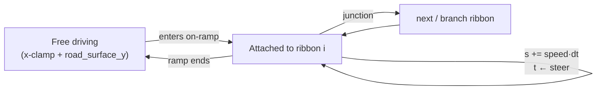

# Endless LIE — streaming corridor, service roads, drivable interchanges

> **RETIRED as the active road (2026-08-23).** Phase 3a replaced this entire architecture with a
> finite, real-world corridor derived from OpenStreetMap: the actual I-495 centreline, compacted from
> 31.2 real miles to 17.994 — see [phase-3-osm-lie-corridor.md](phase-3-osm-lie-corridor.md) §8.
> Nothing here drives any draws now; `App` builds the corridor via `build_corridor_segments` (`src/scene/Corridor/CorridorScene.h`) instead of `generate()` /
> `generate_chunk` / `generate_interchange_scene`, and `CorridorDriver` replaced `Treadmill`.
>
> This document is kept because it is still the reference for **why** the retired design worked, and
> three of its lessons carried straight into the replacement: seamless tile joins need a tile length
> that is a multiple of every texture tile size (the corridor's 300 m tile is 300 m for exactly this
> reason); geometry and physics must read the *same* curve or they drift (Layer 4b); and coordinates
> the GPU sees must be kept small. The code (`Treadmill`, `RoadScene::generate_chunk`,
> `generate_service_roads`, `generate_interchange`) is unwired but still present and still tested —
> deleting it is stage 3b's job, since 3b replaces the interchange geometry.

The goal the user set: make the drive **feel like 20–30 miles of believable Long Island Expressway**
without authoring 30 miles of geometry, and without float32 precision falling apart at the far end.

The answer is a **treadmill**: a hand-authored 4.2 km intro, then one *canonical* 300 m chunk
instanced at a sliding window of world offsets around the car, with the world origin periodically
rebased back toward zero. Because every chunk is the same mesh at a different offset, a rebase in
whole chunk lengths is visually undetectable — the tile looks identical after the shift.

This shipped as Layers 0–4b (2026-07-05). **Layer 5 — polish** (exit signage, network lights,
junction UX, haze/far-plane tuning) is the one remaining piece.

> Locked design decisions, made with the user: endless **treadmill** (not procedural-infinite
> generation); keep the authored 4.2 km as the **intro**; **elevated diamond** interchanges with
> graded ramps and car pitch on grade; **service roads both sides, continuous**; **guided network**
> (drivable bounds follow the current surface — no free-roam).

## Where the code lives

| Concern | File |
|---|---|
| Treadmill state, rebase, chunk/interchange windows, ribbon-follower | [src/scene/Treadmill/Treadmill.h](../src/scene/Treadmill/Treadmill.h) · [.cpp](../src/scene/Treadmill/Treadmill.cpp) |
| Shared road constants + drivable surface queries | [src/scene/RoadGeometry/RoadGeometry.h](../src/scene/RoadGeometry/RoadGeometry.h) |
| `generate_chunk` + the ordered `chunk_elements()` table | [src/scene/RoadScene/RoadScene.cpp](../src/scene/RoadScene/RoadScene.cpp) |
| Service roads, crossover, interchange, exit ramp generators | [src/scene/RoadScene/RoadScene_Ramps.cpp](../src/scene/RoadScene/RoadScene_Ramps.cpp) |
| Surface / furniture generators the chunk reuses | [RoadScene_Surfaces.cpp](../src/scene/RoadScene/RoadScene_Surfaces.cpp), [RoadScene_Furniture.cpp](../src/scene/RoadScene/RoadScene_Furniture.cpp); quads/ribbons in [MeshBuilder.cpp](../src/scene/RoadScene/MeshBuilder.cpp) |
| Shared cross-section constants (`kLie`, `kService`, `kExit`, `snap_dash_to_chunk`) | [src/scene/RoadScene/RoadParams.h](../src/scene/RoadScene/RoadParams.h) |
| Per-draw cull filter | [src/renderer/SceneGeometry/SceneGeometry.cpp](../src/renderer/SceneGeometry/SceneGeometry.cpp); plane/sphere math in [src/utils/geometry/Frustum.h](../src/utils/geometry/Frustum.h) |
| Scene setup (`AppInit.cpp`) + per-frame update (`App.cpp`; today only `m_corridor.update` runs, `m_treadmill` is unused) | [src/core/App/AppInit.cpp](../src/core/App/AppInit.cpp), [src/core/App/App.cpp](../src/core/App/App.cpp) |

## Tuning constants

All in `RoadGeometry` (world units — recall **1 scene-metre = 1000 WU**, `util::units::kWuPerMetre`). The five
never-used `get_*` accessors for these were deleted on 2026-09-29; read the `static constexpr` members directly:

| Constant | Value | Meaning |
|---|---|---|
| `kChunkLen` | `300000` (300 m) | One canonical tile. A multiple of every repeating feature's period, so tiles join seamlessly. |
| `kChunksAhead` | `8` | 8 × 300 m = 2.4 km of road ahead — matches the far plane. |
| `kChunksBehind` | `2` | Kept so the rear-view / chase camera never sees the void. |
| `kRebaseThreshold` | `1200000` (~1.2 km) | Rebase once the car's render-frame \|Z\| exceeds this. |
| `kCameraFar` | `2400000` | ≈ `kChunksAhead · kChunkLen`; chunks fill exactly to the far plane. |

## Layer 0 — per-draw distance + frustum culling

The prerequisite for everything else: instancing a chunk window means many more draw calls, so they
have to be cheap to reject. Every `DrawCall` carries a **bounding sphere** (with `−1` as a
never-cull sentinel for things like the sky). `SceneGeometry::record_draws` filters on frustum +
distance; `record_depth` filters on distance only (a shadow caster outside the camera frustum can
still cast into it).

Frustum planes are extracted from the view-projection matrix by the **Gribb–Hartmann** method: for a
row-major $\mathbf{M} = \mathbf{P}\mathbf{V}$, the six planes are $\mathbf{m}_4 \pm \mathbf{m}_i$
for $i \in \{1,2,3\}$, normalized by the length of the plane's xyz. A sphere at $\mathbf{c}$ with
radius $r$ is rejected when $\mathbf{n}\cdot\mathbf{c} + d < -r$ for any plane.

Ships in release with **image-identical defaults** (6000/6046 drawn — the 46 rejected are genuinely
off-screen). Stress-tested at a 250 m cull distance: 388/6046 drawn (93.6% culled) with no visible
pop-in wall.

## Layer 1 — the treadmill

Two mechanisms, both in `Treadmill::update`:

**Chunk window.** One `RoadScene::generate_chunk(kChunkLen)` mesh is uploaded once and instanced per
frame at a sliding set of world offsets via a per-draw `originOffset`. This was a deliberate choice
over the full per-chunk upload / fence / deferred-destroy machinery — that complexity only pays off
once chunks actually *vary*, which happens at Layer 4.

**Origin rebase.** Render-frame Z is

$$z_\text{render} = z_\text{true} + \Delta_\text{origin}$$

where $\Delta_\text{origin}$ accumulates in **whole chunk lengths** and is stored as a `double`
while everything downstream stays `float`. When $|z_\text{render}| > $ `kRebaseThreshold`, the world
shifts back by whole chunks. This keeps the float32 coordinates the GPU sees bounded near the origin
no matter how far the car has driven — verified surviving a 6,000,000 WU rebase with no visible
seam. Intro lamp point-lights are shifted alongside so they stay on their posts.

The far plane came down 4.3M → 2.4M WU once chunks reliably filled the view.

**Known follow-ups** (from the CHANGELOG): post-spacing seam hiccup, intro→chunk UV seam, per-slot
chunk lights, spray/TAA rebase handling.

## Layer 2 — continuous service roads

`generate_service_roads` emits a 2-lane frontage road on each side, beyond the sound barriers
(double-yellow centre, white edges). Every span is **full-length** so tiles join seamlessly. The
surface is lifted `kServiceY = 6` WU above the grass to avoid coplanar z-fighting — which matters
more than usual under reverse-Z. Called from `generate_chunk` only, so the authored intro and its
exit-ramp marginal road are untouched.

## Layer 3 — the ribbon primitive and the EB↔WB crossover

`MeshBuilder::emit_ribbon` turns a **3D centreline** into an up-facing triangle strip with
arc-length UVs. This is the building block for everything curved or graded — crossovers at Layer 3,
interchange ramps at Layer 4.

`generate_crossover` lays a smoothstep S-curve connector across a gap in the jersey barrier, once
per chunk. `RoadGeometry::drivable_bounds` then feeds the car per-frame lateral bounds that **open
across the median** inside a crossover window and otherwise clamp it to its own carriageway.

Car physics were *not* touched: the free bicycle model and the X-clamp are unchanged, only the
*source* of the bounds and the surface Y was generalized — so eastbound driving stayed
byte-identical.

## Layer 4 — elevated diamond interchanges

`generate_interchange` builds an over-the-mainline cross-street deck at 19.5 ft on piers, plus
**four graded on/off ramps** via `emit_ribbon`, each following a smoothstep 3D centreline that
climbs from `y ≈ 6` to deck level at roughly a **4.6% grade**.

The interchange is a *second* canonical geometry, instanced **sparsely** (~1.5 mi ≈ every 8 chunks)
through the same treadmill path — so it inherits chunk culling, rebase and `originOffset` for free.

## Layer 4b — making them drivable

Geometry alone doesn't let you drive a ramp: an `(x,z) → y` height query cannot represent
**overlapping decks**. The fix is to attach the car to a curve instead.

`RoadScene::interchange_ribbons()` exposes the four drivable centrelines, shared by both the
geometry and the physics so they can't drift apart. The `Treadmill` ribbon-follower then works like
this:

While attached, arc-length $s$ advances by speed, lateral offset $t$ comes from steering input, and
the car's **Y, pitch and heading are read off the ribbon**. Pitch maps to `rotation.z` because the
car's nose is +X. It stays *guided, not on-rails* — you still steer within the ribbon's width, and
junctions offer next/branch choices.

The frontage road was made drivable at the same time (`road_surface_y` + a `drivable_bounds` window)
so the service off-ramp has somewhere to land.

**Verified by driving:** climb 6 → 5944 WU (pitch → 3.9°), flat across the deck, descend 5944 → 16
(pitch → −3.9°) onto the opposite carriageway; steering at the top exits via the service ramp onto
the frontage road.

## What's deferred

- **Layer 5 polish** — endless at-grade exits (intro EB→N Marginal is polished separately),
  network lights, junction UX, haze/far-plane tuning.
- One-way service road (today you can re-enter against the flow).
- Deck and ramp lane markings; embankment fill under the ramps.
- Full `(ribbonId, s, t)` tracking as the general position representation.
- Attach/junction UX is functional but basic.

**Intro exit (2026-08-21):** the authored intro diverge has chevron gore, EXIT ONLY gantry locked
to the ramp Z, W-beam on the ramp/marginal, marginal trees, and `drivable_bounds` opens onto
N Marginal past the decel station. Endless chunks still have **no** flat mainline→frontage exit.

## See also

- [glen-cove-lie.md](glen-cove-lie.md) — the roadside detail (signage, guardrail, davit lamps,
  overpasses) that dresses this corridor.
- [render-pipeline.md](render-pipeline.md) — where this geometry enters the frame (the G-buffer).
- CHANGELOG entries dated **2026-07-05** — the authoritative per-layer write-ups.
