# Endless LIE — streaming corridor, service roads, drivable interchanges

> **RETIRED as the active road (2026-08-23).** Phase 3a replaced this entire architecture with a
> finite, real-world corridor derived from OpenStreetMap: the actual I-495 centreline, compacted from
> 31.2 real miles to 17.994 — see [phase-3-osm-lie-corridor.md](phase-3-osm-lie-corridor.md) §8.
> Nothing here drives any draws now; `App` builds the corridor via `build_corridor_segments` (`src/scene/Corridor/CorridorScene.h`) instead of `generate()` /
> `generate_chunk` / `generate_interchange_scene`, and `CorridorDriver` replaced `Treadmill`.
>
> This document is kept because it is still the reference for **why** the retired design worked, and
> three of its lessons carried straight into the replacement: seamless tile joins need a tile length
> that is a multiple of every texture tile size (the corridor's 300 m tile is 300 m for exactly this
> reason); geometry and physics must read the *same* curve or they drift (Layer 4b); and coordinates
> the GPU sees must be kept small. The code (`Treadmill`, `RoadScene::generate_chunk`,
> `generate_service_roads`, `generate_interchange`) is unwired but still present and still tested —
> deleting it is stage 3b's job, since 3b replaces the interchange geometry.

The goal the user set: make the drive **feel like 20–30 miles of believable Long Island Expressway**
without authoring 30 miles of geometry, and without float32 precision falling apart at the far end.

The answer is a **treadmill**: a hand-authored 4.2 km intro, then one *canonical* 300 m chunk
instanced at a sliding window of world offsets around the car, with the world origin periodically
rebased back toward zero. Because every chunk is the same mesh at a different offset, a rebase in
whole chunk lengths is visually undetectable — the tile looks identical after the shift.

This shipped as Layers 0–4b (2026-07-05). **Layer 5 — polish** (exit signage, network lights,
junction UX, haze/far-plane tuning) is the one remaining piece.

> Locked design decisions, made with the user: endless **treadmill** (not procedural-infinite
> generation); keep the authored 4.2 km as the **intro**; **elevated diamond** interchanges with
> graded ramps and car pitch on grade; **service roads both sides, continuous**; **guided network**
> (drivable bounds follow the current surface — no free-roam).

## Where the code lives

| Concern | File |
|---|---|
| Treadmill state, rebase, chunk/interchange windows, ribbon-follower | [src/scene/Treadmill/Treadmill.h](../src/scene/Treadmill/Treadmill.h) · [.cpp](../src/scene/Treadmill/Treadmill.cpp) |
| Shared road constants + drivable surface queries | [src/scene/RoadGeometry/RoadGeometry.h](../src/scene/RoadGeometry/RoadGeometry.h) |
| `generate_chunk` + the ordered `chunk_elements()` table | [src/scene/RoadScene/RoadScene.cpp](../src/scene/RoadScene/RoadScene.cpp) |
| Service roads, crossover, interchange, exit ramp generators | [src/scene/RoadScene/RoadScene_Ramps.cpp](../src/scene/RoadScene/RoadScene_Ramps.cpp) |
| Surface / furniture generators the chunk reuses | [RoadScene_Surfaces.cpp](../src/scene/RoadScene/RoadScene_Surfaces.cpp), [RoadScene_Furniture.cpp](../src/scene/RoadScene/RoadScene_Furniture.cpp); quads/ribbons in [MeshBuilder.cpp](../src/scene/RoadScene/MeshBuilder.cpp) |
| Shared cross-section constants (`kLie`, `kService`, `kExit`, `snap_dash_to_chunk`) | [src/scene/RoadScene/RoadParams.h](../src/scene/RoadScene/RoadParams.h) |
| Per-draw cull filter | [src/renderer/SceneGeometry/SceneGeometry.cpp](../src/renderer/SceneGeometry/SceneGeometry.cpp); plane/sphere math in [src/utils/geometry/Frustum.h](../src/utils/geometry/Frustum.h) |
| Scene setup (`AppInit.cpp`) + per-frame update (`App.cpp`; today only `m_corridor.update` runs, `m_treadmill` is unused) | [src/core/App/AppInit.cpp](../src/core/App/AppInit.cpp), [src/core/App/App.cpp](../src/core/App/App.cpp) |

## Tuning constants

All in `RoadGeometry` (world units — recall **1 scene-metre = 1000 WU**, `util::units::kWuPerMetre`). The five
never-used `get_*` accessors for these were deleted on 2026-09-29; read the `static constexpr` members directly:

| Constant | Value | Meaning |
|---|---|---|
| `kChunkLen` | `300000` (300 m) | One canonical tile. A multiple of every repeating feature's period, so tiles join seamlessly. |
| `kChunksAhead` | `8` | 8 × 300 m = 2.4 km of road ahead — matches the far plane. |
| `kChunksBehind` | `2` | Kept so the rear-view / chase camera never sees the void. |
| `kRebaseThreshold` | `1200000` (~1.2 km) | Rebase once the car's render-frame \|Z\| exceeds this. |
| `kCameraFar` | `2400000` | ≈ `kChunksAhead · kChunkLen`; chunks fill exactly to the far plane. |

## Layer 0 — per-draw distance + frustum culling

The prerequisite for everything else: instancing a chunk window means many more draw calls, so they
have to be cheap to reject. Every `DrawCall` carries a **bounding sphere** (with `−1` as a
never-cull sentinel for things like the sky). `SceneGeometry::record_draws` filters on frustum +
distance; `record_depth` filters on distance only (a shadow caster outside the camera frustum can
still cast into it).

Frustum planes are extracted from the view-projection matrix by the **Gribb–Hartmann** method: for a
row-major $\mathbf{M} = \mathbf{P}\mathbf{V}$, the six planes are $\mathbf{m}_4 \pm \mathbf{m}_i$
for $i \in \{1,2,3\}$, normalized by the length of the plane's xyz. A sphere at $\mathbf{c}$ with
radius $r$ is rejected when $\mathbf{n}\cdot\mathbf{c} + d < -r$ for any plane.

Ships in release with **image-identical defaults** (6000/6046 drawn — the 46 rejected are genuinely
off-screen). Stress-tested at a 250 m cull distance: 388/6046 drawn (93.6% culled) with no visible
pop-in wall.

## Layer 1 — the treadmill

Two mechanisms, both in `Treadmill::update`:

**Chunk window.** One `RoadScene::generate_chunk(kChunkLen)` mesh is uploaded once and instanced per
frame at a sliding set of world offsets via a per-draw `originOffset`. This was a deliberate choice
over the full per-chunk upload / fence / deferred-destroy machinery — that complexity only pays off
once chunks actually *vary*, which happens at Layer 4.

**Origin rebase.** Render-frame Z is

$$z_\text{render} = z_\text{true} + \Delta_\text{origin}$$

where $\Delta_\text{origin}$ accumulates in **whole chunk lengths** and is stored as a `double`
while everything downstream stays `float`. When $|z_\text{render}| > $ `kRebaseThreshold`, the world
shifts back by whole chunks. This keeps the float32 coordinates the GPU sees bounded near the origin
no matter how far the car has driven — verified surviving a 6,000,000 WU rebase with no visible
seam. Intro lamp point-lights are shifted alongside so they stay on their posts.

The far plane came down 4.3M → 2.4M WU once chunks reliably filled the view.

**Known follow-ups** (from the CHANGELOG): post-spacing seam hiccup, intro→chunk UV seam, per-slot
chunk lights, spray/TAA rebase handling.

## Layer 2 — continuous service roads

`generate_service_roads` emits a 2-lane frontage road on each side, beyond the sound barriers
(double-yellow centre, white edges). Every span is **full-length** so tiles join seamlessly. The
surface is lifted `kServiceY = 6` WU above the grass to avoid coplanar z-fighting — which matters
more than usual under reverse-Z. Called from `generate_chunk` only, so the authored intro and its
exit-ramp marginal road are untouched.

## Layer 3 — the ribbon primitive and the EB↔WB crossover

`MeshBuilder::emit_ribbon` turns a **3D centreline** into an up-facing triangle strip with
arc-length UVs. This is the building block for everything curved or graded — crossovers at Layer 3,
interchange ramps at Layer 4.

`generate_crossover` lays a smoothstep S-curve connector across a gap in the jersey barrier, once
per chunk. `RoadGeometry::drivable_bounds` then feeds the car per-frame lateral bounds that **open
across the median** inside a crossover window and otherwise clamp it to its own carriageway.

Car physics were *not* touched: the free bicycle model and the X-clamp are unchanged, only the
*source* of the bounds and the surface Y was generalized — so eastbound driving stayed
byte-identical.

## Layer 4 — elevated diamond interchanges

`generate_interchange` builds an over-the-mainline cross-street deck at 19.5 ft on piers, plus
**four graded on/off ramps** via `emit_ribbon`, each following a smoothstep 3D centreline that
climbs from `y ≈ 6` to deck level at roughly a **4.6% grade**.

The interchange is a *second* canonical geometry, instanced **sparsely** (~1.5 mi ≈ every 8 chunks)
through the same treadmill path — so it inherits chunk culling, rebase and `originOffset` for free.

## Layer 4b — making them drivable

Geometry alone doesn't let you drive a ramp: an `(x,z) → y` height query cannot represent
**overlapping decks**. The fix is to attach the car to a curve instead.

`RoadScene::interchange_ribbons()` exposes the four drivable centrelines, shared by both the
geometry and the physics so they can't drift apart. The `Treadmill` ribbon-follower then works like
this:

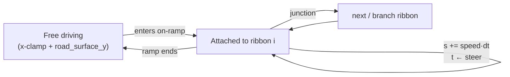

While attached, arc-length $s$ advances by speed, lateral offset $t$ comes from steering input, and
the car's **Y, pitch and heading are read off the ribbon**. Pitch maps to `rotation.z` because the
car's nose is +X. It stays *guided, not on-rails* — you still steer within the ribbon's width, and
junctions offer next/branch choices.

The frontage road was made drivable at the same time (`road_surface_y` + a `drivable_bounds` window)
so the service off-ramp has somewhere to land.

**Verified by driving:** climb 6 → 5944 WU (pitch → 3.9°), flat across the deck, descend 5944 → 16
(pitch → −3.9°) onto the opposite carriageway; steering at the top exits via the service ramp onto
the frontage road.

## What's deferred

- **Layer 5 polish** — endless at-grade exits (intro EB→N Marginal is polished separately),
  network lights, junction UX, haze/far-plane tuning.
- One-way service road (today you can re-enter against the flow).
- Deck and ramp lane markings; embankment fill under the ramps.
- Full `(ribbonId, s, t)` tracking as the general position representation.
- Attach/junction UX is functional but basic.

**Intro exit (2026-08-21):** the authored intro diverge has chevron gore, EXIT ONLY gantry locked
to the ramp Z, W-beam on the ramp/marginal, marginal trees, and `drivable_bounds` opens onto
N Marginal past the decel station. Endless chunks still have **no** flat mainline→frontage exit.

## Corridor port (C1, 2026-11-20): ramps and service roads on the real alignment

The retired generators above worked in an axis-aligned world (Z along, X across). The real corridor curves,
climbs and banks, so [`CorridorRamps.{h,cpp}`](../src/scene/Corridor/CorridorRamps.h) restates the exit ramp,
service road and crossover in corridor frames `(s, t)`. The originals in `RoadScene_Ramps.cpp` are untouched
(golden mesh test and the lighting lab still use them).

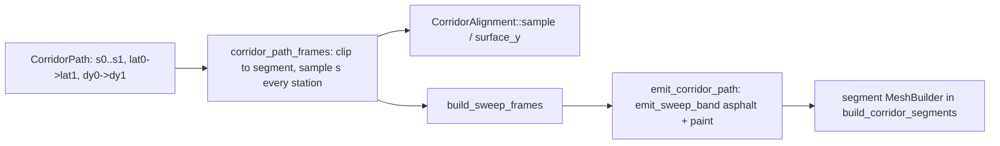

- **One shape for all three.** A path eases its centreline offset and its height with one smoothstep
  $S(u) = 3u^2 - 2u^3$, $u = (s - s_0)/(s_1 - s_0)$. Service road: constant offset, height `dy`. Exit ramp: from
  the shoulder edge to the service road's near lane, height 0 to `dy`. Crossover: EB inner lane to WB inner lane.
  $S'(0) = S'(1) = 0$, so the path leaves and joins tangentially, the same reason the retired ribbons used it.
- **Height.** Bank 0 (level across). The band sits on the highest point of the mainline surface plane under
  it, $y = \text{surface\_y}(s, t) + |e|\,w/2 + dy$, so the grass, which shares that plane, never shows through.
- **Segment split.** Frames are clipped to `[segment start, segment end]` but $u$ uses the full path range, so the
  two halves of a ramp crossing an edge sample one curve and meet exactly (unit test).
- **Sizes** come from `road::kExit` in `RoadParams.h` (ramp 14 ft wide, 1,200 ft long = decel + diverge +
  connect; service road two 12 ft lanes, inner edge 64 ft past the shoulder).
- **Not drivable** in C1; C3 made the diamond paths drivable (section below).

Sources (not opened for this item; standard references for ramp geometry): AASHTO *A Policy on Geometric Design of
Highways and Streets* ("Green Book"), ch. 10 (interchanges: ramp terminals, deceleration lanes, gore); Mannering and
Washburn, *Principles of Highway Engineering and Traffic Analysis*, ch. 3; Michigan Tech CE 3401 (B. Alkire) lecture
notes on horizontal and vertical alignment; FHWA *Interchange Justification / ramp terminal* design guidance.

## Service-road extents (C2a, 2026-11-20): the SRVR asset block

The debug asset `lie_corridor_full.bin` now records where the real service roads run, per side, as an optional
trailing block (tag `SRVR`, same `u32 tag, u32 count, records` pattern as `EXIT` / `DIST`). Each 24-byte
`CorridorServiceRoad` is `{s0, s1, westbound, lanes, source}`; read it with `CorridorAlignment::service_roads()`
(sorted by `s0`, both sides; empty for the release asset and any file without the block).

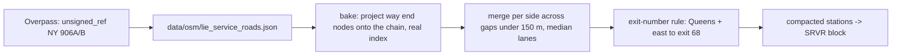

South SR (NY 906A) is eastbound, North SR (NY 906B) westbound, both one way with their side's mainline. Nothing is
drawn from the block yet (C2b). Knobs and sources: [corridor tuning notes](corridor/tuning-notes.md#c2a-service-road-extents).

## Diamonds, service roads and the crossroad cut (C2b, 2026-11-21)

Debug build only (release asset has no `EXIT` / `SRVR` blocks, so every new path is empty there and the release mesh
is unchanged). One generator, driven by the exit table and the SRVR block, builds about 30 standard diamonds.

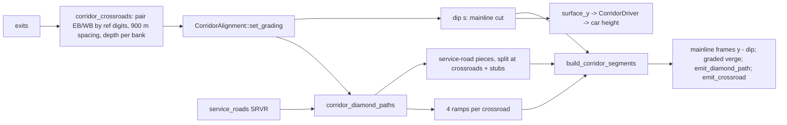

- **One grade function.** `CorridorAlignment::dip(s)` is the only place the cut lives; `surface_y` subtracts it, so
  the mainline mesh, the lamps, `surface_slope` and the car's height all see the same dip. `ground_y(s)` (no bank,
  no dip) is the level the service roads, crossroads and ramp ends sit on. C3 queries both.
- **Paths, not new types.** `CorridorPath` gained `kind` (Plain / Service / Ramp), `side` (lateral measured outward
  from the mainline outer edge, so a service road follows lane tapers), `lanes`, a ground weight `g0 -> g1`
  (0 = mainline plane, 1 = level ground) and a height window `[h0, h1]` in $u$. `corridor_path_at` is the single
  evaluator (frames, verge and tests all use it). A ramp is level with the shoulder until its nose and with the
  service road after its touch point, so it never floats over either.
- **Verge.** On a graded asset the flat grass verge is replaced per tile by three strips per side (gore slope,
  cut slope, level grass) built from explicit points, so slopes run from a dipped or banked edge up to level
  ground. Sample stations include each ramp end and 1 WU either side, so the slope switches shape without slivers.
  New `MeshBuilder::emit_strip` (free per-vertex heights, one draw) and a public `batch_mark` / `close_batch` so
  discrete quads (crossroad boxes, paint, chevrons) batch into one draw per colour.
- **Crossroad.** Straight in world (frame at its station), level across, following the ground grade along the
  mainline. Deck box + 42 in parapets over the cut (between the two strip tops), wall piers at the median and both
  mainline edges, curbs off the deck broken at the service roads, double yellow, dashed lane lines, edge lines,
  continental crosswalks outside each service road. The service road stops 0.5 m under the crossroad edge (no
  crack) and gets a crosswalk and 24 in stop bar on its approach.
- **Segments.** Paths clip per segment as in C1; crossroads go whole into the segment holding their station.

Screenshots: [diamond](corridor/img/c2b-diamond-overview.png), [dip](corridor/img/c2b-dip-under-crossroad.png),
[service road](corridor/img/c2b-service-road.png), [gore](corridor/img/c2b-gore-chevrons.png). Knobs, formulas
and sources: [corridor tuning notes](corridor/tuning-notes.md#c2b-diamonds-service-roads-and-the-crossroad-cut).

Sources (not opened in this session): FHWA MUTCD Part 3 (markings); AASHTO Green Book ch. 10 (interchanges) and
ch. 4 (curbs); Mannering and Washburn ch. 3; Michigan Tech CE 3401 and UW CEE 320 lecture notes.

## Drivable ramps and service roads (C3, 2026-11-21)

Debug build only in effect (release has no diamond paths, so the union below is the mainline alone and the clamp,
height and slope are the same arithmetic as before). The car can leave the mainline at a gore, drive the exit ramp
onto the service road, cross the crossroad along it, and take the entrance ramp back. Everywhere else the old
behaviour stays: the car centre is clamped laterally, and the 6-DOF car gets the push-out and scrape
(`CarEntity::wall_contact`).

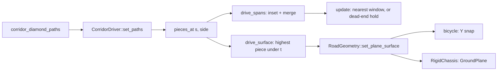

- **One query, two uses.** [`CorridorSurface.h`](../src/scene/Corridor/CorridorSurface.h) declares
  `drive_surface(al, paths, s, lat)` (piece, height, grade) and `drive_spans(al, paths, s, side, inset)` (merged
  lateral windows). Both are built on one list of pieces at $s$: the mainline carriageway (with the dip), every
  ramp and service-road path covering $s$, and the service road's band carried across each crossroad deck. They
  are implemented in [`CorridorBounds.cpp`](../src/scene/Corridor/CorridorBounds.cpp) next to the old rule, so the
  unit tests link them without Vulkan or GLFW. `carriageway_bounds` is now `drive_spans` with no paths.
- **Committed side kept.** Pieces are taken from the committed side only. The median rule from Phase 3a (a long
  frame cannot carry the car through the barrier) is unchanged, and a service road is always on its own side.
- **Gore and landing.** A ramp overlaps the shoulder until its nose and the service road after its touch point,
  so the windows merge there and the car can drift across. Past the nose the grass gore separates them.
- **Height.** The highest piece under the car centre wins. It feeds the same plane as before: the mainline keeps
  its analytic slope (bank and grade); ramps, service roads and the deck are level across, so their slope is the
  grade along the tangent. Both car models read that one plane (see the tuning notes for why not per wheel).
- **Dead ends.** If the nearest window is more than 3 m away while the car was on a side road, the road ended
  under it. The car is held at last frame's spot, with a wall contact along the tangent, instead of being thrown
  sideways onto the mainline.
- **Slider.** `corridorDriveOff` switches back to the mainline-only clamp for A/B.

Verified by a temporary scripted drive (removed), with both car models: lane, exit ramp, service road, crossroad,
service road, entrance ramp, lane, with no height jumps in the 1 Hz telemetry and the hold at a stub end. A 0.25 m
sweep over all 60 diamond routes found every point drivable, with the largest seam step 13 cm at a ramp start on
a 6 % bank (the C2b mesh has the same step). Screenshots: [exit ramp](corridor/img/c3-exit-ramp.png),
[service road](corridor/img/c3-service-road.png). Knobs and formulas:
[corridor tuning notes](corridor/tuning-notes.md#c3-drivable-ramps-service-roads-and-the-crossroad-run).

Sources (not opened in this session): AASHTO Green Book ch. 10 (ramp terminals, gores) and ch. 3
(superelevation); Mannering and Washburn ch. 3; Michigan Tech CE 3401 lecture notes; Ericson, *Real-Time
Collision Detection*, ch. 5 (closest point on an interval).

## Cross-street stubs, signals and the HOV lane (C3a, 2026-11-21)

Debug build only (release has no exit table and no crossroads, so `corridor_hov` and the stub list are empty and the
mesh is unchanged). Three props, all built in the segment pass like C2b:

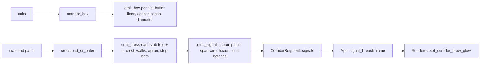

- **Stubs.** The crossroad now runs to $o + L$ on each side ($o$ = the service road's outer edge, $L$ = slider
  `corridorStubM`). It stays the same straight strip as C2b, with a crest profile added to its height over the last
  45 m: up 1.8 m, then down to 2.5 m below ground at the end. From road level the line of sight clears the crest, so the
  end is hidden without a fade shader or a barrier. Quads are cut at 2.5 m knots over the crest; pavement and the grass apron
  use plan-space UVs, so the texture does not jump at the cuts. 5 ft sidewalks, curbs, 2+2 lanes, double yellow, inbound and
  outbound stop bars; centre and lane lines stop at the crosswalks.
- **Signals.** Long Island style, from photos (sources below): span wire on two steel strain poles at the diagonal
  corners, black 3-section 12 in heads with tunnel visors, no backplates. One head per approach lane: the service road
  (one-way, facing upstream), crossroad inbound and outbound. Lenses are batched per (phase group, colour), giving 6 draws per
  crossroad. Their draw indices travel in `CorridorSegment::signals`, and `App` switches colour and emissive every frame
  through a debug-only renderer setter, so nothing is rebuilt. Fixed two-phase cycle: green, 4 s amber, 1 s all red. Props only:
  no traffic logic, no collision (the poles stand on undrivable grass).
- **HOV lane.** Median lane both ways from the exit 32 station to the exit 64 station. The lane 1|2 dashed line becomes
  a 2 ft buffer edged by two 8 in white lines. They are solid, and broken in a 1,000 ft access zone before each exit (a fixed
  pattern; no zone data). Diamond outlines (MUTCD minimum 2.5 x 12 ft, 6 in lines) every 1,000 ft. Paint follows
  the tile's own stations (`corridor_mainline_frames`, dip and bank included), one draw set per tile.

Draw calls: +679 over the corridor (+2.7 %), at most +32 in one segment. Screenshots:
[signal](corridor/img/c3a-signal-from-sr.png), [stub end](corridor/img/c3a-stub-end.png),
[HOV](corridor/img/c3a-hov-buffer-diamond.png). Knobs and formulas:
[corridor tuning notes](corridor/tuning-notes.md#c3a-cross-street-stubs-signals-and-the-hov-lane).

Sources: FHWA MUTCD 2009 Chapter 3D, sections 3D.01 (diamond at least 2.5 ft x 12 ft, 6 in lines; freeway spacing up
to 1,000 ft) and 3D.02 / Table 3D-1 (buffer-separated left-hand lane: wide solid lines, broken where crossing is
permitted), opened 2026-11-21 (mutcd.fhwa.dot.gov/htm/2009/part3/part3d.htm); MUTCD 4D.15 (signal head mounting
height); Wikipedia "Interstate 495 (New York)", HOV section (exits 32 to 64, median lane, designated access points),
opened; Wikimedia Commons photos "Lakeville Road Approaching the Long Island Expressway, Lake Success, NY August 23,
2024 A" and "Long Island Expressway Overpass, Exit 37, Mineola & Willis Avenues, Roslyn Heights" (span wire, black heads,
no backplates), viewed; ITE *Vehicle Traffic Control Signal Heads* (LED minimum intensities) and ITE change-interval
practice (not opened); NYSDOT signal design guidance (not opened); Mannering and Washburn ch. 7 (signal timing) and
UW CEE 320 lecture notes on signalized intersections (not opened).

## Route ends: Queens-Midtown Tunnel and the Riverhead roundabout (C4, 2026-11-21)

Debug build only. `corridor_ends` sizes both ends from `road::ends` (RoadParams.h) and the exit table, and
`CorridorAlignment::set_ends` turns them on. Release never calls it, so `in_tunnel` is false, `main_end` is the
total length and `in_turnaround` keeps the 220 m end pads. Queries live in `CorridorEnds.cpp` (unit-tested);
mesh lives in `CorridorEndsMesh.cpp`.

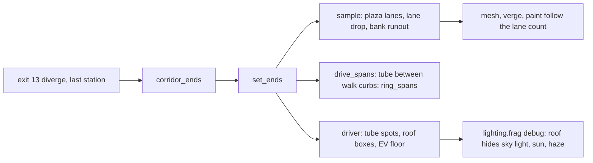

**West end.** OSM tunnel way 658498546 (`maxheight` 12 ft 1 in) ends at the Queens portal, 80 m before the EB exit 13
diverge in the 2026-11-20 bake. The corridor's first 1.42 km is therefore the tube, and the baked start (340 m) is
inside it: the drive begins in the tunnel and emerges at the plaza. The tube is built over the mainline: walks
($0.75 \times 0.30$ m) at both lane edges, tiled walls, a down-facing ceiling at 4.3 m and two continuous luminaire
rows. The lane line is solid (no lane changes in the tube). The shoulders, median barrier and verge still exist behind
the walls, unseen. The car's window is $[p_i + c,\; p_o - c]$, $c = 0.65$ m, so its body stays off the curbs. The west
end is a dark cap behind a 30 m unlit lead-in. The portal has a headwall with two openings, an 80 m grassed cover and
2:1 slopes behind wing walls, so the line of sight from the plaza never reaches the tube boxes. The plaza widening is
extra lane width (+1.5 lanes per side) in `sample()`, so the verge and the clamp follow it. It holds the cashless
gantry and the U-turn opening (`emit_median` builds the barrier with exact openings).

**Lighting the tube.** One downward spot every $\Delta = 6$ m at $h = 4.15$ m over the lane centre:

$$E_\text{road} = \frac{I}{h^2}\sum_{k=-4}^{4}\left(\frac{h}{\sqrt{h^2 + (k\Delta)^2}}\right)^3 \quad\Rightarrow\quad I = \frac{E\,h^2}{\sum_k\cos^3\theta_k}$$

CIE 88's zones as fixed multipliers: threshold ($\times 10$, 50 m in from the portal) and transition (linear to
$\times 1$ over 100 m) for the entering WB tube, and exit ($\times 5$, last 60 m) for the EB tube. The real threshold
luminance follows $L_\text{th} = k\,L_{20}$ with $k \approx 0.05$ to $0.1$ and $L_{20}$ several kcd/m², which is far
brighter than $\times 10$. The fixed factor is a stand-in until the lighting phase meters $L_{20}$. Spots are
unshadowed, so inside the tube only the car's own tube is sent; outside, both are. Three things keep daylight out:
up to 12 roof boxes over 25 m chunks (`corridor_tunnel_roofs`, closed except the portal chunk, which opens at -Z),
which the debug shader uses to remove sky light, the 0.25 shadow floor, haze, rain fog and, for closed or one-ended
boxes, the sun. CSM alone left the inner wall sunlit. Inside the tube the auto-exposure EV100 floor drops from the
preset's daylight value to 4.5 (eye adaptation; `aeSpeed` makes the entry dark and the exit bright, as in a real tunnel).

**East end.** Lane drop over the MUTCD merge taper $L = WS$ (12 ft x 45 mph = 540 ft), with the bank eased to 0
over the same span. Then a 15 m splitter island (crash cushion on its WB nose) and a single-lane roundabout,
$R_o = 24$ m and $R_i = 17$ m (48 m inscribed diameter, inside FHWA's single-lane range), centred on the
centreline 10 m before the last station. The mainline stops at $s_m = s_c - \sqrt{R_o^2 - e^2}$, where its corner
($e$ = outer edge) meets the ring, so no crescent of grass shows between them. The ring overlays the approach 10 WU
higher. Drivable windows: $w_o = \sqrt{R_o^2 - d^2}$ and, over the island, $[-w_o,-w_i] \cup [w_i, w_o]$ with
$d = s - s_c$. The clamp is lateral, so the island and the outer edge act as walls. The side re-commits by sign from
$s_c - R_o$ on, and an empty span list (the far rim) holds the car, as a C3 dead end does. The real LIE ends at exit 73
by becoming CR 58 at a signal, so the roundabout is fictional, and the mainline itself is the final exit.

Draws: 25,831 with the ends (26,128 without: the tube and plaza drop the old service-road stubs). Screenshots:
[inside](corridor/img/c4-tunnel-inside.png), [exit](corridor/img/c4-tunnel-exit.png),
[portal](corridor/img/c4-portal-plaza.png), [approach](corridor/img/c4-roundabout-approach.png),
[ring](corridor/img/c4-roundabout-ring.png). Knobs:
[corridor tuning notes](corridor/tuning-notes.md#c4-tunnel-plaza-and-riverhead-roundabout).

Sources: Wikipedia "Queens–Midtown Tunnel" (two tubes of two lanes, 6,414 / 6,272 ft; open-road cashless tolling from
2017-01-10 with TransCore gantries at the Manhattan end; former toll plaza on the Queens side with exits 13 and 14 just
east; 2017-18 re-tiling in white with gold and blue stripes), opened 2026-11-21; OpenStreetMap ways 658498546 /
11878036 (`tunnel=yes`, `maxheight=12'1"`, layer -1) and `highway=toll_gantry` nodes at the Manhattan portal, read from
the cached extract. Not opened: CIE 88:2004 *Guide for the Lighting of Road Tunnels and Underpasses* (zones,
$L_\text{th} = k L_{20}$, exit zone); ANSI/IES RP-22-11 *Tunnel Lighting* (interior luminance by traffic and speed);
FHWA MUTCD 2009 sections 3B (lane-drop markings), 3C (roundabout markings) and Table 6C-4 (taper $L = WS$); NCHRP
Report 672 *Roundabouts: An Informational Guide* (2010, single-lane inscribed diameters); Mannering and Washburn,
*Principles of Highway Engineering and Traffic Analysis*, ch. 3 (geometric design); UW CEE 320 lecture notes on
horizontal alignment and superelevation runoff.

## Corridor edges (D2, 2026-11-21)

Debug build only (release asset has no exit table, so `corridor_edges` returns an empty `CorridorEdges` and the old box
median and clamp stay). Code: [CorridorEdges.h](../src/scene/Corridor/CorridorEdges.h); sizes: `road::edges`.

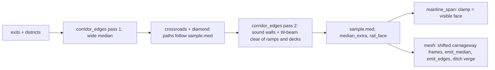

- **One width function.** `CorridorAlignment::median_extra(s)` is the only place the wide median lives; `sample()` puts
  it in `Sample::med`, and the `outer_edge / paint_inner / paint_outer(const Sample&)` overloads carry it to ramps,
  service roads, crossroads, the verge, the HUD and the bounds. The float overloads (tests, plaza, east end) keep the
  header width. The mainline mesh sweeps each carriageway off frames shifted by the same amount, so its paint code is
  unchanged.
- **Median.** West of the wide stretch: a 32 in New Jersey safety shape (3 in reveal, 55° then 84° faces, 24 in base,
  6 in top) with end caps, a concrete footing strip and a widened block under each lamp pole. East of exit 64: grass
  with a shallow swale, a three-cable barrier and attenuators on the NJ ends facing oncoming traffic; no lamps.
- **Outer edge.** W-beam (MGS 31 in, posts 6 ft 3 in, 8 in blockouts, turned-down ends) shields every crossroad pier;
  piers moved 2 m past the shoulder. Sound walls (brick-textured precast on a plinth between posts, 4.5 m) stand at the
  top of the cut in every 400 m gap between diamonds in Nassau and on the westbound side east of exit 31.
- **Embankment.** The cut slope is now a ditch (1V:6H foreslope, flat bottom) and a backslope rounded at toe and top,
  one draw per tile side; `corridor_verge_y` is the shared height for wall feet and rail posts. The bake has no fill
  sections (ground follows the profile), so there are no fill slopes beyond the bank's high side.
- **Contact.** `mainline_span` clamps the car centre one `kCurbClear` off the NJ toe and off the W-beam face, so the
  body stops at the face you see. The clamp is on the centre point: an angled car's corner can still overlap the face.

Screenshots: [NJ close-up](corridor/img/d2-jersey-closeup.png), [car on the barrier](corridor/img/d2-jersey-contact.png),
[6-DOF scrape](corridor/img/d2-rigid-scrape-median.png), [barrier end](corridor/img/d2-jersey-end-attenuator.png),
[grass median east of 64](corridor/img/d2-grass-median-east64.png), [cut + W-beam](corridor/img/d2-cut-wbeam-crossroad.png),
[Nassau wall](corridor/img/d2-soundwall-nassau.png), [wall from the service road](corridor/img/d2-soundwall-service-road.png).
Knobs and formulas: [corridor tuning notes](corridor/tuning-notes.md#d2-edges-nj-barrier-wide-median-w-beam-sound-walls-ditch).

Sources (not opened in this session): AASHTO Roadside Design Guide 4th ed. (2011) ch. 3, 5, 6; AASHTO M180; MASH
2016; FHWA safety-shape barrier and W-beam memos; FHWA Highway Traffic Noise Barrier Design Handbook; NYSDOT Standard
Sheets (guide rail, median barrier); Purdue and UW CEE 320 roadside safety lecture notes. Via the D0 reference sheet
(read by D0, not reopened here): Wikipedia I-495 route description (wide median east of exit 64), nycroads.com (no lamps
east of 64), the exit-33 and exit-49 photos.

## Guide signs (D3, 2026-11-21)

Debug build only (the release asset has no exit table and the atlases load only in debug). Code:
[CorridorSigns.h](../src/scene/Corridor/CorridorSigns.h); text: [tools/sign_corridor.py](../tools/sign_corridor.py) baked to
`assets/signs/` and [SignAtlas.h](../src/scene/Corridor/SignAtlas.h); sizes: `road::signs`.

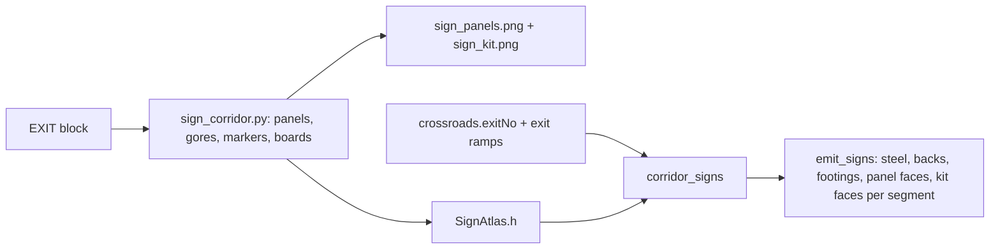

- **Text is offline.** One advance panel and one gore sign per (exit number, direction), grouped by `atoi(ref)` as the
  crossroads are, so every diamond has its text. A direction with no OSM record borrows the other's. Shields follow
  `destRef` (Interstate, NY route, county route); parkway refs become a text line; two destination lines at most
  (MUTCD 2E.10) with MUTCD abbreviations. The generator fails if a legend would drop below a 12 in cap height.
- **Real miles on the faces.** The bake compresses 70.4 mi to 30, so "1 MILE" stands at the baked equivalent of a real
  mile (685.5 m), the unit the HUD shows. The collapse rule (`advance_gantries`) keeps 1 mile + 1/2 mile when both fit
  after the previous gore, else only 1/2 mile, else 1/4 mile, else none; a face always shows the distance it stands at.
  Gantries step off crossroad decks and out of their 150 m sight shadow (the mainline dips under each deck, so a gantry
  just past one is hidden from afar), upstream when there is room.
- **Gantry.** Galvanised square box truss over one carriageway, median column on the NJ line (or off the inner
  shoulder in the wide median), outer column 2 m past the shoulder or past a ramp still alongside, 17 ft clearance over
  the highest point of lanes and shoulders, sign over the right lane. The sign is three quads (tab, panel, distance
  strip) so 116 panels share three strips.
- **Gore and markers.** E5-1a gore sign on a breakaway pair (slip base, hinge plate) where the ramp is 4 m clear of the
  shoulder. D10-style enhanced reference markers every 0.2 real mile on the outer shoulder: shield + direction, mile,
  tenth.
- **Material.** Faces are tagged retroreflective (the L8.2 lobe) with a low-sheen roughness; L8.3 can give sheeting
  its own lobe. Backs are aluminium with a rib per foot.

Screenshots: [gantry at 45 m](corridor/img/d3-gantry-45m.png), [gantry at 200 m](corridor/img/d3-gantry-200m.png),
[gore sign](corridor/img/d3-gore.png), [mile marker](corridor/img/d3-mile-marker.png),
[exit 73 board](corridor/img/d3-exit73-board.png), [W2-6 roundabout](corridor/img/d3-roundabout-w2-6.png).
Knobs: [corridor tuning notes](corridor/tuning-notes.md#d3-guide-signs).

Sources (not opened in this session): FHWA MUTCD 2009 ed., ch. 2A (2A.18 mounting height), ch. 2D (route signs, M1-1
Interstate, M1-6 county), ch. 2E (freeway guide signs: 2E.10 destinations, 2E.13 legend heights, 2E.31-2E.36 advance
guide, exit direction and gore signs, 2H reference location signs D10); FHWA Standard Highway Signs (SHS) 2004/2012
supplement (E1-5P tab, E5-1a, D10-4/5 layouts); FHWA "Clearview" and Highway Gothic Series E(M) notes; AASHTO Standard
Specifications for Structural Supports for Highway Signs, Luminaires and Traffic Signals (sign truss design); NYSDOT
Sign Structures standard sheets; university notes: Purdue CE 361 / UW CEE 320 traffic control devices lectures. Shield
shapes for NY and county routes are drawn from memory and are unverified against photos.

## Overpasses (D4, 2026-11-21)

Debug build only (the release asset has no `XING` block, so `crossings()` is empty, `corridor_bridges` returns nothing
and the crossroad restyle never runs). Code: [CorridorBridges.h](../src/scene/Corridor/CorridorBridges.h); data:
`fetch_xing` + `bake` in [tools/lie_corridor.py](../tools/lie_corridor.py); sizes: `road::bridges`.

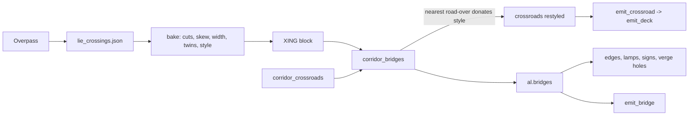

- **What counts as a crossing.** A `bridge` way whose polyline cuts the mainline chain is a road or rail over the LIE;
  a road or track that cuts one of the LIE's own bridge ways is an LIE-over. The bake stores the compacted station,
  skew, real width, kind, lanes, a style hint and the name. Sidewalk footways join the street bridge beside them; twin
  decks and street corners within 25 m merge.
- **Same structure as a crossroad.** C2b crossroads come from the exit table, OSM crossings from bridge tags; at an
  interchange both describe one bridge. Any crossing whose footprint overlaps a diamond is dropped and the nearest
  road-over gives the crossroad its style. That keeps every bridge clear of ramps and of the dip. Overlapping crossings
  keep the wider one (compaction squeezes real neighbours together).
- **One deck builder.** `emit_deck` builds slab, drip notch, girders (painted plate girders with stiffeners and X
  cross-frames, or precast I-beams with diaphragms), bearings, caps, piers (median wall at the NJ toe width, bents or
  walls past the shoulders), seats and backwalls, F-shape or stone parapets and the fence frame, in a skewed frame
  $P(a,t) = O + a\,\hat e_a + t\,\hat e_t$ with per-axis slopes. Over-bridges use $\hat e_a = \hat f$,
  $\hat e_t = \hat r + \hat f \tan\varphi$; an LIE-over swaps them (girders along the LIE, bank and grade in the frame);
  a crossroad uses its own grade. Stone bridges replace girders with segmental arches; the LIRR bridge puts two deep
  girders above a concrete floor.
- **Abutments tie into the verge.** Spill-through abutments stand past the service road (or a 30 ft clear zone): concrete
  slope paving under the deck end, 1V:2H approach fills whose toes sit on the D2 verge, then the C3a crest trick hides
  the road's end. An LIE-over cuts a straight station range out of the verge and fills the skew wedges itself; its
  U-walls rise to the deck seats under the mainline and service-road decks and stop at a coping over the grass.
- **Neighbours.** D2 sound walls and D3 gantries and mile markers stay out of every bridge footprint; lamps stay off
  overpass decks; W-beam shields cover the new shoulder piers (the clamp follows them, as at crossroads). Drivability
  is unchanged: LIE-over decks sit under the existing mainline surface.
- **Renderer, debug only.** The sun's cascades were rendered from under the ground (`center - sunDir * R` with `sunDir`
  pointing at the sun), so geometry below a surface shadowed it; the debug build places the light camera on the sun side.
  Faces turned from the sun get light bounced off the road, $E_b = \rho E_g (1 - N_y)/2$. Both are owner calls to
  promote to release.

Counts on the 2026-11-21 bake: 145 crossings (78 road over, 2 rail over, 65 LIE over), 38 bridges kept (22 / 1 / 15;
23 steel, 13 concrete, 1 stone, 1 through-girder), 30 crossroads restyled (Queens/Nassau steel, Suffolk concrete).
Draws 23,840 (+269 over D3); sound walls stop 40 m short of each bridge (9.7 km of wall). Screenshots: [steel approach](corridor/img/d4-steel-approach.png),
[steel from under](corridor/img/d4-steel-under.png), [concrete from under](corridor/img/d4-concrete-under.png),
[stone arch](corridor/img/d4-stone-arch.png), [inside the arch](corridor/img/d4-stone-arch-under.png),
[LIRR](corridor/img/d4-lirr.png), [LIRR from under](corridor/img/d4-lirr-under.png),
[crossroad deck](corridor/img/d4-c2b-deck.png), [LIE over a road](corridor/img/d4-lie-over.png). Knobs and formulas:
[corridor tuning notes](corridor/tuning-notes.md#d4-overpasses).

Sources (not opened in this session): AASHTO *LRFD Bridge Design Specifications* (span-to-depth, bearings, deck
overhangs, substructure); NYSDOT *Bridge Manual* (vertical clearances 16 ft 6 in / 14 ft 6 in, bridge railings,
abutment types); AASHTO *Roadside Design Guide* ch. 3 and 5 (clear zone, pier shielding); FHWA *Bridge Inspector's
Reference Manual*; Purdue CE 470 and UW CEE 451 bridge lecture notes; Sillion and Puech, *Radiosity and Global
Illumination* (form factors). Read: OpenStreetMap `bridge`, `layer`, `lanes`, `width` tags via Overpass (2026-11-21
pull); the D0 reference sheet's photo notes (BQE green steel, Van Wyck concrete on round piers, Cross Island stone-faced
ramp bridge), not reopened here.

## District kits, lamps and the skyline (D5, 2026-11-21)

Debug build only (the release asset has no exit table and `withLamps` is false there; `emit_dressing` returns without
route ends). Code: [CorridorDressing.h](../src/scene/Corridor/CorridorDressing.h); sizes and the kit table:
`road::dressing`; textures: [tools/gen_dressing.py](../tools/gen_dressing.py) into `assets/dressing/`.

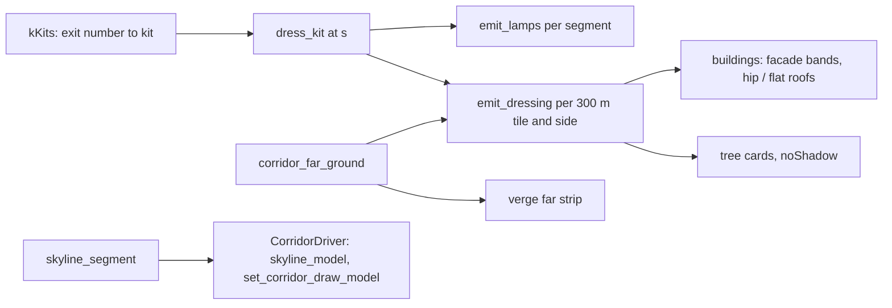

- **Kits by exit number.** Thirteen stretches from the reference sheet ("By district"): LIC towers, Maspeth industry,
  LeFrak City, Flushing Meadows, Bayside, Alley Pond, Lake Success offices, Nassau suburbs (two lamp styles), Melville,
  west Suffolk, pine barrens, Riverhead farms. A kit starts at the first record of its exit; trees and buildings take
  the kit at the tile middle (D1's 300 m snap), lamps the kit at each pole.
- **Lamps.** Queens: median twin arms on the L6.1 60 m grid (the D3 gantry posts dodge that grid) and outer singles
  every 120 m; Nassau and west Suffolk: shoulder singles every 65 m with shoebox (west of 40) or drop-lens cobra heads;
  none east of exit 64. Poles keep off ramps, gores, gantry columns, gore signs and mile markers, decks and the tube.
  Steel, housings, lenses and pedestals batch into one draw each per segment (was 24 draws per pole), one spot per pole
  feeds the existing nearest-lights selection.
- **Far ground.** One more strip in the verge draw, 0.2 m under level ground so C3a aprons, stubs and D4 approach fills
  still win the depth test, cut back on the inside of curves and at LIE-over trenches.
- **Buildings and trees.** Lots on a grid per building type, rows outward from the service road; trees on a 10 m grid
  thinned by grove noise. Both stay off crossroad aprons and stubs and off bridge approaches (tested in the skewed deck
  frame). Trees are crossed double-sided cards with road-facing normals and skip the shadow pass (the depth-only
  pipeline has no alpha test: cards would cast rectangles).
- **Skyline.** A single card around Midtown, 1.3 km past the tube's Manhattan end. The far plane is 2.4 km, so the
  driver draws it at 2 km and scales it about the camera by $D/R$ every frame: bearing and angular size stay true at
  any range, the scene haze fades it. It is its own corridor segment that the visible-window test skips.
- **Renderer hooks.** `DrawCall::noShadow` (never set in release), debug `Renderer::set_corridor_draw_model`, material
  slots `MAT_DRESSING` and `MAT_SKYLINE` (debug-only textures; release binds the white fallback and never draws them).

Draws 8,674 on the 2026-11-21 bake (D4 was 23,840): lamps at most 4 per segment, dressing at most 4 per tile, skyline 1;
838 lamp spots. Screenshots: [LIC + skyline](corridor/img/d5-queens-lic-skyline.png),
[skyline zoom](corridor/img/d5-skyline-zoom.png), [Queens median lamps](corridor/img/d5-queens-median-lamps.png),
[LeFrak City](corridor/img/d5-queens-lefrak.png), [Flushing Meadows](corridor/img/d5-queens-flushing-meadows.png),
[Nassau walls + shoulder lamps](corridor/img/d5-nassau-shoulder-lamps-walls.png),
[Nassau houses](corridor/img/d5-nassau-houses.png), [Melville](corridor/img/d5-melville-exit49.png),
[pine barrens, no lamps](corridor/img/d5-pine-barrens-no-lamps.png), [Riverhead](corridor/img/d5-riverhead-farms.png),
[night Nassau](corridor/img/d5-night-nassau.png), [night Queens median](corridor/img/d5-night-queens-median.png).
Knobs and formulas: [corridor tuning notes](corridor/tuning-notes.md#d5-district-kits-lamps-skyline).

Sources (not opened in this session): AASHTO *Roadside Design Guide* (clear zone); IES RP-8 and the FHWA *Lighting
Handbook* (2012) (mounting height, spacing); BNL pine barrens papers (2016, 2019); Pharr et al., *Physically Based
Rendering* and MIT 6.837 billboard lectures. Read: the D0 reference sheet and photos `exit-13-14/`, `exit-22/`,
`exit-68/` (viewed this session).

## Landmarks (D6, 2026-11-21)

Debug build only (the release asset has no exit table). Code: [CorridorLandmarks.h](../src/scene/Corridor/CorridorLandmarks.h)
for the one-off structures and deck styles; boards ride the D3 sign passes
([CorridorSigns.h](../src/scene/Corridor/CorridorSigns.h)); headstones and street-tree rows are two new D5 kit columns
([CorridorDressing.cpp](../src/scene/Corridor/CorridorDressing.cpp)). All tables: `road::landmarks` and `road::dressing`
in [RoadParams.h](../src/scene/RoadScene/RoadParams.h). D6 adds no new system: every item is a row in a table that an
existing generator reads.

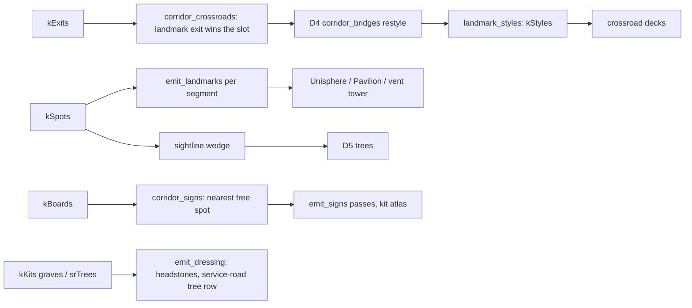

- **Diamond priority.** `corridor_crossroads` keeps the first exit in station order and drops any closer than 900 m.
  That cost four landmarks their interchange (17, 39, 44 lost to 16/18, 38, 43/45). A landmark exit now replaces a
  closer plain neighbour; 53 is left out of the list because its diamond would absorb the D4 Sagtikos arch. Side
  effect: the LIC viaduct crossings that crossroad 16 used to swallow are now LIE-over bridges, and the BQE crossing
  styles crossroad 17 (green Queens steel). Crossroads 30 to 29 with route ends.
- **Deck styles.** After D4 restyles the crossroads, `landmark_styles` applies `kStyles` by exit number: Van Wyck (22)
  and NY-135 (44) concrete, Cross Island Parkway (31) stone-faced (D4's stone parapet and pier cladding).
- **Spots.** One-off structures at an exit's mean record station plus a baked along offset, at the real lateral
  distance measured on OSM: the Unisphere (ribbed globe, continent plates, three orbit rings, tripod) 547 m north of
  exit 22, the NYS Pavilion's three towers and Tent of Tomorrow ring 307 m north, the Queens vent building (orange brick,
  Art Deco setback) over the EB tube 280 m behind the portal on a Borden Ave pad at street level. A tree-free wedge
  (`clear`, `kSightBase`) keeps the Unisphere sightline over the park lawns.
- **Queens plaza.** The C4 cashless gantry is gone: the Queens plaza was demolished when open-road tolling started on
  2017-01-10 and the readers stand at the Manhattan portals. The plaza's paved footprint and U-turn stay.
- **Boards.** Five rows (county line both ways, HOV LANE BEGINS 1/2 MILE, Great Neck / Manhasset EXIT 33, ATTRACTIONS
  AT EXIT 62N) drawn by `tools/sign_corridor.py` into the kit atlas and placed at the nearest spot, 25 m steps upstream
  first, that is off a deck and keeps the board's footprint inside a ramp's inner edge; a board past a ramp would stand
  on the cut slope out of sight.
- **Kits.** Exit 17 kit: Calvary headstones (tablets, family dies, obelisks in straight rows, one batch per tile side);
  Maspeth industry moved from 15 to 18 (the EB 17 record bakes before WB 15, so a 15 kit would never show). Exit 48
  kit: a street-tree row along the service roads' outer curb (Melville). New exit 62 kit: pitch pine and oak mix.

Draws 8,710 on the 2026-11-21 bake (D5 8,674, +36: landmark batches, boards in segments without signs, headstone batches,
the extra bridges freed by the diamond swap). Knobs: [corridor tuning notes](corridor/tuning-notes.md#d6-landmarks).
Screenshots: `corridor/img/d6-*.png`.

Sources: Wikipedia, *Queens–Midtown Tunnel* (read 2026-11-21: vent building, plaza removal, flood doors); Wikipedia,
*Unisphere*, *New York State Pavilion* (dimensions from memory); OSM ways in `data/osm/lie_i495.osm.xml` (offsets);
Commons photos `exit-33/`, `exit-62/` (board wording); Lynch, *The Image of the City* (MIT Press, 1960) and MIT 4.241
lecture notes on landmarks and paths (why a few distinct, well-placed landmarks orient a driver better than uniform
detail; not opened this session).

## Queens network bake (N1, 2026-11-21)

Debug-only assets; nothing loads them yet (N2 builds `CorridorNetwork`). Tool:
[tools/queens_network.py](../tools/queens_network.py), which imports [tools/lie_corridor.py](../tools/lie_corridor.py)
for every geometry step (resample, headings, curvature floor, compaction, vertical profile, superelevation,
`write_asset`). Config: [config/queens_network.toml](../config/queens_network.toml). Parser:
[CorridorNetworkAsset.h](../src/scene/Corridor/CorridorNetworkAsset.h). Tests:
[tests/test_queens_network.cpp](../tests/test_queens_network.cpp). Knobs, math and measurements:
[corridor tuning notes](corridor/tuning-notes.md#n1-queens-network-bake).

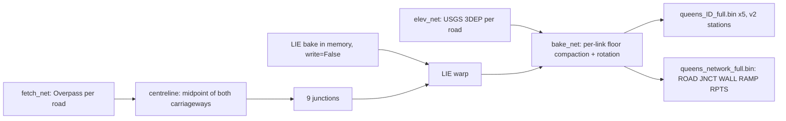

- **One alignment per road**, in the LIE's world frame and vertical datum, so N2 can place all six side by side:
  `queens_{bqe,gcp,vanwyck,clearview,cip}_full.bin` (BQE 9.2 km, GCP 21.4 km, Van Wyck 8.1 km, Clearview 7.1 km,
  CIP 10.0 km compact, horizon tails included). Each is a normal `CorridorAsset` with an EXIT block from the
  road's own `motorway_junction` nodes, its junctions as landmarks, and `startStation` = its first wall.
- **Centreline.** OSM maps each carriageway as its own one-way ways. The tool walks both (minimum-turn at forks,
  as on the LIE) and takes the midpoint, so the alignment runs down the median and lanes per side = the smaller
  side. The LIE itself still uses its EB carriageway (unchanged).
- **Junctions** are the closest approach of two real centrelines near the N0a OSM centre, taken on road a. A
  crossing lands within 1 m of both roads. The Astoria "Y" is a merge: the BQE's own ways end about 105 m short
  of the GCP centreline, so that junction is the BQE's end and the GCP side keeps the real offset as its lateral.
- **Warp.** Junctions go through the LIE warp (real LIE station + lateral, then the compact LIE). The lateral is
  measured along the corridor's fixed cross axis, not the local normal: the normal version folded 4 km off
  the LIE. With the fixed axis, $\det J = f > 0$.
- **Links.** Between junctions each road is compressed the LIE way (heading kept, 500 m curvature floor), with
  the factor solved per link so the chord matches the placed junctions, then rotated onto them. Seams
  cross-fade over 800 m real. Worst endpoint miss 0.018 m.
- **Ends.** Nine work-zone walls (BQE south; GCP west at the RFK approach and east at the Nassau line; Van Wyck
  north past the LIE and south past Kew Gardens; Clearview and CIP north and south). The BQE north end is the
  merge, so it has no wall. Past each wall, about 3 km compact of real road continue as the undrivable horizon
  tail.
- **Ramps.** 293 `motorway_link` ways, each assigned to its nearest junction (within 700 m). They are warped by the
  mean local fit of that junction's roads and stored as x, z, y, layer points. Each end is attached to a mainline
  carriageway within 25 m (LIE: both carriageways, read from the cached LIE extract), else 255. Heights are DEM
  ground plus layer x 6.5 m. N2 snaps the ramp ends.
- **LIE assets unchanged:** `lie_corridor.bin` and `lie_corridor_full.bin` keep their SHA-1 (dcb3aa9..., c884a50...).

## Queens network runtime (N2a, 2026-11-21)

Debug build only (release loads nothing new and its driver path compiles to the old arithmetic). `CorridorDriver`
owns a [`CorridorNetwork`](../src/scene/Corridor/CorridorNetwork.h): the LIE (road 0, borrowed from App) plus the five
N1 road assets, the junction table and the 293 OSM ramps as free paths. [AppInit.cpp](../src/core/App/AppInit.cpp)
loads it after the LIE and appends its segments to the same corridor list, so the origin rebase, the visible window
and per-draw culling apply unchanged.

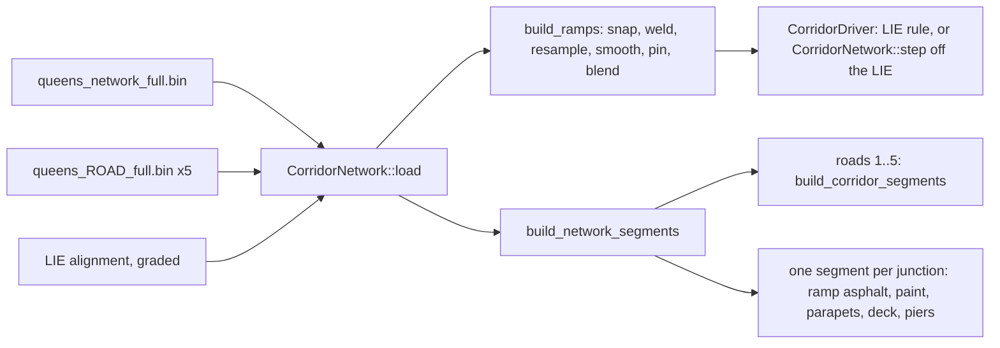

- **Roads** go through `build_corridor_segments` unchanged (mainline, lines, median barrier, graded verge), 1.2 km
  segments and 300 m tiles, lanes from each asset. No dressing, lamps, signs or NJ barrier yet (N7).
- **Free-path ramp** (`NetRamp`): a world-space polyline with height, resampled at 4 m. Ends attached to a road are
  snapped into its carriageway at its surface; ends within 3 m are welded; over the stretch where a ramp lies on its
  road it rides the road's plane (height and bank), so merges are exact. Mesh: 26 ft asphalt, yellow left and white
  right edge lines, parapets clear of the gores, a deck edge and soffit, and piers where the deck is 4 m above the
  DEM ground.
- **Driver.** Position is `NetPos` (road id plus `s`, or ramp plus arc length). The car stays on its piece while
  the piece holds it, and switches only to a piece that holds it within 1 m of its height (roads at a ramp's ends
  first, then other ramps). Roads are never candidates from a road, so an overpassing road never grabs the car. On
  the LIE the C3 rule is unchanged; leaving every LIE piece onto a ramp at the same height hands over.
- **Walls.** A road's drivable range is between its N1 walls; the car is held there (the work-zone kit is N2b).
- **Teleport.** Corridor panel: "Jump: road", "Jump: km", "Jump to road now".

Screenshots: [BQE](corridor/img/n2a-bqe.png), [BQE at the LIE junction](corridor/img/n2a-bqe-junction.png),
[GCP at Flushing Meadows](corridor/img/n2a-gcp-flushing.png), [ramp leaving the Van Wyck](corridor/img/n2a-vanwyck-ramps.png).
Knobs, the handoff rule and measurements: [corridor tuning notes](corridor/tuning-notes.md#n2a-queens-network-runtime).

## Work zones (N2b, 2026-11-22)

Debug build only. Every network wall ([CorridorNetworkAsset.h](../src/scene/Corridor/CorridorNetworkAsset.h) WALL) gets
a freeway full closure laid out from MUTCD Part 6 and NYSDOT 619
([workzone.md](queens-network-reference/workzone.md)). Layout: [CorridorWorkZone.cpp](../src/scene/Corridor/CorridorWorkZone.cpp)
(pure, tested); mesh: [CorridorWorkZoneMesh.cpp](../src/scene/Corridor/CorridorWorkZoneMesh.cpp); one segment per zone
from [CorridorNetworkMesh.cpp](../src/scene/Corridor/CorridorNetworkMesh.cpp).


- **Upstream to downstream** (u = distance before the hold, the asset wall): signs at 1,000 / 2,500 / 5,140 ft before
  the first taper; one merging taper $L = WS$ per closed lane (right lanes first), $2L$ tangents, one Type C arrow board
  per closed lane (flashing arrow left, 15 lamps); buffer 425 ft; a closing taper across lane 1 into the 60 m median gap
  (u 25-85 m); Type III barricades with R11-2 at the centre 3 m past the hold; a 1-2-3 sand-barrel cushion; a full-width
  portable concrete barrier (NJ profile, segments of at most 20 ft, 6 in tapered ends) 8 m past the hold. Cones close the
  return carriageway between the gap and the wall; G20-2 END ROAD WORK faces the way back.
- **Driving.** The gap is a median opening on the alignment (`add_opening`): the box barrier is cut there and
  `in_turnaround` is true, so `CorridorNetwork::step` re-commits the side and the car can U-turn. The openings replace
  the data-end pads of network roads (those lay past the walls; Clearview north's covered the approach). The car is held
  at the wall (`drivable`). Ramps joining a road past its wall are closed (`enter_ramp` skips them). Channelizers are
  not obstacles (no collision).
- **Tail.** Paint stops at the barrier faces (`set_paint_range`); the asset data continues as the tail, and where it is
  shorter than `wz_tail_m` an unpainted road (asphalt, median barrier, grass) is extruded along the end tangent. A few
  knocked drums, a cone, spare barrier segments and a millings pile lie past the wall.
- **N6 kit.** `exit_closure(net, ramp, params)` builds an EXIT CLOSED zone 60 m past a ramp's gore (edge drums,
  barricades with the board, cones); N6 places it on every closed local exit.
- **Screenshot spots.** `SWISH_SPAWN="road,s_m,dir,laneOff"` (road key or index, metres, travel direction, lanes out
  from the median edge) places the car at every scene setup; `SWISH_CAMERA=chase|hood|helicopter|...` picks the view.
  Both debug-only; used by [scripts/arch/snap.sh](../scripts/arch/snap.sh).

Screenshots: [BQE gap](corridor/img/n2b-bqe-gap.png), [BQE overhead](corridor/img/n2b-bqe-overhead.png),
[W4-2R](corridor/img/n2b-bqe-lane-ends.png), [GCP arrow board](corridor/img/n2b-gcp-arrow-board.png),
[GCP wall](corridor/img/n2b-gcp-wall.png), [CIP south](corridor/img/n2b-cip-south.png). Knobs and math:
[corridor tuning notes](corridor/tuning-notes.md#n2b-work-zones).

## BQE and its junctions (N3, 2026-11-22)

Debug build only (release loads no network). The BQE is a real road now: viaduct, LIRR trench, viaduct, the real
LIE x BQE interchange instead of the exit 17 diamond, the Astoria "Y" legs to the GCP, and its own guide signs. Code:
[CorridorViaduct.h](../src/scene/Corridor/CorridorViaduct.h) (structures, overpasses, NJ median),
[CorridorNetwork.cpp](../src/scene/Corridor/CorridorNetwork.cpp) (ramp chains, clearance, fork handoff),
[CorridorNetworkMesh.cpp](../src/scene/Corridor/CorridorNetworkMesh.cpp) (ramp clipping, gores, signs per road),
bake in [tools/queens_network.py](../tools/queens_network.py) with `[roads.bqe]` in
[config/queens_network.toml](../config/queens_network.toml). Knobs and math:
[corridor tuning notes](corridor/tuning-notes.md#n3-bqe-and-its-junctions).

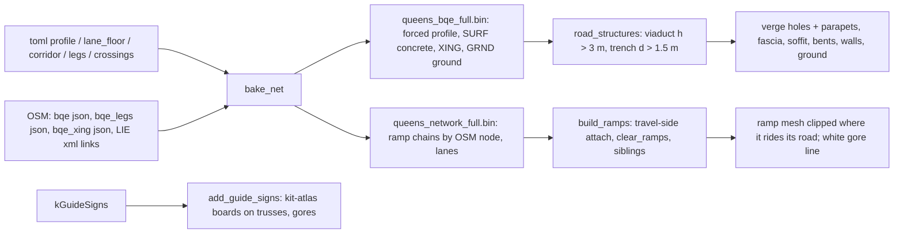

- **Profile.** roads.md section 1 as `profile` rows (real latitude ranges): viaduct LIE to Queens Blvd (ground +7.5 m,
  at least the OSM layer), the Woodside trench (ground -6.5 m, under the LIRR Main Line and the IRT Flushing line),
  viaduct Broadway to Northern Blvd (+7 m). The bake writes the DEM ground per station (`GRND` block) and a concrete
  `SURF` row on the viaducts; `road_structures` classifies the profile against that ground at runtime, so the same
  code serves any road given a profile. 3 lanes from the LIE to the Y (`lane_floor`), 1 ft / 2 ft shoulders
  ("most of the length has none"), NJ median.
- **Structures.** Viaduct: NJ parapets on the deck edge, a 1.8 m fascia and soffit, three-column bents under a cap
  every `net_pier_m`, the DEM ground under it; where the deck spans the LIE, green plate girders (the D6 BQE-over-LIE
  look) and no piers. Trench: retaining walls on an NJ toe up to `net_wall_above_m` over the ground, coping, ground on
  top. The ground eases from verge level over 40 m at each span end and stays off the LIE's verge and its ramps.
  23 OSM structures cross over the BQE (the `XING` block): Queens Blvd, the LIRR Main Line and Port Washington
  Branch, the IRT elevated, Roosevelt Ave, streets and footbridges, drawn as decks on wall piers at max(ground +
  wall, road + 16 ft) (tracks: ballast, rails, through girders).
- **Junction (LIE x BQE).** The exit 16 / 17 diamonds are gone (`road::network::kJunctionExits`), the LIE service roads
  run through, the D4 BQE crossing is skipped (`kOwnedCrossings`), and the LIE's own `motorway_link` ways there join
  the ramp set (`lie_links`). Ramps are whole OSM chains: links joined end to start with no fork are one ramp; an end
  belongs to a road only through a shared OSM node (no more fragments, no wrong attach); far pieces join their
  junction through the chain (`chain_radius_m`). LIE-side ramp points blend the LIE's frame (the OSM EB line is the
  compact median, so laterals map past the lane centres, the real median squeezed to the compact one) with the
  BQE's. At runtime a ramp end attaches to the carriageway whose travel matches the ramp's, a ramp crossing a road
  or ramp is lifted to 16 ft + deck (`clear_ramps`), ramps are one-way (a handoff never picks a ramp running against
  the car), and at a fork the branch whose centreline is nearer takes the car.
- **Astoria Y.** The BQE alignment is the west leg (I-278, 2 lanes) into the GCP; the east leg ("Brooklyn-Queens
  Expressway East", fetched on its own) joins as two 2-lane one-way pieces placed by a nearness-weighted blend of the
  BQE and GCP frames. 3 lanes taper to 2 + 2 at the split.
- **Ramp paint.** Where a ramp rides its road only the part past the road's outer edge is drawn, so ramps no longer
  paint a yellow edge line across a carriageway (the N2b "yellow line on the right"); the left edge line is white
  through the gore (60 m past where it leaves), yellow after; multi-lane ramps get 10 ft / 30 ft lane dashes.
- **Signs.** `kGuideSigns` rows: BQE NB 39 / 40 / 41 at 1/2 mile, the Y truss with two boards (278 WEST GCP W / RFK,
  EXIT 42 GCP E / LaGuardia), "278 EAST Bronx / Grand Central Pkwy 3 MILES" past the LIE; SB "278 WEST Brooklyn / Long
  Island Expwy 2 MILES", 41 / 40 / 39 W, 35 W Midtown Tunnel; gore signs at each exit. LIE exit 17 joins the D3 exit
  list (its own panels, collapse rule). Boards are drawn by [tools/sign_corridor.py](../tools/sign_corridor.py) into a
  new 2048 x 1024 band of `sign_kit.png` (`sign_atlas::kNetBoards`, `kNetGores`); trusses on the BQE stand on the
  parapet.
- **Drive.** Tested movements: LIE EB to BQE NB, BQE NB to the GCP (both legs), GCP to BQE SB, BQE SB to LIE WB, LIE
  WB to BQE SB, BQE to LIE EB and WB; every movement through every junction never holds the car and hands off within
  1 m. Missing: BQE SB to LIE EB (no OSM chain reaches the LIE EB in this extract).

Draws: network 3,449 (N2b 3,456; ramps merged 293 to 184, structures, signs and overpasses added), corridor total
12,144; 60 fps (capped) on the Arch RTX 3060 at the junction. Screenshots: [junction from the LIE](corridor/img/n3-junction-lie.png),
[junction overhead](corridor/img/n3-junction-overhead.png), [flyovers](corridor/img/n3-flyover.png),
[viaduct](corridor/img/n3-viaduct.png), [viaduct at dusk](corridor/img/n3-viaduct-dusk.png),
[LIRR dip](corridor/img/n3-lirr-dip.png), [Astoria Y gantry](corridor/img/n3-astoria-y.png),
[Y split](corridor/img/n3-astoria-split.png). `SWISH_TOD=<0-5>` (debug) sets the time of day for shots.

## GCP and its junctions (N4, 2026-11-22)

Debug build only (release loads no network). The Grand Central Parkway is a parkway now, from the RFK work zone to the
Nassau-line work zone, joined to the LIE at exit 22 by the real cloverleaf and to the BQE by the N3 Astoria Y. The loop
LIE, BQE, GCP, LIE closes both ways. Code: [CorridorNetwork.cpp](../src/scene/Corridor/CorridorNetwork.cpp) (the GCP
under the LIE, ramp clearance), [CorridorBridges.cpp](../src/scene/Corridor/CorridorBridges.cpp) (the LIE's bridge over a
network road), [CorridorViaduct.cpp](../src/scene/Corridor/CorridorViaduct.cpp) (stone-arch overpasses), bake in
[tools/queens_network.py](../tools/queens_network.py) with `[roads.gcp]` in
[config/queens_network.toml](../config/queens_network.toml), signs in [tools/sign_corridor.py](../tools/sign_corridor.py).
Knobs and math: [corridor tuning notes](corridor/tuning-notes.md#n4-gcp-and-its-junctions).

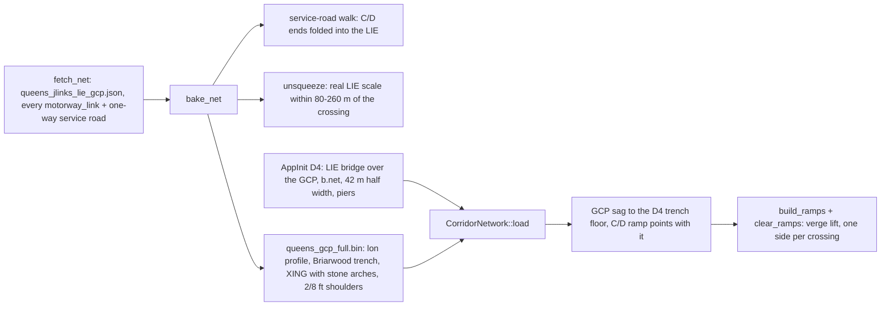

- **Exit 22 (LIE x GCP cloverleaf).** `lie_gcp` joins `lie_links`, so the LIE's own links there join the ramp set, and
  `kJunctionExits` drops the exit 22 diamond (the 900 m spacing rule then keeps 19 and 23, not 24). OSM routes the LIE
  side of the cloverleaf through the Horace Harding Expwy service roads (the C/D); neither the LIE extract nor the GCP
  extract held them, so `fetch_net` pulls every `motorway_link` and one-way secondary / tertiary way within 1.5 km of
  the junction (`queens_jlinks_lie_gcp.json`). A link ending on a service road follows it to where it runs beside the
  LIE and merges into the LIE there; LIE-to-service-road slip ramps are dropped (the service road is folded into the
  LIE). A link merging into the middle of another splits that one (49504 into 64574). Near the crossing the LIE frame
  keeps real scale along the LIE (`unsqueeze_m`), so the C/D roads are not squeezed onto the GCP's lanes. 13 movements,
  7 of the 8 cloverleaf ones (LIE EB to GCP EB has no chain); 21 ramps at the junction (19 before the splits).
- **Van Wyck (N5).** LIE links nearer `lie_vw` serve only owned junctions; the 14 N1 Van Wyck ramps are unchanged and
  the Van Wyck/Kew Gardens junction is not built. No ramp dangles from exit 22's side (deferred, not stubbed).
- **The GCP under the LIE.** The LIE's D4 bridge over the GCP (`kNetUnder = "Grand Central"`) becomes a 42 m half-width
  concrete girder deck on piers at the GCP median and 22 m either side, its trench floor 1.4 m deeper (`kUnderDig`), its
  U-walls only inside the LIE corridor, and no D4 under-road or aprons. At load the GCP's stations take the trench
  floor under the deck and climb back to their own profile over `kLieClimb` + `net_under_blend_m`; the junction's ramp
  points within the bridge's half width (fading over 40 m) move with it, so the C/D roads pass under the deck too.
- **Ramp clearance.** A ramp crossing a road now goes wholly over or wholly under it per run of points (the mean gap
  decides): a per-point choice tore exit 22's C/D road by 10 m. A ramp beside a road (tangents within 20 deg) is not a
  crossing. A ramp sunk up to 2 m into a junction road's grass verge is lifted onto it (short ease), so ramp asphalt
  no longer hides under the grass with only its paint showing.
- **Parkway profile (roads.md section 2).** The GCP's profile rows key on longitude (`profile_axis = "lon"`): the
  Briarwood / Jamaica Hills trench (-73.811 to -73.7905, 5.5 m) with the N3 retaining walls; elsewhere the OSM layers.
  3 through lanes RFK to exit 4 (`lane_floor`), 2 ft / 8 ft shoulders, the N3 NJ median (the GCP now has a GRND block).
  39 OSM structures cross over it (XING), drawn by the N3 overpass code; `crossing_styles` makes the 69th Rd and Jewel
  Ave bridges 1930s stone arches (springing at 14 ft 6 in, piers at the median and past each edge); `crossing_exclude`
  drops the Horace Harding decks (the LIE bridge draws them) and a BQE-named way at the Y.
- **Astoria Y.** The N3 legs stay as built and drivable (BQE NB to GCP EB and WB, GCP WB to BQE SB, GCP EB to BQE SB).
  There was no temporary N3 end or wall to remove: the BQE's north end is the Y merge, and the RFK work zone stays.
- **Signs.** Parkway style: green guide boards with the Interstate shields of the roads the GCP meets (EXIT 10 I-495 both
  ways, EXIT 4 I-278 WEST westbound, 1/2 mile, gore signs) and a new NYSDOT parkway trailblazer (`draw_pkwy`) on the
  confirmation boards past the Y (EAST: LaGuardia Airport, Eastern Long Island) and past exit 22 (WEST: LaGuardia,
  RFK Bridge). LIE exit 22 joins the D3 exit list (its "22A-E" and "22 A-B" panels). The kit atlas grows to 2048 x
  3200 (`sign_atlas::kNetBoards` 11 to 16, `kNetGores` 7 to 9); the earlier cells are pixel-identical.
- **Loop.** `N4: the LIE - BQE - GCP loop closes both ways` drives LIE EB, BQE NB, the Y, GCP EB, exit 22, LIE WB back
  to the start, and LIE EB, exit 22, GCP WB, the Y, BQE SB, LIE WB, every step continuing the last (road id and s
  continuous, no step over 1 m in height, never held), on the LIE graded as in the game (D4 bridges, the GCP's trench).
- **Still missing.** BQE SB to LIE EB: still no OSM chain after the junction-wide link fetch (only BQE SB to LIE WB). A
  BQE east-leg piece passes 5.6 m under the GCP's westbound lanes with no GCP structure drawn over it (N7).

Draws: network 3,488 (N3 3,449), corridor total 12,137; 48-60 fps on the Arch RTX 3060 (headless 1920 x 1080 output),
49-57 at exit 22. Screenshots: [exit 22 overhead](corridor/img/n4-exit22-overhead.png),
[the LIE bridge over the GCP](corridor/img/n4-exit22-bridge.png), [GCP under the LIE](corridor/img/n4-exit22-underpass.png),
[Astoria Y](corridor/img/n4-astoria-y.png), [Jewel Ave arches](corridor/img/n4-gcp-arches.png),
[Briarwood trench](corridor/img/n4-gcp-trench.png), [EXIT 10 sign](corridor/img/n4-gcp-exit10-sign.png),
[EXIT 4 sign](corridor/img/n4-gcp-exit4-sign.png), [parkway confirmation board](corridor/img/n4-gcp-confirm.png),
[exit 10 gore and handoff](corridor/img/n4-loop-handoff.png).

## The rungs: Van Wyck, Clearview, Cross Island (N5, 2026-11-22)

Debug build only (release loads no network). The three ladder rungs between the LIE and the GCP are real roads now:
their LIE junctions from OSM replace the LIE diamonds at exits 26-28 and 31, their GCP junctions (Kew Gardens, the
Clearview four-level stack, GCP x CIP in Alley Pond Park) are drivable, every rung end is the N2b work zone, and the
Van Wyck crosses the LIE on its own viaduct while the Clearview and the CIP pass under new LIE girder bridges. Code:
[CorridorNetwork.cpp](../src/scene/Corridor/CorridorNetwork.cpp), [CorridorViaduct.cpp](../src/scene/Corridor/CorridorViaduct.cpp),
[CorridorNetworkMesh.cpp](../src/scene/Corridor/CorridorNetworkMesh.cpp), bake in [tools/queens_network.py](../tools/queens_network.py)
with [config/queens_network.toml](../config/queens_network.toml), signs in [tools/sign_corridor.py](../tools/sign_corridor.py).
Knobs and math: [corridor tuning notes](corridor/tuning-notes.md#n5-the-rungs-van-wyck-clearview-cross-island).

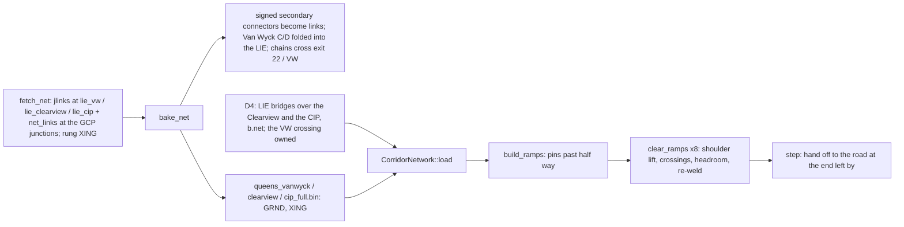

- **LIE junctions.** `lie_links` adds `lie_vw`, `lie_clearview` and `lie_cip`, so each pulls every `motorway_link`
  and one-way secondary / tertiary way within 1.5 km and the LIE's own links join the ramp set. The Van Wyck's C/D
  runs on the Horace Harding service roads like exit 22's (`srv_junctions` + `lie_vw`), and a chain may continue
  across the two junctions (they share C/D pieces). An unnamed secondary or tertiary way with a `destination` tag
  that meets a `motorway_link` (directly or through another such way) is a ramp (25419995 "Grand Central Parkway
  East" at exit 22, the Van Wyck's College Point connectors). LIE EB to GCP EB, listed missing in N4, drives through
  exit 22's C/D and is now pinned in the exit 22 test (eight of eight movements). The diamonds
  at 26, 27, 28 and 31 are gone (`kJunctionExits`): 26's and 28's would sit on the Clearview's C/D and loops. LIE
  exits 27 and 31 join the D3 exit list (their own panels and gores).
- **Crossing the LIE.** The Van Wyck (layer 3) crosses over the LIE on its own viaduct (`kOwnedCrossings` drops the D4
  bridge; College Point Blvd keeps its LIE bridge beside it). The Clearview and the CIP pass under N4-style girder
  bridges (`kNetUnder`); a rung under the trench floor now rises to it (the CIP, 9.8 m under the LIE), so the piers
  stand on its pavement.
- **Profiles and structures.** The rungs bake a GRND block (`profile = []`), so their viaducts (the Van Wyck over the
  LIE and over Kew Gardens) get NJ parapets, fascia, soffit and bents, and the NJ median. A structure now spans any
  network road below it (green plate girders, no piers in its lanes): the GCP over the Clearview stack and over the
  CIP, the Van Wyck over the GCP. The Van Wyck's 25 OSM overpasses are drawn; the Clearview and CIP crossings are
  fetched by bbox (the `around` query returned nothing).
- **Kew Gardens.** OSM joins the Van Wyck and the GCP only GCP EB to VW SB and VW NB to GCP WB; the other movements go
  through Union Tpke and Queens Blvd, which the network does not model. The Jackie Robinson / Union Tpke links are
  drawn up to where they leave the junction.
- **Ramps.** Pins continue past half a ramp while it is level with its road (a C/D in the GCP's lane at the CIP), a
  ramp hugging a road's shoulder is lifted onto it, welded ends move with the clearance bumps and meet again
  (8 rounds), an upper ramp in a stack climbs at most the headroom under the road above it and the lower one drops
  by the rest, and off a ramp the car is handed only to the road at the end it leaves by.
- **Signs.** Twelve boards and nine gores (kit atlas 2048 x 4096, earlier cells pixel-identical): Van Wyck EXIT 7, 10
  and 12 A-B and Clearview EXIT 4 E-W and 1 in Interstate style; CIP EXIT 30 E and 29 E-W both ways and a CROSS ISLAND
  PKWY SOUTH confirmation board in parkway style; GCP EXIT 13, 21 and 23.
- **Drive.** `N5: each rung hands the car LIE - rung - GCP and back` drives, per rung, the LIE onto its southbound to
  the GCP and the GCP onto its northbound back to the LIE (the Van Wyck through its south work zone's median gap).

Still missing: BQE SB to LIE EB (no OSM chain, checked again with every link and one-way service road); ramp grades
next to pins and welds (fixed in N6).

Draws: network 3,549 (N4 3,488), corridor total 12,029; 49-60 fps on the Arch RTX 3060 (headless 1920 x 1080) at the
rung junctions. Screenshots: [LIE x Van Wyck](corridor/img/n5-vw-lie-driver.png) and [overhead](corridor/img/n5-vw-lie-overhead.png),
[Kew Gardens](corridor/img/n5-kew-gardens-driver.png) and [overhead](corridor/img/n5-kew-gardens-overhead.png),
[the Clearview under the LIE](corridor/img/n5-clearview-lie-driver.png) and [overhead](corridor/img/n5-clearview-lie-overhead.png),
[the Clearview stack](corridor/img/n5-clearview-stack-driver.png) and [overhead](corridor/img/n5-clearview-stack-overhead.png),
[the CIP at the LIE](corridor/img/n5-cip-lie-driver.png) and [overhead](corridor/img/n5-cip-lie-overhead.png),
[the CIP under the GCP](corridor/img/n5-cip-gcp-driver.png) and [overhead](corridor/img/n5-cip-gcp-overhead.png),
[Clearview EXIT 4 E-W](corridor/img/n5-clearview-exit4-sign.png), [CIP EXIT 30 E](corridor/img/n5-cip-exit30-sign.png).


## Ramp grades, closed local exits and guide signs per road (N6, 2026-11-22)

Debug build only (release loads no network). Three things: the N5 ramp grades (54-93 % next to pins and welds) are
solved to at most 8 % where the compact layout has room; every local exit on the five new roads is signed but closed
(decision 8: a gore, its exit signs, a short stub and the N2b EXIT CLOSED kit, and the car cannot leave the network
through it); and every exit, closed or real, gets advance, exit-direction and gore signs in its road's style. Code:
[CorridorNetwork.cpp](../src/scene/Corridor/CorridorNetwork.cpp), [CorridorSigns.cpp](../src/scene/Corridor/CorridorSigns.cpp),
[CorridorNetworkMesh.cpp](../src/scene/Corridor/CorridorNetworkMesh.cpp), bake in [tools/queens_network.py](../tools/queens_network.py),
boards in [tools/sign_corridor.py](../tools/sign_corridor.py). Knobs and math:
[corridor tuning notes](corridor/tuning-notes.md#n6-ramp-grades-closed-local-exits-guide-signs-per-road).

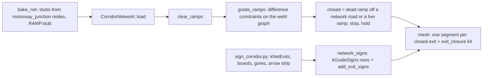

- **Ramp grades.** `grade_ramps` runs after `clear_ramps`. Each ramp point is a height; the constraints are the grade
  limit between neighbours, equal heights at a weld, the pinned stretch fixed, clearance over or under a junction road
  or another ramp (never worse than N5 left it, never more than 16 ft + deck), and the shoulder floor. The band each
  point may take is found by longest / shortest-path relaxation over the graph; the profile is the N5 one clamped into
  it, made feasible from below and from above and averaged, rounded with a 12 m box and fitted again. A ramp with no
  room at 8 % gets the least grade that fits. 233 ramps: 210 at or under 8 %, 22 at 8.2-10.6 %, one LIE x CIP pair at
  19.9 % (open). The handoff, loop, clearance and shoulder tests of N3-N5 are unchanged and green.
- **Closed exits.** The bake adds a stub for every exit node on a road's drivable span whose link is no network ramp
  (34); at runtime every dead ramp (no road reachable past its end) that leaves a network road or forks off a live ramp
  is closed: 48 off the roads, 15 fork branches. The barricades stand `wz_exit_gore_m` past the gore (a fork branch: 30 m
  past where it clears its siblings), the car is held 9 m before them, and past that point no hand-off except back to a
  live ramp. Closed ramps are their own segments (the junction segments keep the rest), with the N2b `exit_closure`
  kit. The LIE's own exits are untouched.
- **Signs.** `network_signs(net, road)` = the N3-N5 `kGuideSigns` rows, then `add_exit_signs` for every exit in
  `sign_atlas::kNetExits` (the sign tool writes one row per exit record on a network road's drivable span): advance
  boards by the D3 collapse rule with the D3 distance strip under them, an exit-direction sign 60 m before the gore
  (board + arrow strip; an N3-N5 board with its distance line cropped), the gore sign; a closed exit's boards carry the
  orange EXIT CLOSED plaque. The BQE, Van Wyck and Clearview use the D3 overhead trusses, the GCP and the CIP roadside
  boards on two posts (0.6 scale, parkway style); a left exit is signed over the left lane with the arrow mirrored.
  Two exits sharing one ramp (Van Wyck 12 A / B, GCP 20A and 21) get one set. Kit atlas 2048 x 7104, earlier cells
  pixel-identical.

Draws: network 4,329 (N5 3,549), corridor 12,809; 60 fps (capped) on the Arch RTX 3060 headless 1920 x 1080 output.
Screenshots: [BQE exit 39 closed](corridor/img/n6-bqe-exit39-closed.png), [its closure](corridor/img/n6-bqe-exit39-overhead.png),
[at dusk](corridor/img/n6-bqe-exit39-dusk.png), [GCP exit 20 B on posts](corridor/img/n6-gcp-exit20b-closed.png),
[GCP closures](corridor/img/n6-gcp-closure-overhead.png), [Van Wyck exit 6](corridor/img/n6-vw-exit6-closed.png),
[Van Wyck south](corridor/img/n6-vw-overhead.png), [Clearview exit 3](corridor/img/n6-clearview-exit3-closed.png),
[its closure](corridor/img/n6-clearview-closure-overhead.png), [CIP exit 28 B](corridor/img/n6-cip-exit28b-closed.png),
[CIP closure](corridor/img/n6-cip-closure-overhead.png), [CIP exit 30 E direction sign](corridor/img/n6-cip-exit30e-direction.png),
[LIE to Van Wyck flyover, graded](corridor/img/n6-lie-vw-flyover-graded.png) and [from the LIE](corridor/img/n6-lie-vw-flyover-chase.png).

Still open: the LIE x CIP pair at 19.9 %; where a ramp's pinned stretch passes the road edge it sits about 10 cm under
the grass verge mesh, so a ramp seems to leave the road through a short gap from above (N3-N5 trait, N7); exit
entrances (on-ramps from local streets) are not closed or signed; the HUD still names LIE exits only (N9).

## Look per road, network ground and soffits (N7, 2026-11-22)

Debug build only (release loads no network; the lighting shader is untouched). Every network road now looks like itself
from the roads.md table, the network stands on one continuous ground, and the deck undersides are lit. Code:
[CorridorGround.h](../src/scene/Corridor/CorridorGround.h) (the ground field and its grass tiles),
`CorridorNetwork::dress` in [CorridorNetwork.cpp](../src/scene/Corridor/CorridorNetwork.cpp) (look rows to kits, lamps,
W-beam, sound walls, verge cuts), [CorridorDressing.cpp](../src/scene/Corridor/CorridorDressing.cpp) (kits by LOOK row,
heights on the ground, keep-out), data in [queens_network.toml](../config/queens_network.toml) (`look`), baked into each
road asset's `LOOK` block by [tools/queens_network.py](../tools/queens_network.py). Knobs and math:
[corridor tuning notes](corridor/tuning-notes.md#n7-look-per-road-network-ground-soffits-lie-x-cip-grade).

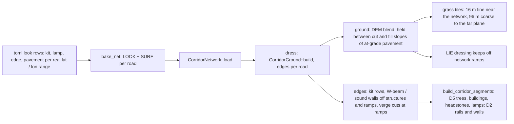

- **Look rows.** Per road, real latitude (longitude on the GCP) ranges name a LIE D5 kit (Maspeth industry, Calvary
  headstones, Queens houses and walk-ups, Flushing Meadows lawns, Alley Pond woods, Nassau suburbs), a lamp kind (median
  twin davits on the BQE, GCP and CIP; roadside singles on the Van Wyck and Clearview), an edge (W-beam through the parks
  and woods, sound walls at the Nassau line) and a pavement (concrete BQE trench and GCP west of exit 4, from the Street
  View notes). Tails past the walls use the same rows, so the road to the horizon is dressed (decision 12).
- **Ground.** One field: the DEM blended between every road and ramp, pinned to each at-grade pavement band and its
  verge, sloping away at 1V:2H, never over pavement. Cloverleaf infields are continuous graded grass that meets the ramp
  edges; the LIE's level ground continues into it; there is ground to the far plane. The network roads lose their own
  far strips (the field replaces them).
- **Verges at ramps.** Where an attached ramp lies over a road's verge band near its level, that side's verge is cut
  and the field fills the gore: no ramp asphalt under the grass (the N6 seam).
- **Keep-out.** Trees stay 12 m off other pavement (network ramps, other roads, the LIE's included), buildings 14 m,
  lamps and headstones off it; the LIE's own dressing near the junctions now keeps off the network ramps too.
- **Soffits.** The viaduct and ramp soffits had up-facing normals (`emit_strip` forces them); `cmesh::soffit` faces
  them down, so the D4 ground bounce lights them. The road under a deck keeps the LIE's sky-only shadow.
- **LIE x CIP grade.** The pair that passes under the LIE and over the CIP 24 m apart is 10.8 % (was 19.9 %): a ramp to
  or from a parkway, or over one, needs parkway headroom (12.5 ft + deck), not 16 ft.
- **Edge lines.** Checked in the shots: every road yellow at the median edge, white at the outer; ramps yellow left,
  white right and through the gore (N3's clip).

Draws: network 5,630 (N6 4,329), corridor 14,110; 55-60 fps on the Arch RTX 3060 (headless 1920 x 1080).
Screenshots: [BQE over New Calvary](corridor/img/n7-bqe.png), [GCP in the woods](corridor/img/n7-gcp.png),
[Van Wyck in the park](corridor/img/n7-vanwyck.png), [Clearview](corridor/img/n7-clearview.png),
[CIP](corridor/img/n7-cip.png), [exit 22 overhead](corridor/img/n7-exit22-overhead.png) and
[at the LIE bridge](corridor/img/n7-exit22-bridge.png) (compare [N4](corridor/img/n4-exit22-bridge.png)),
[soffits over the LIE at the BQE](corridor/img/n7-viaduct-underside.png), [dusk on the BQE](corridor/img/n7-dusk.png),
[Kew Gardens](corridor/img/n7-kew-gardens-overhead.png), [LIE x BQE and Calvary](corridor/img/n7-bqe-calvary-overhead.png),
[CIP closure and its dressed tail](corridor/img/n7-cip-wall-tail.png).

Still open: the pavement under a wide deck reads near-black on the LIE's dark asphalt (the sky-only shadow; a deck
occlusion plus soffit-bounce term needs an owner call on the lighting look); trees are the D5 cards (no new species);
no water (Flushing Bay, Little Neck Bay are grass); entrances from local streets still not closed.

## Landmarks on the network (N8, 2026-11-22)

Debug build only (release loads no network). The decision 9 landmarks from
[landmarks.md](queens-network-reference/landmarks.md), each a few procedural meshes in the existing materials (stone,
brick, concrete, painted steel, glass, emissive lamps). Code: [CorridorNetLandmarks.cpp](../src/scene/Corridor/CorridorNetLandmarks.cpp);
data: `landmarks` rows in [queens_network.toml](../config/queens_network.toml), baked by
[tools/queens_network.py](../tools/queens_network.py) into the network file's `LMRK` block. Knobs and math:
[corridor tuning notes](corridor/tuning-notes.md#n8-landmarks-decision-9).

```mermaid
graph LR
  T[toml landmarks: kind, road, real lat / lon] --> B[bake_net: compact s, real lateral per point] --> L[LMRK block]
  L --> P[landmark_lat: buildings slide clear of roads and ramps]
  P --> S[network_landmark_segments: one segment each]
  P --> K[landmark_keepout: footprints, sightline fans, airfield] --> G[CorridorGround keep-out: no trees there]
  L --> J[landmark_replaces: Jamaica Yard skips emit_overpass]
  S --> F[far segment: Throgs Neck] --> D[CorridorDriver: scaled about the camera each frame]
```

- **Gas station** (Cunningham Park, GCP 14.0 km): canopy, pumps, stone kiosk, lit LED price sign and canopy spots, on
  the left of the eastbound lanes (the real one is in the median, which the compact GCP does not have; both photos are
  eastbound with it on the left). Generic brand, no logo.
- **Stone arch** (GCP over the CIP): the D4 stone arches on the GCP's faces where it crosses the CIP, one per
  carriageway, crown under the GCP's girders, wing walls; its green steel shows through, as in the photo.
- **Astoria underpass**: the Astoria Blvd elevated station along 31st St, over the OSM 31st St bridge, right at the GCP
  west work-zone wall (the station rises over the closure).
- **Jamaica underpass**: the Jamaica Yard plate-girder bridge on granite piers; it replaces the yard-lead crossings it
  covers (landmarks.md's pick: the Van Wyck's LIRR / AirTrain crossings are south of the network's Van Wyck wall).
- **LaGuardia**: wall and chain-link past the GCP's north edge, both runways with edge lights, Terminal B, the tower and
  three parked jets whose tail fins show over the fence.
- **Citi Field and Arthur Ashe Stadium**: brick and ribbed-concrete bowls with light towers, with a tree-free sightline
  from the GCP (the D6 Unisphere wedge rule).
- **Kew Gardens**: light-blue plate girders under the elevated ramps of the GCP x Van Wyck junction.
- **Throgs Neck Bridge**: towers, deck and cables 5 km past the CIP and Clearview north walls; a far segment drawn at
  1 km and scaled about the camera like the skyline card, without turning to face it, and enlarged 3 times about its
  base (`lm_far_scale`: at true size a tower leg is one pixel at 5 km on a 1080p frame).

Draws and frame rate: see the N8 changelog entry. Screenshots (hood camera, Arch headless 1920 x 1080):
[gas station](corridor/img/n8-gas-station.png), [at dusk](corridor/img/n8-gas-station-dusk.png),
[CIP stone arch](corridor/img/n8-cip-stone-arch.png), [Astoria](corridor/img/n8-astoria-underpass.png),
[Jamaica Yard](corridor/img/n8-jamaica-yard-bridge.png), [LaGuardia](corridor/img/n8-laguardia.png),
[Citi Field](corridor/img/n8-citi-field.png), [USTA / Ashe](corridor/img/n8-usta-ashe.png),
[Kew Gardens](corridor/img/n8-kew-gardens.png), [Throgs Neck](corridor/img/n8-throgs-neck.png).

Still open: no Flushing Bay water or marina (landmarks.md #9, not in decision 9), no plane on approach, the gas
station's left-exit link stays the N6 closed stub, the Throgs Neck is enlarged for legibility (owner call on the
factor), Terminal B is a plain box (no curved roof or viaducts), the jets are hidden behind the perimeter wall from most
of the GCP.

## HUD and minimap on every road (N9, 2026-11-22)

Debug build only (the HUD is a debug overlay; release loads no network). Decision 10: the strip and the minimap know
which piece of the network the car is on. Code: [CorridorNetHud.cpp](../src/scene/Corridor/CorridorNetHud.cpp) (pure
text and lines, unit-tested in [test_net_hud.cpp](../tests/test_net_hud.cpp)), [AppHud.cpp](../src/core/App/AppHud.cpp)
(feed), [HudOverlay.cpp](../src/debug/HudOverlay.cpp) (draw), per-road names in `road::network::kHudRoads`
([RoadParams.h](../src/scene/RoadScene/RoadParams.h)). Knobs and sources:
[corridor tuning notes](corridor/tuning-notes.md#n9-hud-and-minimap-on-every-road).

```mermaid
graph LR
  D[CorridorDriver::net_pos: road + s or ramp + u] --> A[AppHud::sync_hud]
  A -->|road 0, no ramp| L[LIE path, unchanged]
  A -->|anything else| N[network_hud]
  N --> F[HudFeed: shield, piece, tab, warn, miles]
  M[network_map_lines, once] --> F
  F --> O[HudOverlay: strip + minimap]
```

- **Strip.** Off the LIE the middle column is the road (Interstate shield tab for I-278 / I-678 / I-295, then the
  name and the signed direction: `BQE E`, `Grand Central Pkwy E`, `Van Wyck N`). The right column is the nearest exit
  record ahead on the car's carriageway inside the walls: green `EXIT 10W-E` with its shields and places, or orange
  `EXIT 39 CLOSED` when the N6 rule closed its ramp (`net_exit_site`, the sign code's lookup). Distances are real miles
  (the road's real over baked length). Within `hud_road_ends_mi` of a work-zone wall, with no exit before it, the tab
  is `ROAD ENDS`. On a ramp: `Ramp`, then `TO I-495 E Long Island Expy` (the welded chain followed to the road it
  lands on, direction from its end tangent) or `EXIT CLOSED`. The district comes from the road asset (Queens).
- **Direction.** The signed cardinal of the route, not the local heading (MUTCD 2D.13): +s runs the toml's from -> to,
  so the BQE north to Astoria reads I-278 East, as its guide signs do. The world frame is the LIE's (it runs along -z),
  so a compass bearing cannot be read off compact geometry.
- **Minimap.** Every network road (drivable span) and every ramp is drawn dim; the piece the car is on is lit blue
  on top. Off the LIE the whole-route view frames the network (title QUEENS) instead of the 30-mile LIE, so the GCP
  near the Nassau line fills the square; on the LIE the view is unchanged. The car arrow is the car's true world x, z.
- **Jump.** Corridor panel: one button per road (`Jump to road:`), at "Jump: km"; the HUD and map follow next frame.
  `SWISH_SPAWN=ramp<k>,u` puts the car on junction ramp k (screenshots).

Screenshots (Arch, 1920 x 1080, cockpit): [BQE, exit 39 closed](corridor/img/n9-bqe.png),
[GCP, exit 10W-E](corridor/img/n9-gcp.png), [Van Wyck N, exit 10](corridor/img/n9-vanwyck.png),
[Clearview S, exit 4E-W](corridor/img/n9-clearview.png), [Cross Island S, exit 30E](corridor/img/n9-cip.png),
[ramp to the LIE](corridor/img/n9-ramp.png), [GCP east wall, ROAD ENDS](corridor/img/n9-wall.png),
[LIE, unchanged](corridor/img/n9-lie.png). 41-56 fps.

Still open: a ramp fork names its first live branch; the minimap lines are built once (a network rebuild is not
redrawn); the LIE HUD keeps its record-station rule (exit 22's sign can be ahead while the strip already shows 23).

## See also

- [glen-cove-lie.md](glen-cove-lie.md) — the roadside detail (signage, guardrail, davit lamps,
  overpasses) that dresses this corridor.
- [render-pipeline.md](render-pipeline.md) — where this geometry enters the frame (the G-buffer).
- CHANGELOG entries dated **2026-07-05** — the authoritative per-layer write-ups.
