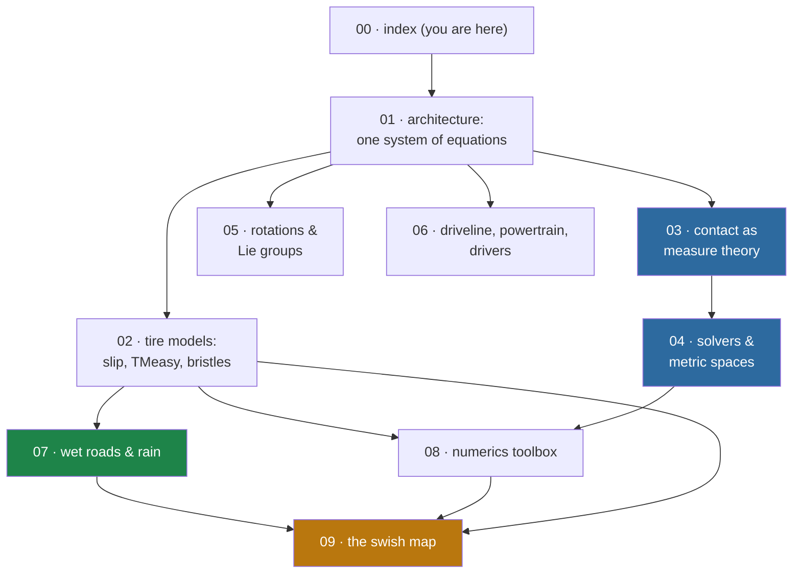

# Lessons from Chrono — index

> [!info] What this series is
> A deep dive into `archive/local/examples/chrono/` (Project Chrono) aimed at one question: **what can swish
> steal to make driving through rain more real?** Each file follows the three-pass style of
> [`archive/local/examples/chrono/VEHICLE_DYNAMICS_GUIDE.md`](../../archive/local/examples/chrono/VEHICLE_DYNAMICS_GUIDE.md)
> — **Layman's terms** first, then **the math** (going further here: real analysis, measure
> theory, convex analysis, metric spaces where they genuinely live in the code), then **the
> code**, quoted verbatim with `file:line` references you can jump to. Every file ends with a
> **→ swish** section pointing at the exact seam in our tree.
>
> *Provenance: AI-assisted deep-dive (Claude), 2026-08-05. All code excerpts verified against the
> checkout at `archive/local/examples/chrono/`; all swish line references verified against branch `debug-ui`.*

## How this relates to the docs you already have

- [`VEHICLE_DYNAMICS_GUIDE.md`](../../archive/local/examples/chrono/VEHICLE_DYNAMICS_GUIDE.md) is the **map**:
  architecture, suspension functors, the tire-model menu, the DAE form, HHT. This series is the
  **territory** — it goes below that guide into the solver, the measure theory, and the numerics,
  and above it into "what do we do about it in swish."
- [`archive/docs/wheels/research/01-physics-theory.md`](../../archive/docs/wheels/research/01-physics-theory.md) already
  derives slip, the quarter-car, wet grip, and a Pacejka verdict *for swish*. We cross-link
  rather than restate; where Chrono does the same thing, the framing here is *"how a full
  multibody code implements what 01 §N sketches."*
- [`docs/wheels/README.md`](../wheels/README.md) Phases B/C are the live plan this series feeds.
  File [09](09-swish-map.md) reconciles every lesson against it.

## Reading order

Two tracks through it:

- **"I want the rain sim to feel real"** → 01 → 02 → 07 → 09. (Blue-collar track; the payoff for
  swish lives here.)
- **"I want the beautiful math"** → 03 → 04 → 05 → 08. (Measure differential inclusions, Moreau
  decompositions, Nesterov in a projected-gradient metric, Lie-group integrators, and a
  regularization bestiary. None of it ships in swish — 09 explains why that's the right call —
  but all of it is real analysis you can hold in your hands.)

## The files

| # | File | One-liner |
| :- | :--- | :-------- |
| 01 | [01-architecture.md](01-architecture.md) | Chrono solves *one* giant equation; swish layers small closed-form models. When each philosophy wins, and the sub-stepping trick both share. |
| 02 | [02-tire-models.md](02-tire-models.md) | The slip story end-to-end: the Fiala→TMeasy→Pacejka ladder, TMeasy's load-interpolation and C¹ curve-matching, and the Dahl bristle model that lets a car *hold still on a hill*. |
| 03 | [03-contact-as-measure-theory.md](03-contact-as-measure-theory.md) | Why impacts break calculus: velocity as a BV function, acceleration as a *measure*, friction cones, and the closed-form Moreau projection — each tied to the exact line of code. |
| 04 | [04-solvers-and-metric-spaces.md](04-solvers-and-metric-spaces.md) | The cone-complementarity problem as a fixed-point equation in a metric space: APGD, Barzilai–Borwein, PSOR, ADMM — and the mass matrix as a Riemannian metric. |
| 05 | [05-rotations-and-lie-groups.md](05-rotations-and-lie-groups.md) | exp/log on SO(3), removable singularities, and why Chrono's quaternions stay unit-norm *without ever renormalizing*. |
| 06 | [06-driveline-powertrain-drivers.md](06-driveline-powertrain-drivers.md) | Torque converters, a 5.4× unit trap that would silently change torque 29×, shift hysteresis, and three steering controllers. |
| 07 | [07-wet-roads-and-rain.md](07-wet-roads-and-rain.md) | The honest headline: **Chrono has no rain model.** The four hooks it gives you, their hard limits, and the wet-μ model swish should build (with code). |
| 08 | [08-numerics-toolbox.md](08-numerics-toolbox.md) | The transferable numerics: splines by Thomas algorithm, inverting monotone maps by table, quadrature on singular integrands, and a catalog of five ways Chrono smooths a signum. |
| 09 | [09-swish-map.md](09-swish-map.md) | The payoff: every lesson mapped to a swish seam, reconciled with wheel Phases B/C, plus the "do not build" list. |

## Notation (used throughout)

| Symbol | Meaning |
| :----- | :------ |
| $\kappa$ (or $s_x$) | longitudinal slip, $\kappa = -v_{sx}/\lvert v_x\rvert$ |
| $\alpha$ (or $s_y$) | lateral slip angle, $\alpha = \operatorname{atan2}(v_{sy}, \lvert v_x\rvert)$ |
| $F_z$ | tire normal (vertical) load |
| $\mu,\ \mu_0$ | current road friction coefficient; the μ the tire data was measured at |
| $q,\ v=\dot q$ | generalized coordinates / velocities of the whole multibody system |
| $M$ | mass/inertia matrix |
| $\Phi(q,t)=0$, $C_q = \partial\Phi/\partial q$ | constraint equations and their Jacobian (Chrono calls the Jacobian `Cq`) |
| $\gamma,\ \lambda$ | Lagrange multipliers — contact/joint *impulses* at the velocity level |
| $K$ | the Coulomb friction cone; $K^\circ$ its polar cone; $N_K(x)$ the normal cone at $x$ |
| $P_K$ | Euclidean projection onto $K$ |
| $N$ | the Schur-complement (Delassus) operator $C_q M^{-1} C_q^\top - E$ |
| WU | swish world units; $1\,\text{m} = 1000$ WU (`util::units::kWuPerMetre`; was `WORLD_SCALE` until 2026-09-29) |

> [!tip] Conventions
> Chrono excerpts are verbatim, headed `// archive/local/examples/chrono/<path>:<lines>`. Swish excerpts are
> headed `// src/<path>:<lines>`. Claims of *absence* ("Chrono has no X") were re-verified by
> grep + reading call sites on 2026-08-05 — the two big ones are flagged inline where they
> matter ([03 §5](03-contact-as-measure-theory.md), [07 §1](07-wet-roads-and-rain.md)).
