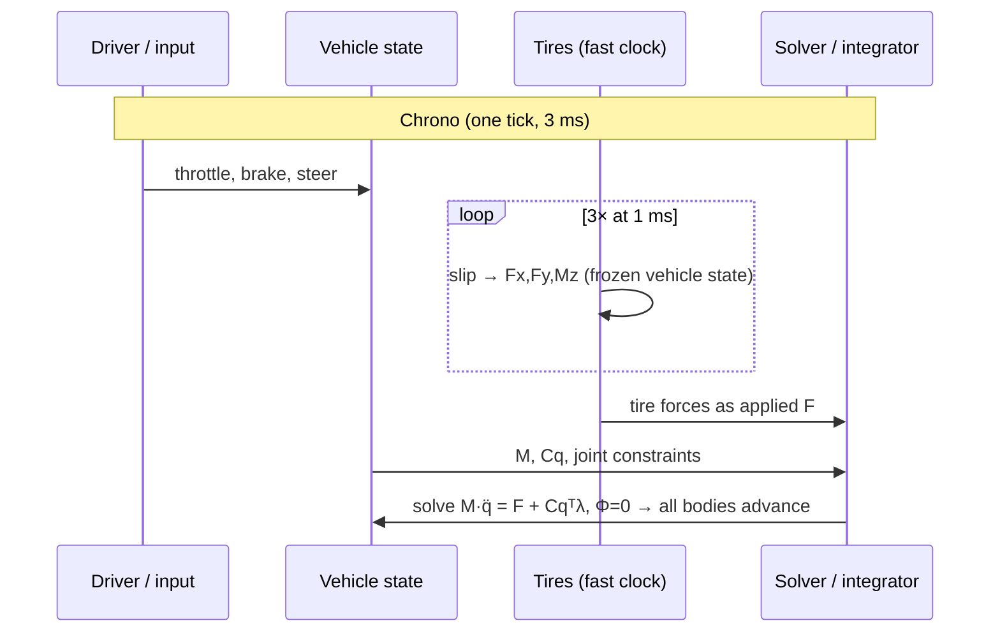

# 01 · Architecture: one system of equations vs. a stack of small models

## 1. The two philosophies

**Layman's terms.** There are two ways to simulate a car.

- **Chrono's way:** build the car the way a factory does. Every suspension arm, every shaft,
  every tire is a body or a constraint handed to one physics engine, and each tick the engine
  solves *everything at once* — "given every force and every joint, what does the whole system do
  next?" Camber change under braking isn't coded anywhere; it *falls out* of the geometry.
- **Swish's way:** write down the small closed-form models that produce the *behavior* you care
  about — a longitudinal force balance, a two-wheel "bicycle" for yaw, a kinematic spin law for
  the rims — and integrate each one directly. Nothing falls out for free, but every line is
  legible, testable, and costs nanoseconds.

Neither is "more correct." Chrono is a *predictive* tool (engineers use it to design real
suspensions); swish is a *perceptual* one (the player must believe the car). The lesson of this
series is not "become Chrono" — it's that Chrono is full of individually steal-able ideas that
survive the trip into a closed-form world.

**The math.** Chrono's single equation is the index-3 DAE from the
[existing guide](../../examples/chrono/VEHICLE_DYNAMICS_GUIDE.md#core-dynamics-solver):

$$
M\,\ddot q = F(q,\dot q,t) + C_q^\top \lambda, \qquad \Phi(q,t) = 0
$$

Swish's "equation" is a *product of small ODEs*, coupled only through a handful of scalars:

$$
\dot v = a_{\text{long}}(v, \text{throttle}, \text{brake}) \quad\Vert\quad
\begin{pmatrix}\dot v_l\\ \dot r\end{pmatrix} = f_{\text{bicycle}}(v, v_l, r, \delta)
\quad\Vert\quad
\dot\theta_w = v/r_w
$$

The `∥` is the point: these run side by side and only exchange $v$ and $\delta$. Chrono's blocks
exchange the *entire state* through $M$ and $C_q$ every step.

## 2. What the "one equation" buys — and costs

**Buys.** Emergent geometry (camber/toe/Ackermann from hardpoints), correct load paths (the
driveshaft's inertia and the spring's preload are unknowns in the *same* linear solve), and
composability — add a trailer and nothing else changes.

**Costs.** Every added body enlarges a linear system that must be solved iteratively per tick
([04](04-solvers-and-metric-spaces.md) is about how); constraint drift must be actively
stabilized; and the *behavior* becomes an emergent property you can only tune indirectly, through
physical parameters. For a game, that last cost is the killer: when the art director says "make
it 10% more planted," a `CarPhysics.h` constant is a one-line change; a multibody model is an
afternoon of hardpoint archaeology.

> [!tip] The lesson
> Chrono itself hedges! `ChSimpleDriveline` bypasses the shaft network with a kinematic torque
> split; `ChEngineSimpleMap` is a torque-vs-RPM lookup with no shaft dynamics; the `Rigid` tire
> skips the slip curve entirely. Even the reference multibody code keeps closed-form shortcuts on
> the menu for when fidelity doesn't pay. Swish's whole physics layer is, in Chrono's own
> taxonomy, the "Simple" tier — a legitimate tier, not a lesser one.

## 3. Subsystem decomposition — the patterns worth copying

Three recurring Chrono patterns transfer directly to any codebase:

### 3a. Force laws as pluggable functors

A suspension in Chrono doesn't hardcode Hooke's law — the spring element `ChLinkTSDA` owns a
`ForceFunctor` object, and the HMMWV plugs in a 21-point tabulated nonlinear spring
(see the [existing guide](../../examples/chrono/VEHICLE_DYNAMICS_GUIDE.md#suspension)). The
force *law* is data + a small object; the *topology* is separate. The same separation appears in
the terrain: friction is a functor you register (`ChTerrain.h:94-116`), not a constant you edit
— that seam is the entire subject of [07](07-wet-roads-and-rain.md).

**→ swish already does the topology half** (`CarParams` / `TireParams` structs in
[`src/scene/Entity/CarPhysics.h`](../../src/scene/Entity/CarPhysics.h)); what it lacks is the
functor half — `tireMu` is a compiled-in constant, and the tire force law at
`CarPhysics.h:101-102` is hardwired `clamp`. [02 §6](02-tire-models.md) and
[07 §4](07-wet-roads-and-rain.md) make both pluggable.

### 3b. Pure, GPU-free physics headers

Chrono's tire models are plain C++ classes whose `Advance()` is testable without a renderer.
Swish already has the same discipline — and it's worth naming as a *policy*, because both trees
converged on it independently:

```cpp
// src/scene/Entity/CarPhysics.h:3-5
// Pure vehicle-physics functions (SI units), independent of the renderer,
// GLFW, and GLM so they can be unit-tested without a GPU. CarEntity converts
// its world-unit state to/from SI at the call boundary.
```

`RainPhysics.h` (Marshall–Palmer drop spectra) and `WheelKinematics.h` follow the same contract.
Every new dynamics feature in this series lands as *pure SI header + Catch2 tests first*, wiring
second.

### 3c. Report structs — telemetry as a first-class output

Chrono's `ForceTSDA {force, length, velocity}` structs exist purely so you can *ask* a spring
what it's doing. Swish's debug UI wants exactly this shape: when [09](09-swish-map.md) proposes
exposing the traction saturation signals from `longitudinal_accel`, that's a report struct — the
solver's internals made observable without changing the solve.

## 4. Two clocks: the sub-stepping / co-simulation lesson

**Layman's terms.** Chrono's canonical vehicle demo runs the *vehicle* at 3 ms steps but the
*tires* at 1 ms — because tire forces change faster than anything else in the system (grip →
slide inside a couple of milliseconds), and it's cheaper to run a small model fast than the whole
model fast.

```cpp
// examples/chrono/src/demos/vehicle/wheeled_models/demo_VEH_HMMWV9_YUP.cpp:50-51
double step_size = 3e-3;        // rigid-body / vehicle-system step
double tire_step_size = 1e-3;   // tires are sub-cycled at a *smaller* step
```

**The math.** This is justified by stiffness separation. If the slowest interesting vehicle mode
is $\omega_{\text{veh}}$ (body heave ≈ 1–2 Hz) and the fastest tire mode is $\omega_{\text{tire}}$
(contact-patch dynamics, $O(10^2)$ Hz), an explicit-ish scheme needs $h \lesssim 2/\omega$ *per
subsystem*. Splitting the clocks means paying the small step only where the large $\omega$ lives:

$$
h_{\text{tire}} \lesssim \frac{2}{\omega_{\text{tire}}} \ll \frac{2}{\omega_{\text{veh}}} \lesssim h_{\text{veh}}
$$

The cost is a *co-simulation error*: during the tire's sub-cycle, the vehicle state it reads is
frozen (zero-order hold), so the coupling is only first-order accurate regardless of the
integrators' orders. Chrono accepts that; so should we.

**→ swish.** Swish currently has *one* clock, and it's the render clock — variable `dt`, clamped
to 1/15 s (`src/core/App/App.cpp:285-292`). That's fine for today's model because nothing in it is
stiff. But wheel **Phase B** ([docs/wheels/README.md](../wheels/README.md#phase-b--ride-height--suspension-effort-m-12-sessions-second-is-eye-tuning))
introduces a spring with $f_n \approx 1.4$ Hz and *debug sliders that can crank it* — which is why
its plan already specifies a fixed internal $h = 1/240$ s substep under the render loop. That is
exactly the HMMWV two-clock pattern: render at whatever `dt` GLFW hands you, sub-cycle the stiff
subsystem at a fixed $h$ chosen from its own $\omega_n$, hold the car state across the sub-cycle.
The stability bound and the semi-implicit Euler choice are derived in
[08 §6](08-numerics-toolbox.md) and
[docs/wheels/research/03-implementation-plan.md](../wheels/research/03-implementation-plan.md).

## 5. The tick, side by side



```mermaid
sequenceDiagram
    participant I as handle_input(dt)
    participant L as longitudinal_accel
    participant B as dynamic_bicycle_deriv
    participant W as wheel_spin_step ×4
    participant A as App (Y-snap, treadmill)
    Note over I,A: swish (one frame, variable dt ≤ 1/15 s)
    I->>L: throttle, brake → v += a·dt
    I->>B: v, δ → vl, r (semi-implicit, clamped)
    I->>W: v → θw (kinematic rolling)
    A->>A: pos.y = road_surface_y(x); treadmill may overwrite pose
```

The structural difference to internalize: in Chrono the tire forces *cause* the chassis motion
through the solve; in swish the chassis motion is computed first and the wheels are *driven by*
it. Everything in [02](02-tire-models.md) and [07](07-wet-roads-and-rain.md) lives comfortably
inside swish's causality — we upgrade the force laws, not the architecture.

---

**Next:** [02 — tire models](02-tire-models.md), where the slip curve gets its full treatment.
