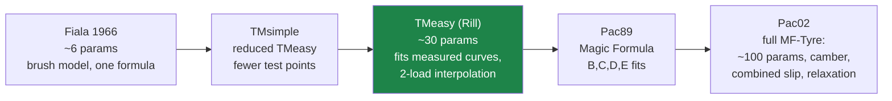

# 02 · Tire models: the slip story end-to-end

> [!abstract] Goal
> Everything interesting Chrono does between "the wheel has a velocity" and "here are $F_x, F_y,
> M_z$" — and exactly which pieces belong behind swish's tire seam at
> [`CarPhysics.h:101-102`](../../src/scene/Entity/CarPhysics.h).
> Slip basics are already derived for swish in
> [wheels research 01 §4](../../archive/docs/wheels/research/01-physics-theory.md); this file assumes them and
> goes into what that doc calls out of scope: the *industrial* models and their numerics.

## 1. Slip, and the division by zero at its heart

**Layman's terms.** Every tire model's input is *slip* — the mismatch between how fast the tire
says it's going by its rotation and how fast the car actually moves. The catch: slip is a
*ratio*, and its denominator is the car's speed. At standstill the definition itself
disintegrates — $0/0$ — and this single removable-looking-but-not-removable singularity shapes an
astonishing amount of real code.

**The math.** With contact-patch slip velocities $v_{sx}, v_{sy}$ and transport speed $v_x$:

$$
\kappa = -\frac{v_{sx}}{|v_x|}, \qquad \alpha = \operatorname{atan2}(v_{sy}, |v_x|)
$$

As $v_x \to 0$ with $v_{sx} \neq 0$ (a spinning launch, a locked slide), $\kappa \to \pm\infty$.
This is not a numerical nuisance to be `max()`ed away and forgotten: the *physics* changes down
there. A rolling tire generates force from slip; a *stationary* tire generates force from static
deformation — it's a spring, not a slip curve. Chrono deals with this honestly (§4). Swish
currently deals with it three separate ways, all defensible: the `vEff = max(|v|, 3)` floor in
`longitudinal_accel`, the `max(|vx|, 1)` floor in `dynamic_bicycle_deriv`, and the kinematic-yaw
blend below 5 m/s in `CarEntity.cpp:102-113`.

**The code** — TMeasy's version. Note it floors the *transport velocity*, not the ratio:

```cpp
// archive/local/examples/chrono/src/chrono_vehicle/wheeled_vehicle/tire/ChTMeasyTire.cpp:153-159
m_states.R_eff = (2.0 * m_unloaded_radius + r_stat) * CH_1_3;
m_states.P_len = 2.0 * std::sqrt(m_unloaded_radius * m_data.depth);
m_states.vta = m_states.R_eff * std::abs(m_states.omega) + m_vnum;
m_states.vsx = m_data.vel.x() - m_states.omega * m_states.R_eff;
m_states.vsy = m_data.vel.y();
m_states.sx = -m_states.vsx / m_states.vta;
m_states.sy = -m_states.vsy / m_states.vta;
```

Two asides worth keeping: the **effective rolling radius** $R_{\text{eff}} = (2R_0 +
r_{\text{stat}})/3$ — a loaded tire rolls on a radius between its unloaded and squashed values,
and the classic $2{:}1$ weighting is an empirical fit good across load ranges; and the **contact
patch length** $P_\ell = 2\sqrt{R_0\,\delta}$ — the chord of a circle penetrating a plane by
depth $\delta$, pure Pythagoras, later reused for the aligning-torque lever arm.

## 2. The model ladder



What each rung buys, and what it demands:

| Model | Params | Data needed | What it adds over the previous rung |
| :---- | :----- | :---------- | :---------------------------------- |
| Fiala | ~6 | none (physics-derived) | the rise-then-saturate shape at all |
| TMsimple | ~12 | a few curve points | fits *measured* peaks instead of deriving them |
| TMeasy | ~30 | curve points at **two loads** | load sensitivity done right (§3), combined slip, Dahl standstill (§4) |
| Pac89 | ~25 | rig-fit coefficients | empirical shape freedom ($B,C,D,E$ per force) |
| Pac02 | ~100 | a full MF-Tyre `.tir` file | camber, pressure, overturning, relaxation lengths (§6) |

> [!tip] Where the value concentrates
> The jump that matters perceptually is **Fiala → TMeasy**: real peak placement and load
> sensitivity. The jump **TMeasy → Pac02** buys accuracy engineers need and players cannot feel,
> at 3× the parameter-sourcing pain. The
> [wheels research doc](../../archive/docs/wheels/research/01-physics-theory.md) reached the same verdict on
> Pacejka for swish from the other direction.

## 3. TMeasy's load interpolation — a small gem of applied approximation

**Layman's terms.** Tire test rigs measure the force curve at the tire's nominal load and at
double that load. Real driving visits every load in between (and beyond). TMeasy reconstructs
any-load behavior from just those two measurements — and it uses *two different* interpolation
rules depending on what kind of quantity it's reconstructing.

**The code:**

```cpp
// archive/local/examples/chrono/src/chrono_vehicle/wheeled_vehicle/tire/ChTMeasyTire.h:250-257
// linear interpolation
double InterpL(double w1, double w2) { return w1 + (w2 - w1) * (m_states.q - 1.0); }
// quadratic interpolation
double InterpQ(double w1, double w2) {
    return (m_states.q) * (2.0 * w1 - 0.5 * w2 - (w1 - 0.5 * w2) * (m_states.q));
}
```

with $q = F_z / F_z^{\text{nom}}$ (clamped via `pn_max`, `ChTMeasyTire.cpp:150`).

**The math.** Write $q$ for normalized load. Both rules agree at the two measured points — check
by substitution:

$$
\begin{aligned}
\text{InterpL}(q) &= w_1 + (w_2 - w_1)(q-1) &&\Rightarrow\ \text{InterpL}(1) = w_1,\quad \text{InterpL}(2) = w_2\\
\text{InterpQ}(q) &= q\left(2w_1 - \tfrac{w_2}{2}\right) - q^2\left(w_1 - \tfrac{w_2}{2}\right) &&\Rightarrow\ \text{InterpQ}(1) = w_1,\quad \text{InterpQ}(2) = w_2
\end{aligned}
$$

The difference is the third constraint. InterpQ is the unique parabola through
$\textcolor{green}{(0,0)}, (1, w_1), (2, w_2)$ — it is used for **forces** ($F$-peak, $F$-slide,
slip stiffnesses), because a tire carrying zero load must produce zero force, *with zero being
hit exactly, not approximately*. InterpL is the affine map through $(1,w_1), (2,w_2)$ — used for
**slip locations** ($s_m$, $s_s$), which are dimensionless curve *positions* with no reason to
vanish at zero load. The dispatch at `ChTMeasyTire.cpp:160-172` follows exactly that rule.

> [!warning] Extrapolation is where interpolants bite
> InterpQ is a downward parabola in $q$ whenever $w_1 > w_2/2$ (always true for real tire data —
> force is sub-linear in load). Past its vertex it *turns over and eventually goes negative*.
> Chrono's only guard is clamping $q$ via `pn_max`, plus `Fz = min(normal_force, pn_max)` at
> `ChTMeasyTire.cpp:207` ("avoid nonsensical extrapolation of the curve coefficients" — their
> comment). Lesson for any table-driven model in swish: **decide the out-of-domain policy
> explicitly**, per quantity. [08 §2](08-numerics-toolbox.md) catalogs the options.
>
> The sub-linearity being interpolated here is real physics with a name — *tire load
> sensitivity*: $\mu_{\text{eff}}$ falls as $F_z$ rises. It's why load transfer hurts total grip
> and why swish's static-load bicycle model (`FzF`, `FzR` constants at `CarPhysics.h:97-98`)
> is smooth but slightly too forgiving.

## 4. Standstill: the Dahl bristle model

**Layman's terms.** Below walking pace the slip curve is meaningless (§1), but a car must still
*hold on a slope without creeping*. TMeasy switches to modeling the tread as a **bristle**: a
tiny spring between rubber and road. At rest it's a genuine spring — deflect it and it pushes
back, forever, with no sliding. Push past the friction limit and the bristle "slips" —
deflection stops growing and force saturates. That's static friction *emerging from a
continuous model*, no if-statement between "static" and "kinetic" regimes.

**The math.** The Dahl model (per bristle deflection $z$, sliding velocity $v$, Coulomb force
$f_c = \mu F_z$, stiffness $\sigma_0$):

$$
\boxed{\ \dot z = v - \sigma_0 \frac{|v|}{f_c}\, z\ } \qquad
F = \sigma_0 z + \sigma_1 \dot z
$$

Look at the two limits. At $v \approx 0$: $\dot z = v$, so $z = \int v\,dt$ — pure spring,
$F = \sigma_0 z$; the car holds. At large constant $v$: the ODE relaxes to equilibrium
$z_\infty = f_c\,\mathrm{sgn}(v)/\sigma_0$, so $F \to f_c\,\mathrm{sgn}(v)$ — pure Coulomb
sliding. The model *interpolates between stiction and sliding through a state variable* instead
of a discontinuous law. (This is the scalar ancestor of LuGre friction, and — worth savoring —
the same trick as the contact-solver's set-valued friction in
[03](03-contact-as-measure-theory.md), approached from the opposite end: regularize via a state
ODE rather than keep the discontinuity and solve an inclusion.)

**The code** — with a numerically load-bearing detail: the ODE is stiff when $|v|$ is large
(relaxation time $f_c / (\sigma_0 |v|)$ → tiny), so Chrono integrates it **implicitly, in closed
form** — solve the BDF1/trapezoidal update equation for $z_{n+1}$ by hand since it's linear in
$z_{n+1}$:

```cpp
// archive/local/examples/chrono/src/chrono_vehicle/wheeled_vehicle/tire/ChTMeasyTire.cpp:310-315
if (m_use_bdf1) {
    // Calculate the new ODE states (Backward Euler / BDF1 / Gear1)
    // implicit, A-stable
    // Integration error ~ h
    m_states.brx = (fc * m_states.brx + fc * h * m_states.vsx) / (fc + h * m_par.sigma0 * fabs(m_states.vsx));
```

Derivation of that line: backward Euler on the ODE is
$z_{n+1} = z_n + h\,(v - \sigma_0 z_{n+1} |v| / f_c)$; collect $z_{n+1}$:

$$
z_{n+1} = \frac{f_c z_n + f_c h v}{f_c + h \sigma_0 |v|}
$$

— exactly the code. A-stable at any $h$, no subcycling needed. ($\sigma_0 = 10^5$, $\sigma_1 =
5\cdot10^3$ N/m per unit load, `ChTMeasyTire.h:218-219`; the comment at `:285` warns $h$ must
equal the vehicle step — the closed form bakes $h$ into the update.) Finally the two bristle
forces are combined and **projected onto the friction disc** — a 2-ball metric projection, little
sibling of [03](03-contact-as-measure-theory.md)'s cone projection:

```cpp
// archive/local/examples/chrono/src/chrono_vehicle/wheeled_vehicle/tire/ChTMeasyTire.cpp:328-332
// combine forces (friction circle)
if (F.Length() > fz * muscale) {
    F.Normalize();
    F *= fz * muscale;
}
```

The handoff between regimes is a $C^1$ sine-step blend over 1–3 m/s
(`ChTMeasyTire.cpp:214, 249-250`): below 1 m/s pure bristle, above 3 m/s pure slip curve.

## 5. The master curve, and a monotonicity bound worth knowing

**Layman's terms.** TMeasy compresses both slip directions into one *generalized slip* and runs a
single master curve through the measured landmarks: initial slope, peak $(s_m, F_m)$, full-slide
point $(s_s, F_s)$. The curve is stitched from a rational arc (adhesion), one or two parabolas
(transition), and a constant (sliding) — with the stitches arranged so the result is $C^1$.

**The math.** Combined slip first — direction-decomposed so one curve serves both axes
(`ChTMeasyTire.cpp:220-236`):

$$
s = \sqrt{s_x^2 + s_y^2}, \quad \cos\varphi = s_x/s,\ \sin\varphi = s_y/s, \qquad
F_x = f(s)\cos\varphi,\ F_y = f(s)\sin\varphi
$$

with each landmark itself blended directionally, e.g. $F_m = \mu_{\text{scale}}
\sqrt{(F_{xm}\cos\varphi)^2 + (F_{ym}\sin\varphi)^2}$. Then the adhesion branch is the rational

$$
f(s) = \frac{\mathrm{d}f_0\, s_m\, \sigma}{1 + \sigma(\sigma + p)}, \qquad
\sigma = \frac{s}{s_m},\quad p = \frac{\mathrm{d}f_0\, s_m}{F_m} - 2
$$

which satisfies $f(0)=0$, $f'(0) = \mathrm{d}f_0$, $f(s_m) = F_m$, $f'(s_m) = 0$ — four
conditions, four degrees of freedom. But there's a hidden inequality. For the curve to stay
monotone on $[0, s_m]$ you need $p \ge 0$, i.e.

$$
\boxed{\ \mathrm{d}f_0 \ \ge\ \frac{2 F_m}{s_m}\ }
$$

— the initial slope must be at least *twice the secant slope to the peak*. Chrono enforces it
silently:

```cpp
// archive/local/examples/chrono/src/chrono_vehicle/wheeled_vehicle/tire/ChTMeasyTire.cpp:345-348
double df0loc = 0.0;
if (sm > 0.0) {
    df0loc = std::max(2.0 * fm / sm, df0);
}
```

That one `max()` is a *shape-preservation constraint on user data* — the same idea as monotone
cubic (Fritsch–Carlson) interpolation clamping derivatives. If the user's measured slope is
inconsistent with their measured peak, the model quietly prefers a sane curve to faithful
nonsense. Past the peak: a parabola matched to $f''(s_m^-)$ (the `a = (fm/sm)²/(df0loc·sm)`
line), a second parabola meeting the sliding level, and a smoothstep cubic as fallback when the
two-parabola construction would overshoot (`ChTMeasyTire.cpp:362-377`). Every joint matches value
and first derivative: the whole curve is $C^1$ by construction.

## 6. Transient slip (relaxation length) — theory, and an honest caveat

**Layman's terms.** A tire doesn't develop lateral force instantly when you steer — the carcass
has to *wind up* first, over roughly one relaxation length $\sigma$ of rolling (0.3–0.6 m). At 30
m/s that's a ~15 ms first-order lag; at parking speed it's a big, feelable squidge.

**The math.** The standard model is a first-order lag on the slip input, with the *distance*
(not time) constant $\sigma$:

$$
\frac{\sigma}{|v_x|}\,\dot{\bar\alpha} + \bar\alpha = \alpha, \qquad
F_y = F_y^{\text{ss}}(\bar\alpha)
$$

i.e. a low-pass whose bandwidth *scales with speed* — the tire responds in distance traveled, not
in seconds.

> [!warning] Verified against this checkout, 2026-08-05
> In this Chrono tree, relaxation length lives **only** in Pac02 — `CalcSigmaK` / `CalcSigmaA`
> (`ChPac02Tire.cpp:325-335`) compute load-dependent $\sigma_\kappa, \sigma_\alpha$ — and those
> two functions are **defined but never called**: `ChPac02Tire::Advance` handles `use_mode` 0–4
> all as steady-state, and no other call site exists (grep verified). TMeasy here carries no slip
> lag at all; its only ODE states are the bristle deflections. So if you read elsewhere that
> "Chrono tires have relaxation dynamics" — in this version, the plumbing exists and the pipe is
> not connected. Documenting intended-vs-wired honestly is itself one of the lessons.

## 7. The regularization catalog (one file, three smoothings of one discontinuity)

The signum/discontinuity at zero speed appears three times in `ChTMeasyTire.cpp`, and gets three
*different* treatments — each matched to what the quantity feeds:

| Site | Regularization | Why this one |
| :--- | :------------- | :----------- |
| slip denominators (`:155`) | additive floor $v_{ta} = R_{\text{eff}}\lvert\omega\rvert + v_{\text{num}}$ | keeps $s_x, s_y$ *bounded* but exact at speed; error vanishes as speed grows |
| force handoff (`:214,249`) | $C^1$ sine-step blend to the bristle model over 1–3 m/s | swaps *models*, not just values — the physics differs at standstill |
| rolling-resistance sign (`:260-261`) | `tanh(ω)` in place of `sgn(ω)` | $M_y$ feeds an integrator; a hard sign flip would chatter ("Ramp Like Signum inhibits 'switching' of My" — their comment) |

Add the Dahl bristle itself (state-based regularization) and the contact solver's *refusal* to
regularize ([03](03-contact-as-measure-theory.md)) and you have five distinct answers to the same
mathematical problem. The meta-lesson: **pick the regularization per consumer, not per
discontinuity** — swish already unknowingly follows this (three different floors in
`CarPhysics.h`/`CarEntity.cpp`, each tuned to its consumer), and [08 §5](08-numerics-toolbox.md)
tabulates the full bestiary.

## 8. → swish

Swish's tire seam is two lines — the entire lateral tire model:

```cpp
// src/scene/Entity/CarPhysics.h:101-102
const float FyF = std::clamp(-t.cAlphaFront * alphaF, -p.tireMu * FzF, p.tireMu * FzF);
const float FyR = std::clamp(-t.cAlphaRear * alphaR, -p.tireMu * FzR, p.tireMu * FzR);
```

That's a linear-then-hard-saturate curve: the right *skeleton*, with two perceptible flaws — the
corner at saturation is $C^0$ (grip loss arrives as a cliff, not a bleed), and there's no
post-peak falloff (a real tire past the peak gives *less* force, which is what makes slides
progressive rather than binary).

**A TMeasy-lite lateral force.** ("premons" — worked code.) Same landmarks as TMeasy, one axle at
a time, no combined slip (the bicycle model has no longitudinal coupling to feed it — yet):

```cpp
// Proposed for CarPhysics.h — per-axle TMeasy-lite: C¹ rise, peak, gentle slide.
// Landmarks per axle: cAlpha (initial slope, N/rad), muPeak·Fz at alphaM, muSlide·Fz at alphaS.
// Degenerates to the current clamp model as alphaM → muPeak·Fz/cAlpha, muSlide → muPeak.
struct TireCurve {
    float alphaM  = 0.10f;  // rad, slip angle at peak force (~5.7°)
    float alphaS  = 0.35f;  // rad, fully sliding beyond this
    float muPeak  = 1.10f;  // peak friction (dry)
    float muSlide = 0.90f;  // full-slide friction (dry)
};

inline float lateral_tire_force(float alpha, float Fz, float cAlpha, const TireCurve& c) {
    const float s  = std::fabs(alpha);
    const float Fm = c.muPeak * Fz, Fs = c.muSlide * Fz;
    const float df0 = std::max(2.0f * Fm / c.alphaM, cAlpha);  // TMeasy monotonicity bound (§5)
    float f;
    if (s >= c.alphaS) {                    // full sliding
        f = Fs;
    } else if (s < c.alphaM) {              // adhesion: rational branch, f(0)=0, f'(0)=df0,
        const float p  = df0 * c.alphaM / Fm - 2.0f;   // f(αm)=Fm, f'(αm)=0
        const float sn = s / c.alphaM;
        f = df0 * c.alphaM * sn / (1.0f + (sn + p) * sn);
    } else {                                // post-peak: C¹ smoothstep down to the slide level
        const float sn = (s - c.alphaM) / (c.alphaS - c.alphaM);
        f = Fm - (Fm - Fs) * sn * sn * (3.0f - 2.0f * sn);
    }
    return (alpha >= 0.0f) ? -f : f;        // force opposes slip
}
```

Wiring it is deliberately left to you (Learning Mode resumes). The trail to follow:

1. Replace the two `std::clamp` lines with calls to `lateral_tire_force` — signature already
   matches what `dynamic_bicycle_deriv` has in scope. Where should `TireCurve` live so the debug
   UI can slide `muPeak` later? (Look at how `TireParams` reaches the function today —
   `CarEntity.cpp:107` — and remember it's rebuilt on the stack per frame.)
2. The existing tests pin the linear regime and the $\mu g$ cap
   (`tests/test_car_physics.cpp:78-100`). Which of them should still pass verbatim, and which
   assert the *old* hard corner? Run them before touching anything and read the two that fail.
3. The stability question: the current model can't oscillate because the clamp is monotone. The
   rational branch is also monotone (that's what the `df0` bound guarantees) — but check what
   your chosen `alphaM` does to understeer gradient: the effective cornering stiffness at small
   α is now `df0`-shaped, not `cAlpha`. The rear-stiffer-than-front invariant
   (`CarPhysics.h:60-63`) must survive in *effective* slopes, or the car trades its stability
   guarantee for the new curve.
4. Hold the post-peak falloff until rain: dry driving rarely visits it; wet driving
   ([07](07-wet-roads-and-rain.md)) lives there. Landing it together with wet-μ makes both
   testable in one CHANGELOG'd behavior change.

---

**Next:** [03 — contact as measure theory](03-contact-as-measure-theory.md), where the
discontinuities stop being regularized and start being *solved*.
