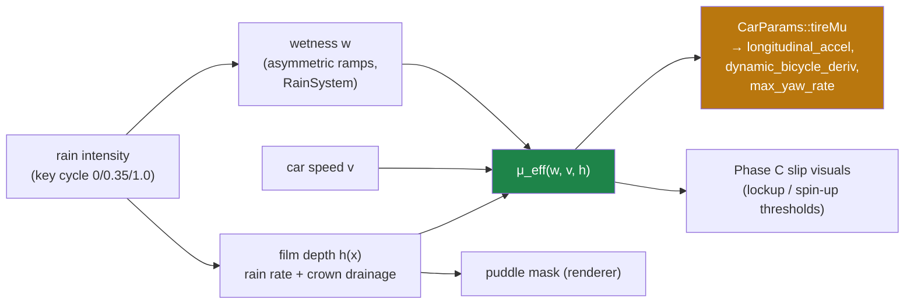

# 07 · Wet roads & rain: what Chrono gives you, and what you must build

> [!abstract] Goal
> The chapter this series exists for. It opens with a negative result, maps the four hooks
> Chrono *does* provide (and their hard limits), then synthesizes the wet-grip model swish
> should build — with worked code, since this is where the payoff lives. Companion to
> [wheels research 01 §4.6](../wheels/research/01-physics-theory.md) (wet grip + hydroplaning
> for swish) and [docs/wheels/README.md Phase C](../wheels/README.md) (the shipping plan this
> feeds).

## 1. The negative result, stated plainly

> [!warning] Verified 2026-08-05
> **Project Chrono contains no wet-road, rain, water-film, or hydroplaning model. Anywhere.**
> Grepped case-insensitively for `hydroplan|wet|water_film|rainfall|rain|puddle|aquaplan|spray`
> across all sources; every hit is a false positive (the substring "rain" inside
> ter**rain**/powert**rain**/const**rain**t, thermal-property comments, SPH free-surface fluid
> demos). The only physics-relevant water in the tree is `chrono_fsi`'s incompressible SPH —
> free-surface *flow*, unrelated to tire grip.

This is worth sitting with: a reference-grade, research-active multibody vehicle code — the one
with the measure-theoretic contact solver and hundred-parameter tire models — treats "the road
is wet" as out of scope. Two honest reasons: wet grip is dominated by *thin-film fluid dynamics
in the contact patch* (a different physics domain than rigid multibody), and the empirical data
that industrial tire models are fit from is overwhelmingly measured dry. So everything below §2
is **synthesis** — the literature model *we* choose, hung on Chrono-shaped hooks — not a port.

## 2. The four hooks Chrono does give you

Ranked by leverage; all verified against the checkout.

### 2a. `ChTerrain::FrictionFunctor` — a spatial μ field

```cpp
// examples/chrono/src/chrono_vehicle/ChTerrain.h:94-101
class CH_VEHICLE_API FrictionFunctor {
  public:
    virtual ~FrictionFunctor() {}
    /// Return the coefficient of friction below the given location.
    virtual float operator()(const ChVector3d& loc) = 0;
};
```

μ as a *function of position* — the right abstraction for puddles, wheel tracks, painted lines.
Two caveats, one striking: the header warns it only affects "certain tire models... it will
have no effect on the interaction of the terrain with other objects" (`ChTerrain.h:54-58`) —
and **not one demo, test, or model in the entire tree registers one** (single grep hit: the
declaration, `ChTerrain.h:116`). The cleanest seam in the vehicle module is completely
unexercised. A wet-road μ field is genuinely new territory even for Chrono users.

### 2b. The contact-callback route (for rigid/NSC contact)

Force-element tires query μ through the `DiscTerrainCollision` out-parameter; rigid-body
contact needs a separate opt-in that rewrites the contact material as each contact is created
(`RigidTerrain::UseLocationDependentFriction`, callback at `RigidTerrain.cpp:897-916` setting
`mat->static_friction = mat->sliding_friction = CombineFriction(...)`). Two independent μ
transport channels for two contact regimes — an architecture wrinkle to remember if you ever
mix them. Per-patch constant μ (no functor) also exists: `FindPoint` returns the *highest* hit
patch's `m_friction` (`RigidTerrain.cpp:1107-1134`).

### 2c. Per-tire μ scaling — and its two hard limits

Every force-element tire normalizes queried road friction against the μ its parameters were
identified at — Fiala: `U *= m_mu / m_mu_0` (`ChFialaTire.cpp:172`); Pac89/Pac02 scale the
D-terms; TMeasy:

```cpp
// examples/chrono/src/chrono_vehicle/wheeled_vehicle/tire/ChTMeasyTire.cpp:119-121
ChClampValue(mu_road, 0.1f, 1.0f);
m_states.muscale = mu_road / m_par.mu_0;
```

**Limit 1 — the clamp.** μ is hard-clamped to $[0.1, 1.0]$ in TMeasy, TMsimple, and Pac02.
Deep-water hydroplaning (μ → 0.05) is unrepresentable; so is dry racing rubber (μ > 1). Any
value you feed outside the box is *silently* clipped — the worst failure mode for a tuning
workflow.

**Limit 2 — saturation-only scaling.** Look which landmarks take the scale
(`ChTMeasyTire.cpp:160-172` and `:232-236`): `fm, sm, fs, ss` are multiplied by `muscale`; the
initial slopes `dfx0, dfy0` carry the comment *"does not vary with road friction."* So in
Chrono, a wet road lowers the *peak* and shifts it, but small-slip response — the cornering
stiffness your hands feel first — stays bone dry. Physically defensible for thin films (small-
slip force comes from tread adhesion that mild wetness barely touches; the peak collapses
first), wrong for real water depth. Either way: **scaling one scalar μ does not make a tire
wet.** A wet tire changes shape, not just height. Carry this into §4.

### 2d. SCM soil callback — the mud model

`SCMTerrain::SoilParametersCallback` (`SCMTerrain.cpp:1387-1389`) spatially varies the full
Bekker–Wong parameter set (cohesion, friction angle, sinkage moduli — the math is in
[08 §7](08-numerics-toolbox.md)) — and unlike 2a, demos actually exercise it. Rain-softened
shoulders and muddy off-road are *this* hook, not the μ field. Out of scope for the LIE
corridor, noted for completeness.

## 3. What wet grip actually is (the model to build)

**Layman's terms.** A wet road is not "a slippery road." It's a road where grip *depends on
speed* in a way dry roads don't. At parking speed a wet road grips nearly like a dry one — the
tread has time to squeeze the film out of the contact patch. As speed rises there's less and
less time to evacuate water; grip bleeds away roughly linearly. Past a critical speed the tire
climbs onto the water like a boat onto plane — **hydroplaning** — and grip collapses to nearly
nothing, steering goes light, and no tire model with a constant μ can reproduce the sensation.

**The math** — three stacked ingredients, each with one parameter you can feel:

**(i) Base wet level.** At low speed, μ drops from dry ≈ 1.1 (swish's `tireMu`) toward the
mid-0.6s on sane wet asphalt — the Phase C decision-4 value:

$$
\mu_{\text{lowspeed}}(w) = \mu_{\text{dry}} + w\,(\mu_{\text{wet}} - \mu_{\text{dry}}), \qquad
\mu_{\text{wet}} \approx 0.6
$$

with $w \in [0,1]$ the *wetness* (the renderer already integrates this with asymmetric
wet/dry rates — `RainSystem.cpp:25-27` — and it, not raw rain intensity, is the right input:
grip loss outlasts the shower exactly like the visual sheen does).

**(ii) Speed fade.** The classic wet-skid data (PIARC/ASTM skid-number measurements) is well
fit by an exponential decay in speed; a linear fade is indistinguishable in our range and
cheaper to reason about:

$$
\mu(w, v) = \mu_{\text{lowspeed}}(w)\,\Big(1 - w\,c_v \min(v, v_p)\Big)
$$

with $c_v$ sized so grip loses ~25–30% of its wet-base value by highway speed. This term is
what makes wet *braking from speed* dramatically worse than the single-μ model predicts — and
it's the term Chrono's hooks cannot express at all (μ reaches the tire as a function of
*position*, never of *speed*).

**(iii) Hydroplaning onset.** The NASA/Horne empirical law: full dynamic hydroplaning begins
when hydrodynamic lift under the patch balances wheel load, at

$$
v_p \;[\text{knots}] \approx 9\sqrt{p\;[\text{psi}]}
\quad\Longleftrightarrow\quad
v_p \;[\text{m/s}] \approx 1.76\sqrt{p\;[\text{kPa}]}
$$

— dependent on inflation pressure (heavier-loaded ≈ higher-pressure tires plane later), *not*
on load directly. For a 911's ≈ 250 kPa: $v_p \approx 28$ m/s ≈ 100 km/h, right in the
folklore range — but that's for *standing water deeper than the tread can swallow*. With film
depth $h$ below tread depth $h_t$, planing doesn't occur; the practical model gates on film:

$$
\mu_{\text{eff}}(w, v) =
\begin{cases}
\mu(w, v) & h < h_t \text{ or } v < v_p \\[2pt]
\mu_{\text{plane}} \approx 0.05\text{–}0.1 & h \ge h_t \text{ and } v \ge v_p
\end{cases}
$$

(smoothly blended in practice — §4 — and with the §2c lesson honored: on a *dry* road, $w = 0$
must reproduce today's handling bit-for-bit.)

**Where does $h$ come from?** Film depth grows with rain rate and with *drainage path length*,
and falls with slope — the highway-engineering fit (Gallaway et al., the basis of hydroplaning
design charts) has $h \propto I^{0.59} L^{0.43} S^{-0.42}$ minus tread depth. Swish is unusually
well equipped here: the road has an analytic 2% crown (`RoadGeometry.cpp:11-17`), so drainage
path length is just distance from the crown apex — meaning **film depth, hence grip, can vary
by lane** with zero new geometry: outer lanes ≈ longer drainage path ≈ deeper film ≈ earlier
planing. That's the same input the renderer's puddle mask wants, one scalar function serving
both looks and physics.



**What it changes, in numbers.** Stopping from 30 m/s, $d = v^2 / (2\mu g)$:

| Condition | μ | Stopping distance |
| :-------- | :- | :--------------- |
| Dry | 1.10 | **41.7 m** |
| Wet, low speed model only | 0.60 | **76.5 m** |
| Wet + speed fade (avg μ ≈ 0.5) | — | **~92 m** |
| Hydroplaning until $v_p$, wet below | — | first ~60 m near-coast, then braking |

The first two rows are exactly the Phase C plan's 42 → 77 m; the third row is what the speed
fade adds; the fourth is the "oh no" the player remembers.

## 4. → swish: the worked coupling ("premons")

The seam analysis, verified against the tree: `set_rain_intensity` is plumbed to `CarEntity`
and currently inert (`CarEntity.h:53`, its only consumer is the disabled cabin-wash tint at
`CarEntity.cpp:198-203`); `CarParams` is default-constructed on the stack **per frame** in both
`update()` call sites (`CarEntity.cpp:52` and `:107`) — so the μ coupling must write a member
that outlives the frame, and both constructions must read it. The pure-header function first:

```cpp
// Proposed addition to src/scene/Entity/CarPhysics.h — pure SI, testable without GPU.
struct WetGripParams {
    float muDry     = 1.10f;   // matches CarParams::tireMu default
    float muWet     = 0.60f;   // low-speed wet asphalt (Phase C decision 4)
    float speedFade = 0.0045f; // per m/s: ~27% additional loss by 60 m/s, scaled by wetness
    float muPlane   = 0.08f;   // grip while hydroplaning
    float vPlane    = 28.0f;   // m/s, NASA/Horne at ~250 kPa
    float planeBand = 4.0f;    // m/s, smooth onset width (no hard switch)
};

// Effective tire-road friction. wetness in [0,1] (the RainSystem integrator, NOT raw
// intensity); filmOverTread ≥ 1 means standing water exceeds tread capacity.
// Invariant: wetness == 0 returns muDry exactly — dry handling must be bit-identical.
inline float effective_mu(float wetness, float v, float filmOverTread, const WetGripParams& g) {
    if (wetness <= 0.0f)
        return g.muDry;
    const float muLow  = g.muDry + wetness * (g.muWet - g.muDry);
    const float vAbs   = std::fabs(v);
    const float faded  = muLow * (1.0f - wetness * g.speedFade * std::min(vAbs, g.vPlane));
    if (filmOverTread < 1.0f)
        return faded;
    // Hydroplaning: C¹ smoothstep from faded grip down to muPlane across [vPlane, vPlane+band].
    const float t = std::clamp((vAbs - g.vPlane) / g.planeBand, 0.0f, 1.0f);
    const float s = t * t * (3.0f - 2.0f * t);
    return faded + s * (g.muPlane - faded);
}
```

Wiring (the short version — each line lands where the seams already are):

```cpp
// CarEntity.h: members
float m_effective_mu = 1.10f;          // updated once per frame, consumed by both models
swish::WetGripParams m_wet_grip{};     // debug-UI sliders attach here later

// CarEntity::update(), before the physics calls (near CarEntity.cpp:52):
m_effective_mu = swish::effective_mu(m_wetness, speed_mps, m_film_over_tread, m_wet_grip);
CarParams params;                       // both existing stack constructions...
params.tireMu = m_effective_mu;         // ...get this one extra line
```

with `m_wetness` fed from the RainSystem's integrated wetness (a `set_wetness()` sibling to the
existing `set_rain_intensity()` — App already pushes rain state both directions at
`App.cpp:33-48`), and `m_film_over_tread` = 0 until the lane-drainage film model lands (the
hydroplaning branch stays dormant — ship the μ fade first, alone).

Learning-mode residue — three things deliberately left for you:

1. **The tests.** Extend `tests/test_car_physics.cpp` with the wet cases before wiring:
   `effective_mu(0, v, ·) == 1.10f` exactly for all $v$ (the bit-identical-dry invariant);
   stopping distance from 30 m/s at wetness 1 lands in [72, 82] m (mirror the existing braking
   test's structure at `:43-51`); monotonicity in both `wetness` and `v`. The existing
   `integrate_lateral` harness (`:63-76`) runs unchanged at wetness 0 — that *is* the
   regression test.
2. **Where does μ enter the lateral model?** `dynamic_bicycle_deriv` and `max_yaw_rate` both
   read `p.tireMu` — so the one-line params patch covers them. But check the *blend region*:
   below 8 m/s the yaw response is partly kinematic (`CarEntity.cpp:102-113`), which has no μ
   at all. Is that right in the wet? (Hint: what does §3's speed fade say about grip at 8 m/s
   — and is a wet parking lot a handling problem or a braking problem?)
3. **The rain-at-both-extremes law** (project rule): the acceptance run is dry vs wetness-1.0
   stopping distance and a lane-change at 30 m/s, window-only screenshots, plus the CHANGELOG
   entry — this coupling is the one intentional gameplay change of Phase C, per decision 4.

## 5. The hydroplaning switch needs the gearbox pattern

When the film model does land: hydroplaning onset is a *discrete-feeling* mode driven by noisy
continuous inputs ($v$ hovering near $v_p$, film depth flickering across lane changes) — the
exact chatter setup from [06 §3](06-driveline-powertrain-drivers.md). Both defenses apply: the
`planeBand` smoothstep above is the hysteresis-shaped smooth gate, and a short latency (~0.5 s
of sustained condition before the *visual/audio* hydroplane state announces itself) prevents
strobing feedback even while μ itself varies smoothly. Physics can be continuous while
*presentation* is discrete; the presentation is what needs the anti-chatter.

---

**Next:** [08 — the numerics toolbox](08-numerics-toolbox.md) — the transferable numerical
analysis behind everything above.
