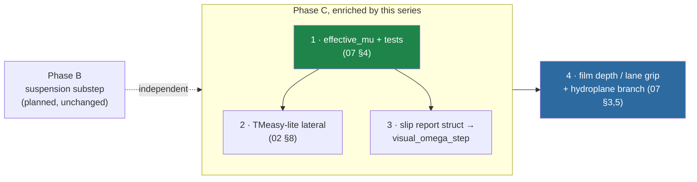

# 09 · The swish map: every lesson, one table, priorities settled

> **Path note (2026-09-29):** `file:line` citations in this table predate the deep-clean. `CarPhysics.h` is now an umbrella
> over `CarParams/Powertrain/Tire/Drivetrain/Longitudinal/Bicycle/WetGrip.h`, and `App.cpp` is split into
> `App.cpp` / `AppInit.cpp` / `AppInput.cpp`. Line numbers are historical; find symbols with `rg`.

> [!abstract] Goal
> The payoff file. Each swish seam, the lesson that covers it, the concrete next action, and an
> honest ROI — reconciled with [tasks/todo.md](../../tasks/todo.md) and the wheel plan
> ([docs/wheels/README.md](../wheels/README.md)) so this series *feeds* the existing roadmap
> instead of forking it. Ends with the equally important "do not build" list.

## 1. The seam table

| Swish seam (verified) | Today | Lesson | Concrete action | ROI for rain realism |
| :-------------------- | :---- | :----- | :-------------- | :------------------- |
| **Wet μ coupling** — `set_rain_intensity` plumbed & inert (`CarEntity.h:53`); `CarParams` rebuilt per frame (`CarEntity.cpp:52,107`) | rain changes nothing about handling | [07 §4](07-wet-roads-and-rain.md) (worked code) | `effective_mu()` pure header + one-line params patch + wet tests; ship μ fade first, hydroplane branch dormant | **Highest.** This *is* Phase C decision 4; the one intentional gameplay change |
| **Tire force law** — `F_y = clamp(−C_α α, ±μF_z)` (`CarPhysics.h:101-102`) | hard $C^0$ corner at the grip limit, no post-peak falloff | [02 §5, §8](02-tire-models.md) (TMeasy-lite code) | swap the clamp for `lateral_tire_force()`; land together with wet-μ so the post-peak region is actually visited and tested | **High.** Progressive slides are the *feel* of wet driving |
| **Speed-dependent grip** — nothing today | μ constant in $v$ | [07 §3](07-wet-roads-and-rain.md) (ii) | inside `effective_mu` — no extra seam | High, ships with row 1 |
| **Slip/lockup signals** — computed then discarded inside `longitudinal_accel` (`powerTerm` vs `tractionCap`, `CarPhysics.h:39`) | invisible | [01 §3c](01-architecture.md) (report structs) | return a small report struct; Phase C's `visual_omega_step` consumes it | High for *visible* wheelspin/lockup in rain (Phase C scope) |
| **Fixed-substep suspension** — none; hard Y-snap (`App.cpp:358-361`) | planned Phase B | [01 §4](01-architecture.md), [08 §6](08-numerics-toolbox.md) | execute the existing Phase B plan; add the max-stiffness boundedness test | Medium-high (body motion sells wet braking) — already planned, theory now documented |
| **Film depth / lane-dependent grip** — crown formula is analytic (`RoadGeometry.cpp:11-17`) | puddles are shader-only | [07 §3](07-wet-roads-and-rain.md) (Gallaway) | one `film_depth(x_lateral, rainRate)` function feeding both puddle mask and `effective_mu`; **after** rows 1–2 ship | Medium — the "outer lane is scarier" touch |
| **Table utility** — constants only today | curves impossible | [08 §1, §8](08-numerics-toolbox.md) | `PiecewiseLinear` pure header (~40 lines) when the first curve consumer lands | Medium (enabler, zero user-visible alone) |
| **Engine torque curve + gears** — power-cap model (`longitudinal_accel`) | Chrono "SimpleMap" tier, gearless | [06 §5](06-driveline-powertrain-drivers.md) | two tables + shift hysteresis if ever wanted | **Low for rain** — explicitly outranked; revisit only post-Phase-C |
| **Unit hygiene** — `kWorldUnitsPerMeter` duplicates `WORLD_SCALE` (`CarEntity.h:116` vs `Constants.h:13`) | two constants, one meaning | [06 §2](06-driveline-powertrain-drivers.md) (the 29× tale) | unify on `swish::WORLD_SCALE` next time either file is touched | Cheap insurance. **DONE 2026-09-29:** both (and four other copies) were replaced by `util::units::kWuPerMetre` in `src/utils/units/Units.h`; `Constants.h` was deleted |
| **Anti-chatter for mode switches** — n/a yet | — | [06 §3](06-driveline-powertrain-drivers.md) | apply latency+hysteresis to the hydroplane *presentation* state when it lands | With row 6 |

Sequenced against the existing roadmap (Phase B ride-height is independent and already planned;
rows 1–4 are effectively an enriched Phase C):

## 2. The invariants that must survive every row

- **Dry is sacred.** `wetness == 0` reproduces current behavior *exactly* — the existing
  `test_car_physics.cpp` suite (launch ≈ μg, top speed 88–96 m/s, braking 0.9–1.3 g, the
  `integrate_lateral` harness with both clamps) runs unmodified and green. It is the regression
  fence for this entire program.
- **Stability invariant of the bicycle model:** effective rear cornering stiffness stays above
  front × (a/b) after any tire-curve change ([02 §8](02-tire-models.md) point 3).
- **Suspension/visuals never write `m_position`/`m_rotation`** (wheel-plan risk 5) — nothing in
  this series changes that.
- **Every behavior change is CHANGELOG'd and screenshot-verified at rain 0 and 1.0** (project
  law; [07 §4](07-wet-roads-and-rain.md) point 3).

## 3. What the pure-header discipline earns us

Every proposed artifact — `effective_mu`, `lateral_tire_force`, `film_depth`,
`PiecewiseLinear`, the slip report — is a **pure SI function in a header with Catch2 tests**,
the established `CarPhysics.h`/`RainPhysics.h` contract ([01 §3b](01-architecture.md)). That's
also Chrono's own testing seam (force elements testable without the multibody world). Nothing
here requires touching the renderer, the treadmill, or the entity system beyond the one-line
params patch and one setter.

## 4. The "do not build" list

Equal in value to the build list. Each entry is a thing Chrono does *well* that swish should
still not do:

| Don't build | Why not — with the numbers |
| :---------- | :------------------------- |
| **CCP/NSC contact solver** ([03](03-contact-as-measure-theory.md)/[04](04-solvers-and-metric-spaces.md)) | Solves body-vs-world contact swish doesn't have: one car, one analytic road, no stacking, no impacts. Cost would be an iterative solver per frame to reproduce what two `clamp`s already do perceptually. The math was worth learning *because* it tells you precisely what you're approximating — and that the approximation is sound. |
| **Multibody suspension** (hardpoints, wishbones) | Camber/toe emergence matters at engineering fidelity, invisible at game fidelity. Phase B's spring-per-corner visual model produces the same *look* for ~1% of the complexity, and the ribbon-follower ownership rules ([wheels risk 5](../wheels/README.md)) would fight a real multibody pose. |
| **Pac02 / full MF-Tyre** | ~100 parameters needing a `.tir` file we don't have, for accuracy below perceptual threshold ([02 §2](02-tire-models.md)); even Chrono's own relaxation-length plumbing sits unwired ([02 §6](02-tire-models.md)). TMeasy-lite landmarks are hand-tunable in the debug UI — that's the property that matters here. |
| **FEA/ANCF deformable tires** | Research-grade cost (and the reason ADMM exists, [04 §5](04-solvers-and-metric-spaces.md)); nothing player-visible. |
| **Shaft-network driveline** | The Willis/planetary machinery pays off under per-wheel slip asymmetry — swish has no per-wheel longitudinal dynamics, and doesn't need them for rain realism. |
| **SCM deformable terrain** | Wrong biome. The LIE is asphalt; the shelf reference is [08 §7](08-numerics-toolbox.md) if soft shoulders ever matter. |

The honest summary of the whole series: **Chrono's value to swish is not its systems — it's its
judgment.** Where to regularize and how ([08 §5](08-numerics-toolbox.md)), how to interpolate
measured curves without inventing nonsense ([02](02-tire-models.md)), how to treat fitted-model
domains ([06 §1](06-driveline-powertrain-drivers.md)), what a projection is and when you're
secretly using one ([03](03-contact-as-measure-theory.md)), and when the "worse" method is the
right one ([04 §4](04-solvers-and-metric-spaces.md)). The rain model itself
([07](07-wet-roads-and-rain.md)) Chrono never built — that part is ours.

---

*Series index: [00-index.md](00-index.md).*
