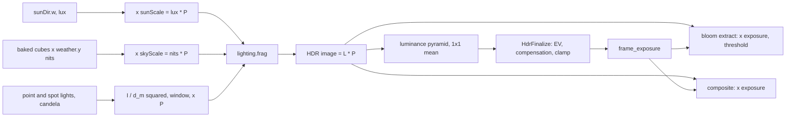

# Lighting L1: physical units and exposure (as built, and how to change it)

This is the reference for what chapter L1 of the lighting plan ([`tasks/todo.md`](../tasks/todo.md)) put into the code, where every number lives, and how to change it. The tutorial version, with animations, is the artifact "The L1 Light Lab". The plan and the reasoning are in `tasks/todo.md` under "L1 tutor guide". Change history is in [`docs/changelog/2026-11.md`](changelog/2026-11.md).

*Written with Claude Code from the source as of 2026-11-15. Lamp lumens and lux figures are typical values for sanity checks, not measurements. Check them against a datasheet before relying on them.*

## 1. What changed

| Item | What it does now | Where |
|------|------------------|-------|
| L1.1 | One exposure law, $\text{exposure} = 1 / (1.2 \cdot 2^{EV_{100}})$ | [`Photometry.h`](../src/utils/light/Photometry.h) `exposure_from_ev100` |
| L1.2 | Auto-exposure runs in release too. It meters the average HDR luminance, converts to EV100, subtracts a compensation, clamps per weather preset | [`HdrFinalizePass.cpp`](../src/renderer/Passes/HdrFinalizePass.cpp), [`Exposure.h`](../src/renderer/Passes/Exposure.h), [`WeatherController.cpp`](../src/renderer/WeatherController/WeatherController.cpp) |
| L1.3 | Sun in lux (`sunDir.w`), sky scale in nits (`weather.y`), fixed pre-exposure (`weather.z`) | [`WeatherController.cpp`](../src/renderer/WeatherController/WeatherController.cpp), [`lighting.frag`](../shaders/lighting.frag) |
| L1.4 | Lamps in lumens, converted to candela | [`RoadScene_Furniture.cpp`](../src/scene/RoadScene/RoadScene_Furniture.cpp), [`CarLights.h`](../src/scene/Entity/CarLights.h) |
| L1.5 | Point and spot falloff is $I/d^2$ with $d$ in metres (`weather.w`) | [`lighting.frag`](../shaders/lighting.frag) |
| L1.6 | Bloom thresholds the exposed image | [`bloom_extract.frag`](../shaders/bloom_extract.frag), [`BloomPasses.cpp`](../src/renderer/Passes/BloomPasses.cpp) |

## 2. How light flows

Lights are physical. The HDR target is half-float (largest finite value 65,504) and a noon sun is 100,000 lux, so every light is multiplied by a fixed **pre-exposure** $P$ where `lighting.frag` defines it. The HDR image therefore holds $L \cdot P$. The composite multiplies by $e / P$ to undo it:

$$
\text{HDR} = L \cdot P, \qquad \text{display} = \text{HDR} \cdot \frac{e}{P} = L \cdot e
$$

$P = 10^{-5}$ ([`kPreExposure`](../src/utils/light/Photometry.h)) and one old scene unit (sun = 1.0) is 100,000 lux ([`kLegacyUnitLux`](../src/utils/light/Photometry.h)). That makes the HDR image exactly the scale every pass was tuned in, so bloom, SSR, TAA and the god-rays needed no change.

**Auto-exposure.** Metering divides the adapted HDR luminance by $P$ to get cd/m², then

$$
EV_{100} = \operatorname{clamp}\!\Bigl(\log_2\tfrac{100\,L}{12.5} - c,\ EV_{\min},\ EV_{\max}\Bigr), \qquad \text{exposure}_{\text{composite}} = \frac{1}{1.2\cdot 2^{EV_{100}}\,P}
$$

where $c$ is `evCompensation`. A positive $c$ **brightens**, because it is subtracted. The old rule `exposure = aeKey / luminance` is this law with a key of $1/9.6 \approx 0.104$, so `aeKey = 0.30` is $\log_2(0.30/0.104) \approx 1.53$ stops brighter, which is the default `evCompensation`.

**Lights.** A light carries candela. The illuminance on a surface is $E = I \cos\theta / d_m^2$ with $d_m$ in metres. `camera.weather.w` is metres per world unit, taken from `util::units::to_m(1.0f)`, so the shader never types 1000. The Karis window $w(d) = \operatorname{clamp}(1 - (d/R)^4)^2$ ends the light at its radius.

## 3. Where each number lives

| I want to change | Edit | File | Note |
|------------------|------|------|------|
| Street lamp brightness | `lamp_lumens` (16,000) | `RoadScene_Furniture.cpp` | Candela is `lumens / 4 pi`. Changes `generate.light_hash` in the road golden |
| Street lamp reach | the `50000.0f` radius next to it | same | WU. Use `r = sqrt(I / E_min)` to derive it (a 0.5 lux floor gives 50 m for 1,273 cd) |
| Headlight, tail, brake flux | `headLumens` 1,200, `tailLumens` 20, `brakeLumens` 300 | `CarLights.h`, panel group `car_lights` | Debug panel only today. TOML keys are `head_lumens`, `tail_lumens`, `brake_lumens` (old `*_intensity` keys are ignored) |
| Spot rule | `spot_candela_from_lumens` in `car_spot_lights` | `CarLights.h` | See recipe B |
| Sun illuminance per preset | `kSunLux` in `look_for`, or a per-preset literal | `WeatherController.cpp` | Currently 100,000 for every preset (parity). L2 calibrates them |
| Sky brightness | `kSkyNits` in `look_for` | same | Scales the baked cubes at sampling time, so no rebake |
| Diffuse sky gain | `ambient` in `look_for` (0.42 for PartlyCloudy) | same | Kept on purpose. It scales diffuse sky only, so removing it changes the look |
| Auto-exposure on or off | `DebugParams::autoExposure` (default `true`) | `DebugParams.h` | Release reads the defaults. Off uses `kShippedEv100` |
| Auto-exposure look | `evCompensation`, `aeSpeed` | `DebugParams.h`, panel "Image / Grade" | `evCompensation` in stops, positive is brighter |
| EV clamps | `evMin`, `evMax` per preset | `WeatherController.cpp` `look_for` | Current values: PartlyCloudy 13.5 to 17.5, Cloudy 13 to 17, VeryCloudy 12.5 to 17, GoldenHour 12 to 16.5. Starting guesses, tune by eye |
| Shipped EV when auto is off | `kShippedEv100` (15.7144) | `Exposure.h` | Reproduces the old fixed 1.55 |
| Pre-exposure | `kPreExposure`, `kLegacyUnitLux` | `Photometry.h` | See recipe E before changing it |
| Bloom threshold | `pp.threshold` (2.74), `DebugParams::bloomThreshold` | `BloomPasses.cpp`, `DebugParams.h` | Exposed space. 2.74 is the old raw 1.77 times 1.55 |
| Bloom strength | `bloom_intensity` (0.45) | `CompositePass.cpp` | Unchanged by L1. It scales with exposure automatically |
| Wet-lamp halo strength | `kHaloStrength`, `kHaloPerCd` | `lighting.frag` | An art effect, not a lux. `kHaloPerCd` maps 1,273 cd back to the old 5.0 gain |

## 4. Recipes

**A. Make the street lamps brighter or dimmer.** Change `lamp_lumens`. Remember the sun is 100,000 lux in every preset today, so a 16,000 lm lamp adds about 15 lux under it and is invisible by day. That is correct. To see lamp pools now, raise the lumens a lot or wait for the L2 night presets. After changing it, re-record the golden: `SWISH_UPDATE_GOLDENS=1 build/tests/swish_tests "Golden mesh*"`, confirm only `generate.light_hash` moved, and add a changelog line.

**B. Use the physical cone rule for headlights.** In `car_spot_lights`, replace `spot_candela_from_lumens(p.headLumens)` with `cone_candela_from_lumens(p.headLumens, glm::radians(p.headOuterDeg))`. At 28 degrees that is 1,631 cd instead of 382 cd, and a tighter beam gets brighter. The two rules agree at 60 degrees (test `L1: the cone rule equals the Frostbite rule at 60 degrees`).

**C. Change the look of auto-exposure.** Open `make debug`, tick Auto-exposure, and drag "AE compensation (stops)". Positive is brighter. Copy the value into `DebugParams::evCompensation`. For a different mean, replace the arithmetic mean in the luminance pyramid with a log-average: store `log2(lum)` in the first blit and `exp2` the readback (alternatives in the L1 guide). To turn auto-exposure off for release, set `autoExposure = false`.

**D. Give a preset its own sun, sky or clamps.** Edit its line in `look_for`. For a physical golden hour use roughly `sunLux = 400` (a rule of thumb, not a measurement) and lower the `evMin` and `evMax` to suit. Because the pre-exposure is fixed, a dark preset needs recipe E.

**E. Dark scenes (night) need a smarter pre-exposure.** A fixed $P = 10^{-5}$ puts a dark road near the half-float floor (a 0.2 nit road becomes $2\times10^{-6}$), which bands. The fix is to feed the previous frame's exposure into `weather.z` instead of the constant: `set_weather(..., preExposure)` already takes it as a parameter. Then compensate in `hdr_exposure_from_ev100` and in the metering (`m_adaptedLum / preExposure`). This now exists as `DebugParams::adaptivePreExposure` (off by default, on in the lighting lab; see [`lighting-lab.md`](lighting-lab.md)): `HdrFinalizePass` publishes `FrameState::preExposure` and the Renderer hands it to the camera UBO each frame. Making it the release default is still the L2 job.

**F. Retune bloom.** Change `pp.threshold` in `BloomPasses.cpp`. It is in exposed space, so about 1.0 means "brighter than display white". The intensity does not need to move with exposure.

**G. Get the old fixed exposure back.** Set `autoExposure = false` in `DebugParams.h`. The release composite then uses `kShippedEv100`, which reproduces the old 1.55.

## 5. Alternatives that were not taken

| Choice | Taken | Not taken | Why |
|--------|-------|-----------|-----|
| Keeping the half-float target in range | Fixed pre-exposure | Clamp at 60,000; a float32 target; dividing all lights by a constant | The clamp loses highlight energy and starves bloom. Float32 doubles post-pass bandwidth. A constant is the fixed pre-exposure under another name |
| Ambient gain 0.42 | Kept | Fold into the sky scale | The gain only scales diffuse sky. The same cubes drive specular reflection, so folding it would dim reflections |
| Sun per preset | 100,000 lux for all (parity) | Physical values now | The frame stays as you approved it. Physical values belong to L2 |
| Spot rule | Frostbite $\Phi/\pi$ | Cone solid angle | It is the scaffold's documented rule and does not change brightness with the angle. The cone rule is one line, see recipe B |
| Metering | Arithmetic mean | Log-average; histogram | Already built. The sun disc and lamp heads pull it dark. See recipe C |
| Halo | Old bounded shape, `kHaloPerCd` | Derive it from lux | A halo is scattering, not illumination. Deriving it would make it vanish by day with the lamp |

## 6. Invariants and gotchas

- **Release reads `DebugParams{}` defaults.** The shipped look is whatever the defaults are, so a default change is a release change.
- **The HDR image is in pre-exposed units.** Anything that reads it (bloom, SSR, TAA, the luminance pyramid) sees $L \cdot P$. Anything that writes a light into it must be in the same scale. The point and spot lights are scaled by `weather.z` in the shader for that reason.
- **Do not divide by a distance in WU.** The light would be a factor of $10^6$ too dim. Use `weather.w`.
- **`lighting.frag.spv` and `bloom_extract.frag.spv` hashes** in `tests/golden/release_spv.sha256` are tied to the SDK glslc and must be re-recorded after any edit to those shaders (`shasum -a 256 -c`, a manual check, not part of `ctest`).
- **Lamp lumens are in the road golden.** A change shows up as `generate.light_hash`.
- **Saved presets.** The TOML keys `ae_key`, `ae_min`, `ae_max`, `head_intensity`, `tail_intensity`, `brake_intensity` are gone and ignored on load. `bloom_threshold` now means exposed space, so an old saved value of 1.77 blooms more than before.
- **Lamps are physically dim by day.** A 16,000 lm lamp is about 15 lux against 100,000 lux of sun. The wet halo is deliberately kept visible. Expect direct lamp light to return at dusk and night once L2 adds those presets.

## 7. Verified, and what to check in the app

Verified: `make test` 400/400 and `make test-debug` 425/425 with 0 warnings, both `lighting.frag` variants compile, shader hashes re-recorded (33 of 33 OK), one golden line re-recorded on purpose (`generate.light_hash`).

Not verified: the app was not run. Check, in `make debug` and `make run`:

1. Daytime frame in all four weather presets: close to before, since auto-exposure replaces the fixed exposure and may differ slightly.
2. Drive under an overpass or turn toward the sun: the exposure should adapt over a second or so, not flash.
3. Debug panel, "Image / Grade", Auto-exposure on: "AE compensation", "AE speed", "EV100 min" and "EV100 max" respond.
4. Rain: the wet halos around lamps are still visible. Windshield rain and glass look unchanged.
5. Car lights panel: headlights are dim by day (correct). Raise "Headlight flux" to confirm it responds.
