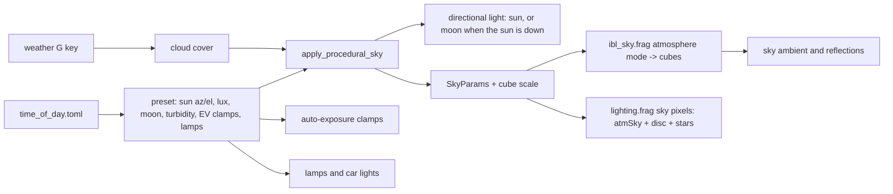

# Lighting L2 to L10: sky, shadows, materials, emissive, lamps, retroreflection (as built)

What chapters L2 to L10 of the lighting plan ([`tasks/todo.md`](../tasks/todo.md)) put into the code, where each control lives, and what is still open. L0 and L1 are in [`lighting-l1.md`](lighting-l1.md); the test world is in [`lighting-lab.md`](lighting-lab.md).

*Written with Claude Code from the source as of 2026-11-15. None of this was looked at in the app by its author; the check list is at the end. Photometric figures are typical values, not measurements.*

## The rule: debug first

Everything here is **on in `make debug` and off in `make run`**. `DebugParams` defaults use `kDebugBuild`, and the shader code sits under `#ifdef SWISH_DEBUG_UI`. Release keeps its HDRI look. Of the 33 release shaders only `ibl_sky.frag` changed (it gained an atmosphere mode that release never selects). To promote an item to release, see "Promoting" below.

## What was built

| Item | Built | Where |
|------|-------|-------|
| L2.1 sky model | Raymarched Rayleigh + Mie + ozone single scattering, no lookup tables | [`atmosphere.glsl`](../shaders/common/atmosphere.glsl), [`Atmosphere.h`](../src/utils/light/Atmosphere.h) |
| L2.3 presets as data | Six time-of-day tables loaded from [`config/time_of_day.toml`](../config/time_of_day.toml) | [`TimeOfDay.h`](../src/scene/TimeOfDay/TimeOfDay.h), `WeatherController::apply_procedural_sky` |
| L2.4 rebake on switch | One synchronous rebake when the sky's inputs change | `IBLManager::bake_atmosphere` |
| L2.5 visible sky | Sky pixels evaluate the model directly, plus the sun or moon disc and stars | `lighting.frag` |
| L2.6 one sun disc | Glass reflects the same physical disc | `glass.frag` |
| L2.7 moon and night | Moonlight as the directional light, airglow, stars | `apply_procedural_sky`, `lighting.frag` |
| L2.8 HDRI override | "Procedural sky" off returns to the HDRI weather presets | panel |
| L3.1, L3.2 | Stable light up vector, texel-snapped cascades, slope-scaled bias | `GeometryProducer.cpp`, [`ShadowFit.h`](../src/utils/light/ShadowFit.h), `lighting.frag` |
| L3.3 | Cascade blend band | `lighting.frag` `cascadePcf3` |
| L3.4 | PCSS penumbra from the sun's real angular radius | `lighting.frag` |
| L3.5 | Shadow floor 0 in debug (the sky fills shadows now) | `DebugParams::shadowFloor` |
| L4.1 | Multiscatter GGX energy compensation | `lighting.frag` |
| L4.2 | Wet sheen bounded by Fresnel | `lighting.frag` |
| L4.3 | Metallic flakes on body paint | `Submesh::is_paint`, `DebugParams::paintFlakeDensity` |
| L4.4 | Karis-weighted 4-tap bloom extract (firefly suppression) | `bloom_extract.frag` |
| L5.1 | Emissive strength in the normal buffer's alpha (16-bit float); retro flag in albedo alpha | `gbuffer.frag`, `PushConstantData::extra` |
| L5.2 | Car lenses glow while their lamp is on | `Submesh::lens`, `CarEntity::set_lens_nits` |
| L5.3 | Street-lamp heads glow (corridor and lab) | `DrawCall::emissiveNits` |
| L6.1 | Lamps on the corridor median every 60 m | `build_corridor_segments(al, withLamps)` |
| L6.2 | 2,100 K sodium colour, downward spot cones | `kelvin_to_rgb`, `CorridorScene.cpp` |
| L6.4 | Low-beam cutoff; headlights use the cone rule | `lighting.frag`, [`CarLights.h`](../src/scene/Entity/CarLights.h) |
| L6.5 | Nearest-first selection for world spots, 40 slots, a read-out of the count | `CameraUniforms.cpp`, panel |
| L6.6 | Lamps and car lights follow the preset's `lamps_on` | `DebugParams::lampsOn` |
| L8.1, L8.2 | Lane markings tagged retroreflective; a retro lobe in the spot loop | `CorridorScene.cpp`, `lighting.frag` |
| L9.1 to L9.3 | All six presets selectable (T key, panel) | panel |
| L10.1 | Rain fog takes the sky's colour; optional wet car exterior | `lighting.frag`, `DebugParams::carWettable` |

## How the sky works

The model marches the view ray through air, haze and ozone and sums what the sun scatters toward the eye. With phase functions $p_R$, $p_M$, scattering coefficients $\beta$, densities $\rho$ and transmittance $T$:

$$
L(\mathbf{v}) = E_{\text{toa}} \int_0^{d} T(\mathbf{o}\to\mathbf{x})\,T(\mathbf{x}\to\text{sun})\,\bigl[\beta_R\,\rho_R(h)\,p_R(\mu) + \beta_M\,\rho_M(h)\,p_M(\mu)\bigr]\,ds
$$

If the ray from a sample toward the sun hits the planet, that sample is in shadow. That is what makes twilight: the model stays correct with the sun below the horizon. The steps are spaced quadratically so they are dense near the eye, where the air is. A constant 1.2 stands in for multiple scattering.

Numbers from the C++ copy (pinned by `tests/utils/test_light_Atmosphere.cpp`): direct sun at the ground is about 111,000 lux at 60 degrees and 19,000 lux at 2 degrees, the noon zenith is about 1,570 cd/m², the horizon is several times brighter, sunset is red toward the sun, and at -6 degrees the zenith is under 1 cd/m².

**Units and the cube.** The baked cube stores sky nits divided by a per-bake scale, ten times the zenith luminance, so the cube's zenith is about 0.1 at noon and at midnight alike (half-float safe). That scale is `skyNits` in the camera UBO, so the shader's `cube x skyNits x preExposure` is unchanged from L1. The sun disc is not in the cube: the sun is an analytic light.

**The light.** `sun_lux` from the TOML is the direct light's amount; the model supplies its tint (transmittance, normalised). When the sun is down and `moon_lux` is above zero, the moon (opposite the sun, 45 degrees up, cool white) becomes the directional light, so the same CSM shadows apply. In twilight there is no directional light and the sky does the lighting.

**Weather.** With the procedural sky on, the G key only sets cloud cover: PartlyCloudy 0.3, Cloudy 0.6, VeryCloudy 0.9, GoldenHour 0. Cloud blends the sky toward a grey CIE overcast sky and removes direct sun (little below 0.3, almost all at 1).

## Controls

| Control | Where | Notes |
|---------|-------|-------|
| T key | anywhere in debug | Next time of day; turns the procedural sky on |
| "Time of day / Sky model" | panel | The six presets, then live sliders: sun elevation and azimuth, direct sun lux, moon lux, turbidity, cloud cover, stars, lamps |
| "Lighting L3-L10 (debug first)" | panel | Shadow fit, cascade blend, sun angular radius, energy compensation, flake density, lens luminances, lamps, lamp output, beam cutoff, retro gain, wet car, spot count |
| "Procedural sky" checkbox | panel | Off returns to the HDRI weather presets and the legacy scale |
| Preset values | `config/time_of_day.toml` | Read at start-up. A preset is copied into the sliders once when selected |

## Changing things

| I want to | Edit |
|-----------|------|
| Tune a time of day | Its table in `config/time_of_day.toml` |
| Change the air (bluer, hazier) | The constants at the top of `atmosphere.glsl` **and** `Atmosphere.h`. They must match; the tests pin the C++ |
| More or fewer march steps | `ATM_VIEW_STEPS` / `kAtmViewSteps` (both files) |
| Lamp spacing, height, output | `kCorridorLampSpacingM`, `kCorridorLampHeightM`, `kCorridorLampLumens` in `CorridorScene.h` |
| Lamp colour | `kelvin_to_rgb(2100.0f)` in `CorridorScene.cpp` |
| Lens brightness | `lensNitsHead`, `lensNitsTail`, `lensNitsBrake` in `DebugParams.h` |
| Which material is body paint | The name test in `ModelManager.cpp` (`"paint"` or `"_ext1"`) |
| Retro strength or tightness | `retroGain`; the exponent 64 in the spot loop of `lighting.frag` |
| Beam cutoff softness | The `smoothstep(-0.01, 0.03, ...)` in the spot loop |
| More spot lights | `MAX_SPOT_LIGHTS` in `SceneTypes.h` and the `[40]` in `shaders/common/lights.glsl` |

## Promoting an item to release

1. Change its `DebugParams` default from `kDebugBuild ? x : y` to the value you want in both builds.
2. Move its shader code out of `#ifdef SWISH_DEBUG_UI`. If it reads `sp.` (the debug scene-params UBO), the value needs a release path: a literal in the `#else` branch of the `SP_*` block, or a lane in the camera UBO.
3. Re-record the changed lines of `tests/golden/release_spv.sha256` and add a changelog entry.

The spot-light loop, `SpotLightData` and the upload are still wholly debug-only, so L6.3 (car lights in release) means un-gating those in `SceneTypes.h`, `CameraUniforms.cpp`, `lights.glsl` and `lighting.frag` together.

## Still open

| Item | Why |
|------|-----|
| L2.2 procedural sky as the release default | Debug first |
| L3.4 PCSS in release, L4.5 SSAO in release (or drop the release multiply), L6.3 car lights in release | Debug first |
| L4.4 bloom mip pyramid | Only the Karis extract was built. The bloom is still one quarter-resolution level with one blur; a pyramid needs new images and passes |
| L4.6 owner sign-off | Yours |
| L7 lamp and headlight shadows, L8.3 signs, L9.4 mesopic look, L10.2 lens rain and the layered wet BRDF | Left out by decision |
| "Bake made cheaper" | Not done. The irradiance convolution is shared with release, so it was left alone; a preset switch costs the same hitch as today's G key |

## Known limits

- **Not seen by its author.** Unit tests cover the pure parts only.
- **No multiple scattering.** The sky is somewhat dark and a little too saturated compared with a measured one; the 1.2 lift is a stand-in.
- **A hitch on every sky change.** Dragging the sun slider rebakes each time the value changes.
- **Glass sun disc in debug is always the physical one**, also with the HDRI sky, because the glass pass has no access to the debug UBO.
- **Lens glow needs opaque lens meshes.** A lens that the loader classifies as glass is drawn by the glass pass and will not glow.
- **Paint detection is by material name.** A car whose paint material is named differently gets no flakes.
- **Windshield rain and the wet-lamp halos ignore the time of day**, so they are too bright at dusk and night.
- **Lamp poles are always built in debug**, lit or not. The lab's lamps are point lights and are always on.
- **Asset metalness.** The rigged car's tyre material carries `metallicFactor` 0.62, which L0.9 now honours.

## Check list (owner, `make debug`)

1. Start-up: procedural sky at noon, blue overhead and paler at the horizon, a small sharp sun. `make run` is unchanged.
2. T through all six presets: dawn and golden hour warm and low, evening a twilight glow with no sun, midnight dark with a moon, stars and lamps. Note the hitch on each switch.
3. G changes cloud cover: the sky greys and the sun's shadows fade.
4. Shadows: raise the sun to the zenith (the old blackout case); drive and watch shadow edges for crawling; look for a line where cascades meet; look for acne on the road at golden hour.
5. Car: paint sparkles in the sun (flakes); metal parts are not too dark; lenses glow when the lights are on (evening, midnight) and bloom.
6. Corridor at evening and midnight: lamp poles on the median, pools of orange light on both carriageways, glowing heads, "Spot lights uploaded" below 40.
7. Headlights at midnight: light on the road with a cutoff above; lane markings brighten ahead of the car and fade to the sides.
8. Rain at 0 and 1 in at least noon and midnight; tick "Rain wets the car's exterior" and judge it.
9. The lab (`SWISH_LAB=1 make debug`) still works, now with the six presets.
