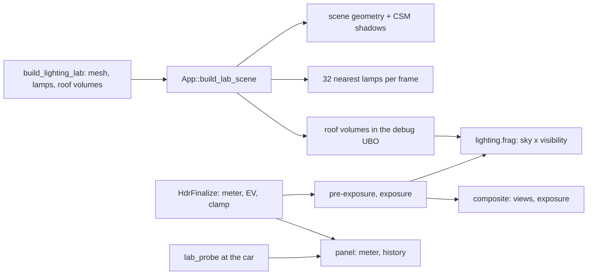

# Lighting lab: a test world for seeing the lighting work

The LIE corridor has no tunnel, no overpass and no street lamps, so chapter L1 (auto-exposure, EV clamps, lumens, bloom; see [`lighting-l1.md`](lighting-l1.md)) could not be watched working. The lab is a debug-only world built for that. The decisions behind it are in [`tasks/todo.md`](../tasks/todo.md) under "Lighting lab".

*Written with Claude Code from the source as of 2026-11-15. Lamp lumens and lux figures are typical values or lab choices, not measurements.*

## Launch

```sh
SWISH_LAB=1 make debug
```

Debug builds only (`SWISH_DEBUG_UI`). A normal launch is unchanged. Press the backtick key to switch between driving and the panel. Open the **Lighting lab** section of the panel.

## The world

A paved box 3.2 km (about 2 miles) on a side with a low wall. The car is held 3 m inside the wall by a position clamp (no collision physics). Lanes run along -Z; the car starts at the origin facing -Z.

| Station | Lane (x) | What is there | What it shows |
|---------|----------|---------------|---------------|
| Start | 0 m | Open pavement | Free driving under open sky |
| Unlit tunnel | -60 m | 400 m tube, 12 m wide, 6 m high, no lamps | Sky occlusion; exposure adapting down, then the flash and recovery at the exit |
| Lit tunnel | -100 m | Same tube, a 12,000 lm luminaire every 12.5 m | Lumens and inverse-square pools, about 19 to 33 lux on the road, bloom in the dark |
| Overpass series | +60 m | Decks 10, 20, 40, 80 m wide, 150 m apart, 5 m clearance | Short shadows: does the exposure pump, do the clamps hold |
| Lamp stretch | +140 m | 600 m, a 16,000 lm street lamp every 40 m on 9 m poles | The night road: about 15 lux under each lamp |
| Calibration lot | +200 m | White (0.90), 18% grey and black (0.03) cards, standing and flat; a matte and a metal ball; one lamp | Reading exact values against the maths: a card under $E$ lux has luminance $\rho E/\pi$ |
| Studio, Parking garage, Gas canopy, Night street | see [`car-showcase.md`](car-showcase.md) | Places for looking at the car, lit by rectangle area lights | Paint, highlights, soft light, wet surfaces |

Each road feature begins 100 m after its teleport point, so you approach it at speed.

## The panel

| Control | What it does |
|---------|--------------|
| Teleport buttons | Put the car at a station, stopped, facing down the lane (lab world only) |
| Day / Dusk / Night | With the procedural sky (the debug default since L2) these pick the Noon, Evening and Midnight time-of-day presets; the "Time of day / Sky model" section has all six. With the HDRI sky they set sun lux, sky scale and the EV clamps: 100,000 / 400 / 0.3, clamps 13.5 to 17.5 / 2 to 13 / -6 to 8 |
| Sun (lux), Sky scale (nits) | Log sliders for the two amounts. They override the weather preset until the preset changes (G key) |
| Adaptive pre-exposure | On in the lab. Needed for dusk and night; see below |
| View: Normal / False colour / Bloom mask | False colour paints the exposed value: deep blue below 0.01, blue below 0.05, green around middle grey (0.14 to 0.24), yellow above 1, red above 2. Bloom mask shows only what the bloom extract kept |
| Exposure meter | Scene average in cd/m², the EV100 it implies, the EV used after compensation and clamps (and whether a clamp is holding it), the HDR multiplier, the pre-exposure, and a few seconds of EV history |
| Light under the car | Sun lux on flat ground (unshadowed, from the Elevation slider), sky visibility, lamp lux and how many lamps are in range, distance to the nearest lamp |

## How it works

**Sky visibility.** `lighting.frag` shadows only the sun (CSM). The sky's ambient light and reflections ignored geometry, so a tunnel stayed bright. The lab sends up to 12 **roof volumes** to the shader (appended rows of the debug scene-params UBO). A roof volume is a box that is open at both ends along one axis (the showcase places add closed, one-end and open-on-all-sides kinds). Inside it, with $d$ the distance to the nearer open end and $f$ the fade length:

$$
\text{vis} = \operatorname{mix}\bigl(1,\ \text{floor},\ \operatorname{smoothstep}(0, f, d)\bigr)
$$

The sky irradiance and both environment reflections are multiplied by it. It applies to every pixel inside the box, so the car goes dark too. A deck narrower than $2f$ never reaches the floor, which is why the 10 m overpass only dims the sky. The same function exists on the CPU as [`roof_sky_visibility`](../src/utils/light/SkyVisibility.h) for the probe and the tests.

**Adaptive pre-exposure.** L1.3 multiplies every light by a fixed $P = 10^{-5}$ so the half-float HDR target does not overflow. That is exact for daylight, but a 0.5 nit night road becomes $5\times10^{-6}$, near the half-float floor. In the lab the pre-exposure follows the exposure:

$$
P = \frac{1}{1.2\cdot 2^{EV_{100}}\cdot 1.55}, \qquad \text{so}\quad \frac{e}{P} = 1.55 \ \text{always}
$$

The composite multiplier is then constant and all adaptation lives in $P$. The meter undoes the pre-exposure of the frame it reads (kept per frame slot in `HdrFinalizePass`), and adaptation runs in cd/m².



## Changing it

| I want to | Edit |
|-----------|------|
| Move, resize or add a station | The layout constants at the top of [`LightingLab.cpp`](../src/scene/LightingLab/LightingLab.cpp), and `lab_stations()` for the teleport |
| Change lamp brightness or spacing | `kTunnelLampLm`, `kTunnelLampGap`, `kLampLm`, `kLampGap` in the same file |
| Change how fast the sky fades under a roof | `kTunnelFade`, `kOverpassFade`, and the floor passed in `tunnel()` / `overpasses()` |
| Add more than 12 roofs | `kMaxRoofVolumes`, the three `[12]` arrays in `SceneParamsUBO` and in `lighting.frag` (a `static_assert` ties them) |
| Change the Day / Dusk / Night values | `set_light(...)` calls in the "Lighting lab" block of `DebugUI.cpp` |
| Change the false-colour bands | The debug block after `hdr *= params.exposure` in `composite.frag` |
| Make the box bigger | `kLabHalfSizeM` in `LightingLab.h` (a test pins 3.2 km) |

## Known limits

- **Not run by its author.** The unit tests pass, but the lab has not been looked at. See the check list in the changelog entry.
- **TAA lags in brightness** by a frame while the exposure moves with adaptive pre-exposure on, because the history image was shaded with the previous pre-exposure. Expect a brief ghost at a tunnel mouth.
- **Unlit effects ignore the night.** Windshield rain, the wet-lamp halos and the rain-fog colour are still in the old fixed scale, so at dusk or night they look too bright. The glass sun glint was fixed.
- **The probe's sun figure is unshadowed** and comes from the Elevation slider, so it is wrong while the sun gizmo is in use or under a roof.
- **Roof volumes are placed by hand.** Geometry elsewhere does not block the sky. A top-down sky shadow map would generalise it.
- **32 lamps at once.** The lit tunnel has 32 luminaires; the nearest 32 lights to the camera are uploaded each frame.

## Tests

`tests/test_lighting_lab.cpp` (world contents, wall clamp, stations under open sky, tunnel and lamp lux) and `tests/utils/test_light_SkyVisibility.cpp` (fade, floor, wider-is-darker, both axes). The adaptive pre-exposure maths is in `tests/utils/test_light_Photometry.cpp`.
