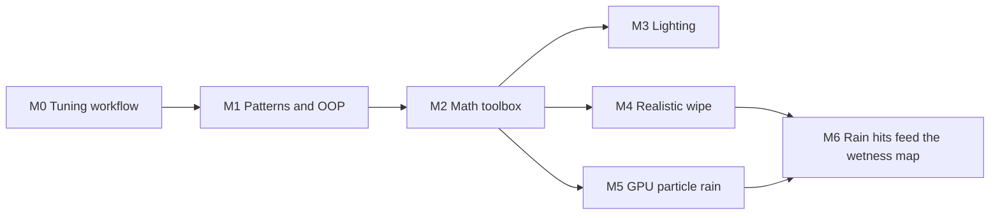
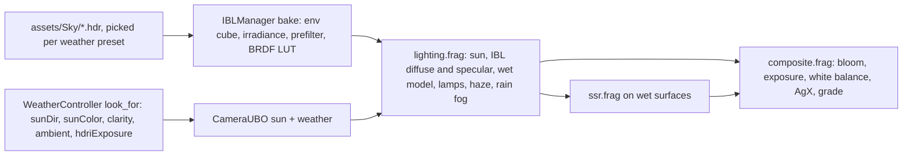
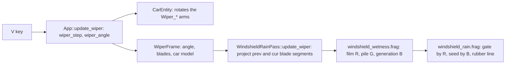

# Realism learning plan: lighting, the wipe, GPU rain, patterns

A self-paced course where **you write the code**. It covers photoreal lighting, a realistic windshield wipe on the
rigged Porsche, and GPU particle rain, plus the design patterns, OOP habits and math they rely on. Each module lists
what to read, what to change (config, then debug sliders, then code), exercises, and how to check the result.

Scaffolding is already in the tree. Two pure headers have stub functions marked `TODO(learning ...)`, and two test
files pin what the stubs should do:

| Module | Header to fill in | Hidden tests |
|---|---|---|
| M1, M4 | [src/scene/Entity/WiperWipe.h](../src/scene/Entity/WiperWipe.h) | [tests/test_wiper_wipe.cpp](../tests/test_wiper_wipe.cpp) |
| M5, M6 | [src/renderer/RainSystem/RainParticle.h](../src/renderer/RainSystem/RainParticle.h) | [tests/test_rain_particle.cpp](../tests/test_rain_particle.cpp) |

The tests are tagged `[.learning]`, so `make test` skips them and the suite stays green. Run them on purpose:

```sh
make build
build/tests/swish_tests "[.learning]"                # all learning tests (they fail until you fill the stubs)
build/tests/swish_tests "[.learning][wiper_wipe]"    # one module
```

When a group passes, delete the `.learning` part of its tags (keep `[wiper]` / `[rain]`) so `make test` guards it.

Companions: [learning-path.md](learning-path.md) (the general study map), [concepts.md](concepts.md),
[RECIPES.md](RECIPES.md), [CODING_RULES.md](CODING_RULES.md), [FEATURE_RULES.md](FEATURE_RULES.md).

## The loop for every module

1. Read the files and references listed.
2. Write down what you expect to see before you change anything.
3. Experiment, cheapest first: config files, then debug-UI sliders, then code.
4. Check by looking: a window-only screenshot (`screencapture -R <window bounds>`), at rain 0.35 and 1.0 for anything
   rain-related. Revert any value you forced temporarily.
5. Write what you learned in [../tasks/lessons.md](../tasks/lessons.md).



---

## M0. The tuning workflow (no code)

The debug build is your lab. Learn what you can change without touching C++.

**Run it**

- `make debug` builds `build-debug/` with the ImGui panel and runs it. Backtick toggles the edit panel vs driving.
- Keys: `R` rain (off, 0.35, 1.0), `V` wipers (Off, Intermittent, Low, High), `G` weather preset, `C` camera,
  `Esc` cursor capture. The key table is `App::init_key_bindings` in
  [src/core/App/AppInput.cpp](../src/core/App/AppInput.cpp).
- Rigged car: `SWISH_CAR=blend/porsche_rigged.glb make debug`. The path is relative to `assets/`. The load log prints
  `named rig, wheelbase ...` when the rig is detected.
- Kill the running app before rebuilding: it loads the `.spv` shaders at startup.

**Config files** (both `make run` and `make debug` re-run CMake, which copies the runtime TOML into the build tree)

- [config/car.toml](../config/car.toml): `[wipers]` (`low_wipes_per_min`, `high_wipes_per_min`,
  `intermittent_dwell_s`, `sweep_deg`, `ease`), `[wheels] ackermann`, `[gauges]`. Debug sliders are seeded from it.
- [config/lie_corridor.toml](../config/lie_corridor.toml): `min_start_m` and `start_min_radius_m` choose where the car
  starts. Re-bake after editing: `python3 tools/lie_corridor.py bake`.
- [config/road.toml](../config/road.toml): road dimensions and tints (baked by `toml_baker` at build time).

**Debug panel sections you will use**: Sky, Sun / Light, Fog, Clearcoat / Flake, Reflections / IBL, SSR, Shadows,
Wet / Rain, Car Lights, Image / Grade, Quality (all in [src/debug/DebugUI.cpp](../src/debug/DebugUI.cpp)).

**Presets**: type a name, Save, Load. Files go to `$SWISH_PRESETS_DIR` or `~/.config/swish/presets/<name>.toml`.
Missing keys keep their current value when loading, so presets hand-edit cleanly
([debug-ui.md](debug-ui.md) "TOML presets").

**Tunables**: [src/debug/Tunables.def](../src/debug/Tunables.def) is a registry. One `TUNE_F` line generates the
field, default, TOML save/load, slider and dump line. Read its header comment, then
[RECIPES.md](RECIPES.md) add-a-tunable.

**Checking by looking**: [visual-verification](../.claude/skills/process/visual-verification/SKILL.md) and
[rain-extremes](../.claude/skills/rain/rain-extremes/SKILL.md).

### M0 exercises

1. Set `high_wipes_per_min = 30` in `car.toml`, run `make debug`, press `V` three times and time ten wipes.
   Expected: about 20 s. Put the value back.
2. Save a dry preset and a wet preset (rain 1.0, Fog max 0.3). Open the wet TOML, change `max` under `[fog]`, Load
   it again.
3. Add a dummy tunable `wiperFilm` (group `wiper`, default 0.2, range 0 to 1, `NOPUSH`, `NOREL`) by following
   add-a-tunable section A. Confirm the slider appears under Wet / Rain, then `make build` and confirm the release build
   still compiles unchanged. You will wire it up for real in M4.

<details><summary>Answer notes</summary>

- Exercise 1: at 30 wipes per minute one wipe takes 2 s, so ten take 20 s. The rate comes from
  `wiper_rate_hz` in [src/scene/Entity/Wiper.h](../src/scene/Entity/Wiper.h).
- Exercise 3: the `wiper` group is already in the registry (the `wiperLowWpm` lines in `Tunables.def`, drawn by
  `draw_tunable_group(p, "wiper")` in the Wet / Rain section). A `NOPUSH` row creates the field, slider and TOML key,
  but `App::update_wiper` only copies the existing rows into `WiperParams`, so nothing reads the new value yet. That
  is why the release build is unchanged.

</details>

---

## M1. Design patterns and OOP, as this codebase uses them

**Read, in order**

1. [CODING_RULES.md](CODING_RULES.md): where code goes and who may include whom.
2. [DESIGN_PATTERNS.md](DESIGN_PATTERNS.md): read the TL;DR first. It records which patterns were chosen and which
   were rejected (no singletons, no abstract `IRenderer`, no object pool for spray).
3. [FEATURE_RULES.md](FEATURE_RULES.md): "build it dark, prove it, turn it on". M5 follows this exactly.
4. [tutorials/typed-cpp/](tutorials/typed-cpp/00-index.md): chapters 04 and 08 (state machines), 07 (X-macros),
   11 (RAII ownership), 12 (pure step functions).

**Patterns in the code you will touch**

| Pattern | Where | What to notice |
|---|---|---|
| Registry (X-macro list) | [PassList.def](../src/renderer/Passes/PassList.def), [Tunables.def](../src/debug/Tunables.def) | One line per entry; order is meaning (frame order, slider order) |
| Update Method | `IRenderPass` in [IRenderPass.h](../src/renderer/Passes/IRenderPass.h) | `beginFrame` / `update` advance state, `record` only reads it |
| Blackboard | `FrameState` in the same header | The rain pass publishes `wetness`; later passes read it. No pass calls another pass |
| State machine + pure step | `WiperMode`, `wiper_step` in [Wiper.h](../src/scene/Entity/Wiper.h) | Old state in, new state out, no hidden globals, so it is testable |
| Double Buffer | wetness map A/B in [WindshieldRainPass.cpp](../src/renderer/WindshieldRainPass/WindshieldRainPass.cpp) | Read A, write B, copy B to A: a pixel never reads its own write |
| RAII | `GpuBuffer`, `GpuImage` in [GpuResource.h](../src/renderer/GpuResource/GpuResource.h) | `reset()` frees the VMA allocation; no manual destroy calls |
| Factory function | `make_rain_pass()`, `make_spray_draw_pass()` | Free functions, not a factory class hierarchy |
| Lookup by type | `ctx.passes.find<SpraySystem>()` in `SprayDrawPass::init` | How two registry entries share one object without a global |
| Facade | `Renderer` | The app talks to one object; passes stay private |
| Owner rule | `RainSystem` (class) vs `RainUBO`, `WiperParams` (struct) | `class` owns resources and invariants; `struct` is plain data |

**External references**

- Game Programming Patterns (free online): [Update Method](https://gameprogrammingpatterns.com/update-method.html),
  [Double Buffer](https://gameprogrammingpatterns.com/double-buffer.html),
  [State](https://gameprogrammingpatterns.com/state.html),
  [Object Pool](https://gameprogrammingpatterns.com/object-pool.html) (a GPU particle buffer is a pool),
  [Data Locality](https://gameprogrammingpatterns.com/data-locality.html) (why particles are arrays of small structs).
- [C++ Core Guidelines](https://isocpp.github.io/CppCoreGuidelines/CppCoreGuidelines): C.2 (class if it has an
  invariant, struct if not), R.1 (RAII), F.8 (prefer pure functions).
- [Refactoring Guru, design patterns](https://refactoring.guru/design-patterns): diagrams for each pattern.

### M1 exercises

1. Trace one frame of rain from the `R` key to `rain.frag`. Name the pattern at each step.
2. Before editing any file in M3 to M5, write one line naming the pattern it uses.
3. **Code:** fill in `wiper_sweep_direction` in [WiperWipe.h](../src/scene/Entity/WiperWipe.h) until
   `build/tests/swish_tests "[learning][wiper_wipe]"` passes the two "M1:" cases. It is a pure function: no state,
   so it can be tested without a window or a GPU.

<details><summary>Answer: one frame of rain</summary>

1. `R` maps to `App::on_cycle_rain` in the key table (Command pattern: a data-driven key-to-method table).
2. `App::set_rain_level` picks `0 / 0.35 / 1.0` and calls `Renderer::set_rain_intensity` (Facade). In debug,
   `Renderer::apply_debug_params` also copies the Wet / Rain slider into the same field each frame.
3. `Renderer::make_frame_update` packs it into `FrameUpdate::rainIntensity` (a parameter object).
4. `RainSystem::beginFrame` (Update Method) builds the gusting wind, calls `step`, which relaxes `m_wetness` and
   writes the near and far `RainUBO`s, then publishes `FrameState::wetness` and `rainIntensity` (Blackboard).
5. `RainSystem::record` binds the camera set; `record_draws` issues two instanced draws (far, then near).
6. `rain.vert` places each of up to 8192 instances from its seed, time and wind; `rain.frag` shades the streak and
   blends it additively into the HDR image.

</details>

---

## M2. Math toolbox (the realism math already in the repo)

[learning-path.md](learning-path.md) is the wider map. This module is the subset you need for M3 to M6.

| Idea | Formula | Where it lives |
|---|---|---|
| Exponential relaxation | $\dot x = (x_t - x)/\tau$ | `RainSystem::step` (wetness), auto-exposure in `HdrFinalizePass` |
| Semi-Lagrangian advection | $w'(\mathbf x) = w(\mathbf x - \mathbf f\,a)$ | `src = fragUV - p.flow * p.advect` in [windshield_wetness.frag](../shaders/windshield_wetness.frag) |
| Distance to a segment | clamp the projection, then a length | `segDist`, `wiperClear` in the same shader |
| Normal from a height field | finite differences, $\hat n = \mathrm{normalize}(s\,\nabla h, 1)$ | [windshield_rain.frag](../shaders/windshield_rain.frag) |
| Fresnel at normal incidence | $F_0 = \left(\frac{n-1}{n+1}\right)^2$ | the wet model in [lighting.frag](../shaders/lighting.frag) |
| Drop sizes | Marshall–Palmer $\Lambda = 4.1 R^{-0.21}$, $D = -\ln u / \Lambda$ | [RainPhysics.h](../src/renderer/RainSystem/RainPhysics.h), [test_rain.cpp](../tests/test_rain.cpp) |
| Fall speed | Gunn–Kinzer $v_t = 9.65 - 10.3\,e^{-0.6 D}$ m/s | same header, mirrored in [rain.vert](../shaders/rain.vert) |
| Fog | Koschmieder $T = 1 - e^{-d/d_{63}}$ | the fog block in `lighting.frag` |
| Ray–plane intersection | $t = \frac{\hat n \cdot (\mathbf q - \mathbf p_0)}{\hat n \cdot (\mathbf p_1 - \mathbf p_0)}$ | you write it in M6 |

**References**

- [Gaffer on Games, Integration Basics](https://gafferongames.com/post/integration_basics/): explicit vs
  semi-implicit Euler vs RK4.
- [Inigo Quilez, 2D distance functions](https://iquilezles.org/articles/distfunctions2d/): the segment SDF.
- [PBR Book](https://pbr-book.org/) (free): Fresnel, Monte Carlo, importance sampling.
- 3Blue1Brown on YouTube, for intuition on exponentials and linear algebra.

### M2 exercises (by hand, then check with a few lines of Python)

1. Solve $\dot x = (x_t - x)/\tau$ over one frame of length $\Delta t$ and show the update is
   $x \mathrel{+}= (x_t - x)(1 - e^{-\Delta t/\tau})$. `RainSystem::step` uses $x \mathrel{+}= (x_t - x)\,k\,\Delta t$
   instead. How different are they at 60 fps, and when would the difference matter?
2. Compute $F_0$ for water ($n = 1.33$) and glass ($n = 1.5$). Which reflects more head-on?
3. How long does the windshield take to show drops again after a wipe, at rain 0.35 and at 1.0? The wetness map gains
   `0.7 * intensity` per second, loses `0.04` per second, and drops are fully visible at a wetness of 0.2
   (`smoothstep(0.02, 0.20, wmap)` in `windshield_rain.frag`).
4. Mean drop diameter at rain 0.35 and 1.0 (rain rate $R = 25 \times$ intensity mm/hr), and the fall speed of a 2 mm drop.
5. A particle relaxes toward zero velocity with $\tau = 0.05$ s. The frame time is capped at 1/15 s
   (`App::frame_delta`). Step explicit Euler $v \mathrel{+}= -v\,\Delta t/\tau$ four times from $v = 1$, then the
   exponential form. What goes wrong, and which form should the M5 compute shader use?

<details><summary>Answers</summary>

1. Separate variables: $x(t) = x_t + (x_0 - x_t)e^{-t/\tau}$, so after $\Delta t$ the change is
   $(x_t - x_0)(1 - e^{-\Delta t/\tau})$. With $k = 1/\tau = 0.08$ and $\Delta t = 1/60$: Euler factor 0.0013333, exact
   0.0013324. Indistinguishable here because $k\,\Delta t \ll 1$. It matters when $k\,\Delta t$ approaches 1 (fast
   responses or long frames). Time constants: 12.5 s to wet, 83 s to dry; 95% takes $3\tau$ (37.5 s and 250 s).
2. Water 0.020, glass 0.040. Glass reflects about twice as much head-on; both rise toward 1 at grazing angles, which is
   why a wet road mirrors the lights mostly near the horizon.
3. Net gain is $0.7 i - 0.04$: 0.205 per second at 0.35 and 0.66 per second at 1.0. Drops start to show at 0.02
   (0.10 s and 0.03 s), are fully visible at 0.2 (0.98 s and 0.30 s), and the map saturates at 1.0 (4.9 s and 1.5 s).
   This is why the wipe looks like it "vanishes": the glass is already re-beaded about a second later.
4. $R = 8.75$: $\Lambda = 2.60$ per mm, mean 0.385 mm. $R = 25$: $\Lambda = 2.09$ per mm, mean 0.479 mm.
   A 2 mm drop falls at 6.55 m/s, which is 6548 WU/s.
5. $\Delta t/\tau = 1.33$. Explicit Euler gives $-0.333, 0.111, -0.037, 0.012$: the velocity flips sign every frame.
   That is the stiffness problem: the step is longer than the time constant. The exponential form gives
   $0.264, 0.070, 0.018, 0.005$ and never overshoots at any $\Delta t$. Use it in M5
   (`rain_relax_velocity` in [RainParticle.h](../src/renderer/RainSystem/RainParticle.h)).

</details>

---

## M3. Photoreal lighting

The effects already exist (see [realism-features.md](realism-features.md)). What is left is getting the values right
and knowing which knob actually reaches the screen. Start with where the light comes from:



**Things that are not what they look like** (checked in the code on 2026-10-16)

- The **Sky** panel sliders only take effect when the preset's HDRI file is missing: `WeatherController::set_preset`
  falls back to the procedural bake ([ibl_sky.frag](../shaders/ibl_sky.frag)) only then, and
  `maybe_rebake_ibl` returns early while an HDRI is loaded. With the shipped HDRIs, the visible sky and the ambient
  light come from the HDRI. `Clarity` still matters: it gates the rain fog.
- `compute_sky_color` and `skyIrradiance` in [lighting.frag](../shaders/lighting.frag) are defined but no longer
  called from `main` (ambient uses `irradianceMap`). A good example of code that outlived its job.
- The **Sun / Light** Azimuth and Elevation sliders are not wired yet (see the comment in
  `WeatherController::apply_debug`). Use the sun gizmo checkbox to aim the sun.
- Release runs at a fixed `exposure = 1.55`. Auto-exposure is a debug-only checkbox under Image / Grade.
- Rain fog is off in release: `SP_FOG_MAX` is `0.0` (the `fogMax` default in
  [DebugParams.h](../src/debug/DebugParams.h)). Only the always-on aerial haze (Haze max 0.5) remains.
- The wet model raises the dielectric reflectance from 0.04 to 0.06 (`dielectricF0` in `lighting.frag`). Water
  alone is 0.02. The wet look mainly comes from roughness collapsing and the normal flattening, not from a higher $F_0$.

**Steps, cheapest first**

1. **Reference frames.** Collect 3 to 5 photos of a wet highway (overcast day, dusk, night). Take matching
   window-only screenshots. Compare average brightness of sky, road, car paint and cabin as ratios, not absolutes.
   The script below does it for rectangles you pick.
2. **Weather and HDRI brightness.** `G` cycles four presets. Each has an `hdriExposure` and a sun in `look_for` in
   [WeatherController.cpp](../src/renderer/WeatherController/WeatherController.cpp). This is the real sky-brightness
   knob.
3. **Fog.** Fog panel: Fog max, Dist @63%, Haze. Find a rain fog that reads as rain at 0.35 and 1.0 without washing
   out the near road.
4. **Wet road.** Wet / Rain panel: Wet porosity, Wet roughness, Puddle coverage. Look at a lamp's reflection at a low
   angle: a believable wet road shows long vertical streaks under each light.
5. **Reflections.** Reflections / IBL (IBL diffuse, IBL specular) and SSR (intensity, max distance, thickness, stride).
6. **Exposure and tone.** Image / Grade: Exposure, then try Auto-exposure. AgX lives in
   [composite.frag](../shaders/composite.frag); read how it keeps bright headlights from turning white too early.
7. **Night glare.** The rain halo around lamps is `kHaloStrength = 0.12` in `lighting.frag`, a fixed constant. Car
   Lights panel needs the rigged car.

```python
# Average linear-ish brightness of regions in a screenshot. Requires Pillow: pip3 install pillow
from PIL import Image
img = Image.open("shot.png").convert("RGB")
regions = {"sky": (100, 40, 400, 140), "road": (500, 700, 900, 800)}  # (left, top, right, bottom) in pixels
for name, box in regions.items():
    px = list(img.crop(box).getdata())
    luma = [((0.2126*r + 0.7152*g + 0.0722*b) / 255.0) ** 2.2 for r, g, b in px]  # undo display gamma
    print(f"{name}: {sum(luma) / len(luma):.4f}")
```

**References**

- Karis, [Real Shading in Unreal Engine 4](https://cdn2.unrealengine.com/Resources/files/2013SiggraphPresentationsNotes-26915738.pdf):
  the GGX / Smith / Schlick model this renderer uses, and split-sum IBL.
- Lagarde and de Rousiers, [Moving Frostbite to PBR 3.0](https://media.contentapi.ea.com/content/dam/eacom/frostbite/files/course-notes-moving-frostbite-to-pbr-v32.pdf):
  section 4.3 (light units), section 4.6 (the sun), section 5 (a physically based camera and exposure).
- Lagarde, [Water drop 3b: physically based wet surfaces](https://seblagarde.wordpress.com/2013/04/14/water-drop-3b-physically-based-wet-surfaces/):
  porosity, darkening, and what water does to $F_0$ and roughness.
- Hillaire, [A scalable and production ready sky and atmosphere](https://sebh.github.io/publications/egsr2020.pdf):
  the next step beyond a gradient sky.
- [SIGGRAPH 2013 shading course](https://blog.selfshadow.com/publications/s2013-shading-course/): all talks and notes.

### M3 exercises

1. Measure sky, road and paint brightness in one of your reference photos and in a matching screenshot. Which ratio is
   furthest off?
2. Temporarily change the `PartlyCloudy` `hdriExposure` from 0.85 to 1.2, rebuild, and screenshot the same view.
   What happened to the ambient light on the road and the reflection on the paint? Revert.
3. Pick a rain fog value. Is it right at both 0.35 and 1.0?
4. Why can't the Sky sliders change the default look? Name the function that returns early.
5. Is `mix(0.04, 0.06, wetLocal)` physically right? What would Lagarde's water-layer model use, and what would you
   expect to see change on the road if you used it?
6. **Code (optional):** promote `kHaloStrength` to a live tunable with the `SP_*` macro pattern
   ([debug-ui.md](debug-ui.md) "The SP_* macro pattern", [RECIPES.md](RECIPES.md) add-a-tunable section B).
   Release must keep 0.12. Then check the hashes (`cd build/shaders && shasum -a 256 -c ../../tests/golden/release_spv.sha256`):
   even with the same value, renaming the constant can change the SPIR-V, and any change means a deliberate golden
   update with a changelog entry.
7. **Code (optional):** try the CIE overcast sky $L(\theta) = L_z(1 + 2\cos\theta)/3$ in `ibl_sky.frag`. To see the
   procedural path, temporarily rename the preset's HDRI in `assets/Sky/` (and rename it back afterwards).

<details><summary>Answer notes</summary>

- 2: higher `hdriExposure` brightens the whole environment: the sky, the irradiance (ambient on the road), and the
  prefiltered reflections on the paint all scale together. Sun strength does not change, so shadows read weaker.
- 4: `WeatherController::maybe_rebake_ibl` returns when `m_ibl->uses_hdri()` is true.
- 5: no. A water layer over asphalt makes the top interface water ($F_0 \approx 0.02$). Lagarde blends $F_0$
  toward water and lets the flattened normal and lower roughness carry the "wet" read. Expect slightly dimmer
  head-on specular and no change at grazing angles (Fresnel goes to 1 either way). Try it at both rain levels before
  deciding: the current 0.06 may be a deliberate art choice.
- 6: the release literal sits in the `#else` block of the `SP_*` macros; the debug value comes from the set-4 UBO.
  A test (`tests/test_debug_params_io.cpp`) compares registry defaults with the GLSL release macros.

</details>

---

## M4. Realistic wipe (rigged Porsche only)

**Why it looks wrong today.** Line 87 of [windshield_wetness.frag](../shaders/windshield_wetness.frag) is
`w *= (1.0 - wiperClear(fragUV))`: water under the blade is erased, not pushed. The drops in
[windshield_rain.frag](../shaders/windshield_rain.frag) are a function of glass position and time only, so when the
glass re-wets (about a second later, see M2 exercise 3) the same procedural pattern simply switches back on.

**The chain you will change**



Files: [App.cpp](../src/core/App/App.cpp) (`App::update_wiper`), [Wiper.h](../src/scene/Entity/Wiper.h),
[WiperBlade.h](../src/scene/Entity/WiperBlade.h), [WindshieldRainPass.h](../src/renderer/WindshieldRainPass/WindshieldRainPass.h)
and [.cpp](../src/renderer/WindshieldRainPass/WindshieldRainPass.cpp), the two shaders, and the scaffold
[WiperWipe.h](../src/scene/Entity/WiperWipe.h).

### Steps

1. **CPU rules first.** Fill in every stub in `WiperWipe.h` until `build/tests/swish_tests "[learning][wiper_wipe]"`
   passes. Then drop `.learning` from those tags.
2. **More channels.** In `WindshieldRainPass.h` change `m_wetFormat` from `VK_FORMAT_R16_SFLOAT` to
   `VK_FORMAT_R16G16B16A16_SFLOAT` (already used for the HDR snapshot, so MoltenVK supports it as a colour attachment,
   sampled image and copy source). R = film wetness (today's value), G = pile, B = wipe generation. The B-to-A copy in
   `record_wetness_update` already copies whole texels. The output becomes `vec4`, and every `.r` read stays valid.
3. **Generation counter (CPU).** In `WindshieldRainPass::update_wiper`, keep the last non-zero
   `wiper_sweep_direction`. When it flips (top reversal) or `wiper_reached_park` fires, advance
   `wiper_next_generation`. Pass `wiper_generation_encode(gen)` in the push block.
4. **Push block.** Add `float film; float pileGain; float release; float generation;` to `WetnessPush` and the GLSL
   `Params` block: 112 + 16 = 128 bytes, still a multiple of 16 and exactly Vulkan's guaranteed minimum push size.
   Update the `static_assert`.
5. **Shader: film, pile, stamp.** Sketch below. Keep the default car identical: it passes `film = 0` and
   `pileGain = 0`, and $\mathrm{mix}(w, \min(w, 0), c) = w(1 - c)$ is exactly today's line.
6. **Drop re-seeding.** In `windshield_rain.frag`, decode the generation from `texture(wetMap, screenUV).b` and add it
   to the hash inputs of `DropLayer2` and `StaticDrops` (`N13(id.x * 35.2 + id.y * 2376.1 + gen * 91.7)`).
7. **Rubber line.** Add a `vec4` row (or two, one per blade) to `WindshieldRainUBO` with the current projected segment
   `m_curSeg[i]`. Near the segment: a thin bright highlight, a small refraction offset across the blade, and a short
   blur along the sweep direction. Keep `rain.wiperState` untouched for the default car.
8. **Golden update.** Both shaders are in [release_spv.sha256](../tests/golden/release_spv.sha256). When the look is
   final, regenerate the two lines on purpose (command below) and write the changelog entry.

```glsl
// windshield_wetness.frag (sketch, not drop-in): R = film, G = pile, B = generation.
vec4 prev = texture(prevWet, fragUV - p.flow * p.advect);  // advect all channels with the water
float w = prev.r + p.intensity * p.dt * 0.7 - p.dt * 0.04;
float pile = prev.g;
float gen  = prev.b;
if (p.wiperOn > 0.5) {
    float clear = wiperClear(fragUV);
    float kept  = mix(w, min(w, p.film), clear);   // == wiper_film_after_clear
    // TODO(learning M4): the water (w - kept) moves into the pile ahead of the blade. A fragment shader can only
    // GATHER, so instead of pushing water forward, let pixels in the leading band pull pile from behind:
    // sample prevWet.g at this pixel rotated back by the blade's angular step about its inner end.
    // Leading side test: sign(cross2(b1 - a1, q - a1)) != sign(cross2(b1 - a1, b0 - a1)).
    w = kept;
    gen = (clear > 0.5) ? p.generation : gen;      // stamp the new seed where the blade passed
    // TODO(learning M4): streak noise along the arc so the film is not uniform.
}
if (p.release > 0.5) { w += pile; pile = 0.0; }  // parked: the pile joins the run-off and advects down
outWet = vec4(clamp(w, 0.0, 1.0), pile * p.pileGain, gen, 0.0);
```

```sh
# Regenerate only after you have looked at the result and decided it is right.
make build
cd build/shaders && shasum -a 256 $(awk '{print $2}' ../../tests/golden/release_spv.sha256) > /tmp/spv.new
diff ../../tests/golden/release_spv.sha256 /tmp/spv.new   # expect exactly the windshield shaders to differ
cp /tmp/spv.new ../../tests/golden/release_spv.sha256
```

### Checking it

- Rigged car (`SWISH_CAR=blend/porsche_rigged.glb make debug`), wipers on Low, at rain 0.35 and 1.0.
- Screenshot mid-stroke, at the top reversal, and at park, plus one during the 4 s Intermittent dwell.
- Default car (no `SWISH_CAR`): its wipe must look exactly as before.
- Validation layers once: `cmake -S . -B build-validation -DCMAKE_BUILD_TYPE=Debug -DSWISH_DEBUG_UI=ON` (the format
  change touches barriers and copies).

**References**: [olivierprat/rain-on-windshield](https://github.com/olivierprat/rain-on-windshield) (a wiper with
flow maps), [Heartfelt](https://www.shadertoy.com/view/ltffzl) (the drop model used here),
Tatarchuk, [Artist-directable real-time rain rendering](https://advances.realtimerendering.com/s2006/Tatarchuk-Rain.pdf),
Lagarde, [Water drop 2a](https://seblagarde.wordpress.com/2012/12/27/water-drop-2a-dynamic-rain-and-its-effects/),
[car-rig.md](car-rig.md) section 3, [rain/README.md](rain/README.md) Part 3.

### M4 exercises

1. Why does the wiper clear use both last frame's and this frame's segment (`prevSeg`, `curSeg`)? What would happen
   at 15 fps with only the current one?
2. Why gather instead of scatter for the pile?
3. Why must the generation wrap, and why 64 rather than 4096?

<details><summary>Answer notes</summary>

1. The blade can move several blade-widths in one frame. The two segments bound the quad it swept, so nothing is
   skipped. With only the current segment, a slow frame would leave unwiped wedges between frames.
2. A fragment shader writes only its own pixel. "Push this water 3 px forward" is a scatter; "take the water that was
   3 px behind me" is a gather, and gathers are what fragment shaders do. The same idea is the semi-Lagrangian
   advection already on line 80.
3. A half float is exact for integers up to 2048, so $g/64$ is exact; $g/4096$ would round neighbouring generations
   together. Wrapping is fine because two passes 64 wipes apart never sit next to each other on the glass.

</details>

---

## M5. GPU particle rain (compute shader, stateful drops)

**What exists.** [RainSystem.cpp](../src/renderer/RainSystem/RainSystem.cpp) draws up to 8192 streaks twice (far and
near layer). Every position is recomputed from scratch in [rain.vert](../shaders/rain.vert):
`mod(seed * volume + velocity * time, volume)`. That is already GPU work, but a drop has no memory, so it cannot
collide, splash or be pushed by the car's airflow.

**The template.** The road spray is a stateful GPU particle system:
[SpraySystem.cpp](../src/renderer/SpraySystem/SpraySystem.cpp), [spray_sim.comp](../shaders/spray_sim.comp),
`spray.vert`. Trace these before writing anything:

- `SpraySystem::record_compute`: bind the compute pipeline, `vkCmdDispatch(kSprayMaxParticles / 64)`, then a buffer
  barrier from `COMPUTE_SHADER` / `SHADER_WRITE` to `VERTEX_SHADER` / `SHADER_READ`. `spray.vert` reads the SSBO
  as a `readonly buffer` indexed by `gl_InstanceIndex`, with the six quad corners from `gl_VertexIndex`, so there is
  no vertex buffer at all.
- Two registry entries share one object: `SpraySim` (compute, before `Rain`) and `SprayDraw` (after `Rain`), which
  finds it with `ctx.passes.find<SpraySystem>()` in `SprayDrawPass::init`.
- One continuously simulated buffer, not one per frame in flight: the simulation must advance once per frame.


### Steps

1. **CPU reference first.** Fill in the stubs in [RainParticle.h](../src/renderer/RainSystem/RainParticle.h) until
   `build/tests/swish_tests "[learning][rain_particle]"` passes the "M5:" cases. Each function becomes one line of GLSL.
2. **Share the physics.** Move the Marshall–Palmer and Gunn–Kinzer functions from `rain.vert` into
   `shaders/common/rain_physics.glsl` and `#include` it from both shaders (project rule: shared GLSL lives in
   `shaders/common/`). Check the `.spv` hashes afterwards; if `rain.vert`'s SPIR-V changed, that is a golden update.
3. **Build it dark** ([FEATURE_RULES.md](FEATURE_RULES.md)). Add two `PASS_DEBUG` lines to
   [PassList.def](../src/renderer/Passes/PassList.def): `RainSim` after `SpraySim`, `RainSimDraw` right after `Rain`.
   Add a `gpuRain` debug toggle (default off). When it is on, `RainSystem::record_draws` returns early and the new
   draw runs instead, so you can flip between the two at the same frame. Release does not compile any of it.
4. **The compute shader.** Sketch below. One invocation per drop: respawn if needed, relax velocity, integrate, wrap.
5. **Camera-relative positions.** Store positions relative to the camera and subtract the camera's movement each
   frame (`camDelta` in the UBO). The corridor rebases the world origin
   ([CorridorDriver.cpp](../src/scene/Corridor/CorridorDriver.cpp), `m_originShift`). `SpraySystem` has no rebase
   handling; its 1.5 s particles hide the jump, but rain that lives several seconds would visibly teleport.
6. **Draw.** A vertex shader that reads the SSBO and builds the same streak billboard as `rain.vert`
   (reuse `rain.frag`). Draw `count * intensity` instances so light rain has fewer drops, as today.
7. **Compare.** Same camera, rain 0.35 and 1.0, `gpuRain` off and on. Then decide whether to turn it on for release
   (FEATURE_RULES step 7), which is a golden update and a changelog entry.

```glsl
// rain_sim.comp (sketch). Mirrors RainParticle.h; 64 threads per group like spray_sim.comp.
#version 450
layout(local_size_x = 64) in;
struct RainParticle { vec4 posLife; vec4 velSize; vec4 seedDia; };
layout(std430, set = 0, binding = 0) buffer Drops { RainParticle drops[]; };
layout(set = 0, binding = 1) uniform Sim {
    vec4 windDt;      // xyz = wind (WU/s), w = dt (s)
    vec4 camDelta;    // xyz = camera movement this frame (WU), w = frame seed
    vec4 params;      // x = halfExtent (WU), y = rain rate R (mm/hr), z = relax tau (s), w = road height relative to camera
    vec4 params2;     // x = live count, yzw = unused
} sim;
#include "hash11.glsl"
#include "rain_physics.glsl"   // TODO(learning M5): create it in step 2

void main() {
    uint i = gl_GlobalInvocationID.x;
    if (i >= uint(sim.params2.x)) return;            // count need not be a multiple of 64
    RainParticle d = drops[i];
    float dt = sim.windDt.w;
    d.posLife.xyz -= sim.camDelta.xyz;               // stay camera-relative
    d.posLife.w   -= dt;
    // TODO(learning M5): respawn when life <= 0 or below the road (rain_should_respawn): new seed from hash11,
    //                    diameter from sampleDropDiameter, position anywhere in the box, life of a few seconds.
    // TODO(learning M5): relax velocity toward rain_target_velocity with the exponential form, then integrate.
    // TODO(learning M5): wrap into [-h, h) on every axis (rain_wrap_camera_relative).
    drops[i] = d;
}
```

**References**

- [Vulkan Tutorial, compute shader](https://vulkan-tutorial.com/en/Compute_Shader): a complete GPU particle system,
  SSBOs, compute pipelines, dispatch and synchronization.
- [Khronos synchronization examples](https://docs.vulkan.org/guide/latest/synchronization_examples.html): the
  compute-to-graphics section.
- Garg and Nayar, [Photorealistic rendering of rain streaks](https://www.cs.columbia.edu/CAVE/publications/pdfs/Garg_TOG06.pdf),
  and the [CAVE rain streak database](https://cave.cs.columbia.edu/repository/Rain): why streaks carry several highlights.
- NVIDIA, [Rain SDK whitepaper](https://developer.download.nvidia.com/whitepapers/2007/SDK10/RainSDKWhitePaper.pdf):
  a GPU particle rain built on the same database.
- Lagarde, [Water drop 2b](https://seblagarde.wordpress.com/2013/01/03/water-drop-2b-dynamic-rain-and-its-effects/):
  splashes, ripples and puddles once drops know where they land.
- Game Programming Patterns, [Object Pool](https://gameprogrammingpatterns.com/object-pool.html): a fixed buffer
  where "dead" drops are recycled is exactly this pattern.

### M5 exercises

1. Why is the particle buffer a single buffer when most per-frame data in this renderer is duplicated per frame in
   flight?
2. Why does the compute pass need its own barrier when the render passes around it already have subpass dependencies?
3. Why camera-relative storage rather than world space?

<details><summary>Answer notes</summary>

1. Each frame reads the previous frame's state and advances it once. Two copies would each advance every other frame
   (half speed, two diverging populations). The price is a hazard across frames in flight: frame N+1's dispatch can
   start writing while frame N's draw is still reading. A pipeline barrier's first scope covers everything submitted
   earlier on the same queue, so an execution barrier from `VERTEX_SHADER` to `COMPUTE_SHADER` recorded *before* the
   dispatch closes it. `SpraySystem::record_compute` only records the barrier after the dispatch; checking whether
   the spray needs the other one too is a good exercise with validation layers on.
2. The dispatch is recorded outside any render pass, so no subpass dependency covers it. Without the barrier the
   vertex shader may read drops while the compute shader is still writing them.
3. Floats lose precision far from the origin, and the world origin jumps when the corridor rebases. Positions relative
   to the camera stay small and are unaffected by the rebase; only the camera's frame-to-frame movement is subtracted.

</details>

---

## M6. Capstone: rain hits feed the wetness map

Today the windshield wets uniformly (`w += intensity * dt * 0.7`). Once drops are particles, the glass can wet where
rain actually lands.

1. Fill in `rain_crosses_plane` (the "M6:" test in `[learning][rain_particle]`). Each frame, test the step
   `p0 -> p1` of every drop against the windshield plane.
2. Get the plane: the windshield's position and outward normal in car space (the rigged GLB's windshield faces `+X`,
   see the test "porsche_rigged.glb: only the front glass is the windshield, and it faces forward" in
   [test_car_rig.cpp](../tests/test_car_rig.cpp)), transformed by the car model matrix, then made camera-relative.
3. On a hit, project the point to screen UV (the same projection `WindshieldRainPass::update_wiper` uses for blade
   points) and append it to a small "impacts" SSBO with an atomic counter.
4. In `windshield_wetness.frag`, add wetness around each impact (a small splat) instead of the uniform gain. Keep a
   reduced uniform term for drops too small to simulate.
5. Barriers: compute write to fragment read for the impacts buffer, recorded before the wetness pass.
6. Check at rain 0.35 and 1.0, parked and at speed: at speed, impacts should cluster on the upper glass.

**Reference**: Tatarchuk's per-cell water mass
([SIGGRAPH 2006](https://advances.realtimerendering.com/s2006/Tatarchuk-Rain.pdf)) is the same idea at texture
resolution.

---

## Done criteria for every module

- `make test` and `make test-debug` pass (the learning tests stay hidden until you enable them).
- Window-only screenshots at rain 0.35 and 1.0, any temporary forced values reverted.
- The release build is unchanged, or the change is intended and the `.spv` golden is updated on purpose.
- A changelog entry in `docs/changelog/YYYY-MM.md`, then `python3 scripts/changelog_index.py`.
- The docs that describe what you changed are updated ([rain/README.md](rain/README.md),
  [realism-features.md](realism-features.md), [data-types.md](data-types.md) for UBO or push-block layouts).
