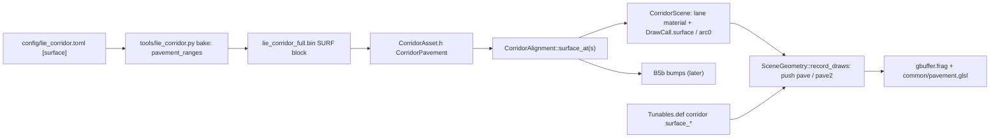

# Road surface (D1) — as built

> Written by AI (Claude) on 2026-11-21 during the autonomous LIE run; reviewed by nobody yet. Debug build only.

The mainline now changes pavement along the route: worn and patched asphalt through Queens and Nassau, a fresh
stretch or two, and jointed concrete east of exit 64. Each kind gets its own procedural detail in the G-buffer pass.
The release build (flat v1 asset, no `SURF` block) draws exactly as before; its `.spv` hashes are unchanged.

## Data flow

- **One source of truth.** The stretches live in `config/lie_corridor.toml [surface]`, keyed by eastbound exit
  numbers. The bake resolves them to stations and writes a 16-byte record per row (`<dB7x`, tag `SURF`). An asset
  without the block (release, older bakes) loads, and `surface_at` returns `Pavement::Legacy`. A runtime TOML table
  would need toml++ in release code and an exit lookup at startup, so the bake was the smaller change.
- **Per draw, not per pixel.** Mainline draws are one per band per 300 m tile, so the kind is chosen per tile
  (`surface_at` at the tile middle). `DrawCall::surface` packs the kind (bits 0-2), a shoulder flag (bit 3) and the
  tile's lane count (bits 4-7). `DrawCall::arc0` is the tile's start station, so joints and markers stay on the global
  station grid even though the surface UVs restart every tile.
- **Materials.** Concrete lanes bind `MAT_CONCRETE` (Concrete012) with a grey tint; fresh lanes bind the new
  `MAT_ASPHALT_FRESH` (Asphalt012 with its red crack stains filled by `tools/gen_asphalt_fresh.py`); worn and patched
  keep `MAT_ASPHALT`. Shoulders stay asphalt everywhere. All tagged lane draws get the road tag, so puddles, ruts,
  ripples and the wet BRDF work on concrete too.
- **No new geometry, no G-buffer change.** Everything is shader detail from the road's (lateral, arc) UVs. Raised
  markers set the existing retroreflective alpha code, so they glow in the headlights through the L8 path.

## What each kind draws

| Kind | Lanes | Shoulders | Paint |
|------|-------|-----------|-------|
| Concrete | Transverse joints every 15 ft (sealant line plus a dirty chamfer), longitudinal joints under the lane lines, per-slab tone | Rumble strips | Half worn |
| Fresh | Clean Asphalt012 aggregate, light polish | Rumble strips | Crisp |
| Worn | Polish, oil line, a few patches, some reflective cracks | Rumble strips | Faded and broken |
| Patched | Many patches with sealed seams, reflective transverse cracks (4 slabs apart), longitudinal tar snakes | Rumble strips | Faded and broken |

All kinds: wheel-path polish from the debug ruts profile, a lane-centre oil drip line, raised pavement markers in the
dash gaps, and a rotated second texture sample under a slow mask to hide the 3 m texture repeat.

## Sources

| Claim | Source | Status |
|-------|--------|--------|
| Asphalt to concrete at exit 64 (NY 112), concrete to Riverhead | Wikipedia, "Interstate 495 (New York)", route description (cites Google Maps) | Sourced |
| Queens rebuilds 1998-2005 (exits 15-22, 29-32); Nassau HOV lanes built inside the old roadbed | Same article, history section | Sourced; the kind picked for each is a guess |
| Asphalt grades per stretch (fresh / worn / patched) | None | Guess, for variety |
| 15 ft (4.6 m) JPCP joint spacing | NYSDOT Comprehensive Pavement Design Manual, ch. 5 (from memory, not opened) | Unverified |
| Reflective cracks every ~60 ft under the overlay | 1950s-60s jointed reinforced pavement practice (from memory) | Guess |
| RPM spacing 80 ft (2N on a 40 ft cycle), mid-gap | MUTCD 2009, section 3B.11 | Sourced (spacing); position in the gap is a guess |
| Milled rumble: 7 in x 16 in, 1/2 in deep, 12 in centres | FHWA Technical Advisory T 5040.39 | Sourced from memory; offset 4 in is a guess |
| Snowplowable RPM casting size | None | Guess |

Further reading (university and agency):

- Huang, Y. H., *Pavement Analysis and Design*, 2nd ed., Pearson (University of Kentucky) — joint spacing and faulting.
- Purdue University JTRP, "Reflective cracking of asphalt overlays on PCC" reports — why overlay cracks follow the old joints.
- Penn State / Pennsylvania Transportation Institute, rumble strip studies (Torbic et al., NCHRP Report 641, 2009).

## Limits and next steps

- The kind changes on a 300 m tile boundary, not at the exact exit station.
- Ramps, service roads, the HOV buffer lines and crossroads keep the legacy look.
- Rumble position uses the tile's rounded lane count, so it sits off the edge line inside a lane taper.
- No faulting (slab steps) yet; B5b will add it as a bump under the wheels from `surface_at`.
- Reflectors are on the lane lines only (no amber on the left edge line).
