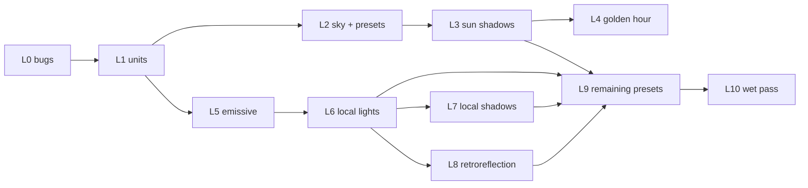

# Lighting in Swish: index

> **Drafted with AI assistance (Claude); owner review pending.** If a chapter and the code disagree, the code wins.

Eleven short chapters that take Swish from one fixed look to six time-of-day presets on physical units.
The plan they follow is the "Lighting: time-of-day presets on physical units" section of
[tasks/todo.md](../../../tasks/todo.md). Step ids (L0.1, L8.2, ...) are the same in both places.

## How to use this

1. Open only the chapter you are on. Ignore the rest.
2. Each chapter is one phase of `tasks/todo.md`.
3. Do the numbered steps in order. Each step is one sitting.
4. Turn that chapter's hidden tests green, then pass its gate.
5. Tick the items in `tasks/todo.md` and move to the next chapter.

## Phases

| Phase | Chapter | What you will see | Stub + hidden tests | Depends on |
|-------|---------|-------------------|---------------------|------------|
| L0 | [L00-structural-bugs.md](L00-structural-bugs.md) | Shadows can go dark; metals stop looking like plastic | `TimeOfDay.h` (`sun_dir_from_az_el`), `[time_of_day][L0]` | none |
| L1 | [L01-physical-units.md](L01-physical-units.md) | Same picture, now driven by lux, lumens and EV100 | `Photometry.h`, `[photometry][L1]` | L0 |
| L2 | [L02-sky-and-presets.md](L02-sky-and-presets.md) | A procedural sky that follows the sun; presets switch live | `TimeOfDay.h`, `[time_of_day][L2]` | L1 |
| L3 | [L03-sun-shadows.md](L03-sun-shadows.md) | Sun shadows hold from horizon to zenith, no shimmer | `ShadowFit.h`, `[shadow_fit][L3]` | L2 |
| L4 | [L04-golden-hour.md](L04-golden-hour.md) | Golden hour signed off on a dry road | none | L3 |
| L5 | [L05-emissive.md](L05-emissive.md) | Lamp heads and car lenses glow and bloom | `Photometry.h` (`emissive_encode`), `[photometry][L5]` | L1 |
| L6 | [L06-local-lights.md](L06-local-lights.md) | Sodium street lamps and headlights on the corridor | `CorridorLamps.h`, `[corridor_lamps][L6]`; `Photometry.h` (`kelvin_to_rgb`), `[photometry][L6]` | L5 |
| L7 | [L07-local-shadows.md](L07-local-shadows.md) | Headlights and the nearest lamps cast shadows | `ShadowFit.h` (`pick_shadow_casters`), `[shadow_fit][L7]` | L6 |
| L8 | [L08-retroreflection.md](L08-retroreflection.md) | Lane markings light up in the headlights | none | L6 |
| L9 | [L09-remaining-presets.md](L09-remaining-presets.md) | Dawn, morning, noon, evening and midnight signed off | none | L3, L6, L5 to L8 |
| L10 | [L10-wet-pass.md](L10-wet-pass.md) | Every preset holds at rain 0 and rain 1.0 | none | L9 |

Stub headers: [Photometry.h](../../../src/utils/light/Photometry.h), [ShadowFit.h](../../../src/utils/light/ShadowFit.h),
[TimeOfDay.h](../../../src/scene/TimeOfDay/TimeOfDay.h), [CorridorLamps.h](../../../src/scene/Corridor/CorridorLamps.h).
Preset data: [config/time_of_day.toml](../../../config/time_of_day.toml) (not loaded until L2).



Golden hour (L0 to L4) is the first sign-off. L5 to L8 are only needed for the presets with lamps on.

## Who does what

| Claude | Owner |
|--------|-------|
| Wrote the stub headers, the hidden tests and these chapters | Writes all production C++ and GLSL |
| Runs unit tests and the gate commands, writes the changelog entry | Does every in-app visual check |
| Never launches the app | Asks for commits and pushes |

GLSL snippets live only in the chapters. Nothing in `shaders/` was pre-written for you.

## How the hidden tests work

The stub functions return placeholders. Their tests carry the Catch2 tag `[.learning]`. The leading dot hides them,
so `make test` skips them and stays green. Run them by name:

```sh
make build
build/tests/utils/swish_utils_tests "[learning][photometry]"     # tests/utils/test_light_Photometry.cpp
build/tests/utils/swish_utils_tests "[learning][shadow_fit]"     # tests/utils/test_light_ShadowFit.cpp
build/tests/swish_tests "[learning][time_of_day]"                # tests/test_time_of_day.cpp
build/tests/swish_tests "[learning][corridor_lamps]"             # tests/test_corridor_lamps.cpp
```

Add a phase tag to narrow the run, for example `"[learning][photometry][L1]"`.
When a phase passes, change `[.learning]` to `[learning]` on its tests. From then on `make test` guards them.

## The standing gate

Every chapter ends with this list, plus its own app checks.

- [ ] `make test` green (release, `build/`)
- [ ] `make test-debug` green (debug UI, `build-debug/`)
- [ ] 0 first-party warnings
- [ ] `make check` prints OK
- [ ] If the release shader output changed: regenerate `tests/golden/release_spv.sha256` on purpose
      (see [tests/golden/README.md](../../../tests/golden/README.md)) and say so in the changelog
- [ ] Changelog entry in `docs/changelog/2026-11.md`, then `python3 scripts/changelog_index.py`
- [ ] Owner check in the app: chase, hood and cockpit views; rain 0 and rain 1.0 for anything wet

A feature leaves the `SWISH_DEBUG_UI` gate one phase at a time. Each promotion is a planned golden change.
A golden is never regenerated to make an unplanned diff pass.

## Glossary

| Term | Meaning |
|------|---------|
| lux (lx) | Light arriving on a surface. Noon sun is about 100 000 lx, a full moon about 0.2 lx. |
| lumen (lm) | Total light a lamp emits in all directions. |
| candela (cd) | Light a lamp emits in one direction. Point lamp: lumens / 4π. |
| nit (cd/m²) | Brightness of a surface or the sky as the camera sees it. |
| EV100 | Camera exposure at ISO 100, in stops. Sunny noon is about 15, a lit street at night about 3. |
| WU | World unit. 1 m = 1000 WU. Use `utils/units/Units.h`, never type `1000`. |
