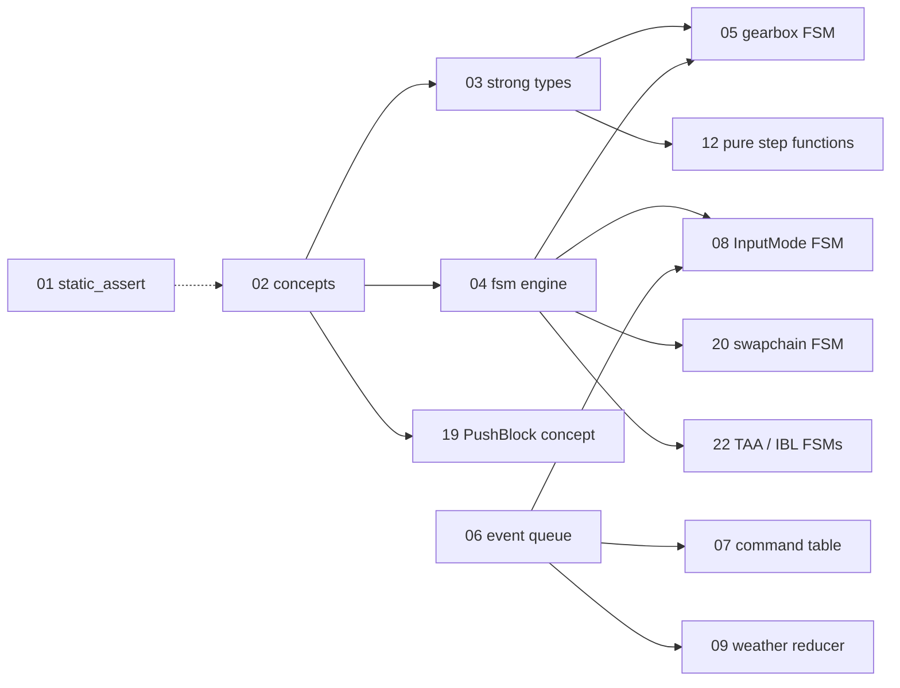

# Typed C++ in Swish: index

> **Drafted with AI assistance (Claude); owner review pending.**
> (Organisation policy requires this label on largely AI-generated work. The chapters were written from the code at
> `33d2c03`; if a chapter and the code disagree, the code wins and the chapter gets fixed.)

## What this series is

A build-it-yourself course in the parts of modern C++ that turn runtime bugs into compile errors: `static_assert`,
`<type_traits>`, concepts, strong types, tag dispatch, `std::variant`, X-macros, state machines (states, events,
guards, actions, transitions), RAII and `std::expected`. You learn each technique by applying it to Swish.

**The tutorial and the refactor are the same thing.** Each chapter is the specification for one refactor phase. When
the chapter's tests are green and its gate passes, that part of Swish has been rebuilt with the technique.

The approved plan this series mirrors lives in `tasks/todo.md` under "Typed C++ system refactor + tutorial".

## How a chapter becomes a phase

| Step | Who | What happens |
|------|-----|--------------|
| 1 | Claude | Creates the branch `refactor/NN-topic` off `debug-ui`, the chapter, a TODO skeleton and the **failing** Catch2 tests named in the chapter's "Tests" section. |
| 2 | Owner | Reads the chapter, does the Exercise, turns the tests green. The owner writes the production code. |
| 3 | Claude | Reviews against [CODING_RULES.md](../../CODING_RULES.md) and runs the gate (below). |
| 4 | Claude | Writes the changelog entry in `docs/changelog/2026-10.md` and refreshes the index (`python3 scripts/changelog_index.py`). |
| 5 | Owner | Asks for the commit and the merge. Nothing is committed or pushed until the owner asks. |

Renderer chapters (M3) work slightly differently: the owner does **one pilot** of the technique, and Claude rolls it out
to the other sites. M0 (bug fixes, build plumbing) is done by Claude.

**Refactor phase vs B-phase.** A numbered chapter is always **behaviour-preserving**: the car golden trajectory, the
mesh goldens and the 33 `.spv` hashes stay as they were. An intended change in behaviour gets its own **B-phase** with
its own golden update, changelog entry and screenshots. A refactor that turns out to change behaviour is either fixed
or reclassified as a B-phase; a golden is never regenerated to make a refactor pass.

The M0 branches `refactor/00-quick-fixes` and `refactor/01-cxx23` already exist. Chapter branches use the chapter
number and topic, for example `refactor/01-static-assert`, so they do not collide.

## Prerequisites

- **C++:** classes, references, templates at the "I can write `template <class T>`" level, lambdas, `std::array`,
  `constexpr` variables. You do not need to know SFINAE; the repo does not use it.
- **Toolchain:** AppleClang 21 (C++23, after the P0.2 bump), CMake, the Vulkan SDK with `VULKAN_SDK` set. Without it
  Homebrew's `glslc` wins and the `.spv` hashes do not match.
- **Second compiler:** access to the Arch machine (GCC). Every phase must build there and pass its unit tests.
- **Read first:** [CODING_RULES.md](../../CODING_RULES.md) (`make rules`), [DESIGN_PATTERNS.md](../../DESIGN_PATTERNS.md)
  section 2 (tag dispatch), [src/utils/README.md](../../../src/utils/README.md) (how a util header is laid out),
  [tests/README.md](../../../tests/README.md) and [tests/golden/README.md](../../../tests/golden/README.md).
- **Baseline green:** `make test`, `make test-debug` and `make check` pass on your machine before you start chapter 01.

## The chapters

Status is the chapter's phase status. All chapters start as "not started"; the authoritative tick list is
`tasks/todo.md`.

### M0: baseline and hygiene (Claude)

These are not chapters, but every chapter assumes them. Status is copied from `tasks/todo.md` on 2026-10-01.

| Phase | What | Status (todo.md) |
|-------|------|------------------|
| P0.0 | Baseline commit (`aab1c9c`) | done |
| P0.1 (B) | Quick bug fixes: cursor/edit-mode desync, weather desync, resize flag, fog label, dump line, double `glfwTerminate`, `EnumCycle` `Count == 0`, dead Treadmill message, stale TODOs | done (manual key/resize check still open) |
| P0.2 | C++23 bump alone | done on macOS (`8216707`); Arch GCC gate pending |
| P0.3 | Build: `swish_scene_core`, `swish_utils`, warnings on tests, CI | open |
| P0.4 | Test seam replacing `#define private public` in `test_golden_car.cpp` | open |
| P0.5 | Doc drift fixes | open |
| P0.6 | This scaffold + a `docs/README.md` row | open |

### M1: foundations, core and car (owner implements)

| Ch | File | Technique | Real target | Status |
|----|------|-----------|-------------|--------|
| 01 | [01-static-assert.md](01-static-assert.md) | `static_assert`, constexpr validators | `GearboxParams` invariants; `MAX_FRAMES_IN_FLIGHT == 2` assumptions | not started |
| 02 | [02-traits-and-concepts.md](02-traits-and-concepts.md) | `<type_traits>`, `if constexpr`, concepts, `requires` | `CountedEnum`; new `utils/meta/Concepts.h` | not started |
| 03 | [03-strong-types.md](03-strong-types.md) | Strong types (deducing `this`, `std::to_underlying`) | `Quantity<Tag>`, `Gear`, `Corner` + `PerCorner<T>`, `Direction` at the `CarEntity` API | not started |
| 04 | [04-fsm-engine.md](04-fsm-engine.md) | The `swish::fsm` engine: table, guards, entry/exit, actions as data, constexpr checks | none yet; built test-first | not started |
| 05 | [05-gearbox-fsm.md](05-gearbox-fsm.md) | First FSM user | gearbox `gearbox_shift_step` | not started |
| 06 | [06-variant-events.md](06-variant-events.md) | `std::variant`, `std::visit`, `overloaded{}` | typed `EventQueue`; GLFW callbacks only push | not started |
| 07 | [07-xmacro-commands.md](07-xmacro-commands.md) | X-macro command table | `Commands.def`, `InputSampler` / `InputFrame` | not started |
| 08 | [08-input-mode-fsm.md](08-input-mode-fsm.md) | FSM with actions as data | `InputMode{Driving, CursorFree, DebugEdit}` | not started |
| 09 | [09-weather-reducer.md](09-weather-reducer.md) | Reducer: `reduce(state, event)` then `apply()` | `WeatherState`, `RainLevel` | not started |
| 10 | [10-camera-variant-states.md](10-camera-variant-states.md) | Variant-of-states FSM | `CameraController` per-mode states | not started |
| 11 | [11-raii-ownership.md](11-raii-ownership.md) | RAII and ownership | `GlfwContext`, `unique_ptr<Camera>`, `RoadSurface`, `CorridorDriver` value result | not started |
| 12 | [12-pure-step-functions.md](12-pure-step-functions.md) | Pure step functions | split `CarEntity::update`; `utils/math/Angle.h` | not started |

### M2: debug, config and data (owner pilots)

| Ch | File | Technique | Real target | Status |
|----|------|-----------|-------------|--------|
| 13 | (not written yet) | X-macro registry + tag dispatch extension | `TUNE_V`; owner converts the sky group, Claude the rest; split `DebugUI.cpp` | not started |
| B2 | (B-phase) | Intended change | persist the 14 sliders presets do not save today | not started |
| 14 | (not written yet) | Schema X-macro + `std::expected` validation | `RoadSchema.def` (`road.bin` byte-identical) | not started |
| B3 | (B-phase) | Intended change | road-config double-to-float narrowing and mismatched fallbacks | not started |
| 15 | (not written yet) | `std::expected` across loaders | TOML, presets, GLB | not started |
| – | (Claude) | Cleanup | `io/Paths.h`, `FrameClock`, `puddle_hash` move, split `test_car_physics.cpp`, missing utils tests | not started |

### M3: renderer (owner pilot, Claude rollout)

| Ch | File | Technique | Real target | Status |
|----|------|-----------|-------------|--------|
| 16 | (not written yet) | RAII handles | pilot `IBLManager`; rollout to the other passes | not started |
| 17 | (not written yet) | RAII scope + builder | `vkx::OneTimeSubmit`, `RenderScope` rollout, `record_car_draws()` | not started |
| 18 | (not written yet) | Strong enum + NTTP dispatch | `enum class Set`, `bind_set<Set::X>()` | not started |
| 19 | (not written yet) | Concept-constrained template | `vkx::PushBlock<T, Stages>`, `PushConstantBlock` | not started |
| 20 | (not written yet) | Frame/swapchain FSM | `Swapchain{Ok, NeedsRecreate, Minimized}`, `RendererCommand` queue | not started |
| 21 | (not written yet) | Typed resource state | `TrackedImage`, declarative pass reads/writes | not started |
| B4 | (B-phase) | Intended change | drop the redundant SSR/GodRays HDR round trip | not started |
| 22 | (not written yet) | Small FSMs + `std::optional` | TAA history, IBL `SkySource` | not started |
| 23 | (not written yet) | Enum over bool pairs | `BlendMode` + depth bias in `PipelineConfig` | not started |
| 24 | (not written yet) | Façade / decomposition | `PostProcessManager` breakup | not started |

### M4: wrap-up

| Ch | File | Technique | Real target | Status |
|----|------|-----------|-------------|--------|
| 25 | (not written yet) | Patterns recap and "when NOT to" | ADRs in `docs/adr/` (fsm engine, event queue, `Quantity` scope, RAII policy); doc and CLAUDE.md sync | not started |

## How the chapters depend on each other

Solid arrows: the later chapter uses a building block from the earlier one. The dotted arrow is reading order only.



## Chapter layout

Every chapter has the same nine sections, in this order:

1. **Concept**: the C++ idea, with one standalone example of 25 lines or fewer that compiles under C++23.
2. **Where Swish is today**: `file:line` anchors read from the code, the quoted lines, and the smell or bug.
3. **Target design**: types and signatures only. A mermaid diagram for every state machine or data flow.
4. **Exercise**: numbered steps for you, naming the files; hints, not answers.
5. **Tests you must turn green**: each Catch2 `TEST_CASE` by name, tag and assertion, plus the `static_assert`s that
   must hold. Claude writes these on the phase branch.
6. **Gate**: the commands, plus anything specific to the chapter.
7. **Pitfalls**: compiler differences, MoltenVK, golden hashes, ODR.
8. **Solution**: a collapsed block that stays empty until you finish or ask.
9. **Further reading**: cppreference links.

Line numbers are correct at the `against:` commit in each chapter's front matter. Re-grep before you edit; earlier
phases move lines.

## Per-phase gate (definition of done)

Copy this checklist into the phase's review. Every box must be ticked before merge.

- [ ] `make test` green (release, `build/`), 0 warnings on AppleClang
- [ ] `make test-debug` green (debug-UI, `build-debug/`), 0 warnings
- [ ] CI clang build green, 0 warnings
- [ ] Arch GCC: builds, unit tests pass (mesh goldens are Clang-bound and are skipped there)
- [ ] Shader hashes: `(cd build/shaders && shasum -a 256 -c ../../tests/golden/release_spv.sha256)` prints 33 `OK`
- [ ] Goldens: `./build/tests/swish_tests "[golden]"` green, and `git status --porcelain tests/golden` is empty
- [ ] Pass order and bindings: `./build/tests/utils/swish_utils_tests "[renderer]"` green
- [ ] `make check` prints OK; `make format-check` exits 0
- [ ] Anything a human sees: window-only screenshots at the extremes, rain at 0 and at 1.0, temporary forces reverted
- [ ] Changelog entry in `docs/changelog/2026-10.md` + `python3 scripts/changelog_index.py`
- [ ] `tasks/todo.md` ticked
- [ ] **B-phases only:** the before/after golden diff or screenshots attached to the changelog entry

```sh
make test
make test-debug
(cd build/shaders && shasum -a 256 -c ../../tests/golden/release_spv.sha256)
./build/tests/swish_tests "[golden]"
make check
make format-check
```

## Conventions used in every chapter

| Rule | Where it comes from |
|------|---------------------|
| Includes rooted at `src/`; same directory uses the bare name; never `../` | CODING_RULES rule 3 |
| Everything in `namespace swish`; utils in `swish::util::<topic>` (so `swish::fsm` in prose is `swish::util::fsm` in code) | CODING_RULES rule 4, `src/utils/README.md` |
| `#pragma once`; one class per `Name/Name.{h,cpp}`; topic headers for small value types | CODING_RULES rule 4 |
| Vocabulary types (`u8`, `u32`, `Vec3`) from `utils/types/Types.h`; units from `utils/units/Units.h`; never type `1000` or pi | CODING_RULES rule 2 |
| New util header starts with the banner `Purpose / Units / Complexity / Naming / Example / See also / Test` | `src/utils/README.md`, `utils/meta/Tags.h` |
| Concepts, not SFINAE or `enable_if` | `DESIGN_PATTERNS.md` section 2, `KEEPING_IT_CLEAN.md` |
| `TEST_CASE` names contain no `,` `;` `[` `]` (CTest discovery splits on them) | `tests/README.md` |
| Keep float expression order when moving maths | `DESIGN_PATTERNS.md` section 7 rule 9 |
