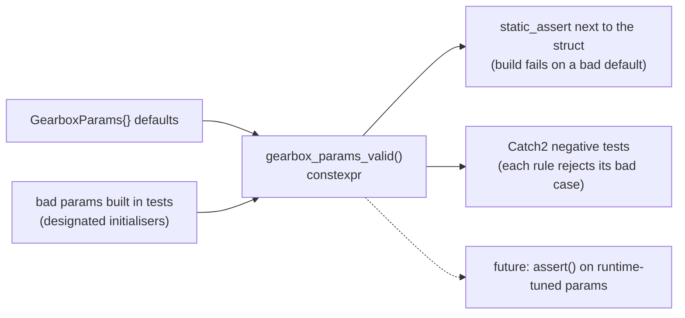

# 01 · `static_assert` and constexpr validators

> Drafted with AI assistance (Claude); owner review pending. Series map: [00-index.md](00-index.md).

**Phase branch:** `refactor/01-static-assert` · **Behaviour:** preserving (no float, shader or golden change)

## 1. Concept

`static_assert(condition, "message")` is checked by the compiler. If the condition is false, the build stops with
your message. The condition must be a **constant expression**: something the compiler can work out without running
the program.

A `constexpr` function can be run by the compiler, so you can write a whole check as ordinary code (loops, `if`,
local variables) and call it from `static_assert`. That is a **constexpr validator**: one function that states an
invariant, checked at compile time for data known at compile time and callable at runtime for data that is not.

Two placements matter:

- **Next to the data** (namespace scope, after a struct or table): checked once, in every translation unit that
  includes the header. If someone edits a default so it breaks the rule, that edit stops compiling.
- **Inside a template**: checked when the template is instantiated, so the check sees the real `T`
  (`push_range<T>` in Swish does this).

```cpp
#include <array>
#include <cstddef>

struct Gearbox {
    std::array<float, 3> ratios{3.0f, 2.0f, 1.0f};
    float up   = 6000.0f;
    float down = 3000.0f;
};

constexpr bool ratios_descending(const Gearbox& g) {
    for (std::size_t i = 1; i < g.ratios.size(); ++i)
        if (!(g.ratios[i] < g.ratios[i - 1])) return false;
    return true;
}

static_assert(Gearbox{}.up > Gearbox{}.down, "hysteresis band is inverted");
static_assert(ratios_descending(Gearbox{}), "ratios must strictly decrease");
static_assert(!ratios_descending(Gearbox{.ratios = {1.0f, 2.0f, 3.0f}}));  // the validator catches a bad table

template <class T>
void upload(const T&) { static_assert(sizeof(T) % 16 == 0, "pad the block to 16 bytes"); }

int main() {}
```

The third assert is the useful trick: a validator can be tested **negatively at compile time** by building a bad
object with designated initialisers and asserting the validator rejects it.

What `static_assert` cannot do: it sees only constant data. A `GearboxParams` built at runtime (say, from a debug
slider) is not checked by it. That is why the check is a function and not just an expression: the same function can
back an `assert` or a unit test.

## 2. Where Swish is today

### The pattern already exists (three good examples)

[src/utils/vulkan/PushConstants.h:37-43](../../../src/utils/vulkan/PushConstants.h): asserts inside a template, so
every `push_range<P>` call checks its own `P`.

```cpp
template <class P>
constexpr VkPushConstantRange push_range(VkShaderStageFlags stages, uint32_t offset = 0) {
    static_assert(std::is_trivially_copyable_v<P>, "push constant block must be trivially copyable");
    static_assert(sizeof(P) % kPushConstantAlign == 0,
                  "push constant block size must be a multiple of 16 bytes (MoltenVK); pad the struct");
```

[src/renderer/Passes/PassInputs.h:36-45](../../../src/renderer/Passes/PassInputs.h) and `:55`, `:66`: a constexpr
validator over a table (`bindings_dense`: the bindings are exactly `0..N-1`, no gaps, no duplicates), asserted next to
each table.

```cpp
static_assert(bindings_dense(kCompositeInputs), "composite inputs must be bindings 0..N-1");
```

[src/debug/Tunables.h:87-95](../../../src/debug/Tunables.h): `defaults_in_range()` loops over the X-macro table and
checks every default and release override lies inside its slider range.

Other layout contracts asserted next to the data: [Units.h:38-46](../../../src/utils/units/Units.h),
[RoadConfig.h:83,86](../../../src/scene/RoadScene/RoadConfig.h),
[CorridorAsset.h:119-122](../../../src/scene/Corridor/CorridorAsset.h),
[SceneParamsUniform.h:36](../../../src/debug/SceneParamsUniform.h).

### Gap 1: `GearboxParams` invariants live in comments

[src/scene/Entity/Powertrain.h:103-122](../../../src/scene/Entity/Powertrain.h) holds the gear ratios and shift
thresholds with **no** assertion. The comment at `:108-118` makes a precise claim:

```cpp
    // ... the LARGEST step
    // is 1st→2nd (1.661) and the SMALLEST is 6th→7th (1.183), so an upshift at
    // upshiftRpm lands somewhere in 4154-5832 rpm — the worst case is still
    // ~950 rpm (=30%) above downshiftRpm, so hysteresis alone already cannot
    // oscillate; the dwell timer is belt-and-suspenders.
    float upshiftRpm   = 6900.f;
    float downshiftRpm = 3200.f;
    float shiftDwell   = 0.3f;    // s, minimum time between shifts
```

That claim is checkable. At a fixed wheel speed engine rpm is proportional to the gear ratio, so after an upshift
from gear $i$ the rpm becomes $\text{rpm}\cdot r_{i+1}/r_i$. The gearbox cannot hunt if, for every adjacent pair,

$$
\text{up}\cdot\frac{r_{i+1}}{r_i} > \text{down}
\qquad\text{and}\qquad
\text{down}\cdot\frac{r_{i}}{r_{i+1}} < \text{up}.
$$

With today's numbers the tightest upshift landing is $6900 \cdot 3.13/5.20 \approx 4153 > 3200$ and the highest
downshift landing is $3200 \cdot 5.20/3.13 \approx 5316 < 6900$, so the defaults pass. Nothing stops an edit that
breaks it.

The top gear is also a magic number that must agree with the array size:
[Powertrain.h:159](../../../src/scene/Entity/Powertrain.h) `for (int i = 0; i < 6; ++i)`, `:163` `return 6;`,
`:182` `state.gear < 6`, and the comment `:171` `// 0 = 1st ... 6 = 7th`. `ratios` is `std::array<float, 7>`
(`:105`). Chapter 03 removes the `6`; this chapter pins the assumption so it cannot drift before then.

### Gap 2: `MAX_FRAMES_IN_FLIGHT == 2` is a review-by-comment rule

[src/renderer/RendererConfig.h:11-13](../../../src/renderer/RendererConfig.h):

```cpp
// Frames the CPU may record ahead of the GPU: sizes every per-frame ring (UBOs, descriptor sets,
// framebuffers, sync objects, command buffers). Changing it needs a renderer-wide review.
static constexpr u32 MAX_FRAMES_IN_FLIGHT = 2;
```

A grep finds two different kinds of "2" that look alike:

| Site | Code | What the 2 really is |
|------|------|----------------------|
| [TaaPass.cpp:284](../../../src/renderer/TaaPass/TaaPass.cpp) | `m_views[(f + 1) % MAX_FRAMES_IN_FLIGHT]` | "the history image", described as `taa[1-f]` in the comments at `:96`, `:276` and [TaaPass.h:106](../../../src/renderer/TaaPass/TaaPass.h). `(f + 1) % N` is the **previous** frame only when `N == 2`. With `N == 3`, frame 0 would read image 1, which was written two frames ago. **A real `MAX_FRAMES_IN_FLIGHT == 2` assumption.** |
| [WindshieldRainPass.cpp:431, 476, 501](../../../src/renderer/WindshieldRainPass/WindshieldRainPass.cpp) | `for (int i = 0; i < 2; i++)` | loops over `m_wetImages` / `m_wetViews`, declared `std::array<GpuImage, 2>` at [WindshieldRainPass.h:113-114](../../../src/renderer/WindshieldRainPass/WindshieldRainPass.h): the wetness **history/current ping-pong pair**. It is not tied to frames in flight. The smell is a literal that repeats the array size. |
| [WindshieldRainPass.cpp:552-554](../../../src/renderer/WindshieldRainPass/WindshieldRainPass.cpp) | `.combinedImageSamplers = 2 * MAX_FRAMES_IN_FLIGHT + 1` | the 2 is the number of sampler bindings in each per-frame set (bindings 1 and 2 of the layout at `:521-533`). The pool size is derived by hand. |

The plan listed the three windshield loops as `MAX_FRAMES_IN_FLIGHT` assumptions. Reading the code shows they are
not; the TAA history index is. Fix each one for what it actually is.

## 3. Target design

Declarations only.

```cpp
// src/scene/Entity/Powertrain.h (after GearboxParams)
namespace swish {

inline constexpr std::size_t kGearCount = std::tuple_size_v<decltype(GearboxParams::ratios)>;

[[nodiscard]] constexpr bool ratios_positive(const GearboxParams& g) noexcept;             // every ratio and finalDrive > 0
[[nodiscard]] constexpr bool ratios_strictly_descending(const GearboxParams& g) noexcept;  // 1st is the shortest
[[nodiscard]] constexpr bool shift_band_ordered(const GearboxParams& g) noexcept;          // upshiftRpm > downshiftRpm
[[nodiscard]] constexpr bool dwell_non_negative(const GearboxParams& g) noexcept;          // shiftDwell >= 0
[[nodiscard]] constexpr bool upshift_lands_above_downshift(const GearboxParams& g) noexcept;
[[nodiscard]] constexpr bool downshift_lands_below_upshift(const GearboxParams& g) noexcept;
[[nodiscard]] constexpr bool gearbox_params_valid(const GearboxParams& g) noexcept;        // all of the above

}  // namespace swish
```

```cpp
// src/renderer/RendererConfig.h
namespace swish {
// Index of the frame recorded one step before `frame` in a ring of N.
template <u32 N = MAX_FRAMES_IN_FLIGHT>
[[nodiscard]] constexpr u32 prev_frame(u32 frame) noexcept;
}
```

```cpp
// src/renderer/WindshieldRainPass/WindshieldRainPass.h (private)
static constexpr std::size_t kWetPingPong = 2;  // [0] = history/read, [1] = current/write
std::array<GpuImage, kWetPingPong>    m_wetImages{};
std::array<VkImageView, kWetPingPong> m_wetViews{};
```

How one validator serves both checks:



## 4. Exercise

1. **Read the three existing patterns** (section 2) and note for each: where the assert sits, what it sees, and what
   message a failing build prints.
2. **Write the gearbox validators** in `src/scene/Entity/Powertrain.h`, directly after `GearboxParams`. One small
   function per rule, then `gearbox_params_valid` as their conjunction. Hint: loop with `std::size_t` over
   `g.ratios.size()`; the landing checks compare `up * r[i+1] / r[i]` against `down` (and the mirror for downshifts).
   Compute in `float`, the same type the runtime uses.
3. **Assert the defaults**, one `static_assert` per rule so a failure names the broken rule. C++23 messages must be
   string literals, so you cannot build one message that lists them all.
4. **Pin the top-gear assumption.** Define `kGearCount` and add
   `static_assert(kGearCount == 7, ...)` with a message that names the three lines that hard-code top gear 6.
   Chapter 03 deletes the magic and this assert together.
5. **Fix the TAA history index.** Add `prev_frame<N>` to `src/renderer/RendererConfig.h` and use it at
   `TaaPass.cpp:284`. Hint: `(frame + N - 1) % N`. Check by hand that for `N == 2` it gives the same value as
   `(f + 1) % 2` for both frames, so the descriptor writes do not change. Update the `taa[1-f]` comments at `:96`,
   `:276` and `TaaPass.h:106` to say "previous frame".
6. **Name the wetness pair.** In `WindshieldRainPass.h` add `kWetPingPong` and use it as the array size. Replace the
   three `i < 2` loops in `WindshieldRainPass.cpp` with a bound that cannot drift from the array (range-for, or
   `kWetPingPong`). Hint: `m_wetImages.size()` is fine as a runtime loop bound, but see Pitfalls before using it in a
   `static_assert`.
7. **Optional stretch:** derive the pool size at `WindshieldRainPass.cpp:552-554` from named counts
   (`kRainSamplerBindings = 2`) and `static_assert` the arithmetic.
8. **Do not** add `static_assert(MAX_FRAMES_IN_FLIGHT == 2)` to sites you have just generalised. Add it only where the
   assumption remains and cannot be removed in this phase; say so in the message.
9. `make format`, then run the gate.

## 5. Tests you must turn green

Claude writes these on the phase branch before you start.

**`tests/test_powertrain_invariants.cpp`** (in `swish_tests`; list it in `tests/CMakeLists.txt`):

| `TEST_CASE` | Tags | Asserts |
|-------------|------|---------|
| `GearboxParams defaults satisfy every invariant` | `[car][gearbox][invariants]` | each validator returns true for `GearboxParams{}` at runtime (so a failure is visible in ctest output too) |
| `Gearbox validator rejects an inverted shift band` | `[car][gearbox][invariants]` | `.upshiftRpm = 3000.f` (below `downshiftRpm`): `shift_band_ordered` and `gearbox_params_valid` are false |
| `Gearbox validator rejects a negative dwell` | `[car][gearbox][invariants]` | `.shiftDwell = -0.1f`: `dwell_non_negative` false |
| `Gearbox validator rejects a zero or negative ratio` | `[car][gearbox][invariants]` | one ratio `0.f`, then one `-1.f`, then `.finalDrive = 0.f`: `ratios_positive` false each time |
| `Gearbox validator rejects ratios that do not descend` | `[car][gearbox][invariants]` | 2nd equal to 1st: `ratios_strictly_descending` false |
| `Gearbox validator rejects a band an upshift can land below` | `[car][gearbox][invariants]` | `.downshiftRpm = 5000.f` with the default `upshiftRpm` (1st to 2nd lands near 4153 rpm): `upshift_lands_above_downshift` false |

**`tests/utils/test_renderer_RendererConfig.cpp`** (in `swish_utils_tests`, tag `[renderer]`):

| `TEST_CASE` | Asserts |
|-------------|---------|
| `prev_frame steps back one slot in the ring` | for `N` in 2, 3 and 4 and every `f < N`: `(prev_frame<N>(f) + 1) % N == f` |
| `prev_frame matches the legacy TAA history index for two frames` | `prev_frame<2>(f) == (f + 1) % 2` for `f` in 0 and 1 |

`static_assert`s that must hold:

```cpp
static_assert(swish::gearbox_params_valid(swish::GearboxParams{}));
static_assert(!swish::gearbox_params_valid(swish::GearboxParams{.upshiftRpm = 3000.f}));
static_assert(swish::kGearCount == 7);
static_assert(swish::prev_frame<2>(0) == 1 && swish::prev_frame<2>(1) == 0);
static_assert(swish::prev_frame<3>(0) == 2);
```

Inside `WindshieldRainPass` (private, so asserted there, not in a test):
`static_assert(std::tuple_size_v<decltype(m_wetImages)> == kWetPingPong)` if you keep any loop bound that is not
derived from the array itself.

## 6. Gate

```sh
make test
make test-debug
(cd build/shaders && shasum -a 256 -c ../../tests/golden/release_spv.sha256)   # 33 OK; no shader was touched
./build/tests/swish_tests "[golden]"                                            # car + mesh goldens unchanged
./build/tests/swish_tests "[gearbox]"
./build/tests/utils/swish_utils_tests "[renderer]"                               # includes prev_frame + pass order
make check
make format-check
```

Chapter-specific checks:

- `git status --porcelain tests/golden` is empty.
- **Break it on purpose once:** temporarily set `downshiftRpm = 5000.f` in `GearboxParams` and confirm the build
  fails with your message. Revert.
- One `Debug` build run with validation on (TAA enabled in the debug UI): 0 validation messages. The descriptor
  writes are unchanged, but this is a renderer edit.
- Arch GCC: builds and `ctest` passes.

## 7. Pitfalls

- **`this` is not a constant expression.** Inside a member function, `static_assert(m_wetImages.size() == 2)` fails on
  some compilers because it reads through `this`. Use `std::tuple_size_v<decltype(m_wetImages)>` or the named
  constant. (C++23's P2280 relaxes some of this for references; do not rely on it across AppleClang, CI clang and GCC.)
- **Messages are string literals in C++23.** Computed messages (`static_assert(cond, make_msg())`) are C++26.
  Write one assert per rule so the literal can say which rule broke.
- **`static_assert(false)` in a template.** Valid since P2593 (applied by Clang 17 and GCC 13 as a defect fix). It is
  still clearer to assert a condition that depends on `T`, as `push_range` does.
- **Compile-time floats are not runtime floats.** Constant evaluation and the Release build can round `a * b + c`
  differently (the optimiser may fuse it into one FMA on arm64). Assert inequalities with margin (the landing checks
  have hundreds of rpm to spare), never exact equality with a value the runtime also computes.
- **A header assert runs in every translation unit** that includes the header. Keep validators cheap (7 ratios is
  nothing). Large tables can hit Clang's `-fconstexpr-steps` or GCC's `-fconstexpr-ops-limit` at different points.
- **Defaults only.** `static_assert(gearbox_params_valid(GearboxParams{}))` proves the shipped defaults. Today
  `CarEntity.cpp:60` and `CarEntity.h:91` both default-construct the params, so that covers every use. A future slider
  that edits them needs a runtime call of the same validator.

## 8. Solution

<details><summary>Solution</summary>

Compare with your own version only after you have tried it. The gearbox and `prev_frame` code below was compiled
with `clang++ -std=c++23 -Wall -Wextra -Wpedantic` against the chapter's tests and `static_assert`s. The
`TaaPass` and `WindshieldRainPass` edits are shown as diffs and have not been built.

### 8.1 Gearbox validators (`src/scene/Entity/Powertrain.h`, after `GearboxParams`)

```cpp
inline constexpr std::size_t kGearCount = std::tuple_size_v<decltype(GearboxParams::ratios)>;
static_assert(kGearCount == 7,
              "gear_for_speed (`i < 6`, `return 6`) and gearbox_shift_step (`state.gear < 6`) hard-code top gear 6: "
              "update them together with the ratio count");

[[nodiscard]] constexpr bool ratios_positive(const GearboxParams& g) noexcept {
    if (!(g.finalDrive > 0.f))
        return false;
    for (const float r : g.ratios)
        if (!(r > 0.f))
            return false;
    return true;
}

[[nodiscard]] constexpr bool ratios_strictly_descending(const GearboxParams& g) noexcept {
    for (std::size_t i = 1; i < g.ratios.size(); ++i)
        if (!(g.ratios[i] < g.ratios[i - 1]))
            return false;
    return true;
}

[[nodiscard]] constexpr bool shift_band_ordered(const GearboxParams& g) noexcept { return g.upshiftRpm > g.downshiftRpm; }
[[nodiscard]] constexpr bool dwell_non_negative(const GearboxParams& g) noexcept { return g.shiftDwell >= 0.f; }

[[nodiscard]] constexpr bool upshift_lands_above_downshift(const GearboxParams& g) noexcept {
    if (!ratios_positive(g))
        return false;
    for (std::size_t i = 0; i + 1 < g.ratios.size(); ++i)
        if (!(g.upshiftRpm * g.ratios[i + 1] / g.ratios[i] > g.downshiftRpm))
            return false;
    return true;
}

[[nodiscard]] constexpr bool downshift_lands_below_upshift(const GearboxParams& g) noexcept {
    if (!ratios_positive(g))
        return false;
    for (std::size_t i = 0; i + 1 < g.ratios.size(); ++i)
        if (!(g.downshiftRpm * g.ratios[i] / g.ratios[i + 1] < g.upshiftRpm))
            return false;
    return true;
}

[[nodiscard]] constexpr bool gearbox_params_valid(const GearboxParams& g) noexcept {
    return ratios_positive(g) && ratios_strictly_descending(g) && shift_band_ordered(g) && dwell_non_negative(g) &&
           upshift_lands_above_downshift(g) && downshift_lands_below_upshift(g);
}

static_assert(ratios_positive(GearboxParams{}), "gear ratios and finalDrive must be > 0");
static_assert(ratios_strictly_descending(GearboxParams{}), "gear ratios must strictly decrease from 1st to 7th");
static_assert(shift_band_ordered(GearboxParams{}), "upshiftRpm must be above downshiftRpm");
static_assert(dwell_non_negative(GearboxParams{}), "shiftDwell must be >= 0");
static_assert(upshift_lands_above_downshift(GearboxParams{}), "an upshift would land at or below downshiftRpm: the box would hunt");
static_assert(downshift_lands_below_upshift(GearboxParams{}), "a downshift would land at or above upshiftRpm: the box would hunt");
```

Why it looks like this:

- **The landing checks start with `ratios_positive`.** A zero ratio would make `r[i+1] / r[i]` a division by zero.
  That is not a constant expression, so a bad table would produce a confusing compile error instead of a clean
  `false`. Guarding first keeps every validator total.
- **Comparisons are written `!(a > b)`** so a NaN fails the check instead of slipping through.
- **The `kGearCount` assert sits beside its definition** and its message names the three hard-coded sites.
  Chapter 03 deletes the `6`s and this assert together.
- **`gearbox_params_valid` is only the conjunction.** The tests and the `static_assert`s call it for the
  whole-object answer. The per-rule asserts exist so a failing build names the broken rule.

### 8.2 `prev_frame` (`src/renderer/RendererConfig.h`) and the TAA site

```cpp
template <u32 N = MAX_FRAMES_IN_FLIGHT>
[[nodiscard]] constexpr u32 prev_frame(u32 frame) noexcept {
    static_assert(N >= 2, "ring needs at least two slots");
    return (frame + N - 1) % N;
}
```

For `N == 2`: `prev_frame(0) = (0 + 1) % 2 = 1` and `prev_frame(1) = (1 + 1) % 2 = 0`, which are exactly the old
`(f + 1) % 2` values, so the descriptor writes are unchanged.

```diff
-            {m_sampler, m_views[(f + 1) % MAX_FRAMES_IN_FLIGHT], VK_IMAGE_LAYOUT_SHADER_READ_ONLY_OPTIMAL},
+            {m_sampler, m_views[prev_frame(f)], VK_IMAGE_LAYOUT_SHADER_READ_ONLY_OPTIMAL},
```

Then change the `taa[1-f]` wording at `TaaPass.cpp:276` (and `:96`, `TaaPass.h:106`) to "previous-frame history".

### 8.3 Wetness ping-pong (`WindshieldRainPass`)

```diff
-    std::array<GpuImage, 2>    m_wetImages{};  // RAII (VMA)
-    std::array<VkImageView, 2> m_wetViews{};
+    static constexpr std::size_t kWetPingPong = 2;  // [0] = history/read, [1] = current/write
+    std::array<GpuImage, kWetPingPong>    m_wetImages{};  // RAII (VMA)
+    std::array<VkImageView, kWetPingPong> m_wetViews{};
```

```diff
-    for (int i = 0; i < 2; i++) {
+    for (std::size_t i = 0; i < kWetPingPong; i++) {
```

Apply the second change at the three loops (`WindshieldRainPass.cpp:431, 476, 501`). Because the bound now comes from the
same constant as the array size, no extra `static_assert` is needed. If the loop body indexes with an `int` API,
cast at that one point rather than keeping the `int` loop variable.

### 8.4 Optional stretch (pool size)

```cpp
static constexpr u32 kRainSamplerBindings = 2;  // bindings 1 and 2 of the per-frame set layout
// ...
.combinedImageSamplers = kRainSamplerBindings * MAX_FRAMES_IN_FLIGHT + 1,
```

Here `MAX_FRAMES_IN_FLIGHT` is a real multiplier (one set per frame), so the arithmetic stays correct for any
value. Do **not** add `static_assert(MAX_FRAMES_IN_FLIGHT == 2)` here or at the TAA site.

### 8.5 Verify

- With the solution in place, `swish_tests "[gearbox]"` and `swish_utils_tests "[renderer]"` should pass.
- Break-it-on-purpose check: with `downshiftRpm = 5000.f` the build stops at
  `downshift_lands_below_upshift` / `upshift_lands_above_downshift` with the message above. The scratch compile of
  `static_assert(gearbox_params_valid(GearboxParams{.downshiftRpm = 5000.f}))` fails as expected.
- Still to run on the phase branch: the full gate in section 6 (`make test`, goldens, `make check`, the Debug
  validation run).

</details>

## 9. Further reading

- [`static_assert` declaration](https://en.cppreference.com/w/cpp/language/static_assert)
- [`constexpr` specifier](https://en.cppreference.com/w/cpp/language/constexpr)
- [Constant expressions](https://en.cppreference.com/w/cpp/language/constant_expression)
- [Aggregate initialization (designated initialisers)](https://en.cppreference.com/w/cpp/language/aggregate_initialization)
- [`std::tuple_size<std::array>`](https://en.cppreference.com/w/cpp/container/array/tuple_size)

## 10. Postscript (2026-10-12): `gearCount` added for the 993 profile

> Added with AI assistance (Claude) during the rigged-Porsche work; owner review pending.

The rigged car is a 1995 911 Carrera RS (993). Its G50/31 is a **six-speed**, so "top gear is index 6" stopped being
true for one of the two cars. This is the edit `static_assert(kGearCount == 7, ...)` was written to catch, and it
caught it: the message named the three lines that hard-coded 6.

The fix keeps the array and adds a count:

- `GearboxParams` gains `int gearCount` (7 for the 992, 6 for the 993). `ratios` keeps its 7 slots, and slots at or past
  `gearCount` are unused (the 993 stores a `0.f` there).
- Every validator walks `active_gear_count(g)` (that is, `gearCount` clamped into the array) instead of `ratios.size()`. A
  new validator, `gear_count_in_range`, checks `1 <= gearCount <= kGearCount`. Without the clamp, a bad count would
  index past the array, and in a constant expression that is a compile error with no useful message.
- `gear_for_speed` and `gearbox_shift_step` use `gearCount - 1` as the top gear. With `gearCount == 7`, that is the old
  `6`, so the 992 is bit-identical; `tests/test_car_profiles.cpp` checks this against frozen copies of the old functions.
- `static_assert(kGearCount == 7, ...)` becomes `static_assert(GearboxParams{}.gearCount <= kGearCount, ...)`, plus a
  `gear_count_in_range(GearboxParams{})` line in the block of default checks.

The zero in the unused slot is deliberate: it keeps the validators meaningful. Copy the 993 box, set `gearCount = 7`,
and `ratios_positive` fails, because that seventh "gear" was never a gear.

This also pays off the **Defaults only** pitfall (section 7). The 993's numbers are not `GearboxParams{}`, so
`car_profiles::rs_993()` is `constexpr` and gets its own `static_assert(car_profile_valid(...))` in `CarProfile.h`. The
version that uses wheelbase and tyre radius measured from the mesh is built at runtime, and the tests call the same
validator on it.
