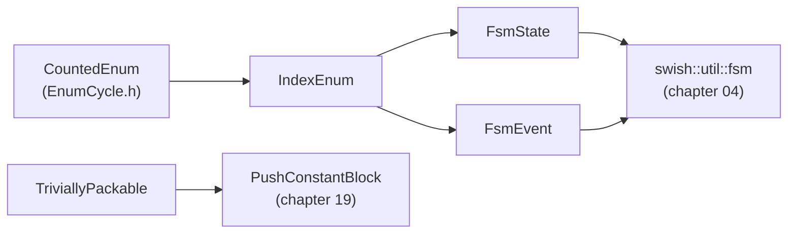

# 02 · Type traits, `if constexpr` and concepts

> Drafted with AI assistance (Claude); owner review pending. Series map: [00-index.md](00-index.md).

**Phase branch:** `refactor/02-concepts` · **Behaviour:** preserving (compile-time only)

## 1. Concept

Four tools, from oldest to newest:

| Tool | What it is | Answers |
|------|-----------|---------|
| **Type trait** (`<type_traits>`) | a template that maps a type to a compile-time value: `std::is_enum_v<E>`, `std::is_trivially_copyable_v<T>`, `std::underlying_type_t<E>` | "is this type X?" as a `bool` |
| **`if constexpr`** | an `if` whose condition is a constant; inside a template the branch not taken is **discarded** and never instantiated | "do something different for this kind of type" in one function body |
| **Concept** | a named, reusable `bool` predicate on types, declared with `concept` | "which types may call this?" |
| **`requires`** | a *requires-clause* (`requires C<T>`) attaches a constraint to a template; a *requires-expression* (`requires (T t) { t.f(); }`) tests whether code would compile | "does this expression make sense for T?" |

A concept is checked **before** the template body is touched. If it fails, the template drops out of overload
resolution and the error says which constraint was not satisfied. A concept made from other concepts **subsumes**
them, so an overload constrained on the more specific concept wins over the general one.

```cpp
#include <cstddef>
#include <cstdint>
#include <type_traits>
#include <utility>
template <class E>
concept Counted = std::is_scoped_enum_v<E> && requires { E::Count; };
template <class T>
concept Packable = std::is_trivially_copyable_v<T> && std::is_standard_layout_v<T>;
template <Counted E>
constexpr auto count() noexcept { return std::to_underlying(E::Count); }
template <class T>
    requires Packable<T>
constexpr std::size_t push_bytes(const T&) noexcept {
    if constexpr (std::is_empty_v<T>) return 0;  // the other branch is never instantiated for empty T
    else return sizeof(T);
}
enum class Mode : std::uint8_t { A, B, Count };
struct NoPush {};
struct Virt { virtual ~Virt() = default; };
static_assert(count<Mode>() == 2 && push_bytes(NoPush{}) == 0 && push_bytes(1.0f) == 4);
static_assert(Packable<NoPush> && !Packable<Virt> && !Counted<int>);
int main() {}
```

### Three ways to reject a type (only two are allowed here)

```cpp
// (a) Concept: rejected at the call site, before the body; the template leaves the overload set.
template <TriviallyPackable T> void upload(const T& v);

// (b) static_assert in the body: the template is chosen first, then the build stops with your message.
template <class T> void upload(const T& v) { static_assert(std::is_trivially_copyable_v<T>, "..."); }

// (c) enable_if / SFINAE: for contrast only. Do not write this in Swish.
template <class T, std::enable_if_t<std::is_trivially_copyable_v<T>, int> = 0> void upload(const T& v);
```

| | Concept | `static_assert` in body | `enable_if` (SFINAE) |
|---|---------|-------------------------|----------------------|
| Removes the overload | yes | no: a type "looks callable" to `std::is_invocable` and `requires`, then fails | yes |
| Overloads ordered by specificity | yes (subsumption) | n/a | no: two `enable_if`s with overlapping conditions are ambiguous |
| Error message | "constraints not satisfied: ... because `Packable<V>` evaluated to false" | your literal | pages of "no type named `type`" |
| Readable at the declaration | yes | only if you open the body | the constraint hides in a defaulted template argument |
| Use in Swish | constrain *which types may call* | state *a property of the chosen type*, with a precise message | **banned** |

**Why the repo bans SFINAE.** [DESIGN_PATTERNS.md:115](../../DESIGN_PATTERNS.md) and
[KEEPING_IT_CLEAN.md:166](../../KEEPING_IT_CLEAN.md) say it plainly: no tag hierarchies, no traits classes, no
SFINAE. With C++20 concepts the same rejection is a named, readable predicate with a usable error and correct
overload ordering. SFINAE is the hack that concepts replaced. A grep of `src/`, `tests/` and `docs/` finds no
`enable_if` or `void_t` today; keep it that way.

## 2. Where Swish is today

### `CountedEnum`: a concept with a contract half in comments

[src/utils/meta/EnumCycle.h:6-7, 22-24](../../../src/utils/meta/EnumCycle.h):

```cpp
// Units     : none. Requirement: an enumerator named `Count` that is one past the last real value,
//             and consecutive values starting at 0.
...
// `Count == 0` is rejected: next_enum would take a modulo by zero.
template <typename E>
concept CountedEnum = std::is_enum_v<E> && requires { E::Count; } && (static_cast<long long>(E::Count) > 0);
```

P0.1 (commit `33d2c03`) added the `> 0` clause and the test at
[test_meta_EnumCycle.cpp:14-16](../../../tests/utils/test_meta_EnumCycle.cpp). What the concept still does not
enforce:

- **Scoped enums only.** `std::is_enum_v` also accepts a plain `enum`, whose enumerators leak into the enclosing scope
  and convert to `int`. Both real users (`CameraMode`, `WeatherPreset`) are `enum class`, so tightening is free.
  Once `E` must be scoped, `E::Count` can only name an enumerator of `E`, so `requires { E::Count; }` is then enough.
- **The cast.** `static_cast<long long>(E::Count)` would misreport an `unsigned long long` enum above `LLONG_MAX`;
  `std::to_underlying` (C++23) compares in the enum's own type.
- **Values are consecutive from 0.** No concept can check this (it would need reflection). It stays a documented
  contract, and the doc block must say so.

Notice the parentheses around `static_cast<long long>(E::Count) > 0`: a concept's constraint is a list of *primary
expressions* joined by `&&` and `||`, so a comparison must be parenthesised. Notice also that the conjunction
short-circuits: for an `E` without `Count`, the third clause is never evaluated, so it cannot cause a hard error.

### `HasDevice`: a structural concept that keeps the layering clean

[src/utils/vulkan/DeviceHandle.h:56-61](../../../src/utils/vulkan/DeviceHandle.h):

```cpp
template <class S>
concept HasDevice = requires(const S& s) {
    { s.device } -> std::convertible_to<VkDevice>;
};

template <class H, auto Destroy, HasDevice Services = DeviceRef>
class DeviceHandle {
```

`vkx` must not include renderer headers, yet `DeviceHandle` needs `RendererServices::device`. The concept states the
*shape* it needs (any type with a `device` member convertible to `VkDevice`), and `RendererServices` satisfies it
without an include. The `{ expr } -> concept` form is a **compound requirement**: it checks the expression compiles
and that its type satisfies `std::convertible_to<VkDevice>`.

### `if constexpr` deciding at compile time whether to push

[src/renderer/Passes/FullscreenPass.h:28, 48, 65-66](../../../src/renderer/Passes/FullscreenPass.h):

```cpp
struct NoPush {};
...
template <class Push = NoPush>
class FullscreenPass : public IRenderPass {
...
            if constexpr (!std::is_empty_v<Push>)
                vkCmdPushConstants(c.cmd, d.layout, VK_SHADER_STAGE_FRAGMENT_BIT, 0, sizeof(Push), &p);
```

`sizeof(NoPush)` is 1, not 0. Without `if constexpr`, `AoBlurPass` (`FullscreenPass<NoPush>`,
[SsaoPasses.cpp:51](../../../src/renderer/Passes/SsaoPasses.cpp)) would record a pointless 1-byte
`vkCmdPushConstants`, which also breaks the 16-byte rule. A runtime `if` on `sizeof` would work too, but
`if constexpr` removes the call from that instantiation entirely.

### Traits used as "concepts by hand"

[src/utils/meta/Tags.h:31-33](../../../src/utils/meta/Tags.h) defines `is_tag_v<T>` as a `bool` variable template;
[PushConstants.h:39](../../../src/utils/vulkan/PushConstants.h) asserts `is_trivially_copyable_v<P>` in a body;
[RoadConfig.h:83](../../../src/scene/RoadScene/RoadConfig.h) and
[CorridorAsset.h:119](../../../src/scene/Corridor/CorridorAsset.h) assert `is_trivially_copyable_v` on on-disk
structs shared with Python. Binary I/O also relies on **standard layout** (fields in declaration order, no hidden
base-class reordering), which nobody asserts.

## 3. Target design

```cpp
// src/utils/meta/EnumCycle.h (tightened, same name, same users)
namespace swish::util::meta {
template <typename E>
concept CountedEnum = std::is_scoped_enum_v<E> && requires { E::Count; } && (std::to_underlying(E::Count) > 0);
}
```

```cpp
// src/utils/meta/Concepts.h (new)
#include "EnumCycle.h"   // same directory: bare name
namespace swish::util::meta {

// A scoped, counted enum with an unsigned underlying type: safe to use as an array index via std::to_underlying.
template <class E>
concept IndexEnum = CountedEnum<E> && std::is_unsigned_v<std::underlying_type_t<E>>;

template <class S> concept FsmState = IndexEnum<S>;   // the states of a swish::util::fsm machine (chapter 04)
template <class E> concept FsmEvent = IndexEnum<E>;   // the event kinds a machine reacts to (chapter 04)

// Bytes can be copied as-is and the field order is the declaration order: push blocks, UBO mirrors, on-disk structs.
template <class T>
concept TriviallyPackable = std::is_trivially_copyable_v<T> && std::is_standard_layout_v<T>;

}  // namespace swish::util::meta
```

How the concepts build on each other. An arrow between two concepts means "the right one is defined from the left
one, so it subsumes it"; the arrows into the boxes on the far right mean "used by".



## 4. Exercise

1. **Predict, then check.** For `enum Plain { A, Count };`, `enum class Signed : int8_t { A, Count };` and
   `struct S { static constexpr int Count = 3; };`, write down whether today's `CountedEnum` accepts each. Then write
   the three `static_assert`s in a scratch file and compile. (One of them surprises most people.)
2. **Tighten `CountedEnum`** in `src/utils/meta/EnumCycle.h`: scoped enums only, and compare with
   `std::to_underlying` instead of the `long long` cast. Hint: `std::is_scoped_enum_v` is C++23 `<type_traits>`;
   `std::to_underlying` is C++23 `<utility>`. Update the doc block so the remaining contract ("consecutive from 0")
   is written as a contract nobody checks.
3. **Create `src/utils/meta/Concepts.h`** with the util banner (`Purpose / Units / Complexity / Naming / Example /
   See also / Test`), `#pragma once`, namespace `swish::util::meta`. Define the four concepts in section 3. Build
   `FsmState` and `FsmEvent` *from* `IndexEnum` (do not repeat the traits) so subsumption works.
4. **Give `TriviallyPackable` one real user.** Replace the `is_trivially_copyable_v` asserts at `RoadConfig.h:83` and
   `CorridorAsset.h:119` with `static_assert(util::meta::TriviallyPackable<...>)`. Keep the `sizeof` asserts next to
   them. Hint: `RoadConfig` is `#pragma pack(push, 1)`; packing does not affect standard layout.
5. **Compare the three styles.** In a scratch file (not committed), write `upload(const T&)` three ways as in
   section 1, call each with `Virt`, and paste the three AppleClang errors into your notes. Then try two overloads
   `f(TriviallyPackable auto)` and `f(PushLike auto)` where `PushLike` is `TriviallyPackable<T> && sizeof(T) % 16 == 0`:
   which wins for a 16-byte struct, and why?
6. **Doc and build wiring:** add a `Concepts.h` row to the `meta/` section of `src/utils/README.md`, and add
   `test_meta_Concepts.cpp` to `tests/utils/CMakeLists.txt`.
7. `make format`, then run the gate.

## 5. Tests you must turn green

**`tests/utils/test_meta_Concepts.cpp`** (in `swish_utils_tests`, tag `[concepts]`). Most of the checking is
`static_assert` at namespace scope; each `TEST_CASE` also checks the same facts at runtime so ctest reports them.

| `TEST_CASE` | Asserts |
|-------------|---------|
| `IndexEnum accepts a counted scoped enum with an unsigned base` | `enum class Ok : uint8_t { A, B, Count }` satisfies `IndexEnum`, `FsmState`, `FsmEvent`, `CountedEnum` |
| `IndexEnum rejects a signed base` | `enum class Signed : int8_t { A, Count }` satisfies `CountedEnum` but fails `IndexEnum` |
| `CountedEnum rejects plain enums and non-enums` | `enum Plain { A, Count }`, `struct S { static constexpr int Count = 3; }` and `int` all fail (the plain enum passes today: this is the tightening) |
| `CountedEnum rejects a missing or empty Count` | an `enum class` without `Count`, and `enum class E : uint8_t { Count = 0 }`, fail |
| `CameraMode and WeatherPreset still satisfy CountedEnum` | both real enums still pass after the tightening (and `test_meta_EnumCycle.cpp` stays green unchanged) |
| `TriviallyPackable accepts POD mirrors and empty tags` | a struct of four floats, `Vec4`, an empty struct, `swish::vkx::DeviceRef` |
| `TriviallyPackable rejects virtual and mixed access types` | a type with a virtual destructor; `class Mixed { public: int a; private: int b; };` (not standard layout) |
| `A subsuming concept wins overload resolution` | with `f(TriviallyPackable auto)` returning 1 and `f(PushLike auto)` returning 2, a 16-byte struct calls the second, an 8-byte struct the first |

`static_assert`s that must hold in the production headers:

```cpp
static_assert(swish::util::meta::CountedEnum<swish::CameraMode>);
static_assert(swish::util::meta::CountedEnum<swish::WeatherPreset>);
static_assert(swish::util::meta::TriviallyPackable<swish::RoadConfig>);       // RoadConfig.h
static_assert(swish::util::meta::TriviallyPackable<swish::CorridorHeader>);   // CorridorAsset.h
```

If `Vec4` is not `TriviallyPackable`, that is a finding about the GLM configuration, not a reason to weaken the
concept. Report it.

## 6. Gate

```sh
make test
make test-debug
(cd build/shaders && shasum -a 256 -c ../../tests/golden/release_spv.sha256)   # 33 OK
./build/tests/swish_tests "[golden]"
./build/tests/utils/swish_utils_tests "[concepts],[enumcycle],[tags]"
make check
make format-check
```

Chapter-specific checks:

- No runtime behaviour changes: the production edits are a tightened concept, a new header and two asserts.
  Concepts and `static_assert`s emit no code.
- Arch GCC builds and passes `swish_utils_tests`. GCC and Clang word concept failures differently; the tests use
  `static_assert(!C<T>)`, never the text of a diagnostic.

## 7. Pitfalls

- **A requires-expression outside a template is not a test.** `static_assert(!requires(Virt v) { upload(v); })` with
  concrete types makes the program ill-formed instead of yielding `false`. Wrap it in a concept
  (`template <class T> concept Uploadable = requires(T v) { upload(v); };`) and assert `!Uploadable<Virt>`.
- **Subsumption only sees named concepts.** Two concepts that both spell out `std::is_trivially_copyable_v<T> && ...`
  do not subsume each other, even when one is clearly stronger; the overloads become ambiguous. Build the specific
  concept from the general one by name.
- **`if constexpr` discards only inside a template.** In an ordinary function both branches must compile.
- **`RoadConfig.h` is also compiled into `tools/toml_baker`** ([CMakeLists.txt:195-197](../../../CMakeLists.txt):
  `cxx_std_23`, include root `src/`). `Concepts.h` must stay std-only (no GLM, no Vulkan) or the baker stops
  building when `RoadConfig.h` includes it.
- **C++23 library parts need a new enough standard library.** `std::is_scoped_enum` and `std::to_underlying` are in
  libc++ (AppleClang 21) and libstdc++ (GCC 11+). Check `__cpp_lib_is_scoped_enum` and `__cpp_lib_to_underlying` if a
  CI image is old.
- **`std::is_trivial` is deprecated in C++26.** Use `is_trivially_copyable` (what binary copying needs) plus
  `is_standard_layout` (what field order needs), which is exactly `TriviallyPackable`.

## 8. Solution

<details><summary>Solution</summary>

_Written after you finish the exercise (or ask for it)._

</details>

## 9. Further reading

- [Constraints and concepts](https://en.cppreference.com/w/cpp/language/constraints)
- [Requires expression](https://en.cppreference.com/w/cpp/language/requires)
- [`if constexpr` (the `if` statement)](https://en.cppreference.com/w/cpp/language/if)
- [`<type_traits>`](https://en.cppreference.com/w/cpp/header/type_traits)
- [`std::is_scoped_enum`](https://en.cppreference.com/w/cpp/types/is_scoped_enum)
- [`std::to_underlying`](https://en.cppreference.com/w/cpp/utility/to_underlying)
- [SFINAE (background only)](https://en.cppreference.com/w/cpp/language/sfinae)
