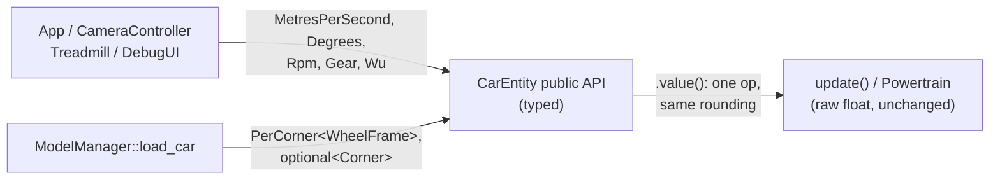

# 03 · Strong types: `Quantity<Tag>`, `Gear`, `Corner`

> Drafted with AI assistance (Claude); owner review pending. Series map: [00-index.md](00-index.md).

**Phase branch:** `refactor/03-strong-types` · **Behaviour:** preserving. **Gate:** the car trajectory is
**bit-identical**, not just inside the golden's tolerance. **Needs first:** P0.4 (the test seam), chapter 02.

## 1. Concept

A **strong type** wraps a primitive so the compiler can tell two meanings apart. `float` metres and `float` seconds
are the same type, so `distance + time` compiles. `Metres` and `Seconds` are different types, so it does not.

| Ingredient | Why |
|------------|-----|
| `explicit` constructor | `Metres m = 3.0f;` does not compile; `Metres m{3.0f};` does. No silent entry |
| No implicit way out | read the number with `.value()`; there is no `operator float()` |
| Only the operations that make sense | same-tag `+` `-`, scaling by a plain `float`, comparison; a same-tag ratio is a plain `float` |
| Zero cost | one `float`, all `constexpr`, trivially copyable, `sizeof(Metres) == sizeof(float)` |
| Phantom tag (`Quantity<struct metre>`) | the tag is never defined or used; it only makes `Quantity<metre>` and `Quantity<second>` different types |

Two C++23 helpers make this neater. **Deducing `this`** (an explicit object parameter):
`auto& operator+=(this auto& self, Quantity o)` is one function where you used to write const and non-const
overloads or a CRTP base; `self` is the object, so members are reached as `self.m_v`. **`std::to_underlying(e)`**:
an enum's value in its underlying type, without spelling that type in a `static_cast`; it is how a `Corner` becomes
an array index.

```cpp
#include <compare>
#include <type_traits>
template <class Tag>
class Quantity {
public:
    constexpr Quantity() noexcept = default;
    constexpr explicit Quantity(float v) noexcept : m_v(v) {}
    [[nodiscard]] constexpr float value() const noexcept { return m_v; }
    constexpr auto& operator+=(this auto& self, Quantity o) noexcept { self.m_v += o.m_v; return self; }
    friend constexpr Quantity operator+(Quantity a, Quantity b) noexcept { return a += b; }
    constexpr auto operator<=>(const Quantity&) const noexcept = default;
private:
    float m_v = 0.0f;
};
using Metres  = Quantity<struct metre>;
using Seconds = Quantity<struct second>;
template <class A, class B> concept Addable = requires(A a, B b) { a + b; };
static_assert(Addable<Metres, Metres> && !Addable<Metres, Seconds> && !Addable<Metres, float>);
static_assert(!std::is_convertible_v<float, Metres> && !std::is_convertible_v<Metres, float>);
static_assert(sizeof(Metres) == sizeof(float) && std::is_trivially_copyable_v<Metres>);
static_assert((Metres{1.0f} + Metres{2.0f}).value() == 3.0f);
int main() {}
```

## 2. Where Swish is today

### Units ride in the name, not the type

[src/scene/Entity/CarEntity.h:31-35](../../../src/scene/Entity/CarEntity.h):
```cpp
    float get_speed() const { return m_forward_speed; }
    // Speed in SI. Callers outside this class shouldn't have to know WORLD_SCALE —
    // kWorldUnitsPerMeter is private, and duplicating the literal at call sites is
    // how unit bugs get in (see the Phase-B draw-offset double-conversion).
    float get_speed_mps() const { return m_forward_speed / kWorldUnitsPerMeter; }
```

Two getters, both `float`, one in WU/s and one in m/s. The comment records a real past bug (a value converted twice).
The rest of the public API is the same: `get_steering_angle()` / `set_steering_angle(float deg)` (`:39-44`, degrees),
`get_engine_rpm()` (`:90-93`), `set_road_bounds(float, float)` (`:26-29`, WU). The conversions themselves are raw
`float` functions in [Units.h:28-31](../../../src/utils/units/Units.h) (`m()`, `ft()`, `to_m()`, `to_ft()`).

### The top gear is a magic `6`

[src/scene/Entity/Powertrain.h:158-164, 171, 182](../../../src/scene/Entity/Powertrain.h):
```cpp
inline int gear_for_speed(float v, const GearboxParams& g, float rWheel) {
    for (int i = 0; i < 6; ++i) { ... }
    return 6;  // top gear
}
...
    int   gear       = 0;     // 0 = 1st ... 6 = 7th
...
        if (rpm >= g.upshiftRpm && state.gear < 6) {
```

`ratios` is `std::array<float, 7>` (`:105`). Three literals must agree with it, and `CarEntity::get_gear()`
(`CarEntity.h:83`) hands out a bare 0-based `int` that the debug UI relabels ([DebugUI.cpp:264](../../../src/debug/DebugUI.cpp)).
Chapter 01 pinned `kGearCount == 7`; this chapter removes the `6`.

### Corners are integers with a `-1` sentinel

| Site | Code |
|------|------|
| [CarEntity.h:96-101](../../../src/scene/Entity/CarEntity.h) | `// Loader-recovered per-corner pivot frames (0 FL · 1 FR · 2 BL · 3 BR).` then `set_wheel_frames(const std::array<WheelFrame, 4>&)` |
| [CarEntity.h:214-216](../../../src/scene/Entity/CarEntity.h) | `return m_wheels_valid ? m_wheel_frames[2].radius : kFallbackRearRadiusM;  // 2 = BL (rear)` |
| [CarEntity.cpp:330, 343-345](../../../src/scene/Entity/CarEntity.cpp) | `const bool front = c < 2;` and the anti-roll partner `(c % 2 == 0) ? c + 1 : c - 1` |
| [ModelManager.cpp:327-329](../../../src/scene/ModelManager/ModelManager.cpp) | `CornerAccum wheel_corners[4];  // 0 FL · 1 FR · 2 BL · 3 BR` and `corner_of = ... (t.z > 0.f ? 0 : 2) + (t.x > 0.f ? 0 : 1)` |
| [ModelManager.cpp:447, 541](../../../src/scene/ModelManager/ModelManager.cpp) | `sm.wheel_corner = static_cast<int8_t>(c);` and the failure path `sm.wheel_corner = -1;` |
| [SceneTypes.h:240-245](../../../src/scene/SceneTypes.h) | `int8_t wheel_corner = -1;` "(0 FL · 1 FR · 2 BL · 3 BR, −1 = not wheel-related)" |
| [CarEntity.cpp:482-485](../../../src/scene/Entity/CarEntity.cpp) | `s.wheel_corner >= 0` then `wheelM[s.wheel_corner]` |

The encoding (index order, which index is "rear", what `-1` means, how the partner is found) is repeated in comments
in four files. The code calls the rear corners `BL`/`BR`; this chapter names them `RL`/`RR` in the type.

**The reverse intent is a `bool`:** [CarEntity.h:202](../../../src/scene/Entity/CarEntity.h)
`bool m_reverse = false;`, set at [CarEntity.cpp:21-28](../../../src/scene/Entity/CarEntity.cpp) and branched on at
`:124`. A `bool` named for one of two directions.

### Why strong types stop at the API (the FMA rule)

On arm64 Clang fuses `a * b + c` written **in one expression** into a single fused multiply-add, which rounds once:

$$
\operatorname{fma}(a,b,c) = \operatorname{round}(a b + c) \;\neq\; \operatorname{round}(\operatorname{round}(a b) + c)
\quad\text{(in general)}.
$$

Write the same maths through `Quantity` operators and the multiply and the add happen in two different inline
functions. They are no longer one source expression, so Clang does not fuse them, and the last bit can change. The
mesh goldens hash every vertex, which is why they are bound to Release + Clang today
([tests/README.md](../../../tests/README.md), "Golden tests"). So:

- **Inside** mesh generators and the `CarEntity::update` hot loop: raw `float`, untouched.
- **At** module APIs (`CarEntity` getters and setters, `Units.h` conversions): `Quantity`, where each wrapper is a
  single operation (`m_forward_speed / kWuPerMetre`) that rounds exactly as the raw code does.



## 3. Target design

```cpp
// src/utils/units/Quantity.h (new, header-only, std only)
namespace swish::util::units {
namespace dim { struct wu; struct metre; struct metre_per_second; struct second; struct radian; struct degree; struct rpm; }
template <class Tag>
class Quantity {
public:
    using tag = Tag;
    constexpr Quantity() noexcept = default;
    constexpr explicit Quantity(float v) noexcept;
    [[nodiscard]] constexpr float value() const noexcept;
    constexpr auto& operator+=(this auto& self, Quantity o) noexcept;   // and -=
    constexpr auto& operator*=(this auto& self, float k) noexcept;      // and /=
    friend constexpr Quantity operator+(Quantity a, Quantity b) noexcept;  // and binary -, unary -
    friend constexpr Quantity operator*(Quantity a, float k) noexcept;     // and float * Quantity, Quantity / float
    friend constexpr float    operator/(Quantity a, Quantity b) noexcept;  // same-tag ratio is dimensionless
    constexpr auto operator<=>(const Quantity&) const noexcept = default;
private:
    float m_v = 0.0f;
};
using Wu = Quantity<dim::wu>;               using Metres  = Quantity<dim::metre>;
using MetresPerSecond = Quantity<dim::metre_per_second>;  using Seconds = Quantity<dim::second>;
using Radians = Quantity<dim::radian>;      using Degrees = Quantity<dim::degree>;  using Rpm = Quantity<dim::rpm>;
}  // namespace swish::util::units
```

```cpp
// src/utils/units/Units.h (additions: the ONLY place a value changes tag)
namespace swish::util::units {
[[nodiscard]] constexpr Wu      to_wu(Metres x) noexcept;      // same rounding as m(x.value())
[[nodiscard]] constexpr Metres  to_metres(Wu x) noexcept;      // same rounding as to_m(x.value())
[[nodiscard]] constexpr Radians to_radians(Degrees x) noexcept;  // bit-identical to glm::radians(x.value())
[[nodiscard]] constexpr Degrees to_degrees(Radians x) noexcept;  // bit-identical to glm::degrees(x.value())
}
```

```cpp
// src/scene/Entity/Powertrain.h
namespace swish {
class Gear {
public:
    constexpr explicit Gear(u8 index) noexcept;               // 0 = 1st
    [[nodiscard]] static constexpr Gear first() noexcept;
    [[nodiscard]] constexpr u8   index() const noexcept;
    [[nodiscard]] constexpr int  number() const noexcept;      // 1 = 1st, for display
    [[nodiscard]] constexpr Gear up() const noexcept;           // caller checks against top_gear()
    [[nodiscard]] constexpr Gear down() const noexcept;         // caller checks against first()
    constexpr auto operator<=>(const Gear&) const noexcept = default;
private:
    u8 m_index = 0;
};
[[nodiscard]] constexpr Gear top_gear(const GearboxParams& g) noexcept;  // from g.ratios.size(), not a literal
}
```

```cpp
// src/scene/Entity/Corner.h (new topic header, next to Powertrain.h / WheelKinematics.h)
namespace swish {
enum class Corner : u8 { FL, FR, RL, RR, Count };   // index order = today's 0 FL, 1 FR, 2 BL, 3 BR
inline constexpr std::array<Corner, 4> kCorners{Corner::FL, Corner::FR, Corner::RL, Corner::RR};
[[nodiscard]] constexpr bool   is_front(Corner c) noexcept;
[[nodiscard]] constexpr bool   is_left(Corner c) noexcept;
[[nodiscard]] constexpr Corner axle_partner(Corner c) noexcept;          // FL<->FR, RL<->RR
[[nodiscard]] constexpr Corner make_corner(bool front, bool left) noexcept;
template <class T>
struct PerCorner {
    std::array<T, 4> v{};
    [[nodiscard]] constexpr auto& operator[](this auto& self, Corner c) noexcept;  // T& or const T&
    [[nodiscard]] constexpr auto begin(this auto& self) noexcept;                  // and end()
};
enum class Direction : u8 { Forward, Reverse };    // the driver's commanded longitudinal direction
}
```

The `CarEntity` public API after this chapter (bodies unchanged apart from the wrap and unwrap):

```cpp
void set_road_bounds(units::Wu min_x, units::Wu max_x);
[[nodiscard]] units::MetresPerSecond get_speed_mps() const;
[[nodiscard]] units::Degrees get_steering_angle() const;   void set_steering_angle(units::Degrees angle);
static constexpr units::Degrees steer_max();
[[nodiscard]] Gear       get_gear() const;
[[nodiscard]] units::Rpm get_engine_rpm() const;
void set_wheel_frames(const PerCorner<WheelFrame>& frames);
float get_speed() const;   // stays raw WU/s this chapter: WU/s is not one of the seven tags (decide in review)
```

`Submesh::wheel_corner` ([SceneTypes.h:245](../../../src/scene/SceneTypes.h)) becomes `std::optional<Corner>`, so
"not a wheel" is `std::nullopt` instead of `-1`.

## 4. Exercise

1. **`Quantity.h`.** Create `src/utils/units/Quantity.h` with the util banner. Precision line in the banner: "each
   operator is exactly one float operation; never use `Quantity` inside mesh generators or hot loops". Hint: the
   compound assignments use deducing `this`; the binary operators are hidden friends built on them.
2. **Typed conversions in `Units.h`.** Add the four functions. Each must reuse the existing raw expression
   (`m()`, `to_m()`) so rounding is identical. For degrees and radians, today's call sites use `glm::radians`; your
   function must give the same bits (the test sweeps it). Hint: read how GLM spells its constant.
3. **`Gear` and `top_gear`** in `Powertrain.h`. Replace the three `6`s (`:159`, `:163`, `:182`) with `top_gear(g)`
   and delete chapter 01's `kGearCount == 7` assert in the same change. `GearState::gear` stays an `int` (chapter 05
   replaces `GearState`); convert at `CarEntity::get_gear()`.
4. **`Corner.h`.** Hint: `make_corner` must reproduce `ModelManager.cpp:329` exactly (index 0 when `t.z > 0` and
   `t.x > 0`). Work out which sign test means `front` and which `left`, and confirm with the names the loader prints
   at `ModelManager.cpp:548-556`.
5. **Use `Corner` in the loader:** `PerCorner<CornerAccum>`, `std::optional<Corner>`, `std::nullopt` on failure.
   Keep the printed `"BL"` / `"BR"` in this phase (the log is not a contract, but this is a refactor).
6. **Type the `CarEntity` API** (section 3) and fix the callers: `App.cpp:186-193`, `Treadmill.cpp:59,129`,
   `CorridorDriver.cpp:52`, `DebugUI.cpp:264`, the golden test (through the P0.4 accessor). In `CarEntity.cpp`, unwrap
   with `.value()` at the top of a function and leave the arithmetic alone.
7. **Indexing-only corner arithmetic:** `CarEntity.cpp:330` (`is_front`), `:345` (`axle_partner`), `:395-396` and
   `:482-485` (`PerCorner<Mat4>`, `optional<Corner>`). Do not touch a line that computes a float.
8. **`Direction`** replaces `bool m_reverse`; the branch at `CarEntity.cpp:124` becomes a comparison. (Chapter 07's
   `DriveIntent` will carry it in from input.) Then the `static_assert`s (section 5), `make format`, the gate.

## 5. Tests you must turn green

**`tests/utils/test_units_Quantity.cpp`** (in `swish_utils_tests`, tags `[units][quantity]`):

| `TEST_CASE` | Asserts |
|-------------|---------|
| `Quantity arithmetic matches raw float bit for bit` | for a sweep of value pairs (including negatives, subnormals and large WU values): `std::bit_cast<u32>((Metres{a} + Metres{b}).value()) == std::bit_cast<u32>(a + b)`; same for `-`, `* k`, `/ k`, unary `-` |
| `Quantity ratio of the same tag is a plain float` | `Metres{6.f} / Metres{3.f}` has type `float` and equals `2.f` |
| `Quantity compares like its value` | `<`, `==`, `>` agree with the raw floats over the sweep |
| `Typed conversions match the raw Units helpers` | `to_wu(Metres{x}).value()` bit-equals `m(x)`; `to_metres(Wu{x}).value()` bit-equals `to_m(x)` |
| `Degree and radian conversions match glm bit for bit` | for `d` from -720 to 720 in steps of 0.25: `to_radians(Degrees{d}).value()` bit-equals `glm::radians(d)`, and the same for `to_degrees` |

**`tests/test_car_strong_types.cpp`** (in `swish_tests`; list it in `tests/CMakeLists.txt`):

| `TEST_CASE` | Tags | Asserts |
|-------------|------|---------|
| `Corner order matches the legacy indices` | `[car][corner]` | `std::to_underlying(kCorners[i]) == i`; `is_front` equals `i < 2`; `axle_partner` index equals `(i % 2 == 0) ? i + 1 : i - 1` |
| `make_corner reproduces the loader corner_of` | `[car][corner]` | the four sign combinations give the same index as a hand copy of `ModelManager.cpp:329` |
| `PerCorner indexes by Corner and keeps array layout` | `[car][corner]` | writes through `operator[]` land in `v[to_underlying(c)]`; const access compiles and returns `const T&` |
| `top_gear comes from the ratio table` | `[car][gear]` | `top_gear(GearboxParams{}).index() == 6` |
| `gear_for_speed is unchanged by top_gear` | `[car][gear]` | for v from 0 to 95 m/s in 0.01 steps, the new `gear_for_speed` equals a hand copy of the legacy function |
| `CarEntity typed getters return the raw values` | `[car]` | after 300 updates at full throttle: `get_speed_mps().value()` bit-equals `get_speed() / kWuPerMetre`; `get_steering_angle()` round-trips `set_steering_angle` |

**Bit-identity probe (Claude adds it before you start).** The golden compares with a tolerance of `1e-3` abs +
`1e-3` rel ([tests/golden/README.md](../../../tests/golden/README.md)), so passing it does not prove bit-identity.
`TEST_CASE("Car trajectory bit hash is unchanged", "[golden][car][bitexact]")` in `tests/test_golden_car.cpp` runs the
four scenarios, hashes the raw bits of every state float each step (FNV-1a over `std::bit_cast<u32>`), and compares
with a hash recorded on the phase branch **before** your first edit. Like the mesh hashes, it is Clang-only.

`static_assert`s that must hold:

```cpp
namespace uu = swish::util::units;
static_assert(sizeof(uu::Metres) == sizeof(float) && alignof(uu::Metres) == alignof(float));
static_assert(swish::util::meta::TriviallyPackable<uu::Rpm>);             // chapter 02
static_assert(!std::is_convertible_v<float, uu::Wu> && !std::is_convertible_v<uu::Wu, float>);
static_assert(std::is_same_v<decltype(uu::Metres{} / uu::Metres{}), float>);
static_assert(sizeof(swish::PerCorner<float>) == 4 * sizeof(float));
static_assert(std::is_trivially_copyable_v<swish::PerCorner<swish::WheelFrame>>);
static_assert(swish::util::meta::CountedEnum<swish::Corner>);
static_assert(swish::top_gear(swish::GearboxParams{}) == swish::Gear{6});
```

## 6. Gate

```sh
make test
make test-debug
(cd build/shaders && shasum -a 256 -c ../../tests/golden/release_spv.sha256)   # 33 OK
./build/tests/swish_tests "[golden]"            # tolerance goldens AND the new [bitexact] hash
./build/tests/swish_tests "[car]"
./build/tests/utils/swish_utils_tests "[quantity]"
make check
make format-check
git status --porcelain tests/golden             # must print nothing
```

Chapter-specific checks:

- `[golden][car][bitexact]` green on AppleClang Release. If it fails, a float changed (usually a `Quantity` that
  slipped inside an expression): find it, do not move the hash. The mesh goldens must not move at all.
- `make debug`, drive for a minute: speed, gear label, rpm and the steering gizmo read as before; wheels spin and
  steer (the corner mapping is right). Arch GCC builds and the unit tests pass (the bit hash is skipped there).

## 7. Pitfalls

- **FMA contraction.** A `Quantity` inside `a * b + c` splits one expression into two calls and changes rounding.
  Keep `Quantity` at the API; unwrap once at the top of the function.
- **Deducing `this` needs Clang 18+ or GCC 14+.** Check `__cpp_explicit_this_parameter` on all three compilers in the
  gate. An explicit-object function cannot be `virtual`, `static`, or cv/ref-qualified, and there is no `this` inside
  it: write `self.m_v`.
- **`printf` and `Gear`.** The golden test prints `get_gear()` with `%d` ([test_golden_car.cpp:81-83](../../../tests/test_golden_car.cpp)).
  Passing a class to varargs is a `-Wformat` warning (an error once P0.3 puts the tests under `-Werror`) and prints
  garbage. Print `.index()`; the CSV stays the same. The same file's `get_gear() >= 1` (`:155`) needs `.index()` too.
- **Defaulted `<=>` on a `float` member returns `std::partial_ordering`** (NaN is unordered). `==` is generated
  alongside it. Comparisons against a raw `float` should not compile; that is the point.
- **`std::optional<Corner>` is 2 bytes, `int8_t` was 1.** `Submesh` is not one of the GPU mirror structs listed in
  [DESIGN_PATTERNS.md](../../DESIGN_PATTERNS.md) section 1, but check nothing `memcpy`s or hashes it first.
- **Degrees to radians.** `glm::radians` multiplies by its own double literal cast to `float`. A different constant
  (`kPi / 180.f`) can differ in the last bit; the sweep test catches it.

## 8. Solution

<details><summary>Solution</summary>

_Written after you finish the exercise (or ask for it)._

</details>

## 9. Further reading

- [Explicit object parameter (deducing `this`)](https://en.cppreference.com/w/cpp/language/member_functions#Explicit_object_member_functions)
- [`std::to_underlying`](https://en.cppreference.com/w/cpp/utility/to_underlying)
- [Default comparisons (`operator<=>`)](https://en.cppreference.com/w/cpp/language/default_comparisons)
- [`std::bit_cast`](https://en.cppreference.com/w/cpp/numeric/bit_cast)
- [`#pragma STDC FP_CONTRACT` (implementation-defined behaviour control)](https://en.cppreference.com/w/cpp/preprocessor/impl)
