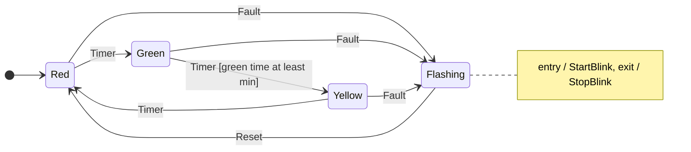
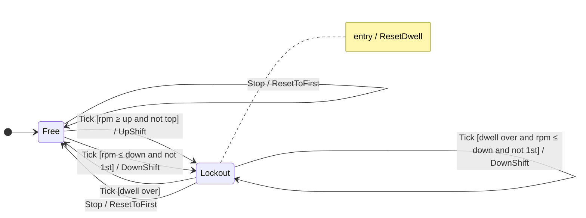

# 04 · The `swish::fsm` engine

> Drafted with AI assistance (Claude); owner review pending. Series map: [00-index.md](00-index.md).

**Phase branch:** `refactor/04-fsm-engine` · **Behaviour:** preserving (new header, no user yet) · **Needs first:**
chapter 02 (`FsmState`, `FsmEvent`). **Built test-first:** the tests exist and fail before you write a line.

In prose "`swish::fsm`"; in code `swish::util::fsm` in `src/utils/fsm/Fsm.h` (utils live in `swish::util::<topic>`).
Use a local alias: `namespace fsm = swish::util::fsm;`.

## 1. Concept

A **finite state machine** is a small vocabulary:

| Word | Meaning | In this engine |
|------|---------|----------------|
| **State** | the mode the thing is in; exactly one at a time | a value of a scoped enum `S` |
| **Event** | something that happened and that the machine may react to | a value of a scoped enum `E` |
| **Guard** | a yes/no condition that must hold for a transition to fire | `bool (*)(const Ctx&) noexcept`, reading a context snapshot |
| **Transition** | "in state `from`, on event `e`, if the guard holds, go to `to`" | one row of a `constexpr` table |
| **Action** | what should happen as a result | a value of a scoped enum `A`, **returned as data** |
| **Entry / exit action** | actions that run whenever a state is entered or left, whichever row caused it | per-state lists in the table |

The key design choice is **actions as data**. The machine never touches the cursor, the renderer or the car. `step`
takes `(state, event, context)` and returns `(new state, handled, actions)`. The owner of the machine applies the
actions. So the machine is a pure function, testable at compile time, and the side effects all happen in one place.

$$
\operatorname{step} : S \times E \times \text{Ctx} \;\longrightarrow\; S \times \{\text{handled}, \text{unhandled}\} \times A^{\le 6}
$$

The smallest table-driven machine, without guards or actions. Everything else in this chapter is this loop plus
guards, entry/exit, actions and compile-time checks on the table.

```cpp
#include <array>
#include <cstdint>
enum class Light : std::uint8_t { Red, Green, Yellow };
enum class Ev : std::uint8_t { Timer };
struct Row { Light from; Ev ev; Light to; };
inline constexpr std::array<Row, 3> kTable{{
    {Light::Red, Ev::Timer, Light::Green},
    {Light::Green, Ev::Timer, Light::Yellow},
    {Light::Yellow, Ev::Timer, Light::Red},
}};
constexpr Light step(Light s, Ev e) {
    for (const Row& r : kTable)
        if (r.from == s && r.ev == e) return r.to;
    return s;  // no row: the event is ignored
}
static_assert(step(step(step(Light::Red, Ev::Timer), Ev::Timer), Ev::Timer) == Light::Red);
int main() {}
```

### Why hand-rolled, and the alternatives

| Approach | Where the transitions live | Compile-time checks | Verdict for Swish |
|----------|---------------------------|---------------------|-------------------|
| `enum` + `switch` | spread over `case`s and nested `if`s, with side effects inline | `-Wswitch` (a missing `case`) only | what Swish has today; fine at 2 states, unreadable at 4 |
| State pattern (one class per state, `virtual` handlers) | inside each class's methods | none | heap and virtual dispatch for what is a lookup; the table is never written down |
| `std::variant` of state structs + `std::visit` | in the visitor | exhaustive visit | right when **states carry different data**: chapter 10 (`CameraController`) |
| Boost.SML | a DSL table of user-defined literals and lambdas | some | external dependency (not vendored), template-heavy errors and compile times, the table hidden behind a DSL |
| **Hand-rolled table (this chapter)** | one `constexpr std::array` of rows | duplicate, unreachable, unhandled, internal-row checks | about 200 lines you understand fully, actions as data, testable in `static_assert` |

**Hierarchy by nesting.** The engine is flat: no superstates. When something needs layers (a swapchain that is
`Ok` / `NeedsRecreate` / `Minimized` inside a running renderer), the owner holds two machines and an action of the
outer one feeds an event to the inner one. Each table stays small and checkable.

## 2. Where Swish is today

No engine exists. The machines are implicit: a state is a combination of fields, and the transitions are `if`s.

**Gearbox** ([src/scene/Entity/Powertrain.h:166-191](../../../src/scene/Entity/Powertrain.h)):
```cpp
    float sinceShift = 1e9f;  // s; large ⇒ not inside a dwell lockout
...
    state.sinceShift += dt;
    const float rpm = engine_rpm(v, state.gear, g, rWheel);
    if (state.sinceShift >= g.shiftDwell) {
        if (rpm >= g.upshiftRpm && state.gear < 6) {
```

There are two states here, "locked out" and "free to shift", and neither has a name. "Free" is encoded as a
`1e9f` sentinel in a timer. The reset to 1st at a dead stop is somewhere else entirely
([CarEntity.cpp:181](../../../src/scene/Entity/CarEntity.cpp), `m_gear_state = GearState{};`).

**Input mode** ([App.h:58, 61, 88](../../../src/core/App/App.h)): `m_first_mouse`, `m_cursor_captured` and
`m_debug_edit_mode` are three bools, 8 combinations, 3 meaningful; P0.1 fixed a desync between two of them (chapter
08). **Rain** ([App.h:77](../../../src/core/App/App.h)): `int m_rain_level = 0;` cycled with `% 3` (chapter 09).

The smell in each case: illegal combinations are representable, the transitions are not listed anywhere, and nothing
checks that every state can be reached or every input is handled.

## 3. Target design

### Rules (the semantics you implement)

1. **Match:** scan rows in declaration order. The first row with `from == current`, `event == e` and a guard that
   is null or returns true fires. Row order is priority (the gearbox's `if` / `else if` becomes two ordered rows).
2. **External row:** the result is `to`; actions are `exit(from)`, then the row's actions, then `entry(to)`. An
   external row with `to == from` (a self-transition) still runs exit and entry.
3. **Internal row:** the state does not change; actions are the row's only. No exit, no entry.
4. **No match:** `{current, handled = false, no actions}`.
5. **Start and purity:** the owner calls `enter(m)` once for the initial entry actions. `step` is `constexpr` and
   `noexcept`, reads only its arguments and writes nothing.

### Declarations

```cpp
// src/utils/meta/Concepts.h gains: template <class A> concept FsmAction = std::is_scoped_enum_v<A>;
// src/utils/fsm/Fsm.h
namespace swish::util::fsm {
using meta::FsmAction; using meta::FsmEvent; using meta::FsmState;
struct NoCtx {};                                              // for machines without guards
template <class Ctx> using Guard = bool (*)(const Ctx&) noexcept;
enum class Kind : u8 { External, Internal };

template <FsmAction A, std::size_t Cap>
class ActionList {                                            // fixed-capacity, constexpr, no allocation
public:
    constexpr ActionList() noexcept = default;
    constexpr ActionList(std::initializer_list<A> items) noexcept;   // precondition: items.size() <= Cap
    constexpr void push_back(A a) noexcept;                            // precondition: size() < Cap
    template <std::size_t C2> constexpr void append(const ActionList<A, C2>& other) noexcept;
    [[nodiscard]] constexpr std::size_t size() const noexcept;
    [[nodiscard]] constexpr bool        empty() const noexcept;
    [[nodiscard]] constexpr const A*    begin() const noexcept;   // and end()
    [[nodiscard]] constexpr A           operator[](std::size_t i) const noexcept;
    friend constexpr bool operator==(const ActionList& a, const ActionList& b) noexcept;  // first size() items only
private:
    std::array<A, Cap> m_items{};
    std::size_t        m_size = 0;
};
inline constexpr std::size_t kMaxRowActions  = 2;
inline constexpr std::size_t kMaxStepActions = 3 * kMaxRowActions;    // exit + row + entry
template <FsmAction A> using RowActions  = ActionList<A, kMaxRowActions>;
template <FsmAction A> using StepActions = ActionList<A, kMaxStepActions>;

template <FsmState S, FsmAction A>
struct StateSpec { S state; RowActions<A> on_entry{}; RowActions<A> on_exit{}; };
template <FsmState S, FsmEvent E, class Ctx, FsmAction A>
struct Transition { S from; E event; S to; Guard<Ctx> guard = nullptr; RowActions<A> actions{}; Kind kind = Kind::External; };
template <FsmState S, FsmEvent E, class Ctx, FsmAction A, std::size_t NS, std::size_t NT>
struct Machine {
    S                                        initial;
    std::array<StateSpec<S, A>, NS>          states;
    std::array<Transition<S, E, Ctx, A>, NT> transitions;
};
template <FsmState S, FsmAction A>
struct StepResult { S state; bool handled = false; StepActions<A> actions{}; };

// Builds a Machine and deduces NS and NT from the two braced lists.
template <FsmState S, FsmEvent E, class Ctx, FsmAction A, std::size_t NS, std::size_t NT>
[[nodiscard]] constexpr Machine<S, E, Ctx, A, NS, NT> make_machine(
    S initial, const StateSpec<S, A> (&states)[NS], const Transition<S, E, Ctx, A> (&rows)[NT]) noexcept;

// Every function below has the template head
//   template <FsmState S, FsmEvent E, class Ctx, FsmAction A, std::size_t NS, std::size_t NT>
// and takes `const Machine<S, E, Ctx, A, NS, NT>& m`, written `const Machine<...>& m` here.
[[nodiscard]] constexpr StepResult<S, A> step(const Machine<...>& m, S current, E event, const Ctx& ctx) noexcept;
[[nodiscard]] constexpr RowActions<A>    enter(const Machine<...>& m) noexcept;
[[nodiscard]] constexpr bool states_listed_once(const Machine<...>& m) noexcept;     // each S value has one StateSpec
[[nodiscard]] constexpr bool no_shadowed_rows(const Machine<...>& m) noexcept;       // see "duplicate rows" below
[[nodiscard]] constexpr bool all_states_reachable(const Machine<...>& m) noexcept;
[[nodiscard]] constexpr bool all_events_handled(const Machine<...>& m) noexcept;     // each E value appears in a row
[[nodiscard]] constexpr bool internal_rows_stay_put(const Machine<...>& m) noexcept; // Internal implies to == from
struct Report { bool states_listed_once, no_shadowed_rows, all_states_reachable, all_events_handled,
                internal_rows_stay_put; [[nodiscard]] constexpr bool ok() const noexcept; };
[[nodiscard]] constexpr Report validate(const Machine<...>& m) noexcept;
}  // namespace swish::util::fsm
```

### The three table checks, precisely

- **Duplicate rows.** Guards make two rows with the same `(from, event)` legal: that is how a priority list is
  written. What is never legal is an **unguarded** row followed by another row with the same key, because the later
  row can never fire. Rule: for rows $i < j$ with the same `(from, event)`, row $i$ must have a guard.
- **Unreachable states.** Start from `initial` and follow every row, ignoring guards (a guarded row *can* fire):
  $$R_0 = \{s_0\},\qquad R_{k+1} = R_k \cup \{\,t.\text{to} \mid t.\text{from} \in R_k\,\}$$
  The fixed point arrives within $|S|$ rounds. Every state must be in it.
- **Unhandled events.** Every value of `E` must appear in at least one row. An event no row mentions is either dead
  or a missing transition. (A state that ignores an event is fine; that is rule 4.)
- **Not checked:** whether guards sharing a key are mutually exclusive or cover every case. The per-machine tests
  (chapter 05's equivalence sweep) do that.

### What a user writes: the toy traffic light



```cpp
enum class Light : u8 { Red, Green, Yellow, Flashing, Count };
enum class LightEv : u8 { Timer, Fault, Reset, Count };
enum class LightAct : u8 { LampRed, LampGreen, LampYellow, StartBlink, StopBlink };
struct LightCtx { float green_s = 0.0f; float min_green_s = 5.0f; };
constexpr bool min_green_elapsed(const LightCtx& c) noexcept { return c.green_s >= c.min_green_s; }
inline constexpr auto kTrafficLight = fsm::make_machine<Light, LightEv, LightCtx, LightAct>(
    Light::Red,
    {{.state = Light::Red, .on_entry = {LightAct::LampRed}},
     {.state = Light::Green, .on_entry = {LightAct::LampGreen}},
     {.state = Light::Yellow, .on_entry = {LightAct::LampYellow}},
     {.state = Light::Flashing, .on_entry = {LightAct::StartBlink}, .on_exit = {LightAct::StopBlink}}},
    {{.from = Light::Red, .event = LightEv::Timer, .to = Light::Green},
     {.from = Light::Green, .event = LightEv::Timer, .to = Light::Yellow, .guard = min_green_elapsed},
     {.from = Light::Yellow, .event = LightEv::Timer, .to = Light::Red},
     {.from = Light::Red, .event = LightEv::Fault, .to = Light::Flashing},
     {.from = Light::Green, .event = LightEv::Fault, .to = Light::Flashing},
     {.from = Light::Yellow, .event = LightEv::Fault, .to = Light::Flashing},
     {.from = Light::Flashing, .event = LightEv::Reset, .to = Light::Red}});
static_assert(fsm::validate(kTrafficLight).ok());
```

No "from any state" wildcard in v1: the three `Fault` rows are written out until a second machine needs one.

### Preview: the gearbox machine (chapter 05)

A first sketch, not the final table. The context carries `rpm`, `since` (already advanced by `dt`) and whether the
gear is 1st or top; the gear itself stays data, changed by the owner when it applies `UpShift` / `DownShift` /
`ResetToFirst`. `Lockout`'s entry action `ResetDwell` zeroes the timer, so its self-transition re-arms it.



The `Lockout --> Lockout` rows exist because today's code can shift **in the same step** the dwell runs out
(`Powertrain.h:179-181`). Chapter 05's equivalence sweep decides whether this reproduces it and whether `Free` stays.

## 4. Exercise

1. **Read the failing tests** in `tests/utils/test_fsm_Fsm.cpp` on the phase branch: they are the specification.
   Add `FsmAction` to `src/utils/meta/Concepts.h`.
2. **Create `src/utils/fsm/Fsm.h`** with the util banner: Purpose, Units (none), Complexity (`step` is
   $O(N_T)$, `validate` is $O(N_S \cdot N_T)$, no allocation), Naming, Example (the traffic light), See also
   (this chapter, chapter 05), Test. Rooted includes only; std + `utils/` only.
3. **`ActionList` first.** Hint: the `initializer_list` constructor can loop and `push_back`. Overflow should be a
   **compile error** in constant evaluation (anything that is not a constant expression on that path does it) and
   a loud failure at runtime; `if consteval` lets the two branches react differently.
4. **`make_machine`, then `step`, then `enter`.** Hint: check `guard == nullptr` before calling it. Build the
   result with `append` in the order of rule 2. Find a state's spec by scanning `states` (or index by
   `std::to_underlying` once `states_listed_once` holds).
5. **The validators, one per test, then `validate`.** Hint: a visited set is
   `std::array<bool, util::meta::enum_count<S>()>`, indexed with `std::to_underlying`.
6. **Wire it up:** an `fsm/` row in the Layout table of `src/utils/README.md`; `test_fsm_Fsm.cpp` in
   `tests/utils/CMakeLists.txt`.
7. **On paper:** write the gearbox preview as rows. Mark which rows share a key and the order they must appear in.
   Bring it to chapter 05.

## 5. Tests you must turn green

**`tests/utils/test_fsm_Fsm.cpp`** (in `swish_utils_tests`, tag `[fsm]`). The test file defines the traffic light
above plus small deliberately broken tables.

| `TEST_CASE` | Asserts |
|-------------|---------|
| `ActionList keeps order and capacity` | `push_back` and the list constructor keep insertion order; `size`, `empty`, iteration; `==` ignores unused slots |
| `step on an unguarded row moves and returns exit then row then entry actions` | `Flashing` + `Reset` gives `Red`, handled, actions `[StopBlink, LampRed]` |
| `step takes the first row whose guard passes` | with two guarded rows on one key, ordering decides which fires; swapping the guard results changes the target |
| `step with every guard false is unhandled` | `Green` + `Timer` with `green_s < min_green_s`: state `Green`, `handled == false`, no actions |
| `step on an event with no row is unhandled` | `Red` + `Reset`: unchanged, unhandled, no actions |
| `internal row skips exit and entry` | an `Internal` row returns only its own actions and keeps the state |
| `external self transition runs exit then entry` | in a variant table with an external `Flashing --Fault--> Flashing` row: `[StopBlink, StartBlink]` |
| `enter returns the initial entry actions` | `enter(kTrafficLight) == {LampRed}` |
| `validate flags a shadowed duplicate row` | an unguarded row followed by a same-key row: `no_shadowed_rows` false; a guarded-then-unguarded pair is accepted |
| `validate flags an unreachable state` | a table with no row into `Yellow`: `all_states_reachable` false |
| `validate flags an event no row handles` | a table without `Reset` rows: `all_events_handled` false |
| `validate flags a bad state list or a moving internal row` | a state listed twice, a state missing: `states_listed_once` false; an `Internal` row with `to != from`: `internal_rows_stay_put` false |
| `traffic light cycles at runtime like at compile time` | a runtime loop of `Timer` events (with the guard satisfied) visits Red, Green, Yellow, Red |

`static_assert`s that must hold (in the test file):
```cpp
static_assert(fsm::step(kTrafficLight, Light::Red, LightEv::Timer, LightCtx{}).state == Light::Green);
static_assert(!fsm::step(kTrafficLight, Light::Red, LightEv::Reset, LightCtx{}).handled);
static_assert(!fsm::validate(kShadowedTable).no_shadowed_rows);
static_assert(std::is_trivially_copyable_v<fsm::StepResult<Light, LightAct>>);
static_assert(util::meta::FsmState<Light> && util::meta::FsmEvent<LightEv> && util::meta::FsmAction<LightAct>);
```

## 6. Gate

```sh
make test
make test-debug
(cd build/shaders && shasum -a 256 -c ../../tests/golden/release_spv.sha256)   # 33 OK
./build/tests/swish_tests "[golden]"
./build/tests/utils/swish_utils_tests "[fsm]"
make check
make format-check
```

Chapter-specific checks: `Fsm.h` includes only std and `utils/` headers (review); nothing outside `utils/` and the
test includes it yet (the first user is chapter 05); Arch GCC builds and `[fsm]` passes there. GCC is the compiler
most likely to reject a constant-evaluation corner that Clang accepts.

## 7. Pitfalls

- **Guards must be capture-free.** Only a non-capturing lambda (or a function) converts to `bool (*)(const Ctx&)
  noexcept`, and it must itself be `noexcept` or the conversion fails. Put data in `Ctx`, not in a capture.
- **Prefer named guard functions in headers.** A lambda in an `inline constexpr` table is allowed, but a named
  `constexpr` function is testable on its own and avoids closure-mangling differences between compilers.
- **Calling a null function pointer** is a compile error in constant evaluation and undefined behaviour at runtime.
  Check before calling.
- **No CTAD for `Machine`.** Class template argument deduction does not see through nested braced arrays; use
  `make_machine` (which deduces `NS`, `NT`) or spell the `Machine<...>` type.
- **`inline constexpr` for tables in headers.** `static constexpr` at namespace scope gives every translation unit
  its own copy; `inline constexpr` gives one object (one address everywhere). Use `inline constexpr`.
- **Include what you use.** libc++ often pulls `<initializer_list>` in transitively; libstdc++ may not. Include it
  explicitly or Arch GCC fails where AppleClang compiles.

## 8. Solution

<details><summary>Solution</summary>

_Written after you finish the exercise (or ask for it)._

</details>

## 9. Further reading

- [`constexpr` specifier](https://en.cppreference.com/w/cpp/language/constexpr)
- [`if consteval`](https://en.cppreference.com/w/cpp/language/if#Consteval_if)
- [Lambda expressions (conversion to function pointer)](https://en.cppreference.com/w/cpp/language/lambda)
- [`inline` specifier (inline variables)](https://en.cppreference.com/w/cpp/language/inline)
