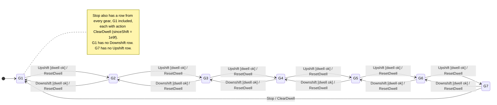
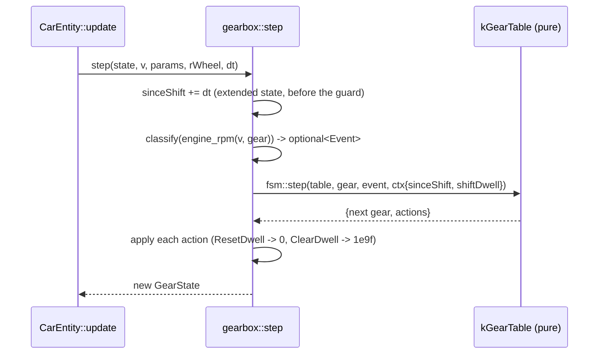

# 05: The gearbox as the first `swish::fsm` user

**Label:** Largely AI-generated (Claude). Every anchor below was checked against the code at `33d2c03`. Please review.
If this page and the code disagree, the code wins: fix this page. Map and prerequisites: [00-index.md](00-index.md).

**Prerequisites:** Ch01 (`GearboxParams` invariants as `static_assert`), Ch03 (strong `Gear`, top gear from
`ratios.size()`), Ch04 (the `swish::fsm` engine in `src/utils/fsm/Fsm.h`).
**Branch:** `refactor/05-gearbox-fsm`. **Kind:** refactor phase, so behaviour must not change.

---

## 1. Concept

A state machine you build to *replace* existing code has to do exactly what that code did. The method is
**differential testing**: keep the old function, write the new one next to it, then run both over a dense grid of
inputs and require the outputs to be **equal, bit for bit**. Delete the old function only after that sweep is
green.

Four things move into the table:

| Old code | FSM term |
|----------|----------|
| the `int gear` field | **state** |
| "rpm crossed a threshold" | **event** (worked out from the inputs each step) |
| `sinceShift >= shiftDwell`, gear bounds | **guard**, or simply no row |
| `sinceShift = 0` | **action** (returned as data, run by the owner) |

```cpp
#include <array>
#include <cassert>
#include <optional>
enum class Heat { Off, On };
enum class Ev { TooCold, TooHot };
struct Row { Heat from; Ev on; Heat to; };
constexpr std::array kTable{Row{Heat::Off, Ev::TooCold, Heat::On}, Row{Heat::On, Ev::TooHot, Heat::Off}};
constexpr std::optional<Ev> classify(float t) {
    if (t < 19.f) return Ev::TooCold;
    if (t > 21.f) return Ev::TooHot;
    return std::nullopt;
}
constexpr Heat step_fsm(Heat s, float t) {
    if (auto e = classify(t))
        for (const Row& r : kTable) if (r.from == s && r.on == *e) return r.to;
    return s;  // no matching row: the event is ignored
}
Heat step_old(Heat s, float t) { return t < 19.f ? Heat::On : t > 21.f ? Heat::Off : s; }

int main() {
    static_assert(step_fsm(Heat::Off, 18.f) == Heat::On);
    for (Heat s : {Heat::Off, Heat::On})
        for (float t = 10.f; t < 30.f; t += 0.01f) assert(step_old(s, t) == step_fsm(s, t));
}
```

The thermostat has the same structure as the gearbox: a hysteresis band (19 to 21) where nothing happens, and
two thresholds that each produce one event.

## 2. Where Swish is today

The shift machine is a single pure function in
[src/scene/Entity/Powertrain.h:178-191](../../../src/scene/Entity/Powertrain.h#L178-L191), acting on a two-field
struct ([:170-173](../../../src/scene/Entity/Powertrain.h#L170-L173)):

```cpp
struct GearState {
    int   gear       = 0;     // 0 = 1st ... 6 = 7th
    float sinceShift = 1e9f;  // s; large ⇒ not inside a dwell lockout
};
inline GearState gearbox_shift_step(GearState state, float v, const GearboxParams& g, float rWheel, float dt) {
    state.sinceShift += dt;
    const float rpm = engine_rpm(v, state.gear, g, rWheel);
    if (state.sinceShift >= g.shiftDwell) {
        if (rpm >= g.upshiftRpm && state.gear < 6) {
            state.gear += 1;
            state.sinceShift = 0.0f;
        } else if (rpm <= g.downshiftRpm && state.gear > 0) {
```

| Where | What it does |
|-------|-------------|
| [Powertrain.h:119-121](../../../src/scene/Entity/Powertrain.h#L119-L121) | `upshiftRpm = 6900`, `downshiftRpm = 3200`, `shiftDwell = 0.3 s` |
| [Powertrain.h:159, 163, 182](../../../src/scene/Entity/Powertrain.h#L159) | the magic `6` (top gear) in `gear_for_speed` and in the step (Ch03 removes these) |
| [CarEntity.cpp:139](../../../src/scene/Entity/CarEntity.cpp#L139) | the one production call, before `longitudinal_accel`, on the forward (`!m_reverse`) branch only |
| [CarEntity.cpp:176-182](../../../src/scene/Entity/CarEntity.cpp#L176-L182) | the dead-stop reset: `m_gear_state = GearState{};` (back to 1st, **and** `sinceShift = 1e9f`) |
| [CarEntity.h:83, 206](../../../src/scene/Entity/CarEntity.h#L83) | `get_gear()` and the `m_gear_state` member |
| [tests/test_car_physics.cpp:35-61](../../../tests/test_car_physics.cpp#L35-L61) | `simulate_full_throttle` and `count_shifts_holding_speed`, both of which call the step |
| [test_car_physics.cpp:333, 378](../../../tests/test_car_physics.cpp#L333) | `"Gear never skips down..."`, `"Auto-shift does not hunt..."` (`[car][gearbox]`) |
| [test_car_physics.cpp:1073](../../../tests/test_car_physics.cpp#L1073) | a third call site, inside the spin-step test helper |
| [tests/test_golden_car.cpp:137](../../../tests/test_golden_car.cpp#L137) | golden column 9 (gear) must match **exactly** |

**The smell.** The machine is real, but you can't see it. The states, the events and the "no 8th gear" bound are all
buried in an `if`/`else if`. Three facts matter for the refactor, and none of them is written down anywhere:

1. The `else if` depends on `upshiftRpm > downshiftRpm`. In top gear with `rpm >= upshiftRpm`, the first branch
   fails only on `gear < 6`, so control falls through to the downshift test. That test can be true only if the
   thresholds overlap.
2. The dwell timer advances **before** the guard is checked, and only on the forward branch. In reverse
   ([CarEntity.cpp:124-132](../../../src/scene/Entity/CarEntity.cpp#L124-L132)) the timer does not advance.
3. The stop reset is **not** "reset the dwell". It sets `sinceShift = 1e9f`, which *clears* the lockout, while a
   shift sets it to `0`, which *starts* the lockout.

## 3. Target design

States are gears. Two events come from rpm each step, and a third comes from the dead stop. The dwell is a guard,
and the bounds are structural (the missing rows).





New topic header `src/scene/Entity/GearboxFsm.h`. It is header-only and pure, like `Powertrain.h`, with no GLFW
and no GLM. The names assume your Ch03 `Gear` and Ch04 `fsm` API, so rename to match yours.

```cpp
namespace swish::gearbox {

enum class Event : u8 { Upshift, Downshift, Stop, Count };
enum class Action : u8 { ResetDwell, ClearDwell, Count };

struct GuardCtx {            // what the dwell guard reads; plain data
    float sinceShift;
    float shiftDwell;
};

constexpr bool dwell_ok(const GuardCtx& c) noexcept;

// rpm -> at most one event; nullopt inside the hysteresis band.
constexpr std::optional<Event> classify(float rpm, const GearboxParams& g) noexcept;

// Built by a constexpr loop over Gear::first()..top_gear(params), not typed by hand.
consteval auto make_gear_table();
inline constexpr auto kGearTable = make_gear_table();

// The replacement for gearbox_shift_step. Same signature shape, same GearState.
GearState step(GearState s, float v, const GearboxParams& g, float rWheel, float dt);

// The dead-stop reset as an event instead of `GearState{}`.
GearState stop(GearState s);

}  // namespace swish::gearbox
```

`GearState` keeps its layout (`gear` becomes Ch03's `Gear`; `sinceShift` stays a raw `float`, because this
function runs inside the physics step). At the call site, [CarEntity.cpp:139](../../../src/scene/Entity/CarEntity.cpp#L139)
becomes `gearbox::step(...)` and [:181](../../../src/scene/Entity/CarEntity.cpp#L181) becomes `gearbox::stop(m_gear_state)`.

Why two actions instead of one: `ResetDwell` has to be a **transition action** on the shift rows, not an entry
action of each gear. If it were an entry action, `Stop` from G3 would enter G1 and run it, setting `sinceShift = 0`
where the old code sets `1e9f`.

## 4. Exercise

Do the steps in this order. The old function stays alive until step 6.

1. **Read the skeleton.** On the phase branch, `src/scene/Entity/GearboxFsm.h` has the declarations above with
   `// TODO(you)` bodies. `tests/test_gearbox_fsm.cpp` is failing. It is listed in `swish_tests` in
   [tests/CMakeLists.txt:13-23](../../../tests/CMakeLists.txt#L13-L23) (or in the `swish_scene_core` target if P0.3
   has landed).
2. **`classify`.** Test `upshiftRpm` first, then `downshiftRpm`. Hint: compare with `>=` and `<=` exactly as the
   old code does; `>` would differ at the boundary rpm, and the sweep will find it.
3. **`make_gear_table`.** Use one loop to add the `Upshift` rows (every gear except top), the `Downshift` rows
   (every gear except first) and the `Stop` rows (every gear, to `Gear::first()`). Hint: the size is
   `3 * gear_count - 2`. Put `static_assert(fsm::validate(kGearTable))` right under it.
4. **`step`.** Order matters: `sinceShift += dt` first, then `engine_rpm` with the **current** gear, then
   `classify`, then `fsm::step`, then apply the returned actions. Hint: keep `sinceShift += dt` as one `+=`
   statement. Do not fold it into the guard expression.
5. **Equivalence sweep.** Before you touch `CarEntity`, move a verbatim copy of the old function into the test file
   as `legacy::gearbox_shift_step` (anonymous namespace), and make the sweep tests in section 5 pass.
6. **Switch and delete.** Point [CarEntity.cpp:139](../../../src/scene/Entity/CarEntity.cpp#L139) and
   [:181](../../../src/scene/Entity/CarEntity.cpp#L181) at the new API. Port the three test helpers in
   `test_car_physics.cpp` (lines 39, 56, 1073). Then delete `gearbox_shift_step` from `Powertrain.h`. Update its
   two mentions in comments ([Powertrain.h:155-157](../../../src/scene/Entity/Powertrain.h#L155-L157),
   [Longitudinal.h:61](../../../src/scene/Entity/Longitudinal.h#L61)) and the summary line in
   [CarPhysics.h:12](../../../src/scene/Entity/CarPhysics.h#L12).
7. **Keep the legacy copy** in the test. From now on the sweep pins the FSM against frozen reference behaviour.

## 5. Tests you must turn green

New file `tests/test_gearbox_fsm.cpp`, tag `[car][gearbox][fsm]`.

| TEST_CASE | Asserts |
|-----------|---------|
| `Gearbox FSM: equivalence sweep vs legacy over speed x dt x start state` | For v in −10..100 m/s (step 0.01), dt in {1/240, 1/144, 1/120, 1/60, 1/30, 1/15}, every start gear, and sinceShift in {0, 0.1, `nextafter(0.3, 0)`, 0.3, `nextafter(0.3, 1)`, 1e9}: same `gear`, and `std::bit_cast<u32>(sinceShift)` equal. Count the mismatches and `REQUIRE(mismatches == 0)`, with the first mismatch in `INFO`. |
| `Gearbox FSM: lockstep with legacy over a full-throttle launch to top speed` | The `simulate_full_throttle` loop runs both machines side by side; every step is bit-equal. |
| `Gearbox FSM: lockstep with legacy holding speed at each shift boundary` | For each gear's upshift and downshift boundary speed ±0.02 m/s, 5 s of steps; every step is bit-equal. |
| `Gearbox FSM: Stop returns to first gear and clears the lockout` | From every gear and from `sinceShift = 0`: the gear is first and `sinceShift == 1e9f` (bit-equal to `GearState{}`). |
| `Gearbox FSM: bounds are structural` | `Upshift` in top gear and `Downshift` in first produce no row and no actions. |
| `Gearbox FSM: dwell guard blocks a shift inside shiftDwell` | `rpm >= upshiftRpm` with `sinceShift < shiftDwell`: the gear does not change, and there are no actions. |

These must stay green **unchanged in what they assert**: `"Gear never skips down while accelerating (monotonic
under WOT)"`, `"Auto-shift does not hunt at a steady speed (hysteresis + dwell, lessons-06 §3)"`, `"0-60 mph lands
on the Turbo S's 2.8 s, EMERGENTLY"`, and both `[golden][car]` cases in `test_golden_car.cpp`.

Static asserts, next to the data in `GearboxFsm.h`:

- `fsm::validate(kGearTable)`: no duplicate (state, event) pair, and every gear reachable from `Gear::first()`.
- `kGearTable.size() == 3 * gear_count - 2`, where `gear_count == std::tuple_size_v<decltype(GearboxParams::ratios)>`.
- `std::is_trivially_copyable_v<GearState>` and `sizeof(GearState) == 8`.
- `GearboxParams{}.upshiftRpm > GearboxParams{}.downshiftRpm` (from Ch01; `classify` relies on it).

Bit-equality is intentional here. `tests/README.md` says never to use `==` on floats, and that rule is for
*computed* values compared against an analytic answer. Here the claim *is* "same bits", so compare bit patterns.

## 6. Gate

```bash
make test && make test-debug
(cd build/shaders && shasum -a 256 -c ../../tests/golden/release_spv.sha256)   # 33 OK, no shader touched
make check && make format-check
./build/tests/swish_tests "[gearbox]"      # the new and the old gearbox tests
./build/tests/swish_tests "[golden][car]"  # golden trajectory: 0 failed CHECKs
```

- **Arch GCC:** the unit tests pass, and `consteval make_gear_table` compiles there too.
- **Golden trajectory bit-identical.** The golden CSV is printed with `%.4f` and compared with a 1e-3 tolerance, so on
  its own it is *not* a bit-identity proof. The proof is this argument: `update()` reads only `m_gear_state` from the
  gearbox, and the sweep shows `step` gives the same bits as the old function for every input in range. So the
  trajectory is identical by construction, and the golden is the cross-check. Never run `SWISH_UPDATE_GOLDENS=1` in
  this phase.
- `grep -rn gearbox_shift_step src/` prints nothing (`tests/` keeps the legacy copy).
- Debug build, drive: the Telemetry panel's gear readout climbs 1 to 7 under full throttle and drops back to 1 at a
  standstill.

## 7. Pitfalls

- **Float order.** `sinceShift += dt` and then a compare is not the same as `sinceShift + dt >= dwell` with a
  store later. The sweep catches it, but only if the grid includes `nextafter` neighbours of `shiftDwell`.
- **Entry action vs transition action.** A per-gear entry action `ResetDwell` breaks `Stop` (0 instead of `1e9f`).
  This is the main reason the old `GearState{}` reset is an event with its own action.
- **The reverse branch.** Do not move the `step` call above the `if (m_reverse)` in `CarEntity::update`. In
  reverse, the dwell timer must not advance.
- **Allocation in the hot path.** `step` runs every physics step. If your Ch04 `fsm::StepActions` were a `std::vector`,
  switch it to a fixed-capacity inline array before this phase.
- **Threshold overlap.** The `else if` equivalence holds only while `upshiftRpm > downshiftRpm`. Tests sometimes
  build a custom `GearboxParams`. Have `classify` `assert` the invariant rather than silently disagreeing with the
  legacy function.
- **FMA.** Keep `engine_rpm` and the `+=` as they are. Ch03's rule ("raw float inside hot loops") exists because
  contraction changes bits.

## 8. Solution

<details><summary>Solution</summary>

_Written after you finish the exercise (or ask for it)._

</details>

## 9. Further reading

- [`constexpr` and `consteval`](https://en.cppreference.com/w/cpp/language/consteval): building the table at compile time
- [`std::bit_cast`](https://en.cppreference.com/w/cpp/numeric/bit_cast): comparing float bit patterns
- [`std::nextafter`](https://en.cppreference.com/w/cpp/numeric/math/nextafter): boundary neighbours for the sweep
- [`std::optional`](https://en.cppreference.com/w/cpp/utility/optional): "at most one event"
- [`std::tuple_size<std::array>`](https://en.cppreference.com/w/cpp/container/array/tuple_size): gear count as a constant
- [`#pragma STDC FP_CONTRACT`](https://en.cppreference.com/w/cpp/preprocessor/impl): floating-point contraction, and why `-ffp-contract` changes bits
