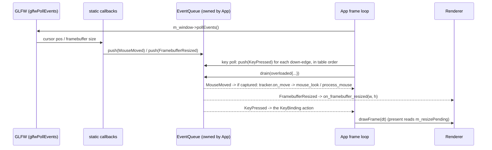

# 06: `std::variant` events and a per-frame queue

**Label:** Largely AI-generated (Claude). Every anchor below was checked against the code at `33d2c03`. Please review.
If this page and the code disagree, the code wins: fix this page. Map and prerequisites: [00-index.md](00-index.md).

**Prerequisites:** Ch02 (concepts, `<type_traits>`). **Branch:** `refactor/06-variant-events`.
**Kind:** refactor phase, so behaviour must not change.

---

## 1. Concept

`std::variant<A, B, C>` is a **closed sum type**: a value that holds exactly one of `A`, `B` or `C`, stored inline
with no heap allocation. It replaces both the `union` + tag pattern and the base-class + `virtual` pattern whenever
the set of cases is known in one place.

| Tool | Use it for |
|------|-----------|
| `std::visit(f, v)` | Call `f` with whichever alternative `v` holds. `f` must accept **every** alternative, or the call does not compile. |
| `overloaded{lambda...}` | Build `f` from one lambda per alternative. This is the idiom, not a library type. |
| `std::get_if<T>(&v)` | A pointer to the `T` inside, or `nullptr`. Good in tests and for single-case checks. |
| `std::holds_alternative<T>(v)` | A yes/no check. |
| `std::monostate` | An empty alternative. Use it when "no value" is a real case, or the first alternative is not default-constructible. |

The compile-time check in `std::visit` is the point. Add an alternative and every visitor that lacks a handler
fails to build, so the compiler gives you the list of places to update.

```cpp
#include <cstdio>
#include <variant>
#include <vector>

struct MouseMoved { double x, y; };
struct Resized { int w, h; };
struct Quit {};
using Event = std::variant<MouseMoved, Resized, Quit>;

template <class... Fs> struct overloaded : Fs... { using Fs::operator()...; };
template <class... Fs> overloaded(Fs...) -> overloaded<Fs...>;  // needed before C++20; harmless after

int main() {
    std::vector<Event> q{MouseMoved{3, 4}, Resized{800, 600}, Quit{}};
    for (const Event& e : q)
        std::visit(overloaded{
                       [](const MouseMoved& m) { std::printf("move %g %g\n", m.x, m.y); },
                       [](const Resized& r) { std::printf("resize %dx%d\n", r.w, r.h); },
                       [](Quit) { std::puts("quit"); },  // delete this line: compile error
                   },
                   e);
    if (const auto* r = std::get_if<Resized>(&q[1])) std::printf("w=%d\n", r->w);
}
```

A **queue** of such values changes *when* work happens. Callbacks stop doing the work and only record what
happened. One owner then drains the record once per frame, at a fixed point, in arrival order.

## 2. Where Swish is today

GLFW callbacks run inside `glfwPollEvents()`
([App.cpp:120-125](../../../src/core/App/App.cpp#L120-L125)) and change App and the camera on the spot:

```cpp
void App::mouse_callback(GLFWwindow* window, double xpos, double ypos) {
    auto* app = static_cast<App*>(glfwGetWindowUserPointer(window));
    if (!app || !app->m_cursor_captured)
        return;
    ...
    if (app->m_camera_ctl.mouse_look(x_offset, y_offset))
        return;
    Camera* camera = app->m_renderer->get_camera();
```

| Where | What |
|-------|------|
| [AppInput.cpp:24-52](../../../src/core/App/AppInput.cpp#L24-L52) | `mouse_callback`: the first-mouse priming, the delta (y reversed), then `mouse_look` or `Camera::process_mouse`, all inside the callback |
| [AppInput.cpp:54-59](../../../src/core/App/AppInput.cpp#L54-L59) | `framebuffer_resize_callback` → `Window::mark_resized()` |
| [AppInit.cpp:75-82](../../../src/core/App/AppInit.cpp#L75-L82) | wiring: `glfwSetWindowUserPointer(this)` **overwrites** Window's pointer, then both callbacks are installed again |
| [AppInit.cpp:84-87](../../../src/core/App/AppInit.cpp#L84-L87) | ImGui init comes **after** these callbacks; its GLFW backend chains onto them |
| [Window.cpp:25-26](../../../src/core/Window/Window.cpp#L25-L26), [:96-101](../../../src/core/Window/Window.cpp#L96-L101) | Window installs its own user pointer and a resize callback that casts the pointer to `Window*` |
| [App.h:134-139](../../../src/core/App/App.h#L134-L139) | the comment recording the segfault that happened when Window's callback read App's pointer |
| [Window.h:36-44](../../../src/core/Window/Window.h#L36-L44) | `m_resized`, `wasResized()`, `resetResizedFlag()`, `mark_resized()` |
| [Renderer_Frame.cpp:92-98](../../../src/renderer/Renderer/Renderer_Frame.cpp#L92-L98) | the only reader: `swapchain_needs_recreation(r) \|\| m_window->wasResized()` |
| [Renderer.cpp:196-199, 208](../../../src/renderer/Renderer/Renderer.cpp#L196-L208) | the minimise loop (`waitEvents`, during which callbacks fire), then the only clear |

**The smells.**

1. **Two owners for one `void*`.** The GLFW user pointer means `Window*` until `init_window_and_renderer` runs,
   and `App*` after it. Whoever forgets the order gets a miscast. The fix today is a comment.
2. **Side effects inside the callback.** Mouse handling runs at whatever moment GLFW chooses, reaches into
   `m_renderer` and `m_camera_ctl`, and is impossible to unit-test, because a test cannot produce a callback without
   a window.
3. **A shared flag as a message.** Resize travels as `Window::m_resized`: written by a callback, read by the
   renderer, cleared by the renderer. P0.1 fixed the reader/clearer race (see
   [docs/changelog/2026-10.md](../../changelog/2026-10.md)). The flag is still a mutable field of Window that the
   renderer reaches into.

Keys are **not** callback-driven. `KeyEdge` polls `glfwGetKey` once per frame
([AppInput.cpp:12-17](../../../src/core/App/AppInput.cpp#L12-L17)). This chapter does not change that (see
Pitfalls).

## 3. Target design

```cpp
// src/core/Events/Events.h  (std + utils/types only: no GLFW, no Vulkan)
namespace swish {
struct MouseMoved         { double x; double y; };  // absolute cursor position, as GLFW reports it
struct FramebufferResized { int width; int height; };
struct KeyPressed         { int key; };             // one per KeyEdge down-edge, pushed by the frame's key poll
// Ch08 adds SetEditMode{bool} and FocusChanged{bool}.
using Event = std::variant<MouseMoved, FramebufferResized, KeyPressed>;

template <class... Fs> struct overloaded : Fs... { using Fs::operator()...; };
template <class... Fs> overloaded(Fs...) -> overloaded<Fs...>;
}

// src/core/Events/EventQueue.h
namespace swish {
class EventQueue {
public:
    void push(const Event& e);
    template <class Visitor> void drain(Visitor&& v);  // FIFO; events pushed during drain wait for the next one
    [[nodiscard]] bool        empty() const noexcept;
    [[nodiscard]] std::size_t size() const noexcept;
private:
    std::vector<Event> m_pending;  // single-threaded: GLFW calls back on the main thread
};
}

// src/core/Events/MouseTracker.h: the first-mouse logic lifted out of mouse_callback, pure
namespace swish {
struct MouseDelta { float dx; float dy; };  // dy already reversed (screen Y grows down)
struct MouseTracker {
    bool  first = true;
    float lastX = 0.f, lastY = 0.f;
    std::optional<MouseDelta> on_move(const MouseMoved& m);  // nullopt on the priming move
    void reset();                                            // what m_first_mouse = true did
};
}

// Renderer (renderer/Renderer/Renderer.h): replaces Window's flag
void Renderer::on_framebuffer_resized(int width, int height);  // sets m_resizePending
```

`overloaded` is generic, so it can live in `src/utils/meta/Overloaded.h` (std only), with a
`tests/utils/test_meta_Overloaded.cpp`. Put it there if you want it reusable by `renderer/` later (Ch20's
`std::variant<Skip, Frame>`).



**Per-frame drain order (fixed).** Poll GLFW, push the key edges, then drain once. Arrival order is the order
things happen today: mouse callbacks fire inside `glfwPollEvents`, *then* `process_key_bindings` runs. The
P0.1 `sync_debug_edit_mode_from_panel()` call and the `debug_edit` snapshot stay where they are, at the top of the
loop ([App.cpp:86-90](../../../src/core/App/App.cpp#L86-L90)). Ch08 moves them.

**One user pointer, one meaning.** App sets it to `&m_events` (the `EventQueue`). Callbacks cast it to
`EventQueue*` and only `push`. Window installs no callbacks and keeps no resize flag. Delete
`Window::framebufferResizeCallback`, `m_resized`, `wasResized`, `resetResizedFlag` and `mark_resized`.

## 4. Exercise

1. **`Events.h`.** Declare the three alternatives and `Event`. Hint: keep every alternative trivially copyable,
   so the variant can never become valueless (see Pitfalls).
2. **`EventQueue.h`.** Hint for `drain`: `std::exchange(m_pending, {})` into a local, then visit the local. This
   gives "pushed during drain = next frame" for free and keeps the capacity games out of the way.
3. **`MouseTracker.h`.** Move the arithmetic of [AppInput.cpp:29-42](../../../src/core/App/AppInput.cpp#L29-L42)
   into `on_move`, keeping the same `static_cast<float>` of the doubles and the same subtraction order. Then
   `set_cursor_captured` calls `m_mouse.reset()` instead of `m_first_mouse = true`
   ([App.cpp:73](../../../src/core/App/App.cpp#L73)).
4. **Callbacks.** Reduce `mouse_callback` and `framebuffer_resize_callback` to one `push` each. Install them once,
   in `init_window_and_renderer`, before `debug_init()`. Remove the overwrite comment at
   [AppInit.cpp:76-81](../../../src/core/App/AppInit.cpp#L76-L81) and the one at App.h:134-139, because the
   problem they describe is gone.
5. **Keys.** Change `process_key_bindings` ([AppInput.cpp:78-84](../../../src/core/App/AppInput.cpp#L78-L84)) to push
   `KeyPressed{b.key}` per edge. The drain's `KeyPressed` handler finds the row and calls the action. Ch07 replaces
   this with commands.
6. **Router.** Write `App::route(const Event&)` as one `std::visit(overloaded{...})` with **no** generic
   `[](auto&&)` lambda. The `MouseMoved` handler keeps the `m_cursor_captured` gate.
7. **Renderer.** Add `on_framebuffer_resized`. In [Renderer_Frame.cpp:93](../../../src/renderer/Renderer/Renderer_Frame.cpp#L93)
   read the renderer's own flag, and clear it in `recreateSwapchain` where `resetResizedFlag()` is called today
   ([Renderer.cpp:208](../../../src/renderer/Renderer/Renderer.cpp#L208)).
8. **Window.** Delete the resize members and the self-installed callback. `Window.h` loses five declarations.

## 5. Tests you must turn green

New file `tests/test_events.cpp`, tag `[events]` (GLFW-free; add it to the `swish_tests` list).

| TEST_CASE | Asserts |
|-----------|---------|
| `EventQueue: drains in push order` | Push M, R, K, M; the visitor sees exactly that order (record the `index()`s). |
| `EventQueue: events pushed while draining wait for the next drain` | A handler that pushes during `drain` does not see its own push. The next `drain` sees it. `empty()` afterwards. |
| `EventQueue: drain empties the queue` | `size()` goes to 0; a second `drain` visits nothing. |
| `overloaded: each alternative reaches its own handler` | Three counters, one per lambda; `std::get_if` confirms the payloads. |
| `MouseTracker: the first move only primes` | `on_move` returns `nullopt` once, then deltas; `reset()` primes again. |
| `MouseTracker: replay matches the old callback arithmetic bit for bit` | Replay a recorded `std::vector<MouseMoved>` through `on_move`, and through a verbatim copy of the old lines 29-42 in the test. Each delta is bit-equal (`std::bit_cast<u32>`). |
| `MouseTracker: y is reversed` | Moving down the screen (+y) gives `dy < 0`. |

Static asserts (in `Events.h`, using Ch02's style):

- `std::variant_size_v<Event> == 3`.
- Every alternative is trivially copyable: write `all_alternatives<Event, std::is_trivially_copyable>` as a small
  variadic trait in `utils/meta/` (Ch02 practice), or as a fold over a helper.
- `std::is_nothrow_move_constructible_v<Event>` and `sizeof(Event) <= 24`.

Replaying is what makes this testable. A test builds a `std::vector<Event>`, drains it through the same router, and
checks the outcome, with no window involved.

## 6. Gate

```bash
make test && make test-debug
(cd build/shaders && shasum -a 256 -c ../../tests/golden/release_spv.sha256)   # 33 OK
make check && make format-check
./build/tests/swish_tests "[events]"
grep -n "wasResized\|mark_resized\|resetResizedFlag\|framebufferResizeCallback" -r src/   # prints nothing
```

- Arch GCC: builds, and the unit tests pass.
- **Manual (debug and release):** drag-resize the window several times (the image follows, with no stretch or
  black band); minimise and restore; go fullscreen and back. Look around with the mouse in cockpit and in free-fly;
  press Esc and confirm the mouse no longer turns the camera, then press Esc again. Run it once in a `Debug` build
  (validation layers on): resize and minimise must log 0 validation messages.
- In the debug UI: drag an ImGui slider in edit mode. ImGui still receives the mouse, because its backend chained
  onto the new callbacks.

## 7. Pitfalls

- **Keys stay polled.** A `glfwSetKeyCallback`-driven `KeyPressed` would catch a tap that starts and ends between two
  polls (today it is missed), and it delivers `GLFW_REPEAT`. Both are behaviour changes, so they belong in a
  B-phase if you want them. Here `KeyPressed` is pushed by the `KeyEdge` poll.
- **Resizes during the minimise loop.** `recreateSwapchain` calls `waitEvents()`
  ([Renderer.cpp:197](../../../src/renderer/Renderer/Renderer.cpp#L197)). Callbacks fire there, *inside*
  `drawFrame`. Today they set the flag, which line 208 then clears. With a queue they are drained next frame and
  ask for one extra recreate. Either ignore a `FramebufferResized` whose size equals the current swapchain extent,
  or accept the extra recreate and say so in the changelog. Decide and write it down.
- **A catch-all lambda kills exhaustiveness.** `[](const auto&) {}` compiles for every alternative, including the
  next one you add. Keep it out of routers.
- **Valueless variants.** A variant becomes `valueless_by_exception()` only if an emplace throws. Trivially copyable
  alternatives cannot throw, so keep the alternatives that way.
- **ImGui chaining order.** ImGui's GLFW backend saves the callbacks that are installed when it initialises, and calls
  them from its own. Install yours first, and never call `glfwSetCursorPosCallback` again after `debug_init()`.
- **Re-entrancy.** `glfwSetInputMode` and window-size calls can trigger callbacks. With a queue they become events
  for the next drain, not nested calls into half-updated state. That is a feature, but check the order with a log
  line when you first wire it.

## 8. Solution

<details><summary>Solution</summary>

_Written after you finish the exercise (or ask for it)._

</details>

## 9. Further reading

- [`std::variant`](https://en.cppreference.com/w/cpp/utility/variant), [`std::visit`](https://en.cppreference.com/w/cpp/utility/variant/visit) (its example is the `overloaded` idiom)
- [`std::get_if`](https://en.cppreference.com/w/cpp/utility/variant/get_if), [`std::holds_alternative`](https://en.cppreference.com/w/cpp/utility/variant/holds_alternative), [`std::monostate`](https://en.cppreference.com/w/cpp/utility/variant/monostate)
- [`valueless_by_exception`](https://en.cppreference.com/w/cpp/utility/variant/valueless_by_exception)
- [Class template argument deduction](https://en.cppreference.com/w/cpp/language/class_template_argument_deduction) (aggregate CTAD, C++20)
- [`std::exchange`](https://en.cppreference.com/w/cpp/utility/exchange)
- GLFW: [Input guide](https://www.glfw.org/docs/latest/input_guide.html) (callbacks vs polling, `GLFW_REPEAT`)
