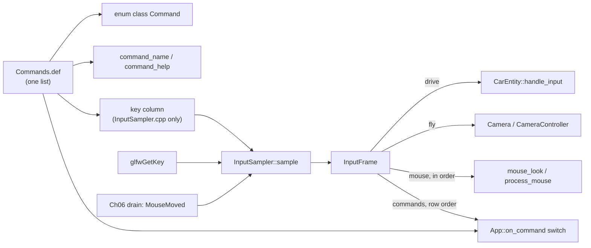

# 07: An X-macro command table and a once-per-frame `InputSampler`

**Label:** Largely AI-generated (Claude). Every anchor below was checked against the code at `33d2c03`. Please review.
If this page and the code disagree, the code wins: fix this page. Map and prerequisites: [00-index.md](00-index.md).

**Prerequisites:** Ch02 (concepts, `EnumCycle`'s `CountedEnum`), Ch06 (`Event`, `EventQueue`, `MouseTracker`).
**Branch:** `refactor/07-xmacro-commands`. **Kind:** refactor phase, so behaviour must not change.

---

## 1. Concept

An **X-macro** is a list written once, as macro calls, and expanded many times with a different definition of the
macro each time. Every expansion stays in step with the list because the list exists in only one place. It is the
preprocessor's answer to "the enum, the name table and the switch must always agree".

There are two forms. The list can be a function-like macro (below), or a `.def` file that each consumer
`#include`s after defining the row macro. Swish uses the `.def` form.

```cpp
#include <cstdio>
#include <string_view>
#define COMMAND_LIST(CMD)              \
    CMD(CycleRain, 'R', "cycle rain")  \
    CMD(ToggleWiper, 'V', "toggle wiper")
enum class Command {
#define CMD(id, key, help) id,
    COMMAND_LIST(CMD)
#undef CMD
    Count };
constexpr int kKeys[] = {
#define CMD(id, key, help) key,
    COMMAND_LIST(CMD)
#undef CMD
};
constexpr std::string_view command_name(Command c) {
    switch (c) {
#define CMD(id, key, help) case Command::id: return #id;
        COMMAND_LIST(CMD)
#undef CMD
        case Command::Count: break;
    }
    return "?";
}
static_assert(std::size(kKeys) == static_cast<std::size_t>(Command::Count));
int main() { std::printf("%s\n", command_name(Command::ToggleWiper).data()); }
```

Two properties are worth knowing. An expansion that ignores a column never compiles that column's tokens, so a
`GLFW_KEY_*` token in the list needs GLFW only in the one file that expands the key column. And a generated
`switch` with no `default:` is checked by `-Wswitch` (on with `-Wall`, an error with `-DSWISH_WERROR=ON`).

## 2. Where Swish is today

**The X-macros that already exist.** Read these first; your `.def` should look like them.

| List | Row macros | Expanded by |
|------|-----------|-------------|
| [src/renderer/Passes/PassList.def](../../../src/renderer/Passes/PassList.def) | `PRODUCER`, `PASS`, `PASS_DEBUG` (lines 5-8) | [PassList.cpp:14, 31](../../../src/renderer/Passes/PassList.cpp#L14), twice; `PASS_DEBUG` expands to nothing in release |
| [src/debug/Tunables.def](../../../src/debug/Tunables.def) | `TUNE_B`, `TUNE_F` (lines 26-28), `#undef`s at 62-66 | [DebugParams.h:94-96](../../../src/debug/DebugParams.h#L94-L96) (fields), [Tunables.h:61](../../../src/debug/Tunables.h#L61) (descriptors), [SsrPass.cpp:46-49](../../../src/renderer/Passes/SsrPass.cpp#L46-L49) (push copy) |

**The key table** is data-driven already, but it is a hand-kept vector of member pointers, and its names exist only
as comments ([AppInput.cpp:65-76](../../../src/core/App/AppInput.cpp#L65-L76)):

```cpp
m_key_bindings = {
    {GLFW_KEY_ESCAPE, {}, &App::on_toggle_cursor_capture},  // toggle cursor lock
    {GLFW_KEY_C, {}, &App::on_cycle_camera_mode},           // cycle camera presets
    ...
#ifdef SWISH_DEBUG_UI
    {GLFW_KEY_GRAVE_ACCENT, {}, &App::on_toggle_debug_edit},  // backtick: edit vs drive
#endif
};
```

`KeyEdge` and `KeyBinding` sit in [App.h:31-44](../../../src/core/App/App.h#L31-L44). The polling loop is at
[AppInput.cpp:78-84](../../../src/core/App/AppInput.cpp#L78-L84) (after Ch06 it pushes `KeyPressed`).

**Held-key polling is scattered** across four files, three of them in `scene/`, which is supposed to be
GLFW-free (`CODING_RULES.md` layering):

| Site | Keys | Precedence rule today |
|------|------|-----------------------|
| [CarEntity.cpp:16-46](../../../src/scene/Entity/CarEntity.cpp#L16-L46) `handle_input(GLFWwindow*, dt)` | Up, Down, Left, Right | `UP` beats `DOWN`; `LEFT` beats `RIGHT` (`else if`); `DOWN` means brake when `m_forward_speed > kSpeedDeadZone`, reverse otherwise |
| [Camera.cpp:133-166](../../../src/scene/Camera/Camera.cpp#L133-L166) `process_keyboard(GLFWwindow*, dt)` | W A S D, E Q, Left Shift | independent `if`s; Shift doubles velocity |
| [CameraController.cpp:93-106](../../../src/core/CameraController/CameraController.cpp#L93-L106) `poll_input` | E, Q (helicopter radius) | independent `if`s |
| [Treadmill.cpp:89-92](../../../src/scene/Treadmill/Treadmill.cpp#L89-L92) | Left, Right | **sum** (`-1 + 1 = 0`), not precedence. `Treadmill` has had no caller since Phase 3a, but it still compiles. |

**The test-seam smell.** Because `handle_input` needs a `GLFWwindow*`, the golden test cannot drive the car the way
the game does. It opens the class with `#define private public`
([tests/test_golden_car.cpp:28-37](../../../tests/test_golden_car.cpp#L28-L37)) and writes `m_throttle` and
`m_brake` directly (lines 68-69, 74-77). P0.4 replaces that macro with a test accessor. This chapter removes the
*reason* for most of it. The `swish_tests` target links `glfw` only because of these calls
([tests/CMakeLists.txt:35-38, 47-52](../../../tests/CMakeLists.txt#L35-L52)).

## 3. Target design

```cpp
// src/core/Input/Commands.def  (no include guard; consumers define the row macros, the file #undefs them)
//   COMMAND(Id, glfwKey, handler, help)        every build
//   COMMAND_DEBUG(Id, glfwKey, handler, help)  SWISH_DEBUG_UI only
// Row order == polling order == action order (same as m_key_bindings today).

// src/core/Input/Commands.h  (no GLFW: the key column is not expanded here)
namespace swish {
enum class Command : u8 { /* generated */ Count };
constexpr std::string_view command_name(Command c) noexcept;      // generated switch
constexpr std::string_view command_help(Command c) noexcept;      // generated switch
inline constexpr std::size_t kCommandCount = std::to_underlying(Command::Count);
using CommandSet = std::bitset<kCommandCount>;                    // bit i = row i fired this frame
}

// src/scene/Entity/DriveIntent.h: scene-level, so CarEntity can include it (scene must not include core/)
struct DriveIntent { bool accelerate; bool brakeOrReverse; bool steerLeft; bool steerRight; };
// src/scene/Camera/FlyIntent.h
struct FlyIntent { bool forward, back, left, right, up, down, sprint; };

// src/core/Input/InputFrame.h
struct InputFrame {
    DriveIntent             drive;
    FlyIntent               fly;
    std::vector<MouseDelta> mouse;     // in arrival order, NOT summed (see Pitfalls)
    CommandSet              commands;
};

// src/core/InputSampler/InputSampler.{h,cpp}: the only place that calls glfwGetKey
class InputSampler {
public:
    void       on_mouse_moved(const MouseMoved& m);  // from the Ch06 drain, only while captured
    void       reset_mouse();                        // was m_first_mouse = true
    InputFrame sample(GLFWwindow* window);           // once per frame, after the drain
private:
    std::array<bool, kCommandCount> m_prevDown{};    // the KeyEdge state, one per row
    MouseTracker                    m_mouse;
    std::vector<MouseDelta>         m_pendingMouse;
};

// New signatures (GLFW gone from scene/)
void CarEntity::handle_input(const DriveIntent& in, float dt);
void Camera::process_keyboard(const FlyIntent& in, float delta_time);
void CameraController::poll_input(const FlyIntent& in, Camera* camera, float dt, bool cursor_captured, bool debug_edit);
void Treadmill::update(CarEntity& car, Renderer& renderer, const DriveIntent& in, float deltaTime, bool debugEdit);
void App::on_command(Command c);                     // generated switch -> on_toggle_cursor_capture() ...
```



**Frame order (must match today's):** `pollEvents` → drain (Ch06) → `sample()` → apply `frame.mouse` in order →
`frame.commands` in row order → `poll_input(frame.fly, ...)` → `update_car` (calls `handle_input(frame.drive, dt)`
when not in edit mode, as [App.cpp:148-150](../../../src/core/App/App.cpp#L148-L150) does today) →
`update_camera`. Today the mouse is handled inside `glfwPollEvents`, *before* the keys. Keep the mouse first.

With commands in the frame, Ch06's `KeyPressed` alternative has no producer. Delete it from `Event`. The compiler
will not flag the lambda that is left over in `overloaded{}`, so remove that lambda yourself.

## 4. Exercise

1. **`Commands.def`.** Six rows, in today's order: Esc, C, R, V, G, then backtick as `COMMAND_DEBUG`. The
   `handler` column names the existing `on_*` methods, so nothing is renamed. End the file with `#undef COMMAND`
   and `#undef COMMAND_DEBUG`, as `Tunables.def` does.
2. **`Commands.h`.** Generate the enum, `command_name` and `command_help`. Hint: define `COMMAND_DEBUG` as
   `COMMAND` under `SWISH_DEBUG_UI`, and as nothing otherwise. Then `Command::Count` is 6 in debug and 5 in
   release. Add `static_assert(util::meta::CountedEnum<Command>)`.
3. **Key uniqueness.** In `InputSampler.cpp`, expand the key column into `constexpr int kCommandKeys[]` and
   `static_assert` that no key appears twice (a constexpr double loop: Ch01 practice). Also assert that no
   command key is one of the held keys (arrows, WASD, Q, E, Left Shift).
4. **Intents.** Create `DriveIntent.h` and `FlyIntent.h` as plain structs. Name the fields for what the key means,
   not for the key, and keep them **raw**: the precedence rules stay in the consumers (see Pitfalls).
5. **`InputSampler::sample`.** Fill `drive` and `fly` from `glfwGetKey`, and fill `commands` from per-row down-edges
   (the old `KeyEdge::pressed` logic, one `bool` per row). Then move `m_pendingMouse` into the frame. Hint:
   `std::exchange`.
6. **Consumers.** Change the four signatures above. `CarEntity.cpp`, `Camera.cpp` and `Treadmill.cpp` lose
   `#include <GLFW/glfw3.h>`. `CarEntity.h`, `Camera.h` and `Treadmill.h` lose `struct GLFWwindow;`.
7. **App.** Delete `KeyEdge`, `KeyBinding`, `m_key_bindings`, `init_key_bindings` and `process_key_bindings`, and
   own one `InputSampler`. `set_cursor_captured` calls `m_input.reset_mouse()`.
8. **Golden test.** Drive `launch_straight` and both `steady_turn_*` scenarios through
   `handle_input(DriveIntent{...}, kDt)` then `update(kDt)`. For the steering scenarios, call
   `set_steering_angle(sc.steerDeg)` after `handle_input` each step, so the fixed 12° survives the
   return-to-centre. Keep `throttle_then_brake` on the P0.4 accessor (see Pitfalls).
9. **Docs.** Update the comments at `tests/CMakeLists.txt:35-38, 47-48` and the "add a binding" note in
   [src/core/README.md](../../../src/core/README.md#key-table-and-edge-detection), which now becomes "add one row
   to `Commands.def`".

## 5. Tests you must turn green

New file `tests/test_commands.cpp`, tags `[commands]` and `[input]`.

| TEST_CASE | Asserts |
|-----------|---------|
| `Commands: names match the enumerators` | `command_name(Command::CycleRain) == "CycleRain"`, for every row (loop over `0..kCommandCount`). |
| `Commands: row order matches the old key table` | The release order is ToggleCursorCapture, CycleCameraMode, CycleRain, ToggleWiper, CycleWeather, and ToggleDebugEdit is last in debug. Check this through `command_name` by index. |
| `DriveIntent: handle_input reproduces the old key logic` | A table of (intent, speed) → (throttle, brake, reverse): Up+Down gives throttle; Down above `kSpeedDeadZone` gives brake; Down at rest gives reverse; Left+Right steers left; no keys returns to centre at `kSteerReturn`. Read back through the P0.4 accessor. |
| `FlyIntent: process_keyboard matches the old WASD QE shift motion` | From a fixed pose, `forward` for dt moves by `move_forward * m_move_speed * dt`; with `sprint` it moves twice that; `up` adds +y. (In `test_camera.cpp`, `[camera]`.) |
| `Mouse: deltas are applied one at a time` | `CameraController::mouse_look` near the ±150° clamp: applying (+20, −20) one at a time differs from applying their sum, and the router's result equals the one-at-a-time result. |

These must stay green, unchanged: `Golden trajectory: real CarEntity::update` and `Golden trajectory: sanity
invariants of the real update()` (`[golden][car]`), and everything in `[camera]`.

Static asserts: `CountedEnum<Command>`; `kCommandCount == 5` in release and `6` in debug (`#ifdef` around the
two lines); all command keys unique; `std::is_trivially_copyable_v<DriveIntent>` and `<FlyIntent>`.

## 6. Gate

```bash
make test && make test-debug
(cd build/shaders && shasum -a 256 -c ../../tests/golden/release_spv.sha256)   # 33 OK
make check && make format-check
./build/tests/swish_tests "[commands]" && ./build/tests/swish_tests "[golden][car]"
grep -rn "glfw" src/scene/        # only comments; no include, no glfwGetKey, no GLFWwindow
```

- Arch GCC: builds, and the unit tests pass.
- **Manual key test (release `make run`, then debug `make debug`):**

| Key | Expect |
|-----|--------|
| Up / Down / Left / Right | Throttle, brake then reverse at a standstill, steer; release to self-centre |
| Up + Down together | Throttle (Up still wins) |
| C | Camera cycles in the old order (the log prints `[camera] ...`) |
| R, V, G | Rain off/light/heavy, wiper, weather (`[weather] ...`), each **once** per press while held |
| Esc | Cursor free; Esc again recaptures it, and mouse look resumes without a jump |
| W A S D Q E + Shift (free-fly) | Moves as before; Q/E in helicopter changes the orbit radius |
| backtick (debug only) | Edit mode on/off; the car does not move while it is on |

## 7. Pitfalls

- **Precedence lives in the consumer.** `CarEntity` uses `else if` (Left wins), and `Treadmill` sums (they cancel).
  If `DriveIntent` held a single `steer` axis, one of the two would change behaviour. Keep the four raw `bool`s.
  Turning them into axes is a B-phase.
- **Do not sum mouse deltas.** `mouse_look` clamps on every call
  ([CameraController.cpp:88-89](../../../src/core/CameraController/CameraController.cpp#L88-L89)), and so does
  `Camera::process_mouse` (pitch ±89°). Float addition is not associative either. Keep a list of deltas.
- **The brake scenario cannot use `handle_input`.** In the golden, `throttle_then_brake` reaches 0 m/s by step 450
  ([car_trajectory.csv:41](../../../tests/golden/car_trajectory.csv#L41)). With a real held Down, a car at rest
  switches to reverse ([CarEntity.cpp:25-28](../../../src/scene/Entity/CarEntity.cpp#L25-L28)) and the trajectory
  diverges. Keep that scenario on the accessor, or make "drive it through the API" a B-phase with a new golden.
- **Layering.** `DriveIntent` and `FlyIntent` live in `scene/`. If they lived in `core/`, `CarEntity.h` would
  include `core/`, which `CODING_RULES.md` forbids.
- **Gating the debug row.** If `COMMAND_DEBUG` is not defined as empty in release, the backtick row silently becomes
  a release command. The `kCommandCount == 5` assert catches this.
- **Macro hygiene.** Every consumer must define *both* row macros before the `#include`, and the `.def` must `#undef`
  them. Otherwise the next consumer inherits a stale definition. This is why `Tunables.def` warns about its arity.

## 8. Solution

<details><summary>Solution</summary>

_Written after you finish the exercise (or ask for it)._

</details>

## 9. Further reading

- [Replacing text macros](https://en.cppreference.com/w/cpp/preprocessor/replace) (`#`, `##`, argument expansion)
- [Source file inclusion](https://en.cppreference.com/w/cpp/preprocessor/include)
- [`switch`](https://en.cppreference.com/w/cpp/language/switch) and [scoped enums](https://en.cppreference.com/w/cpp/language/enum)
- [`std::to_underlying`](https://en.cppreference.com/w/cpp/utility/to_underlying) (C++23), [`std::bitset`](https://en.cppreference.com/w/cpp/utility/bitset)
- [`std::string_view`](https://en.cppreference.com/w/cpp/string/basic_string_view)
- GLFW: [Input guide, key state polling](https://www.glfw.org/docs/latest/input_guide.html#input_key)
