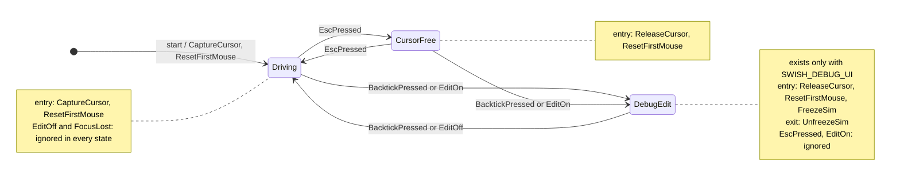

# 08: Input mode as a state machine whose actions are data

**Label:** Largely AI-generated (Claude). Every anchor below was checked against the code at `33d2c03`. Please review.
If this page and the code disagree, the code wins: fix this page. Map and prerequisites: [00-index.md](00-index.md).

**Prerequisites:** Ch04 (`swish::fsm`), Ch05 (a first FSM user), Ch06 (`EventQueue`), Ch07 (`InputFrame`,
`Command`). **Branch:** `refactor/08-input-mode-fsm`. **Kind:** refactor phase. P0.1 already fixed the bugs, and this
chapter replaces the P0.1 fix with the general design without changing behaviour.

---

## 1. Concept

"Actions returned as data" splits a state machine into two halves:

- a **pure decider**: `(state, event) → (next state, list of actions)`. It never calls GLFW, never touches the
  renderer, and can be tested as a table;
- an **executor**, owned by whoever owns the machine. It runs the actions in order against the real world.

This shape works well when the side effects are expensive or impossible in a test (a window, a GPU), and when
several fields have to change together. If every change goes through one decider, those fields cannot drift apart.

```cpp
#include <cstdio>
#include <vector>

enum class Mode { Driving, CursorFree };
enum class Action { CaptureCursor, ReleaseCursor, ResetFirstMouse };
struct Step { Mode next; std::vector<Action> actions; };

// Pure: decides, never does. Trivial to test.
Step on_escape(Mode m) {
    if (m == Mode::Driving) return {Mode::CursorFree, {Action::ReleaseCursor, Action::ResetFirstMouse}};
    return {Mode::Driving, {Action::CaptureCursor, Action::ResetFirstMouse}};
}

int main() {
    Mode mode = Mode::Driving;
    Step s    = on_escape(mode);
    mode      = s.next;
    for (Action a : s.actions)  // the owner executes, in order
        switch (a) {
            case Action::CaptureCursor: std::puts("glfwSetInputMode(DISABLED)"); break;
            case Action::ReleaseCursor: std::puts("glfwSetInputMode(NORMAL)"); break;
            case Action::ResetFirstMouse: std::puts("first_mouse = true"); break;
        }
}
```

**Derived queries** complete the pattern. "Is the mouse captured?" and "is the sim frozen?" stop being fields that
someone must remember to update. They become functions of the state, so they cannot disagree with it.

## 2. Where Swish is today (after P0.1)

The anchors are at `33d2c03`. By the time you reach this chapter, Ch06 will have moved `m_first_mouse` into
`MouseTracker`, and Ch07 will have moved the key table into `Commands.def`. The rules have not changed.

There are three pieces of state in App and one mirror in the renderer:

| State | Where | Written by |
|-------|-------|-----------|
| `m_cursor_captured` | [App.h:61](../../../src/core/App/App.h#L61) | `set_cursor_captured` ([App.cpp:70-74](../../../src/core/App/App.cpp#L70-L74)) |
| `m_first_mouse` | [App.h:58](../../../src/core/App/App.h#L58) | `set_cursor_captured`, `mouse_callback` |
| `m_debug_edit_mode` | [App.h:85-89](../../../src/core/App/App.h#L85-L89) (debug only) | `set_debug_edit_mode` ([AppInput.cpp:117-126](../../../src/core/App/AppInput.cpp#L117-L126)) |
| `DebugParams::editMode` | [DebugParams.h:268](../../../src/debug/DebugParams.h#L268) | `Renderer::set_debug_edit_mode` ([Renderer_State.cpp:50-52](../../../src/renderer/Renderer/Renderer_State.cpp#L50-L52)), **and** the ImGui checkbox ([DebugUI.cpp:374](../../../src/debug/DebugUI.cpp#L374)), **and** Reset ([DebugUI.cpp:187-191](../../../src/debug/DebugUI.cpp#L187-L191), via the button at [:456-457](../../../src/debug/DebugUI.cpp#L456-L457)) |

P0.1 made `set_debug_edit_mode` the single writer and added a poll to catch the panel's own writes:

```cpp
void App::sync_debug_edit_mode_from_panel() {
    const bool panel = m_renderer->debug_params().editMode;
    if (panel != m_debug_edit_mode)
        set_debug_edit_mode(panel);
}
```

| Where | Behaviour that must survive |
|-------|-----------------------------|
| [App.cpp:86-90](../../../src/core/App/App.cpp#L86-L90) | the panel sync runs first; then `debug_edit` is **snapshotted** for the whole frame, *before* the keys run |
| [AppInput.cpp:86-92](../../../src/core/App/AppInput.cpp#L86-L92) | Esc toggles capture, and is **ignored** in edit mode |
| [AppInput.cpp:113-115](../../../src/core/App/AppInput.cpp#L113-L115) | backtick toggles edit mode; leaving edit always recaptures (even if you entered from a free cursor) |
| [AppInput.cpp:26](../../../src/core/App/AppInput.cpp#L26) | mouse deltas are dropped while not captured |
| [App.cpp:94, 148](../../../src/core/App/App.cpp#L94) | `poll_input(..., m_cursor_captured /*live*/, debug_edit /*snapshot*/)`; car input and update are skipped in edit |
| [CameraController.cpp:95, 100, 141, 147](../../../src/core/CameraController/CameraController.cpp#L93-L106) | free-fly and helicopter keys need captured && !edit; cockpit smoothing freezes in edit |
| [AppInit.cpp:82](../../../src/core/App/AppInit.cpp#L82) | the cursor is disabled at startup by a direct GLFW call, outside any setter |
| [DebugUI.cpp:363-366](../../../src/debug/DebugUI.cpp#L363-L366) | ImGui ignores the mouse unless `editMode` |

**The smell.** The rules are correct now, but they are spread across five functions, in two layers, with a
once-per-frame poll that exists only because the UI writes the flag behind App's back. The state is three `bool`s,
which allows eight combinations, while only three are valid. Nothing in the types stops `captured && edit`.

## 3. Target design



| Query | Driving | CursorFree | DebugEdit |
|-------|---------|------------|-----------|
| `captures_mouse()` | true | false | false |
| `sim_frozen()` | false | false | true |

```cpp
// src/core/InputMode/InputMode.{h,cpp}
namespace swish {
class InputMode {
public:
    enum class State : u8 { Driving, CursorFree,
#ifdef SWISH_DEBUG_UI
        DebugEdit,
#endif
        Count };
    enum class Event : u8 { EscPressed, FocusLost,
#ifdef SWISH_DEBUG_UI
        BacktickPressed, EditOn, EditOff,
#endif
        Count };
    enum class Action : u8 { CaptureCursor, ReleaseCursor, ResetFirstMouse,
#ifdef SWISH_DEBUG_UI
        FreezeSim, UnfreezeSim,
#endif
        Count };

    [[nodiscard]] fsm::RowActions<Action>  start();             // entry actions of Driving (fsm::enter)
    [[nodiscard]] fsm::StepActions<Action> dispatch(Event e);   // never has side effects
    [[nodiscard]] State                state() const noexcept;
    [[nodiscard]] constexpr bool       captures_mouse() const noexcept;
    [[nodiscard]] constexpr bool       sim_frozen() const noexcept;  // always false in release
private:
    State m_state = State::Driving;
};
}

// App (core/App): the executor and the translators
void App::execute(InputMode::Action a);                     // switch, no default
std::optional<InputMode::Event> to_input_event(Command c);  // optional: Ch07 commands -> machine events (see step 7)
// Ch06 Event gains: struct SetEditMode { bool on; };  struct FocusChanged { bool focused; };
```

The table has the shape below. Write the rows yourself; the `#ifdef` goes around whole rows:

```cpp
inline constexpr auto kInputModeTable = std::to_array<fsm::Transition<State, Event, Action>>({
    {State::Driving, Event::EscPressed, State::CursorFree},
    // ... CursorFree/Esc ...
#ifdef SWISH_DEBUG_UI
    // ... Backtick / EditOn / EditOff rows ...
#endif
});
```

**Who pushes what.** The ImGui checkbox and Reset push `SetEditMode{bool}` into App's `EventQueue`, and no longer
write `editMode`. `DebugParams::editMode` becomes a **mirror** written only by `FreezeSim` and `UnfreezeSim` (through
`Renderer::set_debug_edit_mode`), which ImGui reads for its `NoMouse` flag. App translates
`SetEditMode{true}` / `{false}` into `EditOn` / `EditOff`, and translates `Command::ToggleCursorCapture` /
`ToggleDebugEdit` into `EscPressed` / `BacktickPressed`.

To let DebugUI push, inject a reference rather than adding a global: `Renderer::debug_init(EventQueue&)` stores it in
`DebugUI`. That adds a `debug/ → core/Events` include edge, so `Events.h` must stay dependency-free. If you would
rather not have the edge, DebugUI can record a `std::optional<bool>` that App collects after `drawFrame` and pushes
itself. Pick one and note it for the `CODING_RULES.md` "Who may include whom" table.

```mermaid
sequenceDiagram
    participant UI as DebugUI (in drawFrame, frame N)
    participant Q as EventQueue
    participant A as App (frame N+1)
    participant M as InputMode (pure)
    UI->>Q: push(SetEditMode{false})
    A->>A: pollEvents (MouseMoved pushed after it, FIFO)
    A->>Q: drain
    Q-->>A: SetEditMode{false} -> EditOff
    A->>M: dispatch(EditOff)
    M-->>A: [UnfreezeSim, CaptureCursor, ResetFirstMouse]
    A->>A: execute each, in order
    Q-->>A: MouseMoved -> routed only if captures_mouse()
    A->>A: frozen = sim_frozen()  (snapshot, as App.cpp:90 does)
    A->>A: sample InputFrame; commands -> EscPressed / BacktickPressed -> dispatch, execute
    A->>A: poll_input(fly, captures_mouse() live, frozen); update_car(dt, frozen); update_camera(dt, frozen)
```

The snapshot goes **after** the queue drain and **before** the frame's commands. That reproduces today's
order exactly: panel sync, then the snapshot, then the keys.

## 4. Exercise

1. **Skeleton.** `src/core/InputMode/InputMode.h` (declarations above) and `tests/test_input_mode.cpp` (failing)
   are on the branch.
2. **Table.** Write the rows. Hint: there are 2 in release and 8 in debug. The ignored pairs (Esc in DebugEdit,
   EditOn in DebugEdit, EditOff outside it, FocusLost everywhere) get **no** row, unless your Ch04 validator
   requires explicit "ignore" rows for completeness. Add `static_assert(fsm::validate(kInputModeTable))`.
3. **Entry and exit actions.** Attach them per state, not per row, so that "leaving DebugEdit always lands in
   Driving with the cursor captured" falls out of the structure.
4. **`execute`.** `CaptureCursor` and `ReleaseCursor` call `glfwSetInputMode`; `ResetFirstMouse` calls
   `m_input.reset_mouse()` (Ch07); `FreezeSim` and `UnfreezeSim` call `m_renderer->set_debug_edit_mode(bool)`. Use a
   `switch` with no `default`, so `-Wswitch` flags an action you forgot.
5. **Startup.** Replace [AppInit.cpp:82](../../../src/core/App/AppInit.cpp#L82) by executing `m_mode.start()`.
6. **UI.** In [DebugUI.cpp:374](../../../src/debug/DebugUI.cpp#L374), check a local copy, and push
   `SetEditMode{copy}` when `Checkbox` returns true. Make `presetReset` keep the current `editMode` mirror and push
   `SetEditMode{true}`.
7. **Delete.** Remove `m_cursor_captured`, `set_cursor_captured`, `m_debug_edit_mode`,
   `set_debug_edit_mode`, `sync_debug_edit_mode_from_panel`, `on_toggle_debug_edit` and the P0.1 sync call at
   [App.cpp:86-88](../../../src/core/App/App.cpp#L86-L88). `cursor_captured()` and `debug_edit_mode()` become
   `m_mode.captures_mouse()` and `m_mode.sim_frozen()`. The two mode rows in Ch07's `Commands.def` lose their
   old `on_*` bodies. Hint: keep the handlers nullary, as the generated `case` calls them, and make each one a single
   line: `dispatch(Event::EscPressed)` or `dispatch(Event::BacktickPressed)`, then `execute` the result. If you do it
   this way, `to_input_event` is not needed.
8. **Focus.** Install a `glfwSetWindowFocusCallback` that pushes `FocusChanged{bool}` (before `debug_init()`). Map
   it to `FocusLost`, which the table ignores. A real "lose focus → free cursor" behaviour is a later B-phase: one
   new row and one changelog line.

## 5. Tests you must turn green

`tests/test_input_mode.cpp`, tag `[inputmode]`. The machine is pure, so the file needs no GLFW. Release cases run
in `swish_tests`. Add the same file, plus `InputMode.cpp` if you created one, to `swish_debug_tests` (which defines
`SWISH_DEBUG_UI`) for the `#ifdef` cases.

| TEST_CASE | Build | Asserts |
|-----------|-------|---------|
| `InputMode: start captures the cursor` | both | `start()` returns exactly `[CaptureCursor, ResetFirstMouse]`; the state is Driving |
| `InputMode: Esc toggles Driving and CursorFree` | both | each step's state, exact action list, `captures_mouse()` |
| `InputMode: FocusLost changes nothing` | both | no actions, same state, from every state |
| `InputMode: derived queries match the table` | both | the query table in section 3, for every state |
| `InputMode: backtick enters and leaves DebugEdit` | debug | from Driving and from CursorFree; leaving always gives Driving |
| `InputMode: Esc is ignored in DebugEdit` | debug | no state change, empty actions |
| `InputMode: SetEditMode with the current value is a no-op` | debug | EditOn in DebugEdit and EditOff in Driving/CursorFree give empty actions |
| `InputMode: replay of the P0.1 bug sequence` | debug | Esc, backtick, backtick ends in Driving with `captures_mouse()` true; the last actions end with `CaptureCursor, ResetFirstMouse` |
| `InputMode: action order on leaving DebugEdit` | debug | exactly `[UnfreezeSim, CaptureCursor, ResetFirstMouse]` |

Static asserts in `InputMode.h`: `fsm::validate(kInputModeTable)` (no duplicate pair, every state reachable);
`enum_count<State>() == 2` in release and `3` in debug; `kInputModeTable.size() == 2` / `8`; and `sim_frozen()` is
`constexpr` and false for every release state.

## 6. Gate

```bash
make test && make test-debug
(cd build/shaders && shasum -a 256 -c ../../tests/golden/release_spv.sha256)   # 33 OK
make check && make format-check
./build/tests/swish_tests "[inputmode]" && ./build-debug/tests/swish_debug_tests "[inputmode]"
grep -rn "m_cursor_captured\|m_debug_edit_mode\|sync_debug_edit_mode_from_panel" src/   # prints nothing
```

- Arch GCC: builds, and the unit tests pass. Release: goldens unchanged.
- **Byte-identical release** means here that the release frame, goldens and `.spv` are unchanged, and that release
  code contains no `DebugEdit` (`enum_count<State>() == 2`). The executable itself changes, which is expected.
- **Manual key matrix.** Window-only screenshots are not needed (nothing visual changes). Run every row and note
  the result in the changelog entry:

| # | Build | Start state | Do | Expect cursor | Expect sim | Expect mouse |
|---|-------|-------------|----|---------------|------------|--------------|
| 1 | release | Driving | Esc | visible | runs | does not turn camera |
| 2 | release | CursorFree | Esc | hidden | runs | turns camera, no jump |
| 3 | debug | Driving | backtick | visible | frozen | moves over panel only |
| 4 | debug | DebugEdit | backtick | hidden | runs | turns camera, no jump |
| 5 | debug | DebugEdit | Esc | visible (unchanged) | frozen (unchanged) | panel only |
| 6 | debug | Driving | Esc, backtick, backtick | hidden | runs | turns camera (the P0.1 bug) |
| 7 | debug | DebugEdit | untick "Edit mode" | hidden | runs | turns camera; box stays unticked |
| 8 | debug | DebugEdit | Reset button | visible | frozen | box stays ticked |
| 9 | debug | DebugEdit | drag a slider | visible | frozen | camera does **not** turn |
| 10 | both | Driving | switch app away and back | unchanged from today | unchanged | unchanged |

## 7. Pitfalls

- **Where the snapshot goes.** If `sim_frozen()` is read live after the commands, backtick freezes the car one frame
  earlier than today. Nobody would see it, but it is a behaviour change. Snapshot after the drain and before the
  commands.
- **Exit and entry order.** Exit (`UnfreezeSim`) runs before entry (`CaptureCursor`). Today
  `set_debug_edit_mode(false)` does the reverse. This is safe because the renderer only stores the flag, and reads
  it in the next `drawFrame`. If an action ever has an effect that depends on order, encode the order in the table.
- **Forgetting `start()`.** Without the initial entry actions, the game starts with a free cursor. Previously
  `AppInit.cpp:82` hid this.
- **Payload in the machine.** Turn `SetEditMode{bool}` into two events at the boundary. A guard on a `bool`
  payload works too, but it makes "EditOn in DebugEdit" a guarded row instead of an obviously missing one.
- **The UI must stop writing the mirror.** If `Checkbox(&p.editMode)` stays, the mirror and the machine can disagree
  for a frame, which is the P0.1 bug again. Check a copy, push an event, and let the action write the mirror.
- **Release gating.** The `#ifdef`s go around enumerators **and** table rows **and** test cases together. If any one
  is left out, release fails to compile (good) or keeps a dead debug row (bad, and the size assert catches it).

## 8. Solution

<details><summary>Solution</summary>

_Written after you finish the exercise (or ask for it)._

</details>

## 9. Further reading

- [`switch`](https://en.cppreference.com/w/cpp/language/switch) and [`-Wswitch`-style exhaustiveness for enums](https://en.cppreference.com/w/cpp/language/enum)
- [`std::to_array`](https://en.cppreference.com/w/cpp/container/array/to_array)
- [`[[nodiscard]]`](https://en.cppreference.com/w/cpp/language/attributes/nodiscard): a dropped action list should be a warning
- [Conditional inclusion (`#ifdef`)](https://en.cppreference.com/w/cpp/preprocessor/conditional)
- [`std::optional`](https://en.cppreference.com/w/cpp/utility/optional): the command-to-event translator
- GLFW: [Window focus](https://www.glfw.org/docs/latest/window_guide.html#window_focus), [Cursor mode](https://www.glfw.org/docs/latest/input_guide.html#cursor_mode)
