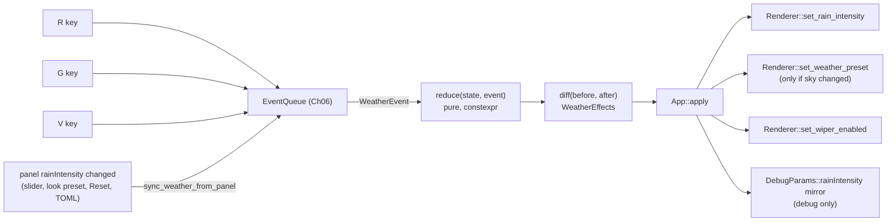

# 09: Weather as a reducer

**Label:** Largely AI-generated (Claude). File:line anchors were checked against `33d2c03` on 2026-10-01. Review it
before relying on it. If this page and the code disagree, the code wins.

**Phase branch:** `refactor/09-weather-reducer`. **Kind:** refactor (behaviour-preserving). Anything this chapter marks
**B9** is an intended behaviour change and belongs in its own B-phase.

## 1. Concept

A **reducer** is a pure function `State reduce(State, const Event&)`. It takes the current state and one event and
returns the next state. It has no members, globals or I/O. All side effects happen in one place at the edge,
usually called `apply`, which reads the new state (or the difference between old and new) and drives the outside
world.

Compare it with the table FSM from chapter 04:

| | Table FSM (`swish::fsm`, Ch04) | Reducer (this chapter) |
|---|---|---|
| State shape | One enumerator out of N (`Driving`, `DebugEdit`, ...) | A **product** of independent fields (rain × sky × wiper) |
| Transitions | Rows `(state, event, guard) -> state` | One `std::visit` arm per event |
| Validation | constexpr checks for duplicate or unreachable rows | Tests and `static_assert` on `reduce` itself |
| Side effects | Actions returned as data from the table | `diff(before, after)` returns effects as data; `apply` runs them |
| Use it when | Modes exclude each other and the order of moves matters | State is a few orthogonal knobs with a few cross-field rules |

Weather has 3 × 4 × 2 = 24 combinations and one cross-field rule ("rain cancels a clear-day sky"). An FSM with 24
states would be a table explosion. A reducer keeps the fields separate and writes the rule once.

```cpp
#include <cstdio>
#include <variant>

struct Inc { int by; };
struct Reset {};
using Event = std::variant<Inc, Reset>;
struct State { int count = 0; bool dirty = false; };

template <class... F> struct overloaded : F... { using F::operator()...; };

constexpr State reduce(State s, const Event& e) {
    return std::visit(overloaded{
        [&](const Inc& i) { s.count += i.by; s.dirty = true; return s; },
        [](const Reset&) { return State{}; },
    }, e);
}

static_assert(reduce(State{}, Inc{2}).count == 2);  // pure, so it can be tested at compile time

int main() {
    State s;
    for (const Event& e : {Event{Inc{1}}, Event{Inc{4}}, Event{Reset{}}}) s = reduce(s, e);
    std::printf("%d\n", s.count);  // the edge: the only side effect
}
```

`std::visit` has been `constexpr` since C++20, so a reducer over a `std::variant` can be checked with
`static_assert` / `STATIC_REQUIRE`.

## 2. Where Swish is today

Weather state is spread across three `App` members, three setters with side effects, and one renderer copy that
the debug panel overwrites every frame.

**App owns three loose fields** ([src/core/App/App.h:76-83](../../../src/core/App/App.h)):

```cpp
int m_rain_level = 0;
bool m_wiper_enabled = false;
WeatherPreset m_weather_preset = WeatherPreset::PartlyCloudy;
```

**Rain level is an `int` taken modulo 3 against a function-local table**
([src/core/App/App.cpp:32-52](../../../src/core/App/App.cpp)):

```cpp
static constexpr float kRainLevels[] = {0.0f, 0.35f, 1.0f};
m_rain_level                         = ((level % 3) + 3) % 3;
const float rain                     = kRainLevels[m_rain_level];
m_renderer->set_rain_intensity(rain);
if (m_car)
    m_car->set_rain_intensity(rain);
#ifdef SWISH_DEBUG_UI
m_renderer->debug_params().rainIntensity = rain;
#endif
if (const WeatherPreset p = preset_for_rain(m_weather_preset, rain); p != m_weather_preset)
    set_weather_preset(p);
```

The `3` is written three times and has no type. Nothing ties the table length to the modulus.
`set_weather_preset` (`App.cpp:54-58`) and `set_wiper` (`App.cpp:60-63`) each write one field and push it to the
renderer. The key actions call them with `rain_level() + 1`, `next_weather_preset(...)` and `!wiper_enabled()`
([src/core/App/AppInput.cpp:98-108](../../../src/core/App/AppInput.cpp)). Startup calls `set_rain_level(0)`
([src/core/App/AppInit.cpp:64](../../../src/core/App/AppInit.cpp)).

**The rule is already pure** ([src/scene/WeatherPreset.h:37-46](../../../src/scene/WeatherPreset.h)). P0.1 added it:

```cpp
constexpr bool is_clear_day(WeatherPreset p) {
    return p == WeatherPreset::PartlyCloudy || p == WeatherPreset::GoldenHour;
}
constexpr WeatherPreset preset_for_rain(WeatherPreset p, float rain) {
    return (rain > 0.0f && is_clear_day(p)) ? WeatherPreset::Cloudy : p;
}
```

It is pinned by `"Rain switches a clear-day preset to Cloudy and keeps the others"` in
[tests/test_rain.cpp:63-72](../../../tests/test_rain.cpp). The plan also asked to delete `App::m_clear_day` and
`Renderer::set_clear_day`. **P0.1 already did that**: neither name appears in `src/` at `33d2c03`.

**The renderer has a second writer** ([src/renderer/Renderer/Renderer_State.cpp:54-61](../../../src/renderer/Renderer/Renderer_State.cpp)):

```cpp
void Renderer::apply_debug_params() {
    m_weather.apply_debug(m_debugParams);
    // Rain intensity slider drives the same scalar as the R-key cycle.
    m_rainIntensity = m_debugParams.rainIntensity;
```

It runs every debug frame, after `DebugUI::begin_frame` ([Renderer_Frame.cpp:110-111](../../../src/renderer/Renderer/Renderer_Frame.cpp)).
Anything that writes `DebugParams::rainIntensity` changes the rain behind App's back: the slider
([src/debug/DebugUI.cpp:688](../../../src/debug/DebugUI.cpp)), the look presets (`DebugUI.cpp:197`, `:211`, `:224`),
Reset (`presetReset`, `DebugUI.cpp:187-191`, which restores the default `rainIntensity = 1.0f` from
[src/debug/DebugParams.h:148](../../../src/debug/DebugParams.h)) and a TOML preset load
([src/debug/DebugParamsIO.cpp:313](../../../src/debug/DebugParamsIO.cpp)). After any of these, `m_rain_level` and
`m_weather_preset` are stale, and the sky can stay clear while it rains.

**Dead state in the car.** `CarEntity::set_rain_intensity` stores `m_rain_intensity`
([src/scene/Entity/CarEntity.h:57-59](../../../src/scene/Entity/CarEntity.h), field at `:149`), but nothing reads it.
The wash it was meant to drive is hard-coded off
([src/scene/Entity/CarEntity.cpp:464](../../../src/scene/Entity/CarEntity.cpp)):

```cpp
const float washAmount = 0.0f;
```

**`WeatherController` is the renderer half** ([src/renderer/WeatherController/WeatherController.h:20-60](../../../src/renderer/WeatherController/WeatherController.h)).
It owns the active preset, the sun direction, colour and clarity, and the dirty-checked IBL rebake. `set_preset`
is expensive: it loads an HDRI and bakes IBL. It stays where it is. This chapter changes **who calls it**, not what
it does.

| Smell | Where | Consequence |
|-------|-------|-------------|
| Untyped `int` + `% 3` + local table | `App.cpp:33-35` | Adding a fourth level means editing three numbers that the compiler cannot connect |
| Two writers of renderer rain | `App.cpp:36`, `Renderer_State.cpp:58` | Slider, presets, Reset and TOML load leave App stale |
| Cross-field rule applied only on R | `App.cpp:50-51` | G can pick a clear-day sky while it rains (see the B9 note below) |
| Dead setter and field | `CarEntity.h:59,149`, `CarEntity.cpp:464` | Looks like a live dependency of the car on weather |

## 3. Target design

New header-only file `src/scene/Weather/WeatherState.h`, in `namespace swish`, depending only on
`scene/WeatherPreset.h`, `utils/meta/EnumCycle.h` and the standard library.

```cpp
enum class RainLevel : uint8_t { Off = 0, Light, Heavy, Count };

inline constexpr std::array<float, util::meta::enum_count<RainLevel>()> kRainIntensity{/* Off, Light, Heavy */};
constexpr float rain_intensity(RainLevel level) noexcept;

struct WeatherState {
    RainLevel     rain      = RainLevel::Off;
    float         intensity = 0.0f;  // what the renderer gets; == rain_intensity(rain) except after SliderRain
    WeatherPreset sky       = WeatherPreset::PartlyCloudy;
    bool          wiper     = false;
    constexpr bool operator==(const WeatherState&) const = default;
};

struct CycleRain {};
struct CycleSky {};
struct ToggleWiper {};
struct SliderRain { float intensity; };
using WeatherEvent = std::variant<CycleRain, CycleSky, ToggleWiper, SliderRain>;

constexpr WeatherState reduce(WeatherState s, const WeatherEvent& e) noexcept;

// Effects as data: what changed between two states. Empty optionals mean "do not touch".
struct WeatherEffects {
    std::optional<float>         rain_intensity;
    std::optional<WeatherPreset> sky;
    std::optional<bool>          wiper;
};
constexpr WeatherEffects diff(const WeatherState& before, const WeatherState& after) noexcept;
```

The edge lives in `core/` (App), because it is the only layer allowed to touch both the renderer and the debug
panel:

```cpp
// App.h
WeatherState m_weather{};
void dispatch(const WeatherEvent& e);              // m_weather = reduce(...); apply(diff(...))
void apply(const WeatherEffects& fx);              // the ONLY weather writes into Renderer
#ifdef SWISH_DEBUG_UI
void sync_weather_from_panel();                    // panel rain != m_weather.intensity -> dispatch(SliderRain{...})
#endif
```



Things that go away: `App::m_rain_level`, `m_wiper_enabled`, `m_weather_preset`, `set_rain_level`, `kRainLevels`,
the `% 3`, `CarEntity::set_rain_intensity` and `m_rain_intensity`, and the `m_rainIntensity =
m_debugParams.rainIntensity` line in `apply_debug_params`.

## 4. Exercise

1. **`RainLevel` and the table.** Create `src/scene/Weather/WeatherState.h` with the doc block your other headers
   use. Size the array from `enum_count<RainLevel>()` so a new level that has no intensity fails to compile.
   *Hint:* `static_assert(kRainIntensity.size() == enum_count<RainLevel>())` is free documentation. Copy the three
   literals exactly. `0.35f` must stay `0.35f`, not `0.35`.
2. **`WeatherState` and the events.** Keep `WeatherState` an aggregate (rule 5: a `struct` groups data). Default
   member values are the startup state: Off, 0, PartlyCloudy, wiper off.
3. **`reduce`.** One `std::visit` with the `overloaded{}` helper from chapter 06 (reuse it; do not define a second
   one). For each event:
   - `CycleRain`: advance with `util::meta::next_enum`, set `intensity` from the table, then apply
     `preset_for_rain`.
   - `CycleSky`: `next_weather_preset(s.sky)`. Do not apply the rain rule here (see Pitfalls, B9).
   - `ToggleWiper`: flip `wiper`.
   - `SliderRain`: clamp to `[0, 1]` and store `intensity`. Leave `rain` and `sky` as they are, because that is
     what the slider does today.
   *Hint:* make the lambdas take `s` by reference and return it, so every arm has the same return type.
4. **`diff`.** Compare field by field. `rain_intensity` is set when `intensity` changed, `sky` when `sky` changed.
   Mark it `constexpr` so tests can `STATIC_REQUIRE` it.
5. **The edge in App.** Replace the three members with `WeatherState m_weather`. Write `dispatch` and `apply`.
   Point the key actions at `dispatch` (or, once Ch06 and Ch07 have landed, push the events onto the queue and
   route the weather alternatives to `dispatch`). `apply` must print `[weather] <name>` exactly when today's code
   does, which is whenever the sky changes.
6. **Startup.** Today `init` calls `set_rain_level(0)`, which writes rain 0 to the renderer and to the debug slider
   but does **not** call `set_weather_preset`, because `Renderer::init` already baked PartlyCloudy. Reproduce that:
   apply `WeatherEffects{.rain_intensity = 0.0f}` once, and nothing else.
7. **The debug panel.** In `apply_debug_params` delete the rain copy (`Renderer_State.cpp:57-58`). Add
   `sync_weather_from_panel()` next to `sync_debug_edit_mode_from_panel()` at the top of `App::run`'s loop
   ([App.cpp:86-88](../../../src/core/App/App.cpp)). Keep it inside `#ifdef SWISH_DEBUG_UI`.
8. **Delete the dead car path.** Remove `CarEntity::set_rain_intensity`, `m_rain_intensity` and the call in App.
   Leave `washAmount` and its comment alone; it is a separate, documented decision.
9. **Docs in the same branch.** Update the setter list in `src/core/README.md:14`. Ask the docs scribe for the
   changelog entry.

## 5. Tests you must turn green

New file `tests/test_weather_state.cpp`, listed in `tests/CMakeLists.txt` (or picked up by the P0.3 library),
tag `[weather]`. It includes only `scene/Weather/WeatherState.h`, so it needs no GLFW and no Vulkan.

| TEST_CASE | Asserts |
|-----------|---------|
| `"RainLevel table matches the old kRainLevels"` | `STATIC_REQUIRE` intensities are exactly `0.0f`, `0.35f`, `1.0f`; `enum_count<RainLevel>() == 3` |
| `"CycleRain walks Off, Light, Heavy and wraps to Off"` | four `reduce` calls; `rain` and `intensity` at each step |
| `"CycleRain from a clear-day sky switches it to Cloudy"` | **P0.1 regression**: PartlyCloudy and GoldenHour each become Cloudy on the first `CycleRain` |
| `"CycleRain keeps a sky that is not clear-day"` | Cloudy and VeryCloudy are unchanged |
| `"After rain moved the sky to Cloudy, CycleSky advances from Cloudy"` | **P0.1 regression, second half**: PartlyCloudy, `CycleRain`, `CycleSky` gives VeryCloudy (not Cloudy again) |
| `"CycleRain back to Off keeps the sky"` | Heavy + Cloudy, `CycleRain` gives Off + Cloudy (today's behaviour: no restore) |
| `"CycleSky advances the preset and leaves rain and wiper alone"` | all four presets plus the wrap; `rain`, `intensity`, `wiper` unchanged |
| `"CycleSky while raining can pick a clear-day sky (today's behaviour)"` | Heavy + VeryCloudy, `CycleSky` gives GoldenHour. B9 flips this test on purpose |
| `"ToggleWiper flips only the wiper"` | two toggles round-trip; every other field equal |
| `"SliderRain clamps and keeps level and sky"` | `-1.0f` gives `0.0f`, `2.0f` gives `1.0f`, `0.6f` stays; `rain` and `sky` unchanged |
| `"diff of equal states has no effects"` | all three optionals empty |
| `"diff reports exactly the changed fields"` | `CycleRain` from the default state gives `rain_intensity == 0.35f` and `sky == Cloudy`, with `wiper` empty |
| `"reduce and diff are constexpr"` | at least one `STATIC_REQUIRE(reduce(WeatherState{}, CycleRain{}).sky == WeatherPreset::Cloudy)` |

Keep the existing `"Rain switches a clear-day preset to Cloudy and keeps the others"` in `tests/test_rain.cpp`
green and unchanged.

`static_assert`s that must hold, written in the header or the test:

```cpp
static_assert(util::meta::CountedEnum<RainLevel>);
static_assert(kRainIntensity.size() == util::meta::enum_count<RainLevel>());
static_assert(std::is_aggregate_v<WeatherState> && std::is_trivially_copyable_v<WeatherState>);
static_assert(std::variant_size_v<WeatherEvent> == 4);
static_assert(std::is_nothrow_invocable_r_v<WeatherState, decltype(&reduce), WeatherState, const WeatherEvent&>);
```

If chapter 02's `FsmEvent` concept exists, also assert that each alternative of `WeatherEvent` satisfies it.

## 6. Gate

- `make test` and `make test-debug` green, 0 warnings.
- `(cd build/shaders && shasum -a 256 -c ../../tests/golden/release_spv.sha256)`: 33 of 33 OK. No shader is touched.
- `make check` and `make format-check` clean.
- Mesh and car goldens unchanged. The car golden never calls `set_rain_intensity`, so removing it cannot move the
  trajectory.
- Chapter-specific:
  - `grep -rnE "kRainLevels|m_rain_level|% 3" src/core` prints nothing. (Use `-E` with a bare `|`; `\|`
    inside `-E` matches a literal pipe.)
  - `grep -rn "set_rain_intensity" src/scene` prints nothing.
  - `grep -rn "rainIntensity" src/renderer/Renderer` shows no write from `m_debugParams`.
  - Release run (`make run`): R three times, G four times, V twice. The console prints the same `[weather]` lines,
    in the same order, as on `debug-ui`. Take window-only screenshots at rain 0 and rain 1.0 and compare them with
    the baseline.
  - Debug run (`make debug`): drag the rain slider to 0.6 and press R. Rain follows the slider and then R, and
    Reset gives the default rain. Note that the slider now takes effect one frame later (see Pitfalls).
  - Arch GCC builds and the `[weather]` tests pass.

## 7. Pitfalls

- **Do not re-apply the sky at startup.** `Renderer::init` already called `m_weather.set_preset(PartlyCloudy)`
  ([Renderer.cpp:100](../../../src/renderer/Renderer/Renderer.cpp)). An "apply the whole state once" shortcut would
  bake the HDRI and IBL a second time and print a `[weather]` line that today's run does not print.
- **One frame of slider latency.** Today the slider is copied into the renderer in the same frame it moves. After
  this chapter, App sees the change at the top of the next frame. This affects the debug build only, the release
  build stays byte-identical, and it matches how P0.1 handled edit mode. Write it in the changelog.
- **B9 behaviour changes, kept out of this phase:** (a) applying the clear-day rule on `CycleSky` while it rains,
  and (b) applying it on `SliderRain`. Both are probably what the comment at `App.cpp:46-47` means, but today's
  code does neither. Pin today's behaviour now and flip the tests deliberately in B9.
- **Float equality in `diff`.** Comparing `intensity` with `!=` is correct here. You want "did the value change",
  not "is it close". Use `WithinAbs` in tests only where a clamp produces the value.
- **Do not turn `WeatherController` into the reducer.** It holds GPU-facing state and borrows `IBLManager`. The
  reducer must stay includable from a test with no Vulkan headers.
- **Keep the `%`-free wrap.** `next_enum` on a `CountedEnum` already wraps. If you still need a `% 3` somewhere,
  the enum is not doing its job.

## 8. Solution

<details><summary>Solution</summary>

_Written after you finish the exercise (or ask for it)._

</details>

## 9. Further reading

- [std::variant](https://en.cppreference.com/w/cpp/utility/variant) and [std::visit](https://en.cppreference.com/w/cpp/utility/variant/visit)
- [std::optional](https://en.cppreference.com/w/cpp/utility/optional)
- [Default comparisons (`= default` `operator==`)](https://en.cppreference.com/w/cpp/language/default_comparisons)
- [Aggregate initialization](https://en.cppreference.com/w/cpp/language/aggregate_initialization) and [std::is_aggregate](https://en.cppreference.com/w/cpp/types/is_aggregate)
- [constexpr specifier](https://en.cppreference.com/w/cpp/language/constexpr)
