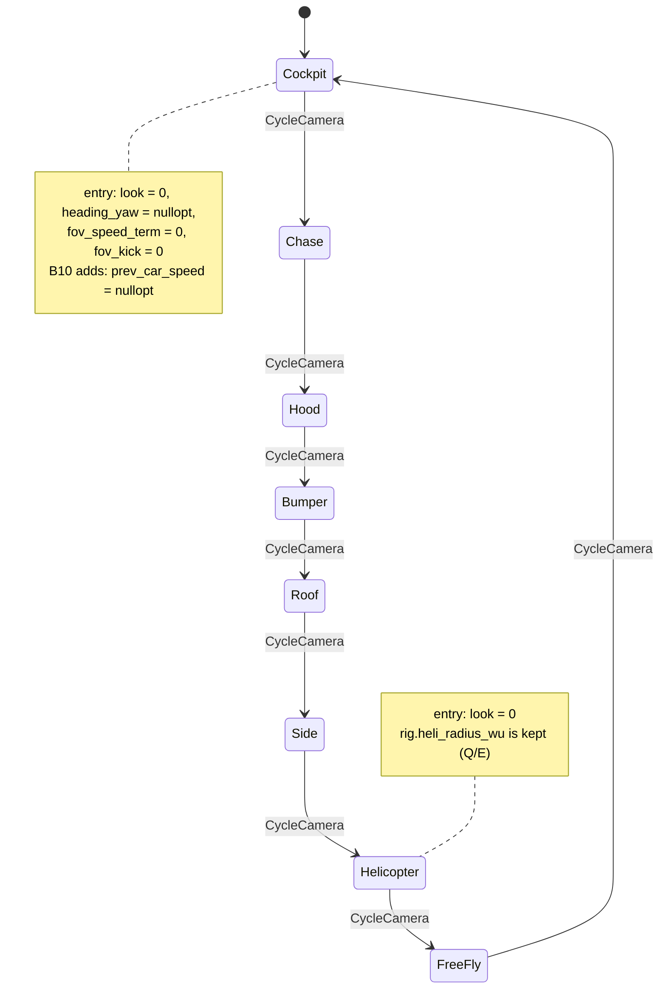

# 10: Camera modes as a variant of states

**Label:** Largely AI-generated (Claude). File:line anchors were checked against `33d2c03` on 2026-10-01. Review it
before relying on it. If this page and the code disagree, the code wins.

**Phase branches:** `refactor/10-camera-variant` (behaviour-preserving), then a short **B10** branch that fixes the
FOV kick. **Assumes** chapter 07 has landed: the `glfwGetKey` calls at `CameraController.cpp:101-104` and
`Camera::process_keyboard(GLFWwindow*, ...)` already take an intent struct. If your branch still has them, keep
`poll_input` as the GLFW shell and do not move it into the pure part.

## 1. Concept

Chapter 04's machine stores the state as **one enumerator** and keeps any extra data in fields next to it. That
works when states carry no data. When each state has its own data, those side fields are shared by every state,
must be reset by hand on every transition, and can go stale.

A **variant of states** puts the data inside the state:

```cpp
using State = std::variant<Idle, Running, Paused>;   // each alternative is a struct with its own fields
```

- **Entry action = construction.** Moving to `Running` builds a fresh `Running{}`, so its fields start at their
  defaults. Nothing can be left over from the last visit.
- **Exit = destruction.** The old alternative's data is gone; a stale read becomes a compile error, not a bug.
- **Exhaustiveness.** `std::visit` with an `overloaded{}` set that has no `auto` fallback fails to compile if a
  state has no handler.
- **What survives a transition is explicit.** Data that must outlive a state goes in a separate struct that the
  machine owns. That struct is the visible list of what persists.

```cpp
#include <cstdio>
#include <variant>

struct Idle {};
struct Running { float elapsed = 0.0f; };  // exists only while Running
struct Paused  { float elapsed; };
using State = std::variant<Idle, Running, Paused>;
struct Start {}; struct Pause {}; struct Tick { float dt; };
template <class... F> struct overloaded : F... { using F::operator()...; };

State on(State s, Start) { return std::holds_alternative<Idle>(s) ? State{Running{}} : s; }  // entry: elapsed = 0
State on(State s, Pause) {
    if (auto* r = std::get_if<Running>(&s)) return Paused{r->elapsed};
    return s;
}
State on(State s, Tick t) {
    if (auto* r = std::get_if<Running>(&s)) r->elapsed += t.dt;
    return s;
}

int main() {
    State s = on(on(on(State{Idle{}}, Start{}), Tick{0.5f}), Pause{});
    std::visit(overloaded{[](const Paused& p) { std::printf("paused at %.1f\n", p.elapsed); },
                          [](const auto&) { std::printf("other\n"); }}, s);
}
```

## 2. Where Swish is today

There are **8 modes**, in this order, cycled by C
([src/scene/CameraMode.h:11-21](../../../src/scene/CameraMode.h)): `Cockpit, Chase, Hood, Bumper, Roof, Side,
Helicopter, FreeFly`. The order is pinned by `"CameraMode and WeatherPreset keep their old counts and cycle order"`
([tests/utils/test_meta_EnumCycle.cpp:32-51](../../../tests/utils/test_meta_EnumCycle.cpp)).

**One enum plus eleven side fields** ([src/core/CameraController/CameraController.h:61-82](../../../src/core/CameraController/CameraController.h)).
Each belongs to one or two modes but lives for all of them:

```cpp
CameraMode m_mode = CameraMode::Cockpit;
float m_look_yaw = 0.0f, m_look_pitch = 0.0f;
float m_heli_height_wu = 55000.0f;
float m_cam_yaw_smoothed = 0.0f;  bool m_cam_yaw_initialized = false;
float m_base_fov = 65.0f;
float m_fov_speed_term = 0.0f, m_fov_kick = 0.0f;
float m_prev_car_speed = 0.0f;  // WU/s, for a finite-difference accel estimate
float m_shake_time = 0.0f;
```

**The reset list is hand-written** ([CameraController.cpp:70-79](../../../src/core/CameraController/CameraController.cpp)):

```cpp
void CameraController::set_mode(CameraMode mode) {
    m_mode       = mode;
    m_look_yaw   = 0.f;
    m_look_pitch = 0.f;
    m_cam_yaw_initialized = false;
    m_fov_kick            = 0.f;
}
```

**The bug: a FOV kick on cockpit re-entry.** The acceleration estimate reads `m_prev_car_speed`, which is written
only in the cockpit FOV step ([CameraController.cpp:162-167](../../../src/core/CameraController/CameraController.cpp)):

```cpp
float accel       = (car.get_speed() - m_prev_car_speed) / std::max(dt, 1e-4f);
float accel_norm  = std::clamp(accel / kAccelRefForKick, 0.0f, 1.0f);  // widen on accel only
...
m_prev_car_speed  = car.get_speed();
```

`set_mode` does not reset it. Leave cockpit at 0 m/s, accelerate to 30 m/s in chase, press C until you are back in
cockpit. The first cockpit frame sees 30,000 WU/s gained in 1/60 s, so `accel_norm` saturates at 1. The kick target
jumps to `kFovKickMaxDeg` (4 degrees), and one attack step at rate 10/s adds about
$4\,(1 - e^{-10/60}) \approx 0.6$ degrees of FOV, which then releases over about 330 ms. The header comment
([CameraController.h:31-33](../../../src/core/CameraController/CameraController.h)) promises the opposite:
"re-entering cockpit never inherits a stale baseline".

**What survives a mode switch today**, read from the code (this is the contract the refactor must keep):

| Field | Reset by `set_mode`? | Also reset elsewhere | Belongs to |
|-------|----------------------|----------------------|-----------|
| `m_look_yaw`, `m_look_pitch` | yes | | every car-attached mode |
| `m_cam_yaw_smoothed` + `m_cam_yaw_initialized` | yes (flag) | | Cockpit |
| `m_fov_kick` | yes | every exterior and free-fly frame (`:196`, `:280`) | Cockpit |
| `m_fov_speed_term` | **no** | every exterior and free-fly frame (`:195`, `:279`) | Cockpit |
| `m_prev_car_speed` | **no (bug)** | never | Cockpit |
| `m_shake_time` | no | never; the shake phase continues | shared |
| `m_heli_height_wu` | no | never; the Q/E radius survives leaving helicopter | shared |
| `m_base_fov` | no | set once from `AppInit.cpp:161` | shared |

**Dispatch is split between an `if` ladder and a `switch`** ([CameraController.cpp:112-120](../../../src/core/CameraController/CameraController.cpp)
and `:205-246`). The `switch` in `update_exterior` has a `default:` branch (`:241-245`) that no real mode reaches,
because Cockpit is handled earlier. `mouse_look` ([`:81-91`](../../../src/core/CameraController/CameraController.cpp))
branches on `m_mode == Helicopter` for its clamps.

**Two hand-written name tables with the same shape.** `camera_mode_name` ([CameraMode.h:31-52](../../../src/scene/CameraMode.h))
and `weather_preset_name` / `weather_preset_hdri_file` ([src/scene/WeatherPreset.h:22-35,49-62](../../../src/scene/WeatherPreset.h))
are each a `switch` with a `default:` fallback. `is_clear_day` (`WeatherPreset.h:38-40`) is a fourth per-preset fact
kept somewhere else. Adding a mode means editing the enum, the name switch, and the placement switch in
`CameraController.cpp`, with no compiler help.

**Not testable today.** `CameraController.cpp` includes `<GLFW/glfw3.h>` and is not in the test target; there is no
`tests/test_camera_controller.cpp`.

## 3. Target design

**X-macro lists**, next to the headers they feed:

```cpp
// src/scene/CameraModes.def      CAMERA_MODE(Id, name, car_attached, look_yaw_limit_deg, look_pitch_limit_deg)
CAMERA_MODE(Cockpit, "cockpit", true, 150.f, 60.f)
// ... one row per mode, in today's order; FreeFly is not car-attached (limits unused)

// src/scene/WeatherPresets.def   WEATHER_PRESET(Id, name, hdri_file, clear_day)
WEATHER_PRESET(PartlyCloudy, "partly cloudy", "citrus_orchard_road_puresky_2k.hdr", true)
// ... Cloudy, VeryCloudy, GoldenHour
```

`CameraMode.h` and `WeatherPreset.h` generate the enum (ending in `Count`), the name functions, `camera_mode_car_attached`,
`weather_preset_hdri_file` and `is_clear_day` from these lists. The names and file names must be byte-identical.

**States carry their data** (new header `src/core/CameraController/CameraStates.h`, pure: GLM, `utils/`, `scene/CameraMode.h`):

```cpp
struct Look { float yaw_deg = 0.f; float pitch_deg = 0.f; };            // reset on entry, by construction

struct Cockpit {
    Look                 look;
    std::optional<float> heading_yaw;      // nullopt = snap on the first frame (replaces the bool + float pair)
    float                fov_speed_term = 0.f;
    float                fov_kick       = 0.f;
};
struct Chase { Look look; };   struct Hood { Look look; };   struct Bumper { Look look; };
struct Roof { Look look; };    struct Side { Look look; };   struct Helicopter { Look look; };
struct FreeFly {};

using CameraState = std::variant<Cockpit, Chase, Hood, Bumper, Roof, Side, Helicopter, FreeFly>;  // generated

struct CameraRig {                 // what survives a mode switch, and nothing else
    float base_fov        = 65.f;
    float heli_radius_wu  = 55000.f;
    float shake_time      = 0.f;
    float prev_car_speed  = 0.f;   // refactor phase only; B10 moves it into Cockpit
};

CameraState enter(CameraMode mode);                        // entry action: default-construct that alternative
CameraMode  mode_of(const CameraState& s);                 // static_cast<CameraMode>(s.index())
```

**Pure step, GLFW-free** (new header `src/core/CameraController/CameraStep.h`):

```cpp
struct CarView { Mat4 model; Vec3 position; Vec3 forward; float heading_deg; float speed_wu; };
CarView car_view(const CarEntity& car);                    // the one read of CarEntity

struct Orientation { float yaw_deg; float pitch_deg; };
struct CameraPose {
    std::optional<Vec3>        eye;      // nullopt: keep (free-fly owns its position)
    std::optional<Orientation> look;     // nullopt: keep (free-fly, or a degenerate look-at)
    std::optional<float>       fov_deg;  // nullopt: keep (cockpit while debug-edit is on)
};

struct CameraStepResult { CameraState state; CameraRig rig; CameraPose pose; };
CameraStepResult step(CameraState s, CameraRig rig, const CarView* car, float dt, bool debug_edit);
bool             mouse_look(CameraState& s, float dx, float dy);   // false in FreeFly: caller forwards to Camera
void             apply(const CameraPose& pose, Camera& camera);    // the shell writes the Camera
```

`CameraController` keeps its public surface (`mode()`, `set_mode`, `set_base_fov`, `mouse_look`, `poll_input`,
`update`). It holds a `CameraState` and a `CameraRig`, and `update` becomes `apply(step(...).pose, camera)`.



## 4. Exercise

1. **X-macros first.** Write `CameraModes.def` and `WeatherPresets.def` and regenerate the enums, name functions,
   `camera_mode_car_attached`, `weather_preset_hdri_file` and `is_clear_day` from them. Keep the `"unknown"` and
   default-HDRI fallbacks for out-of-range values. *Hint:* the existing `test_meta_EnumCycle.cpp` and
   `test_rain.cpp` must pass unchanged before you go on.
2. **States.** Write `CameraStates.h`. Generate `CameraState` from the same `.def`, so the alternative order
   matches the enum. *Hint:* an X-macro row that ends in a comma cannot close a template argument list. See
   Pitfalls for two ways around it.
3. **Entry actions.** `enter(mode)` returns the default-constructed alternative for `mode`. `set_mode` becomes
   `m_state = enter(mode)`. The field-by-field reset list disappears.
4. **Move the math into `step`.** Move `update_cockpit`, `update_cockpit_fov`, `apply_cockpit_shake`,
   `update_exterior`, `update_helicopter`, `update_free_fly` and `look_at_with_offset` into `CameraStep.cpp` as
   free functions that return a `CameraPose`. Keep each floating-point expression **exactly** as written. Dispatch
   with `std::visit` and `overloaded{}` (from chapter 06), with one arm per state and no `auto` arm.
5. **Preserve every "not set this frame" path.** Cockpit under `debug_edit` sets eye and look but **not** FOV
   (`CameraController.cpp:147-150`). `look_at_with_offset` sets the position but returns before yaw and pitch when
   the target is on top of the eye (`:51-55`). Free-fly sets only FOV. Each of these maps to an empty optional.
6. **Mouse look.** Move the clamps into `mouse_look(CameraState&, ...)`, reading the limits generated from the
   `.def`. Return `false` for `FreeFly`. `App::mouse_callback` ([AppInput.cpp:44-51](../../../src/core/App/AppInput.cpp))
   does not change.
7. **Shell.** `CameraController::update` builds `car_view(*car)` (or passes `nullptr`), calls `step`, stores the
   new state and rig, then calls `apply`. `update` is still a no-op without a `Camera`.
8. **Tests.** Add `tests/test_camera_controller.cpp`. Add `CameraStep.cpp` to the test sources (or to the P0.3
   `swish_scene_core` library). It must not include GLFW.
9. **B10, on its own branch.** Move `prev_car_speed` from `CameraRig` into `Cockpit` as `std::optional<float>`.
   When it is empty on the first cockpit frame, seed it and use an acceleration of 0. Replace the characterisation
   test `"Re-entering cockpit at a higher speed: today's kick"` with its B10 counterpart (section 5) and add a
   changelog entry that names the behaviour change.

## 5. Tests you must turn green

`tests/test_camera_controller.cpp`, tags `[camera][controller]`. Build a `CarView` by hand; no `CarEntity`, no GLFW.

| TEST_CASE | Asserts |
|-----------|---------|
| `"CameraState alternatives line up with CameraMode"` | `STATIC_REQUIRE(std::variant_size_v<CameraState> == camera_mode_count())`; `mode_of(enter(m)) == m` for all 8 |
| `"CycleCamera visits the 8 modes in the old order and wraps"` | `enter(next_camera_mode(mode_of(s)))` walks Cockpit to FreeFly and back |
| `"Entering a mode zeroes mouse look"` | after `mouse_look` moves the look, `enter` of the same mode gives 0/0 |
| `"Mouse look is consumed by car-attached modes and refused by FreeFly"` | returns `true` for 7 modes, `false` for FreeFly |
| `"Helicopter clamps look to 180/40, other attached modes to 150/60"` | huge deltas clamp to exactly those limits |
| `"Cockpit snaps heading yaw on the first frame"` | at speed 0 (no shake), the first `step` gives `look->yaw_deg == -heading_deg` exactly (no spin-up) |
| `"Cockpit under debug edit leaves FOV unset"` | `pose.fov_deg` is empty; `eye` and `look` are set |
| `"Exterior modes pin FOV; Helicopter uses max(base, 70)"` | Chase gives `base_fov`; Helicopter with `base_fov = 65` gives 70 |
| `"FreeFly sets only FOV"` | `eye` and `look` empty, `fov_deg == base_fov` |
| `"Helicopter radius survives leaving and re-entering"` | change `rig.heli_radius_wu`, cycle through all modes; it is unchanged |
| `"Re-entering cockpit at a higher speed: today's kick"` | **refactor phase**: leave cockpit at 0, re-enter at 30000 WU/s; `fov_deg > base_fov` on the first frame (characterises the bug) |
| `"Re-entering cockpit at a higher speed gives no FOV kick"` | **B10**: replaces the test above; first-frame `fov_deg == base_fov + fov_speed_term` (kick exactly 0) |
| `"Name tables are unchanged"` | every `camera_mode_name` and `weather_preset_name` / `weather_preset_hdri_file` string equals today's literal |

`static_assert`s that must hold:

```cpp
static_assert(std::variant_size_v<CameraState> == camera_mode_count());
static_assert(std::is_same_v<std::variant_alternative_t<0, CameraState>, Cockpit>);
static_assert(std::is_same_v<std::variant_alternative_t<7, CameraState>, FreeFly>);
static_assert(std::is_trivially_copyable_v<CameraRig>);
static_assert(is_clear_day(WeatherPreset::PartlyCloudy) && !is_clear_day(WeatherPreset::Cloudy));
```

## 6. Gate

- `make test` and `make test-debug` green, 0 warnings.
- `(cd build/shaders && shasum -a 256 -c ../../tests/golden/release_spv.sha256)`: 33 of 33 OK.
- `make check` and `make format-check` clean. Mesh and car goldens unchanged; the camera does not feed either.
- Chapter-specific:
  - `grep -n "glfw" src/core/CameraController/CameraStep.* src/core/CameraController/CameraStates.h` prints nothing.
  - `grep -n "default:" src/scene/CameraMode.h src/scene/WeatherPreset.h` shows only the generated out-of-range
    fallbacks, and none remains in the camera dispatch.
  - Console: cycling C prints the same eight `[camera] <name>` lines as on `debug-ui`; cycling G prints the same
    four `[weather] <name>` lines.
  - No golden covers the camera, so **look at it**: window-only screenshots of all 8 modes on a straight at speed
    (rain 0 and rain 1.0), compared with the same shots from the baseline binary. They must match. The B10 branch
    gets its own before/after of the cockpit re-entry.
  - Arch GCC builds and the `[camera]` tests pass.

## 7. Pitfalls

- **Commas from an X-macro.** `std::variant<` + rows that each end in `,` leaves a trailing comma. Two fixes: write
  the first alternative by hand and emit `, Id` per remaining row, or specialise `template <CameraMode> struct StateFor`
  once per row and build the variant from a `std::make_index_sequence<camera_mode_count()>`. The second also gives
  you the `variant_alternative_t<i> == StateFor<CameraMode(i)>` check for free.
- **Dangling references after a transition.** `auto& c = std::get<Cockpit>(m_state); m_state = enter(...);` leaves
  `c` pointing at destroyed storage. Take the reference inside one `visit` arm and do not keep it after an
  assignment to the variant.
- **Do not fix the kick in the refactor branch.** Putting `prev_car_speed` into `Cockpit` fixes it by construction,
  which is why it is tempting. It is still a behaviour change, so it goes in B10 with its own test flip. Likewise do
  **not** move `shake_time` or `heli_radius_wu` into a state: that would reset the shake phase and the Q/E radius
  on every cycle, which today's code does not do.
- **`fov_speed_term` in `Cockpit` is equivalent only because exterior frames zero it.** At least one non-cockpit
  frame always runs between leaving and re-entering cockpit (each C press is its own frame), so a fresh `Cockpit{}`
  with `fov_speed_term = 0` matches today. Say this in a comment so nobody "simplifies" it later.
- **Keep the float expressions as they are.** A scalar line such as `m_heli_height_wu + kHeliZoom * dt` (`:102`)
  is one expression, so Clang may compile it to a single fused multiply-add. Split it into
  `const float step = kHeliZoom * dt;` plus an add and it can no longer be fused, so the bits change. Chapter 12
  explains this in detail. Move each expression whole.
- **`index()` is not the enum.** It only lines up if the variant is generated from the same `.def` in the same
  order. Pin it with the `static_assert`s above rather than trusting it.

## 8. Solution

<details><summary>Solution</summary>

_Written after you finish the exercise (or ask for it)._

</details>

## 9. Further reading

- [std::variant](https://en.cppreference.com/w/cpp/utility/variant), [std::visit](https://en.cppreference.com/w/cpp/utility/variant/visit), [std::get_if](https://en.cppreference.com/w/cpp/utility/variant/get_if)
- [std::variant_size](https://en.cppreference.com/w/cpp/utility/variant/variant_size) and [std::variant_alternative](https://en.cppreference.com/w/cpp/utility/variant/variant_alternative)
- [std::optional](https://en.cppreference.com/w/cpp/utility/optional)
- [std::integer_sequence / make_index_sequence](https://en.cppreference.com/w/cpp/utility/integer_sequence)
- [Preprocessor: replacing text macros](https://en.cppreference.com/w/cpp/preprocessor/replace) (X-macros are plain `#define` + `#include`)
