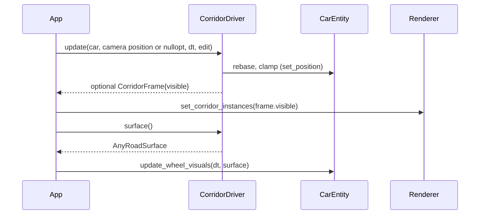

# 11: RAII and ownership

**Label:** Largely AI-generated (Claude). File:line anchors were checked against `33d2c03` on 2026-10-01. Review it
before relying on it. If this page and the code disagree, the code wins.

**Phase branch:** `refactor/11-raii-ownership`. **Kind:** refactor (behaviour-preserving). There are four
independent targets, 11a to 11d. Land each as its own commit so a failing gate points at one of them.

## 1. Concept

| Idea | Meaning |
|------|---------|
| **RAII** | The constructor acquires, the destructor releases. Cleanup runs on every exit path, exceptions included, with no flag and no `cleanup()` to forget or call twice |
| **Rule of zero** | If every member cleans itself up (`unique_ptr`, `vector`, another RAII type), write no destructor and no copy or move operations |
| **Rule of five** | A type that owns a raw handle declares or deletes all five. Delete the moves too when its **address** was given away (a C library's user pointer) |
| **Ownership in the signature** | `f(std::unique_ptr<T>)` takes ownership (a *sink*); `T*` / `T&` only look. A raw `T*` that is deleted later is a lie the compiler cannot catch |
| **Dependency inversion via a concept** | Ask for "anything with `height_at(float) -> float`" instead of a global or a concrete class; tests can pass a fake |

```cpp
#include <concepts>
#include <cstdio>
#include <memory>
#include <stdexcept>

struct File {                                    // rule of five: owns a C handle
    explicit File(const char* path) : f(std::fopen(path, "w")) { if (!f) throw std::runtime_error("open"); }
    ~File() { std::fclose(f); }
    File(const File&) = delete;  File& operator=(const File&) = delete;
    File(File&&) = delete;       File& operator=(File&&) = delete;
    std::FILE* f;
};
struct Logger { File out{"log.txt"}; };          // rule of zero: the member cleans up

template <class S> concept Surface = requires(const S& s, float x) { { s.height_at(x) } -> std::same_as<float>; };
struct Flat { float y; float height_at(float) const { return y; } };

class Car {
public:
    void  set_logger(std::unique_ptr<Logger> l) { m_log = std::move(l); }  // sink: ownership is in the type
    float snap(const Surface auto& road, float x) const { return road.height_at(x); }
private:
    std::unique_ptr<Logger> m_log;
};

int main() { Car c; c.set_logger(std::make_unique<Logger>()); std::printf("%.1f\n", c.snap(Flat{2.0f}, 9.0f)); }
```

## 2. Where Swish is today

### 11a. GLFW lifetime is a flag, not an object

[src/core/Window/Window.cpp:13-39](../../../src/core/Window/Window.cpp):

```cpp
void Window::init(uint32_t width, uint32_t height, const char* title) {
    if (!glfwInit()) { throw std::runtime_error("Failed to initialize GLFW"); }
    m_glfwInitialized = true;
    ...
void Window::cleanup() {
    if (m_window) { glfwDestroyWindow(m_window); m_window = nullptr; }
    // App::shutdown() and ~Window both call this; terminate GLFW only once.
    if (m_glfwInitialized) { glfwTerminate(); m_glfwInitialized = false; }
}
```

`~Window` calls `cleanup()` (`Window.cpp:9-11`), and so does `App::shutdown`
([src/core/App/App.cpp:238](../../../src/core/App/App.cpp)). P0.1 added `m_glfwInitialized`
([Window.h:45](../../../src/core/Window/Window.h)) as a stopgap for the double `glfwTerminate`. Construction is
two-phase (`std::make_unique<Window>()` then `init(800, 600, "swish")`, [AppInit.cpp:68-69](../../../src/core/App/AppInit.cpp)),
so a `Window` can exist with no window. That is why every getter checks `if (!m_window) throw ...`
(`Window.cpp:41-88`). `Window.h` defines `GLFW_INCLUDE_VULKAN` (`:3-4`), so no test can include it.

### 11b. The camera is handed over as a raw pointer

[src/core/App/AppInit.cpp:145](../../../src/core/App/AppInit.cpp) and `:163`:

```cpp
auto* camera = new Camera();
...                                   // set_position, set_perspective, renderer.services() ...
renderer.set_camera(camera);
```

[src/renderer/Renderer/Renderer.cpp:173-175](../../../src/renderer/Renderer/Renderer.cpp):

```cpp
void Renderer::set_camera(Camera* camera) {
    m_camera.reset(camera);
}
```

`Renderer` already owns it as `std::unique_ptr<Camera> m_camera` ([Renderer.h:169](../../../src/renderer/Renderer/Renderer.h)),
but the signature (`Renderer.h:102`) does not say so. Anything that throws between line 145 and line 163 leaks the
camera. `set_camera(&someLocal)` compiles and frees a stack object.

### 11c. A mutable global decides the road height

[src/scene/RoadGeometry/RoadGeometry.h:116-122](../../../src/scene/RoadGeometry/RoadGeometry.h):

```cpp
// Flat-surface override (Phase 3a corridor). Process-wide because
// road_surface_y is a static query called from CarEntity's wheel/body
// placement, which has no corridor handle to consult.
static bool  s_flatSurface;
static float s_flatSurfaceY;
```

| Role | Site |
|------|------|
| Writer | `CorridorDriver::set_alignment` → `RoadGeometry::set_flat_surface(m_al->road_y())` ([src/scene/Corridor/CorridorBounds.cpp:30](../../../src/scene/Corridor/CorridorBounds.cpp)) |
| Query | `RoadGeometry::road_surface_y` returns `s_flatSurfaceY` first ([RoadGeometry.cpp:25-27](../../../src/scene/RoadGeometry/RoadGeometry.cpp)) |
| Reader | App's Y-snap, `pos.y = RoadGeometry::road_surface_y(pos.x)` ([App.cpp:158](../../../src/core/App/App.cpp)) |
| Reader | `CarEntity::update_wheel_visuals`, body and corner heights ([CarEntity.cpp:320](../../../src/scene/Entity/CarEntity.cpp), `:337`) |
| Test cleanup by hand | `RoadGeometry::clear_flat_surface()` in [tests/test_corridor.cpp:488](../../../tests/test_corridor.cpp), `:504`, `:515`, `:528`, `:628` |

The tests must reset the global after themselves, or a later test sees a flat road. The override is also sticky: a
later `set_alignment` with an invalid alignment leaves the old height in place.

### 11d. A scene class pushes into the renderer every frame

[src/scene/Corridor/CorridorDriver.h:62](../../../src/scene/Corridor/CorridorDriver.h):

```cpp
void update(CarEntity& car, Renderer& renderer, float deltaTime, bool debugEdit);
```

It includes `renderer/Renderer/Renderer.h` and `scene/Camera/Camera.h` (`CorridorDriver.cpp:3-4`), reads the camera
through the renderer (`:121`) and writes the visible window back (`:142`):

```cpp
const Vec3 camPos = renderer.get_camera() ? renderer.get_camera()->get_position() : pos;
...
renderer.set_corridor_instances(visible);
```

[CODING_RULES](../../CODING_RULES.md) allows scene code to call the renderer's public API to upload data. A
per-frame step that reads renderer state and writes it back is different: it couples the corridor to the renderer
and keeps it out of the test binary ([tests/CMakeLists.txt:26-31](../../../tests/CMakeLists.txt)). Note too that
`pos` here is the car position **after** the rebase and clamp above it.

## 3. Target design

### 11a. `GlfwContext` + RAII `Window`

```cpp
// src/core/GlfwContext/GlfwContext.h   (no GLFW include; header-only template + one .cpp for GlfwApi)
template <class A>
concept WindowSystemApi = requires {
    { A::init() } -> std::same_as<bool>;
    { A::terminate() } -> std::same_as<void>;
};

template <WindowSystemApi Api>
class BasicGlfwContext {
public:
    BasicGlfwContext();                                   // Api::init(); throws std::runtime_error on false
    ~BasicGlfwContext();                                  // Api::terminate()
    BasicGlfwContext(const BasicGlfwContext&)            = delete;
    BasicGlfwContext& operator=(const BasicGlfwContext&) = delete;
    BasicGlfwContext(BasicGlfwContext&&)                 = delete;
    BasicGlfwContext& operator=(BasicGlfwContext&&)      = delete;
};

struct GlfwApi { static bool init(); static void terminate(); };   // GlfwContext.cpp: glfwInit / glfwTerminate
using GlfwContext = BasicGlfwContext<GlfwApi>;
```

```cpp
// src/core/Window/Window.h
class Window {
public:
    Window(uint32_t width, uint32_t height, const char* title);   // acquires; throws
    Window(const Window&) = delete;  Window& operator=(const Window&) = delete;
    Window(Window&&) = delete;       Window& operator=(Window&&) = delete;  // GLFW holds `this`
    // no destructor: rule of zero; no init(), no cleanup()
private:
    struct GlfwWindowDeleter { void operator()(GLFWwindow* w) const noexcept; };
    GlfwContext                                    m_glfw;    // first: built first, destroyed last
    std::unique_ptr<GLFWwindow, GlfwWindowDeleter> m_window;
    bool                                           m_resized = false;
};
```

### 11b. Camera as a sink

```cpp
void    set_camera(std::unique_ptr<Camera> camera);   // Renderer owns it from here on
Camera* get_camera() const;                           // unchanged: a non-owning view
```

### 11c. `RoadSurface` instead of a global

```cpp
// src/scene/RoadGeometry/RoadSurface.h   (header-only)
template <class S>
concept RoadSurface = std::copyable<S> && requires(const S& s, float x) {
    { s.height_at(x) } noexcept -> std::same_as<float>;
};

struct CrownedSurface { float height_at(float x) const noexcept; };          // RoadGeometry::crown_surface_y(x)
struct FlatSurface    { float y = 0.0f; float height_at(float) const noexcept; };

using AnyRoadSurface = std::variant<CrownedSurface, FlatSurface>;
float height_at(const AnyRoadSurface& road, float x) noexcept;              // one std::visit

static float   RoadGeometry::crown_surface_y(float x);   // old road_surface_y minus its flat branch; the rest is deleted
AnyRoadSurface CorridorDriver::surface() const;          // FlatSurface{m_al->road_y()} if valid, else CrownedSurface{}
void           CarEntity::update_wheel_visuals(float dt, const AnyRoadSurface& road);
```

### 11d. `CorridorDriver::update` returns a value

```cpp
struct CorridorFrame { std::vector<CorridorInstance> visible; };

// nullopt = "no valid alignment, push nothing" (today's early return pushes nothing either)
[[nodiscard]] std::optional<CorridorFrame> update(CarEntity& car, std::optional<Vec3> camera_pos, float dt,
                                                   bool debug_edit);
```



## 4. Exercise

1. **11a, `GlfwContext`.** Scaffold with `make new-class NAME=GlfwContext DIR=core`. Write the concept, the class
   template and `GlfwApi`. Keep `<GLFW/glfw3.h>` out of the header so a test can include it. *Hint:* the
   constructor must not call `terminate()` when `init()` fails; it throws before the object exists, so the
   destructor never runs.
2. **11a, `Window`.** Turn `init` into the constructor and delete `cleanup`, `m_glfwInitialized` and the
   `if (!m_window) throw` checks that the constructor now makes impossible. Write a deleter struct for the window
   handle. Change `AppInit.cpp:68-69` to `std::make_unique<Window>(800, 600, "swish")` and remove
   `m_window->cleanup()` from `App::shutdown`. Check that `m_window` is still App's first member
   ([App.h:50](../../../src/core/App/App.h)), so it is destroyed last, after the renderer has released the surface.
3. **11b, camera.** Change the signature and the definition. In `build_road_scene` use `std::make_unique<Camera>()`
   and read `get_fov()` for `set_base_fov` **before** `std::move`.
4. **11c, `RoadSurface`.** Write `RoadSurface.h`. Add `crown_surface_y` with the crown part of `road_surface_y`
   copied verbatim, and commit it with the temporary bit-for-bit test from section 5 while the old function still
   exists. Add `CorridorDriver::surface()`. Pass the surface to `update_wheel_visuals` and use
   `height_at(m_corridor.surface(), pos.x)` for App's Y-snap. Then delete the two statics and their four functions.
   *Hint:* the compiler lists every remaining reader for you.
5. **11c, tests.** Rewrite the three `test_corridor.cpp` cases that relied on the global (see section 5). Delete
   the `clear_flat_surface()` calls.
6. **11d, `CorridorDriver`.** Change `update` to return `std::optional<CorridorFrame>`. Inside, use
   `camera_pos.value_or(pos)` at the same point as today, so the fallback is still the rebased, clamped position.
   Drop the two includes. In `App::step_car_simulation` pass the camera position (or `std::nullopt` if there is no
   camera) and push `frame->visible` only when the optional has a value.
7. **11d, test build.** `CorridorDriver.cpp` no longer needs Vulkan. Add it to the test sources (or to the P0.3
   `swish_scene_core` library) and delete the comment at `tests/CMakeLists.txt:26-31`.
8. **Docs.** Fix the comments that describe the old design: `RoadGeometry.h:91-97`, `App.cpp:153-156`,
   `CorridorBounds.cpp:6-14,23-29`, `RoadParams.h:34` and `CorridorDriver.h:60-61` (which also wrongly says `update`
   snaps Y). The docs scribe updates `docs/REPO_MAP.md`, `docs/DIRECTORY.md` and the live docs that name
   `road_surface_y` (`src/scene/README.md`, `docs/endless-road.md`, `docs/phase-3-osm-lie-corridor.md`,
   `docs/wheels/README.md`, `docs/lessons-from-chrono/01-architecture.md`); changelog history and `archive/` stay.

## 5. Tests you must turn green

New file `tests/test_ownership.cpp`, tag `[raii]`. It includes `core/GlfwContext/GlfwContext.h` and
`scene/RoadGeometry/RoadSurface.h` only. Use a `FakeApi` with static counters.

| TEST_CASE | Asserts |
|-----------|---------|
| `"GlfwContext is neither copyable nor movable"` | `STATIC_REQUIRE` the four `is_*_constructible_v` / `is_*_assignable_v` are false |
| `"A context calls init once and terminate once"` | construct and destroy `BasicGlfwContext<FakeApi>` in a scope: `init_calls == 1`, `terminate_calls == 1` |
| `"A context whose init fails throws and never terminates"` | `FakeApi::init` returns false: `REQUIRE_THROWS_AS(..., std::runtime_error)`, `terminate_calls == 0` |
| `"Terminate runs while an exception unwinds"` | throw inside the scope that holds the context, catch outside: `terminate_calls == 1` |
| `"Road surfaces satisfy RoadSurface"` | `STATIC_REQUIRE(RoadSurface<FlatSurface> && RoadSurface<CrownedSurface> && !RoadSurface<int>)` |
| `"FlatSurface returns its height everywhere"` | the same `y` at x = -250000, 0 and 6501 |
| `"crown_surface_y matches the old road_surface_y, bit for bit"` | **temporary**, in the commit before the deletion: with the flat override cleared, `==` (not `Approx`) over a sweep of x covering westbound, eastbound, service road and exit ramp. Delete it together with `road_surface_y` |
| `"CrownedSurface forwards to crown_surface_y"` | `==` at the same x values; this one stays |
| `"height_at dispatches to the active alternative"` | an `AnyRoadSurface` holding each alternative gives that alternative's result |

Changes in `tests/test_corridor.cpp`, tags `[corridor][driver]`:

| TEST_CASE | Asserts |
|-----------|---------|
| `"driver: surface() is flat at the asset's roadY once an alignment is attached"` | replaces `"driver: attaching an alignment redirects the surface-height query"` (`:507-531`) |
| `"driver: without a valid alignment the surface is crowned"` | a fresh `CorridorDriver` gives a `CrownedSurface` |
| `"driver: two drivers keep their own surfaces"` | two synthetic alignments with different `road_y()`; each driver reports its own. This test could not exist with a global |
| `"driver: update returns the visible window without a Renderer"` | synthetic alignment + placements: `update` returns a frame whose `visible` holds the segment near the car |
| `"driver: update without a valid alignment returns nullopt"` | `!update(...).has_value()` |

## 6. Gate

- `make test` and `make test-debug` green, 0 warnings.
- `(cd build/shaders && shasum -a 256 -c ../../tests/golden/release_spv.sha256)`: 33 of 33 OK.
- `make check` and `make format-check` clean. Mesh and car goldens unchanged: the mesh generators never call
  `road_surface_y`, and the golden car never calls `update_wheel_visuals`.
- Chapter-specific:
  - `grep -rnE "new Camera|s_flatSurface|set_flat_surface|clear_flat_surface|road_surface_y" src tests` prints nothing.
  - `grep -rnE "glfwInit|glfwTerminate" src` shows only `GlfwContext.cpp`.
  - `grep -n "renderer/" src/scene/Corridor/*` prints nothing.
  - One run of a `-DCMAKE_BUILD_TYPE=Debug` build (validation layers on): start, drive, resize, close the window.
    0 validation messages; teardown order is the thing this chapter touches.
  - Release run: drive the corridor, take window-only screenshots at rain 0 and 1.0, and compare them with the
    baseline. The wheels should sit on the road exactly as before.
  - Arch GCC builds and the `[raii]` and `[corridor]` tests pass.

## 7. Pitfalls

- **`unique_ptr<GLFWwindow, decltype(&glfwDestroyWindow)>` trips GCC** (`-Wignored-attributes` under `-Werror`), the
  same problem [DESIGN_PATTERNS.md](../../DESIGN_PATTERNS.md) records for `fclose`. Use a small deleter struct. It is
  also zero-size, where a function pointer adds 8 bytes.
- **Member order is destruction order.** `m_glfw` must be declared before `m_window`, and `m_window` must stay App's
  first member. The Vulkan surface is destroyed in `Renderer::cleanup`, which must run while the GLFW window still
  exists.
- **Delete the moves, not only the copies.** App and Window register `this` as the GLFW user pointer
  ([AppInit.cpp:76](../../../src/core/App/AppInit.cpp), `Window.cpp:25`). A moved-from object would leave GLFW
  calling into a dead address.
- **Keep the fallback position exact.** If App computed the "no camera" fallback from the car position before
  calling `update`, it would use the position before the rebase. Passing `std::optional<Vec3>` and resolving it at
  today's line keeps it identical.
- **Pushing an empty list is not the same as pushing nothing.** Today's early return leaves the renderer's last
  instance list alone. Returning an empty `CorridorFrame` instead of `nullopt` would clear it.
- **Do not template `CarEntity` on the surface.** A constrained member template would have to live in the header.
  The closed `std::variant` keeps `update_wheel_visuals` in the `.cpp`, and the concept still pins what each
  alternative must provide.

## 8. Solution

<details><summary>Solution</summary>

_Written after you finish the exercise (or ask for it)._

</details>

## 9. Further reading

- [RAII](https://en.cppreference.com/w/cpp/language/raii)
- [The rule of three/five/zero](https://en.cppreference.com/w/cpp/language/rule_of_three)
- [std::unique_ptr](https://en.cppreference.com/w/cpp/memory/unique_ptr) and [std::make_unique](https://en.cppreference.com/w/cpp/memory/unique_ptr/make_unique)
- [Constraints and concepts](https://en.cppreference.com/w/cpp/language/constraints) and [std::copyable](https://en.cppreference.com/w/cpp/concepts/copyable)
- [Non-static member initialisation order](https://en.cppreference.com/w/cpp/language/constructor#Initialization_order)
