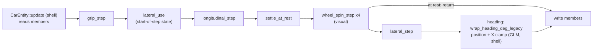

# 12: Pure step functions

**Label:** Largely AI-generated (Claude). File:line anchors were checked against `33d2c03` on 2026-10-01. Review it
before relying on it. If this page and the code disagree, the code wins.

**Phase branch:** `refactor/12-pure-steps`. **Kind:** refactor. The car's trajectory must stay **bit-identical**.
If the bits move, stop: the work becomes a **B12** phase with an intended golden update, a changelog entry and a
reviewed diff. **Assumes** P0.4 replaced `#define private public` in `tests/test_golden_car.cpp` with a test
accessor, and chapter 07 gave `CarEntity` a `handle_input(const DriveIntent&, dt)`.

## 1. Concept

**Functional core, imperative shell.** Keep the maths in **pure step functions**:

```cpp
State step(State s, const Input& in, const Params& p, float dt);   // no members, no globals, no I/O
```

The class around them (the shell) owns the state, reads input and writes results. It calls the steps in a fixed
order and does nothing clever itself. Pure steps can be tested one at a time with hand-built inputs, reused (a
replay, a second car, an AI driver), and checked for determinism: the same inputs give the same bits.

```cpp
#include <cstdio>

struct Body   { float v = 0.0f; float x = 0.0f; };
struct Input  { float throttle = 0.0f; };
struct Params { float accel = 4.0f; float drag = 0.1f; };

// Functional core: no members, no globals, no I/O.
constexpr Body step(Body b, Input in, const Params& p, float dt) {
    const float a = p.accel * in.throttle - p.drag * b.v;
    b.v += a * dt;
    b.x += b.v * dt;
    return b;
}

class Car {  // imperative shell: owns the state, calls the core
public:
    void  update(float throttle, float dt) { m_body = step(m_body, {throttle}, m_params, dt); }
    float x() const { return m_body.x; }
private:
    Body m_body; Params m_params;
};

static_assert(step(Body{}, Input{1.0f}, Params{}, 0.5f).v == 2.0f);

int main() { Car c; for (int i = 0; i < 60; ++i) c.update(1.0f, 1.0f / 60.0f); std::printf("%.4f\n", c.x()); }
```

### Why moving float code can change the bits

Real numbers obey $(a+b)+c = a+(b+c)$. Floats do not, because every operation rounds. Three ways a "pure move"
silently changes results:

1. **FMA contraction.** A fused multiply-add rounds once:
   $$\operatorname{fma}(a,b,c) = \operatorname{rnd}(a\,b + c) \quad\ne\quad \operatorname{rnd}(\operatorname{rnd}(a\,b) + c).$$
   Clang's default `-ffp-contract=on` fuses `a * b + c` only **within one source expression**. Today's
   `v_mps += longitudinal_accel(...) * dt;` ([CarEntity.cpp:141-143](../../../src/scene/Entity/CarEntity.cpp)) can
   become one `fma`. Rewrite it as `const float dv = longitudinal_accel(...) * dt; v_mps += dv;` and it cannot,
   so the bits change. A helper that returns `a * dt` for the caller to add has the same effect, even after
   inlining. GCC in GNU mode (`-std=gnu++23`, what CMake picks while `CMAKE_CXX_EXTENSIONS` is on) defaults to
   `-ffp-contract=fast` and fuses across statements, which is one reason the goldens are bound to Clang.
2. **Reassociation by hand.** `(vx / wheelbase_m) * std::tan(delta)` (`:210`) and `vx * std::tan(delta) / wheelbase_m`
   are the same real number but not the same float. The compiler will not reorder this without `-ffast-math`. You
   might, while tidying.
3. **Round trips that look like identities.** `update()` stores speed in WU (`:158`) and divides it back to m/s for
   the lateral block (`:209`): `vx = m_forward_speed / kWorldUnitsPerMeter`. In floats,
   $\operatorname{rnd}(\operatorname{rnd}(v \cdot 1000) / 1000)$ is not guaranteed to equal $v$. Passing the
   longitudinal step's `v_mps` straight into the lateral step "because it is the same value" can change the result.

## 2. Where Swish is today

**`CarEntity::update` is 229 lines** ([src/scene/Entity/CarEntity.cpp:48-276](../../../src/scene/Entity/CarEntity.cpp)),
one function that mixes grip, both axes, a dead-stop rule, wheel visuals and pose integration:

| Lines | Block | Reads | Writes |
|-------|-------|-------|--------|
| 59-63 | locals: default `TireParams`, `GearboxParams`, `DrivetrainParams`; `v_mps` from WU | `m_forward_speed` | |
| 72-90 | wet grip, `CarParams params` with `tireMu` | `m_wetness`, `m_position`, `m_lateral_velocity` | `m_effective_mu`, `m_plane_frac` |
| 117-122 | lateral use of the friction circle (start-of-step state) | steer, lateral state, `m_long_force` | `latUse` |
| 124-156 | longitudinal: reverse creep, or gearbox + drive/brake + transport term + brake stop | `m_throttle`, `m_brake`, `m_reverse` | `v_mps`, `m_gear_state`, `m_long_force` |
| 158-164 | back to WU + NaN guard | | `m_forward_speed` |
| 176-182 | dead stop when genuinely at rest; gearbox to 1st | all motion state | speed, lateral, yaw, gear |
| 189-193 | road-wheel spin (visual only) | `m_forward_speed` | `m_wheel_spin` |
| 198-199 | early return when at rest | | |
| 207-261 | lateral and yaw: kinematic below 5 m/s, dynamic bicycle above, blend, rate-limited clamps | | `m_lateral_velocity`, `m_yaw_rate` |
| 263-275 | heading, wrap, position, world-X clamp | | `m_rotation.y`, `m_position` |

**Pure steps already exist next to it** in `src/scene/Entity/`. They are the pattern to copy:

| Function | Where | Shape |
|----------|-------|-------|
| `gearbox_shift_step(GearState, v, GearboxParams, rWheel, dt) -> GearState` | [Powertrain.h:170-191](../../../src/scene/Entity/Powertrain.h) | state in, state out (chapter 05 rebuilds it on `swish::fsm`) |
| `wheel_spin_step(theta, v, r, dt) -> float` | [WheelKinematics.h:30-32](../../../src/scene/Entity/WheelKinematics.h) | state in, state out |
| `suspension_step` / `suspension_advance(CornerSpring, ...) -> CornerSpring` | `WheelKinematics.h:210-249` (state struct at `:42-45`) | state in, state out, with substeps |
| `dynamic_bicycle_deriv(...) -> BicycleDeriv` | [Bicycle.h:15-18](../../../src/scene/Entity/Bicycle.h), `:217-226` | a **derivative**; the integration still happens in `CarEntity.cpp:230-233` |
| `longitudinal_accel(..., AxleLongitudinal* split = nullptr) -> float` | [Longitudinal.h:85-88](../../../src/scene/Entity/Longitudinal.h) | pure apart from an **out-parameter** |

**Three angle-wrap idioms** (four, counting the wiper):

| Site | Code | Range claimed | Range in fact |
|------|------|---------------|---------------|
| [Smoothing.h:66](../../../src/utils/math/Smoothing.h) | `std::fmod(target - x + 540.0f, 360.0f) - 180.0f` | (-180, 180] | as claimed while `target - x >= -540` |
| [CarEntity.cpp:265](../../../src/scene/Entity/CarEntity.cpp) | `std::fmod(m_rotation.y + 180.f, 360.f) - 180.f` | ±180 (comment at `:263`) | **(-540, 180)**: `fmod` keeps the dividend's sign |
| [WheelKinematics.h:21-24](../../../src/scene/Entity/WheelKinematics.h) | `fmod`, then `+ kTwoPi` if negative | [0, 2π) | as claimed |
| `WindshieldRainPass.cpp:123-124` | `if (phase > kTwoPi) phase -= kTwoPi;` | | one subtraction; correct only while the step is below 2π |

**The heading wrap is wrong for right turns, and the golden pins it.** A right turn lowers `m_rotation.y`. Once it
passes -180, `fmod` of a negative number stays negative, so the "wrapped" heading keeps falling until -540. The car
golden records this: `steady_turn_dry` at step 690 has `yawDeg = -306.68567`
([tests/golden/car_trajectory.csv:64](../../../tests/golden/car_trajectory.csv)). Two docs repeat the wrong
claim: `src/scene/README.md:72-74` says "wrapped to $(-180°, 180°]$", and `Smoothing.h:63-65` calls it "the same
wrap-to-range trick CarEntity.h uses" (the line is in `CarEntity.cpp`, and the range is not the same). Position is unaffected (`cos`/`sin` do not
care), and the cockpit camera uses the shortest-arc delta, so nothing visible breaks. But a correct wrap would change
the golden.

**The golden is a tolerance check, not a bit check.** `test_golden_car.cpp:137-143` accepts `1e-3 + 1e-3·|e|`
([tests/golden/README.md:9](../../../tests/golden/README.md)). A refactor that moved one ULP would pass it. "Bit
identical" needs its own test (section 5).

## 3. Target design

```cpp
// src/scene/Entity/CarStep.h   (pure, SI, no GLM, no GLFW: the same contract as CarPhysics.h)
struct DriveInput { float throttle; float brake; bool reverse; float steer_deg; };
struct GripState  { float effective_mu; float plane_frac; };
struct LatState   { float vl_mps; float yaw_rate; };
struct LongState  { float forward_speed_wu; GearState gear; AxleLongitudinal long_force; };

struct CarStepParams {
    TireParams tire; GearboxParams gearbox; DrivetrainParams drivetrain; WetGripParams wet;
    float r_wheel_rear; float max_steer_deg; float max_reverse_speed_wu; float reverse_accel_wu;
};

GripState   grip_step(float wetness, float film_over_tread, float v_mps, const LatState& lat,
                      const WetGripParams& wet) noexcept;                                   // lines 72-87
CarParams   car_params_for(const GripState& g) noexcept;                                    // lines 89-90
AxleLateral lateral_use(float v_mps, const LatState& lat, const DriveInput& in, const GripState& g,
                        const LongState& lon, const CarStepParams& p) noexcept;              // lines 117-122
LongState   longitudinal_step(LongState lon, const DriveInput& in, const LatState& lat, AxleLateral lat_use,
                              const GripState& g, const CarStepParams& p, float dt) noexcept; // lines 124-164
bool        settle_at_rest(LongState& lon, LatState& lat, const DriveInput& in) noexcept;   // lines 176-182
LatState    lateral_step(LatState lat, float forward_speed_wu, const DriveInput& in, const GripState& g,
                         const LongState& lon, const CarStepParams& p, float dt) noexcept;   // lines 207-261
```

The signatures are a starting point. The rule that matters is that **each step takes the value in the form the code
has at that line**. For example, `lateral_step` takes `forward_speed_wu` and does the `/ kWorldUnitsPerMeter` itself,
exactly as line 209 does today.

```cpp
// src/utils/math/Angle.h   namespace swish::util::math, std + Units.h only
float wrap_2pi(float rad) noexcept;                        // [0, 2π): WheelKinematics.h:21-24 verbatim
float shortest_delta_deg(float from, float to) noexcept;   // Smoothing.h:66 verbatim
float wrap_heading_deg_legacy(float deg) noexcept;         // CarEntity.cpp:265 verbatim; range (-540, 180)
float wrap_deg_180(float deg) noexcept;                    // the correct (-180, 180]; first user is B12
```

`wrap_angle_2pi` in `WheelKinematics.h` and the expression in `exp_smooth_angle_deg` become calls to these.



After the split, `CarEntity::update` is a shell of about 30 lines: copy the members into the state structs, call
the steps in this order, and write the results back. Heading and position stay in `CarEntity.cpp` because they use
GLM. A file-local function in an anonymous namespace is enough.

## 4. Exercise

1. **Bit-exact baseline first.** Before you touch `CarEntity.cpp`, make sure the bit-exact fixture from section 5
   exists and passes on the unchanged code. Claude records it from the phase's base commit when scaffolding. Never
   regenerate it on the branch.
2. **`Angle.h`.** Create `src/utils/math/Angle.h` with the standard doc block (Purpose / Units / Complexity /
   Precision / Example / See also / Test) and `tests/utils/test_math_Angle.cpp`. Copy each expression verbatim.
   Name the 180 and 360 constants once in the header and do not re-type pi (use `util::units::kTwoPi`). Then point
   `WheelKinematics.h` and `Smoothing.h` at it, and **replace** the comment at `Smoothing.h:62-65` rather than
   adding to it.
3. **`CarStep.h`, one block at a time.** Move one row of the table in section 2 per commit, from the top down. After
   each move, run `./build/tests/swish_tests "[golden][car]"`. *Hint:* if a commit breaks the bit test, the cause is
   almost always one of the three in section 1. Compare the expression you moved with the original, operator by
   operator.
4. **Keep the duplicates that look redundant.** `delta` is computed at line 119 and again at line 208 from the same
   steering angle, and `v_body` (`:81`) and `v_body_lat` (`:217`) look alike but use different speeds. Merge only
   what is provably the same value from the same expression; leave the speeds separate.
5. **Do not fix `longitudinal_accel`'s out-parameter here.** Returning a struct would touch many tests in
   `test_car_physics.cpp`. Note it for chapter 15 or a cleanup.
6. **Shell.** Rewrite `CarEntity::update` as the sequence in the diagram. Keep the early return at the same point,
   so wheel spin still runs and the lateral block still does not run when the car is at rest.
7. **Heading.** Call `util::math::wrap_heading_deg_legacy`. Add a comment that names B12 and the golden row that
   pins the old range.
8. **B12 (separate branch, only if the owner wants it).** Switch to `wrap_deg_180`, regenerate the car golden with
   `SWISH_UPDATE_GOLDENS=1`, review the diff (the `yawDeg` column of both steady-turn scenarios jumps by 360 after
   about 6 s; `x`/`z` may move by ULPs), fix `src/scene/README.md:72-74`, and write the changelog entry.

## 5. Tests you must turn green

**Bit-exact trajectory.** Add to `tests/test_golden_car.cpp`, tags `[golden][car][bits]`:

| TEST_CASE | Asserts |
|-----------|---------|
| `"Golden trajectory: bit-exact against the pre-split baseline"` | every 30 steps of the four scenarios, each state field printed with `%a` (hex float) or compared as `std::bit_cast<uint32_t>`, matches `tests/golden/car_trajectory_bits.txt` exactly. Guard it with `#if defined(__clang__)`, like the P0.3 mesh guard |

The existing `"Golden trajectory: real CarEntity::update"` and `"... sanity invariants ..."` stay unchanged and green.

**Steps in isolation.** New `tests/test_car_step.cpp`, tags `[car][step]`. Hand-built states only:

| TEST_CASE | Asserts |
|-----------|---------|
| `"Steps are deterministic"` | each step called twice with the same inputs gives `bit_cast`-equal outputs |
| `"longitudinal_step from rest at full throttle gains speed in 1st"` | speed > 0, `gear.gear == 0` after one step |
| `"Reverse creep is capped at the reverse speed limit"` | many reverse steps never go below `-max_reverse_speed_wu` |
| `"Braking stops at zero instead of reversing"` | dry (`plane_frac == 0`), brake from a small speed: exactly 0, not negative |
| `"settle_at_rest resets the gearbox only when genuinely at rest"` | true and `gear == GearState{}` at rest; false while `vl_mps` or `yaw_rate` is above the rest thresholds |
| `"lateral_step below the blend speed is kinematic"` | `vl_mps == 0` and `yaw_rate == r_kin` exactly |
| `"lateral_step stays at zero on a straight dry road"` | zero steer and zero lateral state stay exactly zero |
| `"Shell equals steps"` | N steps of `CarEntity::update` (through the P0.4 accessor) equal the same N calls of the pure sequence, bit for bit |

**Angles.** New `tests/utils/test_math_Angle.cpp`, tag `[angle]`, in `swish_utils_tests`:

| TEST_CASE | Asserts |
|-----------|---------|
| `"wrap_2pi matches the old wrap_angle_2pi bit for bit"` | sweep with negatives, exact multiples of 2π and `-0.0f` |
| `"shortest_delta_deg matches the old Smoothing.h expression"` | sweep of `(from, to)` pairs including the 179/-179 wrap |
| `"wrap_heading_deg_legacy keeps today's range"` | -190 stays -190; -541 becomes -181; 190 becomes -170 |
| `"wrap_deg_180 lands in (-180, 180]"` | -190 gives 170, 180 gives 180, -180 gives 180, 540 gives 180 |

`tests/utils/test_math_Smoothing.cpp` and the wheel-spin tests in `tests/test_car_physics.cpp` stay unchanged and
green.

`static_assert`s that must hold:

```cpp
static_assert(std::is_trivially_copyable_v<LongState> && std::is_aggregate_v<LongState>);
static_assert(std::is_trivially_copyable_v<LatState> && std::is_trivially_copyable_v<GripState>);
static_assert(std::is_trivially_copyable_v<DriveInput>);
```

## 6. Gate

- `make test` and `make test-debug` green, 0 warnings.
- `(cd build/shaders && shasum -a 256 -c ../../tests/golden/release_spv.sha256)`: 33 of 33 OK.
- `make check` and `make format-check` clean. Mesh goldens unchanged.
- Chapter-specific:
  - `"Golden trajectory: bit-exact against the pre-split baseline"` passes in **both** `build/` (Release) and
    `build-debug/` (RelWithDebInfo). If it fails, this is not a refactor: stop and either find the expression that
    moved or re-plan the phase as B12.
  - `git diff --stat` shows no change under `tests/golden/`.
  - `grep -rn "std::fmod(" src/utils/math/Smoothing.h src/scene/Entity/` prints nothing: the wraps live in
    `Angle.h` only.
  - `CarEntity::update` is under 40 lines.
  - Release drive: a full-lock right turn and a straight launch look and feel the same as the baseline binary
    (window-only screenshots at rain 0 and 1.0).
  - Arch GCC builds and the `[car][step]` and `[angle]` tests pass. The `[bits]` case is skipped there by design.
  - Ask `vehicle-dynamics-engineer` to review the split.

## 7. Pitfalls

- **Contraction follows source expressions.** Under Clang's `-ffp-contract=on`, `x + a * b` written as one
  expression may become one `fma`; the same maths spread over two statements or two functions will not. Move whole
  expressions, and never split one into a named temporary "for readability" in this phase.
- **Do not "fix" the heading wrap in passing.** `wrap_deg_180` is the correct function, and using it in this
  phase changes the golden's `yawDeg` column by 360. That is B12.
- **Keep the WU and SI round trips.** Lines 63, 158, 190 and 209 convert speed between WU and m/s. Each is a
  rounding point. Leave every one where it is, even the ones that look redundant.
- **`Quantity<Tag>` stays outside.** Chapter 03's strong units belong on `CarEntity`'s public API. Inside the steps,
  use raw `float`: a wrapper's operators are separate functions, which changes what can be contracted.
- **Default-constructed params are part of the behaviour.** `update()` builds `TireParams`, `GearboxParams`,
  `DrivetrainParams` and `CarParams` from defaults every call (`:59-61`, `:89`). If you store them in
  `CarStepParams`, build them from the same defaults and give `tireMu` the same per-frame value.
- **The golden tolerance hides drift.** A green `"Golden trajectory: real CarEntity::update"` does not prove the
  refactor. Only the bit-exact case does.

## 8. Solution

<details><summary>Solution</summary>

_Written after you finish the exercise (or ask for it)._

</details>

## 9. Further reading

- [std::fmod](https://en.cppreference.com/w/cpp/numeric/math/fmod) (note the sign of the result) and [std::remainder](https://en.cppreference.com/w/cpp/numeric/math/remainder)
- [std::fma](https://en.cppreference.com/w/cpp/numeric/math/fma)
- [std::bit_cast](https://en.cppreference.com/w/cpp/numeric/bit_cast)
- [Floating-point environment](https://en.cppreference.com/w/cpp/numeric/fenv) and [std::numeric_limits::epsilon](https://en.cppreference.com/w/cpp/types/numeric_limits/epsilon)
- [printf `%a` (hexadecimal floating point)](https://en.cppreference.com/w/cpp/io/c/fprintf)
